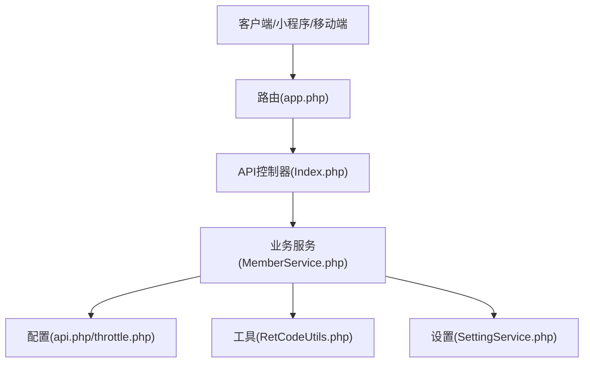
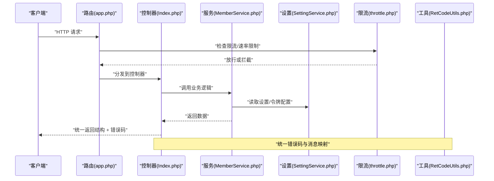
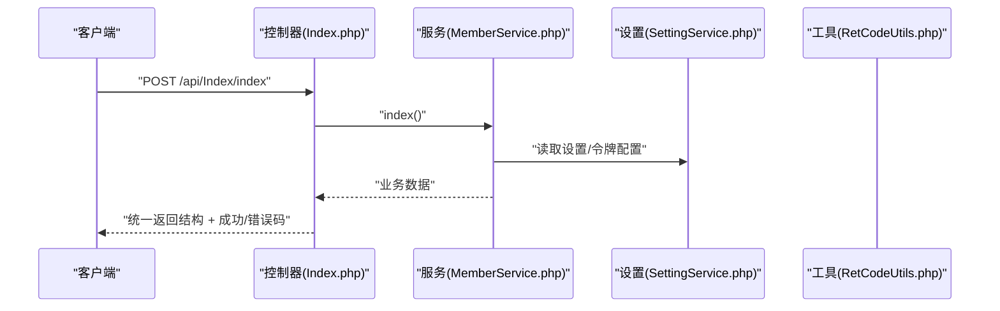
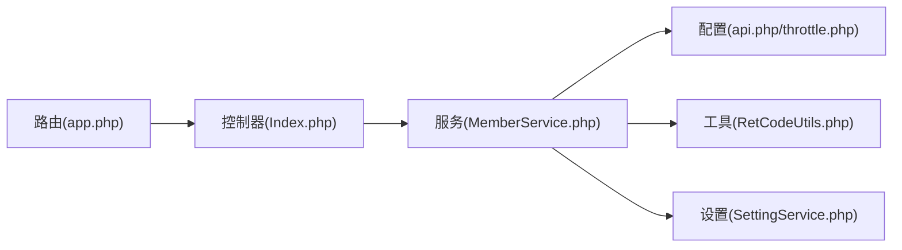

# API接口文档

<cite>
**本文引用的文件**
- [gccd_server/config/api.php](file://gccd_server/config/api.php)
- [gccd_server/config/throttle.php](file://gccd_server/config/throttle.php)
- [gccd_server/app/api/controller/Index.php](file://gccd_server/app/api/controller/Index.php)
- [gccd_server/app/common/service/member/MemberService.php](file://gccd_server/app/common/service/member/MemberService.php)
- [gccd_server/app/common/service/member/SettingService.php](file://gccd_server/app/common/service/member/SettingService.php)
- [gccd_server/app/common/service/utils/RetCodeUtils.php](file://gccd_server/app/common/service/utils/RetCodeUtils.php)
- [gccd_server/route/app.php](file://gccd_server/route/app.php)
</cite>

## 目录
1. [简介](#简介)
2. [项目结构](#项目结构)
3. [核心组件](#核心组件)
4. [架构总览](#架构总览)
5. [详细组件分析](#详细组件分析)
6. [依赖关系分析](#依赖关系分析)
7. [性能考虑](#性能考虑)
8. [故障排查指南](#故障排查指南)
9. [结论](#结论)
10. [附录](#附录)

## 简介
本文件为“高齿传动”项目的API接口文档，面向后端服务与前端/移动端/第三方客户端开发者，提供统一的RESTful API设计规范、认证授权机制、接口清单、版本与兼容策略、测试与调试方法、性能优化建议以及API网关与限流策略说明。项目基于ThinkPHP框架与yylAdmin生态，采用统一返回结构与统一错误码体系，支持多种登录方式与第三方授权登录。

## 项目结构
- 后端服务位于 gccd_server，包含路由、配置、控制器、服务层、中间件与工具类。
- API相关配置集中在 config/api.php 与 config/throttle.php。
- 控制器示例位于 app/api/controller/Index.php。
- 登录、会话与设置逻辑位于 app/common/service/member/*。
- 统一返回与错误码位于 app/common/service/utils/RetCodeUtils.php。
- 路由定义文件位于 route/app.php。

图表来源
- [gccd_server/route/app.php:1-10](file://gccd_server/route/app.php#L1-L10)
- [gccd_server/app/api/controller/Index.php:1-37](file://gccd_server/app/api/controller/Index.php#L1-L37)
- [gccd_server/app/common/service/member/MemberService.php:1-800](file://gccd_server/app/common/service/member/MemberService.php#L1-L800)
- [gccd_server/app/common/service/member/SettingService.php:1-400](file://gccd_server/app/common/service/member/SettingService.php#L1-L400)
- [gccd_server/app/common/service/utils/RetCodeUtils.php:1-85](file://gccd_server/app/common/service/utils/RetCodeUtils.php#L1-L85)
- [gccd_server/config/api.php:1-59](file://gccd_server/config/api.php#L1-L59)
- [gccd_server/config/throttle.php:1-79](file://gccd_server/config/throttle.php#L1-L79)

章节来源
- [gccd_server/route/app.php:1-10](file://gccd_server/route/app.php#L1-L10)
- [gccd_server/app/api/controller/Index.php:1-37](file://gccd_server/app/api/controller/Index.php#L1-L37)

## 核心组件
- 统一返回结构与错误码：所有接口遵循统一的成功/失败结构与错误码常量，便于前端统一处理。
- 配置中心：API令牌方式、令牌名、免登录/免权限/免限流URL白名单、日志排除字段等。
- 限流策略：基于访问来源IP、用户ID与接口URL维度的精细化限流，支持多种算法。
- 登录与会话：支持账号密码登录、第三方授权登录（微信、QQ、微博等），并生成统一令牌返回。
- 设置服务：提供平台、应用类型、令牌有效期、默认头像等配置读取与缓存。

章节来源
- [gccd_server/app/common/service/utils/RetCodeUtils.php:1-85](file://gccd_server/app/common/service/utils/RetCodeUtils.php#L1-L85)
- [gccd_server/config/api.php:1-59](file://gccd_server/config/api.php#L1-L59)
- [gccd_server/config/throttle.php:1-79](file://gccd_server/config/throttle.php#L1-L79)
- [gccd_server/app/common/service/member/MemberService.php:426-570](file://gccd_server/app/common/service/member/MemberService.php#L426-L570)
- [gccd_server/app/common/service/member/SettingService.php:274-341](file://gccd_server/app/common/service/member/SettingService.php#L274-L341)

## 架构总览
下图展示从客户端到控制器、服务层与配置的交互关系，以及限流与错误码的贯穿。

图表来源
- [gccd_server/route/app.php:1-10](file://gccd_server/route/app.php#L1-L10)
- [gccd_server/app/api/controller/Index.php:1-37](file://gccd_server/app/api/controller/Index.php#L1-L37)
- [gccd_server/app/common/service/member/MemberService.php:1-800](file://gccd_server/app/common/service/member/MemberService.php#L1-L800)
- [gccd_server/app/common/service/member/SettingService.php:274-341](file://gccd_server/app/common/service/member/SettingService.php#L274-L341)
- [gccd_server/config/throttle.php:1-79](file://gccd_server/config/throttle.php#L1-L79)
- [gccd_server/app/common/service/utils/RetCodeUtils.php:1-85](file://gccd_server/app/common/service/utils/RetCodeUtils.php#L1-L85)

## 详细组件分析

### 统一返回结构与错误码
- 成功/失败结构：接口统一返回包含状态码、消息与数据的结构，便于前端解析与提示。
- 错误码常量：涵盖登录失效、无权限、接口地址错误、操作频繁、服务器错误等场景，便于跨模块一致化处理。
- 错误码映射：提供错误码到中文描述的映射函数，便于国际化或本地化输出。

章节来源
- [gccd_server/app/common/service/utils/RetCodeUtils.php:1-85](file://gccd_server/app/common/service/utils/RetCodeUtils.php#L1-L85)

### 配置中心（API）
- 令牌方式与名称：支持通过Header或Query参数传递令牌，令牌名可配置。
- 免登录/免权限/免限流白名单：对公开接口与特定接口进行豁免控制，便于快速接入与安全隔离。
- 日志参数排除：对敏感字段与大体积内容进行日志脱敏，保护隐私与性能。

章节来源
- [gccd_server/config/api.php:1-59](file://gccd_server/config/api.php#L1-L59)

### 限流策略（Throttle）
- 维度与键：支持按应用（admin/api）、用户ID、菜单/接口URL组合生成唯一键，实现精细化限流。
- 速率配置：支持全局默认速率与按应用/用户/接口动态调整，算法包括固定窗口、滑动窗口、令牌桶、漏桶等。
- 响应与拦截：当触发限流时，返回统一错误码与等待时间提示，避免过载。

章节来源
- [gccd_server/config/throttle.php:1-79](file://gccd_server/config/throttle.php#L1-L79)

### 登录与会话
- 账号密码登录：支持用户名、手机号、邮箱三种账户形式自动识别，校验密码后更新登录信息并生成令牌。
- 第三方登录：支持微信、QQ、微博等平台的小程序、公众号、网站、移动应用等多端登录，支持未注册时的注册策略。
- 令牌生成：根据设置中的令牌名称与有效期生成令牌，并封装到统一返回结构中。
- 退出登录：更新登出时间并清理缓存。

图表来源
- [gccd_server/app/api/controller/Index.php:1-37](file://gccd_server/app/api/controller/Index.php#L1-L37)
- [gccd_server/app/common/service/member/MemberService.php:1-800](file://gccd_server/app/common/service/member/MemberService.php#L1-L800)
- [gccd_server/app/common/service/member/SettingService.php:274-341](file://gccd_server/app/common/service/member/SettingService.php#L274-L341)
- [gccd_server/app/common/service/utils/RetCodeUtils.php:1-85](file://gccd_server/app/common/service/utils/RetCodeUtils.php#L1-L85)

章节来源
- [gccd_server/app/common/service/member/MemberService.php:426-570](file://gccd_server/app/common/service/member/MemberService.php#L426-L570)
- [gccd_server/app/common/service/member/SettingService.php:274-341](file://gccd_server/app/common/service/member/SettingService.php#L274-L341)

### 设置服务
- 平台与应用枚举：提供系统、微信、QQ、微博等平台与小程序、公众号、网站、移动应用等应用类型的枚举与名称映射。
- 令牌配置：读取令牌方式、令牌名、令牌有效期（转换为秒）等配置，并提供默认头像链接等附加信息。
- 缓存与返回字段：支持按需返回字段与排除字段，减少冗余数据传输。

章节来源
- [gccd_server/app/common/service/member/SettingService.php:1-400](file://gccd_server/app/common/service/member/SettingService.php#L1-L400)

## 依赖关系分析
- 控制器依赖服务层完成业务处理，服务层依赖配置与工具类。
- 限流中间件在路由分发前执行，影响控制器入口。
- 统一错误码贯穿于服务层与控制器，确保错误语义一致。

图表来源
- [gccd_server/app/api/controller/Index.php:1-37](file://gccd_server/app/api/controller/Index.php#L1-L37)
- [gccd_server/app/common/service/member/MemberService.php:1-800](file://gccd_server/app/common/service/member/MemberService.php#L1-L800)
- [gccd_server/app/common/service/member/SettingService.php:1-400](file://gccd_server/app/common/service/member/SettingService.php#L1-L400)
- [gccd_server/app/common/service/utils/RetCodeUtils.php:1-85](file://gccd_server/app/common/service/utils/RetCodeUtils.php#L1-L85)
- [gccd_server/config/api.php:1-59](file://gccd_server/config/api.php#L1-L59)
- [gccd_server/config/throttle.php:1-79](file://gccd_server/config/throttle.php#L1-L79)
- [gccd_server/route/app.php:1-10](file://gccd_server/route/app.php#L1-L10)

章节来源
- [gccd_server/app/api/controller/Index.php:1-37](file://gccd_server/app/api/controller/Index.php#L1-L37)
- [gccd_server/app/common/service/member/MemberService.php:1-800](file://gccd_server/app/common/service/member/MemberService.php#L1-L800)
- [gccd_server/app/common/service/member/SettingService.php:1-400](file://gccd_server/app/common/service/member/SettingService.php#L1-L400)
- [gccd_server/app/common/service/utils/RetCodeUtils.php:1-85](file://gccd_server/app/common/service/utils/RetCodeUtils.php#L1-L85)
- [gccd_server/config/api.php:1-59](file://gccd_server/config/api.php#L1-L59)
- [gccd_server/config/throttle.php:1-79](file://gccd_server/config/throttle.php#L1-L79)
- [gccd_server/route/app.php:1-10](file://gccd_server/route/app.php#L1-L10)

## 性能考虑
- 限流与降载：通过限流中间件在高峰期保护后端，避免雪崩效应。
- 缓存策略：设置与会员信息具备缓存层，减少重复查询与序列化成本。
- 日志脱敏：对敏感字段与大体积内容进行排除，降低日志写入与传输开销。
- 统一返回：减少前端分支判断复杂度，提升渲染与交互效率。

## 故障排查指南
- 登录失败/账号或密码错误：检查账户类型识别与密码校验逻辑，确认是否被禁用。
- 第三方未注册：根据应用类型与平台开关决定是否允许注册，必要时引导用户完成注册。
- 操作频繁：查看限流配置与当前速率，适当降低请求频率或申请提高配额。
- 令牌无效：确认令牌方式与名称配置一致，检查令牌有效期与生成流程。

章节来源
- [gccd_server/app/common/service/member/MemberService.php:426-570](file://gccd_server/app/common/service/member/MemberService.php#L426-L570)
- [gccd_server/config/throttle.php:1-79](file://gccd_server/config/throttle.php#L1-L79)
- [gccd_server/app/common/service/utils/RetCodeUtils.php:1-85](file://gccd_server/app/common/service/utils/RetCodeUtils.php#L1-L85)

## 结论
本API文档基于现有代码梳理了统一返回结构、认证授权、限流策略与核心业务流程，明确了配置项与错误码体系。建议在后续迭代中补充更详细的接口清单与参数说明，并完善API网关与监控告警能力，以进一步提升系统的可观测性与可维护性。

## 附录

### RESTful API 设计规范
- HTTP方法：GET（查询）、POST（新增/登录）、PUT（修改）、DELETE（删除/退出）。
- URL模式：/api/{模块}/{控制器}/{方法}，如 /api/Index/index。
- 请求头：Content-Type: application/json；令牌通过Header或Query传递（由配置决定）。
- 请求体：JSON对象，字段命名采用小驼峰；分页参数通常包含 page、limit。
- 响应体：统一结构包含状态码、消息与数据；错误码参考“统一错误码”。

章节来源
- [gccd_server/config/api.php:11-16](file://gccd_server/config/api.php#L11-L16)
- [gccd_server/app/api/controller/Index.php:16-35](file://gccd_server/app/api/controller/Index.php#L16-L35)

### 认证与授权机制
- 令牌生成：登录成功后返回令牌字段（名称由配置决定），令牌有效期由设置提供。
- 令牌验证：请求携带令牌，后端根据配置的令牌方式与名称进行解析与校验。
- 刷新流程：当前代码未提供显式刷新接口，建议在前端轮询或按需重新登录以获取新令牌。
- 免登录/免权限白名单：对公开接口与特定接口进行豁免，减少不必要的鉴权开销。

章节来源
- [gccd_server/app/common/service/member/MemberService.php:521-547](file://gccd_server/app/common/service/member/MemberService.php#L521-L547)
- [gccd_server/app/common/service/member/SettingService.php:283-341](file://gccd_server/app/common/service/member/SettingService.php#L283-L341)
- [gccd_server/config/api.php:20-43](file://gccd_server/config/api.php#L20-L43)

### 版本管理与兼容性
- 版本策略：当前仓库未体现明确的API版本号路径（如 /api/v1/...），建议引入版本前缀以保障向后兼容。
- 兼容性保证：新增字段采用可选返回，变更字段保持语义不变，错误码与返回结构保持稳定。

章节来源
- [gccd_server/route/app.php:1-10](file://gccd_server/route/app.php#L1-L10)

### 接口测试指南与调试方法
- 测试工具：推荐使用Postman或curl进行接口测试，优先覆盖登录、查询与变更类接口。
- 调试要点：关注限流拦截、令牌有效性、第三方登录开关与返回字段差异。
- 日志定位：结合日志排除配置与缓存命中情况，定位性能瓶颈与异常路径。

章节来源
- [gccd_server/config/api.php:45-57](file://gccd_server/config/api.php#L45-L57)
- [gccd_server/config/throttle.php:1-79](file://gccd_server/config/throttle.php#L1-L79)

### 客户端集成指导
- 令牌存储：建议在内存或安全存储中保存令牌，避免明文落盘。
- 自动重试：对429限流响应进行指数退避重试，避免二次冲击。
- 错误处理：根据统一错误码映射进行用户提示与引导（如重新登录、权限申请）。

章节来源
- [gccd_server/app/common/service/utils/RetCodeUtils.php:67-83](file://gccd_server/app/common/service/utils/RetCodeUtils.php#L67-L83)

### API网关、限流与安全防护
- API网关：建议在网关层统一鉴权、限流、灰度与熔断，后端专注业务。
- 限流策略：按用户/接口维度精细化配置，结合算法选择（令牌桶/滑动窗口）提升稳定性。
- 安全防护：启用HTTPS、参数校验、SQL注入与XSS防护、敏感字段脱敏与日志过滤。

章节来源
- [gccd_server/config/throttle.php:17-79](file://gccd_server/config/throttle.php#L17-L79)
- [gccd_server/config/api.php:45-57](file://gccd_server/config/api.php#L45-L57)