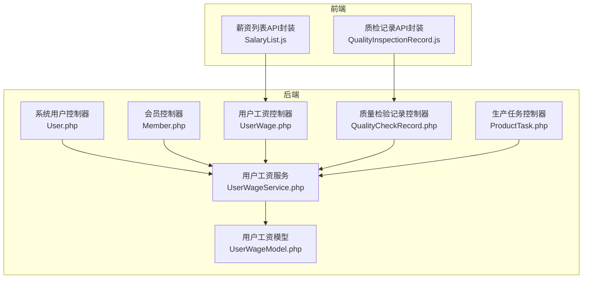
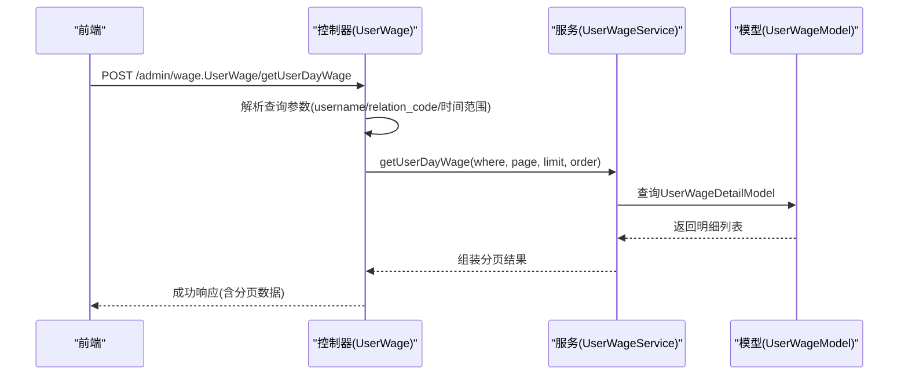
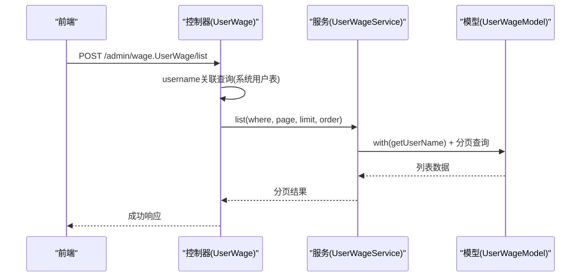
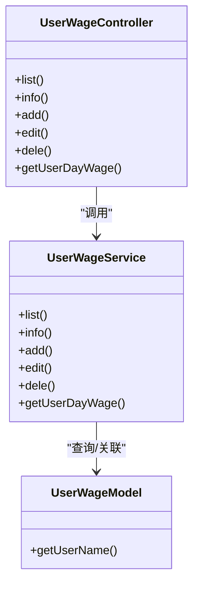

# 人员管理API

<cite>
**本文引用的文件**
- [gccd_server/app/admin/controller/system/User.php](file://gccd_server/app/admin/controller/system/User.php)
- [gccd_server/app/admin/controller/member/Member.php](file://gccd_server/app/admin/controller/member/Member.php)
- [gccd_server/app/admin/controller/wage/UserWage.php](file://gccd_server/app/admin/controller/wage/UserWage.php)
- [gccd_server/app/common/service/admin/UserWageService.php](file://gccd_server/app/common/service/admin/UserWageService.php)
- [gccd_server/app/common/model/admin/UserWageModel.php](file://gccd_server/app/common/model/admin/UserWageModel.php)
- [gccd_server/app/admin/controller/production/QualityCheckRecord.php](file://gccd_server/app/admin/controller/production/QualityCheckRecord.php)
- [gccd_server/app/admin/controller/production/ProductTask.php](file://gccd_server/app/admin/controller/production/ProductTask.php)
- [yarn/src/api/mes/SalaryList/SalaryList.js](file://yarn/src/api/mes/SalaryList/SalaryList.js)
- [yarn/src/api/mes/QualityInspectionRecord/QualityInspectionRecord.js](file://yarn/src/api/mes/QualityInspectionRecord/QualityInspectionRecord.js)
</cite>

## 目录
1. [简介](#简介)
2. [项目结构](#项目结构)
3. [核心组件](#核心组件)
4. [架构总览](#架构总览)
5. [详细组件分析](#详细组件分析)
6. [依赖分析](#依赖分析)
7. [性能考虑](#性能考虑)
8. [故障排查指南](#故障排查指南)
9. [结论](#结论)
10. [附录](#附录)

## 简介
本文件面向“高齿传动”项目，系统化梳理人员管理相关API，覆盖员工信息管理、工资管理、考勤/质量检测记录等能力，并明确人员与工单、质量检测的关联关系。文档以接口清单、调用流程、数据模型与依赖关系为核心，帮助前后端协同开发与集成。

## 项目结构
围绕人员管理的关键模块分布如下：
- 后端控制器层：系统用户管理、会员管理、工资管理、质量检验记录、生产任务管理
- 服务层：统一封装业务逻辑与数据访问
- 模型层：定义数据表映射与关联关系
- 前端API封装：基于Axios的请求封装，便于在前端工程中直接调用

图示来源
- [gccd_server/app/admin/controller/system/User.php:1-238](file://gccd_server/app/admin/controller/system/User.php#L1-L238)
- [gccd_server/app/admin/controller/member/Member.php:1-346](file://gccd_server/app/admin/controller/member/Member.php#L1-L346)
- [gccd_server/app/admin/controller/wage/UserWage.php:1-158](file://gccd_server/app/admin/controller/wage/UserWage.php#L1-L158)
- [gccd_server/app/common/service/admin/UserWageService.php:1-214](file://gccd_server/app/common/service/admin/UserWageService.php#L1-L214)
- [gccd_server/app/common/model/admin/UserWageModel.php:1-23](file://gccd_server/app/common/model/admin/UserWageModel.php#L1-L23)
- [gccd_server/app/admin/controller/production/QualityCheckRecord.php:1-46](file://gccd_server/app/admin/controller/production/QualityCheckRecord.php#L1-L46)
- [gccd_server/app/admin/controller/production/ProductTask.php:1-151](file://gccd_server/app/admin/controller/production/ProductTask.php#L1-L151)
- [yarn/src/api/mes/SalaryList/SalaryList.js:1-27](file://yarn/src/api/mes/SalaryList/SalaryList.js#L1-L27)
- [yarn/src/api/mes/QualityInspectionRecord/QualityInspectionRecord.js:1-63](file://yarn/src/api/mes/QualityInspectionRecord/QualityInspectionRecord.js#L1-L63)

章节来源
- [gccd_server/app/admin/controller/system/User.php:1-238](file://gccd_server/app/admin/controller/system/User.php#L1-L238)
- [gccd_server/app/admin/controller/member/Member.php:1-346](file://gccd_server/app/admin/controller/member/Member.php#L1-L346)
- [gccd_server/app/admin/controller/wage/UserWage.php:1-158](file://gccd_server/app/admin/controller/wage/UserWage.php#L1-L158)
- [gccd_server/app/common/service/admin/UserWageService.php:1-214](file://gccd_server/app/common/service/admin/UserWageService.php#L1-L214)
- [gccd_server/app/common/model/admin/UserWageModel.php:1-23](file://gccd_server/app/common/model/admin/UserWageModel.php#L1-L23)
- [gccd_server/app/admin/controller/production/QualityCheckRecord.php:1-46](file://gccd_server/app/admin/controller/production/QualityCheckRecord.php#L1-L46)
- [gccd_server/app/admin/controller/production/ProductTask.php:1-151](file://gccd_server/app/admin/controller/production/ProductTask.php#L1-L151)
- [yarn/src/api/mes/SalaryList/SalaryList.js:1-27](file://yarn/src/api/mes/SalaryList/SalaryList.js#L1-L27)
- [yarn/src/api/mes/QualityInspectionRecord/QualityInspectionRecord.js:1-63](file://yarn/src/api/mes/QualityInspectionRecord/QualityInspectionRecord.js#L1-L63)

## 核心组件
- 系统用户管理：提供用户增删改查、部门/职位/角色维护、密码修改、启用/禁用等能力
- 会员管理：提供会员增删改查、标签/分组维护、导入导出、统计等能力
- 用户工资管理：提供工资记录列表、详情、按日明细查询、新增/编辑/删除
- 质量检验记录：提供质检列表、小程序批量提交
- 生产任务管理：提供任务/工序管理、状态更新等

章节来源
- [gccd_server/app/admin/controller/system/User.php:27-236](file://gccd_server/app/admin/controller/system/User.php#L27-L236)
- [gccd_server/app/admin/controller/member/Member.php:53-344](file://gccd_server/app/admin/controller/member/Member.php#L53-L344)
- [gccd_server/app/admin/controller/wage/UserWage.php:38-156](file://gccd_server/app/admin/controller/wage/UserWage.php#L38-L156)
- [gccd_server/app/admin/controller/production/QualityCheckRecord.php:17-44](file://gccd_server/app/admin/controller/production/QualityCheckRecord.php#L17-L44)
- [gccd_server/app/admin/controller/production/ProductTask.php:39-149](file://gccd_server/app/admin/controller/production/ProductTask.php#L39-L149)

## 架构总览
人员管理API采用经典的三层架构：
- 控制器层：接收HTTP请求，解析参数，调用服务层，返回标准响应
- 服务层：封装业务规则、事务控制、数据聚合
- 模型层：定义数据表映射与关联（如用户工资与系统用户模型的关联）

图示来源
- [gccd_server/app/admin/controller/wage/UserWage.php:133-156](file://gccd_server/app/admin/controller/wage/UserWage.php#L133-L156)
- [gccd_server/app/common/service/admin/UserWageService.php:196-211](file://gccd_server/app/common/service/admin/UserWageService.php#L196-L211)
- [gccd_server/app/common/model/admin/UserWageModel.php:1-23](file://gccd_server/app/common/model/admin/UserWageModel.php#L1-L23)

## 详细组件分析

### 系统用户管理API
- 列表
  - 方法：GET
  - 路径：/admin/system.User/list
  - 查询参数：分页、排序、搜索、日期范围
  - 返回：用户列表、部门树、职位树、角色列表
- 信息
  - 方法：GET
  - 路径：/admin/system.User/info
  - 查询参数：user_id
  - 返回：用户详情及所属部门/职位/角色名称
- 添加
  - 方法：POST
  - 路径：/admin/system.User/add
  - 请求体：头像、昵称、用户名、密码、手机、邮箱、备注、排序
- 修改
  - 方法：POST
  - 路径：/admin/system.User/edit
  - 请求体：user_id 及上述字段可选更新
- 删除
  - 方法：POST
  - 路径：/admin/system.User/dele
  - 请求体：ids[]
- 部门/职位/角色维护
  - 方法：POST
  - 路径：/admin/system.User/editdept /editpost /editrole
  - 请求体：ids[] + 对应ID数组
- 密码修改/超管/禁用
  - 方法：POST
  - 路径：/admin/system.User/repwd /super /disable
  - 请求体：ids[] + 新密码或状态值
- 按工序筛选员工
  - 方法：GET
  - 路径：/admin/system.User/productlist
  - 查询参数：processes_name

章节来源
- [gccd_server/app/admin/controller/system/User.php:46-236](file://gccd_server/app/admin/controller/system/User.php#L46-L236)

### 会员管理API
- 列表/信息/添加/修改/删除
  - 方法：GET/POST
  - 路径：/admin/member.Member/list /info /add /edit /dele
  - 删除支持按类型区分(member/third)
- 所在地/标签/分组维护
  - 方法：POST
  - 路径：/admin/member.Member/region /edittag /editgroup
- 导入/导出
  - 方法：GET/POST
  - 路径：/admin/member.Member/import /export
  - 导入支持上传文件；导出支持下载模板或提交导出任务
- 统计
  - 方法：GET
  - 路径：/admin/member.Member/statistic
  - 查询参数：type(date粒度), date(范围)

章节来源
- [gccd_server/app/admin/controller/member/Member.php:53-344](file://gccd_server/app/admin/controller/member/Member.php#L53-L344)

### 用户工资管理API
- 列表
  - 方法：GET
  - 路径：/admin/wage.UserWage/list
  - 查询参数：username、check_name、check_code、create_start_date、create_end_date
  - 返回：分页列表，包含用户昵称绑定
- 信息
  - 方法：GET
  - 路径：/admin/wage.UserWage/info
  - 查询参数：id
  - 返回：工资记录及当月明细
- 添加/修改/删除
  - 方法：POST
  - 路径：/admin/wage.UserWage/add /edit /dele
  - 请求体：年份、月份、工资、用户ID等
- 按日查询员工工资明细
  - 方法：POST
  - 路径：/admin/wage.UserWage/getUserDayWage
  - 请求体：username、relation_code、create_start_date、create_end_date
  - 返回：分页明细列表

图示来源
- [gccd_server/app/admin/controller/wage/UserWage.php:38-72](file://gccd_server/app/admin/controller/wage/UserWage.php#L38-L72)
- [gccd_server/app/common/service/admin/UserWageService.php:64-79](file://gccd_server/app/common/service/admin/UserWageService.php#L64-L79)
- [gccd_server/app/common/model/admin/UserWageModel.php:14-22](file://gccd_server/app/common/model/admin/UserWageModel.php#L14-L22)

章节来源
- [gccd_server/app/admin/controller/wage/UserWage.php:38-156](file://gccd_server/app/admin/controller/wage/UserWage.php#L38-L156)
- [gccd_server/app/common/service/admin/UserWageService.php:40-211](file://gccd_server/app/common/service/admin/UserWageService.php#L40-L211)
- [gccd_server/app/common/model/admin/UserWageModel.php:1-23](file://gccd_server/app/common/model/admin/UserWageModel.php#L1-L23)

### 质量检验记录API
- 列表
  - 方法：POST
  - 路径：/admin/production.QualityCheckRecord/list
  - 请求体：process_name、check_start_date、check_end_date
- 小程序批量提交
  - 方法：POST
  - 路径：/admin/production.QualityCheckRecord/submitQualityCheck
  - 请求体：小程序端批量质检数据

章节来源
- [gccd_server/app/admin/controller/production/QualityCheckRecord.php:17-44](file://gccd_server/app/admin/controller/production/QualityCheckRecord.php#L17-L44)

### 生产任务管理API
- 列表
  - 方法：GET
  - 路径：/admin/production.ProductTask/list
  - 查询参数：task_code、processes_code、relation_code、routing_code、create_start_date、create_end_date
- 信息
  - 方法：GET
  - 路径：/admin/production.ProductTask/info
  - 查询参数：id、processes_code
- 添加/修改/删除
  - 方法：POST
  - 路径：/admin/production.ProductTask/add /edit /dele
- 更新状态
  - 方法：POST
  - 路径：/admin/production.ProductTask/updatestatus
  - 请求体：status、id、refuse_reason

章节来源
- [gccd_server/app/admin/controller/production/ProductTask.php:39-149](file://gccd_server/app/admin/controller/production/ProductTask.php#L39-L149)

## 依赖分析
- 控制器到服务层：各控制器通过注入的服务类完成业务处理
- 服务层到模型层：服务类使用模型类进行数据持久化与关联查询
- 前端到后端：前端通过API封装文件发起HTTP请求，控制器返回标准响应

图示来源
- [gccd_server/app/admin/controller/wage/UserWage.php:1-158](file://gccd_server/app/admin/controller/wage/UserWage.php#L1-L158)
- [gccd_server/app/common/service/admin/UserWageService.php:1-214](file://gccd_server/app/common/service/admin/UserWageService.php#L1-L214)
- [gccd_server/app/common/model/admin/UserWageModel.php:1-23](file://gccd_server/app/common/model/admin/UserWageModel.php#L1-L23)

章节来源
- [gccd_server/app/admin/controller/wage/UserWage.php:1-158](file://gccd_server/app/admin/controller/wage/UserWage.php#L1-L158)
- [gccd_server/app/common/service/admin/UserWageService.php:1-214](file://gccd_server/app/common/service/admin/UserWageService.php#L1-L214)
- [gccd_server/app/common/model/admin/UserWageModel.php:1-23](file://gccd_server/app/common/model/admin/UserWageModel.php#L1-L23)

## 性能考虑
- 分页与排序：服务层默认按创建时间倒序，建议前端传入合理页码与限制条数，避免一次性拉取过多数据
- 关联查询：用户工资列表使用with关联绑定用户昵称，注意索引优化与必要字段选择
- 事务控制：新增/编辑/删除涉及事务，确保一致性与回滚机制
- 前端缓存：对只读列表数据可在前端做短期缓存，减少重复请求

## 故障排查指南
- 参数校验失败：检查请求体字段类型与必填项，参考控制器注解中的参数定义
- 数据不存在：服务层在信息查询时可能抛出异常，需捕获并提示
- 事务异常：新增/编辑失败时查看服务层异常处理与回滚逻辑
- 前端请求封装：确认API封装文件中的URL与方法与后端一致

章节来源
- [gccd_server/app/admin/controller/system/User.php:67-92](file://gccd_server/app/admin/controller/system/User.php#L67-L92)
- [gccd_server/app/admin/controller/member/Member.php:102-131](file://gccd_server/app/admin/controller/member/Member.php#L102-L131)
- [gccd_server/app/common/service/admin/UserWageService.php:117-139](file://gccd_server/app/common/service/admin/UserWageService.php#L117-L139)

## 结论
本文件系统性梳理了人员管理相关API，明确了员工信息、工资、考勤/质量检测的接口规范与调用方式，并给出了前后端协作要点与依赖关系。建议在实际开发中严格遵循参数与响应约定，结合事务与分页策略提升稳定性与性能。

## 附录

### 前端API封装使用示例
- 薪资列表
  - 调用路径：/admin/wage.UserWage/list
  - 封装文件：yarn/src/api/mes/SalaryList/SalaryList.js
- 员工报工工资列表
  - 调用路径：/admin/wage.UserWage/getUserDayWage
  - 封装文件：同上
- 质检记录
  - 调用路径：/admin/production.QualityCheckRecord/list
  - 封装文件：yarn/src/api/mes/QualityInspectionRecord/QualityInspectionRecord.js

章节来源
- [yarn/src/api/mes/SalaryList/SalaryList.js:1-27](file://yarn/src/api/mes/SalaryList/SalaryList.js#L1-L27)
- [yarn/src/api/mes/QualityInspectionRecord/QualityInspectionRecord.js:1-63](file://yarn/src/api/mes/QualityInspectionRecord/QualityInspectionRecord.js#L1-L63)