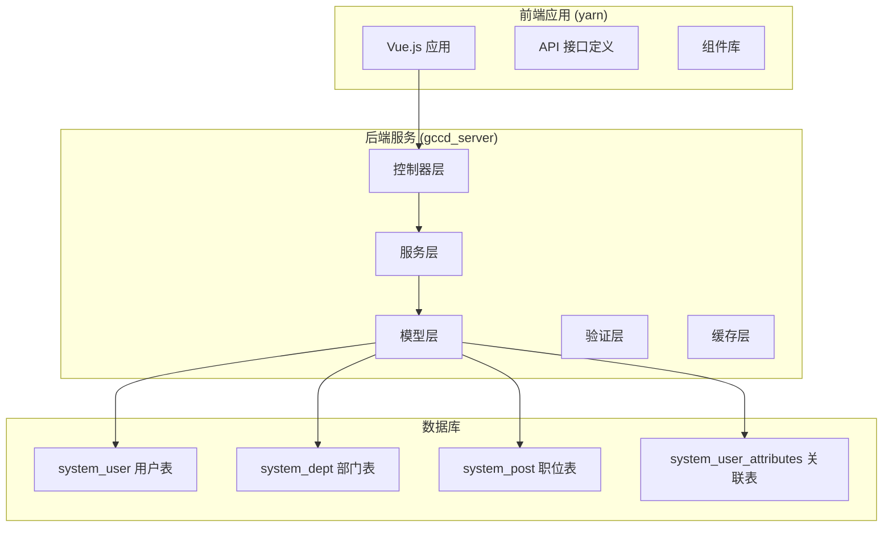
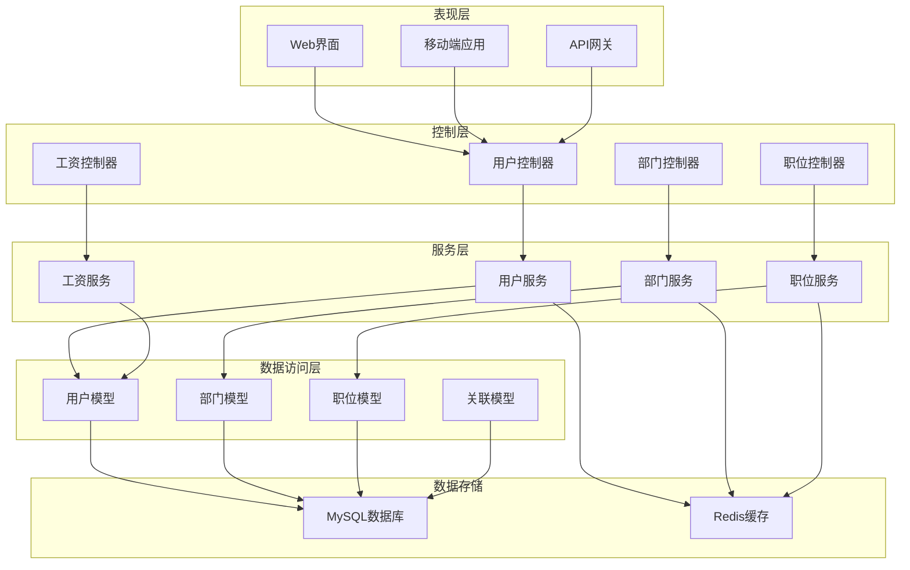
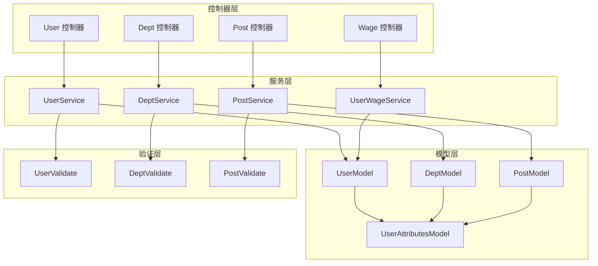

# 员工信息管理API

<cite>
**本文档引用的文件**
- [User.php](file://gccd_server/app/admin/controller/system/User.php)
- [UserModel.php](file://gccd_server/app/common/model/system/UserModel.php)
- [UserService.php](file://gccd_server/app/common/service/system/UserService.php)
- [UserValidate.php](file://gccd_server/app/common/validate/system/UserValidate.php)
- [DeptService.php](file://gccd_server/app/common/service/system/DeptService.php)
- [PostService.php](file://gccd_server/app/common/service/system/PostService.php)
- [UserAttributesModel.php](file://gccd_server/app/common/model/system/UserAttributesModel.php)
- [UserWage.php](file://gccd_server/app/admin/controller/wage/UserWage.php)
</cite>

## 目录
1. [简介](#简介)
2. [项目结构](#项目结构)
3. [核心组件](#核心组件)
4. [架构概览](#架构概览)
5. [详细组件分析](#详细组件分析)
6. [依赖关系分析](#依赖关系分析)
7. [性能考虑](#性能考虑)
8. [故障排除指南](#故障排除指南)
9. [结论](#结论)

## 简介

本文件为高齿传动项目员工信息管理API的详细技术文档。该系统基于ThinkPHP框架开发，采用前后端分离架构，通过RESTful API提供员工信息管理功能。系统支持员工基本信息管理、部门组织架构管理、职位管理、角色管理以及员工工资管理等核心业务功能。

系统采用多层架构设计，包括控制器层、服务层、模型层和验证层，确保代码的可维护性和扩展性。所有API接口均通过apidoc注解进行文档化，提供完整的接口规范和示例。

## 项目结构

高齿传动项目的员工信息管理模块主要分布在以下目录结构中：



**图表来源**
- [User.php:1-238](file://gccd_server/app/admin/controller/system/User.php#L1-238)
- [UserService.php:1-604](file://gccd_server/app/common/service/system/UserService.php#L1-604)

**章节来源**
- [User.php:1-238](file://gccd_server/app/admin/controller/system/User.php#L1-238)
- [UserService.php:1-604](file://gccd_server/app/common/service/system/UserService.php#L1-604)

## 核心组件

### 用户管理控制器

用户管理控制器位于 `app/admin/controller/system/User.php`，提供完整的员工信息管理接口：

- **用户列表查询** - 支持分页、排序、搜索和日期过滤
- **用户信息获取** - 获取单个用户的详细信息
- **用户添加** - 创建新员工账户
- **用户修改** - 更新员工基本信息
- **用户删除** - 删除员工账户
- **部门调整** - 修改员工所属部门
- **职位调整** - 修改员工职位信息
- **角色调整** - 修改员工角色权限
- **密码重置** - 重置员工登录密码
- **状态管理** - 设置超级管理员和禁用状态

### 用户服务层

用户服务层位于 `app/common/service/system/UserService.php`，包含业务逻辑实现：

- **数据验证** - 使用UserValidate进行参数验证
- **事务处理** - 确保数据一致性
- **缓存管理** - 使用UserCache提高性能
- **关联关系处理** - 管理用户与部门、职位、角色的多对多关系
- **权限控制** - 实现超级管理员权限检查

### 数据模型层

系统采用Eloquent ORM模式，主要数据模型包括：

- **UserModel** - 用户基础信息模型
- **DeptModel** - 部门信息模型  
- **PostModel** - 职位信息模型
- **UserAttributesModel** - 用户属性关联模型

**章节来源**
- [User.php:25-237](file://gccd_server/app/admin/controller/system/User.php#L25-237)
- [UserService.php:27-603](file://gccd_server/app/common/service/system/UserService.php#L27-603)
- [UserModel.php:19-132](file://gccd_server/app/common/model/system/UserModel.php#L19-132)

## 架构概览

系统采用经典的MVC架构模式，结合服务层设计，形成清晰的分层结构：



**图表来源**
- [User.php:25-237](file://gccd_server/app/admin/controller/system/User.php#L25-237)
- [UserService.php:27-603](file://gccd_server/app/common/service/system/UserService.php#L27-603)
- [DeptService.php:20-239](file://gccd_server/app/common/service/system/DeptService.php#L20-239)

## 详细组件分析

### 用户管理API接口

#### 基础信息管理接口

**用户列表查询**
- **HTTP方法**: GET
- **URL路径**: `/admin/system.User/list`
- **请求参数**:
  - `page` (整数): 页码，默认1
  - `limit` (整数): 每页数量，默认10
  - `sort` (字符串): 排序字段
  - `search` (字符串): 搜索关键词
  - `date` (字符串): 日期范围
- **响应格式**:
  ```json
  {
    "code": 200,
    "msg": "操作成功",
    "data": {
      "count": 0,
      "pages": 0,
      "page": 1,
      "limit": 10,
      "list": [],
      "dept": [],
      "post": [],
      "role": []
    }
  }
  ```

**用户信息获取**
- **HTTP方法**: GET
- **URL路径**: `/admin/system.User/info`
- **查询参数**:
  - `user_id` (整数): 用户ID
- **响应数据**:
  - 用户基本信息
  - 头像URL
  - 部门名称列表
  - 职位名称列表
  - 角色名称列表

**用户添加**
- **HTTP方法**: POST
- **URL路径**: `/admin/system.User/add`
- **请求体参数**:
  - `avatar_id` (整数): 头像文件ID
  - `nickname` (字符串): 昵称
  - `username` (字符串): 用户名
  - `password` (字符串): 密码
  - `phone` (字符串): 手机号
  - `email` (字符串): 邮箱
  - `remark` (字符串): 备注
  - `sort` (整数): 排序值

**用户修改**
- **HTTP方法**: POST
- **URL路径**: `/admin/system.User/edit`
- **请求体参数**:
  - `user_id` (整数): 用户ID
  - 其他基本信息字段

**用户删除**
- **HTTP方法**: POST
- **URL路径**: `/admin/system.User/dele`
- **请求体参数**:
  - `ids` (数组): 用户ID数组

#### 组织架构管理接口

**修改部门**
- **HTTP方法**: POST
- **URL路径**: `/admin/system.User/editdept`
- **请求体参数**:
  - `ids` (数组): 用户ID数组
  - `dept_ids` (数组): 新部门ID数组

**修改职位**
- **HTTP方法**: POST
- **URL路径**: `/admin/system.User/editpost`
- **请求体参数**:
  - `ids` (数组): 用户ID数组
  - `post_ids` (数组): 新职位ID数组

**修改角色**
- **HTTP方法**: GET/POST
- **URL路径**: `/admin/system.User/editrole`
- **请求体参数**:
  - `ids` (数组): 用户ID数组
  - `role_ids` (数组): 新角色ID数组

#### 权限管理接口

**重置密码**
- **HTTP方法**: POST
- **URL路径**: `/admin/system.User/repwd`
- **请求体参数**:
  - `ids` (数组): 用户ID数组
  - `password` (字符串): 新密码

**设置超级管理员**
- **HTTP方法**: POST
- **URL路径**: `/admin/system.User/super`
- **请求体参数**:
  - `ids` (数组): 用户ID数组
  - `is_super` (整数): 1或0

**禁用用户**
- **HTTP方法**: POST
- **URL路径**: `/admin/system.User/disable`
- **请求体参数**:
  - `ids` (数组): 用户ID数组
  - `is_disable` (整数): 1或0

### 数据验证规则

系统使用专门的验证器类进行数据验证，确保数据的完整性和正确性：

**验证规则**:
- `number`: 编号长度1-63字符，唯一性验证
- `nickname`: 必填，长度1-63字符，唯一性验证
- `username`: 必填，长度2-63字符，唯一性验证
- `password`: 必填，长度6-18字符
- `phone`: 手机号码格式验证，唯一性验证
- `email`: 邮箱格式验证，唯一性验证
- `dept_ids/post_ids/role_ids`: 数组类型验证

**自定义验证规则**:
- `checkNumber`: 编号唯一性检查
- `checkNickname`: 昵称唯一性检查
- `checkUsername`: 用户名唯一性检查
- `checkPhone`: 手机号唯一性检查
- `checkEmail`: 邮箱唯一性检查
- `checkIsSuper`: 超级管理员权限检查
- `checkIsDisable`: 禁用状态检查

### 错误处理机制

系统采用统一的错误处理机制：

**错误类型**:
- 参数验证错误
- 权限不足错误
- 数据不存在错误
- 业务逻辑错误
- 系统内部错误

**错误响应格式**:
```json
{
  "code": 400,
  "msg": "错误信息",
  "data": {}
}
```

**章节来源**
- [User.php:46-237](file://gccd_server/app/admin/controller/system/User.php#L46-237)
- [UserValidate.php:22-272](file://gccd_server/app/common/validate/system/UserValidate.php#L22-272)
- [UserService.php:283-452](file://gccd_server/app/common/service/system/UserService.php#L283-452)

## 依赖关系分析

系统各组件之间的依赖关系如下：



**图表来源**
- [User.php:12-18](file://gccd_server/app/admin/controller/system/User.php#L12-18)
- [UserService.php:12-22](file://gccd_server/app/common/service/system/UserService.php#L12-22)
- [UserModel.php:12-14](file://gccd_server/app/common/model/system/UserModel.php#L12-14)

**章节来源**
- [User.php:12-18](file://gccd_server/app/admin/controller/system/User.php#L12-18)
- [UserService.php:12-22](file://gccd_server/app/common/service/system/UserService.php#L12-22)

## 性能考虑

### 缓存策略

系统采用多级缓存策略提高性能：

1. **用户信息缓存**: 使用UserCache缓存用户基本信息
2. **部门信息缓存**: 使用DeptCache缓存部门树形结构
3. **职位信息缓存**: 使用PostCache缓存职位树形结构
4. **查询条件缓存**: 使用where_cache_key缓存查询条件

### 数据库优化

1. **索引优化**: 在常用查询字段上建立索引
2. **连接池**: 使用数据库连接池减少连接开销
3. **批量操作**: 支持批量插入、更新、删除操作
4. **分页查询**: 实现高效的分页查询机制

### 事务处理

系统使用事务确保数据一致性：
- 用户添加时同时处理用户信息和关联关系
- 用户修改时支持多对多关系的原子性更新
- 删除操作支持软删除和硬删除两种模式

## 故障排除指南

### 常见问题及解决方案

**1. 用户名重复错误**
- **症状**: 添加用户时报用户名已存在
- **原因**: 用户名在数据库中已存在
- **解决**: 更换唯一的用户名或联系管理员

**2. 权限不足错误**
- **症状**: 修改用户权限时报权限不足
- **原因**: 当前用户不是超级管理员
- **解决**: 使用超级管理员账户登录或联系系统管理员

**3. 数据库连接错误**
- **症状**: API调用时报数据库连接失败
- **原因**: 数据库配置错误或网络问题
- **解决**: 检查数据库连接配置和网络连通性

**4. 缓存同步问题**
- **症状**: 用户信息更新后显示旧数据
- **原因**: 缓存未及时更新
- **解决**: 清除相关缓存或等待缓存自动过期

### 日志监控

系统提供完善的日志记录功能：
- **用户操作日志**: 记录用户的重要操作
- **系统错误日志**: 记录系统异常和错误
- **访问日志**: 记录API访问情况
- **性能日志**: 记录关键操作的执行时间

**章节来源**
- [UserValidate.php:207-271](file://gccd_server/app/common/validate/system/UserValidate.php#L207-271)
- [UserService.php:316-324](file://gccd_server/app/common/service/system/UserService.php#L316-324)

## 结论

高齿传动项目的员工信息管理API系统具有以下特点：

1. **完整的功能覆盖**: 涵盖员工信息管理的各个方面，包括基本信息、组织架构、权限管理等

2. **清晰的架构设计**: 采用分层架构，职责明确，便于维护和扩展

3. **严格的数据验证**: 多层次的数据验证确保数据的完整性和安全性

4. **高性能的设计**: 采用缓存、事务处理等技术保证系统的高性能

5. **完善的错误处理**: 统一的错误处理机制和详细的日志记录

6. **良好的扩展性**: 模块化设计便于功能扩展和定制

该系统为高齿传动项目的员工管理提供了稳定可靠的技术支撑，能够满足企业级应用的需求。通过合理的架构设计和严格的开发规范，确保了系统的稳定性、安全性和可维护性。