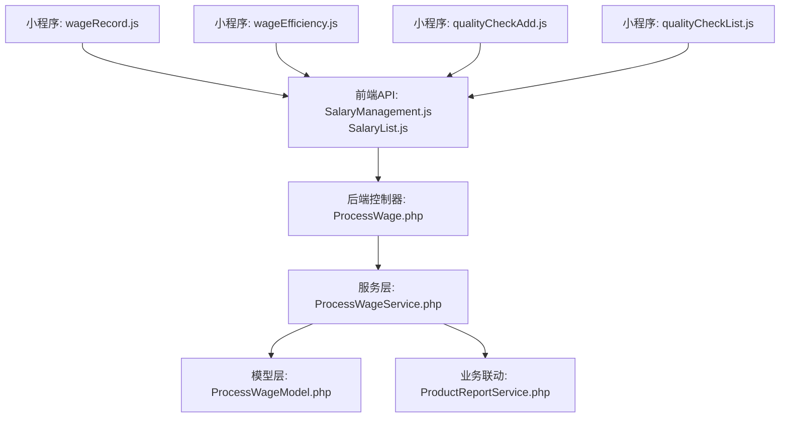
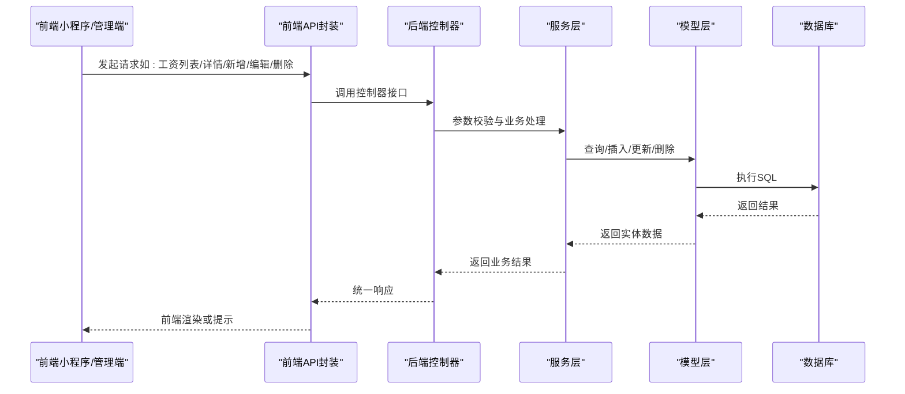
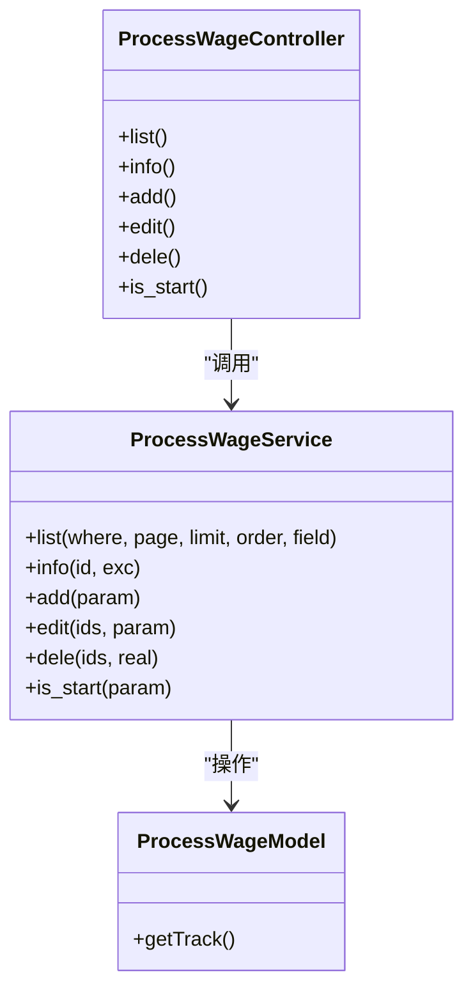
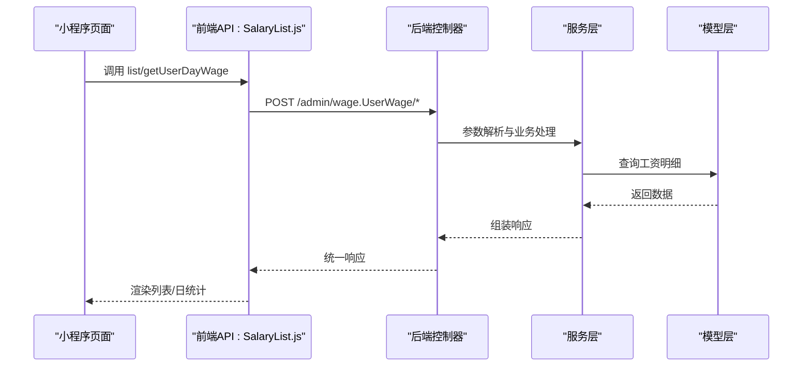
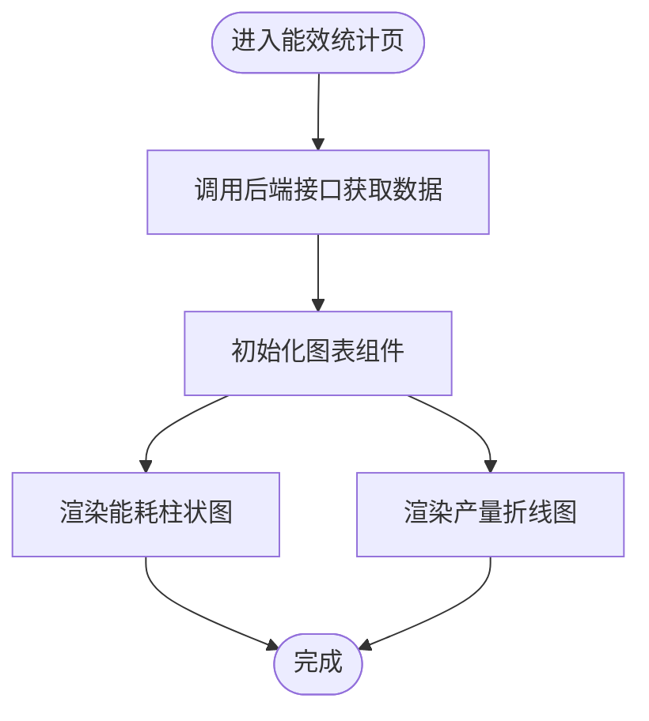
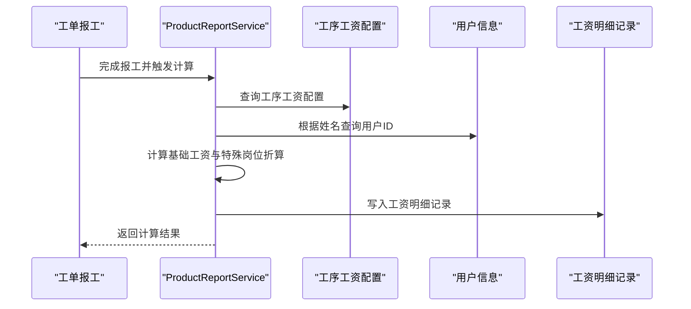
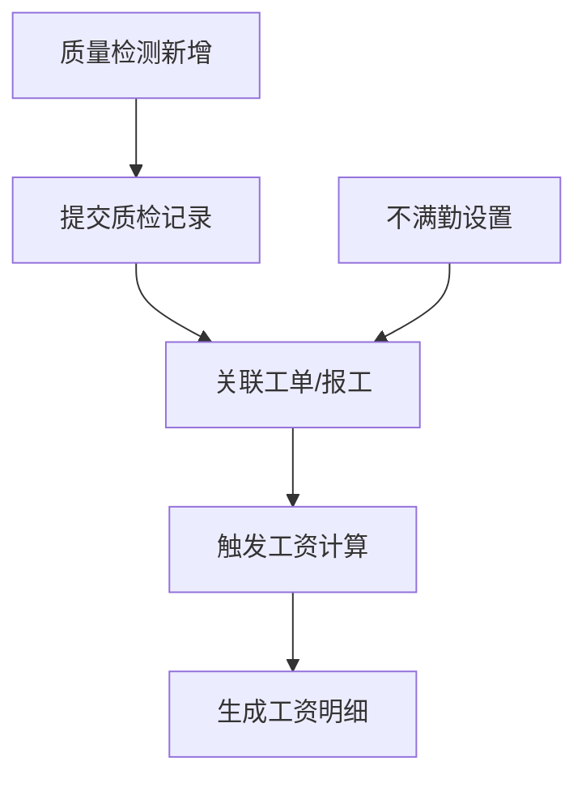
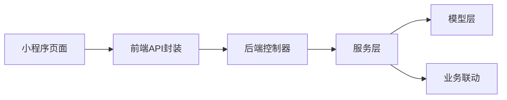

# 工资管理API

<cite>
**本文引用的文件**
- [SalaryManagement.js](file://yarn/src/api/mes/SalaryManagement/SalaryManagement.js)
- [SalaryList.js](file://yarn/src/api/mes/SalaryList/SalaryList.js)
- [ProcessSalary.V_waEoGb.js](file://yarn/admin/js/ProcessSalary.V_waEoGb.js)
- [ProcessWage.php](file://gccd_server/app/admin/controller/wage/ProcessWage.php)
- [ProcessWageModel.php](file://gccd_server/app/common/model/admin/ProcessWageModel.php)
- [ProcessWageService.php](file://gccd_server/app/common/service/admin/ProcessWageService.php)
- [ProductReportService.php](file://gccd_server/app/common/service/admin/ProductReportService.php)
- [wageRecord.js](file://gccd_mini/pageMine/pages/wageRecord/wageRecord.js)
- [wageEfficiency.js](file://gccd_mini/pageMine/pages/wageEfficiency/wageEfficiency.js)
- [qualityCheckAdd.js](file://gccd_mini/pageWorkOrder/pages/qualityCheckAdd/qualityCheckAdd.js)
- [qualityCheckList.js](file://gccd_mini/pageWorkOrder/pages/qualityCheckList/qualityCheckList.js)
</cite>

## 目录
1. [简介](#简介)
2. [项目结构](#项目结构)
3. [核心组件](#核心组件)
4. [架构总览](#架构总览)
5. [详细组件分析](#详细组件分析)
6. [依赖分析](#依赖分析)
7. [性能考虑](#性能考虑)
8. [故障排查指南](#故障排查指南)
9. [结论](#结论)
10. [附录](#附录)

## 简介
本文件面向“高齿传动”项目，系统化梳理工资管理API的设计与实现，覆盖以下方面：
- 工资计算、发放、调整等接口的HTTP方法、URL路径、请求参数与响应格式
- 工资设置、工资明细、工资统计等能力
- 工资与工单、质量检测、考勤记录的业务关联
- 批量工资计算流程与异常处理机制
- 前端调用示例与最佳实践

## 项目结构
围绕工资管理的关键目录与文件如下：
- 前端API封装层：yarn/src/api/mes/ 下的 SalaryManagement.js、SalaryList.js
- 后端控制器：gccd_server/app/admin/controller/wage/ProcessWage.php
- 服务层：gccd_server/app/common/service/admin/ProcessWageService.php
- 模型层：gccd_server/app/common/model/admin/ProcessWageModel.php
- 业务联动：gccd_server/app/common/service/admin/ProductReportService.php（与工单报工联动）
- 小程序前端：gccd_mini/pageMine/pages/wageRecord/wageRecord.js、wageEfficiency/wageEfficiency.js
- 质量检测：gccd_mini/pageWorkOrder/pages/qualityCheckAdd/qualityCheckAdd.js、qualityCheckList.js

**图示来源**
- [ProcessWage.php:1-127](file://gccd_server/app/admin/controller/wage/ProcessWage.php#L1-127)
- [ProcessWageService.php:1-207](file://gccd_server/app/common/service/admin/ProcessWageService.php#L1-207)
- [ProcessWageModel.php:1-22](file://gccd_server/app/common/model/admin/ProcessWageModel.php#L1-22)
- [SalaryManagement.js:1-52](file://yarn/src/api/mes/SalaryManagement/SalaryManagement.js#L1-52)
- [SalaryList.js:1-28](file://yarn/src/api/mes/SalaryList/SalaryList.js#L1-28)
- [wageRecord.js:1-138](file://gccd_mini/pageMine/pages/wageRecord/wageRecord.js#L1-138)
- [wageEfficiency.js:1-275](file://gccd_mini/pageMine/pages/wageEfficiency/wageEfficiency.js#L1-275)
- [qualityCheckAdd.js:261-284](file://gccd_mini/pageWorkOrder/pages/qualityCheckAdd/qualityCheckAdd.js#L261-284)
- [qualityCheckList.js:1-58](file://gccd_mini/pageWorkOrder/pages/qualityCheckList/qualityCheckList.js#L1-58)

**章节来源**
- [ProcessWage.php:1-127](file://gccd_server/app/admin/controller/wage/ProcessWage.php#L1-127)
- [ProcessWageService.php:1-207](file://gccd_server/app/common/service/admin/ProcessWageService.php#L1-207)
- [ProcessWageModel.php:1-22](file://gccd_server/app/common/model/admin/ProcessWageModel.php#L1-22)
- [SalaryManagement.js:1-52](file://yarn/src/api/mes/SalaryManagement/SalaryManagement.js#L1-52)
- [SalaryList.js:1-28](file://yarn/src/api/mes/SalaryList/SalaryList.js#L1-28)
- [wageRecord.js:1-138](file://gccd_mini/pageMine/pages/wageRecord/wageRecord.js#L1-138)
- [wageEfficiency.js:1-275](file://gccd_mini/pageMine/pages/wageEfficiency/wageEfficiency.js#L1-275)
- [qualityCheckAdd.js:261-284](file://gccd_mini/pageWorkOrder/pages/qualityCheckAdd/qualityCheckAdd.js#L261-284)
- [qualityCheckList.js:1-58](file://gccd_mini/pageWorkOrder/pages/qualityCheckList/qualityCheckList.js#L1-58)

## 核心组件
- 工资设置（工序工资配置）：提供列表、详情、新增、编辑、删除、启用/停用等能力
- 工资明细（员工工资记录）：提供列表、按日统计等能力
- 工资统计（能效/产量关联展示）：小程序端展示能效与产量趋势
- 工资计算联动（工单报工）：根据报工结果与工序工资配置自动计算并生成工资明细
- 质量检测（间接影响）：通过质量数据影响工单与报工，从而间接影响工资

**章节来源**
- [ProcessWage.php:24-126](file://gccd_server/app/admin/controller/wage/ProcessWage.php#L24-L126)
- [ProcessWageService.php:26-206](file://gccd_server/app/common/service/admin/ProcessWageService.php#L26-L206)
- [ProcessWageModel.php:7-21](file://gccd_server/app/common/model/admin/ProcessWageModel.php#L7-L21)
- [SalaryManagement.js:1-52](file://yarn/src/api/mes/SalaryManagement/SalaryManagement.js#L1-L52)
- [SalaryList.js:1-28](file://yarn/src/api/mes/SalaryList/SalaryList.js#L1-L28)
- [wageRecord.js:78-102](file://gccd_mini/pageMine/pages/wageRecord/wageRecord.js#L78-L102)
- [wageEfficiency.js:186-203](file://gccd_mini/pageMine/pages/wageEfficiency/wageEfficiency.js#L186-L203)
- [ProductReportService.php:990-1047](file://gccd_server/app/common/service/admin/ProductReportService.php#L990-L1047)

## 架构总览
工资管理采用前后端分离架构：
- 前端通过API封装统一访问后端控制器
- 控制器调用服务层进行业务处理
- 服务层操作模型层与数据库交互
- 业务联动在报工完成后触发工资计算逻辑

**图示来源**
- [ProcessWage.php:38-125](file://gccd_server/app/admin/controller/wage/ProcessWage.php#L38-L125)
- [ProcessWageService.php:58-204](file://gccd_server/app/common/service/admin/ProcessWageService.php#L58-L204)
- [ProcessWageModel.php:7-21](file://gccd_server/app/common/model/admin/ProcessWageModel.php#L7-L21)

## 详细组件分析

### 工资设置（工序工资配置）
- 接口定义
  - 列表：POST /admin/wage.ProcessWage/list
  - 详情：POST /admin/wage.ProcessWage/info
  - 新增：POST /admin/wage.ProcessWage/add
  - 编辑：POST /admin/wage.ProcessWage/edit
  - 删除：POST /admin/wage.ProcessWage/dele
  - 启用/停用：POST /admin/wage.ProcessWage/is_start
- 请求参数
  - 列表：支持分页、排序、搜索（如工序编码、名称、创建时间区间等）
  - 详情：id
  - 新增/编辑：包含工序编码/名称、岗位名称、工资金额、是否月薪等字段
  - 删除：ids（数组）
  - 启用/停用：id、status
- 响应格式
  - 成功：返回统一success结构，包含数据或空对象
  - 失败：返回错误信息（由服务层抛出）

**图示来源**
- [ProcessWage.php:24-126](file://gccd_server/app/admin/controller/wage/ProcessWage.php#L24-L126)
- [ProcessWageService.php:26-206](file://gccd_server/app/common/service/admin/ProcessWageService.php#L26-L206)
- [ProcessWageModel.php:7-21](file://gccd_server/app/common/model/admin/ProcessWageModel.php#L7-L21)

**章节来源**
- [ProcessWage.php:38-125](file://gccd_server/app/admin/controller/wage/ProcessWage.php#L38-L125)
- [ProcessWageService.php:58-204](file://gccd_server/app/common/service/admin/ProcessWageService.php#L58-L204)
- [ProcessWageModel.php:7-21](file://gccd_server/app/common/model/admin/ProcessWageModel.php#L7-L21)

### 工资明细（员工工资记录）
- 接口定义
  - 工资列表：POST /admin/wage.UserWage/list
  - 员工日工资：POST /admin/wage.UserWage/getUserDayWage
- 请求参数
  - 工资列表：分页参数（page、limit）、筛选条件（如日期范围、人员等）
  - 员工日工资：日期、用户ID等
- 响应格式
  - 成功：返回列表与分页信息
  - 失败：错误提示

**图示来源**
- [SalaryList.js:1-28](file://yarn/src/api/mes/SalaryList/SalaryList.js#L1-L28)
- [wageRecord.js:78-102](file://gccd_mini/pageMine/pages/wageRecord/wageRecord.js#L78-L102)

**章节来源**
- [SalaryList.js:1-28](file://yarn/src/api/mes/SalaryList/SalaryList.js#L1-L28)
- [wageRecord.js:78-102](file://gccd_mini/pageMine/pages/wageRecord/wageRecord.js#L78-L102)

### 工资统计（能效/产量趋势）
- 小程序端展示能效与产量趋势，用于辅助工资统计与效率评估
- 数据来源：后端接口返回设备状态、能耗、产量等数据
- 图表类型：柱状图（能耗）、折线图（产量）

**图示来源**
- [wageEfficiency.js:186-203](file://gccd_mini/pageMine/pages/wageEfficiency/wageEfficiency.js#L186-L203)
- [wageEfficiency.js:243-262](file://gccd_mini/pageMine/pages/wageEfficiency/wageEfficiency.js#L243-L262)

**章节来源**
- [wageEfficiency.js:186-203](file://gccd_mini/pageMine/pages/wageEfficiency/wageEfficiency.js#L186-L203)
- [wageEfficiency.js:243-262](file://gccd_mini/pageMine/pages/wageEfficiency/wageEfficiency.js#L243-L262)

### 工资计算与工单报工联动
- 触发点：工单报工完成时，根据报工数量、工序、人员等信息计算工资
- 关键逻辑
  - 计算基础工资：不同工序按规则计算（如“酸洗”工序按报工数量与人数均摊）
  - 班长/水处理工等特殊岗位按月工资按天折算
  - 生成工资明细记录，包含用户ID、关联单号、物料、数量、合计等
- 异常处理：当找不到员工姓名或设备API不可用时抛出异常并回滚事务

**图示来源**
- [ProductReportService.php:990-1047](file://gccd_server/app/common/service/admin/ProductReportService.php#L990-L1047)

**章节来源**
- [ProductReportService.php:990-1047](file://gccd_server/app/common/service/admin/ProductReportService.php#L990-L1047)

### 质量检测与考勤对工资的影响
- 质量检测：通过质量检查记录影响工单与报工，间接影响工资
- 考勤：报工页面支持“不满勤”人员与时长设置，作为考勤依据参与工资计算

**图示来源**
- [qualityCheckAdd.js:261-284](file://gccd_mini/pageWorkOrder/pages/qualityCheckAdd/qualityCheckAdd.js#L261-L284)
- [qualityCheckList.js:1-58](file://gccd_mini/pageWorkOrder/pages/qualityCheckList/qualityCheckList.js#L1-L58)
- [ProductReportService.php:990-1047](file://gccd_server/app/common/service/admin/ProductReportService.php#L990-L1047)

**章节来源**
- [qualityCheckAdd.js:261-284](file://gccd_mini/pageWorkOrder/pages/qualityCheckAdd/qualityCheckAdd.js#L261-L284)
- [qualityCheckList.js:1-58](file://gccd_mini/pageWorkOrder/pages/qualityCheckList/qualityCheckList.js#L1-L58)
- [ProductReportService.php:990-1047](file://gccd_server/app/common/service/admin/ProductReportService.php#L990-L1047)

## 依赖分析
- 前端API封装依赖统一请求工具，控制器依赖服务层，服务层依赖模型层
- 工资计算依赖工序工资配置与用户信息，最终写入工资明细记录
- 质量检测与考勤数据通过工单报工间接影响工资

**图示来源**
- [ProcessWage.php:24-126](file://gccd_server/app/admin/controller/wage/ProcessWage.php#L24-L126)
- [ProcessWageService.php:26-206](file://gccd_server/app/common/service/admin/ProcessWageService.php#L26-L206)
- [ProcessWageModel.php:7-21](file://gccd_server/app/common/model/admin/ProcessWageModel.php#L7-L21)
- [SalaryManagement.js:1-52](file://yarn/src/api/mes/SalaryManagement/SalaryManagement.js#L1-L52)
- [SalaryList.js:1-28](file://yarn/src/api/mes/SalaryList/SalaryList.js#L1-L28)
- [wageRecord.js:78-102](file://gccd_mini/pageMine/pages/wageRecord/wageRecord.js#L78-L102)

**章节来源**
- [ProcessWage.php:24-126](file://gccd_server/app/admin/controller/wage/ProcessWage.php#L24-L126)
- [ProcessWageService.php:26-206](file://gccd_server/app/common/service/admin/ProcessWageService.php#L26-L206)
- [ProcessWageModel.php:7-21](file://gccd_server/app/common/model/admin/ProcessWageModel.php#L7-L21)
- [SalaryManagement.js:1-52](file://yarn/src/api/mes/SalaryManagement/SalaryManagement.js#L1-L52)
- [SalaryList.js:1-28](file://yarn/src/api/mes/SalaryList/SalaryList.js#L1-L28)
- [wageRecord.js:78-102](file://gccd_mini/pageMine/pages/wageRecord/wageRecord.js#L78-L102)

## 性能考虑
- 分页与排序：列表接口支持分页与排序，建议前端按需请求，避免一次性加载过多数据
- 批量计算：批量工资计算涉及循环与多表查询，建议后端使用事务与批量写入优化
- 图表渲染：小程序端图表初始化与数据渲染需控制频率，避免频繁重绘

[本节为通用建议，不直接分析具体文件]

## 故障排查指南
- 常见异常
  - 找不到员工姓名：报工时根据姓名查询用户ID失败
  - 设备API不可用：能耗数据接口异常导致无法计算
  - 事务回滚：新增/编辑/启停操作失败时会回滚
- 建议排查步骤
  - 检查请求参数是否完整（如姓名、工序编码、岗位名称等）
  - 核对工序工资配置是否启用且正确
  - 查看后端日志与异常堆栈定位问题
  - 小程序端确认网络请求状态与返回码

**章节来源**
- [ProductReportService.php:990-1047](file://gccd_server/app/common/service/admin/ProductReportService.php#L990-L1047)
- [ProcessWageService.php:107-126](file://gccd_server/app/common/service/admin/ProcessWageService.php#L107-L126)
- [ProcessWageService.php:183-204](file://gccd_server/app/common/service/admin/ProcessWageService.php#L183-L204)

## 结论
本方案通过清晰的前后端分层与业务联动，实现了从工序工资配置到工资明细生成的闭环。前端提供统一API封装与小程序页面，后端以控制器-服务-模型三层架构支撑业务逻辑与数据持久化。质量检测与考勤数据通过工单报工间接影响工资，形成完整的业务闭环。

[本节为总结性内容，不直接分析具体文件]

## 附录

### 接口清单与调用示例

- 工资设置（工序工资配置）
  - 列表：POST /admin/wage.ProcessWage/list
  - 详情：POST /admin/wage.ProcessWage/info
  - 新增：POST /admin/wage.ProcessWage/add
  - 编辑：POST /admin/wage.ProcessWage/edit
  - 删除：POST /admin/wage.ProcessWage/dele
  - 启用/停用：POST /admin/wage.ProcessWage/is_start

- 工资明细（员工工资记录）
  - 工资列表：POST /admin/wage.UserWage/list
  - 员工日工资：POST /admin/wage.UserWage/getUserDayWage

- 小程序调用示例
  - 工资列表：util.request("admin/wage.UserWage/list", { page, limit })
  - 能效数据：util.request("admin/wechat.WeChat/index")

**章节来源**
- [ProcessWage.php:38-125](file://gccd_server/app/admin/controller/wage/ProcessWage.php#L38-L125)
- [SalaryList.js:1-28](file://yarn/src/api/mes/SalaryList/SalaryList.js#L1-L28)
- [wageRecord.js:78-102](file://gccd_mini/pageMine/pages/wageRecord/wageRecord.js#L78-L102)
- [wageEfficiency.js:186-203](file://gccd_mini/pageMine/pages/wageEfficiency/wageEfficiency.js#L186-L203)