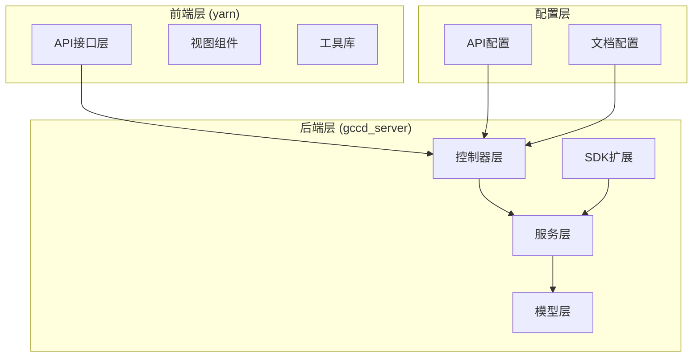
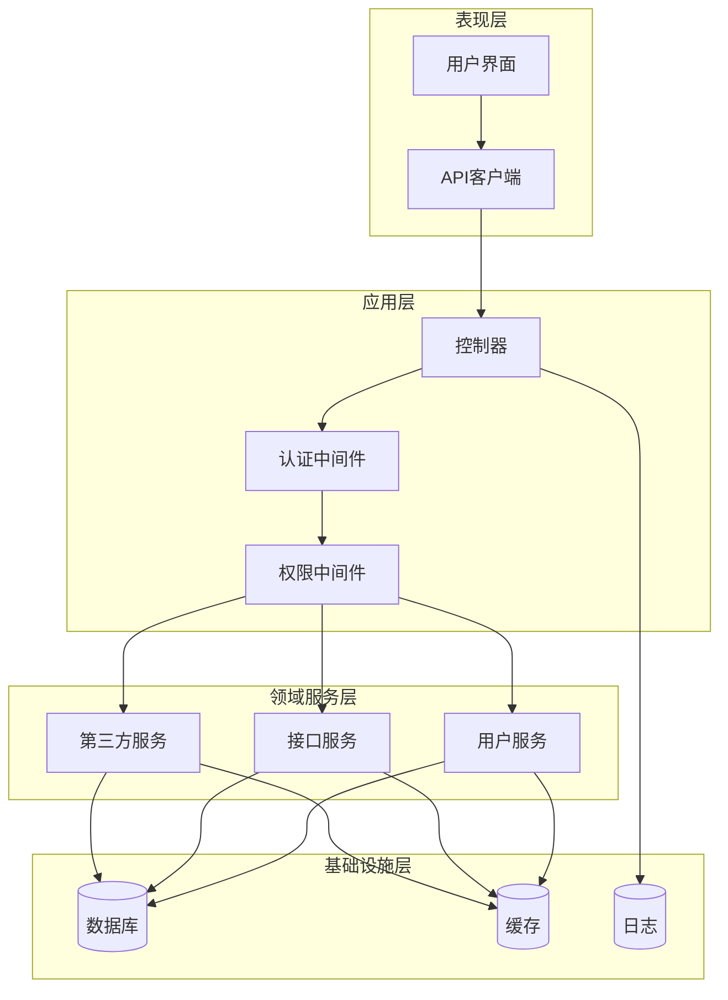
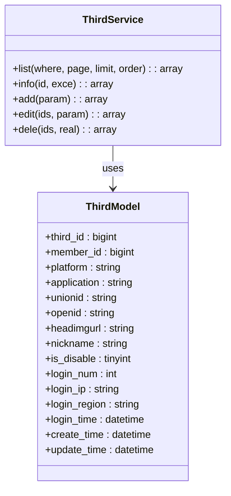
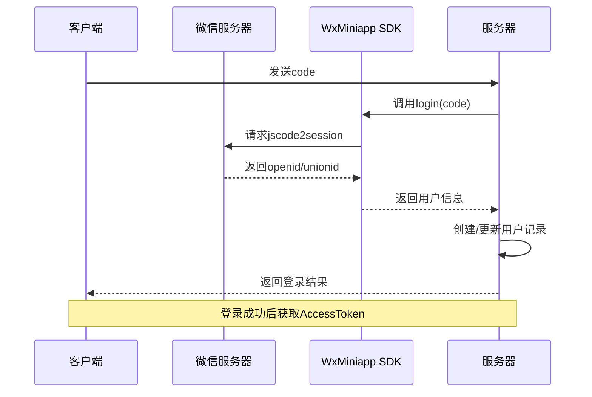
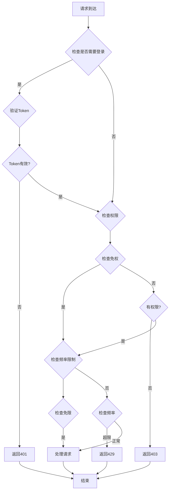
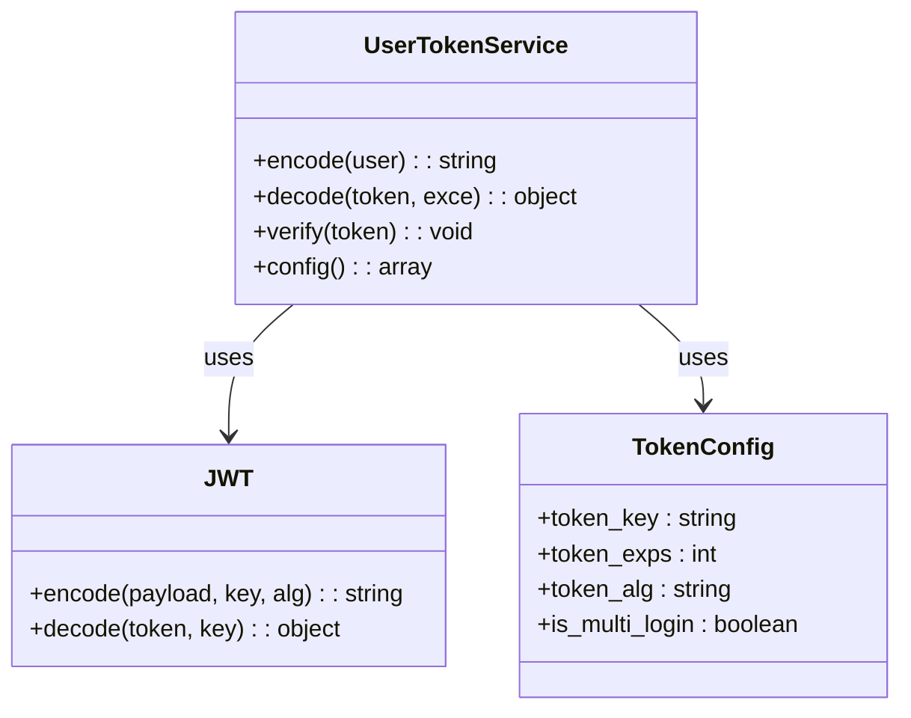
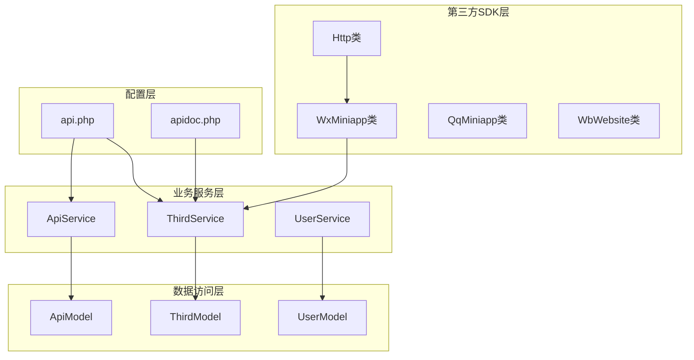

# 第三方集成API

<cite>
**本文档引用的文件**
- [Http.php](file://gccd_server/extend/thirdsdk/Http.php)
- [WxMiniapp.php](file://gccd_server/extend/thirdsdk/WxMiniapp.php)
- [third.js](file://yarn/src/api/member/third.js)
- [Third.php](file://gccd_server/app/admin/controller/member/Third.php)
- [ThirdService.php](file://gccd_server/app/common/service/member/ThirdService.php)
- [Api.php](file://gccd_server/app/admin/controller/member/Api.php)
- [ApiService.php](file://gccd_server/app/common/service/member/ApiService.php)
- [api.php](file://gccd_server/config/api.php)
- [apidocs.md](file://gccd_server/private/apidoc/apidocs.md)
- [ApidocDefinitions.php](file://gccd_server/app/common/controller/ApidocDefinitions.php)
- [UserTokenService.php](file://gccd_server/app/common/service/system/UserTokenService.php)
</cite>

## 目录
1. [简介](#简介)
2. [项目结构](#项目结构)
3. [核心组件](#核心组件)
4. [架构概览](#架构概览)
5. [详细组件分析](#详细组件分析)
6. [依赖关系分析](#依赖关系分析)
7. [性能考虑](#性能考虑)
8. [故障排除指南](#故障排除指南)
9. [结论](#结论)

## 简介

高齿传动项目的第三方集成API为系统提供了与外部平台进行数据交换和身份认证的能力。该API体系主要包含以下功能：

- **第三方账号管理**：支持微信小程序、QQ、微博等平台的用户账号绑定和管理
- **权限认证系统**：基于JWT的Token认证机制，支持多端登录和权限控制
- **接口权限管理**：可配置的接口免登、免权、免限策略
- **数据同步服务**：提供人员数据的双向同步能力

该系统采用前后端分离架构，后端基于ThinkPHP框架，前端使用Vue.js技术栈，通过RESTful API进行数据交互。

## 项目结构

项目采用模块化组织方式，主要分为以下几个部分：

**图表来源**
- [third.js:1-69](file://yarn/src/api/member/third.js#L1-L69)
- [Third.php:17-57](file://gccd_server/app/admin/controller/member/Third.php#L17-L57)

**章节来源**
- [third.js:1-69](file://yarn/src/api/member/third.js#L1-L69)
- [Third.php:17-57](file://gccd_server/app/admin/controller/member/Third.php#L17-L57)

## 核心组件

### 第三方SDK组件

系统提供了统一的第三方SDK抽象层，目前支持以下平台：

| 平台 | 类名 | 功能特性 |
|------|------|----------|
| 微信小程序 | WxMiniapp | 登录授权、AccessToken管理、手机号获取 |
| QQ平台 | QqMiniapp/QqMobile/QqWebsite | 多端支持 |
| 微博平台 | WbWebsite | 网站授权 |
| 支付宝平台 | Alipay | 支付相关 |

### 认证组件

系统采用JWT（JSON Web Token）进行身份认证，支持多种认证方式：

- **Header认证**：通过Authorization头传递Token
- **参数认证**：通过查询参数传递Token
- **多端登录**：支持同一用户在多个设备同时登录

### 接口权限组件

提供灵活的接口权限控制机制：

- **免登接口**：无需登录即可访问的接口列表
- **免权接口**：无需权限验证的接口列表  
- **免限接口**：不受频率限制的接口列表

**章节来源**
- [Http.php:15-116](file://gccd_server/extend/thirdsdk/Http.php#L15-L116)
- [WxMiniapp.php:17-119](file://gccd_server/extend/thirdsdk/WxMiniapp.php#L17-L119)
- [UserTokenService.php:45-91](file://gccd_server/app/common/service/system/UserTokenService.php#L45-L91)

## 架构概览

系统采用分层架构设计，确保各层职责清晰，便于维护和扩展：

**图表来源**
- [ThirdService.php:18-224](file://gccd_server/app/common/service/member/ThirdService.php#L18-L224)
- [ApiService.php:21-391](file://gccd_server/app/common/service/member/ApiService.php#L21-L391)

## 详细组件分析

### 第三方账号管理API

#### 接口定义

系统提供完整的第三方账号管理接口，支持对第三方账号的增删改查操作。

**第三方账号列表接口**
- **HTTP方法**: GET
- **URL路径**: `/admin/member.Third/list`
- **请求参数**:
  - page: 页码，默认1
  - limit: 每页数量，默认10
  - sort: 排序字段
  - search: 搜索条件
  - date: 时间范围查询

**第三方账号详情接口**
- **HTTP方法**: GET  
- **URL路径**: `/admin/member.Third/info`
- **请求参数**:
  - third_id: 第三方账号ID

**第三方账号添加接口**
- **HTTP方法**: POST
- **URL路径**: `/admin/member.Third/add`
- **请求体参数**:
  - member_id: 会员ID
  - platform: 平台类型
  - application: 应用标识
  - unionid: 统一用户标识
  - openid: 平台用户标识
  - headimgurl: 头像URL
  - nickname: 昵称

**章节来源**
- [third.js:8-69](file://yarn/src/api/member/third.js#L8-L69)
- [Third.php:36-104](file://gccd_server/app/admin/controller/member/Third.php#L36-L104)

#### 数据模型设计

**图表来源**
- [ThirdModel.php:19-24](file://gccd_server/app/common/model/member/ThirdModel.php#L19-L24)
- [ThirdService.php:18-224](file://gccd_server/app/common/service/member/ThirdService.php#L18-L224)

**章节来源**
- [ThirdService.php:48-133](file://gccd_server/app/common/service/member/ThirdService.php#L48-L133)

### 微信小程序SDK

#### 登录流程

**图表来源**
- [WxMiniapp.php:67-77](file://gccd_server/extend/thirdsdk/WxMiniapp.php#L67-L77)

#### AccessToken管理

SDK实现了智能的AccessToken缓存机制：

- **缓存策略**: 使用Redis缓存AccessToken
- **过期处理**: 自动检测Token过期并重新获取
- **并发控制**: 避免多个请求同时刷新Token

**章节来源**
- [WxMiniapp.php:84-100](file://gccd_server/extend/thirdsdk/WxMiniapp.php#L84-L100)

### 接口权限管理

#### 权限控制流程

**图表来源**
- [ApiService.php:286-354](file://gccd_server/app/common/service/member/ApiService.php#L286-L354)
- [api.php:20-43](file://gccd_server/config/api.php#L20-L43)

**章节来源**
- [ApiService.php:292-354](file://gccd_server/app/common/service/member/ApiService.php#L292-L354)
- [api.php:20-43](file://gccd_server/config/api.php#L20-L43)

### 认证系统

#### Token生成与验证

**图表来源**
- [UserTokenService.php:45-91](file://gccd_server/app/common/service/system/UserTokenService.php#L45-L91)

**章节来源**
- [UserTokenService.php:45-91](file://gccd_server/app/common/service/system/UserTokenService.php#L45-L91)

## 依赖关系分析

### 组件依赖图

**图表来源**
- [Http.php:15-116](file://gccd_server/extend/thirdsdk/Http.php#L15-L116)
- [WxMiniapp.php:17-119](file://gccd_server/extend/thirdsdk/WxMiniapp.php#L17-L119)
- [ThirdService.php:18-224](file://gccd_server/app/common/service/member/ThirdService.php#L18-L224)

### 外部依赖

系统依赖的主要外部组件：

| 组件 | 版本 | 用途 |
|------|------|------|
| ThinkPHP | 6.x | 核心框架 |
| Vue.js | 3.x | 前端框架 |
| Element Plus | 最新 | UI组件库 |
| JWT | 最新 | Token认证 |
| Redis | 最新 | 缓存存储 |

**章节来源**
- [Http.php:15-116](file://gccd_server/extend/thirdsdk/Http.php#L15-L116)
- [WxMiniapp.php:17-119](file://gccd_server/extend/thirdsdk/WxMiniapp.php#L17-L119)

## 性能考虑

### 缓存策略

系统实现了多层次的缓存机制：

1. **Redis缓存**: 存储AccessToken、接口列表、用户信息
2. **数据库缓存**: ThinkPHP内置查询缓存
3. **浏览器缓存**: 前端静态资源缓存

### 性能优化措施

- **批量操作**: 支持批量删除、批量更新操作
- **分页查询**: 默认每页10条记录，支持自定义数量
- **索引优化**: 关键字段建立数据库索引
- **连接池**: 数据库连接复用

## 故障排除指南

### 常见问题及解决方案

#### 1. 第三方登录失败

**问题症状**: 用户无法通过第三方平台登录

**可能原因**:
- AppID或AppSecret配置错误
- 网络连接问题
- Token过期

**解决步骤**:
1. 检查平台配置信息
2. 验证网络连接
3. 清除缓存重新登录

#### 2. 接口权限错误

**问题症状**: 返回403权限不足错误

**可能原因**:
- 用户权限不足
- Token无效
- 接口权限配置错误

**解决步骤**:
1. 检查用户角色权限
2. 验证Token有效性
3. 检查接口权限配置

#### 3. API响应格式错误

**问题症状**: 接口返回数据格式不符合预期

**可能原因**:
- 参数类型不匹配
- 必填参数缺失
- 数据库连接异常

**解决步骤**:
1. 检查请求参数格式
2. 验证必填参数完整性
3. 查看服务器日志

**章节来源**
- [apidocs.md:39-51](file://gccd_server/private/apidoc/apidocs.md#L39-L51)

### 错误码说明

| 错误码 | 说明 | 处理建议 |
|--------|------|----------|
| 200 | 操作成功 | 正常响应 |
| 400 | 参数错误 | 检查请求参数 |
| 401 | 登录失效 | 重新登录 |
| 403 | 权限不足 | 检查用户权限 |
| 404 | 接口不存在 | 检查URL正确性 |
| 429 | 请求过于频繁 | 降低请求频率 |
| 500 | 服务器错误 | 检查服务器状态 |

## 结论

高齿传动项目的第三方集成API系统具有以下特点：

**优势**:
- **模块化设计**: 清晰的分层架构，便于维护和扩展
- **安全性**: 完善的认证授权机制，支持多种认证方式
- **灵活性**: 可配置的权限控制，适应不同业务场景
- **可靠性**: 多层次缓存和错误处理机制

**应用场景**:
- 第三方账号绑定和管理
- 多平台用户统一认证
- 接口权限精细化控制
- 数据同步和交换

**未来改进方向**:
- 增加更多的第三方平台支持
- 优化性能监控和日志记录
- 完善API文档和示例代码
- 加强安全审计和合规性检查

该系统为高齿传动项目提供了稳定可靠的第三方集成能力，能够满足企业级应用的需求。