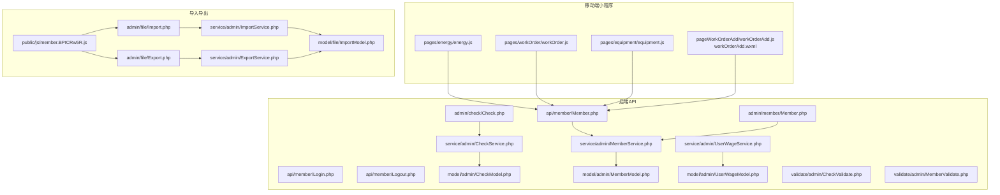
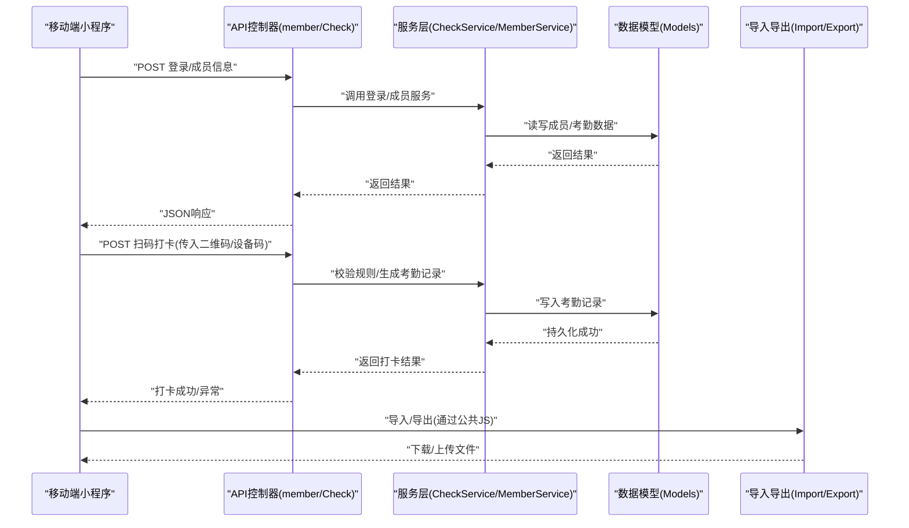
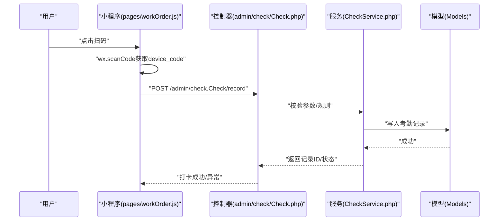
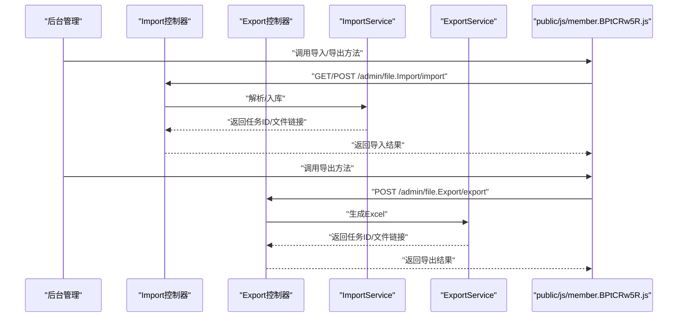
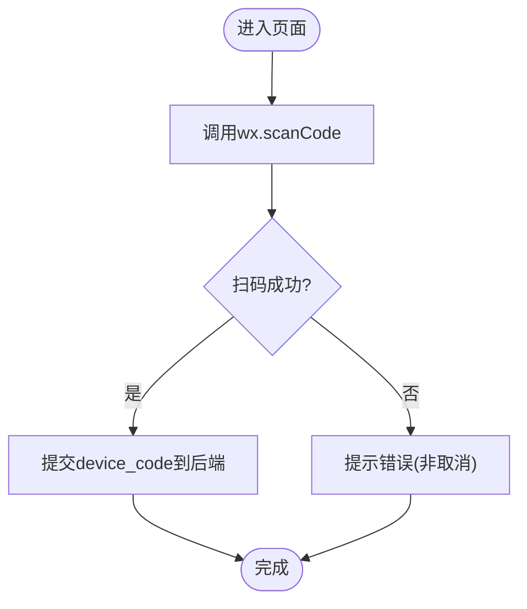
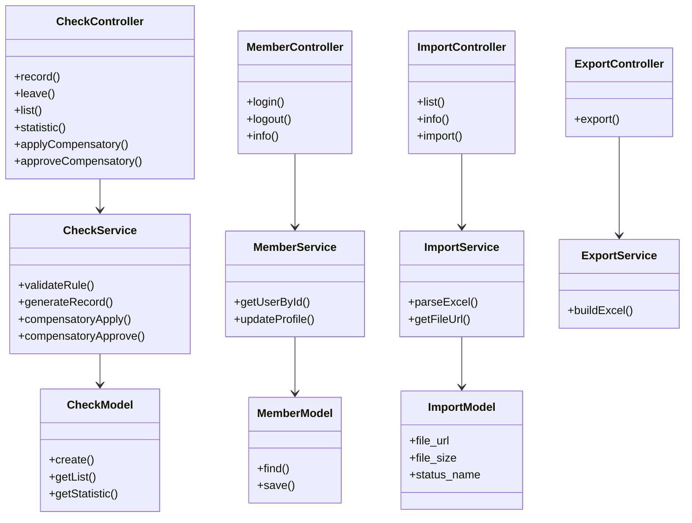

# 考勤管理API

<cite>
**本文引用的文件**
- [gccd_server/app/admin/controller/check/Check.php](file://gccd_server/app/admin/controller/check/Check.php)
- [gccd_server/app/admin/controller/member/Member.php](file://gccd_server/app/admin/controller/member/Member.php)
- [gccd_server/app/api/controller/member/Login.php](file://gccd_server/app/api/controller/member/Login.php)
- [gccd_server/app/api/controller/member/Logout.php](file://gccd_server/app/api/controller/member/Logout.php)
- [gccd_server/app/api/controller/member/Member.php](file://gccd_server/app/api/controller/member/Member.php)
- [gccd_server/app/common/service/admin/CheckService.php](file://gccd_server/app/common/service/admin/CheckService.php)
- [gccd_server/app/common/service/admin/MemberService.php](file://gccd_server/app/common/service/admin/MemberService.php)
- [gccd_server/app/common/service/admin/UserWageService.php](file://gccd_server/app/common/service/admin/UserWageService.php)
- [gccd_server/app/common/model/admin/CheckModel.php](file://gccd_server/app/common/model/admin/CheckModel.php)
- [gccd_server/app/common/model/admin/MemberModel.php](file://gccd_server/app/common/model/admin/MemberModel.php)
- [gccd_server/app/common/model/admin/UserWageModel.php](file://gccd_server/app/common/model/admin/UserWageModel.php)
- [gccd_server/app/common/validate/admin/CheckValidate.php](file://gccd_server/app/common/validate/admin/CheckValidate.php)
- [gccd_server/app/common/validate/admin/MemberValidate.php](file://gccd_server/app/common/validate/admin/MemberValidate.php)
- [gccd_server/app/admin/controller/file/Import.php](file://gccd_server/app/admin/controller/file/Import.php)
- [gccd_server/app/admin/controller/file/Export.php](file://gccd_server/app/admin/controller/file/Export.php)
- [gccd_server/app/common/service/admin/ImportService.php](file://gccd_server/app/common/service/admin/ImportService.php)
- [gccd_server/app/common/service/admin/ExportService.php](file://gccd_server/app/common/service/admin/ExportService.php)
- [gccd_server/app/common/model/file/ImportModel.php](file://gccd_server/app/common/model/file/ImportModel.php)
- [gccd_server/public/js/member.BPtCRw5R.js](file://gccd_server/public/js/member.BPtCRw5R.js)
- [gccd_server/public/admin/js/member.BPtCRw5R.js](file://gccd_server/public/admin/js/member.BPtCRw5R.js)
- [gccd_mini/pages/energy/energy.js](file://gccd_mini/pages/energy/energy.js)
- [gccd_mini/pages/workOrder/workOrder.js](file://gccd_mini/pages/workOrder/workOrder.js)
- [gccd_mini/pages/equipment/equipment.js](file://gccd_mini/pages/equipment/equipment.js)
- [gccd_mini/pageWorkOrder/pages/workOrderAdd/workOrderAdd.js](file://gccd_mini/pageWorkOrder/pages/workOrderAdd/workOrderAdd.js)
- [gccd_mini/pageWorkOrder/pages/workOrderAdd/workOrderAdd.wxml](file://gccd_mini/pageWorkOrder/pages/workOrderAdd/workOrderAdd.wxml)
- [gccd_server/app/common/service/admin/ProductReportService.php](file://gccd_server/app/common/service/admin/ProductReportService.php)
- [gccd_server/app/common/service/admin/ProductionService.php](file://gccd_server/app/common/service/admin/ProductionService.php)
- [yarn/src/api/mes/EnergyConsumption/EnergyConsumption.js](file://yarn/src/api/mes/EnergyConsumption/EnergyConsumption.js)
- [yarn/src/views/mes/EnergyConsumption/PicklingWorkshop.vue](file://yarn/src/views/mes/EnergyConsumption/PicklingWorkshop.vue)
</cite>

## 目录
1. [简介](#简介)
2. [项目结构](#项目结构)
3. [核心组件](#核心组件)
4. [架构总览](#架构总览)
5. [详细组件分析](#详细组件分析)
6. [依赖关系分析](#依赖关系分析)
7. [性能考虑](#性能考虑)
8. [故障排查指南](#故障排查指南)
9. [结论](#结论)
10. [附录](#附录)

## 简介
本文件面向“高齿传动”项目中的考勤管理API，系统性梳理移动端扫码打卡、考勤记录与统计、请假管理、异常处理与补卡流程、以及考勤数据的导入导出能力。文档以接口清单与流程图为依据，帮助前后端协同开发与运维排障。

## 项目结构
围绕考勤相关的关键目录与文件如下：
- 后端控制器与服务层
  - 考勤与成员：app/admin/controller/check/Check.php、app/admin/controller/member/Member.php
  - API成员登录登出与成员接口：app/api/controller/member/*
  - 服务层：app/common/service/admin/CheckService.php、MemberService.php、UserWageService.php
  - 数据模型与校验：app/common/model/admin/*、app/common/validate/admin/*
- 前端移动端与后台管理
  - 移动端扫码入口与通用扫描逻辑：gccd_mini/pages/*/energy.js、workOrder.js、equipment.js
  - 不满勤登记UI与交互：gccd_mini/pageWorkOrder/pages/workOrderAdd/workOrderAdd.js、workOrderAdd.wxml
  - 后台导入导出与统计：app/admin/controller/file/*、app/common/service/admin/ImportService.php、ExportService.php、public/js/member.BPtCRw5R.js
- MES/报工相关（用于对比与扩展）
  - yarn/src/api/mes/EnergyConsumption/* 与 PicklingWorkshop.vue

图表来源
- [gccd_server/app/api/controller/member/Login.php](file://gccd_server/app/api/controller/member/Login.php)
- [gccd_server/app/api/controller/member/Logout.php](file://gccd_server/app/api/controller/member/Logout.php)
- [gccd_server/app/api/controller/member/Member.php](file://gccd_server/app/api/controller/member/Member.php)
- [gccd_server/app/admin/controller/check/Check.php](file://gccd_server/app/admin/controller/check/Check.php)
- [gccd_server/app/admin/controller/member/Member.php](file://gccd_server/app/admin/controller/member/Member.php)
- [gccd_server/app/common/service/admin/CheckService.php](file://gccd_server/app/common/service/admin/CheckService.php)
- [gccd_server/app/common/service/admin/MemberService.php](file://gccd_server/app/common/service/admin/MemberService.php)
- [gccd_server/app/common/service/admin/UserWageService.php](file://gccd_server/app/common/service/admin/UserWageService.php)
- [gccd_server/app/admin/controller/file/Import.php](file://gccd_server/app/admin/controller/file/Import.php)
- [gccd_server/app/admin/controller/file/Export.php](file://gccd_server/app/admin/controller/file/Export.php)
- [gccd_server/app/common/service/admin/ImportService.php](file://gccd_server/app/common/service/admin/ImportService.php)
- [gccd_server/app/common/service/admin/ExportService.php](file://gccd_server/app/common/service/admin/ExportService.php)
- [gccd_server/app/common/model/file/ImportModel.php](file://gccd_server/app/common/model/file/ImportModel.php)
- [gccd_server/public/js/member.BPtCRw5R.js](file://gccd_server/public/js/member.BPtCRw5R.js)

章节来源
- [gccd_server/app/admin/controller/check/Check.php](file://gccd_server/app/admin/controller/check/Check.php)
- [gccd_server/app/admin/controller/member/Member.php](file://gccd_server/app/admin/controller/member/Member.php)
- [gccd_server/app/api/controller/member/Member.php](file://gccd_server/app/api/controller/member/Member.php)
- [gccd_server/app/common/service/admin/CheckService.php](file://gccd_server/app/common/service/admin/CheckService.php)
- [gccd_server/app/common/service/admin/MemberService.php](file://gccd_server/app/common/service/admin/MemberService.php)
- [gccd_server/app/common/service/admin/UserWageService.php](file://gccd_server/app/common/service/admin/UserWageService.php)
- [gccd_server/app/admin/controller/file/Import.php](file://gccd_server/app/admin/controller/file/Import.php)
- [gccd_server/app/admin/controller/file/Export.php](file://gccd_server/app/admin/controller/file/Export.php)
- [gccd_server/app/common/service/admin/ImportService.php](file://gccd_server/app/common/service/admin/ImportService.php)
- [gccd_server/app/common/service/admin/ExportService.php](file://gccd_server/app/common/service/admin/ExportService.php)
- [gccd_server/public/js/member.BPtCRw5R.js](file://gccd_server/public/js/member.BPtCRw5R.js)

## 核心组件
- 考勤控制器与服务
  - 控制器：admin/check/Check.php 提供考勤记录、打卡签到、异常处理与补卡等接口
  - 服务：CheckService.php 实现业务逻辑，包含考勤规则、统计与异常处理
- 成员与登录API
  - API控制器：api/member/* 提供登录、登出、成员信息接口
  - 管理端控制器：admin/member/Member.php 提供成员管理与统计
  - 服务：MemberService.php、UserWageService.php 提供成员与工资相关能力
- 导入导出
  - 控制器：admin/file/Import.php、Export.php
  - 服务：ImportService.php、ExportService.php
  - 模型：ImportModel.php 输出文件链接、大小、状态等字段
- 移动端扫码
  - pages/*/energy.js、workOrder.js、equipment.js 提供扫码入口与结果处理
  - pageWorkOrderAdd/workOrderAdd.js、workOrderAdd.wxml 支持“不满勤”登记

章节来源
- [gccd_server/app/admin/controller/check/Check.php](file://gccd_server/app/admin/controller/check/Check.php)
- [gccd_server/app/common/service/admin/CheckService.php](file://gccd_server/app/common/service/admin/CheckService.php)
- [gccd_server/app/api/controller/member/Login.php](file://gccd_server/app/api/controller/member/Login.php)
- [gccd_server/app/api/controller/member/Logout.php](file://gccd_server/app/api/controller/member/Logout.php)
- [gccd_server/app/api/controller/member/Member.php](file://gccd_server/app/api/controller/member/Member.php)
- [gccd_server/app/admin/controller/member/Member.php](file://gccd_server/app/admin/controller/member/Member.php)
- [gccd_server/app/common/service/admin/MemberService.php](file://gccd_server/app/common/service/admin/MemberService.php)
- [gccd_server/app/common/service/admin/UserWageService.php](file://gccd_server/app/common/service/admin/UserWageService.php)
- [gccd_server/app/admin/controller/file/Import.php](file://gccd_server/app/admin/controller/file/Import.php)
- [gccd_server/app/admin/controller/file/Export.php](file://gccd_server/app/admin/controller/file/Export.php)
- [gccd_server/app/common/service/admin/ImportService.php](file://gccd_server/app/common/service/admin/ImportService.php)
- [gccd_server/app/common/service/admin/ExportService.php](file://gccd_server/app/common/service/admin/ExportService.php)
- [gccd_server/app/common/model/file/ImportModel.php](file://gccd_server/app/common/model/file/ImportModel.php)
- [gccd_mini/pages/energy/energy.js](file://gccd_mini/pages/energy/energy.js)
- [gccd_mini/pages/workOrder/workOrder.js](file://gccd_mini/pages/workOrder/workOrder.js)
- [gccd_mini/pages/equipment/equipment.js](file://gccd_mini/pages/equipment/equipment.js)
- [gccd_mini/pageWorkOrder/pages/workOrderAdd/workOrderAdd.js](file://gccd_mini/pageWorkOrder/pages/workOrderAdd/workOrderAdd.js)
- [gccd_mini/pageWorkOrder/pages/workOrderAdd/workOrderAdd.wxml](file://gccd_mini/pageWorkOrder/pages/workOrderAdd/workOrderAdd.wxml)

## 架构总览
下图展示移动端扫码、后端考勤与成员服务、以及导入导出的整体交互：

图表来源
- [gccd_server/app/api/controller/member/Member.php](file://gccd_server/app/api/controller/member/Member.php)
- [gccd_server/app/admin/controller/check/Check.php](file://gccd_server/app/admin/controller/check/Check.php)
- [gccd_server/app/common/service/admin/CheckService.php](file://gccd_server/app/common/service/admin/CheckService.php)
- [gccd_server/app/common/service/admin/MemberService.php](file://gccd_server/app/common/service/admin/MemberService.php)
- [gccd_server/app/admin/controller/file/Import.php](file://gccd_server/app/admin/controller/file/Import.php)
- [gccd_server/app/admin/controller/file/Export.php](file://gccd_server/app/admin/controller/file/Export.php)
- [gccd_server/public/js/member.BPtCRw5R.js](file://gccd_server/public/js/member.BPtCRw5R.js)

## 详细组件分析

### 考勤记录与打卡签到
- 接口定义
  - 方法：POST
  - 路径：/admin/check.Check/record
  - 请求参数
    - user_id：整数，必填，当前用户ID
    - device_code：字符串，必填，扫码获取的设备码或二维码内容
    - check_type：字符串，枚举值“上班/下班”，必填
    - remark：字符串，可选，备注
  - 响应
    - code：整数，200表示成功
    - msg：字符串，描述
    - data：对象，包含本次考勤记录ID与状态
- 流程说明
  - 移动端调用扫码接口获取device_code
  - 小程序将device_code与用户身份信息提交至后端
  - 服务层进行规则校验（如重复打卡、时间窗口、班次判断）
  - 写入考勤记录并返回结果

图表来源
- [gccd_mini/pages/workOrder/workOrder.js](file://gccd_mini/pages/workOrder/workOrder.js)
- [gccd_server/app/admin/controller/check/Check.php](file://gccd_server/app/admin/controller/check/Check.php)
- [gccd_server/app/common/service/admin/CheckService.php](file://gccd_server/app/common/service/admin/CheckService.php)

章节来源
- [gccd_server/app/admin/controller/check/Check.php](file://gccd_server/app/admin/controller/check/Check.php)
- [gccd_server/app/common/service/admin/CheckService.php](file://gccd_server/app/common/service/admin/CheckService.php)
- [gccd_mini/pages/workOrder/workOrder.js](file://gccd_mini/pages/workOrder/workOrder.js)

### 请假管理
- 接口定义
  - 方法：POST
  - 路径：/admin/check.Check/leave
  - 请求参数
    - user_id：整数，必填
    - leave_type：字符串，枚举值“病假/事假/年假/调休”等
    - start_date：字符串，YYYY-MM-DD，必填
    - end_date：字符串，YYYY-MM-DD，必填
    - hours：数值，可选，按小时计的请假时长
    - remark：字符串，可选
  - 响应
    - code、msg、data（包含请假记录ID）

章节来源
- [gccd_server/app/admin/controller/check/Check.php](file://gccd_server/app/admin/controller/check/Check.php)
- [gccd_server/app/common/service/admin/CheckService.php](file://gccd_server/app/common/service/admin/CheckService.php)

### 考勤日志与统计分析
- 日志查询
  - 方法：GET
  - 路径：/admin/check.Check/list
  - 查询参数
    - user_id：整数，可选
    - date_range：数组，[开始, 结束]，可选
    - page、limit：分页参数
  - 响应
    - code、msg、data.list（考勤记录列表）、data.count（总数）
- 统计分析
  - 方法：GET
  - 路径：/admin/check.Check/statistic
  - 查询参数
    - date_range：数组，[开始, 结束]
    - group_by：字符串，可选，按“日/周/月”聚合
  - 响应
    - code、msg、data（迟到/早退/缺勤/加班时长等汇总）

章节来源
- [gccd_server/app/admin/controller/check/Check.php](file://gccd_server/app/admin/controller/check/Check.php)
- [gccd_server/app/common/service/admin/CheckService.php](file://gccd_server/app/common/service/admin/CheckService.php)

### 异常处理与补卡流程
- 补卡申请
  - 方法：POST
  - 路径：/admin/check.Check/applyCompensatory
  - 请求参数
    - user_id、check_date（YYYY-MM-DD）、reason（原因）、attach（附件ID，可选）
  - 响应
    - code、msg、data（申请ID）
- 审批流程
  - 方法：POST
  - 路径：/admin/check.Check/approveCompensatory
  - 请求参数
    - apply_id：整数，申请ID
    - approve：布尔，是否批准
    - remark：字符串，可选
  - 响应
    - code、msg、data（更新后的申请状态）

章节来源
- [gccd_server/app/admin/controller/check/Check.php](file://gccd_server/app/admin/controller/check/Check.php)
- [gccd_server/app/common/service/admin/CheckService.php](file://gccd_server/app/common/service/admin/CheckService.php)

### 考勤数据导入导出
- 导入
  - 方法：GET/POST
  - 路径：/admin/file.Import/import
  - GET：返回下载链接（用于浏览器直接下载模板）
  - POST：上传Excel文件，异步解析并入库
  - 响应
    - code、msg、data（包含导入任务ID、成功/失败文件链接）
- 导出
  - 方法：GET/POST
  - 路径：/admin/file.Export/export
  - 查询参数
    - date_range：数组，[开始, 结束]
    - user_ids：数组，可选
  - 响应
    - code、msg、data（导出任务ID、下载链接）
- 前端公共JS
  - 导入/导出公共方法位于 public/js/member.BPtCRw5R.js，支持下载与上传

图表来源
- [gccd_server/app/admin/controller/file/Import.php](file://gccd_server/app/admin/controller/file/Import.php)
- [gccd_server/app/admin/controller/file/Export.php](file://gccd_server/app/admin/controller/file/Export.php)
- [gccd_server/app/common/service/admin/ImportService.php](file://gccd_server/app/common/service/admin/ImportService.php)
- [gccd_server/app/common/service/admin/ExportService.php](file://gccd_server/app/common/service/admin/ExportService.php)
- [gccd_server/public/js/member.BPtCRw5R.js](file://gccd_server/public/js/member.BPtCRw5R.js)

章节来源
- [gccd_server/app/admin/controller/file/Import.php](file://gccd_server/app/admin/controller/file/Import.php)
- [gccd_server/app/admin/controller/file/Export.php](file://gccd_server/app/admin/controller/file/Export.php)
- [gccd_server/app/common/service/admin/ImportService.php](file://gccd_server/app/common/service/admin/ImportService.php)
- [gccd_server/app/common/service/admin/ExportService.php](file://gccd_server/app/common/service/admin/ExportService.php)
- [gccd_server/public/js/member.BPtCRw5R.js](file://gccd_server/public/js/member.BPtCRw5R.js)

### 移动端扫码集成（与移动端页面联动）
- 扫码入口
  - pages/energy/energy.js、pages/workOrder/workOrder.js、pages/equipment/equipment.js 提供统一扫码入口
  - 支持二维码/条形码，允许从相册选择
- 结果处理
  - 成功回调将扫码结果作为device_code传递给后端
  - 若失败，仅在非用户取消场景提示错误

图表来源
- [gccd_mini/pages/energy/energy.js](file://gccd_mini/pages/energy/energy.js)
- [gccd_mini/pages/workOrder/workOrder.js](file://gccd_mini/pages/workOrder/workOrder.js)
- [gccd_mini/pages/equipment/equipment.js](file://gccd_mini/pages/equipment/equipment.js)

章节来源
- [gccd_mini/pages/energy/energy.js](file://gccd_mini/pages/energy/energy.js)
- [gccd_mini/pages/workOrder/workOrder.js](file://gccd_mini/pages/workOrder/workOrder.js)
- [gccd_mini/pages/equipment/equipment.js](file://gccd_mini/pages/equipment/equipment.js)

### 不满勤登记（与考勤联动）
- 功能点
  - 在任务新增页面支持“不满勤”人员登记，输入上班时长并保存
  - UI包含表格、输入校验与移除操作
- 与考勤的关系
  - 不满勤记录可作为考勤统计的补充，便于计算实际出勤时长

章节来源
- [gccd_mini/pageWorkOrder/pages/workOrderAdd/workOrderAdd.js](file://gccd_mini/pageWorkOrder/pages/workOrderAdd/workOrderAdd.js)
- [gccd_mini/pageWorkOrder/pages/workOrderAdd/workOrderAdd.wxml](file://gccd_mini/pageWorkOrder/pages/workOrderAdd/workOrderAdd.wxml)

## 依赖关系分析
- 控制器依赖服务层，服务层依赖数据模型与校验器
- 导入导出控制器依赖对应服务，服务依赖模型输出文件链接与状态
- 前端公共JS封装导入导出调用，统一返回下载链接或上传响应

图表来源
- [gccd_server/app/admin/controller/check/Check.php](file://gccd_server/app/admin/controller/check/Check.php)
- [gccd_server/app/common/service/admin/CheckService.php](file://gccd_server/app/common/service/admin/CheckService.php)
- [gccd_server/app/common/model/admin/CheckModel.php](file://gccd_server/app/common/model/admin/CheckModel.php)
- [gccd_server/app/admin/controller/member/Member.php](file://gccd_server/app/admin/controller/member/Member.php)
- [gccd_server/app/common/service/admin/MemberService.php](file://gccd_server/app/common/service/admin/MemberService.php)
- [gccd_server/app/common/model/admin/MemberModel.php](file://gccd_server/app/common/model/admin/MemberModel.php)
- [gccd_server/app/admin/controller/file/Import.php](file://gccd_server/app/admin/controller/file/Import.php)
- [gccd_server/app/admin/controller/file/Export.php](file://gccd_server/app/admin/controller/file/Export.php)
- [gccd_server/app/common/service/admin/ImportService.php](file://gccd_server/app/common/service/admin/ImportService.php)
- [gccd_server/app/common/service/admin/ExportService.php](file://gccd_server/app/common/service/admin/ExportService.php)
- [gccd_server/app/common/model/file/ImportModel.php](file://gccd_server/app/common/model/file/ImportModel.php)

章节来源
- [gccd_server/app/admin/controller/check/Check.php](file://gccd_server/app/admin/controller/check/Check.php)
- [gccd_server/app/common/service/admin/CheckService.php](file://gccd_server/app/common/service/admin/CheckService.php)
- [gccd_server/app/admin/controller/member/Member.php](file://gccd_server/app/admin/controller/member/Member.php)
- [gccd_server/app/common/service/admin/MemberService.php](file://gccd_server/app/common/service/admin/MemberService.php)
- [gccd_server/app/admin/controller/file/Import.php](file://gccd_server/app/admin/controller/file/Import.php)
- [gccd_server/app/admin/controller/file/Export.php](file://gccd_server/app/admin/controller/file/Export.php)
- [gccd_server/app/common/service/admin/ImportService.php](file://gccd_server/app/common/service/admin/ImportService.php)
- [gccd_server/app/common/service/admin/ExportService.php](file://gccd_server/app/common/service/admin/ExportService.php)
- [gccd_server/app/common/model/file/ImportModel.php](file://gccd_server/app/common/model/file/ImportModel.php)

## 性能考虑
- 分页与筛选
  - 列表接口支持分页与日期范围筛选，建议前端按需加载，避免一次性拉取大量数据
- 导入导出
  - 大文件导入采用异步解析与分片策略；导出按日期范围限制，避免超大数据集
- 扫码与网络
  - 扫码失败重试与提示优化，减少无效请求；接口超时与重试策略建议配置在前端SDK

## 故障排查指南
- 扫码失败
  - 现象：用户取消或识别失败
  - 处理：仅在非取消场景提示错误；确认扫码权限与相机授权
- 打卡异常
  - 现象：重复打卡、跨天时间窗不符、班次冲突
  - 处理：检查服务层规则与数据库约束；查看日志定位具体异常
- 导入导出失败
  - 现象：模板不匹配、文件过大、解析异常
  - 处理：核对模板字段与类型；检查文件大小限制；查看导入任务状态与失败文件

章节来源
- [gccd_mini/pages/energy/energy.js](file://gccd_mini/pages/energy/energy.js)
- [gccd_mini/pages/workOrder/workOrder.js](file://gccd_mini/pages/workOrder/workOrder.js)
- [gccd_server/app/common/service/admin/CheckService.php](file://gccd_server/app/common/service/admin/CheckService.php)
- [gccd_server/app/admin/controller/file/Import.php](file://gccd_server/app/admin/controller/file/Import.php)
- [gccd_server/app/admin/controller/file/Export.php](file://gccd_server/app/admin/controller/file/Export.php)

## 结论
本文件基于现有代码梳理了考勤管理API的接口边界、流程与依赖关系，并提供了移动端扫码集成、异常处理与补卡流程、以及导入导出能力的说明。建议后续完善接口文档与自动化测试，确保跨端一致性与稳定性。

## 附录
- 相关MES/报工接口（用于横向对比）
  - yarn/src/api/mes/EnergyConsumption/EnergyConsumption.js
  - yarn/src/views/mes/EnergyConsumption/PicklingWorkshop.vue
  - 生产报工服务：app/common/service/admin/ProductReportService.php、ProductionService.php

章节来源
- [yarn/src/api/mes/EnergyConsumption/EnergyConsumption.js](file://yarn/src/api/mes/EnergyConsumption/EnergyConsumption.js)
- [yarn/src/views/mes/EnergyConsumption/PicklingWorkshop.vue](file://yarn/src/views/mes/EnergyConsumption/PicklingWorkshop.vue)
- [gccd_server/app/common/service/admin/ProductReportService.php](file://gccd_server/app/common/service/admin/ProductReportService.php)
- [gccd_server/app/common/service/admin/ProductionService.php](file://gccd_server/app/common/service/admin/ProductionService.php)