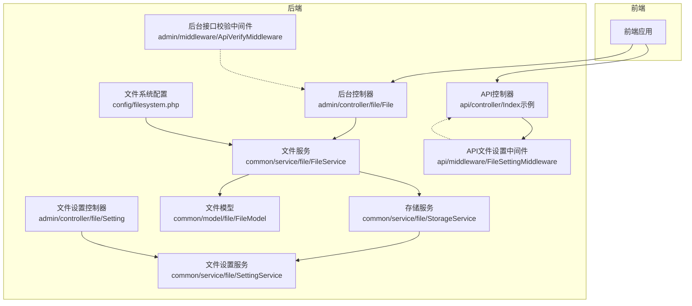
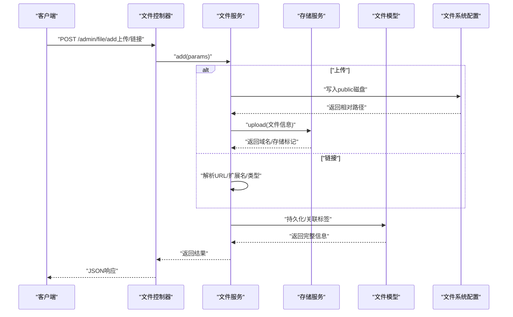
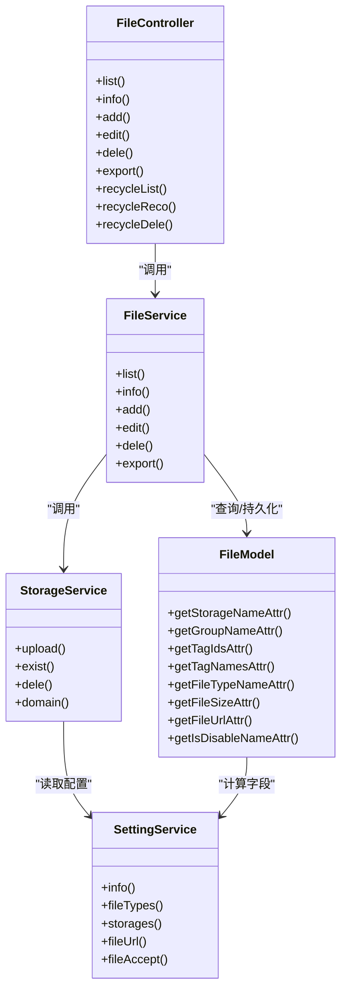
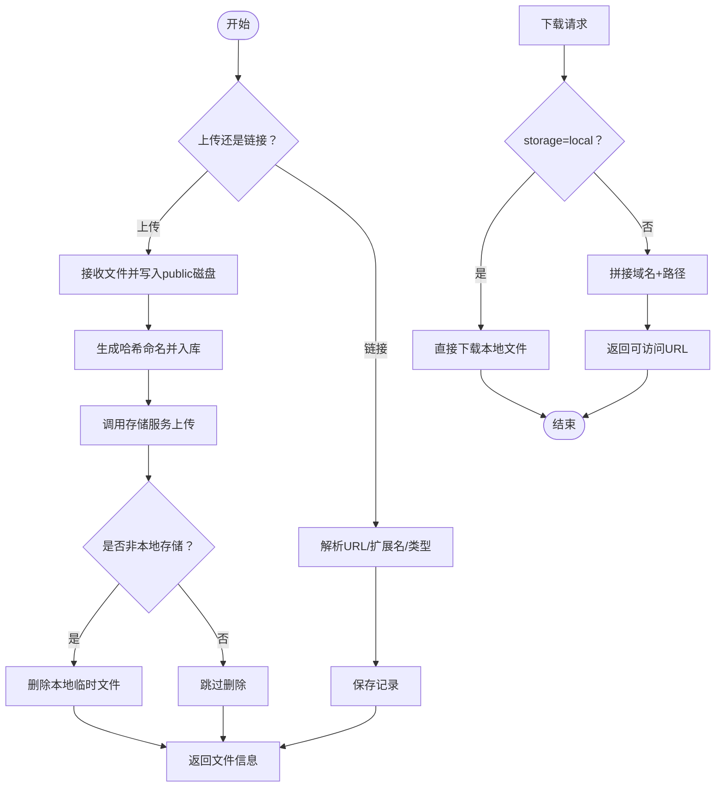

# 文件管理API

<cite>
**本文引用的文件**
- [gccd_server/app/admin/controller/file/File.php](file://gccd_server/app/admin/controller/file/File.php)
- [gccd_server/app/common/service/file/FileService.php](file://gccd_server/app/common/service/file/FileService.php)
- [gccd_server/app/common/model/file/FileModel.php](file://gccd_server/app/common/model/file/FileModel.php)
- [gccd_server/app/common/service/file/StorageService.php](file://gccd_server/app/common/service/file/StorageService.php)
- [gccd_server/app/admin/controller/file/Setting.php](file://gccd_server/app/admin/controller/file/Setting.php)
- [gccd_server/app/common/service/file/SettingService.php](file://gccd_server/app/common/service/file/SettingService.php)
- [gccd_server/config/filesystem.php](file://gccd_server/config/filesystem.php)
- [gccd_server/app/admin/middleware/ApiVerifyMiddleware.php](file://gccd_server/app/admin/middleware/ApiVerifyMiddleware.php)
- [gccd_server/app/api/middleware/FileSettingMiddleware.php](file://gccd_server/app/api/middleware/FileSettingMiddleware.php)
</cite>

## 目录
1. [简介](#简介)
2. [项目结构](#项目结构)
3. [核心组件](#核心组件)
4. [架构总览](#架构总览)
5. [详细组件分析](#详细组件分析)
6. [依赖关系分析](#依赖关系分析)
7. [性能与扩展性](#性能与扩展性)
8. [故障排查指南](#故障排查指南)
9. [结论](#结论)
10. [附录：接口定义与调用示例](#附录接口定义与调用示例)

## 简介
本文件面向“高齿传动”项目的文件管理API，覆盖文件上传、下载、删除、列表查询、详情查看、回收站、导出等能力，并说明本地存储与多种云存储（七牛、阿里云OSS、腾讯云COS、百度云BOS、又拍云USS、华为云OBS、AWS S3）的配置与处理流程。同时给出权限控制、安全防护、业务流程与接口调用示例，帮助前后端协作与运维部署。

## 项目结构
围绕文件管理的关键模块如下：
- 控制器层：后台管理控制器负责文件列表、详情、上传、编辑、删除、回收站、导出等；API侧通过中间件控制访问。
- 服务层：文件服务封装增删改查、导出、前后邻接查询、统计；存储服务封装各类云存储上传/存在性检查/删除与域名拼装。
- 模型层：文件模型提供关联分组、标签、计算字段（类型名、大小、URL、禁用名等）。
- 配置层：本地文件系统磁盘配置；文件设置（存储方式、类型限制、API开关等）。
- 中间件层：后台接口校验与API侧文件功能开关。

**图示来源**
- [gccd_server/app/admin/controller/file/File.php:25-436](file://gccd_server/app/admin/controller/file/File.php#L25-L436)
- [gccd_server/app/common/service/file/FileService.php:22-480](file://gccd_server/app/common/service/file/FileService.php#L22-L480)
- [gccd_server/app/common/service/file/StorageService.php:33-455](file://gccd_server/app/common/service/file/StorageService.php#L33-L455)
- [gccd_server/app/common/model/file/FileModel.php:19-115](file://gccd_server/app/common/model/file/FileModel.php#L19-L115)
- [gccd_server/config/filesystem.php:10-33](file://gccd_server/config/filesystem.php#L10-L33)
- [gccd_server/app/admin/controller/file/Setting.php:24-113](file://gccd_server/app/admin/controller/file/Setting.php#L24-L113)
- [gccd_server/app/common/service/file/SettingService.php:19-278](file://gccd_server/app/common/service/file/SettingService.php#L19-L278)
- [gccd_server/app/admin/middleware/ApiVerifyMiddleware.php:23-78](file://gccd_server/app/admin/middleware/ApiVerifyMiddleware.php#L23-L78)
- [gccd_server/app/api/middleware/FileSettingMiddleware.php:20-39](file://gccd_server/app/api/middleware/FileSettingMiddleware.php#L20-L39)

**章节来源**
- [gccd_server/app/admin/controller/file/File.php:25-436](file://gccd_server/app/admin/controller/file/File.php#L25-L436)
- [gccd_server/app/common/service/file/FileService.php:22-480](file://gccd_server/app/common/service/file/FileService.php#L22-L480)
- [gccd_server/app/common/service/file/StorageService.php:33-455](file://gccd_server/app/common/service/file/StorageService.php#L33-L455)
- [gccd_server/app/common/model/file/FileModel.php:19-115](file://gccd_server/app/common/model/file/FileModel.php#L19-L115)
- [gccd_server/config/filesystem.php:10-33](file://gccd_server/config/filesystem.php#L10-L33)
- [gccd_server/app/admin/controller/file/Setting.php:24-113](file://gccd_server/app/admin/controller/file/Setting.php#L24-L113)
- [gccd_server/app/common/service/file/SettingService.php:19-278](file://gccd_server/app/common/service/file/SettingService.php#L19-L278)
- [gccd_server/app/admin/middleware/ApiVerifyMiddleware.php:23-78](file://gccd_server/app/admin/middleware/ApiVerifyMiddleware.php#L23-L78)
- [gccd_server/app/api/middleware/FileSettingMiddleware.php:20-39](file://gccd_server/app/api/middleware/FileSettingMiddleware.php#L20-L39)

## 核心组件
- 文件控制器：提供列表、详情、添加（上传/链接）、修改、删除、批量修改分组/标签/类型/域名/禁用状态、回收站列表/恢复/彻底删除、导出等接口。
- 文件服务：封装列表/详情/添加/修改/删除/导出/前后邻接/统计等逻辑，统一调用存储服务与缓存。
- 存储服务：统一封装七牛、阿里云OSS、腾讯云COS、百度云BOS、又拍云USS、华为云OBS、AWS S3等对象存储的上传、存在性检查、删除与域名拼装。
- 文件模型：提供关联分组/标签、附加字段（类型名、大小、URL、禁用名）与计算属性。
- 文件设置：提供文件类型、存储方式、允许扩展名、API开关、各云存储密钥与域名等配置项。
- 文件系统配置：定义本地磁盘（runtime与public/storage）与对外URL映射。
- 中间件：后台接口校验与API侧文件功能开关。

**章节来源**
- [gccd_server/app/admin/controller/file/File.php:25-436](file://gccd_server/app/admin/controller/file/File.php#L25-L436)
- [gccd_server/app/common/service/file/FileService.php:22-480](file://gccd_server/app/common/service/file/FileService.php#L22-L480)
- [gccd_server/app/common/service/file/StorageService.php:33-455](file://gccd_server/app/common/service/file/StorageService.php#L33-L455)
- [gccd_server/app/common/model/file/FileModel.php:19-115](file://gccd_server/app/common/model/file/FileModel.php#L19-L115)
- [gccd_server/app/common/service/file/SettingService.php:19-278](file://gccd_server/app/common/service/file/SettingService.php#L19-L278)
- [gccd_server/config/filesystem.php:10-33](file://gccd_server/config/filesystem.php#L10-L33)
- [gccd_server/app/admin/middleware/ApiVerifyMiddleware.php:23-78](file://gccd_server/app/admin/middleware/ApiVerifyMiddleware.php#L23-L78)
- [gccd_server/app/api/middleware/FileSettingMiddleware.php:20-39](file://gccd_server/app/api/middleware/FileSettingMiddleware.php#L20-L39)

## 架构总览
文件管理API采用典型的三层架构：控制器接收请求、服务层编排业务、模型层承载数据与计算。存储服务对多云SDK进行统一封装，便于切换与扩展。

**图示来源**
- [gccd_server/app/admin/controller/file/File.php:127-186](file://gccd_server/app/admin/controller/file/File.php#L127-L186)
- [gccd_server/app/common/service/file/FileService.php:170-275](file://gccd_server/app/common/service/file/FileService.php#L170-L275)
- [gccd_server/app/common/service/file/StorageService.php:44-186](file://gccd_server/app/common/service/file/StorageService.php#L44-L186)
- [gccd_server/config/filesystem.php:10-33](file://gccd_server/config/filesystem.php#L10-L33)

## 详细组件分析

### 文件控制器（后台）
- 列表：支持按分组、标签、存储方式、文件类型、是否前台、是否禁用、时间范围等筛选，返回分页与设置、分组、标签、存储方式、文件类型枚举。
- 详情：支持带下载参数直接触发本地文件下载；否则返回文件信息与附加字段。
- 添加：支持“上传”（multipart/form-data）与“链接”（type=url）两种模式；上传时写入public磁盘并调用存储服务；链接时解析URL并入库。
- 修改：支持单条或多条批量修改字段（名称、分组、类型、域名、备注、排序等），并可更新标签。
- 删除：支持软删除与真实删除（真实删除会清理文件与云存储）。
- 批量操作：修改分组、标签、类型、域名、禁用状态。
- 回收站：列出已删除文件，支持恢复与彻底删除。
- 导出：支持GET下载指定文件与POST导出当前筛选条件下的文件清单。

**章节来源**
- [gccd_server/app/admin/controller/file/File.php:48-87](file://gccd_server/app/admin/controller/file/File.php#L48-L87)
- [gccd_server/app/admin/controller/file/File.php:101-114](file://gccd_server/app/admin/controller/file/File.php#L101-L114)
- [gccd_server/app/admin/controller/file/File.php:127-186](file://gccd_server/app/admin/controller/file/File.php#L127-L186)
- [gccd_server/app/admin/controller/file/File.php:194-203](file://gccd_server/app/admin/controller/file/File.php#L194-L203)
- [gccd_server/app/admin/controller/file/File.php:210-219](file://gccd_server/app/admin/controller/file/File.php#L210-L219)
- [gccd_server/app/admin/controller/file/File.php:227-253](file://gccd_server/app/admin/controller/file/File.php#L227-L253)
- [gccd_server/app/admin/controller/file/File.php:315-355](file://gccd_server/app/admin/controller/file/File.php#L315-L355)
- [gccd_server/app/admin/controller/file/File.php:361-402](file://gccd_server/app/admin/controller/file/File.php#L361-L402)
- [gccd_server/app/admin/controller/file/File.php:409-434](file://gccd_server/app/admin/controller/file/File.php#L409-L434)

### 文件服务
- 列表：支持动态字段、排序、分组聚合、附加字段（类型名、URL、大小、禁用名等），并自动拼接关联数据。
- 详情：从缓存命中，否则查询数据库并追加计算字段，再写回缓存。
- 添加：上传模式下写入public磁盘并生成哈希命名；随后调用存储服务完成云存储上传；链接模式下解析URL与类型；重复文件去重合并。
- 修改：支持批量更新并维护标签关系。
- 删除：软删除或真实删除，真实删除时清理本地文件与云存储。
- 导出：异步导出任务创建与执行。
- 统计：按文件类型统计数量与总数。

**章节来源**
- [gccd_server/app/common/service/file/FileService.php:52-121](file://gccd_server/app/common/service/file/FileService.php#L52-L121)
- [gccd_server/app/common/service/file/FileService.php:131-161](file://gccd_server/app/common/service/file/FileService.php#L131-L161)
- [gccd_server/app/common/service/file/FileService.php:170-275](file://gccd_server/app/common/service/file/FileService.php#L170-L275)
- [gccd_server/app/common/service/file/FileService.php:285-333](file://gccd_server/app/common/service/file/FileService.php#L285-L333)
- [gccd_server/app/common/service/file/FileService.php:343-392](file://gccd_server/app/common/service/file/FileService.php#L343-L392)
- [gccd_server/app/common/service/file/FileService.php:400-413](file://gccd_server/app/common/service/file/FileService.php#L400-L413)
- [gccd_server/app/common/service/file/FileService.php:451-478](file://gccd_server/app/common/service/file/FileService.php#L451-L478)

### 存储服务（多云）
- 上传：根据设置选择对应云存储SDK，将本地临时文件上传至目标存储，返回域名与存储标记；若非本地存储，删除本地临时文件。
- 存在性检查：针对各云存储调用相应SDK检测对象是否存在。
- 删除：按存储类型批量删除对象。
- 域名拼装：依据设置的域名与存储类型拼接最终访问URL。

**章节来源**
- [gccd_server/app/common/service/file/StorageService.php:44-186](file://gccd_server/app/common/service/file/StorageService.php#L44-L186)
- [gccd_server/app/common/service/file/StorageService.php:194-289](file://gccd_server/app/common/service/file/StorageService.php#L194-L289)
- [gccd_server/app/common/service/file/StorageService.php:297-420](file://gccd_server/app/common/service/file/StorageService.php#L297-L420)
- [gccd_server/app/common/service/file/StorageService.php:428-434](file://gccd_server/app/common/service/file/StorageService.php#L428-L434)

### 文件模型
- 计算字段：存储名称、分组名称、标签ID/名称、文件类型名称、文件大小、文件URL、禁用名称。
- 关联：分组（一对一）、标签（多对多）。

**章节来源**
- [gccd_server/app/common/model/file/FileModel.php:31-113](file://gccd_server/app/common/model/file/FileModel.php#L31-L113)

### 文件设置（控制器与服务）
- 控制器：提供设置信息查询与修改接口，参数覆盖各云存储密钥、域名、类型限制、API开关、分组/标签过滤等。
- 服务：提供文件类型、存储方式枚举、文件大小格式化、类型判定、URL拼装、允许扩展名集合等工具方法。

**章节来源**
- [gccd_server/app/admin/controller/file/Setting.php:35-111](file://gccd_server/app/admin/controller/file/Setting.php#L35-L111)
- [gccd_server/app/common/service/file/SettingService.php:36-76](file://gccd_server/app/common/service/file/SettingService.php#L36-L76)
- [gccd_server/app/common/service/file/SettingService.php:111-149](file://gccd_server/app/common/service/file/SettingService.php#L111-L149)
- [gccd_server/app/common/service/file/SettingService.php:184-225](file://gccd_server/app/common/service/file/SettingService.php#L184-L225)
- [gccd_server/app/common/service/file/SettingService.php:234-253](file://gccd_server/app/common/service/file/SettingService.php#L234-L253)
- [gccd_server/app/common/service/file/SettingService.php:262-276](file://gccd_server/app/common/service/file/SettingService.php#L262-L276)

### 文件系统配置
- 默认磁盘：可通过环境变量切换驱动（默认local）。
- 本地磁盘：
  - local：运行时存储目录。
  - public：public/storage目录，对外URL为/storage，可见性public。

**章节来源**
- [gccd_server/config/filesystem.php:10-33](file://gccd_server/config/filesystem.php#L10-L33)

### 中间件
- 后台接口校验：可选的菜单权限校验与登录有效性校验（注释掉的逻辑可按需启用）。
- API文件设置中间件：统一校验文件功能是否开启，避免API侧误用。

**章节来源**
- [gccd_server/app/admin/middleware/ApiVerifyMiddleware.php:23-78](file://gccd_server/app/admin/middleware/ApiVerifyMiddleware.php#L23-L78)
- [gccd_server/app/api/middleware/FileSettingMiddleware.php:20-39](file://gccd_server/app/api/middleware/FileSettingMiddleware.php#L20-L39)

## 依赖关系分析
- 控制器依赖服务层；服务层依赖模型层与存储服务；存储服务依赖SettingService与各云SDK；文件系统配置影响本地磁盘写入与URL生成。
- 中间件贯穿请求链路，分别在后台与API侧提供安全与功能开关控制。

**图示来源**
- [gccd_server/app/admin/controller/file/File.php:25-436](file://gccd_server/app/admin/controller/file/File.php#L25-L436)
- [gccd_server/app/common/service/file/FileService.php:22-480](file://gccd_server/app/common/service/file/FileService.php#L22-L480)
- [gccd_server/app/common/service/file/StorageService.php:33-455](file://gccd_server/app/common/service/file/StorageService.php#L33-L455)
- [gccd_server/app/common/model/file/FileModel.php:19-115](file://gccd_server/app/common/model/file/FileModel.php#L19-L115)
- [gccd_server/app/common/service/file/SettingService.php:19-278](file://gccd_server/app/common/service/file/SettingService.php#L19-L278)

**章节来源**
- [gccd_server/app/admin/controller/file/File.php:25-436](file://gccd_server/app/admin/controller/file/File.php#L25-L436)
- [gccd_server/app/common/service/file/FileService.php:22-480](file://gccd_server/app/common/service/file/FileService.php#L22-L480)
- [gccd_server/app/common/service/file/StorageService.php:33-455](file://gccd_server/app/common/service/file/StorageService.php#L33-L455)
- [gccd_server/app/common/model/file/FileModel.php:19-115](file://gccd_server/app/common/model/file/FileModel.php#L19-L115)
- [gccd_server/app/common/service/file/SettingService.php:19-278](file://gccd_server/app/common/service/file/SettingService.php#L19-L278)

## 性能与扩展性
- 缓存：文件详情与设置信息均使用缓存，减少数据库压力。
- 事务：批量修改与删除使用事务，保证一致性。
- 云存储：上传完成后删除本地临时文件，降低本地IO与磁盘占用。
- 扩展点：新增云存储只需在存储服务中增加分支与配置项，保持调用方不变。

[本节为通用建议，不直接分析具体文件]

## 故障排查指南
- 上传失败：检查文件设置中的存储方式与各云存储密钥、域名配置；查看存储服务日志；确认本地磁盘写入权限。
- 下载异常：本地存储时确保public磁盘URL映射正确；云存储时确认域名与对象路径。
- 权限问题：后台接口可启用菜单权限校验；API侧通过文件设置中间件统一拦截未开启的功能。
- 重复文件：服务层基于哈希去重，如出现重复记录，检查哈希算法与存储路径。

**章节来源**
- [gccd_server/app/common/service/file/StorageService.php:443-453](file://gccd_server/app/common/service/file/StorageService.php#L443-L453)
- [gccd_server/app/admin/middleware/ApiVerifyMiddleware.php:23-78](file://gccd_server/app/admin/middleware/ApiVerifyMiddleware.php#L23-L78)
- [gccd_server/app/api/middleware/FileSettingMiddleware.php:20-39](file://gccd_server/app/api/middleware/FileSettingMiddleware.php#L20-L39)

## 结论
该文件管理API以清晰的分层设计实现了上传、下载、删除、列表、详情、回收站与导出等核心能力，并通过统一的存储服务适配多种云存储。配合文件设置与中间件，既满足后台精细化管理，也支持API侧安全可控的访问。建议在生产环境中完善权限校验与日志监控，持续优化缓存策略与对象存储的容错处理。

[本节为总结性内容，不直接分析具体文件]

## 附录：接口定义与调用示例

### 一、文件管理接口（后台）

- 列表
  - 方法：GET
  - 路径：/admin/file/list
  - 查询参数：分页、排序、搜索、日期、group_id、tag_ids、storage、file_type、is_front、is_disable
  - 返回：分页数据、exp条件、ids、storages、filetypes、setting、group、tag
  - 示例：GET /admin/file/list?page=1&limit=20&storage=local&file_type=image

- 详情
  - 方法：GET
  - 路径：/admin/file/info
  - 查询参数：file_id、is_down（是否直接下载本地文件）
  - 返回：文件信息及附加字段；当is_down=1且storage=local时触发下载
  - 示例：GET /admin/file/info?file_id=123&is_down=1

- 添加（上传）
  - 方法：POST
  - 路径：/admin/file/add
  - 表单参数：type=upl、file（multipart）、group_id、file_type、remark、sort、tag_ids
  - 返回：文件信息
  - 示例：POST /admin/file/add（multipart/form-data）

- 添加（链接）
  - 方法：POST
  - 路径：/admin/file/add
  - 表单参数：type=url、file_url（多个以逗号分隔）、group_id、file_type、remark、sort、tag_ids
  - 返回：单个或多个文件信息
  - 示例：POST /admin/file/add?type=url&file_url=https://example.com/a.jpg,https://example.com/b.png

- 修改
  - 方法：POST
  - 路径：/admin/file/edit
  - 表单参数：file_id、file_name、group_id、file_type、domain、remark、sort、tag_ids
  - 返回：更新后的参数
  - 示例：POST /admin/file/edit

- 删除
  - 方法：POST
  - 路径：/admin/file/dele
  - 表单参数：ids（数组）
  - 返回：更新后的ids
  - 示例：POST /admin/file/dele?ids[]=1&ids[]=2

- 批量修改分组/标签/类型/域名/禁用
  - 方法：POST
  - 路径：/admin/file/editgroup、/admin/file/edittag、/admin/file/edittype、/admin/file/editdomain、/admin/file/disable
  - 表单参数：ids（数组）+ 对应字段
  - 返回：更新后的ids
  - 示例：POST /admin/file/editgroup?ids[]=1&group_id=2

- 回收站列表
  - 方法：GET
  - 路径：/admin/file/recycleList
  - 查询参数：同列表
  - 返回：分页数据与设置
  - 示例：GET /admin/file/recycleList?page=1&limit=20

- 回收站恢复
  - 方法：POST
  - 路径：/admin/file/recycleReco
  - 表单参数：ids（数组）
  - 返回：更新后的ids
  - 示例：POST /admin/file/recycleReco?ids[]=1

- 回收站删除（真实删除）
  - 方法：POST
  - 路径：/admin/file/recycleDele
  - 表单参数：ids（数组）
  - 返回：更新后的ids
  - 示例：POST /admin/file/recycleDele?ids[]=1

- 导出
  - 方法：GET/POST
  - 路径：/admin/file/export
  - GET参数：file_path、file_name（用于下载导出文件）
  - POST参数：筛选条件与export_remark
  - 返回：导出任务信息
  - 示例：GET /admin/file/export?file_path=/storage/export.xlsx&file_name=export.xlsx

**章节来源**
- [gccd_server/app/admin/controller/file/File.php:48-87](file://gccd_server/app/admin/controller/file/File.php#L48-L87)
- [gccd_server/app/admin/controller/file/File.php:101-114](file://gccd_server/app/admin/controller/file/File.php#L101-L114)
- [gccd_server/app/admin/controller/file/File.php:127-186](file://gccd_server/app/admin/controller/file/File.php#L127-L186)
- [gccd_server/app/admin/controller/file/File.php:194-203](file://gccd_server/app/admin/controller/file/File.php#L194-L203)
- [gccd_server/app/admin/controller/file/File.php:210-219](file://gccd_server/app/admin/controller/file/File.php#L210-L219)
- [gccd_server/app/admin/controller/file/File.php:227-253](file://gccd_server/app/admin/controller/file/File.php#L227-L253)
- [gccd_server/app/admin/controller/file/File.php:315-355](file://gccd_server/app/admin/controller/file/File.php#L315-L355)
- [gccd_server/app/admin/controller/file/File.php:361-402](file://gccd_server/app/admin/controller/file/File.php#L361-L402)
- [gccd_server/app/admin/controller/file/File.php:409-434](file://gccd_server/app/admin/controller/file/File.php#L409-L434)

### 二、文件设置接口（后台）

- 设置信息
  - 方法：GET
  - 路径：/admin/file/setting/info
  - 返回：设置对象、分组列表、标签列表
  - 示例：GET /admin/file/setting/info

- 修改设置
  - 方法：POST
  - 路径：/admin/file/setting/edit
  - 表单参数：is_upload_admin、is_upload_api、storage、各云存储密钥与域名、类型扩展名与大小限制、API开关、API过滤条件等
  - 返回：更新后的参数
  - 示例：POST /admin/file/setting/edit

**章节来源**
- [gccd_server/app/admin/controller/file/Setting.php:35-111](file://gccd_server/app/admin/controller/file/Setting.php#L35-L111)
- [gccd_server/app/common/service/file/SettingService.php:36-76](file://gccd_server/app/common/service/file/SettingService.php#L36-L76)

### 三、API侧文件功能开关（中间件）
- 文件功能开关中间件：在API入口处统一校验文件功能是否开启，未开启则直接返回错误。
- 后台接口校验中间件：可选地启用菜单权限与登录有效性校验。

**章节来源**
- [gccd_server/app/api/middleware/FileSettingMiddleware.php:20-39](file://gccd_server/app/api/middleware/FileSettingMiddleware.php#L20-L39)
- [gccd_server/app/admin/middleware/ApiVerifyMiddleware.php:23-78](file://gccd_server/app/admin/middleware/ApiVerifyMiddleware.php#L23-L78)

### 四、文件存储配置
- 本地磁盘配置：default、local、public（含url映射与可见性）
- 云存储配置：在文件设置中填写各云存储的密钥、Endpoint、Bucket、Domain等

**章节来源**
- [gccd_server/config/filesystem.php:10-33](file://gccd_server/config/filesystem.php#L10-L33)
- [gccd_server/app/common/service/file/SettingService.php:54-58](file://gccd_server/app/common/service/file/SettingService.php#L54-L58)

### 五、业务流程图（上传/下载/删除）

**图示来源**
- [gccd_server/app/admin/controller/file/File.php:127-186](file://gccd_server/app/admin/controller/file/File.php#L127-L186)
- [gccd_server/app/common/service/file/FileService.php:220-246](file://gccd_server/app/common/service/file/FileService.php#L220-L246)
- [gccd_server/app/common/service/file/StorageService.php:44-186](file://gccd_server/app/common/service/file/StorageService.php#L44-L186)
- [gccd_server/app/common/service/file/SettingService.php:234-253](file://gccd_server/app/common/service/file/SettingService.php#L234-L253)