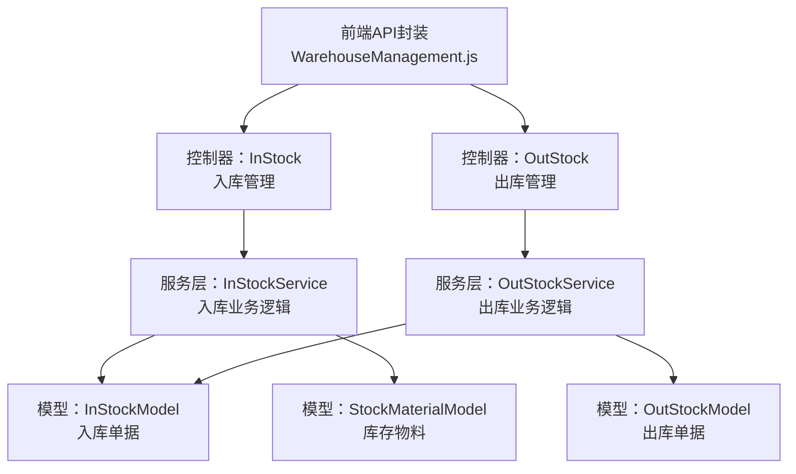
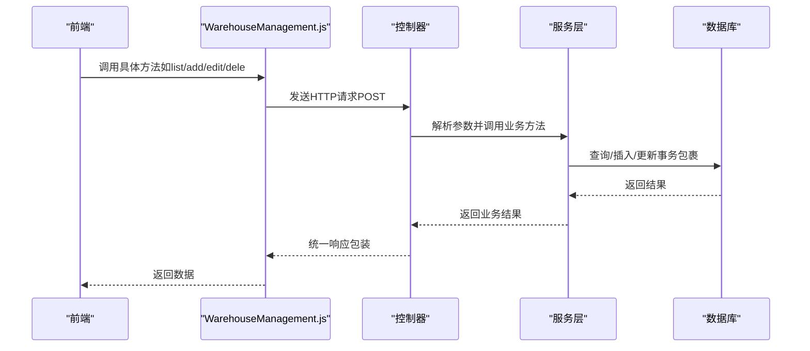
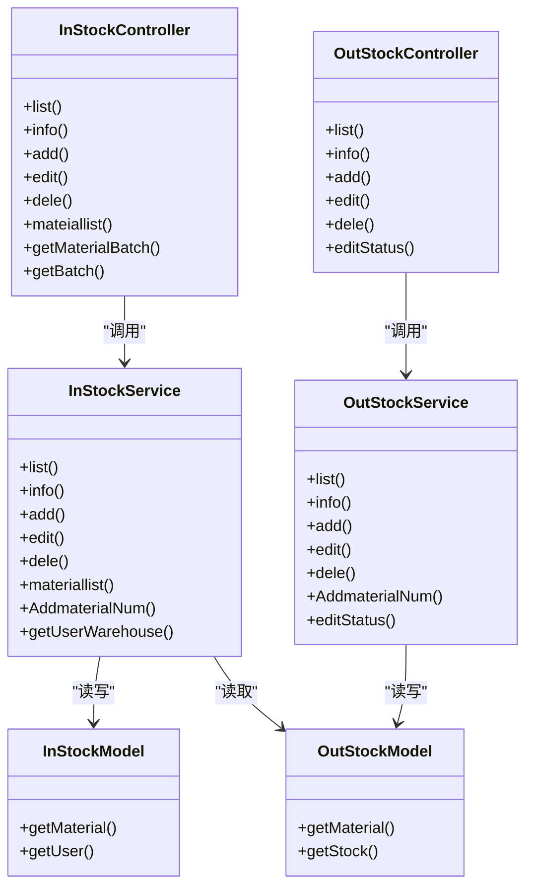

# 出入库管理API

<cite>
**本文引用的文件**
- [gccd_server/app/admin/controller/stock/InStock.php](file://gccd_server/app/admin/controller/stock/InStock.php)
- [gccd_server/app/admin/controller/stock/OutStock.php](file://gccd_server/app/admin/controller/stock/OutStock.php)
- [gccd_server/app/common/service/admin/InStockService.php](file://gccd_server/app/common/service/admin/InStockService.php)
- [gccd_server/app/common/service/admin/OutStockService.php](file://gccd_server/app/common/service/admin/OutStockService.php)
- [gccd_server/app/common/model/admin/InStockModel.php](file://gccd_server/app/common/model/admin/InStockModel.php)
- [gccd_server/app/common/model/admin/OutStockModel.php](file://gccd_server/app/common/model/admin/OutStockModel.php)
- [yarn/src/api/mes/WarehouseManagement/WarehouseManagement.js](file://yarn/src/api/mes/WarehouseManagement/WarehouseManagement.js)
</cite>

## 目录
1. [简介](#简介)
2. [项目结构](#项目结构)
3. [核心组件](#核心组件)
4. [架构总览](#架构总览)
5. [详细组件分析](#详细组件分析)
6. [依赖分析](#依赖分析)
7. [性能考虑](#性能考虑)
8. [故障排查指南](#故障排查指南)
9. [结论](#结论)
10. [附录](#附录)

## 简介
本文件面向“高齿传动”项目的出入库管理API，系统性梳理物料入库、出库、编辑、删除、查询、批次管理等能力，并结合后端控制器、服务层与前端API封装，给出统一的HTTP接口定义、请求参数、响应格式与典型业务流程（如采购入库、生产领料、销售出库、内部调拨等）。同时覆盖扫码入库、批量出入库、异常处理与审计跟踪等主题。

## 项目结构
出入库管理由前后端协同完成：
- 前端通过统一的API模块封装调用后端接口，便于复用与维护。
- 后端以控制器为入口，承接HTTP请求；服务层负责业务逻辑与数据一致性；模型层映射数据库表结构。

图表来源
- [yarn/src/api/mes/WarehouseManagement/WarehouseManagement.js:1-100](file://yarn/src/api/mes/WarehouseManagement/WarehouseManagement.js#L1-L100)
- [gccd_server/app/admin/controller/stock/InStock.php:1-235](file://gccd_server/app/admin/controller/stock/InStock.php#L1-L235)
- [gccd_server/app/admin/controller/stock/OutStock.php:1-164](file://gccd_server/app/admin/controller/stock/OutStock.php#L1-L164)
- [gccd_server/app/common/service/admin/InStockService.php:1-368](file://gccd_server/app/common/service/admin/InStockService.php#L1-L368)
- [gccd_server/app/common/service/admin/OutStockService.php:1-290](file://gccd_server/app/common/service/admin/OutStockService.php#L1-L290)
- [gccd_server/app/common/model/admin/InStockModel.php:1-33](file://gccd_server/app/common/model/admin/InStockModel.php#L1-L33)
- [gccd_server/app/common/model/admin/OutStockModel.php:1-37](file://gccd_server/app/common/model/admin/OutStockModel.php#L1-L37)

章节来源
- [gccd_server/app/admin/controller/stock/InStock.php:1-235](file://gccd_server/app/admin/controller/stock/InStock.php#L1-L235)
- [gccd_server/app/admin/controller/stock/OutStock.php:1-164](file://gccd_server/app/admin/controller/stock/OutStock.php#L1-L164)
- [gccd_server/app/common/service/admin/InStockService.php:1-368](file://gccd_server/app/common/service/admin/InStockService.php#L1-L368)
- [gccd_server/app/common/service/admin/OutStockService.php:1-290](file://gccd_server/app/common/service/admin/OutStockService.php#L1-L290)
- [gccd_server/app/common/model/admin/InStockModel.php:1-33](file://gccd_server/app/common/model/admin/InStockModel.php#L1-L33)
- [gccd_server/app/common/model/admin/OutStockModel.php:1-37](file://gccd_server/app/common/model/admin/OutStockModel.php#L1-L37)
- [yarn/src/api/mes/WarehouseManagement/WarehouseManagement.js:1-100](file://yarn/src/api/mes/WarehouseManagement/WarehouseManagement.js#L1-L100)

## 核心组件
- 前端API封装：统一前缀与方法名，便于调用后端接口。
- 控制器：InStock（入库）、OutStock（出库），负责参数解析、分页排序、搜索过滤与调用服务层。
- 服务层：InStockService、OutStockService，负责单据生成、事务控制、库存扣减与关联业务（如领料扣工资）。
- 模型层：InStockModel、OutStockModel、StockMaterialModel，映射入库/出库单据与库存物料表，支持关联查询与绑定字段。

章节来源
- [gccd_server/app/admin/controller/stock/InStock.php:28-235](file://gccd_server/app/admin/controller/stock/InStock.php#L28-L235)
- [gccd_server/app/admin/controller/stock/OutStock.php:28-164](file://gccd_server/app/admin/controller/stock/OutStock.php#L28-L164)
- [gccd_server/app/common/service/admin/InStockService.php:29-368](file://gccd_server/app/common/service/admin/InStockService.php#L29-L368)
- [gccd_server/app/common/service/admin/OutStockService.php:24-290](file://gccd_server/app/common/service/admin/OutStockService.php#L24-L290)
- [gccd_server/app/common/model/admin/InStockModel.php:8-33](file://gccd_server/app/common/model/admin/InStockModel.php#L8-L33)
- [gccd_server/app/common/model/admin/OutStockModel.php:7-37](file://gccd_server/app/common/model/admin/OutStockModel.php#L7-L37)
- [yarn/src/api/mes/WarehouseManagement/WarehouseManagement.js:1-100](file://yarn/src/api/mes/WarehouseManagement/WarehouseManagement.js#L1-L100)

## 架构总览
出入库API采用“前端封装—控制器—服务层—模型层”的分层架构，控制器仅做参数与权限处理，服务层承担业务规则与事务，模型层负责数据映射与关联查询。

图表来源
- [yarn/src/api/mes/WarehouseManagement/WarehouseManagement.js:1-100](file://yarn/src/api/mes/WarehouseManagement/WarehouseManagement.js#L1-L100)
- [gccd_server/app/admin/controller/stock/InStock.php:42-158](file://gccd_server/app/admin/controller/stock/InStock.php#L42-L158)
- [gccd_server/app/admin/controller/stock/OutStock.php:42-148](file://gccd_server/app/admin/controller/stock/OutStock.php#L42-L148)
- [gccd_server/app/common/service/admin/InStockService.php:63-194](file://gccd_server/app/common/service/admin/InStockService.php#L63-L194)
- [gccd_server/app/common/service/admin/OutStockService.php:58-143](file://gccd_server/app/common/service/admin/OutStockService.php#L58-L143)

## 详细组件分析

### 入库管理API
- 接口前缀：/admin/stock.InStock/
- 方法与路径
  - 入库列表：POST /admin/stock.InStock/list
  - 入库详情：POST /admin/stock.InStock/info
  - 入库新增：POST /admin/stock.InStock/add
  - 入库编辑：POST /admin/stock.InStock/edit
  - 入库删除：POST /admin/stock.InStock/dele
  - 仓库物料列表：POST /admin/stock.InStock/mateiallist
  - 获取物料批次：POST /admin/stock.InStock/getMaterialBatch
  - 获取全部批次：POST /admin/stock.InStock/getBatch

- 请求参数
  - 列表查询：支持按入库单号、关联单号、物料名称/规格/批次、仓库/库位、时间范围等条件过滤。
  - 新增/编辑：传入包含单据头与明细数组的结构，明细字段包含物料ID、入库数量、仓库、库位、单价、金额、备注、关联单号等。
  - 删除：传入待删除的ID数组。
  - 批次查询：按物料ID或全量查询批次号与余额、价格、供应商/制造商等信息。

- 响应格式
  - 统一返回结构包含状态码、消息与数据体；列表返回分页字段（总数、页数、每页条数、当前页、数据列表）。
  - 详情返回单据头+同单据号的明细集合。

- 业务流程要点
  - 单据编号生成：若未提供入库单号，服务层自动生成；仓库归属：普通用户受角色/仓库限制。
  - 批次策略：成品库强制使用关联单号作为批次；其他场景优先使用传入批次，否则自动生成。
  - 库存更新：入库时按物料与批次累加库存数量。
  - 事务保障：新增/编辑/删除在事务内执行，异常自动回滚。

- 异常处理
  - 参数校验失败、数量非法、库存不足、生成单号失败等均会抛出异常并回滚事务。

章节来源
- [yarn/src/api/mes/WarehouseManagement/WarehouseManagement.js:3-100](file://yarn/src/api/mes/WarehouseManagement/WarehouseManagement.js#L3-L100)
- [gccd_server/app/admin/controller/stock/InStock.php:42-231](file://gccd_server/app/admin/controller/stock/InStock.php#L42-L231)
- [gccd_server/app/common/service/admin/InStockService.php:63-194](file://gccd_server/app/common/service/admin/InStockService.php#L63-L194)
- [gccd_server/app/common/model/admin/InStockModel.php:8-33](file://gccd_server/app/common/model/admin/InStockModel.php#L8-L33)

### 出库管理API
- 接口前缀：/admin/stock.OutStock/
- 方法与路径
  - 出库列表：POST /admin/stock.OutStock/list
  - 出库详情：POST /admin/stock.OutStock/info
  - 出库新增：POST /admin/stock.OutStock/add
  - 出库编辑：POST /admin/stock.OutStock/edit
  - 出库删除：POST /admin/stock.OutStock/dele
  - 出库审核：POST /admin/stock.OutStock/editStatus

- 请求参数
  - 列表查询：支持按出库单号、关联单号、物料名称/规格/批次、仓库、时间范围等条件过滤。
  - 新增：传入包含单据头与明细数组的结构，明细字段包含物料ID、出库数量、备注、关联单号等。
  - 审核：传入出库单明细ID与批次号，触发库存扣减与状态更新。

- 响应格式
  - 统一返回结构；列表返回分页字段与创建人姓名等扩展字段。

- 业务流程要点
  - 单据编号生成：若未提供出库单号，服务层自动生成。
  - 库存扣减：按物料ID或批次号扣减库存，不足时报错。
  - 关联业务：当出库类型为“领料单”且备注为特定值时，按入库单价计算金额并扣减对应领料人工资记录。
  - 事务保障：新增/编辑/删除/审核在事务内执行，异常自动回滚。

- 异常处理
  - 数量非法、库存不足、找不到对应批次物料、关联单据缺失等均会抛出异常并回滚事务。

章节来源
- [gccd_server/app/admin/controller/stock/OutStock.php:42-161](file://gccd_server/app/admin/controller/stock/OutStock.php#L42-L161)
- [gccd_server/app/common/service/admin/OutStockService.php:58-287](file://gccd_server/app/common/service/admin/OutStockService.php#L58-L287)
- [gccd_server/app/common/model/admin/OutStockModel.php:7-37](file://gccd_server/app/common/model/admin/OutStockModel.php#L7-L37)

### 扫码入库与批次管理
- 扫码入库
  - 通过“获取物料批次”接口按物料ID查询可用批次，前端选择批次后提交入库单，服务层按批次累加库存。
- 批次管理
  - “获取物料批次”与“获取全部批次”接口支持按物料ID或全量查询批次号、余额、单价、供应商/制造商等信息，便于扫码与盘点。

章节来源
- [gccd_server/app/admin/controller/stock/InStock.php:202-231](file://gccd_server/app/admin/controller/stock/InStock.php#L202-L231)
- [gccd_server/app/common/service/admin/InStockService.php:327-365](file://gccd_server/app/common/service/admin/InStockService.php#L327-L365)

### 批量出入库
- 入库/出库均支持“批量明细”提交，服务层循环处理每条明细，统一生成单据头与明细，确保事务一致性。
- 前端通过传入包含多个明细对象的数组实现批量操作。

章节来源
- [gccd_server/app/admin/controller/stock/InStock.php:106-131](file://gccd_server/app/admin/controller/stock/InStock.php#L106-L131)
- [gccd_server/app/admin/controller/stock/OutStock.php:102-120](file://gccd_server/app/admin/controller/stock/OutStock.php#L102-L120)
- [gccd_server/app/common/service/admin/InStockService.php:123-194](file://gccd_server/app/common/service/admin/InStockService.php#L123-L194)
- [gccd_server/app/common/service/admin/OutStockService.php:114-143](file://gccd_server/app/common/service/admin/OutStockService.php#L114-L143)

### 审计跟踪与历史查询
- 审计字段
  - 创建时间、创建人（用户ID/昵称）、单据号、关联单号、仓库/库位、物料批次、数量、单价、金额、备注等。
- 历史查询
  - 列表接口支持按时间范围、单据号、物料信息、仓库/库位等多维条件过滤，满足审计与追溯需求。
- 数据关联
  - 入库/出库单据与库存物料表通过物料ID与批次号关联，支持按批次追踪历史流水。

章节来源
- [gccd_server/app/common/model/admin/InStockModel.php:14-32](file://gccd_server/app/common/model/admin/InStockModel.php#L14-L32)
- [gccd_server/app/common/model/admin/OutStockModel.php:13-36](file://gccd_server/app/common/model/admin/OutStockModel.php#L13-L36)
- [gccd_server/app/admin/controller/stock/InStock.php:42-88](file://gccd_server/app/admin/controller/stock/InStock.php#L42-L88)
- [gccd_server/app/admin/controller/stock/OutStock.php:42-84](file://gccd_server/app/admin/controller/stock/OutStock.php#L42-L84)

## 依赖分析
- 控制器到服务层：控制器仅负责参数解析与调用，降低耦合度。
- 服务层到模型层：服务层聚合业务规则与事务，模型层专注数据映射与关联查询。
- 前端到控制器：前端通过统一API封装调用，避免分散配置与重复逻辑。

图表来源
- [gccd_server/app/admin/controller/stock/InStock.php:28-235](file://gccd_server/app/admin/controller/stock/InStock.php#L28-L235)
- [gccd_server/app/admin/controller/stock/OutStock.php:28-164](file://gccd_server/app/admin/controller/stock/OutStock.php#L28-L164)
- [gccd_server/app/common/service/admin/InStockService.php:29-368](file://gccd_server/app/common/service/admin/InStockService.php#L29-L368)
- [gccd_server/app/common/service/admin/OutStockService.php:24-290](file://gccd_server/app/common/service/admin/OutStockService.php#L24-L290)
- [gccd_server/app/common/model/admin/InStockModel.php:8-33](file://gccd_server/app/common/model/admin/InStockModel.php#L8-L33)
- [gccd_server/app/common/model/admin/OutStockModel.php:7-37](file://gccd_server/app/common/model/admin/OutStockModel.php#L7-L37)

## 性能考虑
- 分页查询：列表接口默认分页，建议前端合理设置页大小与滚动加载，避免一次性拉取过多数据。
- 关联查询：详情接口包含同单据号明细集合，注意在大数据量下控制明细数量或分页加载。
- 批次查询：全量批次查询可能产生较多数据，建议配合物料筛选条件使用。
- 事务边界：新增/编辑/删除/审核均在事务内执行，避免频繁提交导致锁竞争，建议批量提交时合并为一次事务。

## 故障排查指南
- 常见错误
  - 入库/出库数量非法或为空：检查请求参数中的数量字段。
  - 库存不足：出库审核时若库存不足会抛出异常，请确认批次号或物料ID正确。
  - 单据号生成失败：检查单据号生成服务是否可用。
  - 仓库权限限制：普通用户仅能访问其角色绑定的仓库，需确认登录用户角色配置。
- 排查步骤
  - 使用列表接口定位问题单据，结合时间范围与物料条件缩小范围。
  - 通过详情接口查看单据头与明细，确认批次号、仓库、数量等关键字段。
  - 若涉及领料扣工资，确认备注字段与关联单据是否存在。

章节来源
- [gccd_server/app/common/service/admin/InStockService.php:176-194](file://gccd_server/app/common/service/admin/InStockService.php#L176-L194)
- [gccd_server/app/common/service/admin/OutStockService.php:200-239](file://gccd_server/app/common/service/admin/OutStockService.php#L200-L239)
- [gccd_server/app/admin/controller/stock/InStock.php:284-317](file://gccd_server/app/admin/controller/stock/InStock.php#L284-L317)

## 结论
本出入库管理API以清晰的分层设计与完善的事务控制，覆盖了入库、出库、编辑、删除、查询、批次管理与审计追溯等核心能力。通过统一的前端封装与严格的参数校验，能够稳定支撑扫码入库、批量出入库与多场景业务（如领料扣工资）的落地实施。

## 附录

### API一览（HTTP方法、URL、请求参数与响应说明）

- 入库管理
  - POST /admin/stock.InStock/list
    - 查询参数：入库单号、关联单号、物料名称/规格/批次、仓库/库位、起止日期等
    - 响应：分页列表（含总数、页数、每页条数、当前页、数据）
  - POST /admin/stock.InStock/info
    - 查询参数：id
    - 响应：单据头+同单据号明细集合
  - POST /admin/stock.InStock/add
    - 请求体：单据头+明细数组（物料ID、入库数量、仓库、库位、单价、金额、备注、关联单号等）
    - 响应：创建后的单据数据
  - POST /admin/stock.InStock/edit
    - 请求体：单据头+明细数组
    - 响应：更新后的单据数据
  - POST /admin/stock.InStock/dele
    - 请求体：ids（数组）
    - 响应：删除结果
  - POST /admin/stock.InStock/mateiallist
    - 查询参数：物料名称/规格/批次、仓库、起止日期等
    - 响应：分页列表（含库存汇总）
  - POST /admin/stock.InStock/getMaterialBatch
    - 查询参数：material_id
    - 响应：该物料可用批次列表
  - POST /admin/stock.InStock/getBatch
    - 查询参数：无
    - 响应：全量批次列表

- 出库管理
  - POST /admin/stock.OutStock/list
    - 查询参数：出库单号、关联单号、物料名称/规格/批次、仓库、起止日期等
    - 响应：分页列表（含创建人等扩展字段）
  - POST /admin/stock.OutStock/info
    - 查询参数：id
    - 响应：单据头+同单据号明细集合
  - POST /admin/stock.OutStock/add
    - 请求体：单据头+明细数组（物料ID、出库数量、备注、关联单号等）
    - 响应：创建后的单据数据
  - POST /admin/stock.OutStock/edit
    - 请求体：单据头+明细数组
    - 响应：更新后的单据数据
  - POST /admin/stock.OutStock/dele
    - 请求体：ids（数组）
    - 响应：删除结果
  - POST /admin/stock.OutStock/editStatus
    - 请求体：id、material_batch
    - 响应：审核结果（含库存扣减与关联业务处理）

章节来源
- [gccd_server/app/admin/controller/stock/InStock.php:42-231](file://gccd_server/app/admin/controller/stock/InStock.php#L42-L231)
- [gccd_server/app/admin/controller/stock/OutStock.php:42-161](file://gccd_server/app/admin/controller/stock/OutStock.php#L42-L161)
- [gccd_server/app/common/service/admin/InStockService.php:63-365](file://gccd_server/app/common/service/admin/InStockService.php#L63-L365)
- [gccd_server/app/common/service/admin/OutStockService.php:58-287](file://gccd_server/app/common/service/admin/OutStockService.php#L58-L287)
- [yarn/src/api/mes/WarehouseManagement/WarehouseManagement.js:3-100](file://yarn/src/api/mes/WarehouseManagement/WarehouseManagement.js#L3-L100)