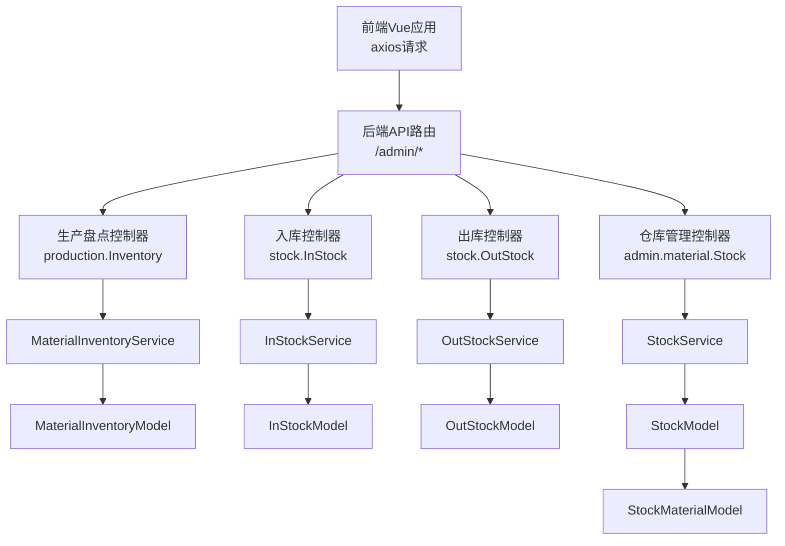
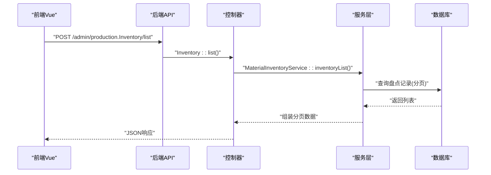
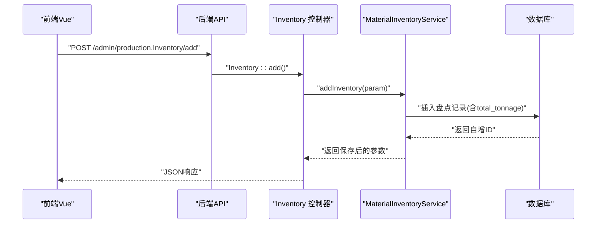
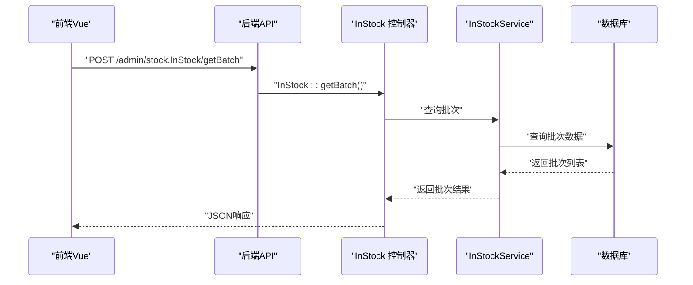
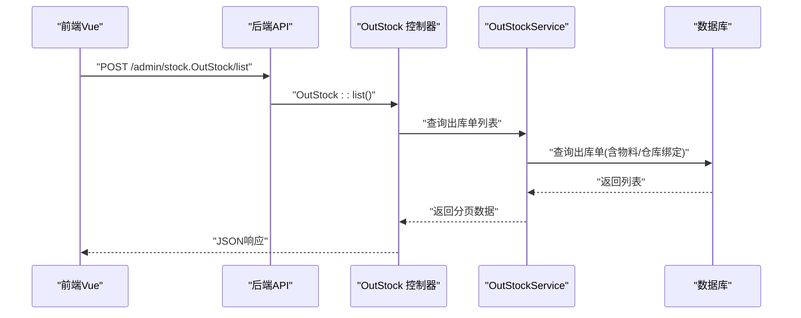
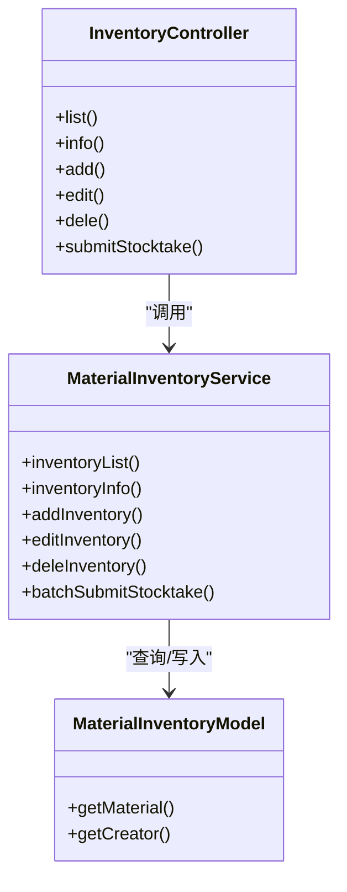

# 库存管理API

<cite>
**本文引用的文件**
- [gccd_server/app/admin/controller/production/Inventory.php](file://gccd_server/app/admin/controller/production/Inventory.php)
- [gccd_server/app/common/service/admin/MaterialInventoryService.php](file://gccd_server/app/common/service/admin/MaterialInventoryService.php)
- [gccd_server/app/common/model/admin/MaterialInventoryModel.php](file://gccd_server/app/common/model/admin/MaterialInventoryModel.php)
- [gccd_server/app/admin/controller/stock/InStock.php](file://gccd_server/app/admin/controller/stock/InStock.php)
- [gccd_server/app/admin/controller/stock/OutStock.php](file://gccd_server/app/admin/controller/stock/OutStock.php)
- [gccd_server/app/common/model/admin/InStockModel.php](file://gccd_server/app/common/model/admin/InStockModel.php)
- [gccd_server/app/common/model/admin/OutStockModel.php](file://gccd_server/app/common/model/admin/OutStockModel.php)
- [gccd_server/app/common/service/admin/InStockService.php](file://gccd_server/app/common/service/admin/InStockService.php)
- [gccd_server/app/common/service/admin/OutStockService.php](file://gccd_server/app/common/service/admin/OutStockService.php)
- [gccd_server/app/admin/controller/material/Stock.php](file://gccd_server/app/admin/controller/material/Stock.php)
- [gccd_server/app/common/service/admin/StockService.php](file://gccd_server/app/common/service/admin/StockService.php)
- [gccd_server/app/common/model/admin/StockModel.php](file://gccd_server/app/common/model/admin/StockModel.php)
- [gccd_server/app/common/model/admin/StockMaterialModel.php](file://gccd_server/app/common/model/admin/StockMaterialModel.php)
- [yarn/src/api/mes/WarehouseManagement/WarehouseManagement.js](file://yarn/src/api/mes/WarehouseManagement/WarehouseManagement.js)
- [yarn/src/api/mes/ProductStocktake/ProductStocktake.js](file://yarn/src/api/mes/ProductStocktake/ProductStocktake.js)
- [yarn/admin/js/WarehouseManagement.TZvzYb6s.js](file://yarn/admin/js/WarehouseManagement.TZvzYb6s.js)
- [yarn/admin/js/OutboundManagement.BwDIVS7i.js](file://yarn/admin/js/OutboundManagement.BwDIVS7i.js)
</cite>

## 目录
1. [简介](#简介)
2. [项目结构](#项目结构)
3. [核心组件](#核心组件)
4. [架构总览](#架构总览)
5. [详细组件分析](#详细组件分析)
6. [依赖分析](#依赖分析)
7. [性能考虑](#性能考虑)
8. [故障排查指南](#故障排查指南)
9. [结论](#结论)
10. [附录](#附录)

## 简介
本文件面向高齿传动项目的库存管理API，覆盖库存查询、库存调整、库存盘点、库存转移（出入库）等核心能力，并对仓库管理、批次管理、有效期管理、库存预警与安全库存、成本核算以及实时同步与批量操作进行系统化说明。文档以接口清单、调用流程、数据模型与错误处理为主线，帮助前后端协作与运维保障。

## 项目结构
- 后端采用 ThinkPHP 框架，按模块划分：admin 控制器层、common 服务层与模型层。
- 前端使用 Vue 与 axios 发起请求，统一通过 /admin/* 路由访问后端接口。
- 关键模块：
  - 生产盘点：production.Inventory 控制器与 MaterialInventoryService 服务。
  - 入库/出库：stock.InStock 与 stock.OutStock 控制器，配合 InStockService/OutStockService。
  - 仓库管理：admin.material.Stock 控制器与 StockService。
  - 数据模型：MaterialInventoryModel、InStockModel、OutStockModel、StockModel、StockMaterialModel。

图表来源
- [gccd_server/app/admin/controller/production/Inventory.php:1-89](file://gccd_server/app/admin/controller/production/Inventory.php#L1-L89)
- [gccd_server/app/admin/controller/stock/InStock.php](file://gccd_server/app/admin/controller/stock/InStock.php)
- [gccd_server/app/admin/controller/stock/OutStock.php](file://gccd_server/app/admin/controller/stock/OutStock.php)
- [gccd_server/app/admin/controller/material/Stock.php:1-126](file://gccd_server/app/admin/controller/material/Stock.php#L1-L126)
- [gccd_server/app/common/service/admin/MaterialInventoryService.php:1-262](file://gccd_server/app/common/service/admin/MaterialInventoryService.php#L1-L262)
- [gccd_server/app/common/service/admin/InStockService.php](file://gccd_server/app/common/service/admin/InStockService.php)
- [gccd_server/app/common/service/admin/OutStockService.php](file://gccd_server/app/common/service/admin/OutStockService.php)
- [gccd_server/app/common/service/admin/StockService.php:1-177](file://gccd_server/app/common/service/admin/StockService.php#L1-L177)
- [gccd_server/app/common/model/admin/MaterialInventoryModel.php:1-24](file://gccd_server/app/common/model/admin/MaterialInventoryModel.php#L1-L24)
- [gccd_server/app/common/model/admin/InStockModel.php:1-33](file://gccd_server/app/common/model/admin/InStockModel.php#L1-L33)
- [gccd_server/app/common/model/admin/OutStockModel.php:1-37](file://gccd_server/app/common/model/admin/OutStockModel.php#L1-L37)
- [gccd_server/app/common/model/admin/StockModel.php:1-36](file://gccd_server/app/common/model/admin/StockModel.php#L1-L36)
- [gccd_server/app/common/model/admin/StockMaterialModel.php:1-36](file://gccd_server/app/common/model/admin/StockMaterialModel.php#L1-L36)

章节来源
- [gccd_server/app/admin/controller/production/Inventory.php:1-89](file://gccd_server/app/admin/controller/production/Inventory.php#L1-L89)
- [gccd_server/app/admin/controller/stock/InStock.php](file://gccd_server/app/admin/controller/stock/InStock.php)
- [gccd_server/app/admin/controller/stock/OutStock.php](file://gccd_server/app/admin/controller/stock/OutStock.php)
- [gccd_server/app/admin/controller/material/Stock.php:1-126](file://gccd_server/app/admin/controller/material/Stock.php#L1-L126)

## 核心组件
- 生产盘点组件：提供盘点列表、详情、新增、编辑、删除、小程序批量提交等接口。
- 入库组件：提供入库单列表、详情、新增、编辑、删除、物料与批次查询等接口。
- 出库组件：提供出库单列表、详情、新增、编辑、删除、关联仓库查询等接口。
- 仓库管理组件：提供仓库列表、详情、新增、编辑、删除等接口。
- 数据模型：围绕 wms_* 表构建，包含盘点、入库、出库、仓库、仓库物料等模型。

章节来源
- [gccd_server/app/common/service/admin/MaterialInventoryService.php:1-262](file://gccd_server/app/common/service/admin/MaterialInventoryService.php#L1-L262)
- [gccd_server/app/common/service/admin/InStockService.php](file://gccd_server/app/common/service/admin/InStockService.php)
- [gccd_server/app/common/service/admin/OutStockService.php](file://gccd_server/app/common/service/admin/OutStockService.php)
- [gccd_server/app/common/service/admin/StockService.php:1-177](file://gccd_server/app/common/service/admin/StockService.php#L1-L177)
- [gccd_server/app/common/model/admin/MaterialInventoryModel.php:1-24](file://gccd_server/app/common/model/admin/MaterialInventoryModel.php#L1-L24)
- [gccd_server/app/common/model/admin/InStockModel.php:1-33](file://gccd_server/app/common/model/admin/InStockModel.php#L1-L33)
- [gccd_server/app/common/model/admin/OutStockModel.php:1-37](file://gccd_server/app/common/model/admin/OutStockModel.php#L1-L37)
- [gccd_server/app/common/model/admin/StockModel.php:1-36](file://gccd_server/app/common/model/admin/StockModel.php#L1-L36)
- [gccd_server/app/common/model/admin/StockMaterialModel.php:1-36](file://gccd_server/app/common/model/admin/StockMaterialModel.php#L1-L36)

## 架构总览
- 前端通过 axios 统一请求 /admin/* 路由，控制器接收参数并调用对应服务层，服务层封装业务逻辑与数据库事务，模型层映射 wms_* 数据表。
- 批量操作与小程序接口通过生产盘点服务实现，支持批量入库/出库明细的快速提交。
- 仓库与物料绑定关系通过模型的 belongsTo/hasOne 关系实现，便于在列表中直接返回仓库名称、物料名称等字段。

图表来源
- [gccd_server/app/admin/controller/production/Inventory.php:17-37](file://gccd_server/app/admin/controller/production/Inventory.php#L17-L37)
- [gccd_server/app/common/service/admin/MaterialInventoryService.php:56-75](file://gccd_server/app/common/service/admin/MaterialInventoryService.php#L56-L75)

## 详细组件分析

### 生产盘点接口
- 接口清单
  - GET /admin/production.Inventory/list：盘点列表（支持按物料名称、工序名称、盘点日期范围筛选）
  - GET /admin/production.Inventory/info：盘点详情
  - POST /admin/production.Inventory/add：新增盘点
  - POST /admin/production.Inventory/edit：修改盘点
  - POST /admin/production.Inventory/dele：删除盘点
  - POST /admin/production.Inventory/submitStocktake：小程序/外部批量提交盘点明细
- 请求参数与响应
  - 列表查询：支持 material_name、process_name、inventory_start_date、inventory_end_date 等筛选字段；返回分页对象（count、pages、page、limit、list），其中 list 绑定物料名称与创建人昵称。
  - 新增/编辑：支持 material_id、material_name、finished_product_spec、current_process_spec、process_name、day_shift_tonnage、night_shift_tonnage、inventory_date、remark 等字段；编辑时自动计算 total_tonnage。
  - 批量提交：接收 stocktake_date、process_name、remark、items（明细数组，每项含 day_shift_qty、night_shift_qty 等）。
- 错误处理
  - 事务回滚与异常抛出，确保数据一致性；删除默认物理删除 real=true。
- 数据模型
  - MaterialInventoryModel：盘点主表，关联物料与创建人信息。

图表来源
- [gccd_server/app/admin/controller/production/Inventory.php:52-57](file://gccd_server/app/admin/controller/production/Inventory.php#L52-L57)
- [gccd_server/app/common/service/admin/MaterialInventoryService.php:96-137](file://gccd_server/app/common/service/admin/MaterialInventoryService.php#L96-L137)

章节来源
- [gccd_server/app/admin/controller/production/Inventory.php:1-89](file://gccd_server/app/admin/controller/production/Inventory.php#L1-L89)
- [gccd_server/app/common/service/admin/MaterialInventoryService.php:1-262](file://gccd_server/app/common/service/admin/MaterialInventoryService.php#L1-L262)
- [gccd_server/app/common/model/admin/MaterialInventoryModel.php:1-24](file://gccd_server/app/common/model/admin/MaterialInventoryModel.php#L1-L24)

### 入库接口
- 接口清单
  - POST /admin/stock.InStock/list：入库单列表（支持按入库单号、关联单号、物料名称、仓库、批次、时间范围等筛选）
  - POST /admin/stock.InStock/info：入库单详情
  - POST /admin/stock.InStock/add：新增入库单
  - POST /admin/stock.InStock/edit：编辑入库单
  - POST /admin/stock.InStock/dele：删除入库单
  - POST /admin/stock.InStock/mateiallist：物料列表（用于选择入库物料）
  - POST /admin/stock.InStock/getBatch：所有物料的批次
  - POST /admin/stock.InStock/getMaterialBatch：指定物料的批次
- 请求参数与响应
  - 列表查询：支持 in_code、relation_code、material_name、warehouse、material_batch、create_start_date、create_end_date 等；返回分页对象。
  - 新增/编辑：支持入库数量、单价、批次、有效期、仓库等字段；编辑时更新时间与用户。
  - 批次查询：支持全局批次与按物料过滤的批次列表。
- 错误处理
  - 事务控制与异常捕获，保证入库单据与库存变动一致。
- 数据模型
  - InStockModel：入库单主表，绑定物料名称与规格、创建人昵称。

图表来源
- [yarn/src/api/mes/WarehouseManagement/WarehouseManagement.js:77-99](file://yarn/src/api/mes/WarehouseManagement/WarehouseManagement.js#L77-L99)
- [gccd_server/app/admin/controller/stock/InStock.php](file://gccd_server/app/admin/controller/stock/InStock.php)

章节来源
- [gccd_server/app/admin/controller/stock/InStock.php](file://gccd_server/app/admin/controller/stock/InStock.php)
- [gccd_server/app/common/service/admin/InStockService.php](file://gccd_server/app/common/service/admin/InStockService.php)
- [gccd_server/app/common/model/admin/InStockModel.php:1-33](file://gccd_server/app/common/model/admin/InStockModel.php#L1-L33)
- [yarn/src/api/mes/WarehouseManagement/WarehouseManagement.js:1-99](file://yarn/src/api/mes/WarehouseManagement/WarehouseManagement.js#L1-L99)
- [yarn/admin/js/WarehouseManagement.TZvzYb6s.js:1-1](file://yarn/admin/js/WarehouseManagement.TZvzYb6s.js#L1-L1)

### 出库接口
- 接口清单
  - POST /admin/stock.OutStock/list：出库单列表（支持按出库单号、物料名称、仓库、时间范围等筛选）
  - POST /admin/stock.OutStock/info：出库单详情
  - POST /admin/stock.OutStock/add：新增出库单
  - POST /admin/stock.OutStock/edit：编辑出库单
  - POST /admin/stock.OutStock/dele：删除出库单
  - POST /admin/stock.OutStock/editStatus：修改状态（如审核、作废等）
- 请求参数与响应
  - 列表查询：支持 out_code、material_name、warehouse、create_start_date、create_end_date 等；返回分页对象。
  - 新增/编辑：支持出库数量、单价、仓库、用途、经手人等字段。
  - 关联仓库：通过模型绑定，从入库单中反查仓库信息。
- 错误处理
  - 事务控制与异常捕获，保证出库单据与库存变动一致。
- 数据模型
  - OutStockModel：出库单主表，绑定物料信息与仓库信息。

图表来源
- [yarn/src/api/mes/OutboundManagement/OutboundManagement.js](file://yarn/src/api/mes/OutboundManagement/OutboundManagement.js)
- [gccd_server/app/admin/controller/stock/OutStock.php](file://gccd_server/app/admin/controller/stock/OutStock.php)
- [gccd_server/app/common/model/admin/OutStockModel.php:1-37](file://gccd_server/app/common/model/admin/OutStockModel.php#L1-L37)

章节来源
- [gccd_server/app/admin/controller/stock/OutStock.php](file://gccd_server/app/admin/controller/stock/OutStock.php)
- [gccd_server/app/common/service/admin/OutStockService.php](file://gccd_server/app/common/service/admin/OutStockService.php)
- [gccd_server/app/common/model/admin/OutStockModel.php:1-37](file://gccd_server/app/common/model/admin/OutStockModel.php#L1-L37)
- [yarn/src/api/mes/OutboundManagement/OutboundManagement.js](file://yarn/src/api/mes/OutboundManagement/OutboundManagement.js)
- [yarn/admin/js/OutboundManagement.BwDIVS7i.js:1-1](file://yarn/admin/js/OutboundManagement.BwDIVS7i.js#L1-L1)

### 仓库管理接口
- 接口清单
  - POST /admin/material.Stock/list：仓库列表（支持按仓库名称/编码、时间范围、跟踪工序等筛选）
  - POST /admin/material.Stock/info：仓库详情
  - POST /admin/material.Stock/add：新增仓库
  - POST /admin/material.Stock/edit：编辑仓库
  - POST /admin/material.Stock/dele：删除仓库
- 请求参数与响应
  - 列表查询：支持 stock_name、stock_code、create_start_date、create_end_date 等；返回分页对象。
  - 新增/编辑：支持仓库编码、仓库名称等字段；新增时可自动生成编码。
  - 仓库与跟踪工序绑定，列表中可显示 track_name。
- 错误处理
  - 重复名称校验、事务控制与异常捕获。
- 数据模型
  - StockModel：仓库主表，绑定跟踪工序名称。
  - StockMaterialModel：仓库物料表，绑定跟踪工序名称。

章节来源
- [gccd_server/app/admin/controller/material/Stock.php:1-126](file://gccd_server/app/admin/controller/material/Stock.php#L1-L126)
- [gccd_server/app/common/service/admin/StockService.php:1-177](file://gccd_server/app/common/service/admin/StockService.php#L1-L177)
- [gccd_server/app/common/model/admin/StockModel.php:1-36](file://gccd_server/app/common/model/admin/StockModel.php#L1-L36)
- [gccd_server/app/common/model/admin/StockMaterialModel.php:1-36](file://gccd_server/app/common/model/admin/StockMaterialModel.php#L1-L36)

### 批次管理与有效期管理
- 批次查询
  - 入库模块提供“所有物料的批次”与“指定物料的批次”两个接口，便于前端在选择物料时展示可用批次。
- 有效期管理
  - 入库单据支持有效期字段（在入库服务与模型中体现），可在新增/编辑时传入并持久化。
- 实现要点
  - 批次与有效期在入库阶段录入，后续出库与盘点可基于批次进行追溯。

章节来源
- [yarn/src/api/mes/WarehouseManagement/WarehouseManagement.js:77-99](file://yarn/src/api/mes/WarehouseManagement/WarehouseManagement.js#L77-L99)
- [gccd_server/app/admin/controller/stock/InStock.php](file://gccd_server/app/admin/controller/stock/InStock.php)
- [gccd_server/app/common/model/admin/InStockModel.php:1-33](file://gccd_server/app/common/model/admin/InStockModel.php#L1-L33)

### 库存预警与安全库存
- 现状说明
  - 当前仓库管理与出入库接口未直接暴露“安全库存阈值”或“库存预警”的字段与计算逻辑。
- 建议扩展
  - 在仓库或物料维度增加安全库存字段；
  - 在入库/出库/盘点服务中加入库存超限/低于安全线的校验与告警；
  - 在列表接口中增加“库存状态”字段（正常/偏高/偏低/缺货）供前端展示。

[本节为概念性建议，不直接分析具体文件，故无章节来源]

### 库存成本核算
- 现状说明
  - 入库/出库服务与模型中存在单价、金额等字段，但未见专门的成本核算服务或算法实现。
- 建议扩展
  - 引入加权平均法或先进先出法的成本计算；
  - 在入库时记录成本，在出库时按策略结转销货成本；
  - 提供成本汇总报表接口。

[本节为概念性建议，不直接分析具体文件，故无章节来源]

### 实时同步与批量操作
- 实时同步
  - 入库/出库/盘点均通过控制器-服务-模型的链路实时写入数据库，前端可通过轮询或WebSocket订阅实现“准实时”展示。
- 批量操作
  - 生产盘点提供批量提交接口，支持一次性入库/出库明细的批量入库；
  - 入库/出库/仓库管理支持批量删除（ids 数组）。

章节来源
- [gccd_server/app/common/service/admin/MaterialInventoryService.php:142-200](file://gccd_server/app/common/service/admin/MaterialInventoryService.php#L142-L200)
- [gccd_server/app/admin/controller/production/Inventory.php:82-87](file://gccd_server/app/admin/controller/production/Inventory.php#L82-L87)
- [gccd_server/app/admin/controller/stock/InStock.php](file://gccd_server/app/admin/controller/stock/InStock.php)
- [gccd_server/app/admin/controller/stock/OutStock.php](file://gccd_server/app/admin/controller/stock/OutStock.php)
- [gccd_server/app/admin/controller/material/Stock.php:117-124](file://gccd_server/app/admin/controller/material/Stock.php#L117-L124)

## 依赖分析
- 控制器到服务层：Inventory、InStock、OutStock、Stock 控制器分别依赖对应的 Service。
- 服务层到模型层：各 Service 依赖对应 Model 进行数据映射与查询。
- 模型层关系：StockModel/StockMaterialModel 与 ProcessesModel 绑定，InStockModel/OutStockModel 与 MaterialModel/UserModel 绑定，便于在列表中直接返回关联字段。

图表来源
- [gccd_server/app/admin/controller/production/Inventory.php:1-89](file://gccd_server/app/admin/controller/production/Inventory.php#L1-L89)
- [gccd_server/app/common/service/admin/MaterialInventoryService.php:1-262](file://gccd_server/app/common/service/admin/MaterialInventoryService.php#L1-L262)
- [gccd_server/app/common/model/admin/MaterialInventoryModel.php:1-24](file://gccd_server/app/common/model/admin/MaterialInventoryModel.php#L1-L24)

章节来源
- [gccd_server/app/admin/controller/production/Inventory.php:1-89](file://gccd_server/app/admin/controller/production/Inventory.php#L1-L89)
- [gccd_server/app/common/service/admin/MaterialInventoryService.php:1-262](file://gccd_server/app/common/service/admin/MaterialInventoryService.php#L1-L262)
- [gccd_server/app/common/model/admin/MaterialInventoryModel.php:1-24](file://gccd_server/app/common/model/admin/MaterialInventoryModel.php#L1-L24)

## 性能考虑
- 分页与排序：列表接口默认按时间倒序，建议在高频查询场景下为常用筛选字段建立索引（如 material_id、inventory_date、create_time）。
- 批量写入：批量提交盘点明细使用批量插入，减少事务次数；建议在大数据量时分批提交并设置合理的超时与重试。
- 关联查询：列表接口使用 with 绑定关联字段，注意避免 N+1 查询；必要时预加载或缓存常用字典数据。
- 缓存策略：对仓库名称、物料规格等静态数据引入缓存，降低数据库压力。

[本节提供通用优化建议，不直接分析具体文件，故无章节来源]

## 故障排查指南
- 常见问题
  - 新增/编辑失败：检查必填字段与唯一性约束（如仓库名称不可重复）。
  - 批量提交为空：确认 items 数组非空且包含 day_shift_qty/night_shift_qty。
  - 删除失败：确认 ids 存在且未被其他业务引用。
- 定位方法
  - 查看服务层事务日志与异常消息；
  - 使用 apidoc 生成的接口文档核对请求参数类型与必填项；
  - 前端请求参数与后端参数校验保持一致。
- 相关实现参考
  - 事务开启/回滚与异常抛出在各 Service 的 add/edit/dele/batchSubmit 中均有体现。

章节来源
- [gccd_server/app/common/service/admin/MaterialInventoryService.php:96-137](file://gccd_server/app/common/service/admin/MaterialInventoryService.php#L96-L137)
- [gccd_server/app/common/service/admin/MaterialInventoryService.php:142-200](file://gccd_server/app/common/service/admin/MaterialInventoryService.php#L142-L200)
- [gccd_server/app/common/service/admin/StockService.php:105-131](file://gccd_server/app/common/service/admin/StockService.php#L105-L131)
- [gccd_server/app/common/service/admin/StockService.php:140-151](file://gccd_server/app/common/service/admin/StockService.php#L140-L151)

## 结论
本库存管理API以 ThinkPHP 为基础，围绕生产盘点、入库/出库、仓库管理三大模块构建，具备完善的列表、详情、新增、编辑、删除与批量提交能力。建议后续补充安全库存阈值、成本核算与预警机制，并在高频接口上完善索引与缓存策略，以进一步提升稳定性与性能。

## 附录
- 前端接口封装示例
  - 入库管理：list、info、add、edit、dele、mateiallist、getBatch、getMaterialBatch
  - 生产盘点：list、info、add、edit、dele
  - 出库管理：list、info、add、edit、dele、editStatus
- 命名规范
  - 控制器：/admin/{模块}.{控制器}/
  - 服务层：对应 Service 类
  - 模型层：对应 Model 类，表前缀 wms_

章节来源
- [yarn/src/api/mes/WarehouseManagement/WarehouseManagement.js:1-99](file://yarn/src/api/mes/WarehouseManagement/WarehouseManagement.js#L1-L99)
- [yarn/src/api/mes/ProductStocktake/ProductStocktake.js:1-63](file://yarn/src/api/mes/ProductStocktake/ProductStocktake.js#L1-L63)
- [yarn/admin/js/WarehouseManagement.TZvzYb6s.js:1-1](file://yarn/admin/js/WarehouseManagement.TZvzYb6s.js#L1-L1)
- [yarn/admin/js/OutboundManagement.BwDIVS7i.js:1-1](file://yarn/admin/js/OutboundManagement.BwDIVS7i.js#L1-L1)