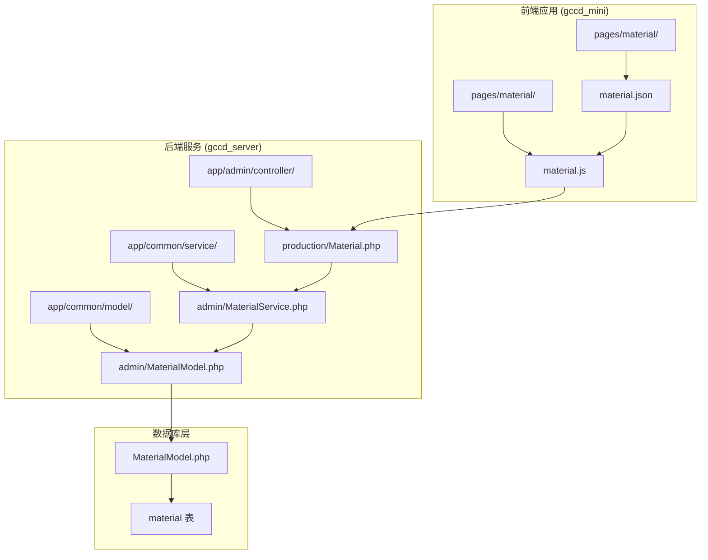
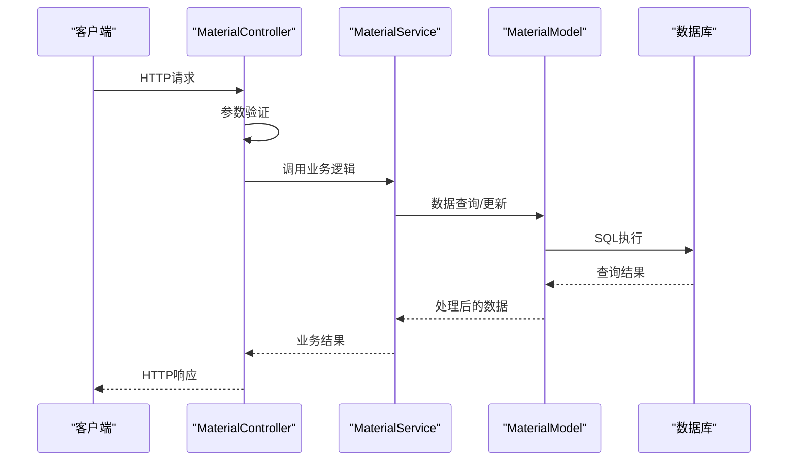
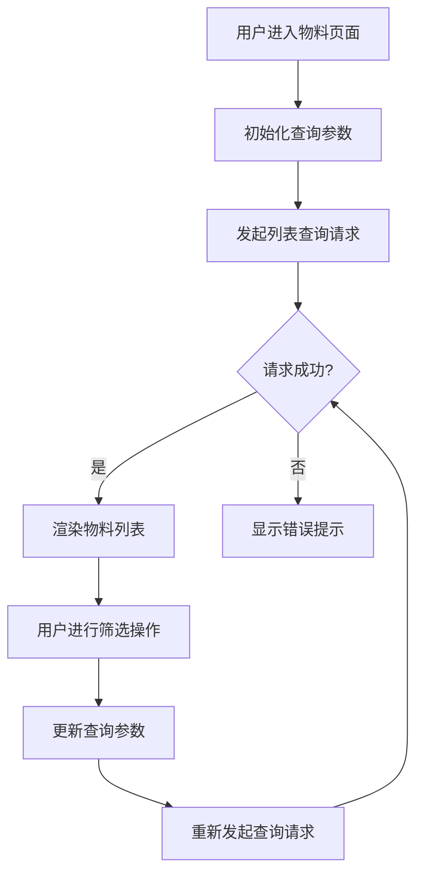
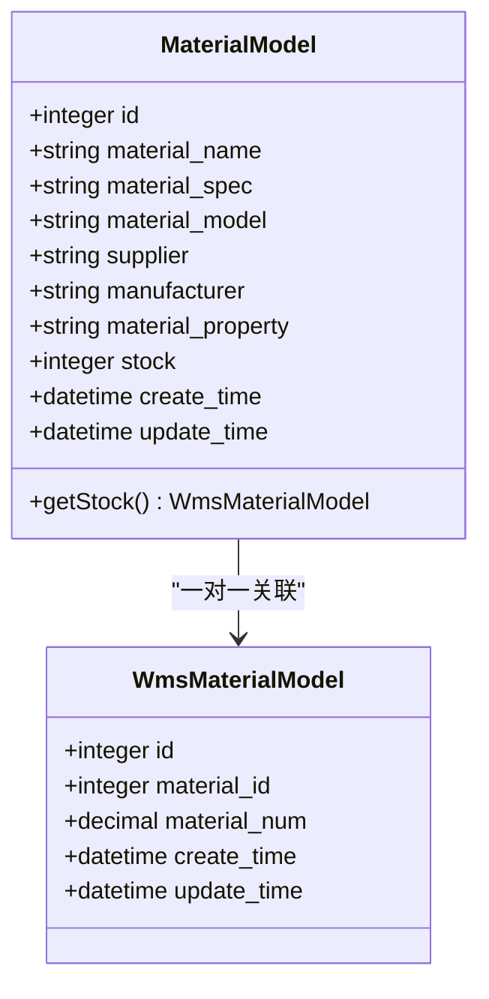
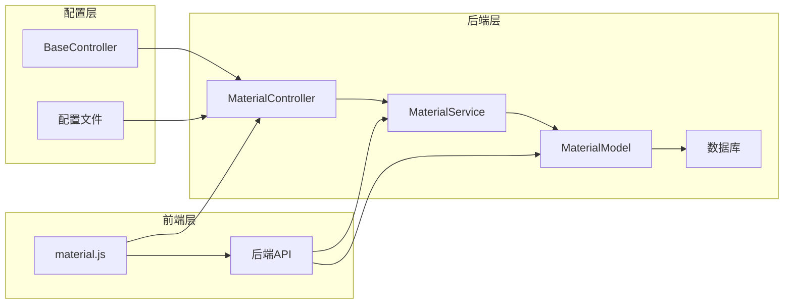

# 物料查询API

<cite>
**本文档引用的文件**
- [Material.php](file://gccd_server/app/admin/controller/production/Material.php)
- [MaterialService.php](file://gccd_server/app/common/service/admin/MaterialService.php)
- [MaterialModel.php](file://gccd_server/app/common/model/admin/MaterialModel.php)
- [material.js](file://gccd_mini/pages/material/material.js)
- [material.json](file://gccd_mini/pages/material/material.json)
</cite>

## 目录
1. [简介](#简介)
2. [项目结构](#项目结构)
3. [核心组件](#核心组件)
4. [架构概览](#架构概览)
5. [详细组件分析](#详细组件分析)
6. [依赖关系分析](#依赖关系分析)
7. [性能考虑](#性能考虑)
8. [故障排除指南](#故障排除指南)
9. [结论](#结论)

## 简介

高齿传动项目的物料查询API提供了完整的物料管理功能，包括物料基础信息查询、物料分类查询、物料规格查询等核心接口。该系统采用前后端分离架构，后端基于ThinkPHP框架开发，前端使用微信小程序技术栈。

系统主要功能涵盖：
- 物料基础信息查询与管理
- 物料分类与规格查询
- 物料搜索与推荐功能
- 物料属性查询与关联查询
- 物料使用情况统计
- 物料数据导出、筛选、排序等高级查询功能

## 项目结构

该项目采用模块化架构设计，主要包含以下关键目录：



**图表来源**
- [Material.php:1-148](file://gccd_server/app/admin/controller/production/Material.php#L1-L148)
- [MaterialService.php:1-195](file://gccd_server/app/common/service/admin/MaterialService.php#L1-L195)
- [MaterialModel.php:1-25](file://gccd_server/app/common/model/admin/MaterialModel.php#L1-L25)

**章节来源**
- [Material.php:1-148](file://gccd_server/app/admin/controller/production/Material.php#L1-L148)
- [MaterialService.php:1-195](file://gccd_server/app/common/service/admin/MaterialService.php#L1-L195)
- [MaterialModel.php:1-25](file://gccd_server/app/common/model/admin/MaterialModel.php#L1-L25)

## 核心组件

### 控制器层 (Controller Layer)

系统的核心控制器位于 `app/admin/controller/production/Material.php`，负责处理所有物料相关的HTTP请求。该控制器继承自 `BaseController`，提供了标准的CRUD操作接口。

### 服务层 (Service Layer)

服务层位于 `app/common/service/admin/MaterialService.php`，封装了业务逻辑和数据处理功能。该层包含：
- 数据验证和处理
- 事务管理
- 数据查询和更新操作
- 错误处理机制

### 模型层 (Model Layer)

模型层位于 `app/common/model/admin/MaterialModel.php`，定义了与数据库表的映射关系和关联查询功能。

**章节来源**
- [Material.php:25-148](file://gccd_server/app/admin/controller/production/Material.php#L25-L148)
- [MaterialService.php:25-195](file://gccd_server/app/common/service/admin/MaterialService.php#L25-L195)
- [MaterialModel.php:10-25](file://gccd_server/app/common/model/admin/MaterialModel.php#L10-L25)

## 架构概览

系统采用经典的三层架构模式，实现了清晰的职责分离：



**图表来源**
- [Material.php:39-78](file://gccd_server/app/admin/controller/production/Material.php#L39-L78)
- [MaterialService.php:68-84](file://gccd_server/app/common/service/admin/MaterialService.php#L68-L84)
- [MaterialModel.php:10-25](file://gccd_server/app/common/model/admin/MaterialModel.php#L10-L25)

## 详细组件分析

### 物料查询接口

#### 基础查询接口

**接口定义**
- 方法：GET
- 路径：`/admin/production.Material/list`
- 功能：获取物料列表数据

**请求参数**
| 参数名 | 类型 | 必填 | 描述 | 示例 |
|--------|------|------|------|------|
| page | integer | 否 | 页码，默认1 | 1 |
| limit | integer | 否 | 每页数量，默认10 | 10 |
| material_name | string | 否 | 物料名称 | "齿轮" |
| material_spec | string | 否 | 物料规格 | "M20" |
| material_model | string | 否 | 物料型号 | "GB/T 12345" |
| supplier | string | 否 | 供应商 | "上海钢铁厂" |
| manufacturer | string | 否 | 生产厂家 | "宝钢集团" |
| material_property | string | 否 | 物料属性 | "合金钢" |
| stock | integer | 否 | 所属仓库ID | 1 |
| create_start_date | date | 否 | 创建开始日期 | "2024-01-01" |
| create_end_date | date | 否 | 创建结束日期 | "2024-12-31" |

**响应格式**
```json
{
  "code": 200,
  "msg": "成功",
  "data": {
    "count": 100,
    "pages": 10,
    "page": 1,
    "limit": 10,
    "list": [
      {
        "id": 1,
        "material_name": "齿轮",
        "material_spec": "M20",
        "material_model": "GB/T 12345",
        "supplier": "上海钢铁厂",
        "manufacturer": "宝钢集团",
        "material_property": "合金钢",
        "stock": 1,
        "create_time": "2024-01-15 10:30:00",
        "update_time": "2024-01-15 10:30:00"
      }
    ]
  }
}
```

**章节来源**
- [Material.php:39-78](file://gccd_server/app/admin/controller/production/Material.php#L39-L78)
- [MaterialService.php:68-84](file://gccd_server/app/common/service/admin/MaterialService.php#L68-L84)

#### 物料详情查询接口

**接口定义**
- 方法：GET
- 路径：`/admin/production.Material/info`
- 功能：获取单个物料的详细信息

**请求参数**
| 参数名 | 类型 | 必填 | 描述 |
|--------|------|------|------|
| id | integer | 是 | 物料ID |

**响应格式**
```json
{
  "code": 200,
  "msg": "成功",
  "data": {
    "id": 1,
    "material_name": "齿轮",
    "material_spec": "M20",
    "material_model": "GB/T 12345",
    "supplier": "上海钢铁厂",
    "manufacturer": "宝钢集团",
    "material_property": "合金钢",
    "stock": 1,
    "create_time": "2024-01-15 10:30:00",
    "update_time": "2024-01-15 10:30:00"
  }
}
```

**章节来源**
- [Material.php:85-91](file://gccd_server/app/admin/controller/production/Material.php#L85-L91)
- [MaterialService.php:94-111](file://gccd_server/app/common/service/admin/MaterialService.php#L94-L111)

#### 物料增删改查接口

**新增物料接口**
- 方法：POST
- 路径：`/admin/production.Material/add`
- 请求参数：同新增字段定义

**修改物料接口**
- 方法：POST
- 路径：`/admin/production.Material/edit`
- 请求参数：包含ID和更新字段

**删除物料接口**
- 方法：POST
- 路径：`/admin/production.Material/dele`
- 请求参数：`{"ids": [1, 2, 3]}`

**章节来源**
- [Material.php:97-133](file://gccd_server/app/admin/controller/production/Material.php#L97-L133)
- [MaterialService.php:119-192](file://gccd_server/app/common/service/admin/MaterialService.php#L119-L192)

### 前端交互组件

#### 物料查询页面

前端物料查询页面位于 `gccd_mini/pages/material/material.js`，提供了完整的物料查询界面：



**图表来源**
- [material.js:198-251](file://gccd_mini/pages/material/material.js#L198-L251)
- [material.js:292-311](file://gccd_mini/pages/material/material.js#L292-L311)

**章节来源**
- [material.js:1-905](file://gccd_mini/pages/material/material.js#L1-L905)
- [material.json:1-17](file://gccd_mini/pages/material/material.json#L1-L17)

### 数据模型设计

#### 物料实体模型



**图表来源**
- [MaterialModel.php:10-25](file://gccd_server/app/common/model/admin/MaterialModel.php#L10-L25)

**章节来源**
- [MaterialModel.php:10-25](file://gccd_server/app/common/model/admin/MaterialModel.php#L10-L25)

## 依赖关系分析

系统各组件之间的依赖关系如下：



**图表来源**
- [Material.php:1-148](file://gccd_server/app/admin/controller/production/Material.php#L1-L148)
- [MaterialService.php:1-195](file://gccd_server/app/common/service/admin/MaterialService.php#L1-L195)
- [MaterialModel.php:1-25](file://gccd_server/app/common/model/admin/MaterialModel.php#L1-L25)

**章节来源**
- [Material.php:1-148](file://gccd_server/app/admin/controller/production/Material.php#L1-L148)
- [MaterialService.php:1-195](file://gccd_server/app/common/service/admin/MaterialService.php#L1-L195)
- [MaterialModel.php:1-25](file://gccd_server/app/common/model/admin/MaterialModel.php#L1-L25)

## 性能考虑

### 查询优化策略

1. **索引优化**：建议在常用查询字段上建立数据库索引
2. **分页查询**：默认限制每页10条记录，避免大数据量查询
3. **缓存机制**：可考虑添加Redis缓存层提升查询性能
4. **批量操作**：删除操作支持批量处理，减少数据库连接次数

### 前端性能优化

1. **防抖机制**：搜索输入支持300ms防抖，减少不必要的请求
2. **懒加载**：支持上拉加载更多，提升用户体验
3. **下拉刷新**：支持下拉刷新功能，确保数据实时性

## 故障排除指南

### 常见问题及解决方案

**1. 查询无结果**
- 检查查询参数是否正确
- 确认数据库中是否存在匹配数据
- 验证权限设置是否正确

**2. 接口请求失败**
- 检查网络连接状态
- 验证服务器是否正常运行
- 查看后端日志获取详细错误信息

**3. 数据显示异常**
- 确认前端页面是否正确渲染
- 检查数据格式是否符合预期
- 验证分页参数是否合理

**章节来源**
- [material.js:220-250](file://gccd_mini/pages/material/material.js#L220-L250)
- [MaterialService.php:121-136](file://gccd_server/app/common/service/admin/MaterialService.php#L121-L136)

## 结论

高齿传动项目的物料查询API系统设计合理，实现了完整的物料管理功能。系统采用清晰的三层架构，具有良好的可维护性和扩展性。通过前后端分离的设计，提升了系统的灵活性和用户体验。

主要优势包括：
- 完整的CRUD操作支持
- 灵活的查询和筛选功能
- 用户友好的前端界面
- 良好的错误处理机制
- 可扩展的架构设计

未来可以考虑的功能增强：
- 添加物料推荐算法
- 实现物料对比功能
- 增加数据导出功能
- 优化查询性能
- 添加物料使用统计报表