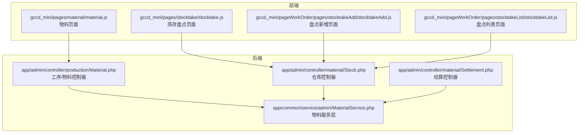
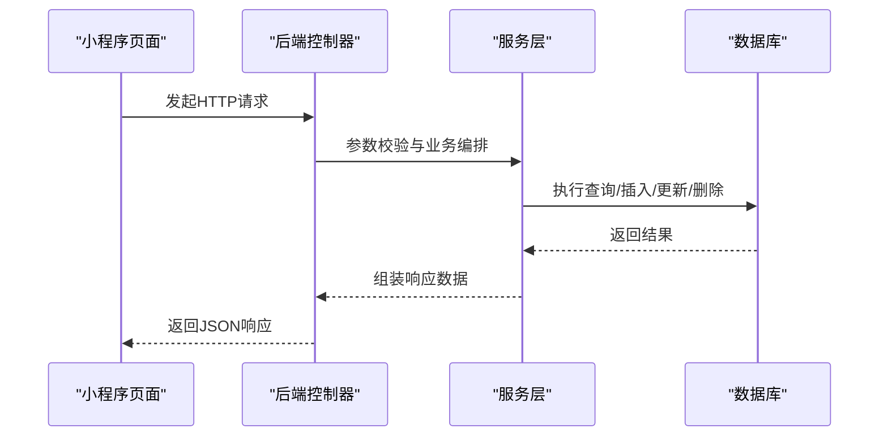
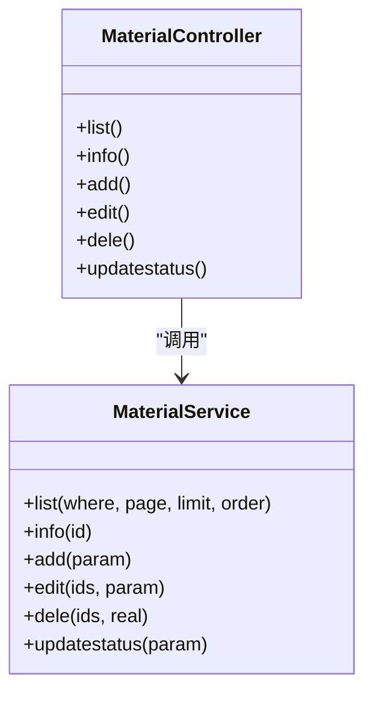
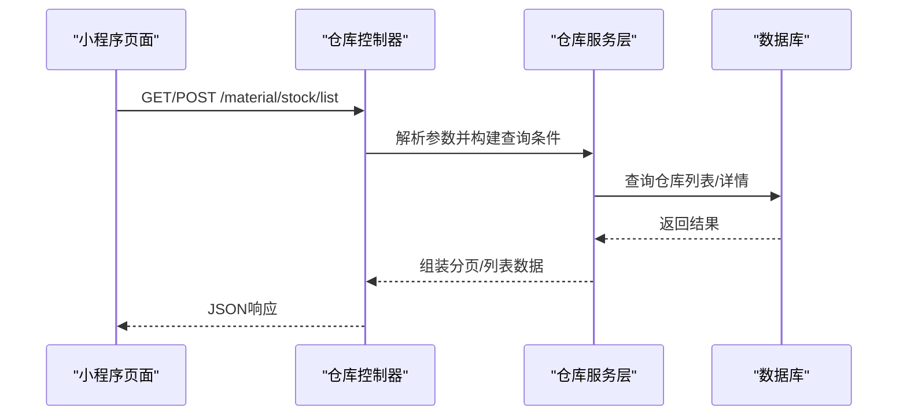
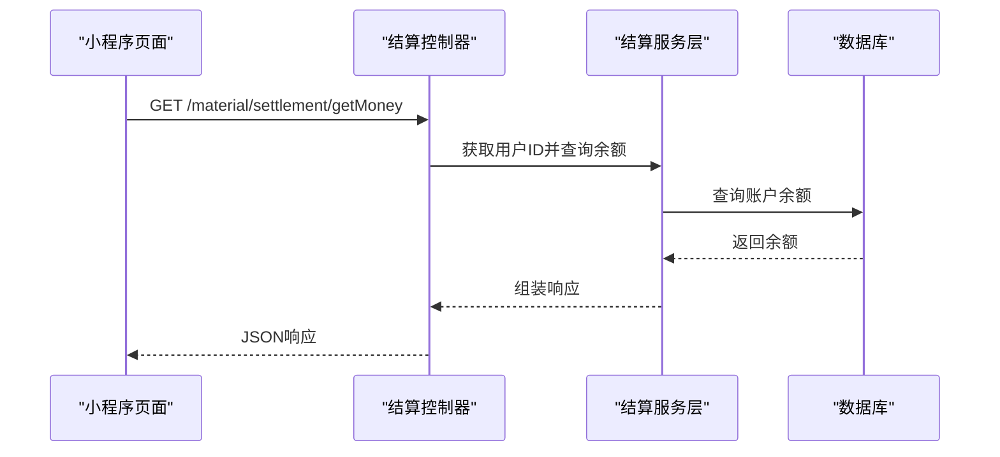
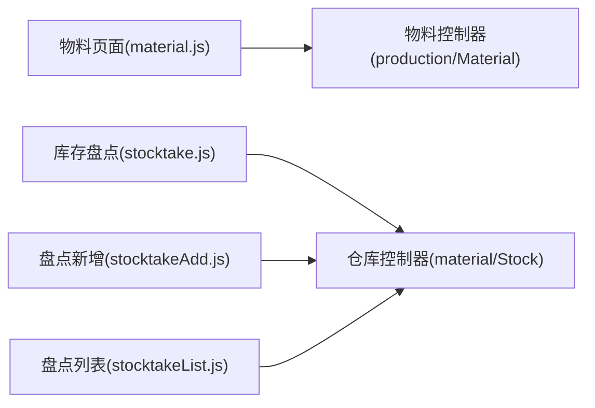
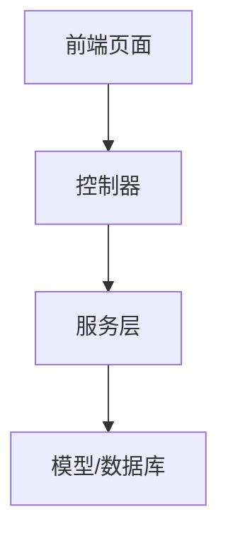
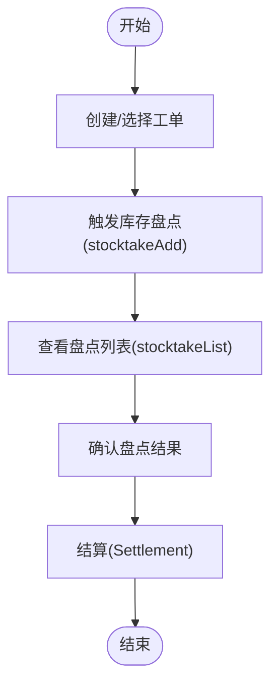

# 物料管理API

<cite>
**本文引用的文件**
- [gccd_server/app/admin/controller/material/Stock.php](file://gccd_server/app/admin/controller/material/Stock.php)
- [gccd_server/app/admin/controller/material/Settlement.php](file://gccd_server/app/admin/controller/material/Settlement.php)
- [gccd_server/app/admin/controller/production/Material.php](file://gccd_server/app/admin/controller/production/Material.php)
- [gccd_server/app/common/service/admin/MaterialService.php](file://gccd_server/app/common/service/admin/MaterialService.php)
- [gccd_mini/pages/material/material.js](file://gccd_mini/pages/material/material.js)
- [gccd_mini/pages/stocktake/stocktake.js](file://gccd_mini/pages/stocktake/stocktake.js)
- [gccd_mini/pageWorkOrder/pages/stocktakeAdd/stocktakeAdd.js](file://gccd_mini/pageWorkOrder/pages/stocktakeAdd/stocktakeAdd.js)
- [gccd_mini/pageWorkOrder/pages/stocktakeList/stocktakeList.js](file://gccd_mini/pageWorkOrder/pages/stocktakeList/stocktakeList.js)
</cite>

## 目录
1. [简介](#简介)
2. [项目结构](#项目结构)
3. [核心组件](#核心组件)
4. [架构总览](#架构总览)
5. [详细组件分析](#详细组件分析)
6. [依赖分析](#依赖分析)
7. [性能考虑](#性能考虑)
8. [故障排查指南](#故障排查指南)
9. [结论](#结论)
10. [附录：接口定义与调用示例](#附录接口定义与调用示例)

## 简介
本文件面向“高齿传动”项目中的物料管理子系统，聚焦于物料主数据、仓库与库存、结算与对账等模块的API设计与使用说明。文档覆盖以下主题：
- 物料主数据管理（新增、编辑、删除、查询）
- 仓库与库存相关接口（仓库信息、出入库登记、库存盘点）
- 结算与余额查询接口
- 前端页面与后端接口的交互方式
- 物料与生产计划、工单的关联关系说明
- 典型业务流程与接口调用示例

## 项目结构
物料管理相关代码主要分布在以下位置：
- 后端（ThinkPHP）：控制器位于 app/admin/controller 下，服务层位于 app/common/service/admin 下
- 前端（小程序）：物料与库存盘点相关页面位于 gccd_mini/pages 与 gccd_mini/pageWorkOrder/pages 下

图表来源
- [gccd_server/app/admin/controller/production/Material.php:1-148](file://gccd_server/app/admin/controller/production/Material.php#L1-L148)
- [gccd_server/app/admin/controller/material/Stock.php:1-126](file://gccd_server/app/admin/controller/material/Stock.php#L1-L126)
- [gccd_server/app/admin/controller/material/Settlement.php:1-156](file://gccd_server/app/admin/controller/material/Settlement.php#L1-L156)
- [gccd_server/app/common/service/admin/MaterialService.php:1-195](file://gccd_server/app/common/service/admin/MaterialService.php#L1-L195)
- [gccd_mini/pages/material/material.js](file://gccd_mini/pages/material/material.js)
- [gccd_mini/pages/stocktake/stocktake.js](file://gccd_mini/pages/stocktake/stocktake.js)
- [gccd_mini/pageWorkOrder/pages/stocktakeAdd/stocktakeAdd.js](file://gccd_mini/pageWorkOrder/pages/stocktakeAdd/stocktakeAdd.js)
- [gccd_mini/pageWorkOrder/pages/stocktakeList/stocktakeList.js](file://gccd_mini/pageWorkOrder/pages/stocktakeList/stocktakeList.js)

章节来源
- [gccd_server/app/admin/controller/production/Material.php:1-148](file://gccd_server/app/admin/controller/production/Material.php#L1-L148)
- [gccd_server/app/admin/controller/material/Stock.php:1-126](file://gccd_server/app/admin/controller/material/Stock.php#L1-L126)
- [gccd_server/app/admin/controller/material/Settlement.php:1-156](file://gccd_server/app/admin/controller/material/Settlement.php#L1-L156)
- [gccd_server/app/common/service/admin/MaterialService.php:1-195](file://gccd_server/app/common/service/admin/MaterialService.php#L1-L195)
- [gccd_mini/pages/material/material.js](file://gccd_mini/pages/material/material.js)
- [gccd_mini/pages/stocktake/stocktake.js](file://gccd_mini/pages/stocktake/stocktake.js)
- [gccd_mini/pageWorkOrder/pages/stocktakeAdd/stocktakeAdd.js](file://gccd_mini/pageWorkOrder/pages/stocktakeAdd/stocktakeAdd.js)
- [gccd_mini/pageWorkOrder/pages/stocktakeList/stocktakeList.js](file://gccd_mini/pageWorkOrder/pages/stocktakeList/stocktakeList.js)

## 核心组件
- 物料控制器（Material）：负责物料主数据的列表、详情、新增、编辑、删除、状态更新等
- 仓库控制器（Stock）：负责仓库信息的列表、详情、新增、编辑、删除等
- 结算控制器（Settlement）：负责结算相关列表、详情、新增、编辑、删除以及余额查询等
- 物料服务层（MaterialService）：封装物料主数据的增删改查、分页、搜索等逻辑，并提供事务控制

章节来源
- [gccd_server/app/admin/controller/production/Material.php:25-147](file://gccd_server/app/admin/controller/production/Material.php#L25-L147)
- [gccd_server/app/admin/controller/material/Stock.php:25-125](file://gccd_server/app/admin/controller/material/Stock.php#L25-L125)
- [gccd_server/app/admin/controller/material/Settlement.php:27-155](file://gccd_server/app/admin/controller/material/Settlement.php#L27-L155)
- [gccd_server/app/common/service/admin/MaterialService.php:25-194](file://gccd_server/app/common/service/admin/MaterialService.php#L25-L194)

## 架构总览
后端采用控制器-服务层分层架构，前端通过页面脚本调用后端接口完成业务操作。

图表来源
- [gccd_server/app/admin/controller/production/Material.php:39-146](file://gccd_server/app/admin/controller/production/Material.php#L39-L146)
- [gccd_server/app/admin/controller/material/Stock.php:39-124](file://gccd_server/app/admin/controller/material/Stock.php#L39-L124)
- [gccd_server/app/admin/controller/material/Settlement.php:41-154](file://gccd_server/app/admin/controller/material/Settlement.php#L41-L154)
- [gccd_server/app/common/service/admin/MaterialService.php:68-194](file://gccd_server/app/common/service/admin/MaterialService.php#L68-L194)

## 详细组件分析

### 物料主数据管理（Material）
- 职责：维护物料主数据，支持列表、详情、新增、编辑、删除、状态更新
- 关键字段：物料名称、规格、厚度、型号、供应商、制造商、属性、所属仓库等
- 搜索条件：按物料名称/规格/型号/供应商/制造商/属性/仓库/创建时间区间等过滤
- 分页与排序：默认按创建时间倒序，支持自定义分页与排序

图表来源
- [gccd_server/app/admin/controller/production/Material.php:25-147](file://gccd_server/app/admin/controller/production/Material.php#L25-L147)
- [gccd_server/app/common/service/admin/MaterialService.php:25-194](file://gccd_server/app/common/service/admin/MaterialService.php#L25-L194)

章节来源
- [gccd_server/app/admin/controller/production/Material.php:39-146](file://gccd_server/app/admin/controller/production/Material.php#L39-L146)
- [gccd_server/app/common/service/admin/MaterialService.php:68-194](file://gccd_server/app/common/service/admin/MaterialService.php#L68-L194)

### 仓库与库存（Stock）
- 职责：维护仓库信息，支持列表、详情、新增、编辑、删除
- 搜索条件：按仓库名称、仓库编码、跟踪ID、用户ID、创建时间区间等过滤
- 适用场景：出入库登记、库存调整、盘点任务发起等

图表来源
- [gccd_server/app/admin/controller/material/Stock.php:39-124](file://gccd_server/app/admin/controller/material/Stock.php#L39-L124)

章节来源
- [gccd_server/app/admin/controller/material/Stock.php:39-124](file://gccd_server/app/admin/controller/material/Stock.php#L39-L124)

### 结算与余额（Settlement）
- 职责：维护结算相关数据，支持列表、详情、新增、编辑、删除；提供余额查询
- 搜索条件：按微信昵称、用户名、跟踪ID、用户ID、创建时间区间等过滤
- 适用场景：与供应商或客户的结算对账、余额查询

图表来源
- [gccd_server/app/admin/controller/material/Settlement.php:147-154](file://gccd_server/app/admin/controller/material/Settlement.php#L147-L154)

章节来源
- [gccd_server/app/admin/controller/material/Settlement.php:41-154](file://gccd_server/app/admin/controller/material/Settlement.php#L41-L154)

### 前端页面与接口交互
- 物料页面：用于展示物料列表、详情与操作入口
- 库存盘点页面：用于发起盘点任务、查看盘点结果
- 工单页面：包含盘点新增与列表页面，便于从工单流程中触发盘点

图表来源
- [gccd_mini/pages/material/material.js](file://gccd_mini/pages/material/material.js)
- [gccd_mini/pages/stocktake/stocktake.js](file://gccd_mini/pages/stocktake/stocktake.js)
- [gccd_mini/pageWorkOrder/pages/stocktakeAdd/stocktakeAdd.js](file://gccd_mini/pageWorkOrder/pages/stocktakeAdd/stocktakeAdd.js)
- [gccd_mini/pageWorkOrder/pages/stocktakeList/stocktakeList.js](file://gccd_mini/pageWorkOrder/pages/stocktakeList/stocktakeList.js)

章节来源
- [gccd_mini/pages/material/material.js](file://gccd_mini/pages/material/material.js)
- [gccd_mini/pages/stocktake/stocktake.js](file://gccd_mini/pages/stocktake/stocktake.js)
- [gccd_mini/pageWorkOrder/pages/stocktakeAdd/stocktakeAdd.js](file://gccd_mini/pageWorkOrder/pages/stocktakeAdd/stocktakeAdd.js)
- [gccd_mini/pageWorkOrder/pages/stocktakeList/stocktakeList.js](file://gccd_mini/pageWorkOrder/pages/stocktakeList/stocktakeList.js)

## 依赖分析
- 控制器依赖服务层进行业务编排与数据访问
- 服务层依赖模型与数据库执行CRUD操作
- 前端页面通过HTTP请求与后端控制器交互

图表来源
- [gccd_server/app/admin/controller/production/Material.php:12-13](file://gccd_server/app/admin/controller/production/Material.php#L12-L13)
- [gccd_server/app/admin/controller/material/Stock.php:11-13](file://gccd_server/app/admin/controller/material/Stock.php#L11-L13)
- [gccd_server/app/admin/controller/material/Settlement.php:12-15](file://gccd_server/app/admin/controller/material/Settlement.php#L12-L15)
- [gccd_server/app/common/service/admin/MaterialService.php:10-12](file://gccd_server/app/common/service/admin/MaterialService.php#L10-L12)

章节来源
- [gccd_server/app/admin/controller/production/Material.php:12-13](file://gccd_server/app/admin/controller/production/Material.php#L12-L13)
- [gccd_server/app/admin/controller/material/Stock.php:11-13](file://gccd_server/app/admin/controller/material/Stock.php#L11-L13)
- [gccd_server/app/admin/controller/material/Settlement.php:12-15](file://gccd_server/app/admin/controller/material/Settlement.php#L12-L15)
- [gccd_server/app/common/service/admin/MaterialService.php:10-12](file://gccd_server/app/common/service/admin/MaterialService.php#L10-L12)

## 性能考虑
- 列表查询建议合理设置分页大小与排序字段，避免一次性加载过多数据
- 搜索条件应尽量使用索引字段，减少全表扫描
- 对于批量更新/删除操作，建议在服务层使用事务保证一致性
- 前端页面应避免频繁轮询，采用必要的缓存与节流策略

## 故障排查指南
- 参数缺失或类型不匹配：检查请求体/查询参数是否符合控制器注解定义
- 数据不存在：确认ID是否存在，或搜索条件是否正确
- 事务回滚：关注服务层异常捕获与回滚逻辑
- 权限问题：确认登录态与用户权限

章节来源
- [gccd_server/app/common/service/admin/MaterialService.php:121-135](file://gccd_server/app/common/service/admin/MaterialService.php#L121-L135)
- [gccd_server/app/admin/controller/production/Material.php:85-90](file://gccd_server/app/admin/controller/production/Material.php#L85-L90)

## 结论
本物料管理API围绕物料主数据、仓库与库存、结算与余额三大模块构建，前后端通过清晰的接口契约协作。建议在实际接入时严格遵循接口定义与参数规范，并结合业务流程完善前端交互与错误处理。

## 附录：接口定义与调用示例

### 1) 物料主数据管理
- 列表查询
  - 方法：GET
  - 路径：/production/material/list
  - 查询参数：分页、排序、搜索条件（物料名称、规格、型号、供应商、制造商、属性、仓库、创建时间区间等）
  - 响应：分页对象（总数、页码、每页数量、列表）
- 详情查询
  - 方法：GET
  - 路径：/production/material/info
  - 查询参数：id
  - 响应：物料对象
- 新增
  - 方法：POST
  - 路径：/production/material/add
  - 请求体：物料字段（名称、规格、厚度、型号、供应商、制造商、属性、所属仓库等）
  - 响应：新增后的物料对象
- 编辑
  - 方法：POST
  - 路径：/production/material/edit
  - 请求体：id + 可选字段
  - 响应：更新后的物料对象
- 删除
  - 方法：POST
  - 路径：/production/material/dele
  - 请求体：ids（数组）
  - 响应：删除结果
- 状态更新
  - 方法：POST
  - 路径：/production/material/updatestatus
  - 请求体：id、status、可选拒绝原因
  - 响应：状态更新结果

章节来源
- [gccd_server/app/admin/controller/production/Material.php:39-146](file://gccd_server/app/admin/controller/production/Material.php#L39-L146)
- [gccd_server/app/common/service/admin/MaterialService.php:68-194](file://gccd_server/app/common/service/admin/MaterialService.php#L68-L194)

### 2) 仓库与库存
- 列表查询
  - 方法：GET
  - 路径：/material/stock/list
  - 查询参数：仓库名称、仓库编码、跟踪ID、用户ID、创建时间区间等
  - 响应：分页对象（总数、页码、每页数量、列表）
- 详情查询
  - 方法：GET
  - 路径：/material/stock/info
  - 查询参数：id
  - 响应：仓库对象
- 新增/编辑/删除
  - 方法：POST
  - 路径：/material/stock/add、/material/stock/edit、/material/stock/dele
  - 请求体：对应字段或ids
  - 响应：操作结果

章节来源
- [gccd_server/app/admin/controller/material/Stock.php:39-124](file://gccd_server/app/admin/controller/material/Stock.php#L39-L124)

### 3) 结算与余额
- 列表查询
  - 方法：GET
  - 路径：/material/settlement/list
  - 查询参数：微信昵称、用户名、跟踪ID、用户ID、创建时间区间等
  - 响应：分页对象
- 详情查询
  - 方法：GET
  - 路径：/material/settlement/info
  - 查询参数：id
  - 响应：结算对象
- 新增/编辑/删除
  - 方法：POST
  - 路径：/material/settlement/add、/material/settlement/edit、/material/settlement/dele
  - 请求体：对应字段或ids
  - 响应：操作结果
- 余额查询
  - 方法：GET
  - 路径：/material/settlement/getMoney
  - 查询参数：user_id
  - 响应：余额

章节来源
- [gccd_server/app/admin/controller/material/Settlement.php:41-154](file://gccd_server/app/admin/controller/material/Settlement.php#L41-L154)

### 4) 物料与生产计划、工单的关联关系
- 关联方式：通过“所属仓库/仓库编码/跟踪ID”等字段在仓库与工单流程中建立联系
- 典型流程：从工单页面发起盘点任务（stocktakeAdd），生成盘点单据（stocktakeList），最终归档到结算（settlement）

图表来源
- [gccd_mini/pageWorkOrder/pages/stocktakeAdd/stocktakeAdd.js](file://gccd_mini/pageWorkOrder/pages/stocktakeAdd/stocktakeAdd.js)
- [gccd_mini/pageWorkOrder/pages/stocktakeList/stocktakeList.js](file://gccd_mini/pageWorkOrder/pages/stocktakeList/stocktakeList.js)
- [gccd_server/app/admin/controller/material/Settlement.php:147-154](file://gccd_server/app/admin/controller/material/Settlement.php#L147-L154)

### 5) 前端页面与接口调用示例
- 物料页面：用于展示物料列表与详情，调用物料控制器接口
- 库存盘点页面：用于发起盘点任务，调用仓库控制器接口
- 工单页面：包含盘点新增与列表页面，调用仓库控制器接口

章节来源
- [gccd_mini/pages/material/material.js](file://gccd_mini/pages/material/material.js)
- [gccd_mini/pages/stocktake/stocktake.js](file://gccd_mini/pages/stocktake/stocktake.js)
- [gccd_mini/pageWorkOrder/pages/stocktakeAdd/stocktakeAdd.js](file://gccd_mini/pageWorkOrder/pages/stocktakeAdd/stocktakeAdd.js)
- [gccd_mini/pageWorkOrder/pages/stocktakeList/stocktakeList.js](file://gccd_mini/pageWorkOrder/pages/stocktakeList/stocktakeList.js)