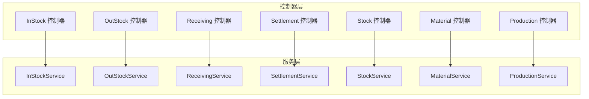
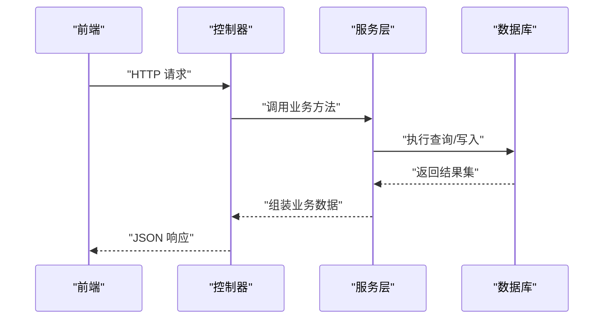
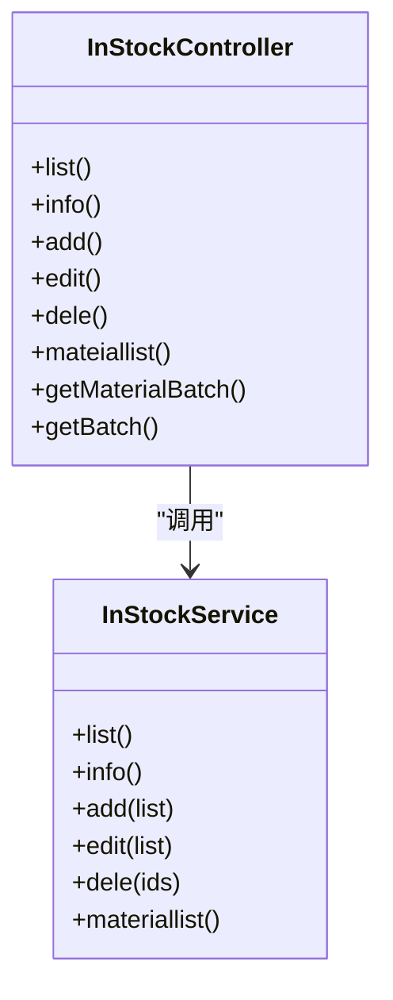

# 采购管理API

<cite>
**本文档引用的文件**
- [gccd_server/app/admin/controller/stock/InStock.php](file://gccd_server/app/admin/controller/stock/InStock.php)
- [gccd_server/app/admin/controller/stock/OutStock.php](file://gccd_server/app/admin/controller/stock/OutStock.php)
- [gccd_server/app/admin/controller/receiving/Receiving.php](file://gccd_server/app/admin/controller/receiving/Receiving.php)
- [gccd_server/app/admin/controller/material/Settlement.php](file://gccd_server/app/admin/controller/material/Settlement.php)
- [gccd_server/app/admin/controller/material/Stock.php](file://gccd_server/app/admin/controller/material/Stock.php)
- [gccd_server/app/admin/controller/production/Material.php](file://gccd_server/app/admin/controller/production/Material.php)
- [gccd_server/app/admin/controller/production/Production.php](file://gccd_server/app/admin/controller/production/Production.php)
- [gccd_server/app/common/service/admin/InStockService.php](file://gccd_server/app/common/service/admin/InStockService.php)
- [gccd_server/app/common/service/admin/OutStockService.php](file://gccd_server/app/common/service/admin/OutStockService.php)
- [gccd_server/app/common/service/admin/ReceivingService.php](file://gccd_server/app/common/service/admin/ReceivingService.php)
- [gccd_server/app/common/service/admin/SettlementService.php](file://gccd_server/app/common/service/admin/SettlementService.php)
- [gccd_server/app/common/service/admin/StockService.php](file://gccd_server/app/common/service/admin/StockService.php)
- [gccd_server/app/common/service/admin/MaterialService.php](file://gccd_server/app/common/service/admin/MaterialService.php)
- [gccd_server/app/common/service/admin/ProductionService.php](file://gccd_server/app/common/service/admin/ProductionService.php)
</cite>

## 目录
1. [简介](#简介)
2. [项目结构](#项目结构)
3. [核心组件](#核心组件)
4. [架构总览](#架构总览)
5. [详细组件分析](#详细组件分析)
6. [依赖关系分析](#依赖关系分析)
7. [性能考虑](#性能考虑)
8. [故障排查指南](#故障排查指南)
9. [结论](#结论)
10. [附录](#附录)

## 简介
本文件面向“高齿传动”项目的采购管理API，系统性梳理从供应商管理、采购申请、采购审批到采购收货、入库、出库、结算的全链路接口定义，覆盖HTTP方法、URL路径、请求参数、响应格式，并给出关键流程的时序图与错误处理建议。文档同时标注了与前端交互的关键字段，便于前后端协同开发。

## 项目结构
采购管理相关后端控制器主要位于以下命名空间与目录：
- 入库管理：app/admin/controller/stock/InStock.php
- 出库管理：app/admin/controller/stock/OutStock.php
- 领料单：app/admin/controller/receiving/Receiving.php
- 结算管理：app/admin/controller/material/Settlement.php
- 仓库管理：app/admin/controller/material/Stock.php
- 物料管理（含供应商）：app/admin/controller/production/Material.php
- 生产订单管理：app/admin/controller/production/Production.php

服务层位于 app/common/service/admin/，各控制器通过调用对应服务实现业务逻辑。

图表来源
- [gccd_server/app/admin/controller/stock/InStock.php:28-235](file://gccd_server/app/admin/controller/stock/InStock.php#L28-L235)
- [gccd_server/app/admin/controller/stock/OutStock.php:28-164](file://gccd_server/app/admin/controller/stock/OutStock.php#L28-L164)
- [gccd_server/app/admin/controller/receiving/Receiving.php:24-119](file://gccd_server/app/admin/controller/receiving/Receiving.php#L24-L119)
- [gccd_server/app/admin/controller/material/Settlement.php:27-156](file://gccd_server/app/admin/controller/material/Settlement.php#L27-L156)
- [gccd_server/app/admin/controller/material/Stock.php:25-126](file://gccd_server/app/admin/controller/material/Stock.php#L25-L126)
- [gccd_server/app/admin/controller/production/Material.php:25-148](file://gccd_server/app/admin/controller/production/Material.php#L25-L148)
- [gccd_server/app/admin/controller/production/Production.php:28-244](file://gccd_server/app/admin/controller/production/Production.php#L28-L244)

章节来源
- [gccd_server/app/admin/controller/stock/InStock.php:1-235](file://gccd_server/app/admin/controller/stock/InStock.php#L1-L235)
- [gccd_server/app/admin/controller/stock/OutStock.php:1-164](file://gccd_server/app/admin/controller/stock/OutStock.php#L1-L164)
- [gccd_server/app/admin/controller/receiving/Receiving.php:1-119](file://gccd_server/app/admin/controller/receiving/Receiving.php#L1-L119)
- [gccd_server/app/admin/controller/material/Settlement.php:1-156](file://gccd_server/app/admin/controller/material/Settlement.php#L1-L156)
- [gccd_server/app/admin/controller/material/Stock.php:1-126](file://gccd_server/app/admin/controller/material/Stock.php#L1-L126)
- [gccd_server/app/admin/controller/production/Material.php:1-148](file://gccd_server/app/admin/controller/production/Material.php#L1-L148)
- [gccd_server/app/admin/controller/production/Production.php:1-244](file://gccd_server/app/admin/controller/production/Production.php#L1-L244)

## 核心组件
- 入库管理控制器：负责入库单据的查询、详情、新增、修改、删除，以及物料批次与供应商价格联动查询。
- 出库管理控制器：负责出库单据的查询、详情、新增、修改、删除，以及出库审核。
- 领料单控制器：负责领料单据的查询、详情、新增、修改、删除。
- 结算管理控制器：负责结算单据的查询、详情、新增、修改、删除、状态更新、余额查询。
- 仓库管理控制器：负责仓库信息的查询、详情、新增、修改、删除。
- 物料管理控制器：负责物料信息（含供应商、厂商、规格、型号等）的查询、详情、新增、修改、删除、状态更新。
- 生产订单管理控制器：负责生产订单的查询、详情、新增、修改、删除、下推计划、进度查询、报表导出等。

章节来源
- [gccd_server/app/admin/controller/stock/InStock.php:28-235](file://gccd_server/app/admin/controller/stock/InStock.php#L28-L235)
- [gccd_server/app/admin/controller/stock/OutStock.php:28-164](file://gccd_server/app/admin/controller/stock/OutStock.php#L28-L164)
- [gccd_server/app/admin/controller/receiving/Receiving.php:24-119](file://gccd_server/app/admin/controller/receiving/Receiving.php#L24-L119)
- [gccd_server/app/admin/controller/material/Settlement.php:27-156](file://gccd_server/app/admin/controller/material/Settlement.php#L27-L156)
- [gccd_server/app/admin/controller/material/Stock.php:25-126](file://gccd_server/app/admin/controller/material/Stock.php#L25-L126)
- [gccd_server/app/admin/controller/production/Material.php:25-148](file://gccd_server/app/admin/controller/production/Material.php#L25-L148)
- [gccd_server/app/admin/controller/production/Production.php:28-244](file://gccd_server/app/admin/controller/production/Production.php#L28-L244)

## 架构总览
后端采用ThinkPHP框架，控制器通过Apigetdoc注解声明接口规范，服务层封装具体业务逻辑，模型层负责数据持久化。前端通过HTTP请求调用控制器方法，控制器再委派给服务层执行。

图表来源
- [gccd_server/app/admin/controller/stock/InStock.php:106-131](file://gccd_server/app/admin/controller/stock/InStock.php#L106-L131)
- [gccd_server/app/common/service/admin/InStockService.php](file://gccd_server/app/common/service/admin/InStockService.php)

## 详细组件分析

### 入库管理（InStock）
- 接口概览
  - 列表查询：GET/POST /admin/stock.InStock/list
  - 详情查询：GET/POST /admin/stock.InStock/info
  - 新增入库：POST /admin/stock.InStock/add
  - 修改入库：POST /admin/stock.InStock/edit
  - 删除入库：POST /admin/stock.InStock/dele
  - 仓库物料列表：GET/POST /admin/stock.InStock/mateiallist
  - 批次查询（按物料ID）：GET/POST /admin/stock.InStock/getMaterialBatch
  - 批次查询（全部）：GET/POST /admin/stock.InStock/getBatch

- 请求参数
  - 列表查询支持分页、排序、日期范围、物料名称/规格/批次/库位/仓库等筛选。
  - 新增入库需提交入库明细数组，包含入库数量、物料ID、关联单号、备注、仓库、库位、单价、小计等字段。
  - 仓库物料列表支持按物料名称/规格/批次/仓库筛选。
  - 批次查询支持按物料ID或全量查询。

- 响应格式
  - 统一返回成功包装对象，包含分页信息与数据列表；部分接口返回单条记录详情。

- 错误处理
  - 参数校验失败、权限不足、业务异常均通过统一异常机制返回标准错误码与提示信息。

章节来源
- [gccd_server/app/admin/controller/stock/InStock.php:42-88](file://gccd_server/app/admin/controller/stock/InStock.php#L42-L88)
- [gccd_server/app/admin/controller/stock/InStock.php:94-100](file://gccd_server/app/admin/controller/stock/InStock.php#L94-L100)
- [gccd_server/app/admin/controller/stock/InStock.php:106-131](file://gccd_server/app/admin/controller/stock/InStock.php#L106-L131)
- [gccd_server/app/admin/controller/stock/InStock.php:138-146](file://gccd_server/app/admin/controller/stock/InStock.php#L138-L146)
- [gccd_server/app/admin/controller/stock/InStock.php:152-158](file://gccd_server/app/admin/controller/stock/InStock.php#L152-L158)
- [gccd_server/app/admin/controller/stock/InStock.php:164-200](file://gccd_server/app/admin/controller/stock/InStock.php#L164-L200)
- [gccd_server/app/admin/controller/stock/InStock.php:203-231](file://gccd_server/app/admin/controller/stock/InStock.php#L203-L231)

### 出库管理（OutStock）
- 接口概览
  - 列表查询：GET/POST /admin/stock.OutStock/list
  - 详情查询：GET/POST /admin/stock.OutStock/info
  - 新增出库：POST /admin/stock.OutStock/add
  - 修改出库：POST /admin/stock.OutStock/edit
  - 删除出库：POST /admin/stock.OutStock/dele
  - 出库审核：POST /admin/stock.OutStock/editStatus

- 请求参数
  - 列表查询支持分页、排序、日期范围、物料名称/规格/仓库/关联单号等筛选。
  - 新增出库需提交出库明细数组，包含出库数量、物料ID、关联单号、备注、拣货人等字段。
  - 出库审核需提交单据ID与批次号，进行业务校验后更新状态。

- 响应格式
  - 统一返回成功包装对象，包含分页信息与数据列表；部分接口返回单条记录详情。

- 错误处理
  - 参数校验失败、库存不足、权限不足、业务异常均通过统一异常机制返回标准错误码与提示信息。

章节来源
- [gccd_server/app/admin/controller/stock/OutStock.php:42-84](file://gccd_server/app/admin/controller/stock/OutStock.php#L42-L84)
- [gccd_server/app/admin/controller/stock/OutStock.php:90-96](file://gccd_server/app/admin/controller/stock/OutStock.php#L90-L96)
- [gccd_server/app/admin/controller/stock/OutStock.php:102-120](file://gccd_server/app/admin/controller/stock/OutStock.php#L102-L120)
- [gccd_server/app/admin/controller/stock/OutStock.php:127-135](file://gccd_server/app/admin/controller/stock/OutStock.php#L127-L135)
- [gccd_server/app/admin/controller/stock/OutStock.php:141-148](file://gccd_server/app/admin/controller/stock/OutStock.php#L141-L148)
- [gccd_server/app/admin/controller/stock/OutStock.php:154-161](file://gccd_server/app/admin/controller/stock/OutStock.php#L154-L161)

### 领料单（Receiving）
- 接口概览
  - 列表查询：GET/POST /admin/receiving.Receiving/list
  - 详情查询：GET/POST /admin/receiving.Receiving/info
  - 新增领料：POST /admin/receiving.Receiving/add
  - 修改领料：POST /admin/receiving.Receiving/edit
  - 删除领料：POST /admin/receiving.Receiving/dele

- 请求参数
  - 列表查询支持分页、排序、日期范围、单号/关联单号等筛选。
  - 新增领料需提交内容与设备编码等字段。

- 响应格式
  - 统一返回成功包装对象，包含分页信息与数据列表；部分接口返回单条记录详情。

- 错误处理
  - 参数校验失败、权限不足、业务异常均通过统一异常机制返回标准错误码与提示信息。

章节来源
- [gccd_server/app/admin/controller/receiving/Receiving.php:38-63](file://gccd_server/app/admin/controller/receiving/Receiving.php#L38-L63)
- [gccd_server/app/admin/controller/receiving/Receiving.php:69-75](file://gccd_server/app/admin/controller/receiving/Receiving.php#L69-L75)
- [gccd_server/app/admin/controller/receiving/Receiving.php:81-88](file://gccd_server/app/admin/controller/receiving/Receiving.php#L81-L88)
- [gccd_server/app/admin/controller/receiving/Receiving.php:95-104](file://gccd_server/app/admin/controller/receiving/Receiving.php#L95-L104)
- [gccd_server/app/admin/controller/receiving/Receiving.php:110-117](file://gccd_server/app/admin/controller/receiving/Receiving.php#L110-L117)

### 结算管理（Settlement）
- 接口概览
  - 列表查询：GET/POST /admin/material.Settlement/list
  - 详情查询：GET/POST /admin/material.Settlement/info
  - 新增结算：POST /admin/material.Settlement/add
  - 修改结算：POST /admin/material.Settlement/edit
  - 删除结算：POST /admin/material.Settlement/dele
  - 更新状态：POST /admin/material.Settlement/updatestatus
  - 查询余额：GET/POST /admin/material.Settlement/getMoney

- 请求参数
  - 列表查询支持分页、排序、日期范围、用户/追踪ID/用户ID等筛选。
  - 新增/修改需提交标题、内容、禁用状态等字段。
  - 更新状态需提交状态与单据ID。
  - 查询余额需提交用户ID。

- 响应格式
  - 统一返回成功包装对象，包含分页信息与数据列表；部分接口返回单条记录详情或余额。

- 错误处理
  - 参数校验失败、权限不足、业务异常均通过统一异常机制返回标准错误码与提示信息。

章节来源
- [gccd_server/app/admin/controller/material/Settlement.php:41-74](file://gccd_server/app/admin/controller/material/Settlement.php#L41-L74)
- [gccd_server/app/admin/controller/material/Settlement.php:80-86](file://gccd_server/app/admin/controller/material/Settlement.php#L80-L86)
- [gccd_server/app/admin/controller/material/Settlement.php:92-100](file://gccd_server/app/admin/controller/material/Settlement.php#L92-L100)
- [gccd_server/app/admin/controller/material/Settlement.php:107-116](file://gccd_server/app/admin/controller/material/Settlement.php#L107-L116)
- [gccd_server/app/admin/controller/material/Settlement.php:122-129](file://gccd_server/app/admin/controller/material/Settlement.php#L122-L129)
- [gccd_server/app/admin/controller/material/Settlement.php:135-142](file://gccd_server/app/admin/controller/material/Settlement.php#L135-L142)
- [gccd_server/app/admin/controller/material/Settlement.php:147-154](file://gccd_server/app/admin/controller/material/Settlement.php#L147-L154)

### 仓库管理（Stock）
- 接口概览
  - 列表查询：GET/POST /admin/material.Stock/list
  - 详情查询：GET/POST /admin/material.Stock/info
  - 新增仓库：POST /admin/material.Stock/add
  - 修改仓库：POST /admin/material.Stock/edit
  - 删除仓库：POST /admin/material.Stock/dele

- 请求参数
  - 列表查询支持分页、排序、日期范围、仓库名称/代码/追踪ID/用户ID等筛选。
  - 新增/修改需提交仓库相关信息字段。

- 响应格式
  - 统一返回成功包装对象，包含分页信息与数据列表；部分接口返回单条记录详情。

- 错误处理
  - 参数校验失败、权限不足、业务异常均通过统一异常机制返回标准错误码与提示信息。

章节来源
- [gccd_server/app/admin/controller/material/Stock.php:39-68](file://gccd_server/app/admin/controller/material/Stock.php#L39-L68)
- [gccd_server/app/admin/controller/material/Stock.php:74-80](file://gccd_server/app/admin/controller/material/Stock.php#L74-L80)
- [gccd_server/app/admin/controller/material/Stock.php:86-98](file://gccd_server/app/admin/controller/material/Stock.php#L86-L98)
- [gccd_server/app/admin/controller/material/Stock.php:104-111](file://gccd_server/app/admin/controller/material/Stock.php#L104-L111)
- [gccd_server/app/admin/controller/material/Stock.php:117-124](file://gccd_server/app/admin/controller/material/Stock.php#L117-L124)

### 物料管理（Material）
- 接口概览
  - 列表查询：GET/POST /admin/production.Material/list
  - 详情查询：GET/POST /admin/production.Material/info
  - 新增物料：POST /admin/production.Material/add
  - 修改物料：POST /admin/production.Material/edit
  - 删除物料：POST /admin/production.Material/dele
  - 更新状态：POST /admin/production.Material/updatestatus

- 请求参数
  - 列表查询支持分页、排序、日期范围、物料规格/名称/型号/属性/供应商/厂商/仓库等筛选。
  - 新增/修改需提交物料相关信息字段。
  - 更新状态需提交状态、单据ID与拒绝原因等。

- 响应格式
  - 统一返回成功包装对象，包含分页信息与数据列表；部分接口返回单条记录详情。

- 错误处理
  - 参数校验失败、权限不足、业务异常均通过统一异常机制返回标准错误码与提示信息。

章节来源
- [gccd_server/app/admin/controller/production/Material.php:39-79](file://gccd_server/app/admin/controller/production/Material.php#L39-L79)
- [gccd_server/app/admin/controller/production/Material.php:85-91](file://gccd_server/app/admin/controller/production/Material.php#L85-L91)
- [gccd_server/app/admin/controller/production/Material.php:97-104](file://gccd_server/app/admin/controller/production/Material.php#L97-L104)
- [gccd_server/app/admin/controller/production/Material.php:111-120](file://gccd_server/app/admin/controller/production/Material.php#L111-L120)
- [gccd_server/app/admin/controller/production/Material.php:126-133](file://gccd_server/app/admin/controller/production/Material.php#L126-L133)
- [gccd_server/app/admin/controller/production/Material.php:139-146](file://gccd_server/app/admin/controller/production/Material.php#L139-L146)

### 生产订单管理（Production）
- 接口概览
  - 列表查询：GET/POST /admin/production.Production/list
  - 详情查询：GET/POST /admin/production.Production/info
  - 新增回填：POST /admin/production.Production/add
  - 微信新增回填：POST /admin/production.Production/wechatadd
  - 修改生产：POST /admin/production.Production/edit
  - 删除生产：POST /admin/production.Production/dele
  - 下推计划：POST /admin/production.Production/push
  - 进度查询：GET/POST /admin/production.Production/getProcess
  - 文件上传（图片）：POST /admin/production.Production/upload
  - 文件上传（文档）：POST /admin/production.Production/uploaddoc
  - 导出工序成本日报表：POST /admin/production.Production/exportProcessCostDailyReport

- 请求参数
  - 列表查询支持分页、排序、日期范围、计划名称/编号、物料规格/型号/原物料规格等筛选。
  - 新增/修改需提交生产相关信息字段。
  - 下推计划需提交计划编号、路由编码与内容。
  - 文件上传需提交文件资源。
  - 导出报表需提交起止日期。

- 响应格式
  - 统一返回成功包装对象，包含分页信息与数据列表；部分接口返回单条记录详情或文件元信息。

- 错误处理
  - 参数校验失败、权限不足、业务异常均通过统一异常机制返回标准错误码与提示信息。

章节来源
- [gccd_server/app/admin/controller/production/Production.php:42-93](file://gccd_server/app/admin/controller/production/Production.php#L42-L93)
- [gccd_server/app/admin/controller/production/Production.php:99-105](file://gccd_server/app/admin/controller/production/Production.php#L99-L105)
- [gccd_server/app/admin/controller/production/Production.php:111-119](file://gccd_server/app/admin/controller/production/Production.php#L111-L119)
- [gccd_server/app/admin/controller/production/Production.php:126-135](file://gccd_server/app/admin/controller/production/Production.php#L126-L135)
- [gccd_server/app/admin/controller/production/Production.php:141-150](file://gccd_server/app/admin/controller/production/Production.php#L141-L150)
- [gccd_server/app/admin/controller/production/Production.php:156-162](file://gccd_server/app/admin/controller/production/Production.php#L156-L162)
- [gccd_server/app/admin/controller/production/Production.php:169-176](file://gccd_server/app/admin/controller/production/Production.php#L169-L176)
- [gccd_server/app/admin/controller/production/Production.php:178-183](file://gccd_server/app/admin/controller/production/Production.php#L178-L183)
- [gccd_server/app/admin/controller/production/Production.php:190-202](file://gccd_server/app/admin/controller/production/Production.php#L190-L202)
- [gccd_server/app/admin/controller/production/Production.php:204-216](file://gccd_server/app/admin/controller/production/Production.php#L204-L216)
- [gccd_server/app/admin/controller/production/Production.php:229-241](file://gccd_server/app/admin/controller/production/Production.php#L229-L241)

## 依赖关系分析
- 控制器与服务层
  - 各控制器通过调用对应服务类完成业务处理，服务类封装数据访问与业务规则。
- 服务层与模型层
  - 服务层使用模型进行数据读写，部分复杂查询通过原生SQL或查询构造器实现。
- 前后端交互
  - 前端通过HTTP请求调用控制器方法，控制器返回统一格式的JSON响应。

图表来源
- [gccd_server/app/admin/controller/stock/InStock.php:28-235](file://gccd_server/app/admin/controller/stock/InStock.php#L28-L235)
- [gccd_server/app/common/service/admin/InStockService.php](file://gccd_server/app/common/service/admin/InStockService.php)

章节来源
- [gccd_server/app/admin/controller/stock/InStock.php:28-235](file://gccd_server/app/admin/controller/stock/InStock.php#L28-L235)
- [gccd_server/app/common/service/admin/InStockService.php](file://gccd_server/app/common/service/admin/InStockService.php)

## 性能考虑
- 分页与排序
  - 列表接口统一支持分页与排序，建议前端合理设置每页大小，避免一次性加载过多数据。
- 搜索条件
  - 多字段组合查询时，优先使用索引字段，减少全表扫描。
- 批量操作
  - 批量删除与批量编辑建议控制单次操作数量，避免超大数组导致内存压力。
- 数据缓存
  - 对于高频读取但低频变更的数据（如基础字典），可引入缓存层降低数据库压力。
- 文件上传
  - 图片/文档上传建议限制文件大小与类型，开启CDN加速与安全校验。

## 故障排查指南
- 常见错误类型
  - 参数缺失或格式错误：检查请求体与查询参数是否符合接口定义。
  - 权限不足：确认登录态与角色权限，部分接口仅超级管理员可见。
  - 业务校验失败：如库存不足、批次不匹配、状态不可变更等，需根据提示修正输入。
  - 数据库异常：检查连接配置与事务一致性，必要时回滚或重试。
- 排查步骤
  - 查看接口返回的错误码与消息，定位具体失败环节。
  - 使用apigoc文档页面验证请求参数与响应结构。
  - 在服务层日志中定位SQL执行情况与异常堆栈。
  - 对批量操作进行分批重试，确保幂等性。

章节来源
- [gccd_server/app/admin/controller/stock/InStock.php:106-131](file://gccd_server/app/admin/controller/stock/InStock.php#L106-L131)
- [gccd_server/app/admin/controller/stock/OutStock.php:154-161](file://gccd_server/app/admin/controller/stock/OutStock.php#L154-L161)
- [gccd_server/app/admin/controller/receiving/Receiving.php:81-88](file://gccd_server/app/admin/controller/receiving/Receiving.php#L81-L88)
- [gccd_server/app/admin/controller/material/Settlement.php:135-142](file://gccd_server/app/admin/controller/material/Settlement.php#L135-L142)
- [gccd_server/app/admin/controller/material/Stock.php:86-98](file://gccd_server/app/admin/controller/material/Stock.php#L86-L98)
- [gccd_server/app/admin/controller/production/Material.php:97-104](file://gccd_server/app/admin/controller/production/Material.php#L97-L104)
- [gccd_server/app/admin/controller/production/Production.php:190-202](file://gccd_server/app/admin/controller/production/Production.php#L190-L202)

## 结论
本文档基于现有控制器与服务层代码，系统化梳理了采购管理相关API的接口定义、参数约束与响应格式，并提供了关键流程的时序图与故障排查建议。建议在后续迭代中持续完善参数校验与错误码体系，提升接口稳定性与可维护性。

## 附录
- 统一响应结构
  - 成功响应：包含状态码、消息与数据体（分页/列表/详情/文件信息等）。
  - 失败响应：包含状态码、错误消息与可选的错误详情。
- 前端对接要点
  - 严格遵循接口文档的参数命名与数据结构，避免字段拼写差异。
  - 对批量操作进行节流与去抖，提升用户体验与系统稳定性。