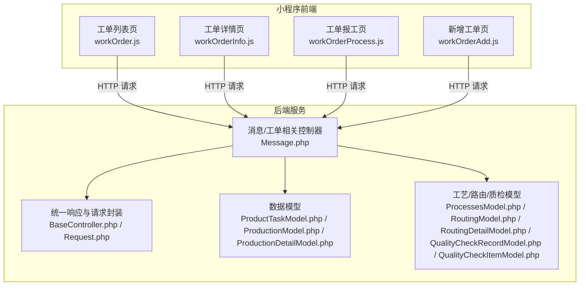
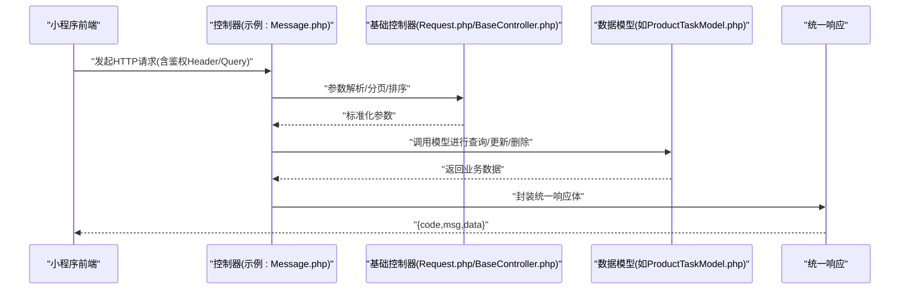
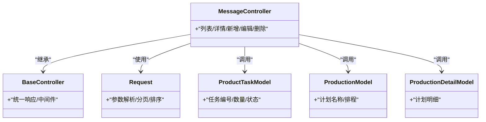
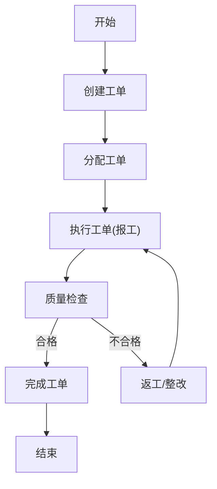

# 工单管理API

<cite>
**本文引用的文件**
- [apidocs.md](file://gccd_server/private/apidoc/apidocs.md)
- [BaseController.php](file://gccd_server/app/BaseController.php)
- [Request.php](file://gccd_server/app/Request.php)
- [workOrderAdd.js](file://gccd_mini/pageWorkOrder/pages/workOrderAdd/workOrderAdd.js)
- [workOrderInfo.js](file://gccd_mini/pageWorkOrder/pages/workOrderInfo/workOrderInfo.js)
- [workOrderProcess.js](file://gccd_mini/pageWorkOrder/pages/workOrderProcess/workOrderProcess.js)
- [workOrder.js](file://gccd_mini/pages/workOrder/workOrder.js)
- [workOrder.wxss](file://gccd_mini/pages/workOrder/workOrder.wxss)
- [ProductTaskModel.php](file://gccd_server/app/common/model/admin/ProductTaskModel.php)
- [ProductionModel.php](file://gccd_server/app/common/model/admin/ProductionModel.php)
- [ProductionDetailModel.php](file://gccd_server/app/common/model/admin/ProductionDetailModel.php)
- [ProcessesModel.php](file://gccd_server/app/common/model/admin/ProcessesModel.php)
- [RoutingModel.php](file://gccd_server/app/common/model/admin/RoutingModel.php)
- [RoutingDetailModel.php](file://gccd_server/app/common/model/admin/RoutingDetailModel.php)
- [QualityCheckRecordModel.php](file://gccd_server/app/common/model/admin/QualityCheckRecordModel.php)
- [QualityCheckItemModel.php](file://gccd_server/app/common/model/admin/QualityCheckItemModel.php)
- [Message.php](file://gccd_server/app/admin/controller/message/Message.php)
</cite>

## 目录
1. [简介](#简介)
2. [项目结构](#项目结构)
3. [核心组件](#核心组件)
4. [架构总览](#架构总览)
5. [详细组件分析](#详细组件分析)
6. [依赖关系分析](#依赖关系分析)
7. [性能考虑](#性能考虑)
8. [故障排查指南](#故障排查指南)
9. [结论](#结论)
10. [附录](#附录)

## 简介
本文件为“工单管理API”的权威接口文档，覆盖工单创建、编辑、删除、查询与状态流转等核心能力。文档基于后端ThinkPHP框架与前端小程序实现，结合统一的响应规范与鉴权机制，提供从请求到响应的完整说明，并给出典型业务流程（创建、分配、执行、完成）的调用示例。

## 项目结构
系统由三部分组成：
- 后端服务（ThinkPHP 6）：提供REST风格API，统一响应结构与鉴权中间件。
- 小程序前端：提供工单列表、详情、报工、质检等页面与交互逻辑。
- 文档与约定：统一的响应体结构、错误码说明、全局Header/Query/Body参数约定。

图表来源
- [workOrder.js](file://gccd_mini/pages/workOrder/workOrder.js)
- [workOrderInfo.js](file://gccd_mini/pageWorkOrder/pages/workOrderInfo/workOrderInfo.js)
- [workOrderProcess.js](file://gccd_mini/pageWorkOrder/pages/workOrderProcess/workOrderProcess.js)
- [workOrderAdd.js](file://gccd_mini/pageWorkOrder/pages/workOrderAdd/workOrderAdd.js)
- [BaseController.php](file://gccd_server/app/BaseController.php)
- [Request.php](file://gccd_server/app/Request.php)
- [Message.php](file://gccd_server/app/admin/controller/message/Message.php)
- [ProductTaskModel.php](file://gccd_server/app/common/model/admin/ProductTaskModel.php)
- [ProductionModel.php](file://gccd_server/app/common/model/admin/ProductionModel.php)
- [ProductionDetailModel.php](file://gccd_server/app/common/model/admin/ProductionDetailModel.php)
- [ProcessesModel.php](file://gccd_server/app/common/model/admin/ProcessesModel.php)
- [RoutingModel.php](file://gccd_server/app/common/model/admin/RoutingModel.php)
- [RoutingDetailModel.php](file://gccd_server/app/common/model/admin/RoutingDetailModel.php)
- [QualityCheckRecordModel.php](file://gccd_server/app/common/model/admin/QualityCheckRecordModel.php)
- [QualityCheckItemModel.php](file://gccd_server/app/common/model/admin/QualityCheckItemModel.php)

章节来源
- [workOrder.js](file://gccd_mini/pages/workOrder/workOrder.js)
- [workOrderInfo.js](file://gccd_mini/pageWorkOrder/pages/workOrderInfo/workOrderInfo.js)
- [workOrderProcess.js](file://gccd_mini/pageWorkOrder/pages/workOrderProcess/workOrderProcess.js)
- [workOrderAdd.js](file://gccd_mini/pageWorkOrder/pages/workOrderAdd/workOrderAdd.js)
- [BaseController.php](file://gccd_server/app/BaseController.php)
- [Request.php](file://gccd_server/app/Request.php)
- [Message.php](file://gccd_server/app/admin/controller/message/Message.php)

## 核心组件
- 统一响应与请求封装：后端通过基础控制器与请求封装类提供统一的参数解析、分页、排序与响应格式。
- 控制器层：以消息/工单相关控制器为例，提供列表、详情、新增、编辑、删除等标准接口。
- 数据模型层：围绕产品任务、生产计划、工序/工艺路线、质量检验等实体建模，支撑工单全生命周期。
- 前端页面：小程序页面负责展示与提交表单，调用后端API完成业务操作。

章节来源
- [BaseController.php](file://gccd_server/app/BaseController.php)
- [Request.php](file://gccd_server/app/Request.php)
- [Message.php](file://gccd_server/app/admin/controller/message/Message.php)
- [ProductTaskModel.php](file://gccd_server/app/common/model/admin/ProductTaskModel.php)
- [ProductionModel.php](file://gccd_server/app/common/model/admin/ProductionModel.php)
- [ProductionDetailModel.php](file://gccd_server/app/common/model/admin/ProductionDetailModel.php)
- [ProcessesModel.php](file://gccd_server/app/common/model/admin/ProcessesModel.php)
- [RoutingModel.php](file://gccd_server/app/common/model/admin/RoutingModel.php)
- [RoutingDetailModel.php](file://gccd_server/app/common/model/admin/RoutingDetailModel.php)
- [QualityCheckRecordModel.php](file://gccd_server/app/common/model/admin/QualityCheckRecordModel.php)
- [QualityCheckItemModel.php](file://gccd_server/app/common/model/admin/QualityCheckItemModel.php)

## 架构总览
后端采用MVC架构，控制器负责接收请求、组装参数并调用服务/模型；前端小程序通过HTTP请求与后端交互；统一响应体包含code、msg、data字段，便于前端统一处理。

图表来源
- [Message.php](file://gccd_server/app/admin/controller/message/Message.php)
- [BaseController.php](file://gccd_server/app/BaseController.php)
- [Request.php](file://gccd_server/app/Request.php)
- [ProductTaskModel.php](file://gccd_server/app/common/model/admin/ProductTaskModel.php)

## 详细组件分析

### 统一响应与鉴权约定
- 基础响应体字段
  - code：整型，业务状态码
  - msg：字符串，提示信息
  - data：对象或数组，业务数据
- 鉴权方式
  - 后端要求在请求头或请求参数中携带特定Token（例如AdminToken/ApiToken），用于身份校验与权限控制
- 全局参数
  - 在接口调试时，建议在全局Header/Query/Body中设置对应参数，便于复用

章节来源
- [apidocs.md](file://gccd_server/private/apidoc/apidocs.md)

### 工单相关接口（以消息/工单控制器为例）
以下接口遵循统一响应体与鉴权约定，具体路径与方法以实际路由为准。

- 列表查询
  - 方法：GET
  - 路径：/admin/message/list 或对应路由
  - 鉴权：AdminToken
  - 查询参数：支持按物料编码、创建起止日期等字段过滤
  - 返回：分页数据（当前页、每页条数、总数、列表）
- 详情查询
  - 方法：GET
  - 路径：/admin/message/info 或对应路由
  - 鉴权：AdminToken
  - 查询参数：id（整型）
  - 返回：单条记录详情
- 新增
  - 方法：POST
  - 路径：/admin/message/add 或对应路由
  - 鉴权：AdminToken
  - 请求体：标题、内容、是否禁用等字段
  - 返回：新增后的记录
- 编辑
  - 方法：POST
  - 路径：/admin/message/edit 或对应路由
  - 鉴权：AdminToken
  - 请求体：id（整型）、标题、内容、是否禁用等字段
  - 返回：更新后的记录
- 删除
  - 方法：POST
  - 路径：/admin/message/dele 或对应路由
  - 鉴权：AdminToken
  - 请求体：ids（数组）
  - 返回：删除结果

章节来源
- [Message.php](file://gccd_server/app/admin/controller/message/Message.php)

### 工单数据模型与关键字段
- 生产任务模型（ProductTaskModel.php）
  - 关键字段：任务编号、关联编号、工艺编码、物料ID、任务数量、报工数量、状态、创建时间等
- 生产计划模型（ProductionModel.php / ProductionDetailModel.php）
  - 关键字段：计划名称、计划明细、排程信息、关联任务等
- 工序与工艺模型（ProcessesModel.php / RoutingModel.php / RoutingDetailModel.php）
  - 关键字段：工序编号、工艺编码、工序顺序、所需资源、工时等
- 质量检查模型（QualityCheckRecordModel.php / QualityCheckItemModel.php）
  - 关键字段：检查项、缺陷记录、检查结果、状态等

章节来源
- [ProductTaskModel.php](file://gccd_server/app/common/model/admin/ProductTaskModel.php)
- [ProductionModel.php](file://gccd_server/app/common/model/admin/ProductionModel.php)
- [ProductionDetailModel.php](file://gccd_server/app/common/model/admin/ProductionDetailModel.php)
- [ProcessesModel.php](file://gccd_server/app/common/model/admin/ProcessesModel.php)
- [RoutingModel.php](file://gccd_server/app/common/model/admin/RoutingModel.php)
- [RoutingDetailModel.php](file://gccd_server/app/common/model/admin/RoutingDetailModel.php)
- [QualityCheckRecordModel.php](file://gccd_server/app/common/model/admin/QualityCheckRecordModel.php)
- [QualityCheckItemModel.php](file://gccd_server/app/common/model/admin/QualityCheckItemModel.php)

### 前端页面与API调用
- 工单列表页（workOrder.js）
  - 功能：展示工单卡片、状态样式、按钮布局
  - 调用：向后端请求列表数据，渲染UI
- 工单详情页（workOrderInfo.js）
  - 功能：展示工单基本信息、生产计划、状态文本、创建时间等
  - 调用：根据id请求详情接口
- 工单报工页（workOrderProcess.js）
  - 功能：执行报工、完成工序等操作
  - 调用：提交报工数量、工序编号等参数
- 新增工单页（workOrderAdd.js）
  - 功能：填写任务编号、关联编号、工艺编码、物料信息、任务数量等
  - 调用：提交新增工单请求

章节来源
- [workOrder.js](file://gccd_mini/pages/workOrder/workOrder.js)
- [workOrderInfo.js](file://gccd_mini/pageWorkOrder/pages/workOrderInfo/workOrderInfo.js)
- [workOrderProcess.js](file://gccd_mini/pageWorkOrder/pages/workOrderProcess/workOrderProcess.js)
- [workOrderAdd.js](file://gccd_mini/pageWorkOrder/pages/workOrderAdd/workOrderAdd.js)

## 依赖关系分析
- 控制器依赖基础控制器与请求封装，确保参数解析与响应格式一致
- 控制器依赖数据模型，完成业务数据的查询与更新
- 前端页面依赖后端API，通过HTTP请求获取/提交数据

图表来源
- [BaseController.php](file://gccd_server/app/BaseController.php)
- [Request.php](file://gccd_server/app/Request.php)
- [Message.php](file://gccd_server/app/admin/controller/message/Message.php)
- [ProductTaskModel.php](file://gccd_server/app/common/model/admin/ProductTaskModel.php)
- [ProductionModel.php](file://gccd_server/app/common/model/admin/ProductionModel.php)
- [ProductionDetailModel.php](file://gccd_server/app/common/model/admin/ProductionDetailModel.php)

## 性能考虑
- 分页与排序：后端提供分页与排序参数，前端应合理设置每页大小，避免一次性加载过多数据
- 缓存策略：对静态列表数据可考虑前端缓存，减少重复请求
- 幂等性：编辑/删除等写操作建议前端做好防重复提交，后端做好幂等校验
- 错误重试：网络异常时，建议在前端实现有限次数的重试与用户提示

## 故障排查指南
- 常见错误码
  - 200：操作成功
  - 400：参数错误
  - 401：登录失效/鉴权失败
  - 403：无权限
  - 404：接口不存在
  - 429：请求过于频繁
  - 500：服务器错误
- 排查步骤
  - 确认请求头/参数中是否携带正确的Token
  - 检查请求参数类型与必填字段是否满足接口要求
  - 查看后端日志定位异常，结合统一响应体中的错误信息
  - 对高频接口增加限流与重试策略，避免触发429

章节来源
- [apidocs.md](file://gccd_server/private/apidoc/apidocs.md)

## 结论
本文档提供了工单管理API的统一响应规范、鉴权约定、核心接口定义与典型业务流程。通过前后端协同与统一的数据模型，可高效实现工单的创建、编辑、删除、查询与状态流转。建议在实际开发中严格遵循接口规范与错误码约定，确保系统稳定性与一致性。

## 附录

### 工单状态流转示例（创建→分配→执行→完成）
- 创建工单
  - 前端：在新增工单页填写任务编号、关联编号、工艺编码、物料信息、任务数量等
  - 后端：接收请求，校验参数，写入生产任务与计划明细，返回创建结果
- 分配工单
  - 前端：在列表或详情页选择负责人/班组，提交分配请求
  - 后端：更新工单状态为“已分配”，记录分配信息
- 执行工单
  - 前端：在报工页提交报工数量、工序编号、执行人等
  - 后端：校验报工数量与工序状态，更新报工数量与进度
- 完成工单
  - 前端：在详情页点击“完成”，提交完成请求
  - 后端：校验质量检查与报工完成情况，更新状态为“已完成”

