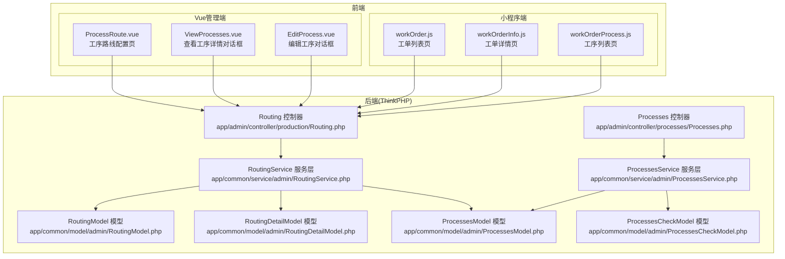
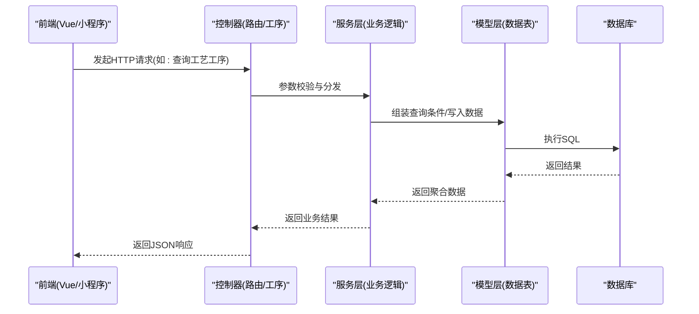
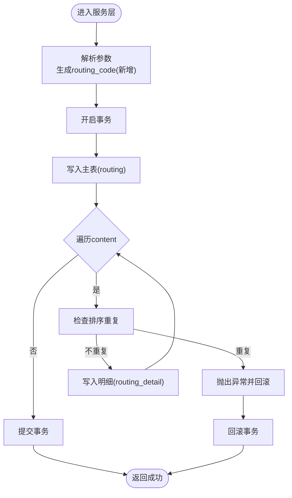
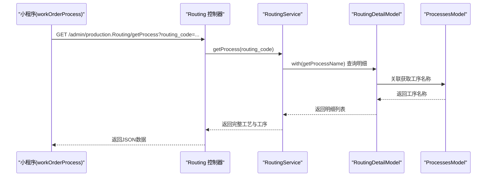
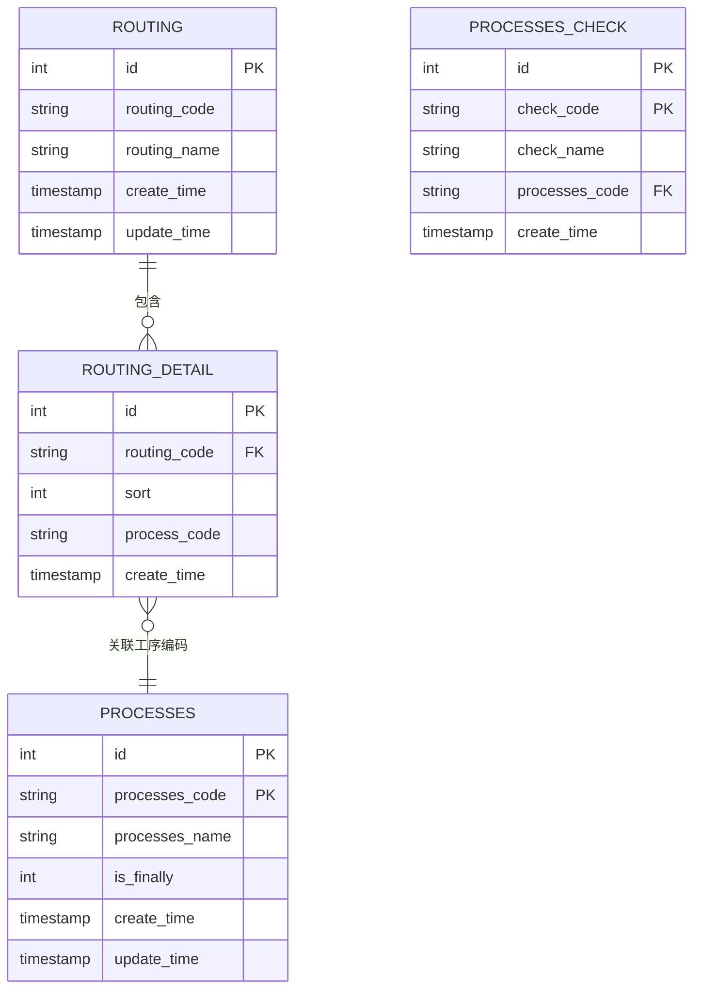
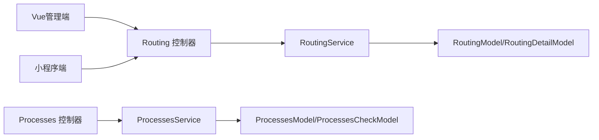

# 工序管理API

<cite>
**本文引用的文件**
- [Routing.php](file://gccd_server/app/admin/controller/production/Routing.php)
- [Processes.php](file://gccd_server/app/admin/controller/processes/Processes.php)
- [RoutingService.php](file://gccd_server/app/common/service/admin/RoutingService.php)
- [ProcessesService.php](file://gccd_server/app/common/service/admin/ProcessesService.php)
- [RoutingModel.php](file://gccd_server/app/common/model/admin/RoutingModel.php)
- [RoutingDetailModel.php](file://gccd_server/app/common/model/admin/RoutingDetailModel.php)
- [ProcessesModel.php](file://gccd_server/app/common/model/admin/ProcessesModel.php)
- [ProcessesCheckModel.php](file://gccd_server/app/common/model/admin/ProcessesCheckModel.php)
- [workOrderProcess.js](file://gccd_mini/pageWorkOrder/pages/workOrderProcess/workOrderProcess.js)
- [workOrderInfo.js](file://gccd_mini/pageWorkOrder/pages/workOrderInfo/workOrderInfo.js)
- [workOrder.js](file://gccd_mini/pages/workOrder/workOrder.js)
- [ProcessRoute.vue](file://yarn/src/views/mes/BasicSettings/ProcessRoute.vue)
- [ViewProcesses.vue](file://yarn/src/views/mes/BasicSettings/components/ViewProcesses.vue)
- [EditProcess.vue](file://yarn/src/views/mes/BasicSettings/components/EditProcess.vue)
</cite>

## 目录
1. [简介](#简介)
2. [项目结构](#项目结构)
3. [核心组件](#核心组件)
4. [架构总览](#架构总览)
5. [详细组件分析](#详细组件分析)
6. [依赖关系分析](#依赖关系分析)
7. [性能考虑](#性能考虑)
8. [故障排查指南](#故障排查指南)
9. [结论](#结论)
10. [附录](#附录)

## 简介
本文件面向“工序管理API”的接口文档与实现解析，覆盖以下主题：
- 工序路线配置：工艺模板的创建、编辑、删除、查看及按工艺编码查询工序明细
- 工序步骤管理：工序模板内步骤顺序维护、重复校验与事务一致性
- 工序检验项管理：为工序绑定检验项、查询工序检验项清单
- 工单执行监控：通过工艺编码获取工序列表，支持移动端与PC端联动
- 变更记录与状态：基于服务层统一处理，便于审计与追踪
- 业务逻辑接口设计：优先级（排序）、时间计算（创建/更新时间）、资源分配（通过工序与工艺关联体现）

## 项目结构
本项目采用前后端分离架构，后端使用ThinkPHP框架，提供REST风格的管理端API；前端包含Vue管理端与小程序端，分别调用后端接口实现工序与工单流程管理。

图表来源
- [Routing.php:25-165](file://gccd_server/app/admin/controller/production/Routing.php#L25-L165)
- [Processes.php:26-146](file://gccd_server/app/admin/controller/processes/Processes.php#L26-L146)
- [RoutingService.php:26-276](file://gccd_server/app/common/service/admin/RoutingService.php#L26-L276)
- [ProcessesService.php:26-235](file://gccd_server/app/common/service/admin/ProcessesService.php#L26-L235)
- [RoutingModel.php:10-24](file://gccd_server/app/common/model/admin/RoutingModel.php#L10-L24)
- [RoutingDetailModel.php:10-24](file://gccd_server/app/common/model/admin/RoutingDetailModel.php#L10-L24)
- [ProcessesModel.php:7-21](file://gccd_server/app/common/model/admin/ProcessesModel.php#L7-L21)
- [ProcessesCheckModel.php:7-21](file://gccd_server/app/common/model/admin/ProcessesCheckModel.php#L7-L21)
- [ProcessRoute.vue:119-145](file://yarn/src/views/mes/BasicSettings/ProcessRoute.vue#L119-L145)
- [ViewProcesses.vue:46-80](file://yarn/src/views/mes/BasicSettings/components/ViewProcesses.vue#L46-L80)
- [EditProcess.vue:107-155](file://yarn/src/views/mes/BasicSettings/components/EditProcess.vue#L107-L155)
- [workOrder.js:307-334](file://gccd_mini/pages/workOrder/workOrder.js#L307-L334)
- [workOrderInfo.js:56-86](file://gccd_mini/pageWorkOrder/pages/workOrderInfo/workOrderInfo.js#L56-L86)
- [workOrderProcess.js:44-80](file://gccd_mini/pageWorkOrder/pages/workOrderProcess/workOrderProcess.js#L44-L80)

章节来源
- [Routing.php:25-165](file://gccd_server/app/admin/controller/production/Routing.php#L25-L165)
- [Processes.php:26-146](file://gccd_server/app/admin/controller/processes/Processes.php#L26-L146)
- [RoutingService.php:26-276](file://gccd_server/app/common/service/admin/RoutingService.php#L26-L276)
- [ProcessesService.php:26-235](file://gccd_server/app/common/service/admin/ProcessesService.php#L26-L235)

## 核心组件
- 路由控制器（Routing）：提供工艺模板的列表、详情、新增、编辑、删除、按工艺编码查询工序等能力
- 工序控制器（Processes）：提供工序模板的列表、详情、新增、编辑、删除、工序检验项新增与查询等能力
- 服务层（RoutingService/ProcessesService）：封装业务逻辑，包括字段校验、唯一性校验、事务控制、关联数据组装
- 模型层（RoutingModel/RoutingDetailModel/ProcessesModel/ProcessesCheckModel）：定义数据表结构与关联关系

章节来源
- [Routing.php:25-165](file://gccd_server/app/admin/controller/production/Routing.php#L25-L165)
- [Processes.php:26-146](file://gccd_server/app/admin/controller/processes/Processes.php#L26-L146)
- [RoutingService.php:26-276](file://gccd_server/app/common/service/admin/RoutingService.php#L26-L276)
- [ProcessesService.php:26-235](file://gccd_server/app/common/service/admin/ProcessesService.php#L26-L235)
- [RoutingModel.php:10-24](file://gccd_server/app/common/model/admin/RoutingModel.php#L10-L24)
- [RoutingDetailModel.php:10-24](file://gccd_server/app/common/model/admin/RoutingDetailModel.php#L10-L24)
- [ProcessesModel.php:7-21](file://gccd_server/app/common/model/admin/ProcessesModel.php#L7-L21)
- [ProcessesCheckModel.php:7-21](file://gccd_server/app/common/model/admin/ProcessesCheckModel.php#L7-L21)

## 架构总览
后端以控制器为入口，接收请求参数，调用服务层进行业务处理；服务层操作模型层完成数据库读写，并通过事务保证一致性；前端通过HTTP请求调用后端接口，实现工序路线配置与工单执行监控。

图表来源
- [Routing.php:66-72](file://gccd_server/app/admin/controller/production/Routing.php#L66-L72)
- [Processes.php:67-73](file://gccd_server/app/admin/controller/processes/Processes.php#L67-L73)
- [RoutingService.php:82-103](file://gccd_server/app/common/service/admin/RoutingService.php#L82-L103)
- [ProcessesService.php:81-98](file://gccd_server/app/common/service/admin/ProcessesService.php#L81-L98)

## 详细组件分析

### 工序路线配置API
- 功能概述
  - 工艺模板列表与搜索
  - 工艺模板详情（含工序明细）
  - 新增/编辑工艺模板（含工序顺序）
  - 删除工艺模板（级联删除工序明细）
  - 根据工艺编码查询工序列表

- 接口定义
  - GET /admin/production/Routing/list
    - 查询参数：分页、排序、搜索、日期范围
    - 返回：分页数据（列表、总数、页码等）
  - GET /admin/production/Routing/info
    - 查询参数：id
    - 返回：工艺模板详情（含content工序明细）
  - POST /admin/production/Routing/add
    - 请求体：routing_code、routing_name、content（工序顺序数组）
    - 返回：新增后的工艺模板
  - POST /admin/production/Routing/edit
    - 请求体：id、routing_code、routing_name、content
    - 返回：编辑后的工艺模板
  - POST /admin/production/Routing/dele
    - 请求体：ids（数组）
    - 返回：删除结果
  - GET /admin/production/Routing/getProcess
    - 查询参数：routing_code
    - 返回：按工序顺序排列的工序明细（含工序名称等）

- 关键实现要点
  - 新增/编辑时对content中sort进行去重校验，避免同工艺下排序重复
  - 编辑时先删除原工序明细，再批量插入新顺序，保证一致性
  - 查询时通过with关联获取工序名称，便于前端展示
  - 使用事务包裹新增/编辑流程，失败回滚

- 数据流图（新增/编辑）

图表来源
- [RoutingService.php:111-148](file://gccd_server/app/common/service/admin/RoutingService.php#L111-L148)
- [RoutingService.php:191-226](file://gccd_server/app/common/service/admin/RoutingService.php#L191-L226)

章节来源
- [Routing.php:39-164](file://gccd_server/app/admin/controller/production/Routing.php#L39-L164)
- [RoutingService.php:57-103](file://gccd_server/app/common/service/admin/RoutingService.php#L57-L103)
- [RoutingService.php:111-148](file://gccd_server/app/common/service/admin/RoutingService.php#L111-L148)
- [RoutingService.php:155-182](file://gccd_server/app/common/service/admin/RoutingService.php#L155-L182)
- [RoutingService.php:191-226](file://gccd_server/app/common/service/admin/RoutingService.php#L191-L226)
- [RoutingService.php:257-274](file://gccd_server/app/common/service/admin/RoutingService.php#L257-L274)

### 工序步骤管理API
- 功能概述
  - 工序模板列表与搜索
  - 工序模板详情
  - 新增/编辑/删除工序模板
  - 工序检验项新增与查询

- 接口定义
  - GET /admin/processes/Processes/list
    - 查询参数：分页、排序、搜索（工序名称/编码/是否末道工序）
    - 返回：分页数据
  - GET /admin/processes/Processes/info
    - 查询参数：id
    - 返回：工序模板详情
  - POST /admin/processes/Processes/add
    - 请求体：processes_name、processes_code、is_finally、check_list
    - 返回：新增后的工序模板
  - POST /admin/processes/Processes/edit
    - 请求体：id、processes_name、processes_code、is_finally、check_list
    - 返回：编辑后的工序模板
  - POST /admin/processes/Processes/dele
    - 请求体：ids（数组）
    - 返回：删除结果
  - POST /admin/processes/Processes/addCheck
    - 请求体：processes_code、check_code、check_name
    - 返回：新增的检验项
  - GET /admin/processes/Processes/checklist
    - 查询参数：processes_code
    - 返回：该工序的检验项列表

- 关键实现要点
  - 新增时自动生成工序编码（带前缀），并为每个检验项创建独立记录
  - 编辑时仅更新基础字段，不涉及检验项重建
  - 检验项新增时校验同一工序下不允许重复创建相同check_code

章节来源
- [Processes.php:40-144](file://gccd_server/app/admin/controller/processes/Processes.php#L40-L144)
- [ProcessesService.php:57-98](file://gccd_server/app/common/service/admin/ProcessesService.php#L57-L98)
- [ProcessesService.php:106-146](file://gccd_server/app/common/service/admin/ProcessesService.php#L106-L146)
- [ProcessesService.php:156-174](file://gccd_server/app/common/service/admin/ProcessesService.php#L156-L174)
- [ProcessesService.php:184-201](file://gccd_server/app/common/service/admin/ProcessesService.php#L184-L201)
- [ProcessesService.php:203-226](file://gccd_server/app/common/service/admin/ProcessesService.php#L203-L226)
- [ProcessesService.php:228-233](file://gccd_server/app/common/service/admin/ProcessesService.php#L228-L233)

### 工单执行监控API
- 功能概述
  - 小程序端根据工单携带的工艺编码，拉取该工艺下的工序列表，用于报工与能耗录入等操作
  - PC端管理端提供工序路线的查看、编辑、创建等界面，调用后端接口完成配置

- 前端调用示例
  - 小程序：GET admin/production.Routing/getProcess?routing_code=xxx
  - PC端：通过Vue组件调用后端接口（列表/详情/新增/编辑/删除）

- 数据流向

图表来源
- [workOrderProcess.js:44-80](file://gccd_mini/pageWorkOrder/pages/workOrderProcess/workOrderProcess.js#L44-L80)
- [Routing.php:159-164](file://gccd_server/app/admin/controller/production/Routing.php#L159-L164)
- [RoutingService.php:257-274](file://gccd_server/app/common/service/admin/RoutingService.php#L257-L274)
- [RoutingDetailModel.php:16-24](file://gccd_server/app/common/model/admin/RoutingDetailModel.php#L16-L24)
- [ProcessesModel.php:7-21](file://gccd_server/app/common/model/admin/ProcessesModel.php#L7-L21)

章节来源
- [workOrderProcess.js:44-80](file://gccd_mini/pageWorkOrder/pages/workOrderProcess/workOrderProcess.js#L44-L80)
- [workOrderInfo.js:56-86](file://gccd_mini/pageWorkOrder/pages/workOrderInfo/workOrderInfo.js#L56-L86)
- [workOrder.js:307-334](file://gccd_mini/pages/workOrder/workOrder.js#L307-L334)
- [ProcessRoute.vue:119-145](file://yarn/src/views/mes/BasicSettings/ProcessRoute.vue#L119-L145)
- [ViewProcesses.vue:46-80](file://yarn/src/views/mes/BasicSettings/components/ViewProcesses.vue#L46-L80)
- [EditProcess.vue:107-155](file://yarn/src/views/mes/BasicSettings/components/EditProcess.vue#L107-L155)

### 数据模型关系

图表来源
- [RoutingModel.php:10-24](file://gccd_server/app/common/model/admin/RoutingModel.php#L10-L24)
- [RoutingDetailModel.php:10-24](file://gccd_server/app/common/model/admin/RoutingDetailModel.php#L10-L24)
- [ProcessesModel.php:7-21](file://gccd_server/app/common/model/admin/ProcessesModel.php#L7-L21)
- [ProcessesCheckModel.php:7-21](file://gccd_server/app/common/model/admin/ProcessesCheckModel.php#L7-L21)

## 依赖关系分析
- 控制器依赖服务层：所有业务逻辑集中在服务层，控制器仅负责参数接收与响应封装
- 服务层依赖模型层：通过模型层访问数据库，完成数据读写与关联查询
- 前端依赖后端接口：Vue管理端与小程序端通过HTTP请求调用后端API，实现工序路线配置与工单执行监控

图表来源
- [Routing.php:25-165](file://gccd_server/app/admin/controller/production/Routing.php#L25-L165)
- [Processes.php:26-146](file://gccd_server/app/admin/controller/processes/Processes.php#L26-L146)
- [RoutingService.php:26-276](file://gccd_server/app/common/service/admin/RoutingService.php#L26-L276)
- [ProcessesService.php:26-235](file://gccd_server/app/common/service/admin/ProcessesService.php#L26-L235)
- [RoutingModel.php:10-24](file://gccd_server/app/common/model/admin/RoutingModel.php#L10-L24)
- [RoutingDetailModel.php:10-24](file://gccd_server/app/common/model/admin/RoutingDetailModel.php#L10-L24)
- [ProcessesModel.php:7-21](file://gccd_server/app/common/model/admin/ProcessesModel.php#L7-L21)
- [ProcessesCheckModel.php:7-21](file://gccd_server/app/common/model/admin/ProcessesCheckModel.php#L7-L21)

## 性能考虑
- 分页查询：列表接口默认按创建时间倒序，结合分页参数减少一次性传输数据量
- 关联查询：明细查询使用with关联，避免N+1查询问题
- 事务控制：新增/编辑工艺模板使用事务，保证数据一致性，但需注意锁粒度与并发场景下的性能影响
- 前端缓存：建议在管理端对常用配置（如工序列表）做本地缓存，降低重复请求

## 故障排查指南
- 新增/编辑失败
  - 检查content中sort是否重复（同工艺下不允许重复排序）
  - 检查请求参数是否符合服务层字段定义
- 工序检验项重复
  - 同一工序下check_code不可重复，若提示重复请更换唯一标识
- 工单无法获取工序
  - 确认工单是否已配置routing_code
  - 确认工艺是否存在且未被删除
- 响应异常
  - 查看后端日志与异常栈，定位具体抛出位置（服务层或模型层）

章节来源
- [RoutingService.php:126-138](file://gccd_server/app/common/service/admin/RoutingService.php#L126-L138)
- [ProcessesService.php:210-214](file://gccd_server/app/common/service/admin/ProcessesService.php#L210-L214)

## 结论
本API体系围绕“工艺模板—工序明细—工序检验项”构建，配合前后端协同，实现了从配置到执行的闭环管理。通过严格的字段校验、事务控制与关联查询，保障了数据一致性与可追溯性；同时，分页与关联优化提升了系统性能与用户体验。

## 附录
- 常用字段说明
  - routing_code：工艺编码（唯一）
  - routing_name：工艺名称
  - content：工序明细数组，包含sort与process_code
  - processes_code：工序编码（唯一）
  - is_finally：是否末道工序（0/1）
  - check_code/check_name：工序检验项标识与名称
- 建议扩展
  - 工序优先级：可在content中引入priority字段，按优先级排序
  - 时间计算：可在明细中增加标准工时、开始/结束时间字段，便于排程
  - 资源分配：通过工序与设备/人员的关联表扩展，实现资源占用与释放