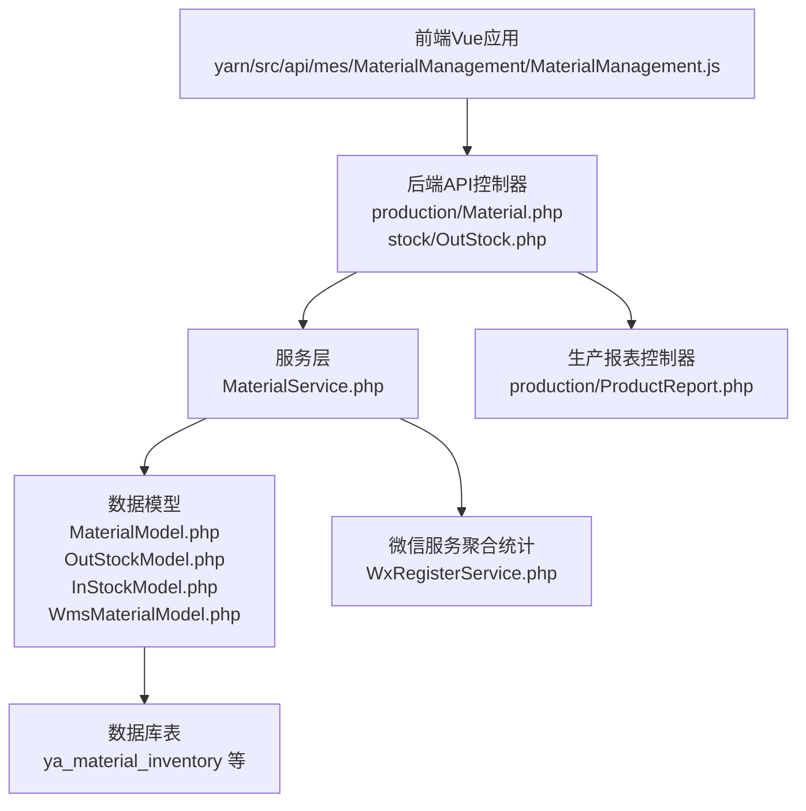
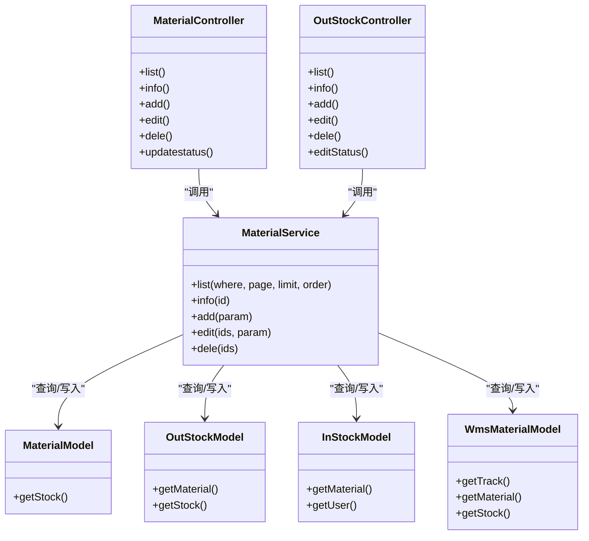
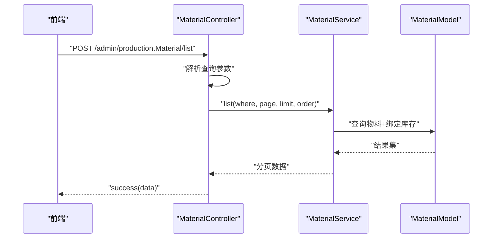
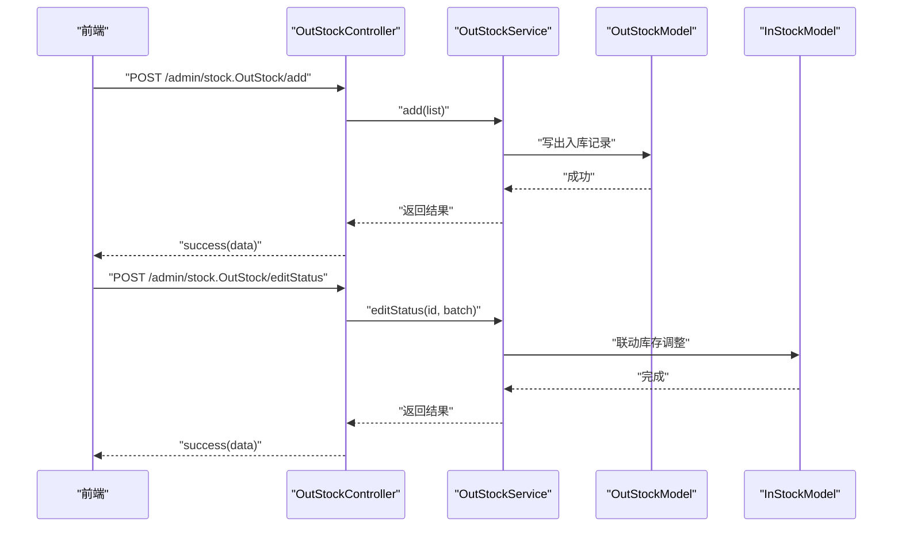
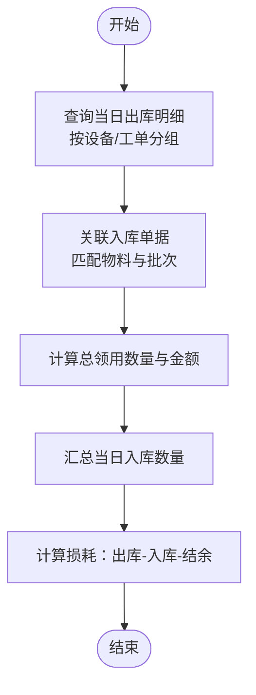
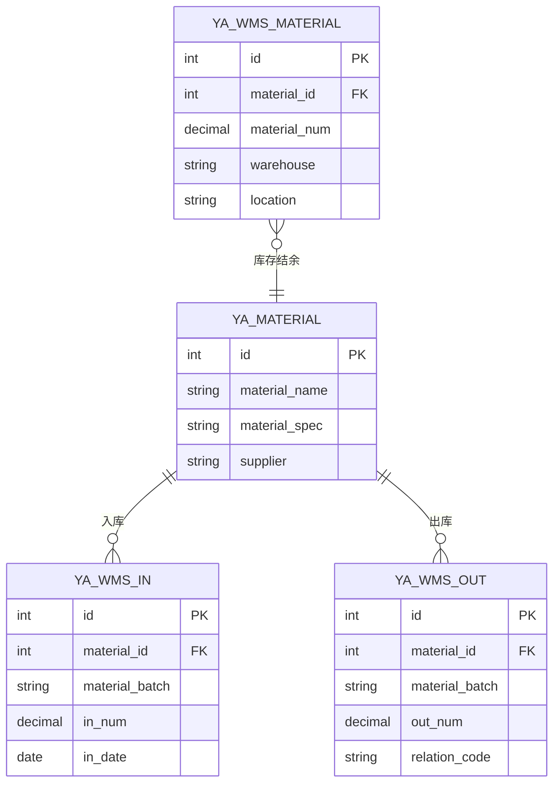
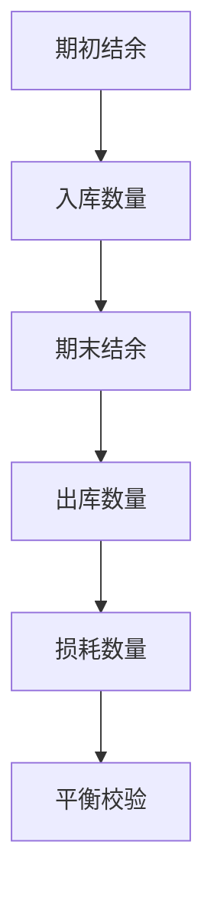
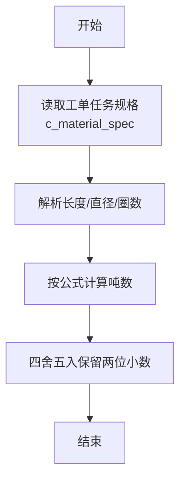
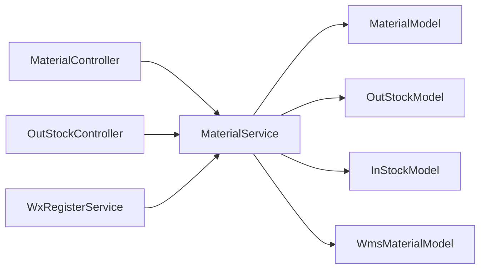

# 物料消耗API

<cite>
**本文引用的文件**
- [gccd_server/app/admin/controller/production/Material.php](file://gccd_server/app/admin/controller/production/Material.php)
- [gccd_server/app/common/service/admin/MaterialService.php](file://gccd_server/app/common/service/admin/MaterialService.php)
- [gccd_server/app/common/model/admin/MaterialModel.php](file://gccd_server/app/common/model/admin/MaterialModel.php)
- [gccd_server/app/admin/controller/stock/OutStock.php](file://gccd_server/app/admin/controller/stock/OutStock.php)
- [gccd_server/app/common/model/admin/OutStockModel.php](file://gccd_server/app/common/model/admin/OutStockModel.php)
- [gccd_server/app/common/model/admin/InStockModel.php](file://gccd_server/app/common/model/admin/InStockModel.php)
- [gccd_server/app/common/model/admin/WmsMaterialModel.php](file://gccd_server/app/common/model/admin/WmsMaterialModel.php)
- [yarn/src/api/mes/MaterialManagement/MaterialManagement.js](file://yarn/src/api/mes/MaterialManagement/MaterialManagement.js)
- [yarn/admin/js/MaterialManagement.CLsvct-x.js](file://yarn/admin/js/MaterialManagement.CLsvct-x.js)
- [gccd_server/app/common/service/wechat/WxRegisterService.php](file://gccd_server/app/common/service/wechat/WxRegisterService.php)
- [gccd_server/app/admin/controller/production/ProductReport.php](file://gccd_server/app/admin/controller/production/ProductReport.php)
- [gccd_server/database_fix.sql](file://gccd_server/database_fix.sql)
</cite>

## 目录
1. [简介](#简介)
2. [项目结构](#项目结构)
3. [核心组件](#核心组件)
4. [架构概览](#架构概览)
5. [详细组件分析](#详细组件分析)
6. [依赖分析](#依赖分析)
7. [性能考虑](#性能考虑)
8. [故障排查指南](#故障排查指南)
9. [结论](#结论)
10. [附录](#附录)

## 简介
本文件面向“物料消耗API”的使用与集成，覆盖以下业务主题：
- 物料领用、退料、损耗统计
- 生产物料投料管理、边角料处理、物料平衡计算
- 物料批次追踪、供应商管理、库存联动

文档以接口定义、调用流程、数据模型与依赖关系为主线，帮助前后端协同开发与运维排障。

## 项目结构
该仓库包含三部分：
- 前端工程（Vue + Element Plus）：位于 yarn/，提供MES相关页面与API封装。
- 后端服务（ThinkPHP）：位于 gccd_server/，提供物料、出入库、生产报表等接口。
- 小程序前端：位于 gccd_mini/，提供部分物料与工单交互能力。

与物料消耗直接相关的模块分布如下：
- 前端API封装：yarn/src/api/mes/MaterialManagement/MaterialManagement.js
- 后端控制器：gccd_server/app/admin/controller/production/Material.php、gccd_server/app/admin/controller/stock/OutStock.php
- 服务层：gccd_server/app/common/service/admin/MaterialService.php
- 数据模型：gccd_server/app/common/model/admin/MaterialModel.php、gccd_server/app/common/model/admin/OutStockModel.php、gccd_server/app/common/model/admin/InStockModel.php、gccd_server/app/common/model/admin/WmsMaterialModel.php
- 生产报表与吨数计算：gccd_server/app/admin/controller/production/ProductReport.php
- 微信服务聚合统计：gccd_server/app/common/service/wechat/WxRegisterService.php
- 数据库初始化脚本：gccd_server/database_fix.sql

图表来源
- [gccd_server/app/admin/controller/production/Material.php:1-148](file://gccd_server/app/admin/controller/production/Material.php#L1-L148)
- [gccd_server/app/admin/controller/stock/OutStock.php:1-164](file://gccd_server/app/admin/controller/stock/OutStock.php#L1-L164)
- [gccd_server/app/common/service/admin/MaterialService.php:1-195](file://gccd_server/app/common/service/admin/MaterialService.php#L1-L195)
- [gccd_server/app/common/model/admin/MaterialModel.php:1-25](file://gccd_server/app/common/model/admin/MaterialModel.php#L1-L25)
- [gccd_server/app/common/model/admin/OutStockModel.php:1-37](file://gccd_server/app/common/model/admin/OutStockModel.php#L1-L37)
- [gccd_server/app/common/model/admin/InStockModel.php:1-33](file://gccd_server/app/common/model/admin/InStockModel.php#L1-L33)
- [gccd_server/app/common/model/admin/WmsMaterialModel.php:1-47](file://gccd_server/app/common/model/admin/WmsMaterialModel.php#L1-L47)
- [gccd_server/app/admin/controller/production/ProductReport.php:372-399](file://gccd_server/app/admin/controller/production/ProductReport.php#L372-L399)
- [gccd_server/app/common/service/wechat/WxRegisterService.php:643-677](file://gccd_server/app/common/service/wechat/WxRegisterService.php#L643-L677)
- [gccd_server/database_fix.sql:37-57](file://gccd_server/database_fix.sql#L37-L57)

章节来源
- [gccd_server/app/admin/controller/production/Material.php:1-148](file://gccd_server/app/admin/controller/production/Material.php#L1-L148)
- [gccd_server/app/admin/controller/stock/OutStock.php:1-164](file://gccd_server/app/admin/controller/stock/OutStock.php#L1-L164)
- [gccd_server/app/common/service/admin/MaterialService.php:1-195](file://gccd_server/app/common/service/admin/MaterialService.php#L1-L195)
- [gccd_server/app/common/model/admin/MaterialModel.php:1-25](file://gccd_server/app/common/model/admin/MaterialModel.php#L1-L25)
- [gccd_server/app/common/model/admin/OutStockModel.php:1-37](file://gccd_server/app/common/model/admin/OutStockModel.php#L1-L37)
- [gccd_server/app/common/model/admin/InStockModel.php:1-33](file://gccd_server/app/common/model/admin/InStockModel.php#L1-L33)
- [gccd_server/app/common/model/admin/WmsMaterialModel.php:1-47](file://gccd_server/app/common/model/admin/WmsMaterialModel.php#L1-L47)
- [gccd_server/app/admin/controller/production/ProductReport.php:372-399](file://gccd_server/app/admin/controller/production/ProductReport.php#L372-L399)
- [gccd_server/app/common/service/wechat/WxRegisterService.php:643-677](file://gccd_server/app/common/service/wechat/WxRegisterService.php#L643-L677)
- [gccd_server/database_fix.sql:37-57](file://gccd_server/database_fix.sql#L37-L57)

## 核心组件
- 物料基础管理（列表、新增、编辑、删除、状态变更）
- 出库管理（出库列表、详情、新增、编辑、删除、审核）
- 生产物料投料与统计（按工单/工序维度的领用、退料、损耗统计）
- 批次与供应商信息（批次、单价、供应商）
- 库存联动（入库、出库与库存结余的联动）

章节来源
- [gccd_server/app/admin/controller/production/Material.php:25-148](file://gccd_server/app/admin/controller/production/Material.php#L25-L148)
- [gccd_server/app/admin/controller/stock/OutStock.php:28-164](file://gccd_server/app/admin/controller/stock/OutStock.php#L28-L164)
- [gccd_server/app/common/service/admin/MaterialService.php:25-195](file://gccd_server/app/common/service/admin/MaterialService.php#L25-L195)
- [gccd_server/app/common/model/admin/MaterialModel.php:10-25](file://gccd_server/app/common/model/admin/MaterialModel.php#L10-L25)
- [gccd_server/app/common/model/admin/OutStockModel.php:7-37](file://gccd_server/app/common/model/admin/OutStockModel.php#L7-L37)
- [gccd_server/app/common/model/admin/InStockModel.php:8-33](file://gccd_server/app/common/model/admin/InStockModel.php#L8-L33)
- [gccd_server/app/common/model/admin/WmsMaterialModel.php:8-47](file://gccd_server/app/common/model/admin/WmsMaterialModel.php#L8-L47)

## 架构概览
后端采用“控制器-服务-模型”三层架构：
- 控制器负责参数解析、校验与返回格式化
- 服务层封装业务逻辑（事务、统计、聚合）
- 模型层映射数据库表，提供关联查询与绑定字段

图表来源
- [gccd_server/app/admin/controller/production/Material.php:25-148](file://gccd_server/app/admin/controller/production/Material.php#L25-L148)
- [gccd_server/app/admin/controller/stock/OutStock.php:28-164](file://gccd_server/app/admin/controller/stock/OutStock.php#L28-L164)
- [gccd_server/app/common/service/admin/MaterialService.php:25-195](file://gccd_server/app/common/service/admin/MaterialService.php#L25-L195)
- [gccd_server/app/common/model/admin/MaterialModel.php:10-25](file://gccd_server/app/common/model/admin/MaterialModel.php#L10-L25)
- [gccd_server/app/common/model/admin/OutStockModel.php:7-37](file://gccd_server/app/common/model/admin/OutStockModel.php#L7-L37)
- [gccd_server/app/common/model/admin/InStockModel.php:8-33](file://gccd_server/app/common/model/admin/InStockModel.php#L8-L33)
- [gccd_server/app/common/model/admin/WmsMaterialModel.php:8-47](file://gccd_server/app/common/model/admin/WmsMaterialModel.php#L8-L47)

## 详细组件分析

### 1) 物料基础管理API
- 接口路径前缀：/admin/production.Material/
- 前端封装文件：yarn/src/api/mes/MaterialManagement/MaterialManagement.js
- 对应控制器：gccd_server/app/admin/controller/production/Material.php
- 服务层：gccd_server/app/common/service/admin/MaterialService.php
- 数据模型：gccd_server/app/common/model/admin/MaterialModel.php

接口清单
- 列表查询：POST /admin/production.Material/list
  - 查询条件：物料名称、规格、型号、供应商、制造商、属性、仓库、创建时间区间
  - 返回：分页列表与统计信息
- 详情查询：POST /admin/production.Material/info
  - 参数：id
- 新增：POST /admin/production.Material/add
  - 参数：物料基础字段（名称、规格、厚度、型号、供应商、制造商、属性、仓库等）
- 编辑：POST /admin/production.Material/edit
  - 参数：id + 可选字段
- 删除：POST /admin/production.Material/dele
  - 参数：ids[]
- 状态变更：POST /admin/production.Material/updatestatus
  - 参数：id、status、refuse_reason

调用序列图（以“列表查询”为例）

图表来源
- [gccd_server/app/admin/controller/production/Material.php:39-79](file://gccd_server/app/admin/controller/production/Material.php#L39-L79)
- [gccd_server/app/common/service/admin/MaterialService.php:68-84](file://gccd_server/app/common/service/admin/MaterialService.php#L68-L84)
- [gccd_server/app/common/model/admin/MaterialModel.php:15-24](file://gccd_server/app/common/model/admin/MaterialModel.php#L15-L24)

章节来源
- [gccd_server/app/admin/controller/production/Material.php:25-148](file://gccd_server/app/admin/controller/production/Material.php#L25-L148)
- [gccd_server/app/common/service/admin/MaterialService.php:25-195](file://gccd_server/app/common/service/admin/MaterialService.php#L25-L195)
- [gccd_server/app/common/model/admin/MaterialModel.php:10-25](file://gccd_server/app/common/model/admin/MaterialModel.php#L10-L25)
- [yarn/src/api/mes/MaterialManagement/MaterialManagement.js:1-63](file://yarn/src/api/mes/MaterialManagement/MaterialManagement.js#L1-L63)
- [yarn/admin/js/MaterialManagement.CLsvct-x.js:1-1](file://yarn/admin/js/MaterialManagement.CLsvct-x.js#L1-L1)

### 2) 出库管理API（含退料、批次、供应商）
- 接口路径前缀：/admin/stock.OutStock/
- 对应控制器：gccd_server/app/admin/controller/stock/OutStock.php
- 数据模型：gccd_server/app/common/model/admin/OutStockModel.php、gccd_server/app/common/model/admin/InStockModel.php
- 关联WMS物料：gccd_server/app/common/model/admin/WmsMaterialModel.php

接口清单
- 出库列表：POST /admin/stock.OutStock/list
  - 查询条件：出库单号、关联单号、物料名称/规格/仓库、创建时间区间
  - 返回：分页列表（含物料名称、规格、仓库、库位等）
- 出库详情：POST /admin/stock.OutStock/info
  - 参数：id
- 新增出库：POST /admin/stock.OutStock/add
  - 参数：list[]（包含 material_id、out_num、relation_code、remark、picker 等）
- 编辑出库：POST /admin/stock.OutStock/edit
  - 参数：id + 可选字段
- 删除出库：POST /admin/stock.OutStock/dele
  - 参数：ids[]
- 审核出库：POST /admin/stock.OutStock/editStatus
  - 参数：id、material_batch

出库流程（新增与审核）

图表来源
- [gccd_server/app/admin/controller/stock/OutStock.php:102-161](file://gccd_server/app/admin/controller/stock/OutStock.php#L102-L161)
- [gccd_server/app/common/model/admin/OutStockModel.php:13-36](file://gccd_server/app/common/model/admin/OutStockModel.php#L13-L36)
- [gccd_server/app/common/model/admin/InStockModel.php:14-32](file://gccd_server/app/common/model/admin/InStockModel.php#L14-L32)

章节来源
- [gccd_server/app/admin/controller/stock/OutStock.php:28-164](file://gccd_server/app/admin/controller/stock/OutStock.php#L28-L164)
- [gccd_server/app/common/model/admin/OutStockModel.php:7-37](file://gccd_server/app/common/model/admin/OutStockModel.php#L7-L37)
- [gccd_server/app/common/model/admin/InStockModel.php:8-33](file://gccd_server/app/common/model/admin/InStockModel.php#L8-L33)
- [gccd_server/app/common/model/admin/WmsMaterialModel.php:13-47](file://gccd_server/app/common/model/admin/WmsMaterialModel.php#L13-L47)

### 3) 生产物料投料与统计（领用、退料、损耗）
- 投料统计：按设备/工单维度统计当日领料数量与金额
- 退料统计：通过出库单据（退料）进行反向统计
- 损耗统计：结合入库、出库与库存差异计算损耗
- 批次追踪：出库单据与入库批次关联，支持按批次查询与统计

统计聚合逻辑（按日期与设备分组）

图表来源
- [gccd_server/app/common/service/wechat/WxRegisterService.php:643-677](file://gccd_server/app/common/service/wechat/WxRegisterService.php#L643-L677)

章节来源
- [gccd_server/app/common/service/wechat/WxRegisterService.php:643-677](file://gccd_server/app/common/service/wechat/WxRegisterService.php#L643-L677)

### 4) 物料批次追踪、供应商管理、库存联动
- 批次追踪：出库单据与入库批次关联，支持按批次查询
- 供应商管理：物料模型绑定供应商字段，出库单据可记录供应商价格
- 库存联动：出库审核后联动库存结余，入库与出库双向影响可用量

图表来源
- [gccd_server/app/common/model/admin/OutStockModel.php:13-36](file://gccd_server/app/common/model/admin/OutStockModel.php#L13-L36)
- [gccd_server/app/common/model/admin/InStockModel.php:14-32](file://gccd_server/app/common/model/admin/InStockModel.php#L14-L32)
- [gccd_server/app/common/model/admin/WmsMaterialModel.php:13-47](file://gccd_server/app/common/model/admin/WmsMaterialModel.php#L13-L47)

章节来源
- [gccd_server/app/common/model/admin/OutStockModel.php:7-37](file://gccd_server/app/common/model/admin/OutStockModel.php#L7-L37)
- [gccd_server/app/common/model/admin/InStockModel.php:8-33](file://gccd_server/app/common/model/admin/InStockModel.php#L8-L33)
- [gccd_server/app/common/model/admin/WmsMaterialModel.php:8-47](file://gccd_server/app/common/model/admin/WmsMaterialModel.php#L8-L47)

### 5) 物料平衡计算与边角料处理
- 物料平衡：入库数量、出库数量、库存结余三者平衡校验
- 边角料处理：通过退料单据进行退料登记，并纳入损耗统计

平衡计算流程

图表来源
- [gccd_server/app/common/service/wechat/WxRegisterService.php:643-677](file://gccd_server/app/common/service/wechat/WxRegisterService.php#L643-L677)

章节来源
- [gccd_server/app/common/service/wechat/WxRegisterService.php:643-677](file://gccd_server/app/common/service/wechat/WxRegisterService.php#L643-L677)

### 6) 生产投料管理与吨数计算
- 投料管理：根据工单任务的材料规格与支数，计算理论投料吨数
- 吨数计算接口：POST /admin/production.ProductReport/count
  - 参数：count（支数）、task_code（工单号）
  - 返回：report_num（吨数）

吨数计算流程

图表来源
- [gccd_server/app/admin/controller/production/ProductReport.php:372-387](file://gccd_server/app/admin/controller/production/ProductReport.php#L372-L387)

章节来源
- [gccd_server/app/admin/controller/production/ProductReport.php:372-399](file://gccd_server/app/admin/controller/production/ProductReport.php#L372-L399)

## 依赖分析
- 控制器依赖服务层；服务层依赖模型层；模型层依赖数据库表
- 出库审核依赖库存模型进行结余联动
- 统计聚合依赖微信服务对出库、入库、库存的映射与汇总

图表来源
- [gccd_server/app/admin/controller/production/Material.php:25-148](file://gccd_server/app/admin/controller/production/Material.php#L25-L148)
- [gccd_server/app/admin/controller/stock/OutStock.php:28-164](file://gccd_server/app/admin/controller/stock/OutStock.php#L28-L164)
- [gccd_server/app/common/service/admin/MaterialService.php:25-195](file://gccd_server/app/common/service/admin/MaterialService.php#L25-L195)
- [gccd_server/app/common/model/admin/MaterialModel.php:10-25](file://gccd_server/app/common/model/admin/MaterialModel.php#L10-L25)
- [gccd_server/app/common/model/admin/OutStockModel.php:7-37](file://gccd_server/app/common/model/admin/OutStockModel.php#L7-L37)
- [gccd_server/app/common/model/admin/InStockModel.php:8-33](file://gccd_server/app/common/model/admin/InStockModel.php#L8-L33)
- [gccd_server/app/common/model/admin/WmsMaterialModel.php:8-47](file://gccd_server/app/common/model/admin/WmsMaterialModel.php#L8-L47)
- [gccd_server/app/common/service/wechat/WxRegisterService.php:643-677](file://gccd_server/app/common/service/wechat/WxRegisterService.php#L643-L677)

章节来源
- [gccd_server/app/admin/controller/production/Material.php:25-148](file://gccd_server/app/admin/controller/production/Material.php#L25-L148)
- [gccd_server/app/admin/controller/stock/OutStock.php:28-164](file://gccd_server/app/admin/controller/stock/OutStock.php#L28-L164)
- [gccd_server/app/common/service/admin/MaterialService.php:25-195](file://gccd_server/app/common/service/admin/MaterialService.php#L25-L195)
- [gccd_server/app/common/model/admin/MaterialModel.php:10-25](file://gccd_server/app/common/model/admin/MaterialModel.php#L10-L25)
- [gccd_server/app/common/model/admin/OutStockModel.php:7-37](file://gccd_server/app/common/model/admin/OutStockModel.php#L7-L37)
- [gccd_server/app/common/model/admin/InStockModel.php:8-33](file://gccd_server/app/common/model/admin/InStockModel.php#L8-L33)
- [gccd_server/app/common/model/admin/WmsMaterialModel.php:8-47](file://gccd_server/app/common/model/admin/WmsMaterialModel.php#L8-L47)
- [gccd_server/app/common/service/wechat/WxRegisterService.php:643-677](file://gccd_server/app/common/service/wechat/WxRegisterService.php#L643-L677)

## 性能考虑
- 分页查询：列表接口默认分页，建议前端设置合理 limit 并避免一次性请求全量数据
- 关联查询：物料列表与库存绑定查询需注意索引优化（如 material_id、create_time）
- 统计聚合：按日/按设备分组统计涉及多表连接，建议在相关字段上建立索引
- 批量操作：出库新增支持批量 list[]，建议控制单次批量大小并做好幂等性校验

## 故障排查指南
- 出库审核失败
  - 检查 material_batch 是否正确传入
  - 核对库存是否充足
  - 查看事务是否回滚
- 列表查询无数据
  - 检查查询条件（名称/规格/仓库/时间区间）是否过严
  - 确认物料是否存在且未被删除
- 统计异常
  - 检查出库与入库是否在同一日期与批次
  - 确认库存映射是否正确（入库与出库批次一致）

章节来源
- [gccd_server/app/admin/controller/stock/OutStock.php:154-161](file://gccd_server/app/admin/controller/stock/OutStock.php#L154-L161)
- [gccd_server/app/common/service/admin/MaterialService.php:121-136](file://gccd_server/app/common/service/admin/MaterialService.php#L121-L136)
- [gccd_server/app/common/service/wechat/WxRegisterService.php:643-677](file://gccd_server/app/common/service/wechat/WxRegisterService.php#L643-L677)

## 结论
本套物料消耗API围绕“物料基础管理—出库管理—统计聚合—库存联动”形成闭环，支持生产投料、退料、损耗统计、批次追踪与供应商管理。建议在生产环境关注索引与分页策略，确保统计与库存联动的实时性与准确性。

## 附录
- 数据库表初始化参考：ya_material_inventory（生产盘点记录表）
- 前端API封装文件：yarn/src/api/mes/MaterialManagement/MaterialManagement.js、yarn/admin/js/MaterialManagement.CLsvct-x.js

章节来源
- [gccd_server/database_fix.sql:37-57](file://gccd_server/database_fix.sql#L37-L57)
- [yarn/src/api/mes/MaterialManagement/MaterialManagement.js:1-63](file://yarn/src/api/mes/MaterialManagement/MaterialManagement.js#L1-L63)
- [yarn/admin/js/MaterialManagement.CLsvct-x.js:1-1](file://yarn/admin/js/MaterialManagement.CLsvct-x.js#L1-L1)