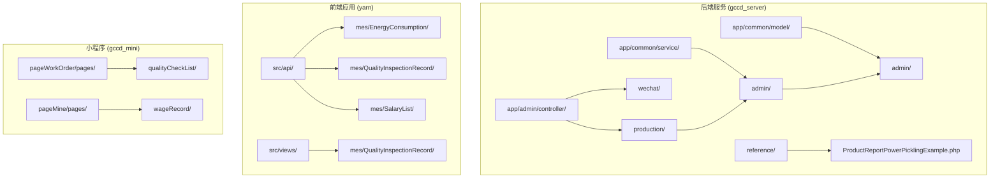
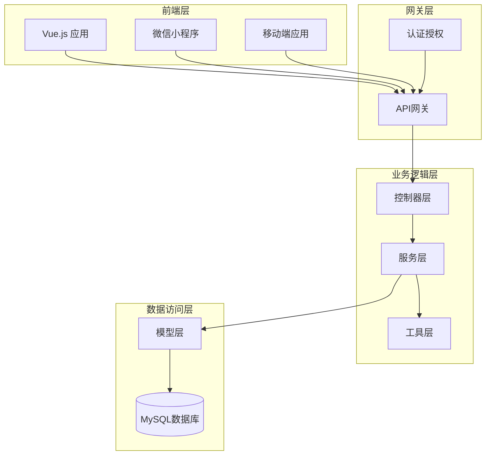
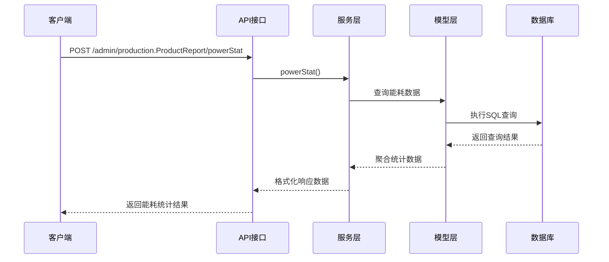
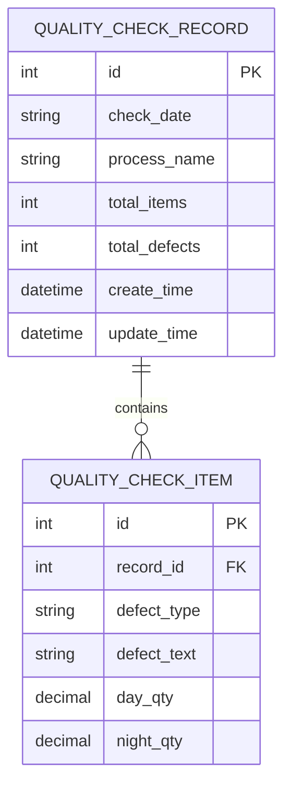
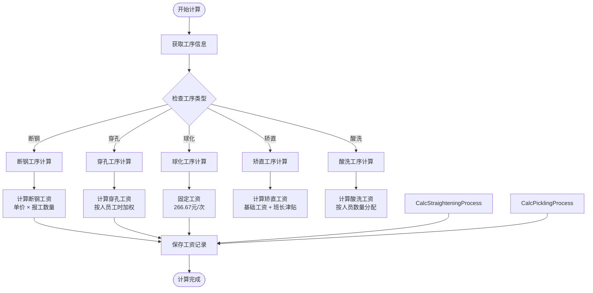
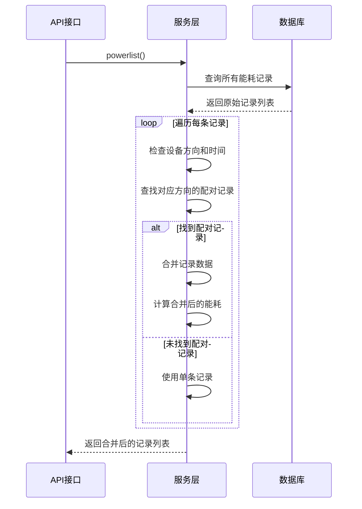
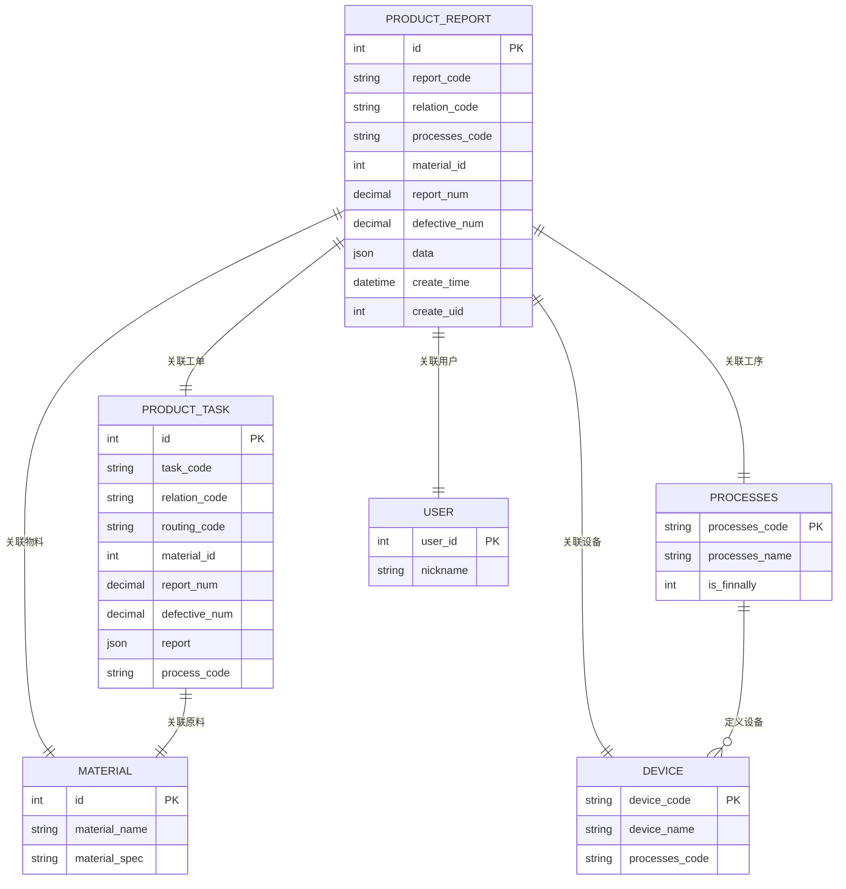
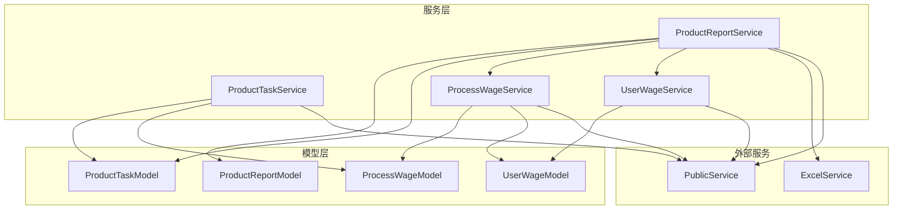

# 生产报表API

<cite>
**本文档引用的文件**
- [ProductReport.php](file://gccd_server/app/admin/controller/production/ProductReport.php)
- [ProductReportService.php](file://gccd_server/app/common/service/admin/ProductReportService.php)
- [ProductReportModel.php](file://gccd_server/app/common/model/admin/ProductReportModel.php)
- [EnergyConsumption.js](file://yarn/src/api/mes/EnergyConsumption/EnergyConsumption.js)
- [ProductReportPowerPicklingExample.php](file://gccd_server/reference/ProductReportPowerPicklingExample.php)
- [ProductTaskService.php](file://gccd_server/app/common/service/admin/ProductTaskService.php)
- [QualityInspectionRecord.js](file://yarn/src/api/mes/QualityInspectionRecord/QualityInspectionRecord.js)
- [SalaryList.js](file://yarn/src/api/mes/SalaryList/SalaryList.js)
</cite>

## 目录
1. [简介](#简介)
2. [项目结构](#项目结构)
3. [核心组件](#核心组件)
4. [架构概览](#架构概览)
5. [详细组件分析](#详细组件分析)
6. [依赖关系分析](#依赖关系分析)
7. [性能考虑](#性能考虑)
8. [故障排除指南](#故障排除指南)
9. [结论](#结论)

## 简介
本文件为高齿传动项目的生产报表API提供完整的技术文档，涵盖生产统计数据查询、报表生成、趋势分析等核心功能。文档详细说明了产量统计、质量指标、设备效率、人员绩效等各类报表的数据获取方法，并包含时间范围筛选、数据聚合、图表展示等高级功能的API实现。

该项目采用前后端分离架构，后端基于ThinkPHP框架开发，前端使用Vue.js技术栈，通过RESTful API进行数据交互。系统主要服务于生产制造过程中的数据采集、统计分析和报表展示需求。

## 项目结构
项目采用模块化的目录组织方式，主要分为以下几部分：

**图表来源**
- [ProductReport.php:1-416](file://gccd_server/app/admin/controller/production/ProductReport.php#L1-L416)
- [ProductReportService.php:1-1262](file://gccd_server/app/common/service/admin/ProductReportService.php#L1-L1262)

**章节来源**
- [ProductReport.php:1-416](file://gccd_server/app/admin/controller/production/ProductReport.php#L1-L416)
- [ProductReportService.php:1-1262](file://gccd_server/app/common/service/admin/ProductReportService.php#L1-L1262)

## 核心组件
生产报表系统的核心组件包括控制器层、服务层、模型层和前端API层，各层级职责明确，耦合度低，便于维护和扩展。

### 控制器层
控制器层负责HTTP请求的接收、参数验证和响应数据的封装，主要包含以下功能模块：
- 报工记录管理：提供报工记录的CRUD操作
- 能源统计管理：处理能耗数据的统计和查询
- 质量检查管理：管理质量检验相关数据
- 工资管理：处理人员绩效和工资计算

### 服务层
服务层是业务逻辑的核心，负责复杂的业务规则处理和数据聚合，主要功能包括：
- 数据聚合统计：按时间、工序、设备等维度进行数据聚合
- 工资计算：根据工序和绩效计算人员工资
- 能耗分析：计算设备效率和能耗指标
- 报表生成：生成各类生产报表数据

### 模型层
模型层负责数据持久化和数据库操作，提供数据访问接口和关联查询能力。

**章节来源**
- [ProductReport.php:24-416](file://gccd_server/app/admin/controller/production/ProductReport.php#L24-L416)
- [ProductReportService.php:41-1262](file://gccd_server/app/common/service/admin/ProductReportService.php#L41-L1262)

## 架构概览
系统采用经典的三层架构设计，前后端分离，通过RESTful API进行通信。

**图表来源**
- [ProductReport.php:1-416](file://gccd_server/app/admin/controller/production/ProductReport.php#L1-L416)
- [ProductReportService.php:1-1262](file://gccd_server/app/common/service/admin/ProductReportService.php#L1-L1262)

## 详细组件分析

### 能源消耗报表API

#### 接口定义
系统提供了完整的能源消耗数据查询和统计功能，主要包括以下接口：

**图表来源**
- [ProductReport.php:319-323](file://gccd_server/app/admin/controller/production/ProductReport.php#L319-L323)
- [ProductReportService.php:487-516](file://gccd_server/app/common/service/admin/ProductReportService.php#L487-L516)

#### 能耗统计接口
- **接口地址**: `/admin/production.ProductReport/powerStat`
- **请求方法**: POST
- **功能描述**: 获取当日和当月的能耗统计信息，包括电力和燃气消耗量
- **响应数据**: 
  - `today_gas`: 当日燃气消耗总量
  - `today_power`: 当日电力消耗总量  
  - `month_gas`: 当月燃气消耗总量
  - `month_power`: 当月电力消耗总量
  - `processes_month_gas`: 按工序分类的月度能耗统计
  - `processes_today_gas`: 按工序分类的当日能耗统计

#### 能耗吨数统计接口
- **接口地址**: `/admin/production.ProductReport/getPowerConsumptionStats`
- **请求方法**: POST
- **请求参数**:
  - `start_date`: 起始日期（可选）
  - `end_date`: 结束日期（可选）
- **功能描述**: 统计指定日期范围内的能耗吨数，特别针对酸洗车间的磷化、皂化、碱三种化学药剂的消耗量
- **响应数据**:
  - `phosphating_total`: 磷化吨数总和（保留3位小数）
  - `saponification_total`: 皂化吨数总和（保留3位小数）
  - `alkali_total`: 碱吨数总和（保留3位小数）
  - `date_range`: 日期范围信息（当提供日期参数时返回）

**章节来源**
- [ProductReport.php:319-412](file://gccd_server/app/admin/controller/production/ProductReport.php#L319-L412)
- [ProductReportService.php:487-516](file://gccd_server/app/common/service/admin/ProductReportService.php#L487-L516)
- [ProductReportService.php:1204-1259](file://gccd_server/app/common/service/admin/ProductReportService.php#L1204-L1259)

### 报工记录管理API

#### 报工列表查询
- **接口地址**: `/admin/production.ProductReport/list`
- **请求方法**: POST
- **功能描述**: 获取报工记录列表，支持多条件筛选和分页查询
- **支持的筛选条件**:
  - `routing_code`: 工艺路线编码
  - `relation_code`: 关联工单编码
  - `processes_code`: 工序编码
  - `device_code`: 设备编码
  - `device_name`: 设备名称（JSON字段模糊查询）
  - `create_name`: 创建人姓名（关联用户表）
  - `production_plan_name`: 生产计划名称（关联生产计划表）
  - `plan_code`: 计划编码（关联工单表）
  - `c_material_spec`: 成品物料规格
  - `y_material_spec`: 原料物料规格
  - `create_start_date`: 创建开始日期
  - `create_end_date`: 创建结束日期

#### 报工详情查询
- **接口地址**: `/admin/production.ProductReport/info`
- **请求方法**: POST
- **请求参数**:
  - `id`: 报工记录ID
- **功能描述**: 获取指定报工记录的详细信息，包括关联的工序、物料、设备等信息

#### 报工编辑操作
- **接口地址**: `/admin/production.ProductReport/edit`
- **请求方法**: POST
- **功能描述**: 修改现有的报工记录信息
- **支持的编辑字段**: 报工数量、不良品数量、备注等

#### 报工删除操作
- **接口地址**: `/admin/production.ProductReport/dele`
- **请求方法**: POST
- **请求参数**:
  - `ids`: 报工记录ID数组
- **功能描述**: 删除指定的报工记录（支持批量删除）

**章节来源**
- [ProductReport.php:43-182](file://gccd_server/app/admin/controller/production/ProductReport.php#L43-L182)
- [ProductReport.php:257-263](file://gccd_server/app/admin/controller/production/ProductReport.php#L257-L263)
- [ProductReport.php:282-303](file://gccd_server/app/admin/controller/production/ProductReport.php#L282-L303)

### 质量检查报表API

#### 质检记录查询
- **接口地址**: `/admin/production.QualityCheckRecord/list`
- **请求方法**: POST
- **功能描述**: 获取质量检查记录列表
- **支持的筛选条件**:
  - `process_name`: 工序名称
  - `check_start_date`: 检查开始日期
  - `check_end_date`: 检查结束日期

#### 质检详情查询
- **接口地址**: `/admin/production.QualityCheckRecord/info`
- **请求方法**: POST
- **功能描述**: 获取质量检查记录的详细信息

#### 质检数据结构

**图表来源**
- [QualityInspectionRecord.js:1-63](file://yarn/src/api/mes/QualityInspectionRecord/QualityInspectionRecord.js#L1-L63)

**章节来源**
- [QualityInspectionRecord.js:1-63](file://yarn/src/api/mes/QualityInspectionRecord/QualityInspectionRecord.js#L1-L63)

### 人员绩效报表API

#### 工资列表查询
- **接口地址**: `/admin/wage.UserWage/list`
- **请求方法**: POST
- **功能描述**: 获取员工工资列表
- **支持的筛选条件**:
  - `user_id`: 员工ID
  - `month`: 工资月份
  - `year`: 工资年份

#### 员工日工资查询
- **接口地址**: `/admin/wage.UserWage/getUserDayWage`
- **请求方法**: POST
- **功能描述**: 获取指定日期的员工工资信息
- **请求参数**:
  - `user_id`: 员工ID
  - `date`: 查询日期

#### 工资计算逻辑
系统根据不同的生产工序和绩效指标自动计算员工工资，主要包含以下计算规则：

**图表来源**
- [ProductReportService.php:771-1047](file://gccd_server/app/common/service/admin/ProductReportService.php#L771-L1047)

**章节来源**
- [SalaryList.js:1-27](file://yarn/src/api/mes/SalaryList/SalaryList.js#L1-L27)
- [ProductReportService.php:771-1047](file://gccd_server/app/common/service/admin/ProductReportService.php#L771-L1047)

### 设备效率分析API

#### 能耗抄表记录管理
- **接口地址**: `/admin/production.ProductReport/powerlist`
- **请求方法**: POST
- **功能描述**: 获取能耗抄表记录列表，支持按设备、班次、日期等条件筛选
- **支持的筛选条件**:
  - `routing_code`: 工艺路线编码
  - `relation_code`: 关联工单编码
  - `class`: 班次（南/北）
  - `device_code`: 设备编码
  - `processes_name`: 工序名称（关联设备表）
  - `device_name`: 设备名称（关联设备表）
  - `create_start_date`: 创建开始日期
  - `create_end_date`: 创建结束日期

#### 能耗数据合并处理
系统支持南北向设备数据的智能合并，自动识别同一设备在不同方向的读数并进行合并计算：

**图表来源**
- [ProductReportService.php:189-289](file://gccd_server/app/common/service/admin/ProductReportService.php#L189-L289)

**章节来源**
- [ProductReport.php:184-251](file://gccd_server/app/admin/controller/production/ProductReport.php#L184-L251)
- [ProductReportService.php:189-289](file://gccd_server/app/common/service/admin/ProductReportService.php#L189-L289)

## 依赖关系分析

### 数据模型关系
系统的核心数据模型之间存在复杂的关联关系，通过外键约束保证数据完整性：

**图表来源**
- [ProductReportModel.php:10-76](file://gccd_server/app/common/model/admin/ProductReportModel.php#L10-L76)

### 服务层依赖关系
服务层内部存在清晰的依赖层次，确保业务逻辑的可维护性：

**图表来源**
- [ProductReportService.php:10-37](file://gccd_server/app/common/service/admin/ProductReportService.php#L10-L37)
- [ProductTaskService.php:10-22](file://gccd_server/app/common/service/admin/ProductTaskService.php#L10-L22)

**章节来源**
- [ProductReportModel.php:10-76](file://gccd_server/app/common/model/admin/ProductReportModel.php#L10-L76)
- [ProductReportService.php:10-37](file://gccd_server/app/common/service/admin/ProductReportService.php#L10-L37)
- [ProductTaskService.php:10-22](file://gccd_server/app/common/service/admin/ProductTaskService.php#L10-L22)

## 性能考虑
系统在设计时充分考虑了性能优化，主要体现在以下几个方面：

### 数据库优化
- **索引策略**: 在常用查询字段上建立适当的索引，如`create_time`、`device_code`、`relation_code`等
- **查询优化**: 使用`EXPLAIN`分析慢查询，优化复杂关联查询
- **分页机制**: 实现高效的分页查询，避免全表扫描

### 缓存策略
- **Redis缓存**: 对热点数据进行缓存，减少数据库访问压力
- **查询结果缓存**: 缓存常用的统计结果，提高响应速度
- **配置缓存**: 缓存系统配置和权限信息

### 异步处理
- **队列处理**: 对耗时的操作使用消息队列异步处理
- **批量操作**: 支持批量数据导入和导出
- **定时任务**: 使用定时任务处理周期性统计任务

## 故障排除指南

### 常见问题及解决方案

#### API调用失败
**问题现象**: API请求返回错误状态码
**可能原因**:
- 参数格式不正确
- 权限不足
- 服务器异常

**解决步骤**:
1. 检查请求URL和HTTP方法是否正确
2. 验证请求参数的格式和类型
3. 确认用户权限和认证信息
4. 查看服务器日志获取详细错误信息

#### 数据查询异常
**问题现象**: 查询结果为空或不完整
**可能原因**:
- 查询条件过于严格
- 数据库连接异常
- 缓存数据过期

**解决步骤**:
1. 检查查询条件的逻辑关系
2. 验证数据库连接状态
3. 清除相关缓存数据
4. 重新执行查询操作

#### 性能问题
**问题现象**: API响应时间过长
**可能原因**:
- 查询语句效率低下
- 数据量过大
- 并发访问过高

**解决步骤**:
1. 分析慢查询日志
2. 优化数据库索引
3. 实施分页查询
4. 增加缓存机制

**章节来源**
- [ProductReportService.php:299-347](file://gccd_server/app/common/service/admin/ProductReportService.php#L299-L347)

## 结论
本生产报表API系统提供了完整的生产数据管理和分析功能，涵盖了能耗统计、质量检查、人员绩效等多个维度的报表需求。系统采用模块化设计，具有良好的可扩展性和维护性。

通过合理的架构设计和性能优化，系统能够满足高并发场景下的数据查询和统计需求。同时，完善的错误处理和监控机制确保了系统的稳定运行。

未来可以进一步增强的功能包括：
- 实时数据监控和告警功能
- 更丰富的图表展示和交互体验
- 移动端专用的报表功能
- 与其他ERP系统的集成接口