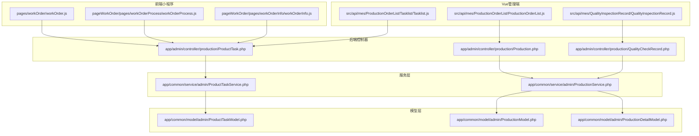
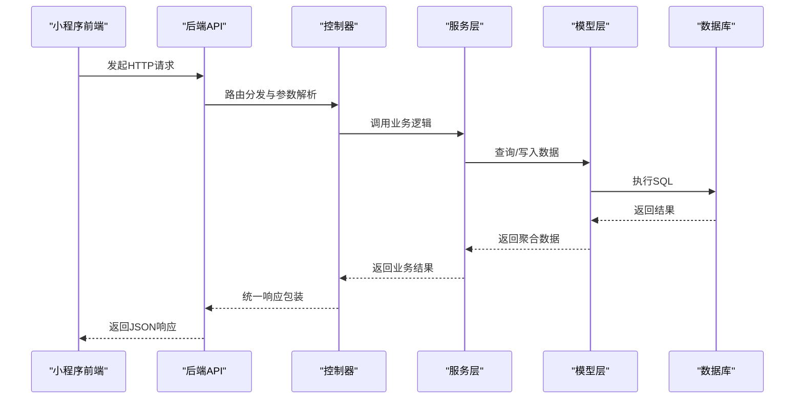
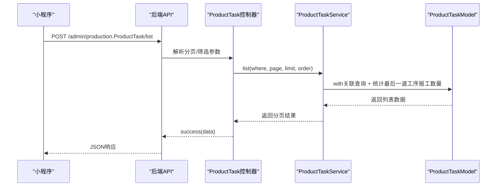
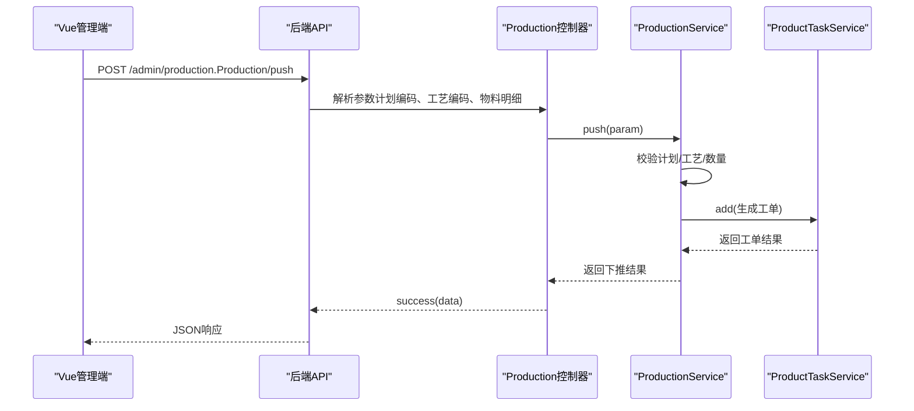
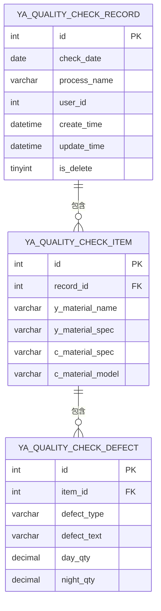
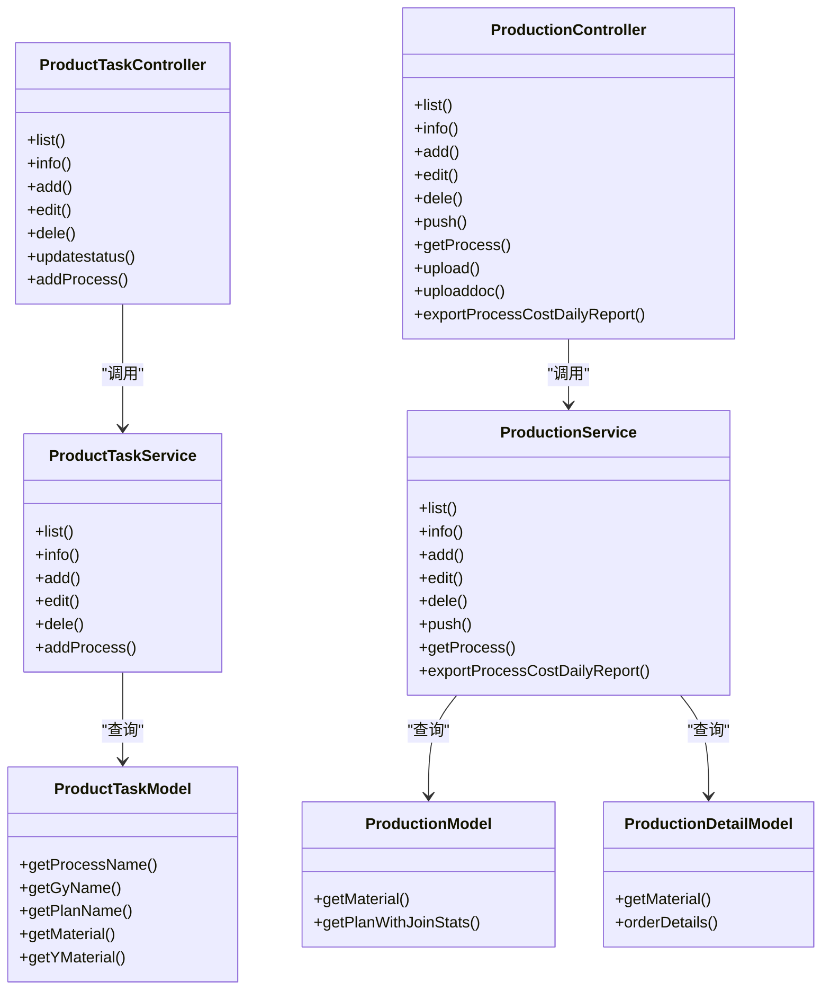

# 生产管理API

<cite>
**本文档引用的文件**
- [ProductTask.php](file://gccd_server/app/admin/controller/production/ProductTask.php)
- [ProductTaskService.php](file://gccd_server/app/common/service/admin/ProductTaskService.php)
- [ProductTaskModel.php](file://gccd_server/app/common/model/admin/ProductTaskModel.php)
- [Production.php](file://gccd_server/app/admin/controller/production/Production.php)
- [ProductionService.php](file://gccd_server/app/common/service/admin/ProductionService.php)
- [ProductionModel.php](file://gccd_server/app/common/model/admin/ProductionModel.php)
- [ProductionDetailModel.php](file://gccd_server/app/common/model/admin/ProductionDetailModel.php)
- [QualityCheckRecord.php](file://gccd_server/app/admin/controller/production/QualityCheckRecord.php)
- [workOrder.js](file://gccd_mini/pages/workOrder/workOrder.js)
- [workOrderProcess.js](file://gccd_mini/pageWorkOrder/pages/workOrderProcess/workOrderProcess.js)
- [workOrderInfo.js](file://gccd_mini/pageWorkOrder/pages/workOrderInfo/workOrderInfo.js)
- [Tasklist.js](file://yarn/src/api/mes/ProductionOrderList/Tasklist/Tasklist.js)
- [ProductionOrderList.js](file://yarn/src/api/mes/ProductionOrderList/ProductionOrderList.js)
- [QualityInspectionRecord.js](file://yarn/src/api/mes/QualityInspectionRecord/QualityInspectionRecord.js)
- [database_fix.sql](file://gccd_server/database_fix.sql)
</cite>

## 目录
1. [简介](#简介)
2. [项目结构](#项目结构)
3. [核心组件](#核心组件)
4. [架构总览](#架构总览)
5. [详细组件分析](#详细组件分析)
6. [依赖关系分析](#依赖关系分析)
7. [性能考虑](#性能考虑)
8. [故障排除指南](#故障排除指南)
9. [结论](#结论)
10. [附录](#附录)

## 简介
本文件面向高齿传动项目的生产管理API，系统性梳理工单管理、工序管理、生产报表与质量检测等核心接口，覆盖HTTP方法、URL路径、请求参数、响应格式、权限控制与数据验证规则，并提供接口调用示例与常见业务场景处理方案，帮助前后端协同开发与运维部署。

## 项目结构
生产管理相关模块主要分布在以下层次：
- 后端控制器层：负责路由定义、参数解析与权限校验
- 服务层：封装业务逻辑、事务控制与跨表聚合
- 模型层：定义数据表关系与字段绑定
- 前端小程序与Vue管理端：调用API并展示数据

**图表来源**
- [ProductTask.php:1-151](file://gccd_server/app/admin/controller/production/ProductTask.php#L1-151)
- [Production.php:1-244](file://gccd_server/app/admin/controller/production/Production.php#L1-244)
- [QualityCheckRecord.php:1-45](file://gccd_server/app/admin/controller/production/QualityCheckRecord.php#L1-45)
- [ProductTaskService.php:1-299](file://gccd_server/app/common/service/admin/ProductTaskService.php#L1-299)
- [ProductionService.php:1-799](file://gccd_server/app/common/service/admin/ProductionService.php#L1-799)
- [ProductTaskModel.php:1-67](file://gccd_server/app/common/model/admin/ProductTaskModel.php#L1-67)
- [ProductionModel.php:1-32](file://gccd_server/app/common/model/admin/ProductionModel.php#L1-32)
- [ProductionDetailModel.php:1-27](file://gccd_server/app/common/model/admin/ProductionDetailModel.php#L1-27)
- [workOrder.js:134-334](file://gccd_mini/pages/workOrder/workOrder.js#L134-334)
- [workOrderProcess.js:1-48](file://gccd_mini/pageWorkOrder/pages/workOrderProcess/workOrderProcess.js#L1-48)
- [workOrderInfo.js:47-86](file://gccd_mini/pageWorkOrder/pages/workOrderInfo/workOrderInfo.js#L47-86)
- [Tasklist.js:1-39](file://yarn/src/api/mes/ProductionOrderList/Tasklist/Tasklist.js#L1-39)
- [ProductionOrderList.js:1-39](file://yarn/src/api/mes/ProductionOrderList/ProductionOrderList.js#L1-39)
- [QualityInspectionRecord.js:1-63](file://yarn/src/api/mes/QualityInspectionRecord/QualityInspectionRecord.js#L1-63)

**章节来源**
- [ProductTask.php:1-151](file://gccd_server/app/admin/controller/production/ProductTask.php#L1-151)
- [Production.php:1-244](file://gccd_server/app/admin/controller/production/Production.php#L1-244)
- [QualityCheckRecord.php:1-45](file://gccd_server/app/admin/controller/production/QualityCheckRecord.php#L1-45)
- [ProductTaskService.php:1-299](file://gccd_server/app/common/service/admin/ProductTaskService.php#L1-299)
- [ProductionService.php:1-799](file://gccd_server/app/common/service/admin/ProductionService.php#L1-799)
- [ProductTaskModel.php:1-67](file://gccd_server/app/common/model/admin/ProductTaskModel.php#L1-67)
- [ProductionModel.php:1-32](file://gccd_server/app/common/model/admin/ProductionModel.php#L1-32)
- [ProductionDetailModel.php:1-27](file://gccd_server/app/common/model/admin/ProductionDetailModel.php#L1-27)
- [workOrder.js:134-334](file://gccd_mini/pages/workOrder/workOrder.js#L134-334)
- [workOrderProcess.js:1-48](file://gccd_mini/pageWorkOrder/pages/workOrderProcess/workOrderProcess.js#L1-48)
- [workOrderInfo.js:47-86](file://gccd_mini/pageWorkOrder/pages/workOrderInfo/workOrderInfo.js#L47-86)
- [Tasklist.js:1-39](file://yarn/src/api/mes/ProductionOrderList/Tasklist/Tasklist.js#L1-39)
- [ProductionOrderList.js:1-39](file://yarn/src/api/mes/ProductionOrderList/ProductionOrderList.js#L1-39)
- [QualityInspectionRecord.js:1-63](file://yarn/src/api/mes/QualityInspectionRecord/QualityInspectionRecord.js#L1-63)

## 核心组件
- 工单管理（生产任务）：提供工单列表、详情、新增、编辑、删除、状态更新与工序添加等功能
- 生产管理（生产计划）：提供计划列表、详情、新增、编辑、删除、下推计划、进度查询与报表导出
- 质量检测：提供质检记录列表、详情、新增、编辑、删除与小程序批量提报接口
- 前端集成：小程序与Vue管理端通过统一的API适配器调用后端接口

**章节来源**
- [ProductTask.php:39-151](file://gccd_server/app/admin/controller/production/ProductTask.php#L39-151)
- [Production.php:42-244](file://gccd_server/app/admin/controller/production/Production.php#L42-244)
- [QualityCheckRecord.php:14-45](file://gccd_server/app/admin/controller/production/QualityCheckRecord.php#L14-45)
- [ProductTaskService.php:60-299](file://gccd_server/app/common/service/admin/ProductTaskService.php#L60-299)
- [ProductionService.php:72-799](file://gccd_server/app/common/service/admin/ProductionService.php#L72-799)

## 架构总览
后端采用ThinkPHP框架，控制器通过注解生成接口文档，服务层封装业务逻辑与事务，模型层定义关联关系；前端小程序与Vue管理端通过Axios适配器统一请求后端REST风格接口。

**图表来源**
- [ProductTask.php:39-151](file://gccd_server/app/admin/controller/production/ProductTask.php#L39-151)
- [Production.php:42-244](file://gccd_server/app/admin/controller/production/Production.php#L42-244)
- [ProductTaskService.php:60-299](file://gccd_server/app/common/service/admin/ProductTaskService.php#L60-299)
- [ProductionService.php:72-799](file://gccd_server/app/common/service/admin/ProductionService.php#L72-799)
- [ProductTaskModel.php:10-67](file://gccd_server/app/common/model/admin/ProductTaskModel.php#L10-67)
- [ProductionModel.php:7-32](file://gccd_server/app/common/model/admin/ProductionModel.php#L7-32)
- [ProductionDetailModel.php:7-27](file://gccd_server/app/common/model/admin/ProductionDetailModel.php#L7-27)

## 详细组件分析

### 工单管理API
- 接口定义与权限
  - 控制器注解用于生成接口文档与分组，接口均通过统一响应包装返回
  - 参数校验与权限控制由中间件与控制器参数解析实现
- 关键接口
  - GET /admin/production.ProductTask/list：分页查询工单列表，支持按任务编码、工序编码、关联计划编码、工艺编码与创建日期筛选
  - POST /admin/production.ProductTask/info：获取工单详情，支持按工序编码获取特定工序的报工数量
  - POST /admin/production.ProductTask/add：批量新增工单，参数包含关联计划编码、工艺编码与物料明细
  - POST /admin/production.ProductTask/edit：批量编辑工单字段
  - POST /admin/production.ProductTask/dele：批量删除工单
  - POST /admin/production.ProductTask/updatestatus：更新工单状态
  - POST /admin/production.ProductTask/addProcess：按工艺顺序添加工序明细
- 数据模型关系
  - 工单模型关联工序、工艺、生产计划与物料信息，支持字段绑定与聚合统计
- 前端调用
  - 小程序通过util.request调用，Vue管理端通过Tasklist.js适配器调用

**图表来源**
- [ProductTask.php:39-151](file://gccd_server/app/admin/controller/production/ProductTask.php#L39-151)
- [ProductTaskService.php:60-114](file://gccd_server/app/common/service/admin/ProductTaskService.php#L60-114)
- [ProductTaskModel.php:10-67](file://gccd_server/app/common/model/admin/ProductTaskModel.php#L10-67)
- [workOrder.js:197-224](file://gccd_mini/pages/workOrder/workOrder.js#L197-224)

**章节来源**
- [ProductTask.php:39-151](file://gccd_server/app/admin/controller/production/ProductTask.php#L39-151)
- [ProductTaskService.php:60-174](file://gccd_server/app/common/service/admin/ProductTaskService.php#L60-174)
- [ProductTaskModel.php:10-67](file://gccd_server/app/common/model/admin/ProductTaskModel.php#L10-67)
- [workOrder.js:197-224](file://gccd_mini/pages/workOrder/workOrder.js#L197-224)
- [workOrderProcess.js:44-48](file://gccd_mini/pageWorkOrder/pages/workOrderProcess/workOrderProcess.js#L44-48)
- [workOrderInfo.js:57-86](file://gccd_mini/pageWorkOrder/pages/workOrderInfo/workOrderInfo.js#L57-86)
- [Tasklist.js:9-39](file://yarn/src/api/mes/ProductionOrderList/Tasklist/Tasklist.js#L9-39)

### 生产管理API
- 接口定义与权限
  - 控制器注解定义生产订单管理接口，支持分页、搜索、日期范围筛选与物料规格/型号关联查询
- 关键接口
  - GET /admin/production.Production/list：分页查询生产计划，支持按计划名称、编码与物料规格/型号筛选
  - POST /admin/production.Production/info：获取生产计划详情，包含物料明细
  - POST /admin/production.Production/add：新增生产计划并自动下推至工单
  - POST /admin/production.Production/edit：修改生产计划及物料数量，同步更新工单工艺编码
  - POST /admin/production.Production/dele：删除生产计划并级联删除工单与领料单
  - POST /admin/production.Production/push：手动下推生产计划，校验数量与工艺信息
  - POST /admin/production.Production/getProcess：查询某计划的生产进度（按最后一道工序统计）
  - POST /admin/production.Production/upload：上传图片并返回访问URL
  - POST /admin/production.Production/uploaddoc：上传文档并返回访问URL
  - POST /admin/production.Production/exportProcessCostDailyReport：导出工序成本日报表（Excel）
- 业务流程
  - 新增生产计划后自动下推工单，并生成领料申请单
  - 下推时校验计划数量与已下推数量，确保不超发
  - 进度查询统计最后一道工序的累计报工数量

**图表来源**
- [Production.php:169-183](file://gccd_server/app/admin/controller/production/Production.php#L169-183)
- [ProductionService.php:314-415](file://gccd_server/app/common/service/admin/ProductionService.php#L314-415)
- [ProductTaskService.php:182-208](file://gccd_server/app/common/service/admin/ProductTaskService.php#L182-208)

**章节来源**
- [Production.php:42-244](file://gccd_server/app/admin/controller/production/Production.php#L42-244)
- [ProductionService.php:72-459](file://gccd_server/app/common/service/admin/ProductionService.php#L72-459)
- [ProductionModel.php:7-32](file://gccd_server/app/common/model/admin/ProductionModel.php#L7-32)
- [ProductionDetailModel.php:7-27](file://gccd_server/app/common/model/admin/ProductionDetailModel.php#L7-27)
- [ProductionOrderList.js:1-39](file://yarn/src/api/mes/ProductionOrderList/ProductionOrderList.js#L1-39)

### 质量检测API
- 接口定义与权限
  - 质检记录列表、详情、新增、编辑、删除接口
  - 小程序批量提报质检数据接口
- 关键接口
  - POST /admin/production.QualityCheckRecord/list：分页查询质检记录，支持按工序名称与日期范围筛选
  - POST /admin/production.QualityCheckRecord/info：获取质检详情
  - POST /admin/production.QualityCheckRecord/add：新增质检记录
  - POST /admin/production.QualityCheckRecord/edit：编辑质检记录
  - POST /admin/production.QualityCheckRecord/dele：删除质检记录
  - POST /admin/production.QualityCheckRecord/submitQualityCheck：小程序批量提报质检数据
- 数据结构
  - 主表：质检记录主表
  - 明细表：质检记录列表项
  - 缺陷表：质检缺陷项明细

**图表来源**
- [database_fix.sql:1-35](file://gccd_server/database_fix.sql#L1-35)

**章节来源**
- [QualityCheckRecord.php:14-45](file://gccd_server/app/admin/controller/production/QualityCheckRecord.php#L14-45)
- [QualityInspectionRecord.js:9-63](file://yarn/src/api/mes/QualityInspectionRecord/QualityInspectionRecord.js#L9-63)

### 前端调用示例与业务场景
- 工单列表加载与报工入口
  - 小程序通过POST调用/admin/production.ProductTask/list获取进行中工单，组装工序报工数据并展示
  - 点击“报工”导航至报工页面，携带工单ID与工艺编码
- 工单详情与完成
  - 通过POST调用/admin/production.ProductTask/info获取详情，展示状态与物料信息
  - 支持完成工单操作
- 生产计划下推与进度查询
  - Vue管理端调用/admin/production.Production/push下推计划，随后调用/admin/production.Production/getProcess查询进度
- 质检记录管理
  - Vue管理端调用/admin/production.QualityCheckRecord/list查询质检记录，支持日期范围筛选
  - 小程序调用/admin/production.QualityCheckRecord/submitQualityCheck批量提报

**章节来源**
- [workOrder.js:197-224](file://gccd_mini/pages/workOrder/workOrder.js#L197-224)
- [workOrderProcess.js:23-41](file://gccd_mini/pageWorkOrder/pages/workOrderProcess/workOrderProcess.js#L23-41)
- [workOrderInfo.js:57-86](file://gccd_mini/pageWorkOrder/pages/workOrderInfo/workOrderInfo.js#L57-86)
- [Tasklist.js:9-39](file://yarn/src/api/mes/ProductionOrderList/Tasklist/Tasklist.js#L9-39)
- [ProductionOrderList.js:1-39](file://yarn/src/api/mes/ProductionOrderList/ProductionOrderList.js#L1-39)
- [QualityInspectionRecord.js:9-63](file://yarn/src/api/mes/QualityInspectionRecord/QualityInspectionRecord.js#L9-63)

## 依赖关系分析
- 控制器依赖服务层，服务层依赖模型层，形成清晰的分层架构
- 工单管理与生产管理紧密耦合：生产计划下推生成工单，工单报工推动计划进度
- 质量检测独立于生产流程，但与工单/计划存在数据关联（缺陷统计）

**图表来源**
- [ProductTask.php:25-151](file://gccd_server/app/admin/controller/production/ProductTask.php#L25-151)
- [Production.php:28-244](file://gccd_server/app/admin/controller/production/Production.php#L28-244)
- [ProductTaskService.php:27-299](file://gccd_server/app/common/service/admin/ProductTaskService.php#L27-299)
- [ProductionService.php:32-799](file://gccd_server/app/common/service/admin/ProductionService.php#L32-799)
- [ProductTaskModel.php:10-67](file://gccd_server/app/common/model/admin/ProductTaskModel.php#L10-67)
- [ProductionModel.php:7-32](file://gccd_server/app/common/model/admin/ProductionModel.php#L7-32)
- [ProductionDetailModel.php:7-27](file://gccd_server/app/common/model/admin/ProductionDetailModel.php#L7-27)

**章节来源**
- [ProductTask.php:25-151](file://gccd_server/app/admin/controller/production/ProductTask.php#L25-151)
- [Production.php:28-244](file://gccd_server/app/admin/controller/production/Production.php#L28-244)
- [ProductTaskService.php:27-299](file://gccd_server/app/common/service/admin/ProductTaskService.php#L27-299)
- [ProductionService.php:32-799](file://gccd_server/app/common/service/admin/ProductionService.php#L32-799)
- [ProductTaskModel.php:10-67](file://gccd_server/app/common/model/admin/ProductTaskModel.php#L10-67)
- [ProductionModel.php:7-32](file://gccd_server/app/common/model/admin/ProductionModel.php#L7-32)
- [ProductionDetailModel.php:7-27](file://gccd_server/app/common/model/admin/ProductionDetailModel.php#L7-27)

## 性能考虑
- 分页与排序：服务层默认按创建时间倒序，避免全表扫描
- 关联查询优化：提前查询最后一道工序编码，减少重复查询
- 事务控制：新增/编辑/删除涉及多表操作，统一使用事务保证一致性
- 报表导出：使用Excel库异步生成文件，避免阻塞请求线程

[本节为通用性能建议，无需具体文件分析]

## 故障排除指南
- 参数缺失或格式错误
  - 检查控制器参数解析与必填字段校验
  - 参考接口注解与参数定义
- 下推数量超限
  - 校验计划数量与已下推数量之和不超过计划数量
- 工艺信息缺失
  - 确保生产计划关联的工艺编码存在且第一道工序有效
- 报表导出失败
  - 检查Excel库依赖与文件存储权限

**章节来源**
- [ProductionService.php:352-355](file://gccd_server/app/common/service/admin/ProductionService.php#L352-355)
- [ProductionService.php:361-363](file://gccd_server/app/common/service/admin/ProductionService.php#L361-363)
- [ProductionService.php:780-795](file://gccd_server/app/common/service/admin/ProductionService.php#L780-795)

## 结论
本API体系围绕工单管理、生产计划与质量检测三大核心模块构建，前后端通过统一的REST接口协作，具备良好的扩展性与可维护性。建议在实际部署中完善权限中间件与日志审计，确保生产数据安全与可追溯。

## 附录
- 常用接口一览
  - 工单管理：/admin/production.ProductTask/{list, info, add, edit, dele, updatestatus, addProcess}
  - 生产管理：/admin/production.Production/{list, info, add, edit, dele, push, getProcess, upload, uploaddoc, exportProcessCostDailyReport}
  - 质量检测：/admin/production.QualityCheckRecord/{list, info, add, edit, dele, submitQualityCheck}

[本节为概览总结，无需具体文件分析]