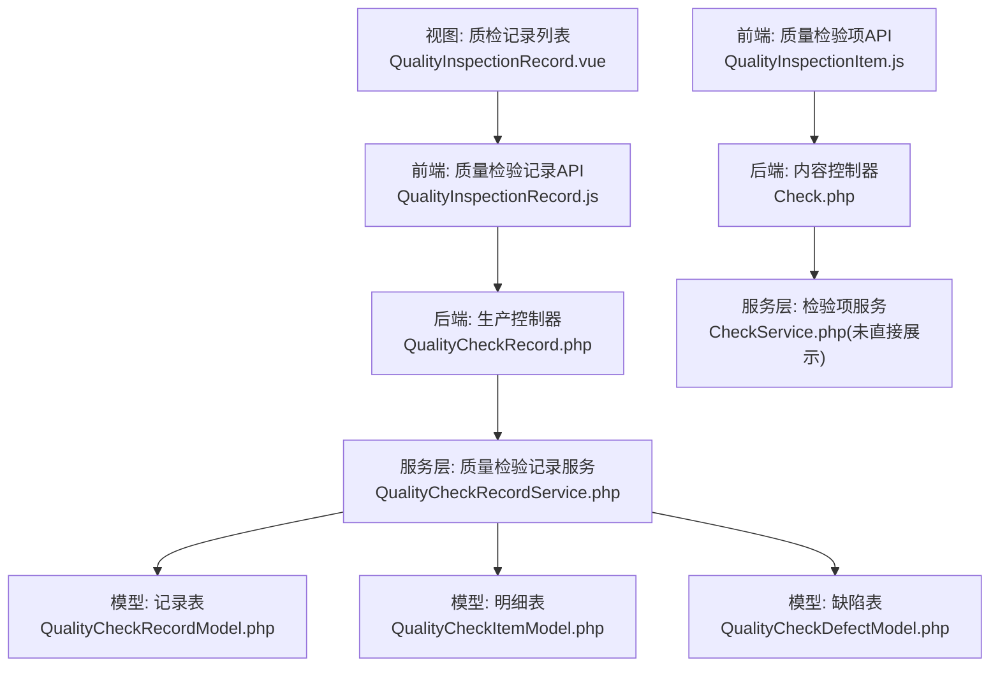
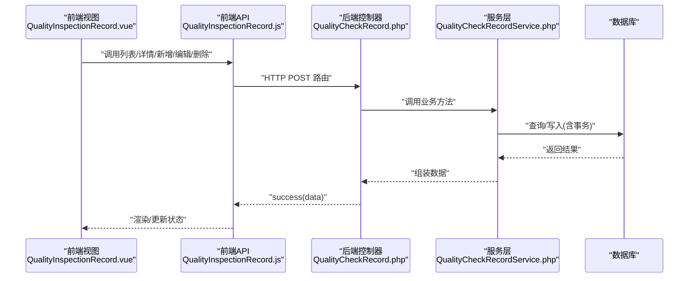
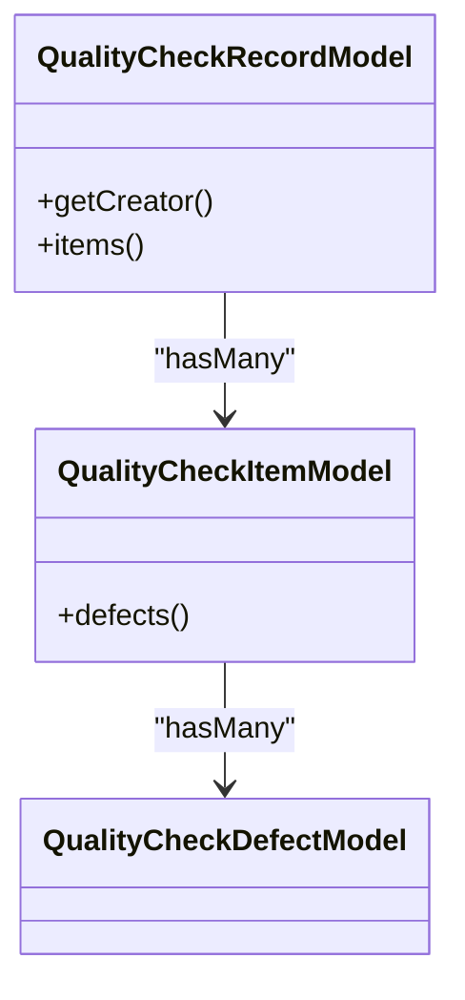
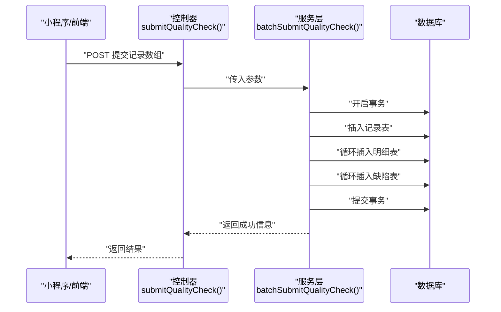
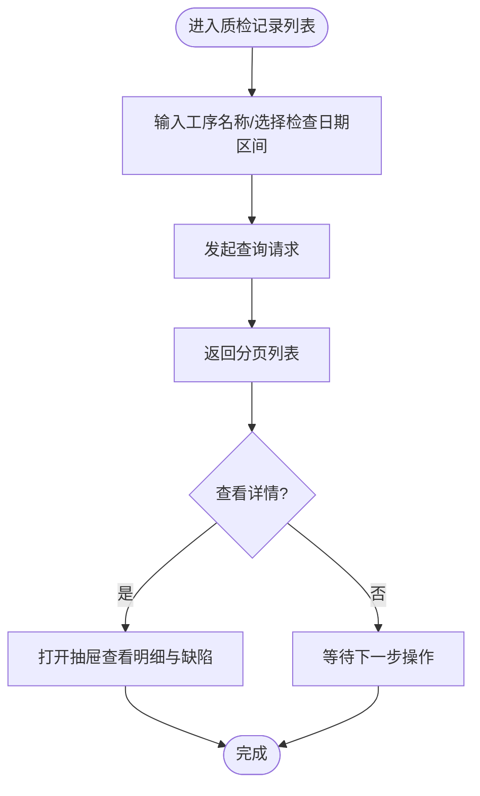
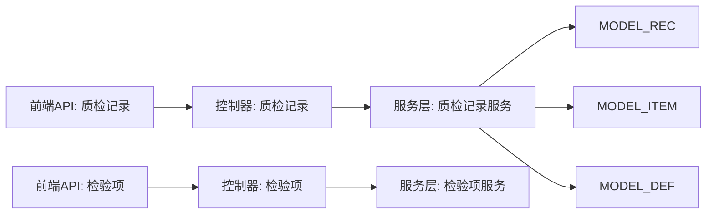

# 质量检测API

<cite>
**本文引用的文件**
- [QualityInspectionRecord.js](file://yarn/src/api/mes/QualityInspectionRecord/QualityInspectionRecord.js)
- [QualityInspectionItem.js](file://yarn/src/api/mes/QualityInspectionItem/QualityInspectionItem.js)
- [QualityCheckRecord.php](file://gccd_server/app/admin/controller/production/QualityCheckRecord.php)
- [Check.php](file://gccd_server/app/admin/controller/check/Check.php)
- [QualityCheckRecordService.php](file://gccd_server/app/common/service/admin/QualityCheckRecordService.php)
- [QualityCheckRecordModel.php](file://gccd_server/app/common/model/admin/QualityCheckRecordModel.php)
- [QualityCheckItemModel.php](file://gccd_server/app/common/model/admin/QualityCheckItemModel.php)
- [QualityCheckDefectModel.php](file://gccd_server/app/common/model/admin/QualityCheckDefectModel.php)
- [QualityInspectionRecord.vue](file://yarn/src/views/mes/QualityInspectionRecord/QualityInspectionRecord.vue)
</cite>

## 目录
1. [简介](#简介)
2. [项目结构](#项目结构)
3. [核心组件](#核心组件)
4. [架构总览](#架构总览)
5. [详细组件分析](#详细组件分析)
6. [依赖关系分析](#依赖关系分析)
7. [性能考虑](#性能考虑)
8. [故障排查指南](#故障排查指南)
9. [结论](#结论)
10. [附录](#附录)

## 简介
本文件面向质量检测API，系统性梳理“质检项目配置”“质检记录录入”“质量统计分析”等关键能力，并重点覆盖以下业务主题：
- 质检标准设置与检验项管理（检验项配置）
- 抽检规则配置（通过“检验项-工序”关联实现）
- 不合格品处理（缺陷类型与数量统计）
- 质检数据采集、批量提交、审核与追溯（基于记录-明细-缺陷三层结构）

该API采用前后端分离架构：前端使用Vue + Axios封装请求；后端采用PHP框架，控制器负责参数校验与路由分发，服务层承担业务逻辑，模型层映射数据库表。

## 项目结构
围绕质量检测相关模块，项目在前端与后端分别包含如下关键文件：
- 前端API封装：质量检验记录、质量检验项
- 后端控制器：生产类质量检验记录、内容类检验项管理
- 服务层：质量检验记录的查询与批量提交
- 模型层：记录、明细、缺陷三张表的关联关系

图表来源
- [QualityInspectionRecord.js:1-64](file://yarn/src/api/mes/QualityInspectionRecord/QualityInspectionRecord.js#L1-L64)
- [QualityInspectionItem.js:1-52](file://yarn/src/api/mes/QualityInspectionItem/QualityInspectionItem.js#L1-L52)
- [QualityCheckRecord.php:1-46](file://gccd_server/app/admin/controller/production/QualityCheckRecord.php#L1-L46)
- [Check.php:1-134](file://gccd_server/app/admin/controller/check/Check.php#L1-L134)
- [QualityCheckRecordService.php:1-124](file://gccd_server/app/common/service/admin/QualityCheckRecordService.php#L1-L124)
- [QualityCheckRecordModel.php:1-21](file://gccd_server/app/common/model/admin/QualityCheckRecordModel.php#L1-L21)
- [QualityCheckItemModel.php:1-16](file://gccd_server/app/common/model/admin/QualityCheckItemModel.php#L1-L16)
- [QualityCheckDefectModel.php:1-11](file://gccd_server/app/common/model/admin/QualityCheckDefectModel.php#L1-L11)
- [QualityInspectionRecord.vue:166-232](file://yarn/src/views/mes/QualityInspectionRecord/QualityInspectionRecord.vue#L166-L232)

章节来源
- [QualityInspectionRecord.js:1-64](file://yarn/src/api/mes/QualityInspectionRecord/QualityInspectionRecord.js#L1-L64)
- [QualityInspectionItem.js:1-52](file://yarn/src/api/mes/QualityInspectionItem/QualityInspectionItem.js#L1-L52)
- [QualityCheckRecord.php:1-46](file://gccd_server/app/admin/controller/production/QualityCheckRecord.php#L1-L46)
- [Check.php:1-134](file://gccd_server/app/admin/controller/check/Check.php#L1-L134)
- [QualityCheckRecordService.php:1-124](file://gccd_server/app/common/service/admin/QualityCheckRecordService.php#L1-L124)
- [QualityCheckRecordModel.php:1-21](file://gccd_server/app/common/model/admin/QualityCheckRecordModel.php#L1-L21)
- [QualityCheckItemModel.php:1-16](file://gccd_server/app/common/model/admin/QualityCheckItemModel.php#L1-L16)
- [QualityCheckDefectModel.php:1-11](file://gccd_server/app/common/model/admin/QualityCheckDefectModel.php#L1-L11)
- [QualityInspectionRecord.vue:166-232](file://yarn/src/views/mes/QualityInspectionRecord/QualityInspectionRecord.vue#L166-L232)

## 核心组件
- 质检记录API（生产类）：提供列表、详情、新增、编辑、删除、小程序批量提交等接口。
- 检验项API（内容类）：提供检验项列表、详情、新增、编辑、删除、以及“工序-检验项”关联配置接口。
- 服务层：封装查询与批量提交逻辑，支持事务控制与统计字段计算。
- 模型层：定义记录、明细、缺陷三者的一对多关系，便于级联查询与统计。

章节来源
- [QualityCheckRecord.php:14-44](file://gccd_server/app/admin/controller/production/QualityCheckRecord.php#L14-L44)
- [Check.php:38-132](file://gccd_server/app/admin/controller/check/Check.php#L38-L132)
- [QualityCheckRecordService.php:20-56](file://gccd_server/app/common/service/admin/QualityCheckRecordService.php#L20-L56)
- [QualityCheckRecordModel.php:11-19](file://gccd_server/app/common/model/admin/QualityCheckRecordModel.php#L11-L19)
- [QualityCheckItemModel.php:11-14](file://gccd_server/app/common/model/admin/QualityCheckItemModel.php#L11-L14)
- [QualityCheckDefectModel.php:6-10](file://gccd_server/app/common/model/admin/QualityCheckDefectModel.php#L6-L10)

## 架构总览
质量检测API遵循“前端请求 -> 控制器 -> 服务层 -> 模型层”的分层架构，数据流以“记录-明细-缺陷”三层结构贯穿，支持批量提交与统计汇总。

图表来源
- [QualityInspectionRecord.vue:212-223](file://yarn/src/views/mes/QualityInspectionRecord/QualityInspectionRecord.vue#L212-L223)
- [QualityInspectionRecord.js:9-14](file://yarn/src/api/mes/QualityInspectionRecord/QualityInspectionRecord.js#L9-L14)
- [QualityCheckRecord.php:17-34](file://gccd_server/app/admin/controller/production/QualityCheckRecord.php#L17-L34)
- [QualityCheckRecordService.php:20-56](file://gccd_server/app/common/service/admin/QualityCheckRecordService.php#L20-L56)

## 详细组件分析

### 组件A：质检记录API（生产类）
- 接口职责
  - 列表查询：支持按工序名称、检查日期区间筛选，分页排序。
  - 小程序批量提交：接收“记录数组”，自动写入主表与明细、缺陷表，事务保障。
  - 其他：详情、新增、编辑、删除（由前端API封装，具体实现见控制器方法）。

- 数据模型关系
  - 记录表 -> 明细表（一对多）
  - 明细表 -> 缺陷表（一对多）
  - 服务层在查询时预加载关联，同时计算每条记录的缺陷总数用于前端展示。

图表来源
- [QualityCheckRecordModel.php:11-19](file://gccd_server/app/common/model/admin/QualityCheckRecordModel.php#L11-L19)
- [QualityCheckItemModel.php:11-14](file://gccd_server/app/common/model/admin/QualityCheckItemModel.php#L11-L14)
- [QualityCheckDefectModel.php:6-10](file://gccd_server/app/common/model/admin/QualityCheckDefectModel.php#L6-L10)

- 批量提交流程（序列图）

图表来源
- [QualityCheckRecord.php:39-44](file://gccd_server/app/admin/controller/production/QualityCheckRecord.php#L39-L44)
- [QualityCheckRecordService.php:61-122](file://gccd_server/app/common/service/admin/QualityCheckRecordService.php#L61-L122)

- 关键字段与统计
  - 服务层在返回列表时，对每条记录的缺陷数量进行累加，形成“总缺陷数”字段，便于前端直接展示。

章节来源
- [QualityCheckRecord.php:17-34](file://gccd_server/app/admin/controller/production/QualityCheckRecord.php#L17-L34)
- [QualityCheckRecordService.php:20-56](file://gccd_server/app/common/service/admin/QualityCheckRecordService.php#L20-L56)
- [QualityInspectionRecord.vue:212-223](file://yarn/src/views/mes/QualityInspectionRecord/QualityInspectionRecord.vue#L212-L223)

### 组件B：检验项API（内容类）
- 接口职责
  - 列表查询：支持按编码、名称、创建时间区间筛选。
  - 新增/编辑/删除：维护检验项基础信息。
  - 工序-检验项关联：将检验项绑定到特定工序，实现抽检规则配置的基础。

- 与质检记录的关系
  - 检验项作为“标准模板”，在质检记录中以“明细-缺陷”形式体现实际执行情况。
  - 通过“工序-检验项”关联，可实现不同工序的差异化抽检规则。

章节来源
- [Check.php:38-132](file://gccd_server/app/admin/controller/check/Check.php#L38-L132)

### 组件C：前端交互与数据采集
- 列表页面
  - 支持按工序名称、检查日期区间筛选，重置查询条件，分页加载。
  - 展示记录列表与“总缺陷数”统计字段，点击可打开抽屉查看详情。

- 数据采集流程（流程图）

图表来源
- [QualityInspectionRecord.vue:190-223](file://yarn/src/views/mes/QualityInspectionRecord/QualityInspectionRecord.vue#L190-L223)

## 依赖关系分析
- 前端API封装与后端控制器一一对应，控制器方法名与服务层方法名保持一致，便于定位。
- 服务层依赖模型层进行数据库操作，模型层定义了“记录-明细-缺陷”的外键关系。
- 视图组件通过API封装调用控制器，形成闭环的数据流。

图表来源
- [QualityInspectionRecord.js:3-63](file://yarn/src/api/mes/QualityInspectionRecord/QualityInspectionRecord.js#L3-L63)
- [QualityInspectionItem.js:3-51](file://yarn/src/api/mes/QualityInspectionItem/QualityInspectionItem.js#L3-L51)
- [QualityCheckRecord.php:12-45](file://gccd_server/app/admin/controller/production/QualityCheckRecord.php#L12-L45)
- [Check.php:24-133](file://gccd_server/app/admin/controller/check/Check.php#L24-L133)
- [QualityCheckRecordService.php:9-123](file://gccd_server/app/common/service/admin/QualityCheckRecordService.php#L9-L123)

章节来源
- [QualityInspectionRecord.js:1-64](file://yarn/src/api/mes/QualityInspectionRecord/QualityInspectionRecord.js#L1-L64)
- [QualityInspectionItem.js:1-52](file://yarn/src/api/mes/QualityInspectionItem/QualityInspectionItem.js#L1-L52)
- [QualityCheckRecord.php:1-46](file://gccd_server/app/admin/controller/production/QualityCheckRecord.php#L1-L46)
- [Check.php:1-134](file://gccd_server/app/admin/controller/check/Check.php#L1-L134)
- [QualityCheckRecordService.php:1-124](file://gccd_server/app/common/service/admin/QualityCheckRecordService.php#L1-L124)

## 性能考虑
- 查询优化
  - 列表默认按检查日期与创建时间降序排列，减少前端二次排序成本。
  - 使用with预加载关联，避免N+1查询问题。
- 统计计算
  - 在服务层对每条记录的缺陷数量进行聚合计算，避免前端重复计算。
- 批量提交
  - 使用数据库事务保证一致性，减少异常回滚成本。
- 分页策略
  - 服务层根据limit与page计算总页数，避免一次性拉取大量数据。

## 故障排查指南
- 提交失败
  - 现象：批量提交返回失败提示。
  - 可能原因：提交数据为空、数据库异常、事务回滚。
  - 处理建议：检查records是否为空，确认用户身份与日期参数，查看服务层异常日志。
- 列表无数据或分页异常
  - 现象：列表为空或页码不正确。
  - 可能原因：筛选条件导致无匹配数据，或分页参数错误。
  - 处理建议：重置查询条件，确认分页参数，检查服务层分页计算逻辑。
- 缺陷统计不准确
  - 现象：总缺陷数与明细不符。
  - 可能原因：缺陷数量字段为空或非数值。
  - 处理建议：在服务层对空值进行安全转换，确保字段类型一致。

章节来源
- [QualityCheckRecordService.php:61-122](file://gccd_server/app/common/service/admin/QualityCheckRecordService.php#L61-L122)
- [QualityCheckRecordService.php:20-56](file://gccd_server/app/common/service/admin/QualityCheckRecordService.php#L20-L56)

## 结论
本质量检测API以“记录-明细-缺陷”三层结构为核心，结合服务层的事务控制与统计计算，实现了从“检验项配置”到“质检数据采集、审核与追溯”的完整闭环。前端通过统一的API封装与视图组件，提供了直观的查询与详情展示能力；后端通过清晰的控制器与服务层分工，保障了业务逻辑的可维护性与扩展性。

## 附录

### API清单与说明
- 质检记录（生产类）
  - 列表：按工序名称、检查日期区间筛选，分页排序。
  - 小程序批量提交：接收记录数组，自动写入主表、明细、缺陷表。
  - 其他：详情、新增、编辑、删除（由前端API封装，具体实现见控制器方法）。

- 检验项（内容类）
  - 列表：按编码、名称、创建时间区间筛选。
  - 新增/编辑/删除：维护检验项基础信息。
  - 工序-检验项关联：将检验项绑定到特定工序，实现抽检规则配置。

章节来源
- [QualityCheckRecord.php:17-44](file://gccd_server/app/admin/controller/production/QualityCheckRecord.php#L17-L44)
- [Check.php:38-132](file://gccd_server/app/admin/controller/check/Check.php#L38-L132)
- [QualityInspectionRecord.js:9-63](file://yarn/src/api/mes/QualityInspectionRecord/QualityInspectionRecord.js#L9-L63)
- [QualityInspectionItem.js:9-51](file://yarn/src/api/mes/QualityInspectionItem/QualityInspectionItem.js#L9-L51)