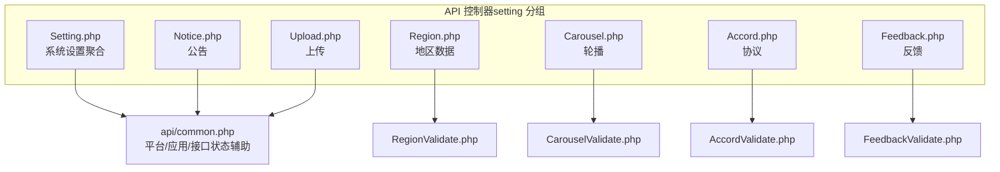
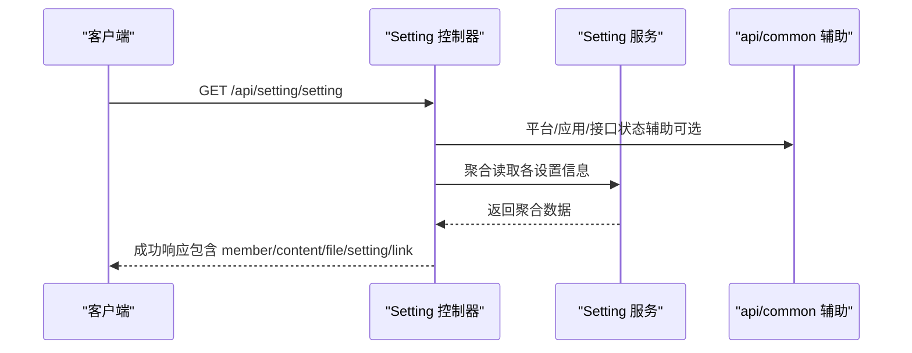
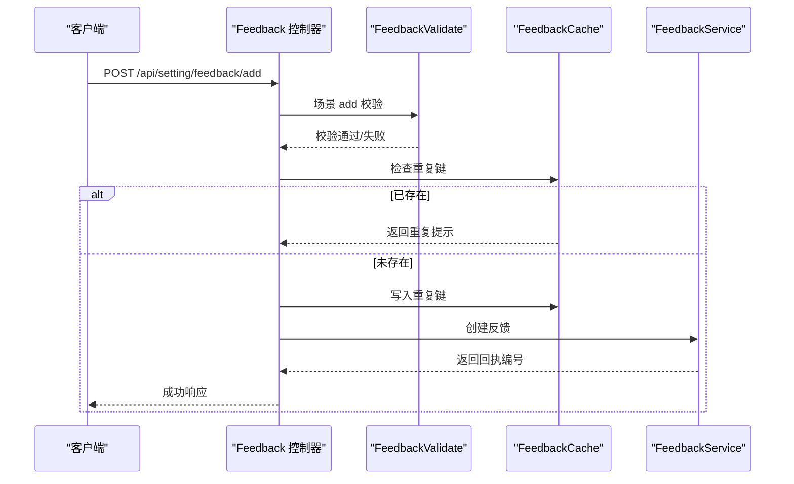
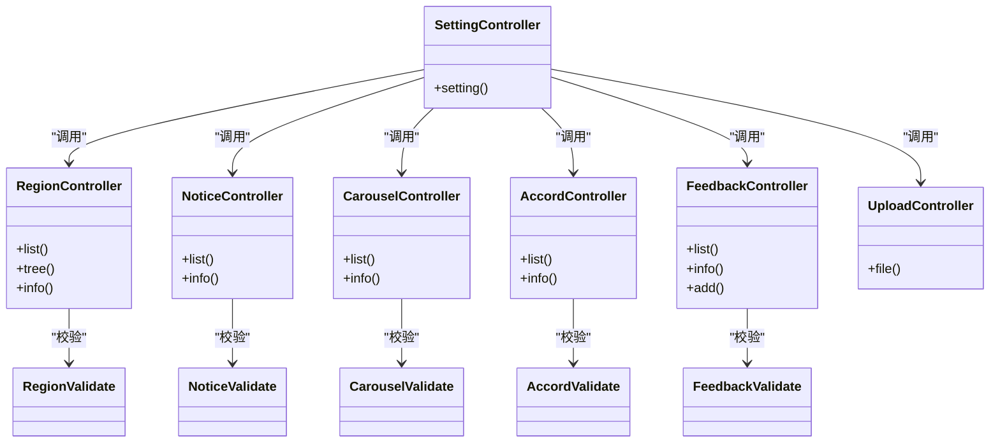

# 系统设置API

<cite>
**本文引用的文件**
- [gccd_server/app/api/controller/setting/Setting.php](file://gccd_server/app/api/controller/setting/Setting.php)
- [gccd_server/app/api/controller/setting/Region.php](file://gccd_server/app/api/controller/setting/Region.php)
- [gccd_server/app/api/controller/setting/Notice.php](file://gccd_server/app/api/controller/setting/Notice.php)
- [gccd_server/app/api/controller/setting/Carousel.php](file://gccd_server/app/api/controller/setting/Carousel.php)
- [gccd_server/app/api/controller/setting/Accord.php](file://gccd_server/app/api/controller/setting/Accord.php)
- [gccd_server/app/api/controller/setting/Feedback.php](file://gccd_server/app/api/controller/setting/Feedback.php)
- [gccd_server/app/api/controller/setting/Upload.php](file://gccd_server/app/api/controller/setting/Upload.php)
- [gccd_server/app/common/validate/setting/FeedbackValidate.php](file://gccd_server/app/common/validate/setting/FeedbackValidate.php)
- [gccd_server/app/common/validate/setting/CarouselValidate.php](file://gccd_server/app/common/validate/setting/CarouselValidate.php)
- [gccd_server/app/common/validate/setting/AccordValidate.php](file://gccd_server/app/common/validate/setting/AccordValidate.php)
- [gccd_server/app/common/validate/setting/RegionValidate.php](file://gccd_server/app/common/validate/setting/RegionValidate.php)
- [gccd_server/app/api/common.php](file://gccd_server/app/api/common.php)
</cite>

## 目录
1. [简介](#简介)
2. [项目结构](#项目结构)
3. [核心组件](#核心组件)
4. [架构总览](#架构总览)
5. [详细组件分析](#详细组件分析)
6. [依赖关系分析](#依赖关系分析)
7. [性能与安全考量](#性能与安全考量)
8. [故障排查指南](#故障排查指南)
9. [结论](#结论)
10. [附录：接口清单与最佳实践](#附录接口清单与最佳实践)

## 简介
本文件面向“高齿传动项目”的系统设置类API，覆盖系统配置聚合查询、地区数据、公告/轮播/协议展示、反馈提交与上传能力。文档基于后端控制器注解与验证器规则，整理各接口的HTTP方法、URL路径、请求参数、响应格式、权限与校验策略，并提供最佳实践与调用示例指引。

## 项目结构
系统设置相关接口集中在后端模块的 API 控制器中，按功能划分为多个子控制器，统一归属分组“setting”。各控制器通过 apidoc 注解声明接口元数据，便于自动生成文档与接口测试。

图表来源
- [gccd_server/app/api/controller/setting/Setting.php:1-72](file://gccd_server/app/api/controller/setting/Setting.php#L1-L72)
- [gccd_server/app/api/controller/setting/Region.php:1-73](file://gccd_server/app/api/controller/setting/Region.php#L1-L73)
- [gccd_server/app/api/controller/setting/Notice.php:1-83](file://gccd_server/app/api/controller/setting/Notice.php#L1-L83)
- [gccd_server/app/api/controller/setting/Carousel.php:1-79](file://gccd_server/app/api/controller/setting/Carousel.php#L1-L79)
- [gccd_server/app/api/controller/setting/Accord.php:1-74](file://gccd_server/app/api/controller/setting/Accord.php#L1-L74)
- [gccd_server/app/api/controller/setting/Feedback.php:1-134](file://gccd_server/app/api/controller/setting/Feedback.php#L1-L134)
- [gccd_server/app/api/controller/setting/Upload.php:1-78](file://gccd_server/app/api/controller/setting/Upload.php#L1-L78)
- [gccd_server/app/common/validate/setting/FeedbackValidate.php:1-77](file://gccd_server/app/common/validate/setting/FeedbackValidate.php#L1-L77)
- [gccd_server/app/common/validate/setting/CarouselValidate.php:1-67](file://gccd_server/app/common/validate/setting/CarouselValidate.php#L1-L67)
- [gccd_server/app/common/validate/setting/AccordValidate.php:1-66](file://gccd_server/app/common/validate/setting/AccordValidate.php#L1-L66)
- [gccd_server/app/common/validate/setting/RegionValidate.php:1-101](file://gccd_server/app/common/validate/setting/RegionValidate.php#L1-L101)
- [gccd_server/app/api/common.php:1-182](file://gccd_server/app/api/common.php#L1-L182)

章节来源
- [gccd_server/app/api/controller/setting/Setting.php:1-72](file://gccd_server/app/api/controller/setting/Setting.php#L1-L72)
- [gccd_server/app/api/controller/setting/Region.php:1-73](file://gccd_server/app/api/controller/setting/Region.php#L1-L73)
- [gccd_server/app/api/controller/setting/Notice.php:1-83](file://gccd_server/app/api/controller/setting/Notice.php#L1-L83)
- [gccd_server/app/api/controller/setting/Carousel.php:1-79](file://gccd_server/app/api/controller/setting/Carousel.php#L1-L79)
- [gccd_server/app/api/controller/setting/Accord.php:1-74](file://gccd_server/app/api/controller/setting/Accord.php#L1-L74)
- [gccd_server/app/api/controller/setting/Feedback.php:1-134](file://gccd_server/app/api/controller/setting/Feedback.php#L1-L134)
- [gccd_server/app/api/controller/setting/Upload.php:1-78](file://gccd_server/app/api/controller/setting/Upload.php#L1-L78)
- [gccd_server/app/api/common.php:1-182](file://gccd_server/app/api/common.php#L1-L182)

## 核心组件
- Setting 聚合接口：一次性返回会员设置、内容设置、文件设置、系统设置及友链列表，便于前端初始化加载。
- Region 地区接口：支持按父级查询列表、树形结构、单条信息读取。
- Notice 公告接口：支持分页查询、按类型/标题筛选、获取类型枚举。
- Carousel 轮播接口：支持分页查询、按标题/位置筛选、获取单条信息。
- Accord 协议接口：支持分页查询、按名称/唯一标识筛选、获取单条信息。
- Feedback 反馈接口：支持列表查询、详情读取、提交反馈（含图片）、防重复提交缓存。
- Upload 上传接口：表单上传文件，支持分组与标签绑定，受系统设置开关控制。

章节来源
- [gccd_server/app/api/controller/setting/Setting.php:20-72](file://gccd_server/app/api/controller/setting/Setting.php#L20-L72)
- [gccd_server/app/api/controller/setting/Region.php:17-73](file://gccd_server/app/api/controller/setting/Region.php#L17-L73)
- [gccd_server/app/api/controller/setting/Notice.php:17-83](file://gccd_server/app/api/controller/setting/Notice.php#L17-L83)
- [gccd_server/app/api/controller/setting/Carousel.php:17-79](file://gccd_server/app/api/controller/setting/Carousel.php#L17-L79)
- [gccd_server/app/api/controller/setting/Accord.php:17-74](file://gccd_server/app/api/controller/setting/Accord.php#L17-L74)
- [gccd_server/app/api/controller/setting/Feedback.php:19-134](file://gccd_server/app/api/controller/setting/Feedback.php#L19-L134)
- [gccd_server/app/api/controller/setting/Upload.php:20-78](file://gccd_server/app/api/controller/setting/Upload.php#L20-L78)

## 架构总览
系统设置API采用“控制器-服务-模型”分层，控制器负责参数解析与返回封装，服务层处理业务逻辑，验证器保障输入合法性。部分接口依赖全局辅助函数进行平台/应用识别与接口状态判断。

图表来源
- [gccd_server/app/api/controller/setting/Setting.php:53-70](file://gccd_server/app/api/controller/setting/Setting.php#L53-L70)
- [gccd_server/app/api/common.php:137-181](file://gccd_server/app/api/common.php#L137-L181)

## 详细组件分析

### Setting 聚合接口
- 功能概述：一次性返回会员设置、内容设置、文件设置、系统设置及友链列表。
- HTTP 方法与路径：GET /api/setting/setting
- 请求参数：无
- 响应字段概要：
  - member：会员相关配置与默认头像、token 类型/名称等
  - content：内容相关设置
  - file：文件上传相关设置（含存储、扩展名、大小限制、API 文件开关等）
  - setting：系统设置
  - link：友链列表（启用、未删、在有效期内的项，按排序与主键倒序）
- 权限与校验：不需登录；不需鉴权；不受速率限制
- 失败场景：无直接错误返回，若某子设置缺失则对应字段为空或默认值

章节来源
- [gccd_server/app/api/controller/setting/Setting.php:20-72](file://gccd_server/app/api/controller/setting/Setting.php#L20-L72)

### Region 地区接口
- 功能概述：地区列表、树形结构、单条信息读取
- HTTP 方法与路径：
  - GET /api/setting/region/list
  - GET /api/setting/region/tree
  - GET /api/setting/region/info
- 请求参数：
  - 列表：region_id（父级 ID，默认 0）
  - 树形：无
  - 信息：region_id（必填）
- 响应字段：
  - 列表：地区列表（region_id, region_pid, region_name, pinyin, citycode, zipcode, longitude, latitude, sort）
  - 树形：地区树（region_id, region_pid, region_name）
  - 信息：单条地区记录
- 权限与校验：不需登录；不需鉴权；不受速率限制
- 数据过滤：自动附加“未禁用、未删除”条件
- 校验规则：
  - 信息读取：region_id 必填
  - 删除场景：存在下级时禁止删除

章节来源
- [gccd_server/app/api/controller/setting/Region.php:17-73](file://gccd_server/app/api/controller/setting/Region.php#L17-L73)
- [gccd_server/app/common/validate/setting/RegionValidate.php:1-101](file://gccd_server/app/common/validate/setting/RegionValidate.php#L1-L101)

### Notice 公告接口
- 功能概述：公告列表与详情
- HTTP 方法与路径：
  - GET /api/setting/notice/list
  - GET /api/setting/notice/info
- 请求参数：
  - 列表：page/page_size、type（类型）、title（标题模糊）
  - 信息：notice_id（必填）
- 响应字段：
  - 列表：分页结果（含 list、types），列表项包含图片 URL、类型名称、时间范围、排序等
  - 信息：公告详情（含图片 URL、类型名称）
- 权限与校验：不需登录；不需鉴权；不受速率限制
- 数据过滤：仅返回当前时间有效、未禁用、未删除的公告，按 sort、start_time、主键倒序

章节来源
- [gccd_server/app/api/controller/setting/Notice.php:17-83](file://gccd_server/app/api/controller/setting/Notice.php#L17-L83)

### Carousel 轮播接口
- 功能概述：轮播列表与详情
- HTTP 方法与路径：
  - GET /api/setting/carousel/list
  - GET /api/setting/carousel/info
- 请求参数：
  - 列表：page/page_size、sort、title（标题模糊）、position（位置）
  - 信息：carousel_id（必填）
- 响应字段：
  - 列表：分页结果（含 list），列表项包含文件关联、位置、排序等
  - 信息：轮播详情（含文件列表）
- 权限与校验：不需登录；不需鉴权；不受速率限制
- 数据过滤：未禁用、未删除，按 sort、主键倒序

章节来源
- [gccd_server/app/api/controller/setting/Carousel.php:17-79](file://gccd_server/app/api/controller/setting/Carousel.php#L17-L79)
- [gccd_server/app/common/validate/setting/CarouselValidate.php:1-67](file://gccd_server/app/common/validate/setting/CarouselValidate.php#L1-L67)

### Accord 协议接口
- 功能概述：协议列表与详情
- HTTP 方法与路径：
  - GET /api/setting/accord/list
  - GET /api/setting/accord/info
- 请求参数：
  - 列表：page/page_size、sort、name（名称模糊）、unique（多个以逗号分隔）
  - 信息：accord_id（必填）
- 响应字段：
  - 列表：分页结果（含 list）
  - 信息：协议详情
- 权限与校验：不需登录；不需鉴权；不受速率限制
- 数据过滤：未禁用、未删除，按 sort、主键倒序

章节来源
- [gccd_server/app/api/controller/setting/Accord.php:17-74](file://gccd_server/app/api/controller/setting/Accord.php#L17-L74)
- [gccd_server/app/common/validate/setting/AccordValidate.php:1-66](file://gccd_server/app/common/validate/setting/AccordValidate.php#L1-L66)

### Feedback 反馈接口
- 功能概述：反馈列表、详情、提交（含图片）
- HTTP 方法与路径：
  - GET /api/setting/feedback/list
  - GET /api/setting/feedback/info
  - POST /api/setting/feedback/add
- 请求参数：
  - 列表：page/page_size、日期区间 create_time、title（模糊）
  - 详情：feedback_id（必填）
  - 提交：type、title、content、phone、email、images（数组）
- 响应字段：
  - 列表：分页结果（含 types），列表项包含类型名称、状态名称、用户名等
  - 详情：反馈详情（含类型/状态名称、用户信息、图片集）
  - 提交：返回回执编号 receipt_no
- 权限与校验：
  - 列表/详情：需登录（通过 member_id 校验）
  - 提交：需登录；防重复提交（60 秒内相同类型+手机号+标题去重）
  - 校验规则：标题/内容必填；手机/邮箱格式；回执编号唯一且非纯数字
- 数据过滤：未禁用、未删除

图表来源
- [gccd_server/app/api/controller/setting/Feedback.php:95-134](file://gccd_server/app/api/controller/setting/Feedback.php#L95-L134)
- [gccd_server/app/common/validate/setting/FeedbackValidate.php:20-77](file://gccd_server/app/common/validate/setting/FeedbackValidate.php#L20-L77)

章节来源
- [gccd_server/app/api/controller/setting/Feedback.php:19-134](file://gccd_server/app/api/controller/setting/Feedback.php#L19-L134)
- [gccd_server/app/common/validate/setting/FeedbackValidate.php:1-77](file://gccd_server/app/common/validate/setting/FeedbackValidate.php#L1-L77)

### Upload 上传接口
- 功能概述：表单上传文件，支持分组与标签绑定
- HTTP 方法与路径：POST /api/setting/upload/file
- 请求参数：
  - group_id：分组 id 或标识（可选）
  - tag_ids：标签 id 或标识，多个以逗号分隔（可选）
  - file_type：文件类型（默认 image）
  - file_name：文件名（可选）
  - file：文件对象（必填）
- 响应字段：文件上传结果（含文件信息）
- 权限与校验：
  - 需登录
  - 受系统设置开关控制：当 is_upload_api 为否时拒绝上传
  - 校验规则：文件类型、文件名、文件对象必填
- 数据过滤：按系统设置的存储与扩展名限制执行

章节来源
- [gccd_server/app/api/controller/setting/Upload.php:20-78](file://gccd_server/app/api/controller/setting/Upload.php#L20-L78)

## 依赖关系分析
- 控制器到验证器：Region/Notice/Carousel/Accord/Feedback 均有独立验证器，确保输入合法与业务约束（如标识唯一性、名称存在性、父子关系自检、删除前检查等）。
- 控制器到服务层：各控制器调用对应服务层完成数据读写，控制器仅做参数解析与返回封装。
- 控制器到辅助函数：Setting/Upload/Feedback 等使用全局辅助函数进行平台/应用识别与接口状态判断。
- 缓存与防刷：Feedback 使用缓存键防重复提交，提升用户体验并降低重复数据风险。

图表来源
- [gccd_server/app/api/controller/setting/Setting.php:25-71](file://gccd_server/app/api/controller/setting/Setting.php#L25-L71)
- [gccd_server/app/api/controller/setting/Region.php:22-72](file://gccd_server/app/api/controller/setting/Region.php#L22-L72)
- [gccd_server/app/api/controller/setting/Notice.php:22-82](file://gccd_server/app/api/controller/setting/Notice.php#L22-L82)
- [gccd_server/app/api/controller/setting/Carousel.php:22-78](file://gccd_server/app/api/controller/setting/Carousel.php#L22-L78)
- [gccd_server/app/api/controller/setting/Accord.php:22-73](file://gccd_server/app/api/controller/setting/Accord.php#L22-L73)
- [gccd_server/app/api/controller/setting/Feedback.php:24-133](file://gccd_server/app/api/controller/setting/Feedback.php#L24-L133)
- [gccd_server/app/api/controller/setting/Upload.php:25-77](file://gccd_server/app/api/controller/setting/Upload.php#L25-L77)
- [gccd_server/app/common/validate/setting/RegionValidate.php:18-101](file://gccd_server/app/common/validate/setting/RegionValidate.php#L18-L101)
- [gccd_server/app/common/validate/setting/CarouselValidate.php:18-67](file://gccd_server/app/common/validate/setting/CarouselValidate.php#L18-L67)
- [gccd_server/app/common/validate/setting/AccordValidate.php:18-66](file://gccd_server/app/common/validate/setting/AccordValidate.php#L18-L66)
- [gccd_server/app/common/validate/setting/FeedbackValidate.php:18-77](file://gccd_server/app/common/validate/setting/FeedbackValidate.php#L18-L77)

## 性能与安全考量
- 性能
  - 列表接口均支持分页与排序，建议前端按需传入 page/page_size 与 sort，避免一次性拉取大量数据。
  - Setting 聚合接口一次返回多类设置，减少多次请求，但注意字段较多时的网络传输成本。
- 安全
  - 登录态要求：Upload/Feedback 列表/详情/提交需要登录；其他接口通常无需登录。
  - 速率限制：接口默认不受速率限制，如需防护可结合全局中间件策略。
  - 输入校验：各接口均有对应验证器，严格校验必填、格式与业务唯一性。
  - 上传开关：Upload 接口受系统设置开关控制，防止未授权上传。

[本节为通用指导，不直接分析具体文件]

## 故障排查指南
- 反馈提交被拒
  - 现象：提示“请勿重复提交”
  - 原因：60 秒内相同类型+手机号+标题的组合触发重复键
  - 处理：调整参数或等待冷却
  - 参考
    - [gccd_server/app/api/controller/setting/Feedback.php:121-127](file://gccd_server/app/api/controller/setting/Feedback.php#L121-L127)
- 回执编号冲突
  - 现象：提示“回执编号已存在”
  - 原因：唯一性校验失败
  - 处理：更换回执编号
  - 参考
    - [gccd_server/app/common/validate/setting/FeedbackValidate.php:52-75](file://gccd_server/app/common/validate/setting/FeedbackValidate.php#L52-L75)
- 轮播标识冲突
  - 现象：提示“标识已存在”
  - 原因：唯一性校验失败
  - 处理：更换唯一标识
  - 参考
    - [gccd_server/app/common/validate/setting/CarouselValidate.php:42-65](file://gccd_server/app/common/validate/setting/CarouselValidate.php#L42-L65)
- 协议标识冲突
  - 现象：提示“标识已存在”
  - 原因：唯一性校验失败
  - 处理：更换唯一标识
  - 参考
    - [gccd_server/app/common/validate/setting/AccordValidate.php:43-64](file://gccd_server/app/common/validate/setting/AccordValidate.php#L43-L64)
- 地区删除失败
  - 现象：提示“存在下级地区，无法删除”
  - 原因：删除前检查存在子节点
  - 处理：先删除子节点再删除父节点
  - 参考
    - [gccd_server/app/common/validate/setting/RegionValidate.php:89-99](file://gccd_server/app/common/validate/setting/RegionValidate.php#L89-L99)
- 上传被拒绝
  - 现象：提示“文件上传未开启”
  - 原因：系统设置关闭了 API 上传
  - 处理：开启系统设置中的上传开关或改用其他上传方式
  - 参考
    - [gccd_server/app/api/controller/setting/Upload.php:40-42](file://gccd_server/app/api/controller/setting/Upload.php#L40-L42)

章节来源
- [gccd_server/app/api/controller/setting/Feedback.php:121-127](file://gccd_server/app/api/controller/setting/Feedback.php#L121-L127)
- [gccd_server/app/common/validate/setting/FeedbackValidate.php:52-75](file://gccd_server/app/common/validate/setting/FeedbackValidate.php#L52-L75)
- [gccd_server/app/common/validate/setting/CarouselValidate.php:42-65](file://gccd_server/app/common/validate/setting/CarouselValidate.php#L42-L65)
- [gccd_server/app/common/validate/setting/AccordValidate.php:43-64](file://gccd_server/app/common/validate/setting/AccordValidate.php#L43-L64)
- [gccd_server/app/common/validate/setting/RegionValidate.php:89-99](file://gccd_server/app/common/validate/setting/RegionValidate.php#L89-L99)
- [gccd_server/app/api/controller/setting/Upload.php:40-42](file://gccd_server/app/api/controller/setting/Upload.php#L40-L42)

## 结论
系统设置API围绕“设置聚合、基础数据、内容展示、反馈与上传”构建，接口清晰、职责明确，配合验证器与缓存机制，兼顾易用性与稳定性。建议在生产环境中结合全局中间件完善登录态与速率限制策略，并对上传接口进行更细粒度的白名单与大小限制配置。

[本节为总结性内容，不直接分析具体文件]

## 附录：接口清单与最佳实践

### 接口清单
- Setting 聚合
  - 方法：GET
  - 路径：/api/setting/setting
  - 参数：无
  - 用途：初始化加载系统设置与友链
- Region 地区
  - 列表：GET /api/setting/region/list（region_id 父级）
  - 树形：GET /api/setting/region/tree
  - 信息：GET /api/setting/region/info（region_id）
- Notice 公告
  - 列表：GET /api/setting/notice/list（page/page_size、type、title）
  - 信息：GET /api/setting/notice/info（notice_id）
- Carousel 轮播
  - 列表：GET /api/setting/carousel/list（page/page_size、sort、title、position）
  - 信息：GET /api/setting/carousel/info（carousel_id）
- Accord 协议
  - 列表：GET /api/setting/accord/list（page/page_size、sort、name、unique）
  - 信息：GET /api/setting/accord/info（accord_id）
- Feedback 反馈
  - 列表：GET /api/setting/feedback/list（page/page_size、create_time、title）
  - 信息：GET /api/setting/feedback/info（feedback_id）
  - 提交：POST /api/setting/feedback/add（title、content、phone、email、images）
- Upload 上传
  - 提交：POST /api/setting/upload/file（group_id、tag_ids、file_type、file_name、file）

### 最佳实践
- 分页与排序：列表接口建议始终传入 page/page_size 与 sort，避免全量拉取。
- 登录态：涉及用户数据的接口（反馈、上传）必须登录，确保 member_id 正确。
- 防重复提交：反馈提交建议前端做好按钮防抖与重复提交提示。
- 上传规范：上传前检查系统设置开关，合理设置文件类型与大小限制。
- 校验优先：前端尽量在提交前完成基础校验，减少无效请求。

[本节为通用指导，不直接分析具体文件]