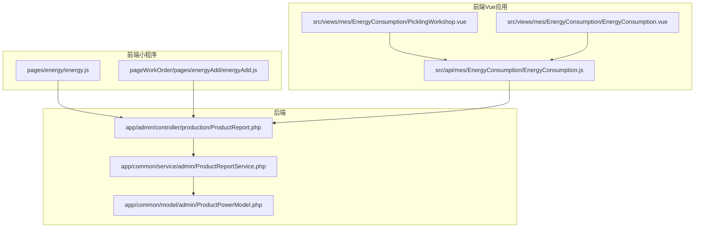
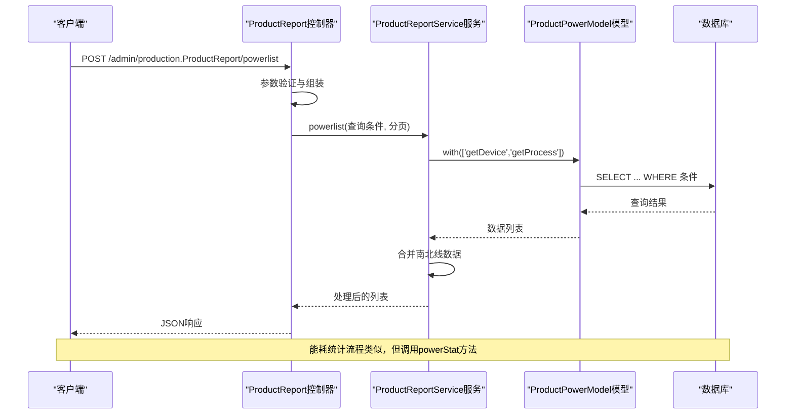
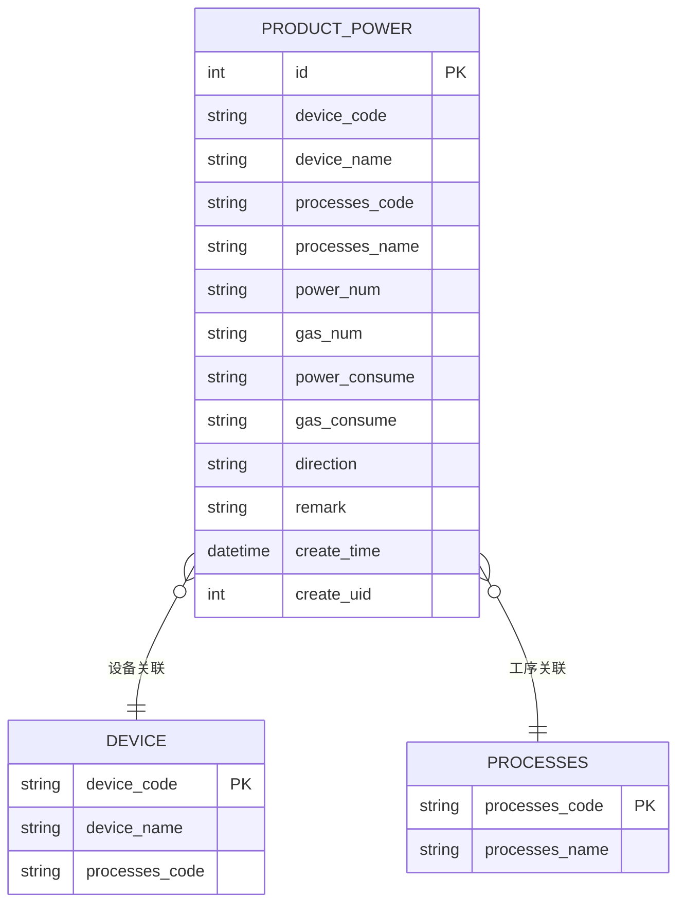
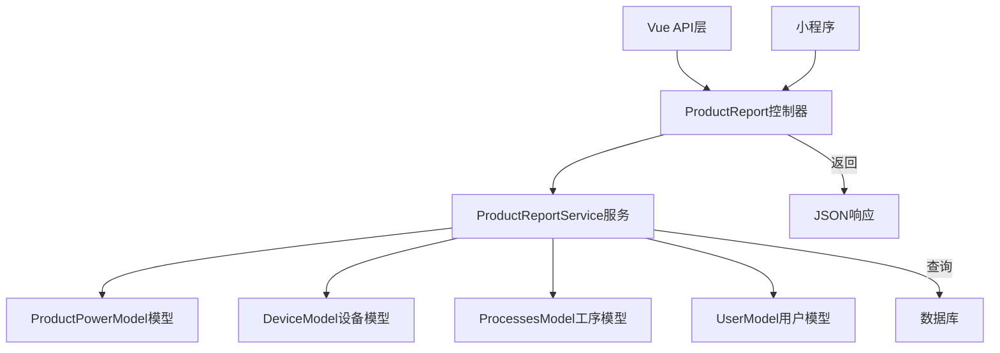

# 能源管理API

<cite>
**本文档引用的文件**
- [ProductReport.php](file://gccd_server/app/admin/controller/production/ProductReport.php)
- [ProductReportService.php](file://gccd_server/app/common/service/admin/ProductReportService.php)
- [ProductPowerModel.php](file://gccd_server/app/common/model/admin/ProductPowerModel.php)
- [energy.js](file://gccd_mini/pages/energy/energy.js)
- [energyAdd.js](file://gccd_mini/pageWorkOrder/pages/energyAdd/energyAdd.js)
- [EnergyConsumption.js](file://yarn/src/api/mes/EnergyConsumption/EnergyConsumption.js)
- [PicklingWorkshop.vue](file://yarn/src/views/mes/EnergyConsumption/PicklingWorkshop.vue)
- [EnergyConsumption.vue](file://yarn/src/views/mes/EnergyConsumption/EnergyConsumption.vue)
- [ProductReportPowerPicklingExample.php](file://gccd_server/reference/ProductReportPowerPicklingExample.php)
</cite>

## 目录
1. [简介](#简介)
2. [项目结构](#项目结构)
3. [核心组件](#核心组件)
4. [架构概览](#架构概览)
5. [详细组件分析](#详细组件分析)
6. [依赖关系分析](#依赖关系分析)
7. [性能考虑](#性能考虑)
8. [故障排除指南](#故障排除指南)
9. [结论](#结论)

## 简介
本文件为高齿传动项目能源管理API的详细技术文档，涵盖电耗统计、能耗分析、能源报表等核心功能接口。文档基于实际代码实现，详细说明了HTTP方法、URL路径、请求参数、响应格式，并提供了数据模型说明与接口调用示例。系统支持能耗数据采集、计算与展示，包括分时段统计、能耗对比、异常预警等功能，并实现了能源数据与生产数据的关联分析。

## 项目结构
能源管理模块主要分布在以下层次：
- 前端小程序：负责用户交互与基础数据展示
- 前端Vue应用：提供管理端界面与高级分析功能
- 后端控制器：定义API接口与参数校验
- 服务层：实现业务逻辑与数据处理
- 数据模型：定义数据库表结构与关联关系



**图表来源**
- [ProductReport.php:184-415](file://gccd_server/app/admin/controller/production/ProductReport.php#L184-L415)
- [ProductReportService.php:487-709](file://gccd_server/app/common/service/admin/ProductReportService.php#L487-L709)
- [ProductPowerModel.php:10-46](file://gccd_server/app/common/model/admin/ProductPowerModel.php#L10-L46)

**章节来源**
- [ProductReport.php:1-416](file://gccd_server/app/admin/controller/production/ProductReport.php#L1-L416)
- [ProductReportService.php:1-1262](file://gccd_server/app/common/service/admin/ProductReportService.php#L1-L1262)
- [ProductPowerModel.php:1-46](file://gccd_server/app/common/model/admin/ProductPowerModel.php#L1-L46)

## 核心组件
本系统的核心组件包括：
- 能源数据采集接口：支持手动录入与自动获取
- 能耗统计分析接口：提供日/月维度统计与酸洗车间专项统计
- 能源报表接口：支持分页查询与多条件筛选
- 数据模型：定义能耗记录与设备关联关系

关键特性：
- 支持南北线合并统计
- 自动计算能耗差值
- 酸洗车间吨数统计（磷化、皂化、碱）
- 与生产任务的关联分析

**章节来源**
- [ProductReport.php:184-415](file://gccd_server/app/admin/controller/production/ProductReport.php#L184-L415)
- [ProductReportService.php:487-709](file://gccd_server/app/common/service/admin/ProductReportService.php#L487-L709)
- [ProductPowerModel.php:10-46](file://gccd_server/app/common/model/admin/ProductPowerModel.php#L10-L46)

## 架构概览
系统采用前后端分离架构，后端提供RESTful API，前端通过HTTP请求调用。数据流向清晰：前端发起请求 → 控制器接收参数 → 服务层执行业务逻辑 → 模型层访问数据库 → 返回JSON响应。



**图表来源**
- [ProductReport.php:184-251](file://gccd_server/app/admin/controller/production/ProductReport.php#L184-L251)
- [ProductReportService.php:189-289](file://gccd_server/app/common/service/admin/ProductReportService.php#L189-L289)
- [ProductPowerModel.php:10-46](file://gccd_server/app/common/model/admin/ProductPowerModel.php#L10-L46)

## 详细组件分析

### 能源数据采集接口

#### 抄表列表接口
- **HTTP方法**: POST
- **URL路径**: `/admin/production.ProductReport/powerlist`
- **请求参数**:
  - `page`: 页码，默认1
  - `limit`: 每页条数，默认10
  - `routing_code`: 工艺编码（模糊查询）
  - `relation_code`: 关联单号（模糊查询）
  - `class`: 班次（南/北）
  - `device_code`: 设备编码（模糊查询）
  - `processes_name`: 工序名称（模糊查询）
  - `device_name`: 设备名称（模糊查询）
  - `create_start_date`: 创建开始日期
  - `create_end_date`: 创建结束日期

- **响应格式**:
```json
{
  "code": 200,
  "msg": "操作成功",
  "data": {
    "list": [
      {
        "id": 1,
        "device_code": "设备编码",
        "device_name": "设备名称",
        "processes_code": "工序编码",
        "processes_name": "工序名称",
        "power_num": "电表读数",
        "gas_num": "气表读数",
        "power_consume": "电耗差值",
        "gas_consume": "气耗差值",
        "direction": "方向",
        "remark": "备注",
        "create_time": "创建时间",
        "create_name": "创建人"
      }
    ],
    "count": 100,
    "pages": 10,
    "page": 1,
    "limit": 10
  }
}
```

**章节来源**
- [ProductReport.php:184-251](file://gccd_server/app/admin/controller/production/ProductReport.php#L184-L251)
- [ProductReportService.php:189-289](file://gccd_server/app/common/service/admin/ProductReportService.php#L189-L289)

#### 能源统计接口
- **HTTP方法**: POST
- **URL路径**: `/admin/production.ProductReport/powerStat`
- **请求参数**: 无
- **响应格式**:
```json
{
  "code": 200,
  "msg": "操作成功",
  "data": {
    "today_gas": 1500.50,
    "today_power": 2500.75,
    "month_gas": 45000.00,
    "month_power": 75000.00,
    "processes_month_gas": [
      {
        "processes_code": "工序编码",
        "gas_num": 12000.00,
        "power_num": 20000.00
      }
    ],
    "processes_today_gas": [
      {
        "processes_code": "工序编码",
        "gas_num": 500.00,
        "power_num": 800.00
      }
    ]
  }
}
```

**章节来源**
- [ProductReport.php:319-323](file://gccd_server/app/admin/controller/production/ProductReport.php#L319-L323)
- [ProductReportService.php:487-516](file://gccd_server/app/common/service/admin/ProductReportService.php#L487-L516)

#### 填报能耗接口
- **HTTP方法**: POST
- **URL路径**: `/admin/production.ProductReport/reportpower`
- **请求参数**:
```json
{
  "list": [
    {
      "device_code": "设备编码",
      "power_num": "电表读数",
      "gas_num": "气表读数",
      "direction": "南/北",
      "phosphating": "磷化吨数",
      "saponification": "皂化吨数", 
      "alkali": "碱吨数"
    }
  ]
}
```

- **响应格式**:
```json
{
  "code": 200,
  "msg": "操作成功",
  "data": {
    "list": [
      {
        "device_code": "设备编码",
        "power_num": "电表读数",
        "gas_num": "气表读数",
        "direction": "南/北",
        "power_consume": "电耗差值",
        "gas_consume": "气耗差值"
      }
    ]
  }
}
```

**章节来源**
- [ProductReport.php:340-345](file://gccd_server/app/admin/controller/production/ProductReport.php#L340-L345)
- [ProductReportService.php:644-709](file://gccd_server/app/common/service/admin/ProductReportService.php#L644-L709)

#### 能耗吨数统计接口
- **HTTP方法**: POST
- **URL路径**: `/admin/production.ProductReport/getPowerConsumptionStats`
- **请求参数**:
  - `start_date`: 起始日期（可选）
  - `end_date`: 结束日期（可选）

- **响应格式**:
```json
{
  "code": 200,
  "msg": "操作成功", 
  "data": {
    "phosphating_total": 1234.567,
    "saponification_total": 789.012,
    "alkali_total": 456.789,
    "date_range": {
      "start_date": "2024-01-01",
      "end_date": "2024-01-31"
    }
  }
}
```

**章节来源**
- [ProductReport.php:399-412](file://gccd_server/app/admin/controller/production/ProductReport.php#L399-L412)
- [ProductReportService.php:1204-1259](file://gccd_server/app/common/service/admin/ProductReportService.php#L1204-L1259)

### 数据模型

#### 能源记录模型


**图表来源**
- [ProductPowerModel.php:10-46](file://gccd_server/app/common/model/admin/ProductPowerModel.php#L10-L46)

**章节来源**
- [ProductPowerModel.php:1-46](file://gccd_server/app/common/model/admin/ProductPowerModel.php#L1-L46)

### 前端集成示例

#### 小程序端调用示例
```javascript
// 获取能源列表
util.request("admin/production.ProductReport/powerlist", {
    limit: this.data.pageSize,
    page: page
})

// 添加能耗记录
util.request("admin/production.ProductReport/reportpower", {
    relation_code: this.data.relation_code,
    routing_code: this.data.routing_code,
    processes_code: this.data.process_code,
    power_num: this.data.power_num,
    gas_num: this.data.gas_num
}, "POST")
```

#### Vue应用调用示例
```javascript
// 能源统计
import { powerStat } from '@/api/mes/EnergyConsumption/EnergyConsumption'

// 抄表列表
import { powerlist } from '@/api/mes/EnergyConsumption/EnergyConsumption'

// 酸洗车间统计
import { getPowerConsumptionStats } from '@/api/mes/EnergyConsumption/EnergyConsumption'
```

**章节来源**
- [energy.js:46-82](file://gccd_mini/pages/energy/energy.js#L46-L82)
- [energyAdd.js:76-130](file://gccd_mini/pageWorkOrder/pages/energyAdd/energyAdd.js#L76-L130)
- [EnergyConsumption.js:1-100](file://yarn/src/api/mes/EnergyConsumption/EnergyConsumption.js#L1-L100)

## 依赖关系分析



**图表来源**
- [ProductReport.php:12-18](file://gccd_server/app/admin/controller/production/ProductReport.php#L12-L18)
- [ProductReportService.php:10-31](file://gccd_server/app/common/service/admin/ProductReportService.php#L10-L31)

系统依赖关系特点：
- 控制器层负责参数接收与响应封装
- 服务层实现核心业务逻辑与数据处理
- 模型层提供数据访问与关联查询
- 前端通过统一API接口访问后端服务

**章节来源**
- [ProductReport.php:1-416](file://gccd_server/app/admin/controller/production/ProductReport.php#L1-L416)
- [ProductReportService.php:1-1262](file://gccd_server/app/common/service/admin/ProductReportService.php#L1-L1262)

## 性能考虑
1. **查询优化**: 
   - 使用索引优化常用查询字段（device_code、create_time、processes_code）
   - 分页查询避免一次性加载大量数据
   - 条件查询使用合适的WHERE子句

2. **数据处理优化**:
   - 南北线合并采用批量处理减少循环次数
   - 统计查询使用聚合函数减少数据传输
   - 缓存常用配置数据

3. **前端优化**:
   - 懒加载与虚拟滚动提升大数据量展示性能
   - 请求去抖与防重复提交
   - 数据本地缓存减少重复请求

## 故障排除指南

### 常见问题与解决方案

#### 能耗数据异常
- **现象**: 能耗差值为负数或异常大
- **原因**: 电表/气表读数异常或数据顺序错误
- **解决**: 检查设备读数准确性，确认数据插入顺序

#### 酸洗车间吨数统计错误
- **现象**: 磷化/皂化/碱吨数缺失或为0
- **原因**: 设备名称匹配失败或参数格式不正确
- **解决**: 确认设备名称包含"酸洗"关键词，检查请求参数格式

#### 数据合并异常
- **现象**: 南北线数据未正确合并
- **原因**: 时间窗口设置不当或设备方向标记错误
- **解决**: 调整时间窗口至±30秒，检查direction字段

**章节来源**
- [ProductReportService.php:217-289](file://gccd_server/app/common/service/admin/ProductReportService.php#L217-L289)
- [ProductReportPowerPicklingExample.php:35-57](file://gccd_server/reference/ProductReportPowerPicklingExample.php#L35-L57)

## 结论
本能源管理API提供了完整的能耗数据采集、统计与分析能力，支持多种数据源接入与复杂业务场景。系统采用模块化设计，具有良好的扩展性与维护性。通过合理的数据模型设计与优化的查询策略，能够满足高并发场景下的性能需求。建议在实际部署中重点关注数据库索引优化与缓存策略，以进一步提升系统性能。