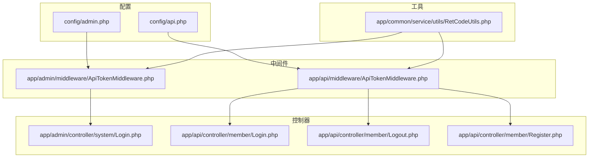
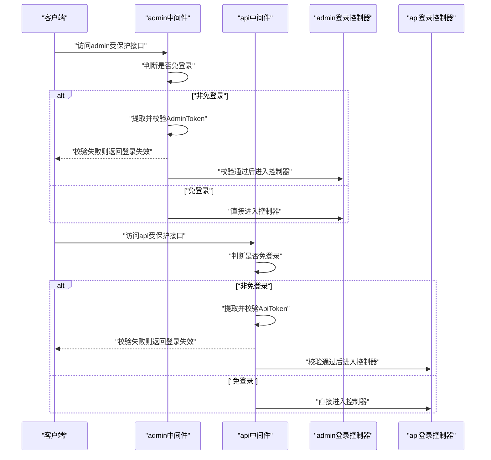
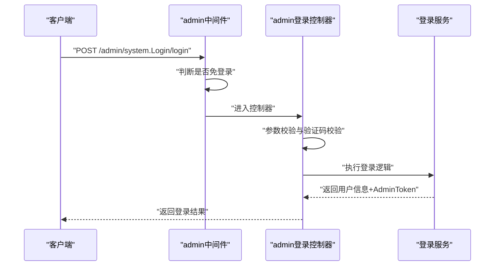
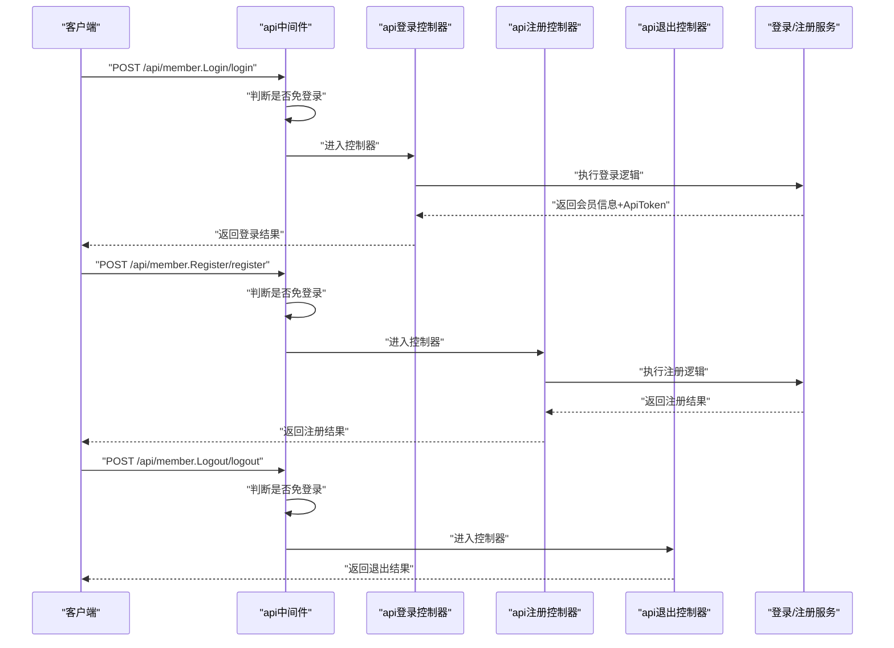
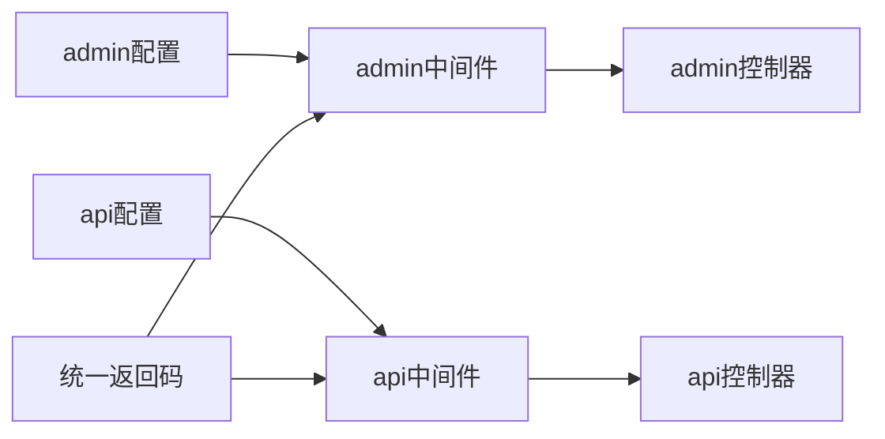

# 认证授权API

<cite>
**本文引用的文件**
- [gccd_server/app/admin/middleware.php](file://gccd_server/app/admin/middleware.php)
- [gccd_server/app/api/middleware.php](file://gccd_server/app/api/middleware.php)
- [gccd_server/config/admin.php](file://gccd_server/config/admin.php)
- [gccd_server/config/api.php](file://gccd_server/config/api.php)
- [gccd_server/app/admin/middleware/ApiTokenMiddleware.php](file://gccd_server/app/admin/middleware/ApiTokenMiddleware.php)
- [gccd_server/app/api/middleware/ApiTokenMiddleware.php](file://gccd_server/app/api/middleware/ApiTokenMiddleware.php)
- [gccd_server/app/common/service/utils/RetCodeUtils.php](file://gccd_server/app/common/service/utils/RetCodeUtils.php)
- [gccd_server/app/admin/controller/system/Login.php](file://gccd_server/app/admin/controller/system/Login.php)
- [gccd_server/app/api/controller/member/Login.php](file://gccd_server/app/api/controller/member/Login.php)
- [gccd_server/app/admin/controller/system/Login.php](file://gccd_server/app/admin/controller/system/Login.php)
- [gccd_server/app/api/controller/member/Logout.php](file://gccd_server/app/api/controller/member/Logout.php)
- [gccd_server/app/api/controller/member/Register.php](file://gccd_server/app/api/controller/member/Register.php)
</cite>

## 目录
1. [简介](#简介)
2. [项目结构](#项目结构)
3. [核心组件](#核心组件)
4. [架构总览](#架构总览)
5. [详细组件分析](#详细组件分析)
6. [依赖关系分析](#依赖关系分析)
7. [性能考虑](#性能考虑)
8. [故障排查指南](#故障排查指南)
9. [结论](#结论)
10. [附录](#附录)

## 简介
本文件面向“高齿传动”项目的认证授权API，系统性说明JWT风格令牌在admin与api两个应用中的生成、验证与刷新机制，覆盖登录、注册、退出等关键接口，并对认证中间件的工作原理、配置差异、权限校验流程、令牌过期处理与安全防护进行深入解析。同时提供接口调用示例与错误处理建议，帮助前后端协同实现稳定、安全的认证体系。

## 项目结构
认证相关能力主要分布在以下位置：
- 配置层：admin与api两套独立配置，分别定义令牌类型、令牌名、免登录/免权限/免限流URL集合等
- 中间件层：admin与api各自提供ApiTokenMiddleware，负责在进入业务控制器前进行令牌校验
- 控制器层：admin与api分别提供登录、退出、注册等接口
- 工具层：统一返回码工具类，用于标准化错误码与提示

图表来源
- [gccd_server/config/admin.php:1-65](file://gccd_server/config/admin.php#L1-L65)
- [gccd_server/config/api.php:1-59](file://gccd_server/config/api.php#L1-L59)
- [gccd_server/app/admin/middleware/ApiTokenMiddleware.php:1-45](file://gccd_server/app/admin/middleware/ApiTokenMiddleware.php#L1-L45)
- [gccd_server/app/api/middleware/ApiTokenMiddleware.php:1-47](file://gccd_server/app/api/middleware/ApiTokenMiddleware.php#L1-L47)
- [gccd_server/app/admin/controller/system/Login.php:105-139](file://gccd_server/app/admin/controller/system/Login.php#L105-L139)
- [gccd_server/app/api/controller/member/Login.php:91-96](file://gccd_server/app/api/controller/member/Login.php#L91-L96)
- [gccd_server/app/api/controller/member/Logout.php](file://gccd_server/app/api/controller/member/Logout.php)
- [gccd_server/app/api/controller/member/Register.php](file://gccd_server/app/api/controller/member/Register.php)
- [gccd_server/app/common/service/utils/RetCodeUtils.php:1-85](file://gccd_server/app/common/service/utils/RetCodeUtils.php#L1-L85)

章节来源
- [gccd_server/config/admin.php:1-65](file://gccd_server/config/admin.php#L1-L65)
- [gccd_server/config/api.php:1-59](file://gccd_server/config/api.php#L1-L59)
- [gccd_server/app/admin/middleware/ApiTokenMiddleware.php:1-45](file://gccd_server/app/admin/middleware/ApiTokenMiddleware.php#L1-L45)
- [gccd_server/app/api/middleware/ApiTokenMiddleware.php:1-47](file://gccd_server/app/api/middleware/ApiTokenMiddleware.php#L1-L47)

## 核心组件
- 令牌类型与令牌名
  - admin应用：令牌类型与令牌名由配置项决定，默认通过请求头传递令牌
  - api应用：令牌类型与令牌名由配置项决定，默认通过请求头传递令牌
- 免登录/免权限/免限流URL集合
  - admin应用：包含登录、验证码、设置等特定路由
  - api应用：包含首页、设置、登录、注册、多种登录方式等特定路由
- 中间件职责
  - admin与api的ApiTokenMiddleware均在进入控制器前检查是否属于免登录路由；若非免登录，则从请求中提取令牌并进行验证，否则直接放行
- 统一返回码
  - 提供登录失效等标准错误码，便于前后端约定

章节来源
- [gccd_server/config/admin.php:12-38](file://gccd_server/config/admin.php#L12-L38)
- [gccd_server/config/api.php:12-43](file://gccd_server/config/api.php#L12-L43)
- [gccd_server/app/admin/middleware/ApiTokenMiddleware.php:29-43](file://gccd_server/app/admin/middleware/ApiTokenMiddleware.php#L29-L43)
- [gccd_server/app/api/middleware/ApiTokenMiddleware.php:29-45](file://gccd_server/app/api/middleware/ApiTokenMiddleware.php#L29-L45)
- [gccd_server/app/common/service/utils/RetCodeUtils.php:34](file://gccd_server/app/common/service/utils/RetCodeUtils.php#L34)

## 架构总览
下图展示admin与api两个应用的认证路径：请求经由对应中间件进行令牌校验，再进入具体控制器执行业务逻辑。

图表来源
- [gccd_server/app/admin/middleware/ApiTokenMiddleware.php:29-43](file://gccd_server/app/admin/middleware/ApiTokenMiddleware.php#L29-L43)
- [gccd_server/app/api/middleware/ApiTokenMiddleware.php:29-45](file://gccd_server/app/api/middleware/ApiTokenMiddleware.php#L29-L45)
- [gccd_server/app/admin/controller/system/Login.php:105-139](file://gccd_server/app/admin/controller/system/Login.php#L105-L139)
- [gccd_server/app/api/controller/member/Login.php:91-96](file://gccd_server/app/api/controller/member/Login.php#L91-L96)

## 详细组件分析

### admin应用认证流程
- 中间件工作原理
  - 在进入控制器前，先判断当前路由是否属于免登录集合；若不在免登录集合，则从请求中提取令牌并进行验证，否则直接放行
- 登录接口
  - 接口路径：admin/system.Login/login
  - 参数：用户名、密码、验证码（支持图形验证码或极验行为验证码）
  - 返回：用户信息与AdminToken
- 退出接口
  - 接口路径：admin/system.Login/logout
  - 功能：根据当前用户ID执行登出，清理会话状态

图表来源
- [gccd_server/app/admin/middleware/ApiTokenMiddleware.php:29-43](file://gccd_server/app/admin/middleware/ApiTokenMiddleware.php#L29-L43)
- [gccd_server/app/admin/controller/system/Login.php:105-139](file://gccd_server/app/admin/controller/system/Login.php#L105-L139)

章节来源
- [gccd_server/app/admin/middleware/ApiTokenMiddleware.php:29-43](file://gccd_server/app/admin/middleware/ApiTokenMiddleware.php#L29-L43)
- [gccd_server/app/admin/controller/system/Login.php:105-139](file://gccd_server/app/admin/controller/system/Login.php#L105-L139)

### api应用认证流程
- 中间件工作原理
  - 在进入控制器前，先判断当前路由是否属于免登录集合；若不在免登录集合，则从请求中提取令牌并进行验证，否则直接放行
- 登录接口
  - 接口路径：api/member.Login/login
  - 参数：账号类型、账号、密码、验证码
  - 返回：会员信息与ApiToken
- 注册接口
  - 接口路径：api/member.Register/register
  - 参数：账号、密码、验证码
  - 返回：注册结果
- 退出接口
  - 接口路径：api/member.Logout/logout
  - 功能：根据当前会员ID执行登出

图表来源
- [gccd_server/app/api/middleware/ApiTokenMiddleware.php:29-45](file://gccd_server/app/api/middleware/ApiTokenMiddleware.php#L29-L45)
- [gccd_server/app/api/controller/member/Login.php:91-96](file://gccd_server/app/api/controller/member/Login.php#L91-L96)
- [gccd_server/app/api/controller/member/Register.php](file://gccd_server/app/api/controller/member/Register.php)
- [gccd_server/app/api/controller/member/Logout.php](file://gccd_server/app/api/controller/member/Logout.php)

章节来源
- [gccd_server/app/api/middleware/ApiTokenMiddleware.php:29-45](file://gccd_server/app/api/middleware/ApiTokenMiddleware.php#L29-L45)
- [gccd_server/app/api/controller/member/Login.php:91-96](file://gccd_server/app/api/controller/member/Login.php#L91-L96)
- [gccd_server/app/api/controller/member/Register.php](file://gccd_server/app/api/controller/member/Register.php)
- [gccd_server/app/api/controller/member/Logout.php](file://gccd_server/app/api/controller/member/Logout.php)

### 令牌生成与刷新机制
- 令牌生成
  - 登录成功后，控制器返回包含令牌的响应体；前端应将令牌保存于本地存储或内存中，并在后续请求中携带
- 令牌刷新
  - 当前代码未提供专门的“令牌刷新接口”。建议采用如下策略之一：
    - 后端在响应头或响应体中返回新的短期令牌与长期刷新令牌，前端在短期令牌即将过期时使用刷新令牌换取新令牌
    - 或采用“静默续签”：后端在检测到即将过期时，在响应中附带新令牌，前端自动替换
  - 无论采用哪种策略，都应在配置中明确令牌有效期与刷新窗口，并在中间件中对即将过期的令牌进行特殊处理（例如返回“即将过期”提示，引导前端刷新）

章节来源
- [gccd_server/app/admin/controller/system/Login.php:97-100](file://gccd_server/app/admin/controller/system/Login.php#L97-L100)
- [gccd_server/app/api/controller/member/Login.php:83-86](file://gccd_server/app/api/controller/member/Login.php#L83-L86)

### 权限验证流程
- admin应用
  - 通过配置项定义“免权限”路由集合；其余路由默认需要权限
  - 可结合角色/菜单权限进一步扩展，但当前中间件仅做令牌校验
- api应用
  - 通过配置项定义“免权限”路由集合；其余路由默认需要权限
  - 可结合会员等级/功能开关进一步扩展

章节来源
- [gccd_server/config/admin.php:31-38](file://gccd_server/config/admin.php#L31-L38)
- [gccd_server/config/api.php:36-40](file://gccd_server/config/api.php#L36-L40)

### 令牌过期处理
- 过期检测
  - 中间件在提取令牌后立即进行验证；若验证失败，抛出登录失效错误
- 前端处理
  - 收到登录失效错误时，清除本地令牌，跳转至登录页重新登录
- 安全建议
  - 对于重要操作，可在请求头中携带“重新鉴权”标志，后端在验证失败时返回“需要重新登录”的明确提示

章节来源
- [gccd_server/app/admin/middleware/ApiTokenMiddleware.php:35-40](file://gccd_server/app/admin/middleware/ApiTokenMiddleware.php#L35-L40)
- [gccd_server/app/api/middleware/ApiTokenMiddleware.php:34-41](file://gccd_server/app/api/middleware/ApiTokenMiddleware.php#L34-L41)
- [gccd_server/app/common/service/utils/RetCodeUtils.php:34](file://gccd_server/app/common/service/utils/RetCodeUtils.php#L34)

### 安全防护措施
- 令牌传递方式
  - admin与api默认通过请求头传递令牌，避免令牌泄露至URL
- 免登录/免权限/免限流白名单
  - 严格限定在最小必要范围，防止误放导致安全风险
- 验证码防护
  - admin登录支持图形验证码与极验行为验证码，降低暴力破解风险
- 敏感字段屏蔽
  - 日志记录时排除密码、图片、视频、音频等敏感字段

章节来源
- [gccd_server/config/admin.php:12-15](file://gccd_server/config/admin.php#L12-L15)
- [gccd_server/config/api.php:12-15](file://gccd_server/config/api.php#L12-L15)
- [gccd_server/config/admin.php:24-38](file://gccd_server/config/admin.php#L24-L38)
- [gccd_server/config/api.php:20-43](file://gccd_server/config/api.php#L20-L43)
- [gccd_server/app/admin/controller/system/Login.php:117-134](file://gccd_server/app/admin/controller/system/Login.php#L117-L134)
- [gccd_server/config/admin.php:46-60](file://gccd_server/config/admin.php#L46-L60)
- [gccd_server/config/api.php:45-57](file://gccd_server/config/api.php#L45-L57)

## 依赖关系分析
- 配置对中间件的影响
  - admin与api的配置决定令牌类型、令牌名以及免登录/免权限/免限流列表
- 中间件对控制器的影响
  - 中间件在进入控制器前完成令牌校验，确保控制器只处理已认证请求
- 统一返回码对错误处理的影响
  - 登录失效等错误码统一由工具类提供，便于前后端约定

图表来源
- [gccd_server/config/admin.php:12-38](file://gccd_server/config/admin.php#L12-L38)
- [gccd_server/config/api.php:12-43](file://gccd_server/config/api.php#L12-L43)
- [gccd_server/app/admin/middleware/ApiTokenMiddleware.php:29-43](file://gccd_server/app/admin/middleware/ApiTokenMiddleware.php#L29-L43)
- [gccd_server/app/api/middleware/ApiTokenMiddleware.php:29-45](file://gccd_server/app/api/middleware/ApiTokenMiddleware.php#L29-L45)
- [gccd_server/app/common/service/utils/RetCodeUtils.php:34](file://gccd_server/app/common/service/utils/RetCodeUtils.php#L34)

章节来源
- [gccd_server/config/admin.php:12-38](file://gccd_server/config/admin.php#L12-L38)
- [gccd_server/config/api.php:12-43](file://gccd_server/config/api.php#L12-L43)
- [gccd_server/app/admin/middleware/ApiTokenMiddleware.php:29-43](file://gccd_server/app/admin/middleware/ApiTokenMiddleware.php#L29-L43)
- [gccd_server/app/api/middleware/ApiTokenMiddleware.php:29-45](file://gccd_server/app/api/middleware/ApiTokenMiddleware.php#L29-L45)
- [gccd_server/app/common/service/utils/RetCodeUtils.php:34](file://gccd_server/app/common/service/utils/RetCodeUtils.php#L34)

## 性能考虑
- 令牌验证成本
  - 将令牌验证前置到中间件，避免重复校验，提升整体吞吐
- 限流策略
  - 通过中间件内置限流组件对高频接口进行节流，降低攻击面
- 缓存与日志
  - 对验证码、登录状态等进行缓存，减少数据库压力；日志记录时剔除敏感字段，降低I/O

## 故障排查指南
- 常见错误与处理
  - 登录失效（401）：检查令牌是否存在、是否过期、是否与配置的令牌名一致
  - 频繁操作（429）：检查限流配置与前端重试策略
  - 无权限（403）：确认当前用户角色与目标接口权限
- 排查步骤
  - 确认请求头中是否携带正确令牌名
  - 核对免登录/免权限/免限流配置是否符合预期
  - 查看中间件是否正确拦截并抛出异常
  - 使用统一返回码定位问题类型

章节来源
- [gccd_server/app/common/service/utils/RetCodeUtils.php:34](file://gccd_server/app/common/service/utils/RetCodeUtils.php#L34)
- [gccd_server/app/admin/middleware/ApiTokenMiddleware.php:35-40](file://gccd_server/app/admin/middleware/ApiTokenMiddleware.php#L35-L40)
- [gccd_server/app/api/middleware/ApiTokenMiddleware.php:34-41](file://gccd_server/app/api/middleware/ApiTokenMiddleware.php#L34-L41)

## 结论
本项目在admin与api两个应用中实现了基于中间件的统一认证框架：通过配置化管理令牌类型与免登录/免权限/免限流列表，中间件在进入控制器前完成令牌校验，控制器专注于业务逻辑。建议后续补充令牌刷新机制与更细粒度的权限控制，以进一步提升安全性与可用性。

## 附录

### 接口调用示例（admin）
- 登录
  - 方法：POST
  - 路径：/admin/system.Login/login
  - 请求头：携带AdminToken（如需）
  - 返回：包含AdminToken的用户信息
- 退出
  - 方法：POST
  - 路径：/admin/system.Login/logout
  - 返回：退出成功提示

章节来源
- [gccd_server/app/admin/controller/system/Login.php:105-139](file://gccd_server/app/admin/controller/system/Login.php#L105-L139)
- [gccd_server/app/admin/controller/system/Login.php:148-157](file://gccd_server/app/admin/controller/system/Login.php#L148-L157)

### 接口调用示例（api）
- 登录
  - 方法：POST
  - 路径：/api/member.Login/login
  - 返回：包含ApiToken的会员信息
- 注册
  - 方法：POST
  - 路径：/api/member.Register/register
  - 返回：注册结果
- 退出
  - 方法：POST
  - 路径：/api/member.Logout/logout
  - 返回：退出成功提示

章节来源
- [gccd_server/app/api/controller/member/Login.php:91-96](file://gccd_server/app/api/controller/member/Login.php#L91-L96)
- [gccd_server/app/api/controller/member/Register.php](file://gccd_server/app/api/controller/member/Register.php)
- [gccd_server/app/api/controller/member/Logout.php](file://gccd_server/app/api/controller/member/Logout.php)