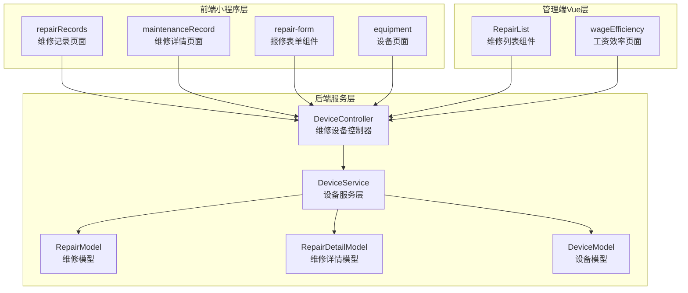
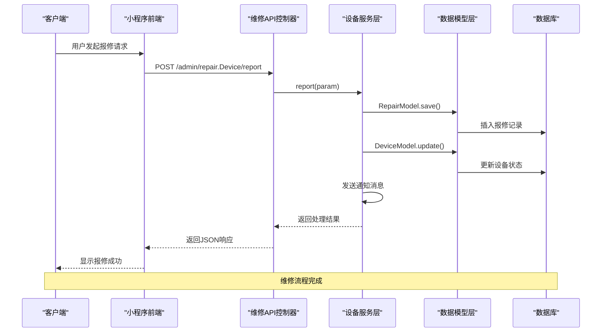
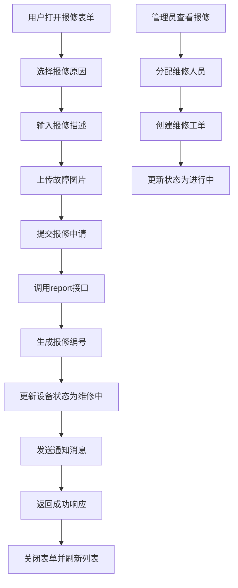
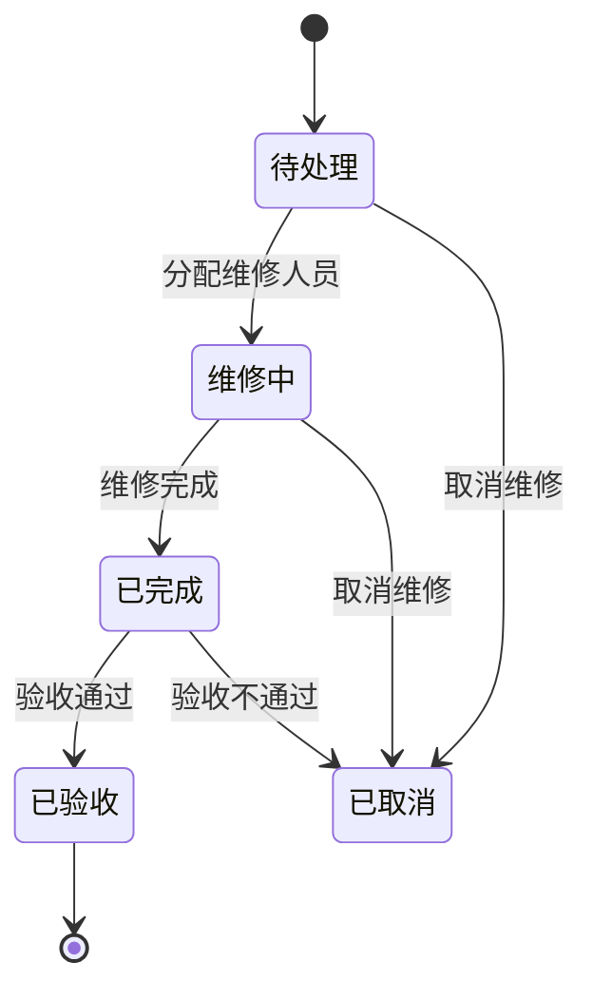
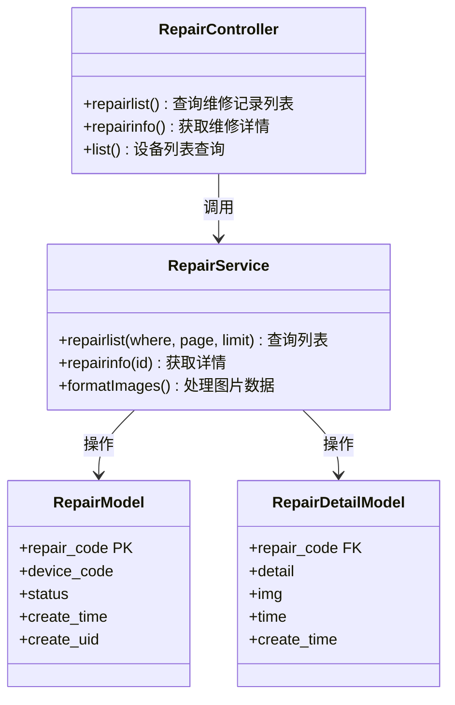
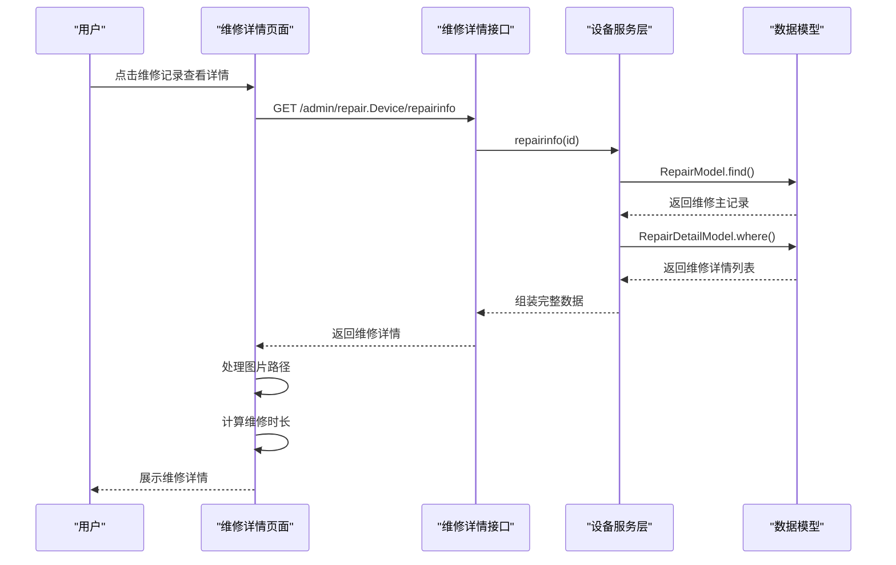
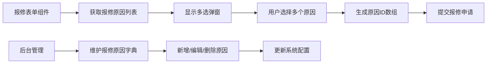
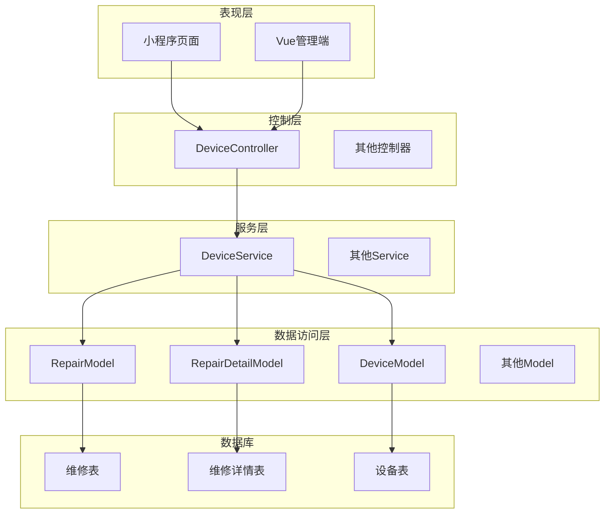

# 维修管理API

<cite>
**本文档引用的文件**
- [Device.php](file://gccd_server/app/admin/controller/repair/Device.php)
- [DeviceService.php](file://gccd_server/app/common/service/admin/DeviceService.php)
- [repairRecords.js](file://gccd_mini/pageEquipment/pages/repairRecords/repairRecords.js)
- [maintenanceRecord.js](file://gccd_mini/pageEquipment/pages/maintenanceRecord/maintenanceRecord.js)
- [repair-form.js](file://gccd_mini/pages/components/repair-form/repair-form.js)
- [equipment.js](file://gccd_mini/pages/equipment/equipment.js)
- [wageEfficiency.js](file://gccd_mini/pageMine/pages/wageEfficiency/wageEfficiency.js)
</cite>

## 目录
1. [简介](#简介)
2. [项目结构](#项目结构)
3. [核心组件](#核心组件)
4. [架构概览](#架构概览)
5. [详细组件分析](#详细组件分析)
6. [依赖关系分析](#依赖关系分析)
7. [性能考虑](#性能考虑)
8. [故障排除指南](#故障排除指南)
9. [结论](#结论)

## 简介

高齿传动项目的设备维修管理API提供了一套完整的设备维修全流程管理接口。该系统支持设备报修、维修派工、维修进度跟踪、维修验收等核心功能，实现了从设备故障发现到维修完成的全生命周期管理。

系统采用前后端分离架构，后端基于ThinkPHP框架开发，前端包括小程序端和Web管理端。维修管理API涵盖了设备维修的各个环节，包括报修申请、维修工单创建、维修进度跟踪、维修验收等完整流程。

## 项目结构

维修管理API主要分布在以下模块中：



**图表来源**
- [Device.php:1-281](file://gccd_server/app/admin/controller/repair/Device.php#L1-281)
- [DeviceService.php:1-540](file://gccd_server/app/common/service/admin/DeviceService.php#L1-540)

**章节来源**
- [Device.php:1-281](file://gccd_server/app/admin/controller/repair/Device.php#L1-281)
- [DeviceService.php:1-540](file://gccd_server/app/common/service/admin/DeviceService.php#L1-540)

## 核心组件

### 维修设备控制器

维修设备控制器位于`app/admin/controller/repair/Device.php`，提供了完整的维修管理接口：

- **报修接口**: `report()` - 处理设备报修申请
- **维修记录查询**: `repairlist()` - 查询维修记录列表
- **维修详情查询**: `repairinfo()` - 获取维修详情
- **维修记录创建**: `addrecords()` - 新增维修记录
- **状态更新**: `editStatus()` - 更新维修状态

### 设备服务层

设备服务层位于`app/common/service/admin/DeviceService.php`，封装了所有业务逻辑：

- **报修处理**: `report()` - 处理报修申请并更新设备状态
- **维修记录管理**: `repairlist()` 和 `repairinfo()` - 维修记录的查询和详情获取
- **维修执行**: `addrecords()` - 创建维修记录并更新设备状态
- **状态管理**: `editStatus()` - 维修状态的确认和更新

### 前端组件

#### 维修记录页面
- **repairRecords.js**: 实现维修记录列表的展示和分页加载
- **maintenanceRecord.js**: 展示维修详情和计算维修时长

#### 报修表单组件
- **repair-form.js**: 提供设备报修的表单组件，支持多选报修原因和图片上传

**章节来源**
- [Device.php:87-281](file://gccd_server/app/admin/controller/repair/Device.php#L87-281)
- [DeviceService.php:303-537](file://gccd_server/app/common/service/admin/DeviceService.php#L303-537)
- [repairRecords.js:1-119](file://gccd_mini/pageEquipment/pages/repairRecords/repairRecords.js#L1-119)
- [maintenanceRecord.js:1-154](file://gccd_mini/pageEquipment/pages/maintenanceRecord/maintenanceRecord.js#L1-154)
- [repair-form.js:1-261](file://gccd_mini/pages/components/repair-form/repair-form.js#L1-261)

## 架构概览

维修管理系统的整体架构采用分层设计：



**图表来源**
- [Device.php:143-149](file://gccd_server/app/admin/controller/repair/Device.php#L143-149)
- [DeviceService.php:303-364](file://gccd_server/app/common/service/admin/DeviceService.php#L303-364)

系统采用RESTful API设计原则，每个接口都有明确的功能职责和标准的HTTP方法映射。数据传输采用JSON格式，错误处理遵循统一的响应格式。

**章节来源**
- [Device.php:1-281](file://gccd_server/app/admin/controller/repair/Device.php#L1-281)
- [DeviceService.php:1-540](file://gccd_server/app/common/service/admin/DeviceService.php#L1-540)

## 详细组件分析

### 报修申请流程

报修申请是维修管理的第一步，涉及多个组件的协作：



**图表来源**
- [repair-form.js:221-259](file://gccd_mini/pages/components/repair-form/repair-form.js#L221-259)
- [Device.php:143-149](file://gccd_server/app/admin/controller/repair/Device.php#L143-149)
- [DeviceService.php:303-364](file://gccd_server/app/common/service/admin/DeviceService.php#L303-364)

#### 报修接口规范

**接口地址**: `POST /admin/repair.Device/report`

**请求参数**:
- `device_code`: 设备编码 (必填)
- `reason`: 报修描述 (可选)
- `img`: 图片URL数组 (可选)
- `repair_list`: 报修原因数组 (必填)

**响应数据**:
```json
{
  "code": 200,
  "msg": "操作成功",
  "data": {
    "repair_code": "R202401010001",
    "device_code": "D001",
    "reason": "设备异常响声",
    "img": ["http://example.com/image1.jpg"],
    "repair_list": ["轴承损坏", "润滑不足"],
    "create_time": "2024-01-01 10:30:00",
    "status": 0
  }
}
```

**章节来源**
- [repair-form.js:221-259](file://gccd_mini/pages/components/repair-form/repair-form.js#L221-259)
- [Device.php:143-149](file://gccd_server/app/admin/controller/repair/Device.php#L143-149)
- [DeviceService.php:303-364](file://gccd_server/app/common/service/admin/DeviceService.php#L303-364)

### 维修工单管理

维修工单管理包括工单创建、状态更新和进度跟踪：



**图表来源**
- [DeviceService.php:524-537](file://gccd_server/app/common/service/admin/DeviceService.php#L524-537)

#### 维修记录创建接口

**接口地址**: `POST /admin/repair.Device/addrecords`

**请求参数**:
- `device_code`: 设备编码 (必填)
- `repair_code`: 维修编号 (必填)
- `detail`: 维修详情 (必填)
- `user`: 维修人员 (必填)
- `repair_list`: 维修原因 (可选)
- `img`: 维修图片 (可选)

**状态流转**:
- 创建维修记录时，设备状态从"维修中"(1)更新为"正常"(0)
- 维修工单状态从"待处理"(0)更新为"已确认"(1)

**章节来源**
- [equipment.js:999-1023](file://gccd_mini/pages/equipment/equipment.js#L999-1023)
- [DeviceService.php:464-522](file://gccd_server/app/common/service/admin/DeviceService.php#L464-522)

### 维修记录查询

维修记录查询支持多种筛选条件和分页功能：



**图表来源**
- [Device.php:161-240](file://gccd_server/app/admin/controller/repair/Device.php#L161-240)
- [DeviceService.php:389-457](file://gccd_server/app/common/service/admin/DeviceService.php#L389-457)

#### 维修记录查询接口

**接口地址**: `GET /admin/repair.Device/repairlist`

**查询参数**:
- `device_code`: 设备编码 (可选)
- `device_name`: 设备名称 (可选)
- `create_start_date`: 开始日期 (可选)
- `create_end_date`: 结束日期 (可选)
- `repair_name`: 维修人员姓名 (可选)
- `create_name`: 报修人员姓名 (可选)
- `status`: 状态 (可选)
- `page`: 页码 (默认1)
- `limit`: 每页条数 (默认10)

**响应数据**:
```json
{
  "code": 200,
  "msg": "操作成功",
  "data": {
    "count": 150,
    "pages": 15,
    "page": 1,
    "limit": 10,
    "list": [
      {
        "id": 1,
        "repair_code": "R202401010001",
        "device_code": "D001",
        "device_name": "齿轮加工机",
        "status": 2,
        "create_time": "2024-01-01 10:30:00",
        "create_name": "张三",
        "repair_name": "李四",
        "time": "2小时30分",
        "imgs": ["http://example.com/image1.jpg"],
        "detail": [
          {
            "id": 1,
            "repair_code": "R202401010001",
            "detail": "更换轴承",
            "img": ["http://example.com/repair1.jpg"],
            "time": "2小时30分",
            "create_time": "2024-01-01 12:30:00"
          }
        ]
      }
    ]
  }
}
```

**章节来源**
- [Device.php:161-240](file://gccd_server/app/admin/controller/repair/Device.php#L161-240)
- [DeviceService.php:389-457](file://gccd_server/app/common/service/admin/DeviceService.php#L389-457)
- [repairRecords.js:40-86](file://gccd_mini/pageEquipment/pages/repairRecords/repairRecords.js#L40-86)

### 维修详情展示

维修详情页面提供了完整的维修信息展示和图片预览功能：



**图表来源**
- [Device.php:87-93](file://gccd_server/app/admin/controller/repair/Device.php#L87-93)
- [DeviceService.php:133-187](file://gccd_server/app/common/service/admin/DeviceService.php#L133-187)

**章节来源**
- [maintenanceRecord.js:34-102](file://gccd_mini/pageEquipment/pages/maintenanceRecord/maintenanceRecord.js#L34-102)
- [DeviceService.php:133-187](file://gccd_server/app/common/service/admin/DeviceService.php#L133-187)

### 报修原因管理

系统支持灵活的报修原因配置和管理：



**图表来源**
- [repair-form.js:44-118](file://gccd_mini/pages/components/repair-form/repair-form.js#L44-118)

**章节来源**
- [repair-form.js:44-118](file://gccd_mini/pages/components/repair-form/repair-form.js#L44-118)

## 依赖关系分析

维修管理API的依赖关系呈现清晰的分层结构：



**图表来源**
- [Device.php:1-281](file://gccd_server/app/admin/controller/repair/Device.php#L1-281)
- [DeviceService.php:1-540](file://gccd_server/app/common/service/admin/DeviceService.php#L1-540)

系统采用依赖注入和工厂模式，确保各层之间的松耦合。控制器只负责请求处理和响应输出，业务逻辑集中在服务层，数据访问通过模型层实现。

**章节来源**
- [Device.php:1-281](file://gccd_server/app/admin/controller/repair/Device.php#L1-281)
- [DeviceService.php:1-540](file://gccd_server/app/common/service/admin/DeviceService.php#L1-540)

## 性能考虑

### 缓存策略
- **设备状态缓存**: 经常访问的设备状态信息可以缓存到Redis中
- **报修原因缓存**: 报修原因字典数据可以缓存，减少数据库查询
- **图片资源缓存**: 维修图片可以通过CDN加速访问

### 数据库优化
- **索引优化**: 在`device_code`、`create_time`、`status`等常用查询字段建立索引
- **分页查询**: 对于大量维修记录的查询使用分页机制
- **连接池**: 使用数据库连接池提高并发处理能力

### 前端优化
- **图片压缩**: 移动端上传的图片进行压缩处理
- **懒加载**: 维修记录列表使用虚拟滚动技术
- **本地存储**: 关键数据缓存到本地存储中

## 故障排除指南

### 常见问题及解决方案

#### 报修申请失败
**问题现象**: 用户提交报修申请后返回失败

**可能原因**:
1. 设备编码不存在
2. 必填字段缺失
3. 文件上传失败

**解决步骤**:
1. 检查设备编码是否正确
2. 验证必填字段完整性
3. 确认文件上传接口可用性

#### 维修记录查询异常
**问题现象**: 维修记录列表无法加载

**可能原因**:
1. 数据库连接异常
2. 查询条件不合法
3. 分页参数错误

**解决步骤**:
1. 检查数据库连接状态
2. 验证查询参数格式
3. 确认分页参数范围

#### 图片显示问题
**问题现象**: 维修图片无法正常显示

**可能原因**:
1. 图片URL格式错误
2. 文件权限问题
3. CDN配置异常

**解决步骤**:
1. 检查图片URL格式
2. 验证文件访问权限
3. 确认CDN配置正确

**章节来源**
- [repairRecords.js:73-85](file://gccd_mini/pageEquipment/pages/repairRecords/repairRecords.js#L73-85)
- [maintenanceRecord.js:70-82](file://gccd_mini/pageEquipment/pages/maintenanceRecord/maintenanceRecord.js#L70-82)

## 结论

高齿传动项目的设备维修管理API提供了一个完整、高效的设备维修管理解决方案。系统采用现代化的架构设计，具有良好的扩展性和维护性。

### 主要优势
1. **完整的功能覆盖**: 从报修申请到维修验收的全流程管理
2. **清晰的架构设计**: 分层架构确保了代码的可维护性
3. **灵活的配置管理**: 支持多种查询条件和筛选规则
4. **友好的用户体验**: 前后端分离设计提供了优秀的交互体验

### 技术特点
- 基于ThinkPHP框架开发，具有良好的性能和稳定性
- 采用RESTful API设计，接口规范统一
- 支持多端访问，包括小程序和Web管理端
- 具备完善的错误处理和日志记录机制

该维修管理API为高齿传动项目的设备维护提供了强有力的技术支撑，能够有效提升设备管理效率和维修响应速度。