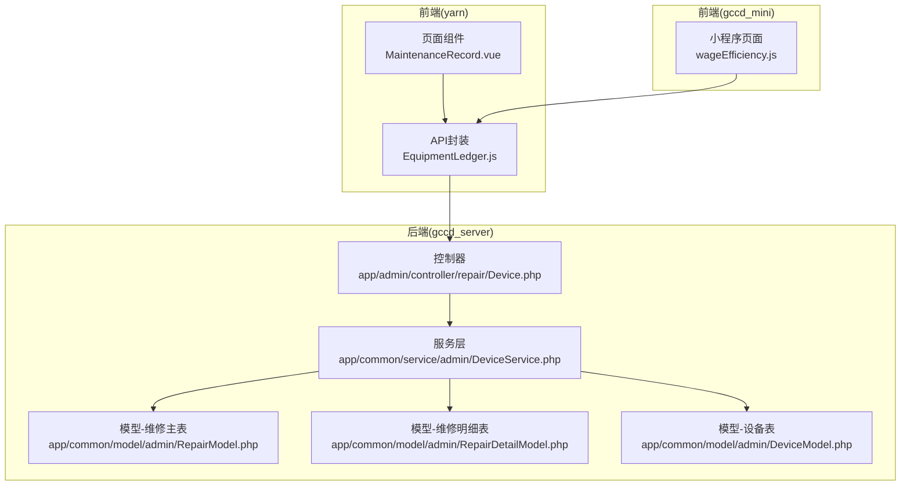
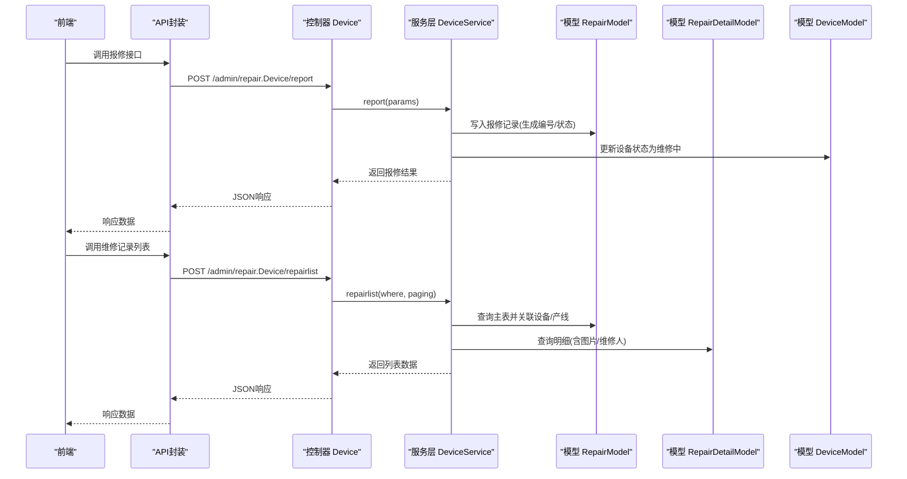
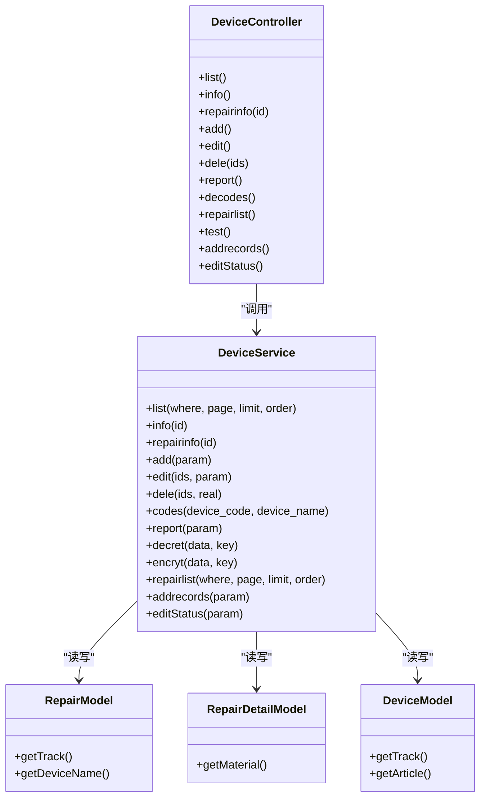
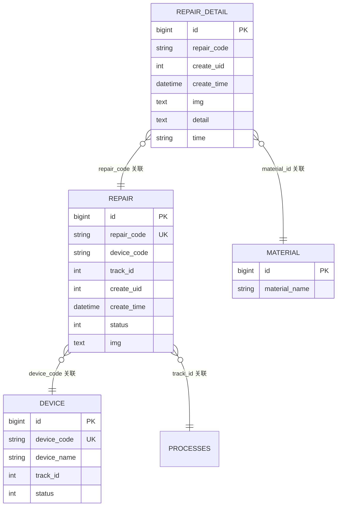
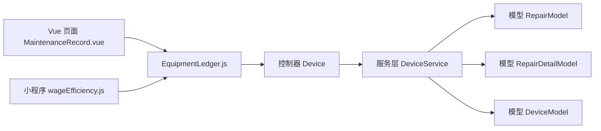

# 维护记录API

<cite>
**本文引用的文件**
- [gccd_server/app/admin/controller/repair/Device.php](file://gccd_server/app/admin/controller/repair/Device.php)
- [gccd_server/app/common/service/admin/DeviceService.php](file://gccd_server/app/common/service/admin/DeviceService.php)
- [gccd_server/app/common/model/admin/RepairModel.php](file://gccd_server/app/common/model/admin/RepairModel.php)
- [gccd_server/app/common/model/admin/RepairDetailModel.php](file://gccd_server/app/common/model/admin/RepairDetailModel.php)
- [gccd_server/app/common/model/admin/DeviceModel.php](file://gccd_server/app/common/model/admin/DeviceModel.php)
- [yarn/src/api/mes/EquipmentLedger/EquipmentLedger.js](file://yarn/src/api/mes/EquipmentLedger/EquipmentLedger.js)
- [yarn/src/views/mes/EquipmentLedger/MaintenanceRecord.vue](file://yarn/src/views/mes/EquipmentLedger/MaintenanceRecord.vue)
- [gccd_mini/pageMine/pages/wageEfficiency/wageEfficiency.js](file://gccd_mini/pageMine/pages/wageEfficiency/wageEfficiency.js)
</cite>

## 目录
1. [简介](#简介)
2. [项目结构](#项目结构)
3. [核心组件](#核心组件)
4. [架构总览](#架构总览)
5. [详细组件分析](#详细组件分析)
6. [依赖分析](#依赖分析)
7. [性能考虑](#性能考虑)
8. [故障排查指南](#故障排查指南)
9. [结论](#结论)
10. [附录](#附录)

## 简介
本文件面向“高齿传动项目”的设备维护记录API，系统性梳理并说明以下能力：
- 维修记录的创建、查询、更新、删除接口
- 维修记录与设备台账的关联关系
- 维修记录的统计分析（如设备故障率、维修成本等）接口设计思路
- 维修记录的审批流程接口与历史记录查询功能

说明：
- 仓库中现有实现主要围绕“报修”和“维修记录明细”两大模块，未发现独立的“设备维护保养记录”接口。本文将基于现有“报修/维修记录”能力，给出可扩展到“设备维护保养记录”的接口定义与流程建议。

## 项目结构
后端采用 ThinkPHP 框架，前端分为 Vue 管理端与小程序端。与维护记录直接相关的后端模块位于 admin/repair/Device 控制器及对应的 Service/Model 层；前端管理端通过 API 封装调用后端接口。

图表来源
- [gccd_server/app/admin/controller/repair/Device.php:1-281](file://gccd_server/app/admin/controller/repair/Device.php#L1-L281)
- [gccd_server/app/common/service/admin/DeviceService.php:1-540](file://gccd_server/app/common/service/admin/DeviceService.php#L1-L540)
- [gccd_server/app/common/model/admin/RepairModel.php:1-32](file://gccd_server/app/common/model/admin/RepairModel.php#L1-L32)
- [gccd_server/app/common/model/admin/RepairDetailModel.php:1-21](file://gccd_server/app/common/model/admin/RepairDetailModel.php#L1-L21)
- [gccd_server/app/common/model/admin/DeviceModel.php:1-32](file://gccd_server/app/common/model/admin/DeviceModel.php#L1-L32)
- [yarn/src/api/mes/EquipmentLedger/EquipmentLedger.js:1-39](file://yarn/src/api/mes/EquipmentLedger/EquipmentLedger.js#L1-L39)
- [yarn/src/views/mes/EquipmentLedger/MaintenanceRecord.vue:150-210](file://yarn/src/views/mes/EquipmentLedger/MaintenanceRecord.vue#L150-L210)
- [gccd_mini/pageMine/pages/wageEfficiency/wageEfficiency.js:205-240](file://gccd_mini/pageMine/pages/wageEfficiency/wageEfficiency.js#L205-L240)

章节来源
- [gccd_server/app/admin/controller/repair/Device.php:1-281](file://gccd_server/app/admin/controller/repair/Device.php#L1-L281)
- [gccd_server/app/common/service/admin/DeviceService.php:1-540](file://gccd_server/app/common/service/admin/DeviceService.php#L1-L540)
- [yarn/src/api/mes/EquipmentLedger/EquipmentLedger.js:1-39](file://yarn/src/api/mes/EquipmentLedger/EquipmentLedger.js#L1-L39)
- [yarn/src/views/mes/EquipmentLedger/MaintenanceRecord.vue:150-210](file://yarn/src/views/mes/EquipmentLedger/MaintenanceRecord.vue#L150-L210)
- [gccd_mini/pageMine/pages/wageEfficiency/wageEfficiency.js:205-240](file://gccd_mini/pageMine/pages/wageEfficiency/wageEfficiency.js#L205-L240)

## 核心组件
- 维修记录控制器：提供报修、维修记录列表、维修记录详情、新增维修记录、确认维修状态等接口。
- 维修记录服务层：封装业务逻辑，包括报修编号生成、图片地址拼接、维修时长计算、设备状态联动更新、消息推送等。
- 数据模型：
  - 维修主表模型：关联设备与产线信息，绑定设备名称与产线名称。
  - 维修明细模型：关联物料信息，绑定物料名称。
  - 设备模型：关联产线与入库信息，绑定产线名称与文章地址。

章节来源
- [gccd_server/app/admin/controller/repair/Device.php:87-281](file://gccd_server/app/admin/controller/repair/Device.php#L87-L281)
- [gccd_server/app/common/service/admin/DeviceService.php:125-537](file://gccd_server/app/common/service/admin/DeviceService.php#L125-L537)
- [gccd_server/app/common/model/admin/RepairModel.php:7-31](file://gccd_server/app/common/model/admin/RepairModel.php#L7-L31)
- [gccd_server/app/common/model/admin/RepairDetailModel.php:7-20](file://gccd_server/app/common/model/admin/RepairDetailModel.php#L7-L20)
- [gccd_server/app/common/model/admin/DeviceModel.php:7-31](file://gccd_server/app/common/model/admin/DeviceModel.php#L7-L31)

## 架构总览
后端采用“控制器-服务层-模型层”的分层架构，前端通过统一 API 封装调用后端接口。维修记录相关流程从“扫码报修”开始，经“维修记录明细”完成，最终联动设备状态与消息推送。

图表来源
- [gccd_server/app/admin/controller/repair/Device.php:143-240](file://gccd_server/app/admin/controller/repair/Device.php#L143-L240)
- [gccd_server/app/common/service/admin/DeviceService.php:303-457](file://gccd_server/app/common/service/admin/DeviceService.php#L303-L457)
- [gccd_server/app/common/model/admin/RepairModel.php:7-31](file://gccd_server/app/common/model/admin/RepairModel.php#L7-L31)
- [gccd_server/app/common/model/admin/RepairDetailModel.php:7-20](file://gccd_server/app/common/model/admin/RepairDetailModel.php#L7-L20)
- [gccd_server/app/common/model/admin/DeviceModel.php:7-31](file://gccd_server/app/common/model/admin/DeviceModel.php#L7-L31)

## 详细组件分析

### 维修记录控制器与服务层
- 控制器职责
  - 报修接口：接收设备编码、故障原因、图片列表、维修项列表，生成报修编号并写入维修主表，同时更新设备状态为“维修中”，并向指定角色推送消息。
  - 维修记录列表：支持按设备编码/名称、产线编码、报修人/维修人昵称、创建时间范围、设备状态等条件筛选，返回主表与明细的聚合数据。
  - 维修记录详情：返回主表信息、设备/产线绑定字段、维修明细列表（含图片拆分、维修人名称）。
  - 新增维修记录：写入维修明细，计算维修时长（基于报修时间），更新设备状态为“正常”，并将主表状态置为“待确认”。
  - 确认维修状态：仅允许报修申请人本人将主表状态更新为“已确认”。

- 服务层职责
  - 编号生成：使用公共方法生成唯一编号（如报修编号）。
  - 图片处理：将图片URL数组拼接为分号分隔字符串存储，列表/详情时再拆分为数组返回。
  - 维修时长计算：根据报修时间与当前时间计算“时:分”格式。
  - 设备状态联动：报修成功更新设备状态为“维修中”，新增维修记录成功后更新设备状态为“正常”。
  - 消息推送：向“总经理/车间主任/设备维修”等角色推送消息。

图表来源
- [gccd_server/app/admin/controller/repair/Device.php:33-281](file://gccd_server/app/admin/controller/repair/Device.php#L33-L281)
- [gccd_server/app/common/service/admin/DeviceService.php:40-537](file://gccd_server/app/common/service/admin/DeviceService.php#L40-L537)
- [gccd_server/app/common/model/admin/RepairModel.php:7-31](file://gccd_server/app/common/model/admin/RepairModel.php#L7-L31)
- [gccd_server/app/common/model/admin/RepairDetailModel.php:7-20](file://gccd_server/app/common/model/admin/RepairDetailModel.php#L7-L20)
- [gccd_server/app/common/model/admin/DeviceModel.php:7-31](file://gccd_server/app/common/model/admin/DeviceModel.php#L7-L31)

章节来源
- [gccd_server/app/admin/controller/repair/Device.php:87-281](file://gccd_server/app/admin/controller/repair/Device.php#L87-L281)
- [gccd_server/app/common/service/admin/DeviceService.php:125-537](file://gccd_server/app/common/service/admin/DeviceService.php#L125-L537)

### 维修记录接口定义（基于现有能力扩展）
说明：以下接口定义基于现有“报修/维修记录明细”能力进行扩展设计，便于对接“设备维护保养记录”。字段命名与业务含义以现有实现为准，具体字段值需结合业务补充。

- 报修接口
  - 方法与路径：POST /admin/repair.Device/report
  - 请求参数
    - device_code: 设备编码（必填）
    - reason: 故障原因（必填）
    - img: 图片URL数组（可选）
    - repair_list: 维修项描述数组（可选）
  - 返回字段
    - repair_code: 报修编号
    - create_time: 创建时间
    - create_uid: 创建人
    - status: 状态（默认“维修中”）
    - 设备状态联动：更新设备状态为“维修中”
    - 消息推送：向指定角色推送通知

- 维修记录列表接口
  - 方法与路径：POST /admin/repair.Device/repairlist
  - 请求参数
    - device_code: 设备编码（模糊匹配）
    - device_name: 设备名称（模糊匹配）
    - create_start_date/create_end_date: 创建时间范围
    - processes_code: 产线编码（模糊匹配）
    - user_id: 报修人ID（精确匹配）
    - repair_name: 维修人昵称（模糊匹配）
    - create_name: 报修人昵称（模糊匹配）
    - status: 设备状态（精确匹配）
  - 返回字段
    - repair_code: 报修编号
    - device_code/device_name: 关联设备信息
    - track_name: 产线名称
    - create_name: 报修人姓名
    - imgs: 主表图片数组
    - detail: 维修明细列表（含维修人、图片、维修时长）
    - create_time/status: 创建时间与状态

- 维修记录详情接口
  - 方法与路径：GET /admin/repair.Device/repairinfo?id={id}
  - 返回字段
    - repair_code: 报修编号
    - device_code/device_name: 关联设备信息
    - track_name: 产线名称
    - create_name: 报修人姓名
    - imgs: 主表图片数组
    - detail: 维修明细列表（含维修人、图片、维修时长）
    - create_time/status: 创建时间与状态

- 新增维修记录接口
  - 方法与路径：POST /admin/repair.Device/addrecords
  - 请求参数
    - device_code: 设备编码（必填）
    - repair_code: 报修编号（必填）
    - user: 维修人（可选）
    - img: 图片URL数组（可选）
    - detail: 维修内容描述（可选）
    - repair_list: 维修项列表（可选）
  - 返回字段
    - 计算维修时长（基于报修时间）
    - 更新设备状态为“正常”
    - 更新主表状态为“待确认”

- 确认维修状态接口
  - 方法与路径：POST /admin/repair.Device/editStatus
  - 请求参数
    - id: 主表ID（必填）
    - status: 目标状态（如“已确认”）
  - 返回字段
    - 更新结果

章节来源
- [gccd_server/app/admin/controller/repair/Device.php:143-277](file://gccd_server/app/admin/controller/repair/Device.php#L143-L277)
- [gccd_server/app/common/service/admin/DeviceService.php:303-537](file://gccd_server/app/common/service/admin/DeviceService.php#L303-L537)

### 维修记录与设备台账的关联关系
- 维修主表 RepairModel 通过 device_code 关联设备表 DeviceModel，绑定 device_name。
- 维修主表 RepairModel 通过 track_id 关联产线表 ProcessesModel，绑定 track_name。
- 维修明细 RepairDetailModel 可关联物料表 MaterialModel，绑定 material_name。

图表来源
- [gccd_server/app/common/model/admin/RepairModel.php:7-31](file://gccd_server/app/common/model/admin/RepairModel.php#L7-L31)
- [gccd_server/app/common/model/admin/RepairDetailModel.php:7-20](file://gccd_server/app/common/model/admin/RepairDetailModel.php#L7-L20)
- [gccd_server/app/common/model/admin/DeviceModel.php:7-31](file://gccd_server/app/common/model/admin/DeviceModel.php#L7-L31)

章节来源
- [gccd_server/app/common/model/admin/RepairModel.php:7-31](file://gccd_server/app/common/model/admin/RepairModel.php#L7-L31)
- [gccd_server/app/common/model/admin/RepairDetailModel.php:7-20](file://gccd_server/app/common/model/admin/RepairDetailModel.php#L7-L20)
- [gccd_server/app/common/model/admin/DeviceModel.php:7-31](file://gccd_server/app/common/model/admin/DeviceModel.php#L7-L31)

### 维修记录统计分析（设计建议）
现有实现未提供专门的统计分析接口。建议在服务层新增统计方法，基于维修记录数据计算如下指标：
- 设备故障率：某设备故障次数 / 总运行时长
- 维修成本：按维修项/物料统计总费用
- 维修时长分布：平均维修时长、最长/最短维修时长
- 维修人效率：每位维修人的维修次数与平均时长
- 时间维度分析：按月/季度统计维修频次与成本

实现建议：
- 在 DeviceService 中新增统计方法，使用 RepairModel/RepairDetailModel 进行聚合查询。
- 对于维修成本，可在明细中引入物料单价与数量，或在业务表中扩展成本字段。

章节来源
- [gccd_server/app/common/service/admin/DeviceService.php:389-457](file://gccd_server/app/common/service/admin/DeviceService.php#L389-L457)

### 审批流程与历史记录（设计建议）
现有实现支持“确认维修状态”，但未体现完整的审批流。建议扩展：
- 审批流程接口
  - 提交审批：将主表状态置为“待审批”
  - 审批通过/驳回：由审批人更新状态并记录审批意见
  - 审批历史：新增审批记录表，记录审批人、时间、意见与状态变更
- 历史记录查询
  - 支持按设备、维修人、时间范围查询历史维修记录
  - 明细中保留每次维修的图片、时长、物料消耗等快照

章节来源
- [gccd_server/app/admin/controller/repair/Device.php:273-277](file://gccd_server/app/admin/controller/repair/Device.php#L273-L277)
- [gccd_server/app/common/service/admin/DeviceService.php:524-537](file://gccd_server/app/common/service/admin/DeviceService.php#L524-L537)

## 依赖分析
- 控制器依赖服务层，服务层依赖模型层，形成清晰的分层耦合。
- 维修记录与设备、产线、物料存在外键关联，查询时通过 with 关联加载提升性能。
- 前端通过 API 封装统一调用后端控制器，页面组件与 API 封装松耦合。

图表来源
- [gccd_server/app/admin/controller/repair/Device.php:33-281](file://gccd_server/app/admin/controller/repair/Device.php#L33-L281)
- [gccd_server/app/common/service/admin/DeviceService.php:40-537](file://gccd_server/app/common/service/admin/DeviceService.php#L40-L537)
- [yarn/src/views/mes/EquipmentLedger/MaintenanceRecord.vue:150-210](file://yarn/src/views/mes/EquipmentLedger/MaintenanceRecord.vue#L150-L210)
- [yarn/src/api/mes/EquipmentLedger/EquipmentLedger.js:1-39](file://yarn/src/api/mes/EquipmentLedger/EquipmentLedger.js#L1-L39)
- [gccd_mini/pageMine/pages/wageEfficiency/wageEfficiency.js:205-240](file://gccd_mini/pageMine/pages/wageEfficiency/wageEfficiency.js#L205-L240)

章节来源
- [gccd_server/app/admin/controller/repair/Device.php:33-281](file://gccd_server/app/admin/controller/repair/Device.php#L33-L281)
- [gccd_server/app/common/service/admin/DeviceService.php:40-537](file://gccd_server/app/common/service/admin/DeviceService.php#L40-L537)
- [yarn/src/views/mes/EquipmentLedger/MaintenanceRecord.vue:150-210](file://yarn/src/views/mes/EquipmentLedger/MaintenanceRecord.vue#L150-L210)
- [yarn/src/api/mes/EquipmentLedger/EquipmentLedger.js:1-39](file://yarn/src/api/mes/EquipmentLedger/EquipmentLedger.js#L1-L39)
- [gccd_mini/pageMine/pages/wageEfficiency/wageEfficiency.js:205-240](file://gccd_mini/pageMine/pages/wageEfficiency/wageEfficiency.js#L205-L240)

## 性能考虑
- 分页查询：列表接口默认分页，避免一次性加载大量数据。
- 关联查询：使用 with 关联加载减少 N+1 查询问题。
- 图片处理：存储为分号分隔字符串，列表/详情时再拆分，降低存储冗余。
- 状态联动：在服务层统一处理设备状态与主表状态，减少重复更新。

## 故障排查指南
- 报修失败
  - 检查设备是否存在且状态是否正确
  - 检查图片上传与URL格式
  - 查看服务层日志与异常信息
- 维修记录无法确认
  - 确认当前用户是否为报修申请人
  - 检查主表状态是否允许变更
- 列表查询无结果
  - 检查筛选条件（设备名称/编码、时间范围、维修人昵称等）
  - 确认关联表数据是否完整（设备/产线/物料）

章节来源
- [gccd_server/app/common/service/admin/DeviceService.php:524-537](file://gccd_server/app/common/service/admin/DeviceService.php#L524-L537)

## 结论
- 现有实现已覆盖“报修—维修记录明细—设备状态联动—消息推送”的核心流程。
- 建议在此基础上扩展“设备维护保养记录”的接口定义与审批流程，以满足日常保养、定期保养、大修等场景。
- 统计分析与历史记录查询可通过服务层聚合查询实现，提升运维决策效率。

## 附录
- 前端调用示例（管理端）
  - 维修记录列表：EquipmentLedger.repairlist(params)
  - 设备列表（用于设备筛选）：EquipmentLedger.list(params)
- 小程序端设备列表：请求 admin/repair.Device/list 接口

章节来源
- [yarn/src/api/mes/EquipmentLedger/EquipmentLedger.js:17-39](file://yarn/src/api/mes/EquipmentLedger/EquipmentLedger.js#L17-L39)
- [gccd_mini/pageMine/pages/wageEfficiency/wageEfficiency.js:205-240](file://gccd_mini/pageMine/pages/wageEfficiency/wageEfficiency.js#L205-L240)