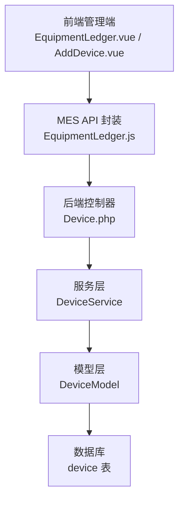
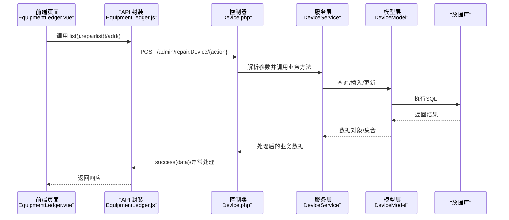
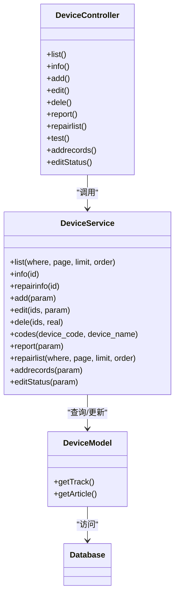

# 设备台账API

<cite>
**本文引用的文件**
- [gccd_server/app/admin/controller/repair/Device.php](file://gccd_server/app/admin/controller/repair/Device.php)
- [gccd_server/app/common/service/admin/DeviceService.php](file://gccd_server/app/common/service/admin/DeviceService.php)
- [gccd_server/app/common/model/admin/DeviceModel.php](file://gccd_server/app/common/model/admin/DeviceModel.php)
- [yarn/src/api/mes/EquipmentLedger/EquipmentLedger.js](file://yarn/src/api/mes/EquipmentLedger/EquipmentLedger.js)
- [yarn/src/views/mes/EquipmentLedger/EquipmentLedger.vue](file://yarn/src/views/mes/EquipmentLedger/EquipmentLedger.vue)
- [yarn/src/views/mes/EquipmentLedger/components/AddDevice.vue](file://yarn/src/views/mes/EquipmentLedger/components/AddDevice.vue)
- [gccd_mini/pageMine/pages/wageEfficiency/wageEfficiency.js](file://gccd_mini/pageMine/pages/wageEfficiency/wageEfficiency.js)
- [gccd_mini/pages/equipment/equipment.js](file://gccd_mini/pages/equipment/equipment.js)
</cite>

## 目录
1. [简介](#简介)
2. [项目结构](#项目结构)
3. [核心组件](#核心组件)
4. [架构总览](#架构总览)
5. [详细组件分析](#详细组件分析)
6. [依赖关系分析](#依赖关系分析)
7. [性能考虑](#性能考虑)
8. [故障排查指南](#故障排查指南)
9. [结论](#结论)
10. [附录](#附录)

## 简介
本文件面向“高齿传动”项目，系统化梳理“设备台账API”的设计与实现，覆盖设备基本信息管理（新增、查询、更新、删除）、设备状态管理（在用、停用、维修中、报废）、设备搜索与分页、以及前端调用规范与错误处理机制。文档同时给出接口定义、参数校验、响应格式与常见问题排查建议，帮助前后端协同开发与维护。

## 项目结构
围绕设备台账功能，相关代码分布在后端 ThinkPHP 控制器与服务层、前端 Vue 调用与页面组件、以及小程序侧调用等模块中。整体采用“控制器-服务-模型”的分层设计，前端通过统一的 API 模块发起请求。

图表来源
- [gccd_server/app/admin/controller/repair/Device.php:47-136](file://gccd_server/app/admin/controller/repair/Device.php#L47-L136)
- [gccd_server/app/common/service/admin/DeviceService.php:80-96](file://gccd_server/app/common/service/admin/DeviceService.php#L80-L96)
- [gccd_server/app/common/model/admin/DeviceModel.php:7-31](file://gccd_server/app/common/model/admin/DeviceModel.php#L7-L31)
- [yarn/src/api/mes/EquipmentLedger/EquipmentLedger.js:1-40](file://yarn/src/api/mes/EquipmentLedger/EquipmentLedger.js#L1-L40)
- [yarn/src/views/mes/EquipmentLedger/EquipmentLedger.vue:135-195](file://yarn/src/views/mes/EquipmentLedger/EquipmentLedger.vue#L135-L195)
- [yarn/src/views/mes/EquipmentLedger/components/AddDevice.vue:1-38](file://yarn/src/views/mes/EquipmentLedger/components/AddDevice.vue#L1-L38)

章节来源
- [gccd_server/app/admin/controller/repair/Device.php:47-136](file://gccd_server/app/admin/controller/repair/Device.php#L47-L136)
- [gccd_server/app/common/service/admin/DeviceService.php:80-96](file://gccd_server/app/common/service/admin/DeviceService.php#L80-L96)
- [gccd_server/app/common/model/admin/DeviceModel.php:7-31](file://gccd_server/app/common/model/admin/DeviceModel.php#L7-L31)
- [yarn/src/api/mes/EquipmentLedger/EquipmentLedger.js:1-40](file://yarn/src/api/mes/EquipmentLedger/EquipmentLedger.js#L1-L40)
- [yarn/src/views/mes/EquipmentLedger/EquipmentLedger.vue:135-195](file://yarn/src/views/mes/EquipmentLedger/EquipmentLedger.vue#L135-L195)
- [yarn/src/views/mes/EquipmentLedger/components/AddDevice.vue:1-38](file://yarn/src/views/mes/EquipmentLedger/components/AddDevice.vue#L1-L38)

## 核心组件
- 后端控制器 Device.php：提供设备台账列表、详情、新增、编辑、删除、扫码报修、维修记录列表、生成二维码等接口入口。
- 服务层 DeviceService：封装业务逻辑，包括分页查询、新增/更新/删除、二维码生成、报修流程、维修记录统计等。
- 模型层 DeviceModel：定义与数据库表 device 的映射及关联查询（如工序分类、入库信息等）。
- 前端 API 封装 EquipmentLedger.js：统一暴露 list、repairlist、add 等方法，供页面组件调用。
- 前端页面组件：EquipmentLedger.vue 负责表格展示与分页查询；AddDevice.vue 负责新增设备表单提交。
- 小程序侧调用：wageEfficiency.js 与 equipment.js 展示了设备列表与新增接口的调用方式。

章节来源
- [gccd_server/app/admin/controller/repair/Device.php:47-136](file://gccd_server/app/admin/controller/repair/Device.php#L47-L136)
- [gccd_server/app/common/service/admin/DeviceService.php:80-96](file://gccd_server/app/common/service/admin/DeviceService.php#L80-L96)
- [gccd_server/app/common/model/admin/DeviceModel.php:7-31](file://gccd_server/app/common/model/admin/DeviceModel.php#L7-L31)
- [yarn/src/api/mes/EquipmentLedger/EquipmentLedger.js:1-40](file://yarn/src/api/mes/EquipmentLedger/EquipmentLedger.js#L1-L40)
- [yarn/src/views/mes/EquipmentLedger/EquipmentLedger.vue:135-195](file://yarn/src/views/mes/EquipmentLedger/EquipmentLedger.vue#L135-L195)
- [yarn/src/views/mes/EquipmentLedger/components/AddDevice.vue:1-38](file://yarn/src/views/mes/EquipmentLedger/components/AddDevice.vue#L1-L38)
- [gccd_mini/pageMine/pages/wageEfficiency/wageEfficiency.js:205-240](file://gccd_mini/pageMine/pages/wageEfficiency/wageEfficiency.js#L205-L240)
- [gccd_mini/pages/equipment/equipment.js:777-800](file://gccd_mini/pages/equipment/equipment.js#L777-L800)

## 架构总览
下图展示了从前端到后端的典型调用链路，以及设备状态流转与二维码生成的关键节点。

图表来源
- [yarn/src/views/mes/EquipmentLedger/EquipmentLedger.vue:135-195](file://yarn/src/views/mes/EquipmentLedger/EquipmentLedger.vue#L135-L195)
- [yarn/src/api/mes/EquipmentLedger/EquipmentLedger.js:1-40](file://yarn/src/api/mes/EquipmentLedger/EquipmentLedger.js#L1-L40)
- [gccd_server/app/admin/controller/repair/Device.php:47-136](file://gccd_server/app/admin/controller/repair/Device.php#L47-L136)
- [gccd_server/app/common/service/admin/DeviceService.php:80-96](file://gccd_server/app/common/service/admin/DeviceService.php#L80-L96)
- [gccd_server/app/common/model/admin/DeviceModel.php:7-31](file://gccd_server/app/common/model/admin/DeviceModel.php#L7-L31)

## 详细组件分析

### 设备基本信息管理接口
- 接口路径
  - 列表查询：POST /admin/repair.Device/list
  - 详情查询：GET /admin/repair.Device/info?id={id}
  - 新增设备：POST /admin/repair.Device/add
  - 更新设备：POST /admin/repair.Device/edit
  - 删除设备：POST /admin/repair.Device/dele
- 请求参数
  - 列表查询支持分页与多字段过滤，典型字段包括：
    - device_code：设备编码（模糊匹配）
    - device_name：设备名称（模糊匹配）
    - create_start_date/create_end_date：创建时间范围
    - user_id：负责人ID
    - 其他扩展字段由服务层搜索字段集定义
  - 新增/编辑需提供：
    - device_name、device_code、processes_code、img 等
- 响应数据
  - 列表：包含 count、pages、page、limit、list 等分页字段
  - 详情：返回单条设备记录
  - 新增/编辑/删除：返回变更后的数据或影响标识
- 错误处理
  - 服务层通过事务包裹写操作，异常时回滚并抛出错误
  - 控制器返回统一 success(data) 或异常信息

章节来源
- [gccd_server/app/admin/controller/repair/Device.php:47-136](file://gccd_server/app/admin/controller/repair/Device.php#L47-L136)
- [gccd_server/app/common/service/admin/DeviceService.php:46-67](file://gccd_server/app/common/service/admin/DeviceService.php#L46-L67)
- [gccd_server/app/common/service/admin/DeviceService.php:80-96](file://gccd_server/app/common/service/admin/DeviceService.php#L80-L96)
- [gccd_server/app/common/service/admin/DeviceService.php:195-221](file://gccd_server/app/common/service/admin/DeviceService.php#L195-L221)
- [gccd_server/app/common/service/admin/DeviceService.php:231-249](file://gccd_server/app/common/service/admin/DeviceService.php#L231-L249)
- [gccd_server/app/common/service/admin/DeviceService.php:259-276](file://gccd_server/app/common/service/admin/DeviceService.php#L259-L276)

### 设备状态管理
- 状态含义
  - 0：在用
  - 1：维修中
  - 2：停用
  - 3：报废
- 状态流转
  - 新增设备默认状态由业务决定（服务层可设置初始状态）
  - 报修流程会将设备状态置为“维修中”，维修完成会更新为“在用”
- 关键接口
  - 报修接口：POST /admin/repair.Device/report（触发状态更新）
  - 确认维修状态：POST /admin/repair.Device/editStatus（仅报修申请人可确认）

章节来源
- [gccd_server/app/common/service/admin/DeviceService.php:303-364](file://gccd_server/app/common/service/admin/DeviceService.php#L303-L364)
- [gccd_server/app/common/service/admin/DeviceService.php:524-537](file://gccd_server/app/common/service/admin/DeviceService.php#L524-L537)
- [gccd_server/app/admin/controller/repair/Device.php:143-149](file://gccd_server/app/admin/controller/repair/Device.php#L143-L149)
- [gccd_server/app/admin/controller/repair/Device.php:273-277](file://gccd_server/app/admin/controller/repair/Device.php#L273-L277)

### 设备搜索与分页
- 支持的筛选条件
  - 设备编码/名称模糊匹配
  - 创建时间范围
  - 负责人ID
  - 维修记录相关：设备名称、维修人姓名、报修人姓名、设备状态
- 分页参数
  - page、limit 由控制器统一解析
  - 服务层计算 count、pages 并返回分页数据

章节来源
- [gccd_server/app/admin/controller/repair/Device.php:47-74](file://gccd_server/app/admin/controller/repair/Device.php#L47-L74)
- [gccd_server/app/admin/controller/repair/Device.php:161-240](file://gccd_server/app/admin/controller/repair/Device.php#L161-L240)
- [gccd_server/app/common/service/admin/DeviceService.php:80-96](file://gccd_server/app/common/service/admin/DeviceService.php#L80-L96)

### 前端调用与页面集成
- 管理端页面
  - EquipmentLedger.vue：维护查询参数（page、limit、device_code、device_name 等），调用 list() 获取设备列表
  - AddDevice.vue：负责新增设备表单，调用 add() 提交
- 小程序侧
  - wageEfficiency.js：调用 admin/repair.Device/list 获取设备列表
  - equipment.js：注释中展示了新增设备接口调用方式

章节来源
- [yarn/src/views/mes/EquipmentLedger/EquipmentLedger.vue:135-195](file://yarn/src/views/mes/EquipmentLedger/EquipmentLedger.vue#L135-L195)
- [yarn/src/views/mes/EquipmentLedger/components/AddDevice.vue:1-38](file://yarn/src/views/mes/EquipmentLedger/components/AddDevice.vue#L1-L38)
- [gccd_mini/pageMine/pages/wageEfficiency/wageEfficiency.js:205-240](file://gccd_mini/pageMine/pages/wageEfficiency/wageEfficiency.js#L205-L240)
- [gccd_mini/pages/equipment/equipment.js:777-800](file://gccd_mini/pages/equipment/equipment.js#L777-L800)

### 二维码生成与绑定
- 功能说明
  - 新增设备时自动生成二维码图片，并将访问链接存入设备记录
  - 可通过测试接口替换二维码图片
- 实现要点
  - 使用第三方库生成二维码，保存至本地存储并返回访问地址
  - 图片字段以字符串形式存储，便于跨端展示

章节来源
- [gccd_server/app/common/service/admin/DeviceService.php:277-300](file://gccd_server/app/common/service/admin/DeviceService.php#L277-L300)
- [gccd_server/app/admin/controller/repair/Device.php:246-256](file://gccd_server/app/admin/controller/repair/Device.php#L246-L256)

## 依赖关系分析
- 控制器依赖服务层，服务层依赖模型层，模型层依赖数据库
- 前端通过 API 封装间接依赖控制器
- 设备状态与维修流程存在强耦合，需保证状态机一致性

图表来源
- [gccd_server/app/admin/controller/repair/Device.php:47-281](file://gccd_server/app/admin/controller/repair/Device.php#L47-L281)
- [gccd_server/app/common/service/admin/DeviceService.php:80-540](file://gccd_server/app/common/service/admin/DeviceService.php#L80-L540)
- [gccd_server/app/common/model/admin/DeviceModel.php:7-31](file://gccd_server/app/common/model/admin/DeviceModel.php#L7-L31)

章节来源
- [gccd_server/app/admin/controller/repair/Device.php:47-281](file://gccd_server/app/admin/controller/repair/Device.php#L47-L281)
- [gccd_server/app/common/service/admin/DeviceService.php:80-540](file://gccd_server/app/common/service/admin/DeviceService.php#L80-L540)
- [gccd_server/app/common/model/admin/DeviceModel.php:7-31](file://gccd_server/app/common/model/admin/DeviceModel.php#L7-L31)

## 性能考虑
- 分页查询
  - 服务层已内置 count 与 pages 计算，避免一次性拉取全量数据
- 过滤条件
  - 建议在高频查询字段上建立索引（如 device_code、create_time），提升模糊查询性能
- 图片存储
  - 二维码图片保存为静态资源，建议开启 CDN 与缓存策略
- 事务与异常
  - 写操作使用事务，异常回滚，减少脏数据风险

## 故障排查指南
- 常见问题
  - 新增失败：检查参数完整性与数据库连接；查看服务层日志与异常信息
  - 列表为空：确认筛选条件是否过严；检查分页参数
  - 二维码无法显示：确认图片路径可访问且未被清理
- 定位步骤
  - 前端：核对请求 URL 与参数；查看网络面板与控制台错误
  - 后端：查看控制器参数解析、服务层事务执行与异常捕获
  - 数据库：核对 device 表字段与索引情况

章节来源
- [gccd_server/app/common/service/admin/DeviceService.php:213-219](file://gccd_server/app/common/service/admin/DeviceService.php#L213-L219)
- [gccd_server/app/common/service/admin/DeviceService.php:514-521](file://gccd_server/app/common/service/admin/DeviceService.php#L514-L521)

## 结论
设备台账API以清晰的分层架构实现了设备基础信息的全生命周期管理，并配套完善的搜索、分页与状态管理能力。结合前端页面与小程序调用，形成从录入到运维的闭环。后续可在数据库索引、图片缓存与状态机约束方面进一步优化，以提升性能与稳定性。

## 附录

### 接口清单与规范
- 设备台账列表
  - 方法：POST
  - 路径：/admin/repair.Device/list
  - 参数：page、limit、device_code、device_name、create_start_date、create_end_date、user_id 等
  - 响应：分页对象（count、pages、page、limit、list）
- 设备详情
  - 方法：GET
  - 路径：/admin/repair.Device/info
  - 参数：id
  - 响应：单条设备记录
- 新增设备
  - 方法：POST
  - 路径：/admin/repair.Device/add
  - 参数：device_name、device_code、processes_code、img 等
  - 响应：新增后的设备数据（含二维码图片地址）
- 更新设备
  - 方法：POST
  - 路径：/admin/repair.Device/edit
  - 参数：id、device_name、device_code、processes_code、img 等
  - 响应：更新后的设备数据
- 删除设备
  - 方法：POST
  - 路径：/admin/repair.Device/dele
  - 参数：ids（数组）
  - 响应：影响标识
- 维修记录列表
  - 方法：POST
  - 路径：/admin/repair.Device/repairlist
  - 参数：device_code、device_name、create_start_date、create_end_date、repair_name、create_name、status 等
  - 响应：分页对象（含维修明细与人员信息）
- 报修
  - 方法：POST
  - 路径：/admin/repair.Device/report
  - 参数：device_code、reason、img（数组）、repair_list（数组）
  - 响应：报修单据
- 确认维修状态
  - 方法：POST
  - 路径：/admin/repair.Device/editStatus
  - 参数：id、status
  - 响应：状态更新结果

章节来源
- [gccd_server/app/admin/controller/repair/Device.php:47-281](file://gccd_server/app/admin/controller/repair/Device.php#L47-L281)
- [gccd_server/app/common/service/admin/DeviceService.php:46-67](file://gccd_server/app/common/service/admin/DeviceService.php#L46-L67)
- [gccd_server/app/common/service/admin/DeviceService.php:80-96](file://gccd_server/app/common/service/admin/DeviceService.php#L80-L96)
- [gccd_server/app/common/service/admin/DeviceService.php:195-221](file://gccd_server/app/common/service/admin/DeviceService.php#L195-L221)
- [gccd_server/app/common/service/admin/DeviceService.php:231-249](file://gccd_server/app/common/service/admin/DeviceService.php#L231-L249)
- [gccd_server/app/common/service/admin/DeviceService.php:259-276](file://gccd_server/app/common/service/admin/DeviceService.php#L259-L276)
- [gccd_server/app/common/service/admin/DeviceService.php:303-364](file://gccd_server/app/common/service/admin/DeviceService.php#L303-L364)
- [gccd_server/app/common/service/admin/DeviceService.php:389-457](file://gccd_server/app/common/service/admin/DeviceService.php#L389-L457)
- [gccd_server/app/common/service/admin/DeviceService.php:524-537](file://gccd_server/app/common/service/admin/DeviceService.php#L524-L537)