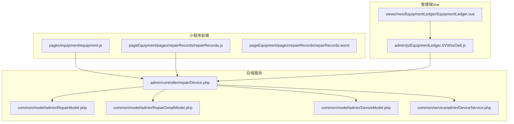
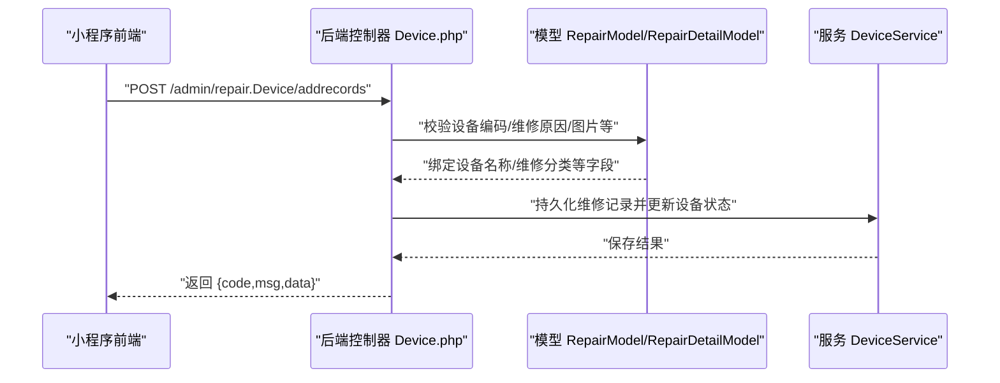
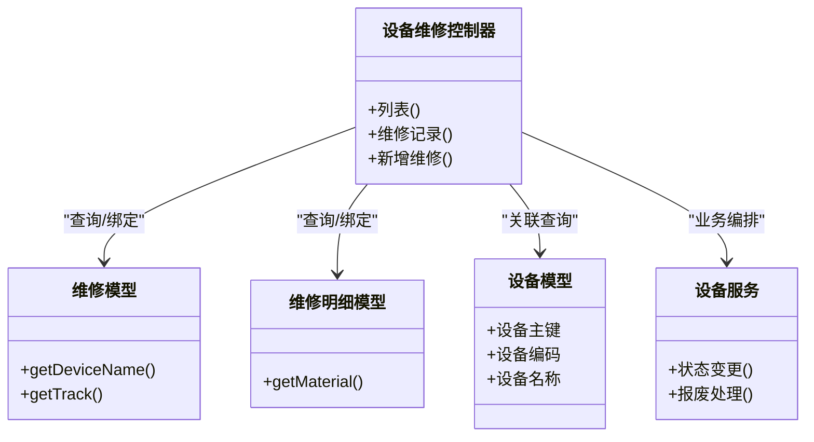

# 设备管理API

<cite>
**本文引用的文件**
- [gccd_mini/pages/equipment/equipment.js](file://gccd_mini/pages/equipment/equipment.js)
- [gccd_mini/pageEquipment/pages/repairRecords/repairRecords.js](file://gccd_mini/pageEquipment/pages/repairRecords/repairRecords.js)
- [gccd_mini/pageEquipment/pages/repairRecords/repairRecords.wxml](file://gccd_mini/pageEquipment/pages/repairRecords/repairRecords.wxml)
- [yarn/src/views/mes/EquipmentLedger/EquipmentLedger.vue](file://yarn/src/views/mes/EquipmentLedger/EquipmentLedger.vue)
- [yarn/admin/js/EquipmentLedger.SVWssOe8.js](file://yarn/admin/js/EquipmentLedger.SVWssOe8.js)
- [gccd_server/app/common/model/admin/RepairModel.php](file://gccd_server/app/common/model/admin/RepairModel.php)
- [gccd_server/app/common/model/admin/RepairDetailModel.php](file://gccd_server/app/common/model/admin/RepairDetailModel.php)
- [gccd_server/app/admin/controller/repair/Device.php](file://gccd_server/app/admin/controller/repair/Device.php)
- [gccd_server/app/common/model/admin/DeviceModel.php](file://gccd_server/app/common/model/admin/DeviceModel.php)
- [gccd_server/app/common/service/admin/DeviceService.php](file://gccd_server/app/common/service/admin/DeviceService.php)
- [gccd_mini/pageMine/pages/wageEfficiency/wageEfficiency.js](file://gccd_mini/pageMine/pages/wageEfficiency/wageEfficiency.js)
</cite>

## 目录
1. [简介](#简介)
2. [项目结构](#项目结构)
3. [核心组件](#核心组件)
4. [架构总览](#架构总览)
5. [详细组件分析](#详细组件分析)
6. [依赖分析](#依赖分析)
7. [性能考虑](#性能考虑)
8. [故障排查指南](#故障排查指南)
9. [结论](#结论)
10. [附录](#附录)

## 简介
本文件面向“高齿传动”项目中的设备管理API，聚焦设备台账、维护记录、维修管理等关键业务场景，系统梳理前后端交互的HTTP方法、URL路径、请求参数与响应格式，并给出设备数据全生命周期管理（录入、状态变更、维护保养、报废处理）的操作建议与最佳实践。同时，说明设备与人员、工单的关联关系接口，提供可复用的调用示例与排障指引。

## 项目结构
设备管理相关能力在前端小程序与管理端Vue应用中均有体现，后端通过ThinkPHP控制器与模型层支撑维修与设备数据的查询与写入。整体交互链路如下：

图表来源
- [gccd_mini/pages/equipment/equipment.js:996-1023](file://gccd_mini/pages/equipment/equipment.js#L996-L1023)
- [gccd_mini/pageEquipment/pages/repairRecords/repairRecords.js:1-53](file://gccd_mini/pageEquipment/pages/repairRecords/repairRecords.js#L1-L53)
- [gccd_mini/pageEquipment/pages/repairRecords/repairRecords.wxml:1-34](file://gccd_mini/pageEquipment/pages/repairRecords/repairRecords.wxml#L1-L34)
- [yarn/src/views/mes/EquipmentLedger/EquipmentLedger.vue:135-195](file://yarn/src/views/mes/EquipmentLedger/EquipmentLedger.vue#L135-L195)
- [yarn/admin/js/EquipmentLedger.SVWssOe8.js:1-1](file://yarn/admin/js/EquipmentLedger.SVWssOe8.js#L1-L1)
- [gccd_server/app/admin/controller/repair/Device.php](file://gccd_server/app/admin/controller/repair/Device.php)
- [gccd_server/app/common/model/admin/RepairModel.php:1-32](file://gccd_server/app/common/model/admin/RepairModel.php#L1-L32)
- [gccd_server/app/common/model/admin/RepairDetailModel.php:1-21](file://gccd_server/app/common/model/admin/RepairDetailModel.php#L1-L21)
- [gccd_server/app/common/model/admin/DeviceModel.php](file://gccd_server/app/common/model/admin/DeviceModel.php)
- [gccd_server/app/common/service/admin/DeviceService.php](file://gccd_server/app/common/service/admin/DeviceService.php)

章节来源
- [gccd_mini/pages/equipment/equipment.js:996-1023](file://gccd_mini/pages/equipment/equipment.js#L996-L1023)
- [gccd_mini/pageEquipment/pages/repairRecords/repairRecords.js:1-53](file://gccd_mini/pageEquipment/pages/repairRecords/repairRecords.js#L1-L53)
- [yarn/src/views/mes/EquipmentLedger/EquipmentLedger.vue:135-195](file://yarn/src/views/mes/EquipmentLedger/EquipmentLedger.vue#L135-L195)
- [yarn/admin/js/EquipmentLedger.SVWssOe8.js:1-1](file://yarn/admin/js/EquipmentLedger.SVWssOe8.js#L1-L1)
- [gccd_server/app/admin/controller/repair/Device.php](file://gccd_server/app/admin/controller/repair/Device.php)

## 核心组件
- 设备维修控制器：提供设备列表、维修记录查询、新增维修记录等接口，位于后端控制器目录。
- 设备与维修模型：封装设备与维修记录的关联查询，便于按设备维度聚合维修明细。
- 前端小程序页面：负责设备列表展示、维修记录分页加载、提交维修记录等交互。
- 管理端Vue页面：提供设备台账列表与筛选、分页等管理功能。
- 后端服务层：封装设备状态变更、报废处理等业务逻辑（如存在），供控制器调用。

章节来源
- [gccd_server/app/admin/controller/repair/Device.php](file://gccd_server/app/admin/controller/repair/Device.php)
- [gccd_server/app/common/model/admin/RepairModel.php:1-32](file://gccd_server/app/common/model/admin/RepairModel.php#L1-L32)
- [gccd_server/app/common/model/admin/RepairDetailModel.php:1-21](file://gccd_server/app/common/model/admin/RepairDetailModel.php#L1-L21)
- [gccd_server/app/common/model/admin/DeviceModel.php](file://gccd_server/app/common/model/admin/DeviceModel.php)
- [gccd_server/app/common/service/admin/DeviceService.php](file://gccd_server/app/common/service/admin/DeviceService.php)
- [gccd_mini/pages/equipment/equipment.js:996-1023](file://gccd_mini/pages/equipment/equipment.js#L996-L1023)
- [gccd_mini/pageEquipment/pages/repairRecords/repairRecords.js:1-53](file://gccd_mini/pageEquipment/pages/repairRecords/repairRecords.js#L1-L53)
- [yarn/src/views/mes/EquipmentLedger/EquipmentLedger.vue:135-195](file://yarn/src/views/mes/EquipmentLedger/EquipmentLedger.vue#L135-L195)

## 架构总览
设备管理API采用前后端分离架构，小程序与管理端通过统一的后端控制器暴露REST风格接口；控制器读取模型层数据并返回标准JSON响应；服务层负责复杂业务编排。

图表来源
- [gccd_mini/pages/equipment/equipment.js:996-1023](file://gccd_mini/pages/equipment/equipment.js#L996-L1023)
- [gccd_server/app/admin/controller/repair/Device.php](file://gccd_server/app/admin/controller/repair/Device.php)
- [gccd_server/app/common/model/admin/RepairModel.php:1-32](file://gccd_server/app/common/model/admin/RepairModel.php#L1-L32)
- [gccd_server/app/common/model/admin/RepairDetailModel.php:1-21](file://gccd_server/app/common/model/admin/RepairDetailModel.php#L1-L21)
- [gccd_server/app/common/service/admin/DeviceService.php](file://gccd_server/app/common/service/admin/DeviceService.php)

## 详细组件分析

### 设备台账接口
- 接口路径
  - 列表查询：POST /admin/repair.Device/list
  - 参数
    - page：当前页码
    - limit：每页条数
    - device_code：设备编码（可选）
    - device_name：设备名称（可选）
  - 响应
    - code：状态码
    - msg：提示信息
    - data：包含列表与总数
- 关联页面
  - 小程序设备页与管理端设备台账页均使用该接口进行分页查询与筛选。

章节来源
- [yarn/admin/js/EquipmentLedger.SVWssOe8.js:1-1](file://yarn/admin/js/EquipmentLedger.SVWssOe8.js#L1-L1)
- [yarn/src/views/mes/EquipmentLedger/EquipmentLedger.vue:135-195](file://yarn/src/views/mes/EquipmentLedger/EquipmentLedger.vue#L135-L195)
- [gccd_mini/pageMine/pages/wageEfficiency/wageEfficiency.js:205-240](file://gccd_mini/pageMine/pages/wageEfficiency/wageEfficiency.js#L205-L240)

### 维修记录接口
- 接口路径
  - 维修记录列表：POST /admin/repair.Device/repairlist
  - 参数
    - device_code：设备编码（必填）
    - page：当前页码
    - limit：每页条数
  - 响应
    - code：状态码
    - msg：提示信息
    - data：包含列表与总数
- 新增维修记录：POST /admin/repair.Device/addrecords
  - 参数
    - device_code：设备编码（必填）
    - repair_code：维修单号（可选）
    - detail：维修描述（可选）
    - user：报修人（可选）
    - repair_list：维修原因集合（可选）
    - img：图片地址数组（可选）
  - 响应
    - code：状态码
    - msg：提示信息
    - data：空或扩展数据
- 关联页面
  - 维修记录列表页与设备详情页联动展示维修历史。

章节来源
- [gccd_mini/pageEquipment/pages/repairRecords/repairRecords.js:1-53](file://gccd_mini/pageEquipment/pages/repairRecords/repairRecords.js#L1-L53)
- [gccd_mini/pageEquipment/pages/repairRecords/repairRecords.wxml:1-34](file://gccd_mini/pageEquipment/pages/repairRecords/repairRecords.wxml#L1-L34)
- [gccd_mini/pages/equipment/equipment.js:996-1023](file://gccd_mini/pages/equipment/equipment.js#L996-L1023)

### 设备与人员、工单的关联关系
- 设备与维修记录关联
  - 通过设备编码(device_code)在维修记录表中进行过滤与聚合，支持按设备维度查看维修历史。
- 设备与物料/工单关联
  - 维修明细模型可关联物料信息，用于记录更换部件等；若存在工单流程，可在维修记录中补充工单编号或状态。
- 前端展示
  - 小程序与管理端页面均以设备为中心组织数据，维修记录作为子集展示。

章节来源
- [gccd_server/app/common/model/admin/RepairModel.php:1-32](file://gccd_server/app/common/model/admin/RepairModel.php#L1-L32)
- [gccd_server/app/common/model/admin/RepairDetailModel.php:1-21](file://gccd_server/app/common/model/admin/RepairDetailModel.php#L1-L21)

### 设备全生命周期管理接口
- 设备录入
  - 通过设备台账接口进行新增与编辑；建议在后端提供独立的新增/编辑接口，参数包含设备编码、名称、规格、所属部门、责任人等。
- 状态变更
  - 在维修新增接口中，结合服务层逻辑更新设备状态（如“运行中/维修中/停用/报废”）。
- 维护保养
  - 可扩展“保养计划”与“保养执行”接口，与设备建立周期性关联。
- 报废处理
  - 提供报废申请与审批流程接口，更新设备状态并归档历史记录。

章节来源
- [gccd_server/app/admin/controller/repair/Device.php](file://gccd_server/app/admin/controller/repair/Device.php)
- [gccd_server/app/common/service/admin/DeviceService.php](file://gccd_server/app/common/service/admin/DeviceService.php)

## 依赖分析
- 前端依赖
  - 小程序端通过工具函数发起请求，管理端通过封装的API模块调用控制器接口。
- 后端依赖
  - 控制器依赖模型层完成字段绑定与关联查询；服务层负责业务规则与事务控制。

图表来源
- [gccd_server/app/admin/controller/repair/Device.php](file://gccd_server/app/admin/controller/repair/Device.php)
- [gccd_server/app/common/model/admin/RepairModel.php:1-32](file://gccd_server/app/common/model/admin/RepairModel.php#L1-L32)
- [gccd_server/app/common/model/admin/RepairDetailModel.php:1-21](file://gccd_server/app/common/model/admin/RepairDetailModel.php#L1-L21)
- [gccd_server/app/common/model/admin/DeviceModel.php](file://gccd_server/app/common/model/admin/DeviceModel.php)
- [gccd_server/app/common/service/admin/DeviceService.php](file://gccd_server/app/common/service/admin/DeviceService.php)

## 性能考虑
- 分页与筛选
  - 列表接口统一使用page/limit参数，建议对设备编码、名称等常用查询字段建立索引。
- 缓存策略
  - 对高频查询（如设备状态统计）引入缓存，降低数据库压力。
- 图片上传
  - 维修记录图片建议压缩与CDN加速，避免阻塞接口响应。
- 并发控制
  - 维修新增时需加锁或采用乐观锁，防止并发导致的状态不一致。

## 故障排查指南
- 常见问题
  - 设备编码为空：维修记录接口要求device_code必填，需在前端校验并提示。
  - 列表无数据：检查筛选条件与权限，确认是否存在匹配记录。
  - 图片上传失败：检查上传配置与网络状态。
- 排查步骤
  - 打印请求参数与响应体，定位是前端参数错误还是后端异常。
  - 查看后端日志与数据库慢查询，优化索引与SQL。
  - 使用管理端接口测试工具验证控制器行为。

章节来源
- [gccd_mini/pageEquipment/pages/repairRecords/repairRecords.js:39-53](file://gccd_mini/pageEquipment/pages/repairRecords/repairRecords.js#L39-L53)
- [gccd_mini/pages/equipment/equipment.js:996-1023](file://gccd_mini/pages/equipment/equipment.js#L996-L1023)

## 结论
本方案基于现有控制器与模型实现了设备台账与维修管理的核心能力，建议后续完善设备全生命周期接口（新增/编辑/报废）、引入保养计划与工单流程，并加强前端参数校验与后端事务控制，以提升系统的稳定性与可维护性。

## 附录

### 接口清单与示例

- 设备台账列表
  - 方法：POST
  - 路径：/admin/repair.Device/list
  - 请求参数：page, limit, device_code(可选), device_name(可选)
  - 响应：code, msg, data(list,count)
- 维修记录列表
  - 方法：POST
  - 路径：/admin/repair.Device/repairlist
  - 请求参数：device_code(必填), page, limit
  - 响应：code, msg, data(list,count)
- 新增维修记录
  - 方法：POST
  - 路径：/admin/repair.Device/addrecords
  - 请求参数：device_code(必填), repair_code(可选), detail(可选), user(可选), repair_list(可选), img(可选)
  - 响应：code, msg, data

章节来源
- [gccd_mini/pageEquipment/pages/repairRecords/repairRecords.js:1-53](file://gccd_mini/pageEquipment/pages/repairRecords/repairRecords.js#L1-L53)
- [gccd_mini/pages/equipment/equipment.js:996-1023](file://gccd_mini/pages/equipment/equipment.js#L996-L1023)
- [yarn/admin/js/EquipmentLedger.SVWssOe8.js:1-1](file://yarn/admin/js/EquipmentLedger.SVWssOe8.js#L1-L1)