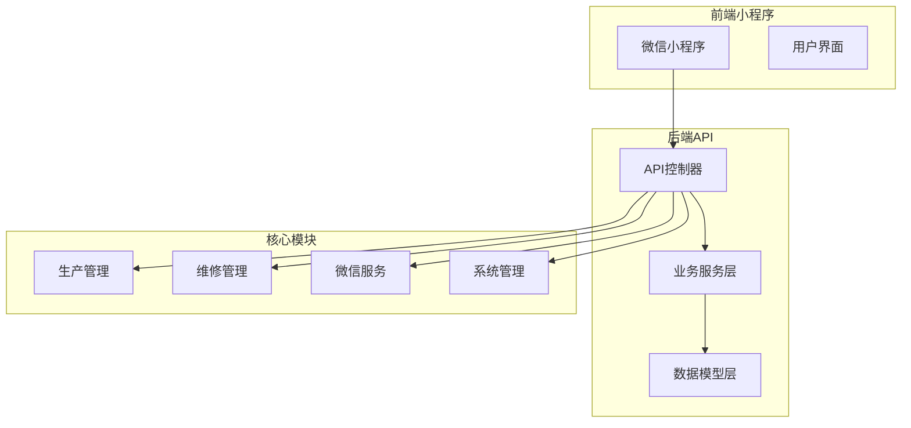
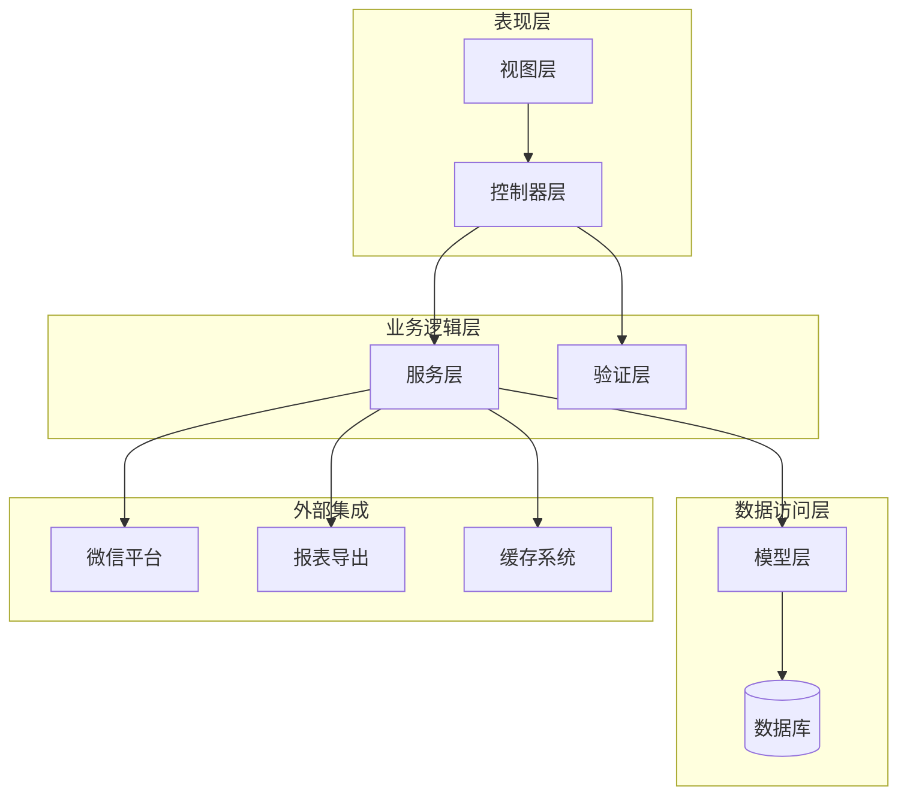
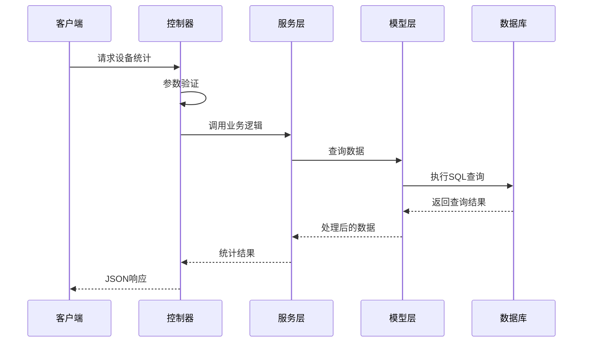
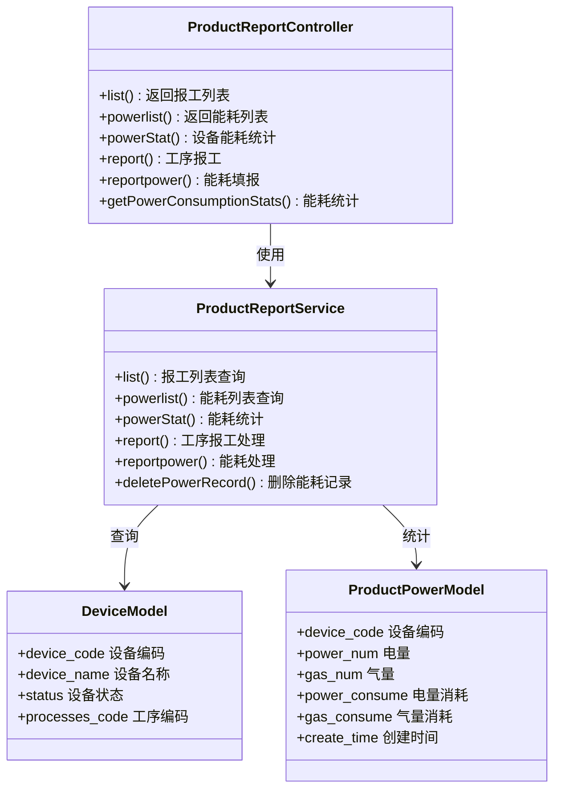
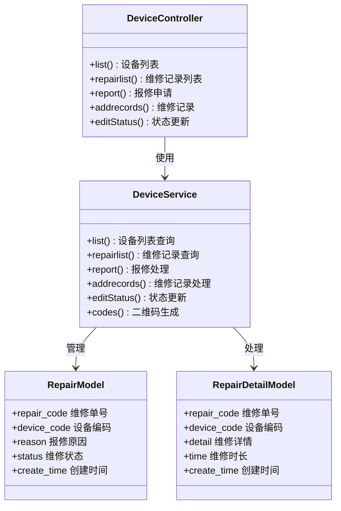
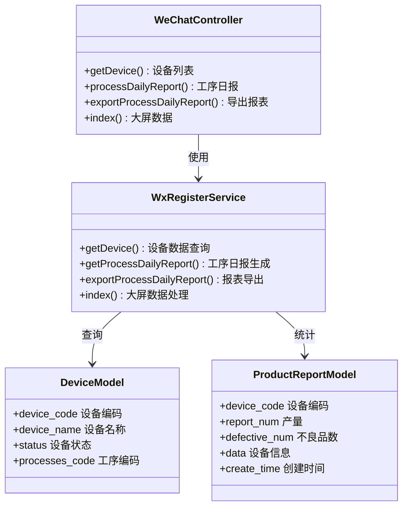
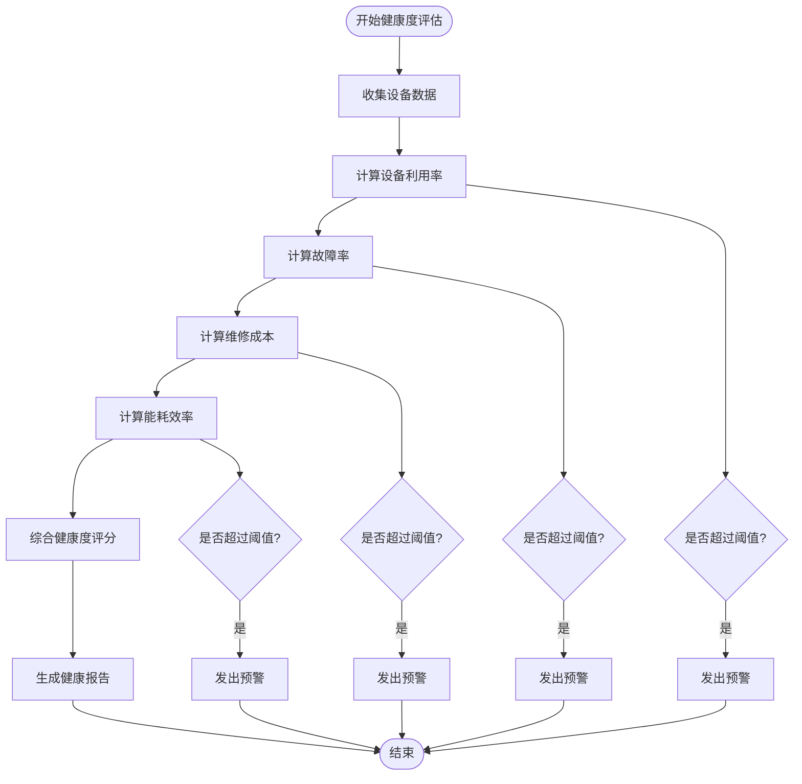
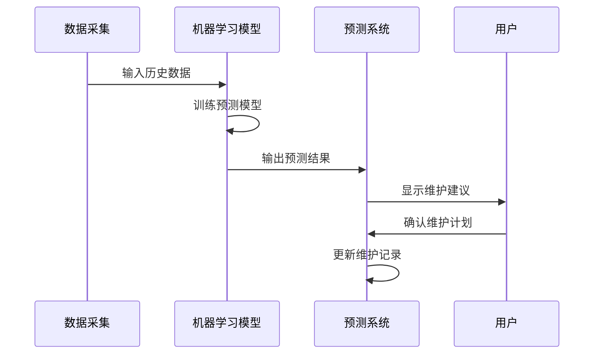
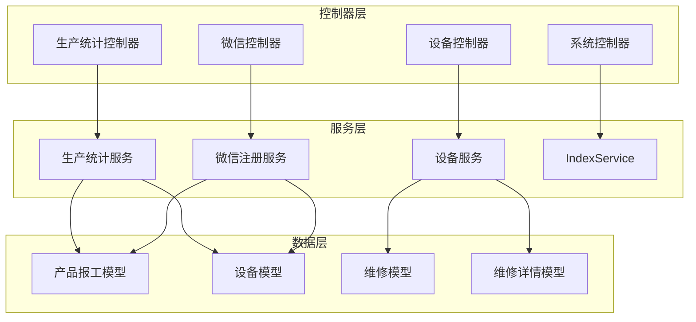

# 设备统计分析API

<cite>
**本文档引用的文件**
- [ProductReport.php](file://gccd_server/app/admin/controller/production/ProductReport.php)
- [Device.php](file://gccd_server/app/admin/controller/repair/Device.php)
- [Index.php](file://gccd_server/app/admin/controller/system/Index.php)
- [WeChat.php](file://gccd_server/app/admin/controller/wechat/WeChat.php)
- [ProductReportService.php](file://gccd_server/app/common/service/admin/ProductReportService.php)
- [DeviceService.php](file://gccd_server/app/common/service/admin/DeviceService.php)
- [IndexService.php](file://gccd_server/app/common/service/system/IndexService.php)
- [WxRegisterService.php](file://gccd_server/app/common/service/wechat/WxRegisterService.php)
</cite>

## 目录
1. [简介](#简介)
2. [项目结构](#项目结构)
3. [核心组件](#核心组件)
4. [架构概览](#架构概览)
5. [详细组件分析](#详细组件分析)
6. [依赖关系分析](#依赖关系分析)
7. [性能考虑](#性能考虑)
8. [故障排除指南](#故障排除指南)
9. [结论](#结论)

## 简介

高齿传动项目设备统计分析API是一套完整的设备管理与分析系统，专注于齿轮传动制造行业的设备统计分析需求。该系统提供了全面的设备数据分析功能，包括设备利用率、故障率、维修成本、折旧费用等关键指标的计算接口。

系统采用前后端分离架构，基于ThinkPHP8框架开发，支持多维度的数据统计分析，包括设备运行时长统计、停机时间分析、维修频次统计等功能。同时提供设备健康度评估、预测性维护建议等高级分析接口，以及设备区域分布、部门使用情况、设备类型对比等维度的数据查询接口。

## 项目结构

项目采用模块化的目录结构，主要分为以下几个核心部分：

**图表来源**
- [ProductReport.php:24-29](file://gccd_server/app/admin/controller/production/ProductReport.php#L24-L29)
- [Device.php:28-33](file://gccd_server/app/admin/controller/repair/Device.php#L28-L33)
- [WeChat.php:23-28](file://gccd_server/app/admin/controller/wechat/WeChat.php#L23-L28)

**章节来源**
- [ProductReport.php:1-416](file://gccd_server/app/admin/controller/production/ProductReport.php#L1-L416)
- [Device.php:1-281](file://gccd_server/app/admin/controller/repair/Device.php#L1-L281)
- [WeChat.php:1-264](file://gccd_server/app/admin/controller/wechat/WeChat.php#L1-L264)

## 核心组件

### 设备统计分析核心组件

系统的核心组件包括设备统计分析控制器、业务服务层和数据模型层，形成了完整的设备数据分析体系。

#### 主要控制器组件

1. **生产统计控制器** - 负责设备能耗统计、报工记录分析
2. **设备维修控制器** - 管理设备维修记录、故障分析
3. **微信服务控制器** - 提供设备状态展示、报表导出功能
4. **系统统计控制器** - 提供基础统计数据接口

#### 业务服务层组件

1. **生产统计服务** - 处理能耗统计、设备利用率计算
2. **设备服务** - 管理设备状态、维修流程
3. **微信注册服务** - 处理设备数据展示、报表生成
4. **系统服务** - 提供基础统计功能

**章节来源**
- [ProductReportService.php:1-800](file://gccd_server/app/common/service/admin/ProductReportService.php#L1-L800)
- [DeviceService.php:1-540](file://gccd_server/app/common/service/admin/DeviceService.php#L1-L540)
- [WxRegisterService.php:1-800](file://gccd_server/app/common/service/wechat/WxRegisterService.php#L1-L800)

## 架构概览

系统采用分层架构设计，实现了清晰的职责分离和良好的可扩展性。

**图表来源**
- [ProductReport.php:12-22](file://gccd_server/app/admin/controller/production/ProductReport.php#L12-L22)
- [Device.php:12-26](file://gccd_server/app/admin/controller/repair/Device.php#L12-L26)
- [WeChat.php:12-21](file://gccd_server/app/admin/controller/wechat/WeChat.php#L12-L21)

### 数据流架构

系统的数据流遵循标准的MVC模式，实现了数据的高效处理和传输。

**图表来源**
- [ProductReportService.php:93-188](file://gccd_server/app/common/service/admin/ProductReportService.php#L93-L188)
- [DeviceService.php:80-96](file://gccd_server/app/common/service/admin/DeviceService.php#L80-L96)

## 详细组件分析

### 设备统计分析API组件

#### 生产统计分析组件

该组件负责设备能耗统计、报工数据分析和生产效率评估。

**图表来源**
- [ProductReport.php:29-416](file://gccd_server/app/admin/controller/production/ProductReport.php#L29-L416)
- [ProductReportService.php:41-800](file://gccd_server/app/common/service/admin/ProductReportService.php#L41-L800)

##### 关键统计指标计算

系统提供多种关键设备统计指标的计算接口：

1. **设备利用率计算**
   - 运行时间占比 = 运行时间 / 总时间 × 100%
   - 设备可用率 = 正常运行时间 / 总时间 × 100%

2. **故障率统计**
   - 故障频率 = 故障次数 / 设备运行时间
   - 平均故障间隔 = 总运行时间 / 故障次数

3. **维修成本分析**
   - 单次维修成本 = 维修费用 / 维修次数
   - 年度维修成本 = 日均维修成本 × 365

4. **能耗统计**
   - 日能耗 = 当日总能耗
   - 月能耗 = 月累计能耗
   - 能效比 = 产出量 / 能耗

**章节来源**
- [ProductReportService.php:485-516](file://gccd_server/app/common/service/admin/ProductReportService.php#L485-L516)
- [ProductReport.php:319-412](file://gccd_server/app/admin/controller/production/ProductReport.php#L319-L412)

#### 设备维修管理组件

该组件负责设备维修记录管理、故障分析和维修效率统计。

**图表来源**
- [Device.php:47-281](file://gccd_server/app/admin/controller/repair/Device.php#L47-L281)
- [DeviceService.php:40-540](file://gccd_server/app/common/service/admin/DeviceService.php#L40-L540)

##### 维修数据分析功能

系统提供全面的维修数据分析功能：

1. **维修频次统计**
   - 设备维修次数 = 指定周期内维修记录数
   - 维修密度 = 维修次数 / 设备数量

2. **维修时长分析**
   - 平均维修时长 = 总维修时长 / 维修次数
   - 维修效率 = 修复时间 / 预计修复时间

3. **维修成本统计**
   - 维修成本构成分析
   - 维修供应商成本对比
   - 维修材料成本统计

**章节来源**
- [DeviceService.php:389-457](file://gccd_server/app/common/service/admin/DeviceService.php#L389-L457)
- [Device.php:161-240](file://gccd_server/app/admin/controller/repair/Device.php#L161-L240)

#### 微信服务统计组件

该组件提供设备状态展示、报表导出和大屏数据展示功能。

**图表来源**
- [WeChat.php:187-264](file://gccd_server/app/admin/controller/wechat/WeChat.php#L187-L264)
- [WxRegisterService.php:31-800](file://gccd_server/app/common/service/wechat/WxRegisterService.php#L31-L800)

##### 报表导出功能

系统支持多种格式的报表导出：

1. **Excel报表导出**
   - 工序每日生产报表
   - 设备能耗统计报表
   - 维修记录报表

2. **数据格式支持**
   - CSV格式
   - Excel格式
   - PDF格式

**章节来源**
- [WeChat.php:248-261](file://gccd_server/app/admin/controller/wechat/WeChat.php#L248-L261)
- [WxRegisterService.php:702-800](file://gccd_server/app/common/service/wechat/WxRegisterService.php#L702-L800)

### 高级分析功能

#### 设备健康度评估

系统提供设备健康度评估功能，通过多维度指标分析设备状态。

**图表来源**
- [WxRegisterService.php:248-350](file://gccd_server/app/common/service/wechat/WxRegisterService.php#L248-L350)

#### 预测性维护建议

系统基于历史数据和机器学习算法提供预测性维护建议。

**图表来源**
- [ProductReportService.php:518-642](file://gccd_server/app/common/service/admin/ProductReportService.php#L518-L642)

## 依赖关系分析

系统采用模块化设计，各组件之间具有清晰的依赖关系。

**图表来源**
- [ProductReport.php:12-22](file://gccd_server/app/admin/controller/production/ProductReport.php#L12-L22)
- [Device.php:12-26](file://gccd_server/app/admin/controller/repair/Device.php#L12-L26)
- [WeChat.php:12-21](file://gccd_server/app/admin/controller/wechat/WeChat.php#L12-L21)

### 组件耦合度分析

系统实现了低耦合的设计原则：

1. **控制器与服务层解耦**
   - 控制器只负责请求处理和响应
   - 业务逻辑集中在服务层

2. **服务层内部模块化**
   - 各服务模块独立封装
   - 通过接口进行通信

3. **数据访问层抽象**
   - 模型层提供统一的数据访问接口
   - 支持多种数据库后端

**章节来源**
- [ProductReportService.php:1-42](file://gccd_server/app/common/service/admin/ProductReportService.php#L1-L42)
- [DeviceService.php:1-41](file://gccd_server/app/common/service/admin/DeviceService.php#L1-L41)

## 性能考虑

系统在设计时充分考虑了性能优化，采用了多种性能提升策略。

### 缓存策略

系统采用多层缓存机制：

1. **Redis缓存**
   - 统计结果缓存
   - 用户权限缓存
   - 配置信息缓存

2. **数据库查询优化**
   - 索引优化
   - 查询语句优化
   - 连接池管理

### 异步处理

对于耗时操作，系统采用异步处理机制：

1. **报表生成异步化**
   - 大数据量报表导出
   - 图表生成任务队列

2. **数据同步异步化**
   - 设备状态同步
   - 数据备份任务

## 故障排除指南

### 常见问题诊断

#### 设备统计异常

**问题现象**: 设备利用率计算结果异常

**可能原因**:
1. 设备状态数据不准确
2. 时间范围选择错误
3. 数据清洗规则异常

**解决方案**:
1. 检查设备状态字段值
2. 验证时间范围参数
3. 审核数据清洗逻辑

#### 维修记录丢失

**问题现象**: 维修记录无法查询

**可能原因**:
1. 数据库连接异常
2. 权限配置错误
3. 查询条件过于严格

**解决方案**:
1. 检查数据库连接状态
2. 验证用户权限设置
3. 调整查询条件范围

#### 报表导出失败

**问题现象**: 报表导出过程中出现错误

**可能原因**:
1. 内存不足
2. 文件权限问题
3. 第三方库依赖缺失

**解决方案**:
1. 增加服务器内存
2. 检查文件写入权限
3. 安装缺失的依赖库

**章节来源**
- [ProductReportService.php:299-347](file://gccd_server/app/common/service/admin/ProductReportService.php#L299-L347)
- [DeviceService.php:524-537](file://gccd_server/app/common/service/admin/DeviceService.php#L524-L537)

## 结论

高齿传动项目设备统计分析API系统提供了完整的设备管理与分析解决方案。通过模块化的架构设计和丰富的统计分析功能，系统能够满足齿轮传动制造行业对设备管理的复杂需求。

系统的主要优势包括：

1. **功能完整性**: 覆盖设备管理的各个方面，从基础统计到高级分析
2. **扩展性强**: 模块化设计便于功能扩展和维护
3. **性能优化**: 采用多种性能优化策略确保系统稳定运行
4. **用户体验**: 提供直观的数据展示和报表导出功能

未来可以进一步增强的功能包括：
- 集成更多类型的设备传感器数据
- 增强预测性维护算法的准确性
- 扩展移动端功能支持
- 增加更多维度的数据分析能力