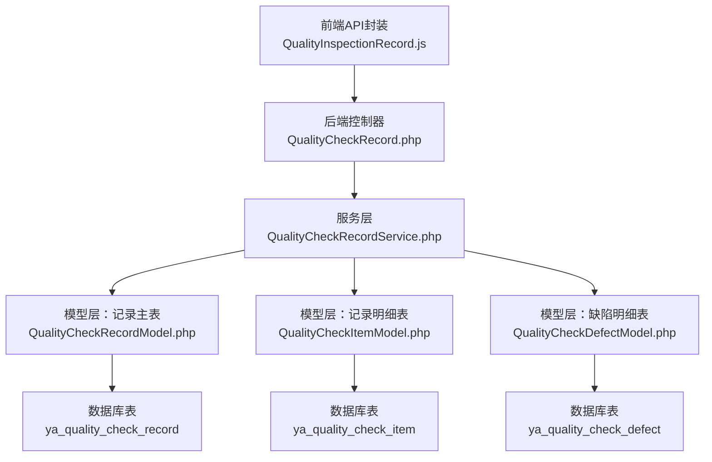
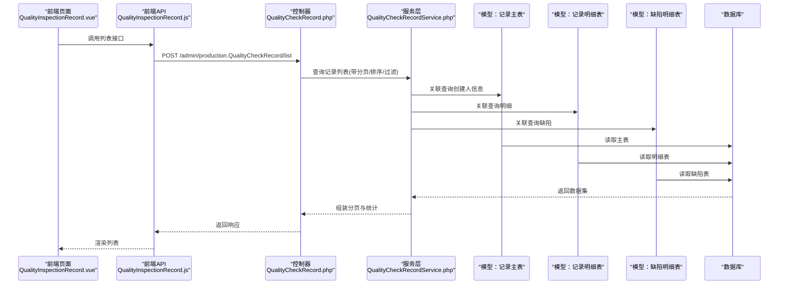
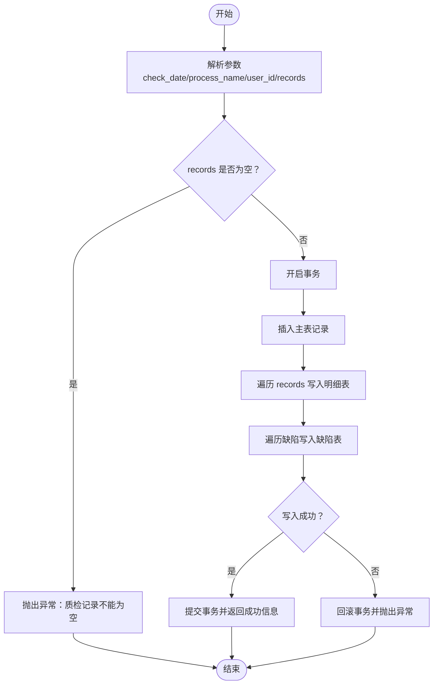
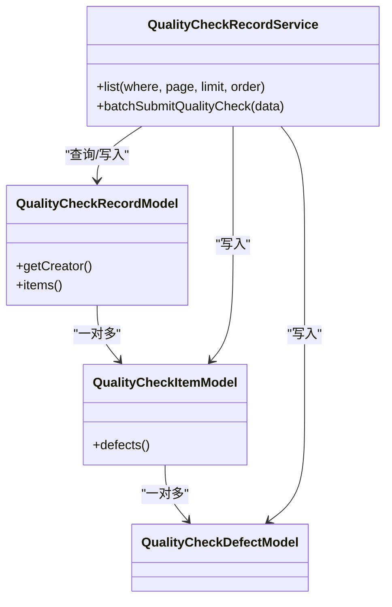
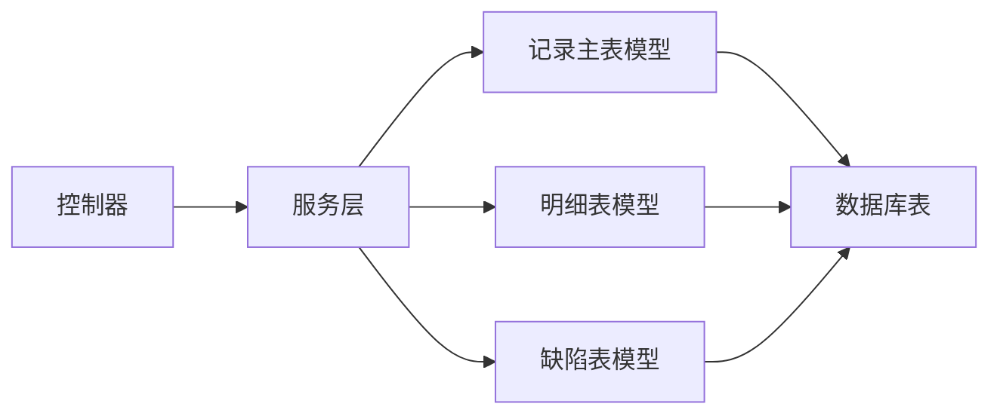

# 质检记录管理API

<cite>
**本文引用的文件**
- [gccd_server/app/admin/controller/production/QualityCheckRecord.php](file://gccd_server/app/admin/controller/production/QualityCheckRecord.php)
- [gccd_server/app/common/service/admin/QualityCheckRecordService.php](file://gccd_server/app/common/service/admin/QualityCheckRecordService.php)
- [gccd_server/app/common/model/admin/QualityCheckRecordModel.php](file://gccd_server/app/common/model/admin/QualityCheckRecordModel.php)
- [gccd_server/app/common/model/admin/QualityCheckItemModel.php](file://gccd_server/app/common/model/admin/QualityCheckItemModel.php)
- [gccd_server/app/common/model/admin/QualityCheckDefectModel.php](file://gccd_server/app/common/model/admin/QualityCheckDefectModel.php)
- [gccd_server/database_fix.sql](file://gccd_server/database_fix.sql)
- [yarn/src/api/mes/QualityInspectionRecord/QualityInspectionRecord.js](file://yarn/src/api/mes/QualityInspectionRecord/QualityInspectionRecord.js)
- [yarn/src/views/mes/QualityInspectionRecord/QualityInspectionRecord.vue](file://yarn/src/views/mes/QualityInspectionRecord/QualityInspectionRecord.vue)
</cite>

## 目录
1. [简介](#简介)
2. [项目结构](#项目结构)
3. [核心组件](#核心组件)
4. [架构总览](#架构总览)
5. [详细组件分析](#详细组件分析)
6. [依赖关系分析](#依赖关系分析)
7. [性能考虑](#性能考虑)
8. [故障排查指南](#故障排查指南)
9. [结论](#结论)
10. [附录](#附录)

## 简介
本文件面向“高齿传动”项目的质检记录管理API，系统性说明质检记录的创建、查询、修改、删除等接口能力，并重点覆盖以下方面：
- 质检记录的查询接口（GET/POST），支持按工序名称、质检日期范围筛选
- 质检记录的批量提交接口（POST），用于小程序或API批量提报
- 质检记录与生产工单的关联关系说明（当前实现以“工序名称”作为关联线索）
- 质检记录的批量导入导出、状态流转、异常处理等扩展能力建议与使用示例

本API采用前后端分离架构：前端通过统一请求封装调用后端控制器，控制器委托服务层完成业务逻辑，服务层通过模型层访问数据库。

## 项目结构
围绕质检记录管理的关键文件组织如下：
- 前端
  - API封装：yarn/src/api/mes/QualityInspectionRecord/QualityInspectionRecord.js
  - 页面视图：yarn/src/views/mes/QualityInspectionRecord/QualityInspectionRecord.vue
- 后端
  - 控制器：gccd_server/app/admin/controller/production/QualityCheckRecord.php
  - 服务层：gccd_server/app/common/service/admin/QualityCheckRecordService.php
  - 模型层：QualityCheckRecordModel.php、QualityCheckItemModel.php、QualityCheckDefectModel.php
  - 数据库脚本：gccd_server/database_fix.sql

图表来源
- [yarn/src/api/mes/QualityInspectionRecord/QualityInspectionRecord.js:1-64](file://yarn/src/api/mes/QualityInspectionRecord/QualityInspectionRecord.js#L1-L64)
- [gccd_server/app/admin/controller/production/QualityCheckRecord.php:1-46](file://gccd_server/app/admin/controller/production/QualityCheckRecord.php#L1-L46)
- [gccd_server/app/common/service/admin/QualityCheckRecordService.php:1-124](file://gccd_server/app/common/service/admin/QualityCheckRecordService.php#L1-L124)
- [gccd_server/app/common/model/admin/QualityCheckRecordModel.php:1-21](file://gccd_server/app/common/model/admin/QualityCheckRecordModel.php#L1-L21)
- [gccd_server/app/common/model/admin/QualityCheckItemModel.php:1-16](file://gccd_server/app/common/model/admin/QualityCheckItemModel.php#L1-L16)
- [gccd_server/app/common/model/admin/QualityCheckDefectModel.php:1-11](file://gccd_server/app/common/model/admin/QualityCheckDefectModel.php#L1-L11)
- [gccd_server/database_fix.sql:1-35](file://gccd_server/database_fix.sql#L1-L35)

章节来源
- [yarn/src/api/mes/QualityInspectionRecord/QualityInspectionRecord.js:1-64](file://yarn/src/api/mes/QualityInspectionRecord/QualityInspectionRecord.js#L1-L64)
- [gccd_server/app/admin/controller/production/QualityCheckRecord.php:1-46](file://gccd_server/app/admin/controller/production/QualityCheckRecord.php#L1-L46)
- [gccd_server/app/common/service/admin/QualityCheckRecordService.php:1-124](file://gccd_server/app/common/service/admin/QualityCheckRecordService.php#L1-L124)
- [gccd_server/app/common/model/admin/QualityCheckRecordModel.php:1-21](file://gccd_server/app/common/model/admin/QualityCheckRecordModel.php#L1-L21)
- [gccd_server/app/common/model/admin/QualityCheckItemModel.php:1-16](file://gccd_server/app/common/model/admin/QualityCheckItemModel.php#L1-L16)
- [gccd_server/app/common/model/admin/QualityCheckDefectModel.php:1-11](file://gccd_server/app/common/model/admin/QualityCheckDefectModel.php#L1-L11)
- [gccd_server/database_fix.sql:1-35](file://gccd_server/database_fix.sql#L1-L35)

## 核心组件
- 前端API封装模块：提供列表、详情、新增、编辑、删除等方法，统一前缀为“/admin/production.QualityCheckRecord/”
- 后端控制器：暴露“质检列表”和“小程序批量提交”两个接口
- 服务层：负责查询、分页、聚合统计、事务批量写入
- 模型层：定义主表、明细表、缺陷表的关联关系
- 数据库：三张核心表（记录主表、明细表、缺陷表）

章节来源
- [yarn/src/api/mes/QualityInspectionRecord/QualityInspectionRecord.js:1-64](file://yarn/src/api/mes/QualityInspectionRecord/QualityInspectionRecord.js#L1-L64)
- [gccd_server/app/admin/controller/production/QualityCheckRecord.php:1-46](file://gccd_server/app/admin/controller/production/QualityCheckRecord.php#L1-L46)
- [gccd_server/app/common/service/admin/QualityCheckRecordService.php:1-124](file://gccd_server/app/common/service/admin/QualityCheckRecordService.php#L1-L124)
- [gccd_server/app/common/model/admin/QualityCheckRecordModel.php:1-21](file://gccd_server/app/common/model/admin/QualityCheckRecordModel.php#L1-L21)
- [gccd_server/app/common/model/admin/QualityCheckItemModel.php:1-16](file://gccd_server/app/common/model/admin/QualityCheckItemModel.php#L1-L16)
- [gccd_server/app/common/model/admin/QualityCheckDefectModel.php:1-11](file://gccd_server/app/common/model/admin/QualityCheckDefectModel.php#L1-L11)
- [gccd_server/database_fix.sql:1-35](file://gccd_server/database_fix.sql#L1-L35)

## 架构总览
下图展示从前端到数据库的整体调用链路与数据流向：

图表来源
- [yarn/src/views/mes/QualityInspectionRecord/QualityInspectionRecord.vue:162-225](file://yarn/src/views/mes/QualityInspectionRecord/QualityInspectionRecord.vue#L162-L225)
- [yarn/src/api/mes/QualityInspectionRecord/QualityInspectionRecord.js:1-64](file://yarn/src/api/mes/QualityInspectionRecord/QualityInspectionRecord.js#L1-L64)
- [gccd_server/app/admin/controller/production/QualityCheckRecord.php:17-34](file://gccd_server/app/admin/controller/production/QualityCheckRecord.php#L17-L34)
- [gccd_server/app/common/service/admin/QualityCheckRecordService.php:20-56](file://gccd_server/app/common/service/admin/QualityCheckRecordService.php#L20-L56)
- [gccd_server/app/common/model/admin/QualityCheckRecordModel.php:11-19](file://gccd_server/app/common/model/admin/QualityCheckRecordModel.php#L11-L19)
- [gccd_server/app/common/model/admin/QualityCheckItemModel.php:11-14](file://gccd_server/app/common/model/admin/QualityCheckItemModel.php#L11-L14)
- [gccd_server/app/common/model/admin/QualityCheckDefectModel.php:1-11](file://gccd_server/app/common/model/admin/QualityCheckDefectModel.php#L1-L11)

## 详细组件分析

### 接口定义与使用说明
- 列表查询
  - 方法：POST
  - 路径：/admin/production.QualityCheckRecord/list
  - 功能：返回质检记录列表，包含分页、排序、按工序名称模糊匹配、按质检日期范围过滤
  - 响应：包含 count、pages、page、limit、list 等字段；list 中包含 items 和 total_defects_count 的聚合统计
- 小程序批量提交
  - 方法：POST
  - 路径：/admin/production.QualityCheckRecord/submitQualityCheck
  - 功能：接收批量质检数据，事务写入主表、明细表、缺陷表
  - 输入：包含 check_date、process_name、user_id、records（明细数组）
  - 输出：成功提示与入库明细条数

章节来源
- [gccd_server/app/admin/controller/production/QualityCheckRecord.php:17-44](file://gccd_server/app/admin/controller/production/QualityCheckRecord.php#L17-L44)
- [gccd_server/app/common/service/admin/QualityCheckRecordService.php:61-122](file://gccd_server/app/common/service/admin/QualityCheckRecordService.php#L61-L122)
- [yarn/src/api/mes/QualityInspectionRecord/QualityInspectionRecord.js:9-15](file://yarn/src/api/mes/QualityInspectionRecord/QualityInspectionRecord.js#L9-L15)
- [yarn/src/api/mes/QualityInspectionRecord/QualityInspectionRecord.js:41-51](file://yarn/src/api/mes/QualityInspectionRecord/QualityInspectionRecord.js#L41-L51)

### 数据模型与字段说明
- 记录主表（ya_quality_check_record）
  - 字段：id、check_date、process_name、user_id、create_time、update_time、is_delete
  - 说明：记录一次质检提报的基本信息；关联创建人信息由模型绑定
- 明细表（ya_quality_check_item）
  - 字段：id、record_id、y_material_name、y_material_spec、c_material_spec、c_material_model
  - 说明：每条记录下的物料明细，包含原料与成品相关信息
- 缺陷表（ya_quality_check_defect）
  - 字段：id、item_id、defect_type、defect_text、day_qty、night_qty
  - 说明：每个物料明细下的缺陷类型与数量（白班/夜班）

章节来源
- [gccd_server/database_fix.sql:2-35](file://gccd_server/database_fix.sql#L2-L35)
- [gccd_server/app/common/model/admin/QualityCheckRecordModel.php:11-19](file://gccd_server/app/common/model/admin/QualityCheckRecordModel.php#L11-L19)
- [gccd_server/app/common/model/admin/QualityCheckItemModel.php:11-14](file://gccd_server/app/common/model/admin/QualityCheckItemModel.php#L11-L14)
- [gccd_server/app/common/model/admin/QualityCheckDefectModel.php:1-11](file://gccd_server/app/common/model/admin/QualityCheckDefectModel.php#L1-L11)

### 前端交互与页面渲染
- 前端通过 API 封装调用列表接口，支持按工序名称与质检日期范围筛选
- 页面渲染包含：
  - 表格：显示质检日期、工序、摘要（物料种类、不良品总数）、提交时间
  - 详情抽屉：展示物料明细与缺陷分布（白班/夜班数量）
  - 分页控件：支持切换页码与每页数量

章节来源
- [yarn/src/views/mes/QualityInspectionRecord/QualityInspectionRecord.vue:1-440](file://yarn/src/views/mes/QualityInspectionRecord/QualityInspectionRecord.vue#L1-L440)
- [yarn/src/api/mes/QualityInspectionRecord/QualityInspectionRecord.js:9-15](file://yarn/src/api/mes/QualityInspectionRecord/QualityInspectionRecord.js#L9-L15)

### 批量提交流程（事务与校验）

图表来源
- [gccd_server/app/common/service/admin/QualityCheckRecordService.php:61-122](file://gccd_server/app/common/service/admin/QualityCheckRecordService.php#L61-L122)

章节来源
- [gccd_server/app/common/service/admin/QualityCheckRecordService.php:61-122](file://gccd_server/app/common/service/admin/QualityCheckRecordService.php#L61-L122)

### 类关系与依赖

图表来源
- [gccd_server/app/common/model/admin/QualityCheckRecordModel.php:11-19](file://gccd_server/app/common/model/admin/QualityCheckRecordModel.php#L11-L19)
- [gccd_server/app/common/model/admin/QualityCheckItemModel.php:11-14](file://gccd_server/app/common/model/admin/QualityCheckItemModel.php#L11-L14)
- [gccd_server/app/common/model/admin/QualityCheckDefectModel.php:1-11](file://gccd_server/app/common/model/admin/QualityCheckDefectModel.php#L1-L11)
- [gccd_server/app/common/service/admin/QualityCheckRecordService.php:20-56](file://gccd_server/app/common/service/admin/QualityCheckRecordService.php#L20-L56)

## 依赖关系分析
- 控制器依赖服务层进行业务处理
- 服务层依赖模型层进行数据访问与关联查询
- 模型层依赖数据库表结构，形成主表-明细表-缺陷表的三层关联
- 前端通过统一API封装调用控制器接口

图表来源
- [gccd_server/app/admin/controller/production/QualityCheckRecord.php:1-46](file://gccd_server/app/admin/controller/production/QualityCheckRecord.php#L1-L46)
- [gccd_server/app/common/service/admin/QualityCheckRecordService.php:1-124](file://gccd_server/app/common/service/admin/QualityCheckRecordService.php#L1-L124)
- [gccd_server/app/common/model/admin/QualityCheckRecordModel.php:1-21](file://gccd_server/app/common/model/admin/QualityCheckRecordModel.php#L1-L21)
- [gccd_server/app/common/model/admin/QualityCheckItemModel.php:1-16](file://gccd_server/app/common/model/admin/QualityCheckItemModel.php#L1-L16)
- [gccd_server/app/common/model/admin/QualityCheckDefectModel.php:1-11](file://gccd_server/app/common/model/admin/QualityCheckDefectModel.php#L1-L11)

章节来源
- [gccd_server/app/admin/controller/production/QualityCheckRecord.php:1-46](file://gccd_server/app/admin/controller/production/QualityCheckRecord.php#L1-L46)
- [gccd_server/app/common/service/admin/QualityCheckRecordService.php:1-124](file://gccd_server/app/common/service/admin/QualityCheckRecordService.php#L1-L124)
- [gccd_server/app/common/model/admin/QualityCheckRecordModel.php:1-21](file://gccd_server/app/common/model/admin/QualityCheckRecordModel.php#L1-L21)
- [gccd_server/app/common/model/admin/QualityCheckItemModel.php:1-16](file://gccd_server/app/common/model/admin/QualityCheckItemModel.php#L1-L16)
- [gccd_server/app/common/model/admin/QualityCheckDefectModel.php:1-11](file://gccd_server/app/common/model/admin/QualityCheckDefectModel.php#L1-L11)

## 性能考虑
- 分页与排序：服务层默认按质检日期与创建时间降序，避免全表扫描
- 关联查询：使用 with 预加载关联数据，减少 N+1 查询
- 统计聚合：在内存中对缺陷数量进行聚合，保证前端展示稳定
- 事务批处理：批量提交使用事务，确保一致性与原子性

章节来源
- [gccd_server/app/common/service/admin/QualityCheckRecordService.php:20-56](file://gccd_server/app/common/service/admin/QualityCheckRecordService.php#L20-L56)
- [gccd_server/app/common/service/admin/QualityCheckRecordService.php:61-122](file://gccd_server/app/common/service/admin/QualityCheckRecordService.php#L61-L122)

## 故障排查指南
- 提交失败
  - 现象：批量提交接口返回异常信息
  - 可能原因：records 参数缺失、数据库写入异常
  - 处理建议：检查前端传参是否包含 records 数组；查看服务层异常捕获日志
- 查询无数据
  - 现象：列表接口返回空数据
  - 可能原因：筛选条件过于严格（日期范围/工序名称）
  - 处理建议：清空筛选条件或放宽日期范围重试
- 前端渲染异常
  - 现象：详情抽屉无法打开或数据不完整
  - 可能原因：接口返回字段缺失或格式不符
  - 处理建议：确认服务层返回的 items 与 defects 结构一致

章节来源
- [gccd_server/app/common/service/admin/QualityCheckRecordService.php:118-121](file://gccd_server/app/common/service/admin/QualityCheckRecordService.php#L118-L121)
- [yarn/src/views/mes/QualityInspectionRecord/QualityInspectionRecord.vue:212-223](file://yarn/src/views/mes/QualityInspectionRecord/QualityInspectionRecord.vue#L212-L223)

## 结论
本API围绕“质检记录”的查询与批量提交提供了完整的前后端实现，具备良好的可扩展性与可维护性。当前实现以“工序名称”作为与生产工单的关联线索，后续可根据业务需求扩展为更明确的工单号关联字段与状态流转机制。

## 附录

### 接口清单与字段说明
- 列表查询
  - 方法：POST /admin/production.QualityCheckRecord/list
  - 请求参数：process_name（工序名称，模糊匹配）、check_start_date（开始日期）、check_end_date（结束日期）、page、limit、order
  - 响应字段：count、pages、page、limit、list（包含 items、total_defects_count）
- 小程序批量提交
  - 方法：POST /admin/production.QualityCheckRecord/submitQualityCheck
  - 请求参数：check_date（质检日期，默认当天）、process_name（工序名称）、user_id（提交人ID）、records（明细数组）
  - records 子项字段：y_material_name、y_material_spec、c_material_spec、c_material_model、defective_items（缺陷数组，包含 type、typeText、day_qty、night_qty）

章节来源
- [gccd_server/app/admin/controller/production/QualityCheckRecord.php:17-44](file://gccd_server/app/admin/controller/production/QualityCheckRecord.php#L17-L44)
- [gccd_server/app/common/service/admin/QualityCheckRecordService.php:61-122](file://gccd_server/app/common/service/admin/QualityCheckRecordService.php#L61-L122)
- [gccd_server/database_fix.sql:2-35](file://gccd_server/database_fix.sql#L2-L35)

### 质检记录与生产工单的关联关系
- 当前实现
  - 通过“工序名称”字段关联生产工单，便于按工序维度进行质检汇总
- 建议扩展
  - 新增“工单号”字段，建立与生产工单的直接关联
  - 新增“状态”字段，支持“待提交/已提交/已审核/已驳回/已计划/已发货”等状态流转
  - 新增“产品编号”字段，细化到具体产品的质检记录

章节来源
- [gccd_server/app/admin/controller/production/QualityCheckRecord.php:22-30](file://gccd_server/app/admin/controller/production/QualityCheckRecord.php#L22-L30)
- [gccd_server/database_fix.sql:2-35](file://gccd_server/database_fix.sql#L2-L35)

### 批量导入导出与状态流转建议
- 批量导入
  - 建议提供 Excel 导入模板，字段映射到 records 与 defective_items
  - 导入前进行数据校验（必填项、格式、数值范围）
- 批量导出
  - 支持按筛选条件导出列表与详情
  - 导出字段建议包含：质检日期、工序名称、物料明细、缺陷分布、提交人、提交时间
- 状态流转
  - 在记录主表增加状态字段，配合审批流程
  - 状态变更需记录操作日志与责任人

[本节为概念性建议，无需源文件引用]