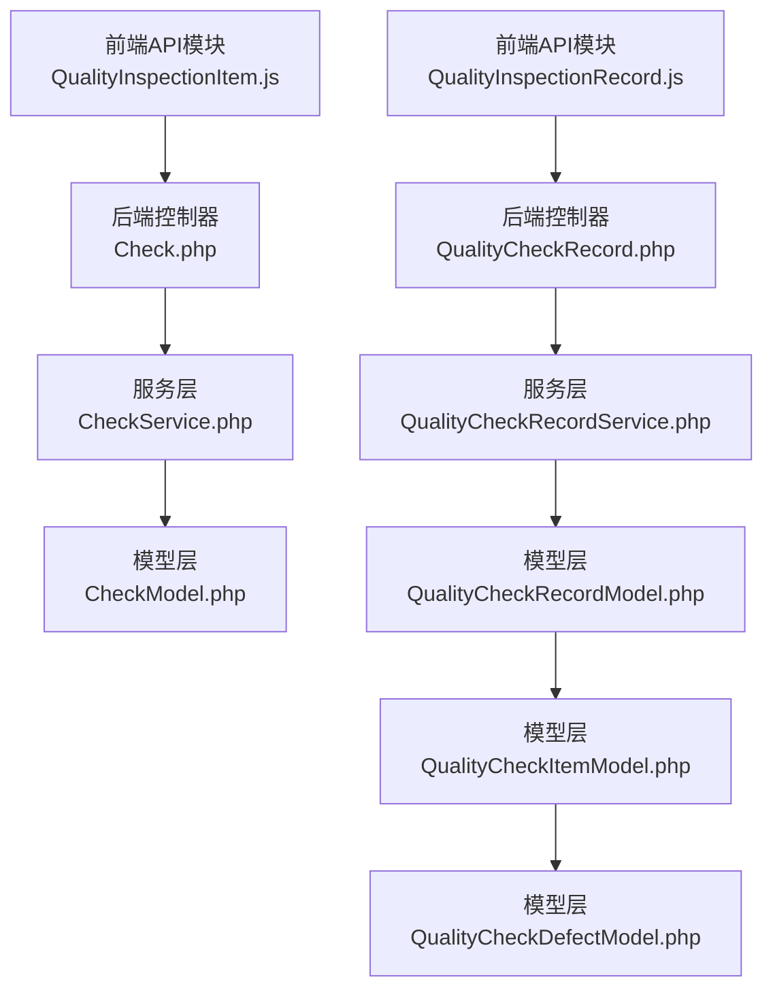
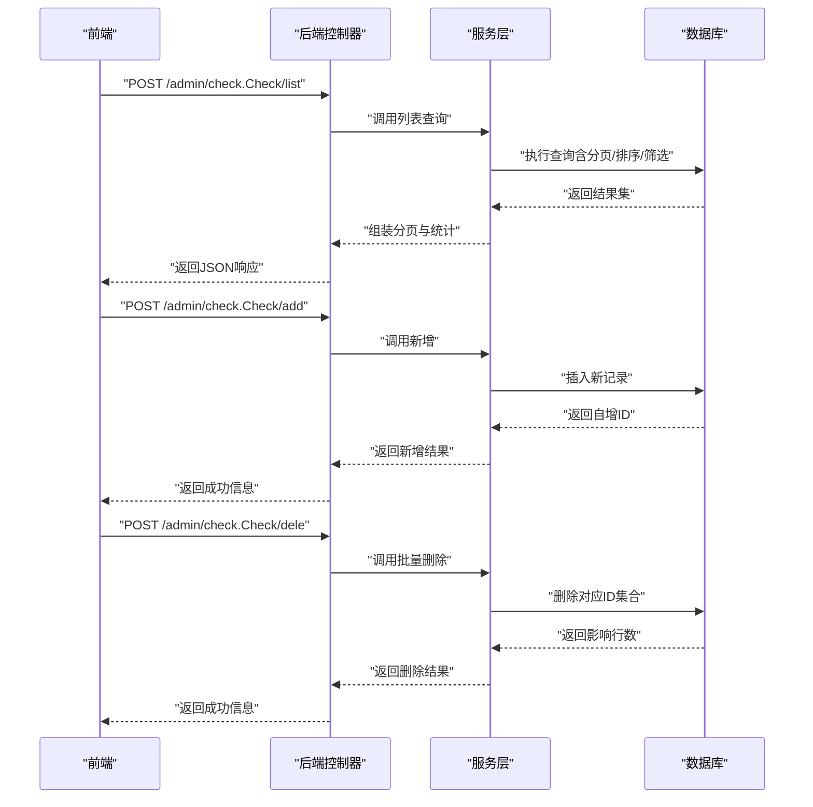
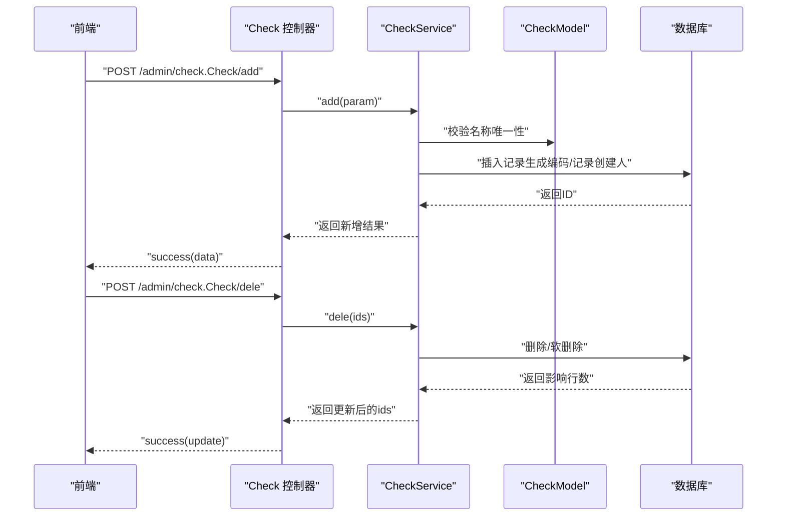
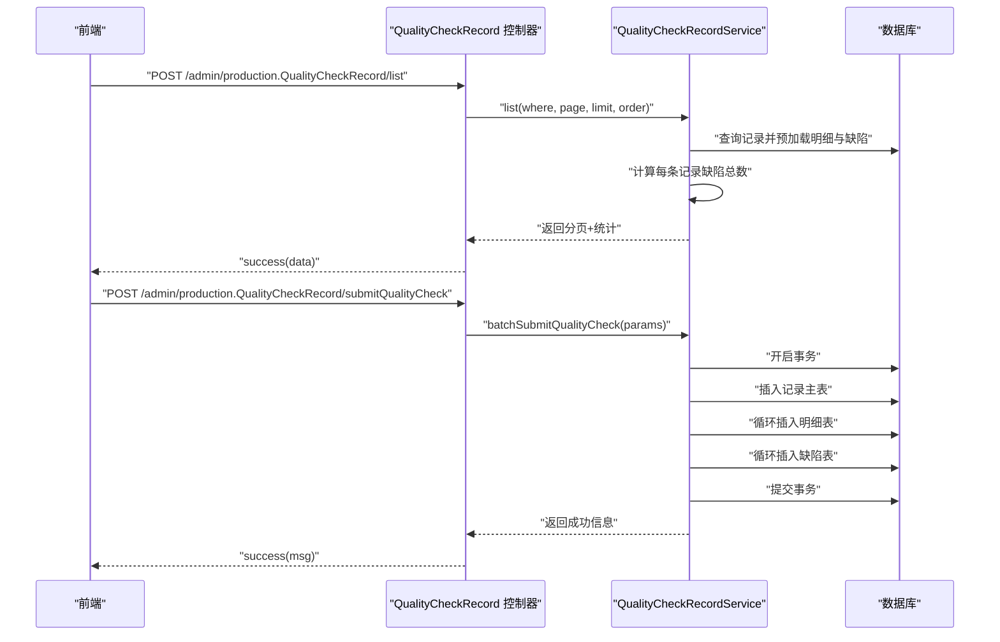
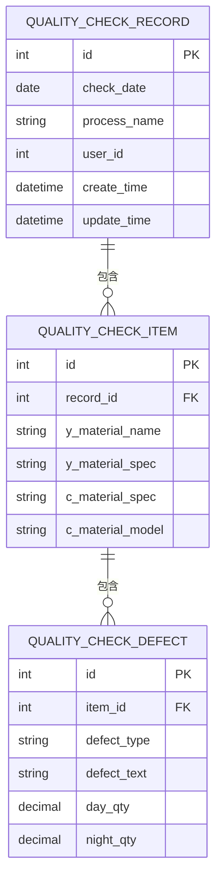
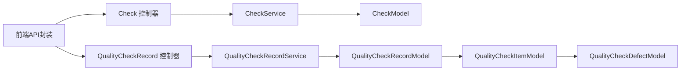

# 质检项目管理API

<cite>
**本文档引用的文件**
- [Check.php](file://gccd_server/app/admin/controller/check/Check.php)
- [CheckService.php](file://gccd_server/app/common/service/admin/CheckService.php)
- [CheckModel.php](file://gccd_server/app/common/model/admin/CheckModel.php)
- [QualityInspectionItem.js](file://yarn/src/api/mes/QualityInspectionItem/QualityInspectionItem.js)
- [QualityInspectionRecord.js](file://yarn/src/api/mes/QualityInspectionRecord/QualityInspectionRecord.js)
- [QualityCheckRecord.php](file://gccd_server/app/admin/controller/production/QualityCheckRecord.php)
- [QualityCheckRecordService.php](file://gccd_server/app/common/service/admin/QualityCheckRecordService.php)
- [QualityCheckRecordModel.php](file://gccd_server/app/common/model/admin/QualityCheckRecordModel.php)
- [QualityCheckItemModel.php](file://gccd_server/app/common/model/admin/QualityCheckItemModel.php)
- [QualityCheckDefectModel.php](file://gccd_server/app/common/model/admin/QualityCheckDefectModel.php)
</cite>

## 目录
1. [简介](#简介)
2. [项目结构](#项目结构)
3. [核心组件](#核心组件)
4. [架构总览](#架构总览)
5. [详细组件分析](#详细组件分析)
6. [依赖关系分析](#依赖关系分析)
7. [性能考虑](#性能考虑)
8. [故障排除指南](#故障排除指南)
9. [结论](#结论)
10. [附录](#附录)

## 简介
本文件面向高齿传动项目的质检项目管理API，系统性梳理“检验项管理”与“质量检验记录”的前后端接口、数据模型与业务流程。重点覆盖以下能力：
- 检验项管理：GET获取检验项列表、POST创建检验项、POST更新检验项、POST删除检验项（支持批量）
- 质量检验记录：GET/POST获取质检记录列表、POST批量提交小程序质检数据
- 数据模型：检验项、质检记录、质检明细、缺陷项的关联关系
- 分类管理与状态控制：通过控制器注解与服务层逻辑实现
- 实际调用示例与最佳实践

## 项目结构
前端通过统一请求封装调用后端控制器；后端控制器通过服务层完成业务逻辑，并持久化到数据库。

**图表来源**
- [Check.php:24-133](file://gccd_server/app/admin/controller/check/Check.php#L24-L133)
- [CheckService.php:31-302](file://gccd_server/app/common/service/admin/CheckService.php#L31-L302)
- [CheckModel.php:7-21](file://gccd_server/app/common/model/admin/CheckModel.php#L7-L21)
- [QualityCheckRecord.php:12-44](file://gccd_server/app/admin/controller/production/QualityCheckRecord.php#L12-L44)
- [QualityCheckRecordService.php:9-123](file://gccd_server/app/common/service/admin/QualityCheckRecordService.php#L9-L123)
- [QualityCheckRecordModel.php:6-20](file://gccd_server/app/common/model/admin/QualityCheckRecordModel.php#L6-L20)
- [QualityCheckItemModel.php:6-15](file://gccd_server/app/common/model/admin/QualityCheckItemModel.php#L6-L15)
- [QualityCheckDefectModel.php:6-10](file://gccd_server/app/common/model/admin/QualityCheckDefectModel.php#L6-L10)

**章节来源**
- [Check.php:24-133](file://gccd_server/app/admin/controller/check/Check.php#L24-L133)
- [QualityCheckRecord.php:12-44](file://gccd_server/app/admin/controller/production/QualityCheckRecord.php#L12-L44)

## 核心组件
- 检验项管理API（后端控制器）：提供检验项的增删改查与批量删除、工序绑定等能力
- 质量检验记录API（后端控制器）：提供记录列表查询与小程序批量提交能力
- 服务层：封装业务逻辑、参数校验、事务控制与数据聚合
- 模型层：定义数据表结构、主从关联关系与绑定字段

关键字段与含义（以检验项为例）：
- 编码：唯一标识，用于检索与绑定工序
- 名称：检验项名称
- 创建时间/更新时间：系统维护的时间戳
- 关联分类：通过模型绑定实现

**章节来源**
- [Check.php:38-133](file://gccd_server/app/admin/controller/check/Check.php#L38-L133)
- [CheckService.php:37-183](file://gccd_server/app/common/service/admin/CheckService.php#L37-L183)
- [CheckModel.php:9-21](file://gccd_server/app/common/model/admin/CheckModel.php#L9-L21)

## 架构总览
下图展示从前端请求到数据库写入的完整链路，包含检验项管理与质量检验记录两条主线。

**图表来源**
- [Check.php:38-113](file://gccd_server/app/admin/controller/check/Check.php#L38-L113)
- [CheckService.php:59-183](file://gccd_server/app/common/service/admin/CheckService.php#L59-L183)

## 详细组件分析

### 检验项管理API（增删改查）
- 接口路径：/admin/check.Check/{action}
- 支持动作：list（列表）、info（详情）、add（新增）、edit（编辑）、dele（删除）

请求与响应要点：
- 列表查询：支持按编码/名称模糊搜索、按创建时间区间筛选、分页与排序
- 新增：自动生成唯一编码，避免同名重复
- 编辑：支持批量更新（ids数组）
- 删除：支持真实删除或软删除（由服务层参数决定）

**图表来源**
- [Check.php:77-113](file://gccd_server/app/admin/controller/check/Check.php#L77-L113)
- [CheckService.php:107-183](file://gccd_server/app/common/service/admin/CheckService.php#L107-L183)
- [CheckModel.php:9-21](file://gccd_server/app/common/model/admin/CheckModel.php#L9-L21)

**章节来源**
- [Check.php:38-113](file://gccd_server/app/admin/controller/check/Check.php#L38-L113)
- [CheckService.php:59-183](file://gccd_server/app/common/service/admin/CheckService.php#L59-L183)
- [CheckModel.php:9-21](file://gccd_server/app/common/model/admin/CheckModel.php#L9-L21)

### 质量检验记录API（列表与批量提交）
- 列表接口：/admin/production.QualityCheckRecord/list
  - 支持按工序名称模糊搜索、按质检日期区间筛选
  - 返回分页数据，并在服务层计算每条记录的缺陷总数
- 批量提交接口：/admin/production.QualityCheckRecord/submitQualityCheck
  - 小程序或API批量提交，包含记录主表、明细表、缺陷项三部分
  - 使用事务保证一致性，异常时回滚

**图表来源**
- [QualityCheckRecord.php:17-44](file://gccd_server/app/admin/controller/production/QualityCheckRecord.php#L17-L44)
- [QualityCheckRecordService.php:20-122](file://gccd_server/app/common/service/admin/QualityCheckRecordService.php#L20-L122)

**章节来源**
- [QualityCheckRecord.php:17-44](file://gccd_server/app/admin/controller/production/QualityCheckRecord.php#L17-L44)
- [QualityCheckRecordService.php:20-122](file://gccd_server/app/common/service/admin/QualityCheckRecordService.php#L20-L122)

### 数据模型与关联关系
- 质检记录表：记录整体质检日期、工序、创建人等
- 质检明细表：每条记录下的物料明细（包含物料名称、规格、型号等）
- 缺陷项表：每个明细下的缺陷类型与班次数量

**图表来源**
- [QualityCheckRecordModel.php:6-20](file://gccd_server/app/common/model/admin/QualityCheckRecordModel.php#L6-L20)
- [QualityCheckItemModel.php:6-15](file://gccd_server/app/common/model/admin/QualityCheckItemModel.php#L6-L15)
- [QualityCheckDefectModel.php:6-10](file://gccd_server/app/common/model/admin/QualityCheckDefectModel.php#L6-L10)

**章节来源**
- [QualityCheckRecordModel.php:6-20](file://gccd_server/app/common/model/admin/QualityCheckRecordModel.php#L6-L20)
- [QualityCheckItemModel.php:6-15](file://gccd_server/app/common/model/admin/QualityCheckItemModel.php#L6-L15)
- [QualityCheckDefectModel.php:6-10](file://gccd_server/app/common/model/admin/QualityCheckDefectModel.php#L6-L10)

### 前端API封装与调用示例
- 检验项API封装：统一前缀/admin/check.Check/，提供list/info/add/dele方法
- 质检记录API封装：统一前缀/admin/production.QualityCheckRecord/，提供list/info/add/edit/dele方法

调用示例（路径参考）：
- 获取检验项列表：POST /admin/check.Check/list（携带分页、搜索参数）
- 创建检验项：POST /admin/check.Check/add（携带名称/编码等）
- 更新检验项：POST /admin/check.Check/edit（携带id与更新字段）
- 删除检验项：POST /admin/check.Check/dele（携带ids数组）
- 获取质检记录列表：POST /admin/production.QualityCheckRecord/list（携带日期范围/工序名）
- 批量提交质检：POST /admin/production.QualityCheckRecord/submitQualityCheck（携带records数组）

**章节来源**
- [QualityInspectionItem.js:1-63](file://yarn/src/api/mes/QualityInspectionItem/QualityInspectionItem.js#L1-L63)
- [QualityInspectionRecord.js:1-63](file://yarn/src/api/mes/QualityInspectionRecord/QualityInspectionRecord.js#L1-L63)

## 依赖关系分析
- 控制器依赖服务层：负责参数解析、权限与返回格式
- 服务层依赖模型层：封装CRUD、事务与复杂查询
- 模型层依赖数据库：定义表结构与关联关系
- 前端API封装依赖后端路由：统一前缀与方法映射

**图表来源**
- [Check.php:24-133](file://gccd_server/app/admin/controller/check/Check.php#L24-L133)
- [QualityCheckRecord.php:12-44](file://gccd_server/app/admin/controller/production/QualityCheckRecord.php#L12-L44)
- [CheckService.php:31-302](file://gccd_server/app/common/service/admin/CheckService.php#L31-L302)
- [QualityCheckRecordService.php:9-123](file://gccd_server/app/common/service/admin/QualityCheckRecordService.php#L9-L123)
- [CheckModel.php:7-21](file://gccd_server/app/common/model/admin/CheckModel.php#L7-L21)
- [QualityCheckRecordModel.php:6-20](file://gccd_server/app/common/model/admin/QualityCheckRecordModel.php#L6-L20)
- [QualityCheckItemModel.php:6-15](file://gccd_server/app/common/model/admin/QualityCheckItemModel.php#L6-L15)
- [QualityCheckDefectModel.php:6-10](file://gccd_server/app/common/model/admin/QualityCheckDefectModel.php#L6-L10)

**章节来源**
- [Check.php:24-133](file://gccd_server/app/admin/controller/check/Check.php#L24-L133)
- [QualityCheckRecord.php:12-44](file://gccd_server/app/admin/controller/production/QualityCheckRecord.php#L12-L44)

## 性能考虑
- 分页与排序：服务层默认按创建时间降序，建议前端传入合理limit与page，避免一次性拉取过多数据
- 预加载关联：列表查询中预加载明细与缺陷，减少N+1查询；注意在大数据量场景下控制预加载深度
- 事务边界：批量提交使用事务，异常回滚，保障数据一致性
- 搜索条件：模糊匹配与日期区间查询需配合索引优化（如按日期、名称建立索引）

## 故障排除指南
- 新增失败：检查名称唯一性约束与编码生成逻辑
- 批量提交异常：确认records非空且结构正确，关注事务回滚日志
- 查询无结果：检查搜索条件（名称模糊、日期区间）是否过窄
- 删除失败：确认ids有效且存在，区分真实删除与软删除策略

**章节来源**
- [CheckService.php:107-183](file://gccd_server/app/common/service/admin/CheckService.php#L107-L183)
- [QualityCheckRecordService.php:61-122](file://gccd_server/app/common/service/admin/QualityCheckRecordService.php#L61-L122)

## 结论
本API体系围绕“检验项管理”和“质量检验记录”两大主题，提供了完整的增删改查、批量操作与事务保障能力。通过清晰的前后端职责划分与模型关联设计，能够支撑日常质检业务的高效运转。建议在生产环境中结合索引与分页策略进一步优化查询性能，并完善异常监控与日志追踪。

## 附录
- 常用字段说明（示例）
  - 检验项：编码、名称、创建时间、更新时间
  - 质检记录：日期、工序名称、创建人、明细与缺陷统计
  - 质检明细：物料名称、规格、型号
  - 缺陷项：类型、描述、白班/夜班数量