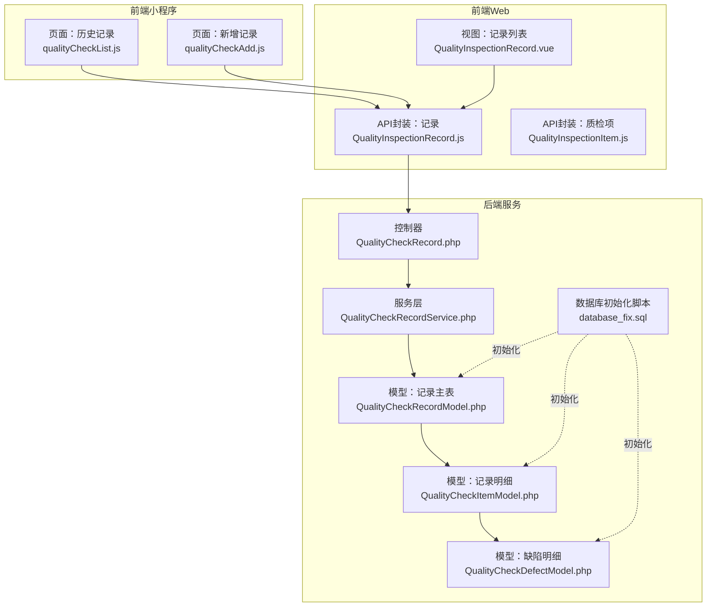
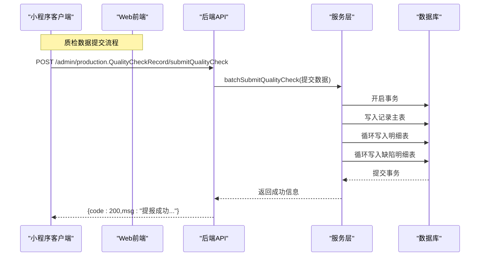
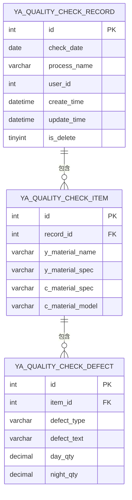
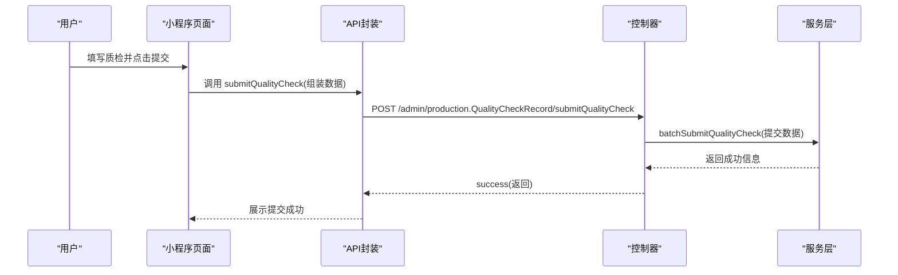
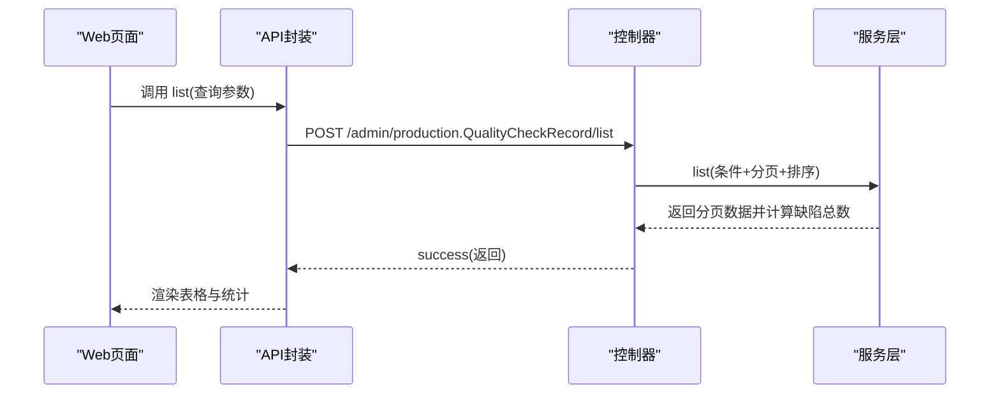
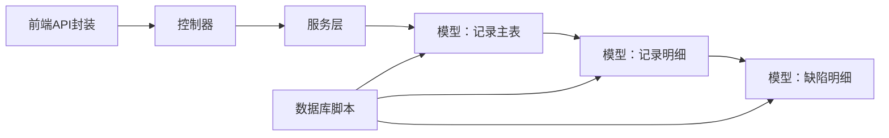

# 质量管理API

<cite>
**本文档引用的文件**
- [gccd_server/app/admin/controller/production/QualityCheckRecord.php](file://gccd_server/app/admin/controller/production/QualityCheckRecord.php)
- [gccd_server/app/common/service/admin/QualityCheckRecordService.php](file://gccd_server/app/common/service/admin/QualityCheckRecordService.php)
- [gccd_server/app/common/model/admin/QualityCheckRecordModel.php](file://gccd_server/app/common/model/admin/QualityCheckRecordModel.php)
- [gccd_server/app/common/model/admin/QualityCheckItemModel.php](file://gccd_server/app/common/model/admin/QualityCheckItemModel.php)
- [gccd_server/app/common/model/admin/QualityCheckDefectModel.php](file://gccd_server/app/common/model/admin/QualityCheckDefectModel.php)
- [gccd_server/database_fix.sql](file://gccd_server/database_fix.sql)
- [yarn/src/api/mes/QualityInspectionRecord/QualityInspectionRecord.js](file://yarn/src/api/mes/QualityInspectionRecord/QualityInspectionRecord.js)
- [yarn/src/api/mes/QualityInspectionItem/QualityInspectionItem.js](file://yarn/src/api/mes/QualityInspectionItem/QualityInspectionItem.js)
- [yarn/src/views/mes/QualityInspectionRecord/QualityInspectionRecord.vue](file://yarn/src/views/mes/QualityInspectionRecord/QualityInspectionRecord.vue)
- [gccd_mini/pageWorkOrder/pages/qualityCheckList/qualityCheckList.js](file://gccd_mini/pageWorkOrder/pages/qualityCheckList/qualityCheckList.js)
- [gccd_mini/pageWorkOrder/pages/qualityCheckAdd/qualityCheckAdd.js](file://gccd_mini/pageWorkOrder/pages/qualityCheckAdd/qualityCheckAdd.js)
</cite>

## 目录
1. [简介](#简介)
2. [项目结构](#项目结构)
3. [核心组件](#核心组件)
4. [架构总览](#架构总览)
5. [详细组件分析](#详细组件分析)
6. [依赖关系分析](#依赖关系分析)
7. [性能考虑](#性能考虑)
8. [故障排查指南](#故障排查指南)
9. [结论](#结论)
10. [附录](#附录)

## 简介
本文件面向“高齿传动”项目的质量管理模块，系统化梳理质量数据全生命周期管理的API设计与实现，覆盖质检项目管理、质检记录管理、质量统计分析等关键能力，并明确质量数据与生产数据的关联关系。文档以接口清单、调用流程、数据模型与错误处理为主线，帮助前后端协同开发与运维保障。

## 项目结构
质量管理相关代码分布在三部分：
- 后端服务层：控制器、服务层、模型层与数据库初始化脚本
- 前端Web端：API封装、页面视图与交互逻辑
- 前端小程序端：质量记录新增、历史查询与草稿管理

**图表来源**
- [gccd_server/app/admin/controller/production/QualityCheckRecord.php:1-46](file://gccd_server/app/admin/controller/production/QualityCheckRecord.php#L1-L46)
- [gccd_server/app/common/service/admin/QualityCheckRecordService.php:1-124](file://gccd_server/app/common/service/admin/QualityCheckRecordService.php#L1-L124)
- [gccd_server/app/common/model/admin/QualityCheckRecordModel.php:1-21](file://gccd_server/app/common/model/admin/QualityCheckRecordModel.php#L1-L21)
- [gccd_server/app/common/model/admin/QualityCheckItemModel.php:1-16](file://gccd_server/app/common/model/admin/QualityCheckItemModel.php#L1-L16)
- [gccd_server/app/common/model/admin/QualityCheckDefectModel.php:1-11](file://gccd_server/app/common/model/admin/QualityCheckDefectModel.php#L1-L11)
- [gccd_server/database_fix.sql:1-35](file://gccd_server/database_fix.sql#L1-L35)
- [yarn/src/api/mes/QualityInspectionRecord/QualityInspectionRecord.js:1-64](file://yarn/src/api/mes/QualityInspectionRecord/QualityInspectionRecord.js#L1-L64)
- [yarn/src/api/mes/QualityInspectionItem/QualityInspectionItem.js:1-52](file://yarn/src/api/mes/QualityInspectionItem/QualityInspectionItem.js#L1-L52)
- [yarn/src/views/mes/QualityInspectionRecord/QualityInspectionRecord.vue:166-232](file://yarn/src/views/mes/QualityInspectionRecord/QualityInspectionRecord.vue#L166-L232)
- [gccd_mini/pageWorkOrder/pages/qualityCheckList/qualityCheckList.js:1-174](file://gccd_mini/pageWorkOrder/pages/qualityCheckList/qualityCheckList.js#L1-L174)
- [gccd_mini/pageWorkOrder/pages/qualityCheckAdd/qualityCheckAdd.js:1-336](file://gccd_mini/pageWorkOrder/pages/qualityCheckAdd/qualityCheckAdd.js#L1-L336)

**章节来源**
- [gccd_server/app/admin/controller/production/QualityCheckRecord.php:1-46](file://gccd_server/app/admin/controller/production/QualityCheckRecord.php#L1-L46)
- [gccd_server/app/common/service/admin/QualityCheckRecordService.php:1-124](file://gccd_server/app/common/service/admin/QualityCheckRecordService.php#L1-L124)
- [gccd_server/app/common/model/admin/QualityCheckRecordModel.php:1-21](file://gccd_server/app/common/model/admin/QualityCheckRecordModel.php#L1-L21)
- [gccd_server/app/common/model/admin/QualityCheckItemModel.php:1-16](file://gccd_server/app/common/model/admin/QualityCheckItemModel.php#L1-L16)
- [gccd_server/app/common/model/admin/QualityCheckDefectModel.php:1-11](file://gccd_server/app/common/model/admin/QualityCheckDefectModel.php#L1-L11)
- [gccd_server/database_fix.sql:1-35](file://gccd_server/database_fix.sql#L1-L35)
- [yarn/src/api/mes/QualityInspectionRecord/QualityInspectionRecord.js:1-64](file://yarn/src/api/mes/QualityInspectionRecord/QualityInspectionRecord.js#L1-L64)
- [yarn/src/api/mes/QualityInspectionItem/QualityInspectionItem.js:1-52](file://yarn/src/api/mes/QualityInspectionItem/QualityInspectionItem.js#L1-L52)
- [yarn/src/views/mes/QualityInspectionRecord/QualityInspectionRecord.vue:166-232](file://yarn/src/views/mes/QualityInspectionRecord/QualityInspectionRecord.vue#L166-L232)
- [gccd_mini/pageWorkOrder/pages/qualityCheckList/qualityCheckList.js:1-174](file://gccd_mini/pageWorkOrder/pages/qualityCheckList/qualityCheckList.js#L1-L174)
- [gccd_mini/pageWorkOrder/pages/qualityCheckAdd/qualityCheckAdd.js:1-336](file://gccd_mini/pageWorkOrder/pages/qualityCheckAdd/qualityCheckAdd.js#L1-L336)

## 核心组件
- 控制器：提供“质检列表”和“小程序批量提交质检数据”的HTTP接口入口
- 服务层：负责查询过滤、分页统计、事务性批量写入
- 模型层：定义主表、明细表、缺陷表的关联关系与字段
- 数据库脚本：初始化质量相关三张表
- 前端API封装：统一REST风格调用后端接口
- 前端页面：Web端记录列表与小程序端新增/历史记录

**章节来源**
- [gccd_server/app/admin/controller/production/QualityCheckRecord.php:12-45](file://gccd_server/app/admin/controller/production/QualityCheckRecord.php#L12-L45)
- [gccd_server/app/common/service/admin/QualityCheckRecordService.php:9-124](file://gccd_server/app/common/service/admin/QualityCheckRecordService.php#L9-L124)
- [gccd_server/app/common/model/admin/QualityCheckRecordModel.php:6-20](file://gccd_server/app/common/model/admin/QualityCheckRecordModel.php#L6-L20)
- [gccd_server/app/common/model/admin/QualityCheckItemModel.php:6-15](file://gccd_server/app/common/model/admin/QualityCheckItemModel.php#L6-L15)
- [gccd_server/app/common/model/admin/QualityCheckDefectModel.php:6-11](file://gccd_server/app/common/model/admin/QualityCheckDefectModel.php#L6-L11)
- [gccd_server/database_fix.sql:1-35](file://gccd_server/database_fix.sql#L1-L35)
- [yarn/src/api/mes/QualityInspectionRecord/QualityInspectionRecord.js:1-64](file://yarn/src/api/mes/QualityInspectionRecord/QualityInspectionRecord.js#L1-L64)
- [yarn/src/api/mes/QualityInspectionItem/QualityInspectionItem.js:1-52](file://yarn/src/api/mes/QualityInspectionItem/QualityInspectionItem.js#L1-L52)

## 架构总览
质量管理采用“控制器-服务-模型-数据库”的分层架构，Web端与小程序端通过统一的REST接口访问后端服务，服务层完成复杂的数据聚合与事务控制。

**图表来源**
- [gccd_server/app/admin/controller/production/QualityCheckRecord.php:39-44](file://gccd_server/app/admin/controller/production/QualityCheckRecord.php#L39-L44)
- [gccd_server/app/common/service/admin/QualityCheckRecordService.php:61-122](file://gccd_server/app/common/service/admin/QualityCheckRecordService.php#L61-L122)

## 详细组件分析

### 接口清单与调用规范

#### 质检记录管理
- 列表查询
  - 方法：POST
  - 路径：/admin/production.QualityCheckRecord/list
  - 请求参数（搜索条件）：
    - check_start_date：开始日期（可选）
    - check_end_date：结束日期（可选）
    - process_name：工序名称（模糊匹配，可选）
    - page：页码（默认1）
    - limit：每页条数（默认10）
    - order：排序规则（默认按质检日期、创建时间降序）
  - 响应字段：
    - count：总记录数
    - pages：总页数
    - page：当前页
    - limit：每页条数
    - list：记录数组，包含以下字段：
      - id：主表ID
      - check_date：质检日期
      - process_name：工序名称
      - create_time：创建时间
      - update_time：更新时间
      - total_defects_count：该记录下缺陷总数（白班+夜班）
      - items：明细数组，包含：
        - y_material_name：原料名称
        - y_material_spec：原料规格
        - c_material_spec：成品规格
        - c_material_model：成品型号
        - defects：缺陷数组，包含：
          - defect_type：缺陷类型
          - defect_text：缺陷描述
          - day_qty：白班数量
          - night_qty：夜班数量

- 小程序批量提交质检数据
  - 方法：POST
  - 路径：/admin/production.QualityCheckRecord/submitQualityCheck
  - 请求体字段：
    - check_date：质检日期（默认当天）
    - process_name：工序名称（可选）
    - user_id：提交人ID（可选，优先使用登录上下文）
    - records：明细数组，每项包含：
      - y_material_name：原料名称
      - y_material_spec：原料规格
      - c_material_spec：成品规格
      - c_material_model：成品型号
      - defective_items：缺陷数组，每项包含：
        - type：缺陷类型ID
        - typeText：缺陷类型文本
        - day_qty：白班数量
        - night_qty：夜班数量
  - 响应：
    - code：200表示成功
    - msg：返回入库明细条数提示或错误信息

- 详情、新增、修改、删除
  - 方法：POST
  - 路径：
    - /admin/production.QualityCheckRecord/info
    - /admin/production.QualityCheckRecord/add
    - /admin/production.QualityCheckRecord/edit
    - /admin/production.QualityCheckRecord/dele
  - 说明：上述接口由前端API封装导出，具体业务逻辑以服务层为准；对于批量提交场景，推荐使用“submitQualityCheck”。

**章节来源**
- [gccd_server/app/admin/controller/production/QualityCheckRecord.php:17-44](file://gccd_server/app/admin/controller/production/QualityCheckRecord.php#L17-L44)
- [gccd_server/app/common/service/admin/QualityCheckRecordService.php:20-56](file://gccd_server/app/common/service/admin/QualityCheckRecordService.php#L20-L56)
- [yarn/src/api/mes/QualityInspectionRecord/QualityInspectionRecord.js:9-63](file://yarn/src/api/mes/QualityInspectionRecord/QualityInspectionRecord.js#L9-L63)

#### 质检项目管理
- 列表查询
  - 方法：POST
  - 路径：/admin/check.Check/list
  - 请求参数：
    - page：页码
    - limit：每页条数
  - 响应字段：
    - list：质检项数组，包含：
      - id：质检项ID
      - check_code：质检编码
      - check_name：质检名称

- 详情、新增、删除
  - 方法：POST
  - 路径：
    - /admin/check.Check/info
    - /admin/check.Check/add
    - /admin/check.Check/dele

**章节来源**
- [yarn/src/api/mes/QualityInspectionItem/QualityInspectionItem.js:9-51](file://yarn/src/api/mes/QualityInspectionItem/QualityInspectionItem.js#L9-L51)

### Web端记录列表
- 页面职责：支持按工序名称、质检日期范围筛选，分页展示记录，并计算每条记录的缺陷总数
- 关键交互：
  - 查询重置、日期范围联动
  - 加载数据并渲染表格
- 数据来源：调用“质检列表”接口，自动聚合明细与缺陷统计

**章节来源**
- [yarn/src/views/mes/QualityInspectionRecord/QualityInspectionRecord.vue:166-232](file://yarn/src/views/mes/QualityInspectionRecord/QualityInspectionRecord.vue#L166-L232)
- [gccd_server/app/common/service/admin/QualityCheckRecordService.php:39-56](file://gccd_server/app/common/service/admin/QualityCheckRecordService.php#L39-L56)

### 小程序端新增与历史
- 新增页面：
  - 功能：选择原料/成品、选择缺陷类型并录入白班/夜班数量，支持草稿本地存储
  - 提交流程：校验必填与数量，组装records，调用“submitQualityCheck”
- 历史页面：
  - 功能：按日期分组展示历史记录，统计每日缺陷总数与明细数量

**章节来源**
- [gccd_mini/pageWorkOrder/pages/qualityCheckAdd/qualityCheckAdd.js:261-305](file://gccd_mini/pageWorkOrder/pages/qualityCheckAdd/qualityCheckAdd.js#L261-L305)
- [gccd_mini/pageWorkOrder/pages/qualityCheckList/qualityCheckList.js:87-166](file://gccd_mini/pageWorkOrder/pages/qualityCheckList/qualityCheckList.js#L87-L166)

### 数据模型与全生命周期
- 主表（ya_quality_check_record）
  - 字段：id、check_date、process_name、user_id、create_time、update_time、is_delete
  - 关联：一对多明细表
- 明细表（ya_quality_check_item）
  - 字段：id、record_id、y_material_name、y_material_spec、c_material_spec、c_material_model
  - 关联：一对多缺陷表
- 缺陷表（ya_quality_check_defect）
  - 字段：id、item_id、defect_type、defect_text、day_qty、night_qty
- 生命周期：
  - 新增：提交接口写入主表与明细/缺陷表
  - 查询：服务层按条件过滤、分页、统计缺陷总数
  - 删除：控制器层对主表标记is_delete=1（软删）

**图表来源**
- [gccd_server/database_fix.sql:2-35](file://gccd_server/database_fix.sql#L2-L35)
- [gccd_server/app/common/model/admin/QualityCheckRecordModel.php:6-20](file://gccd_server/app/common/model/admin/QualityCheckRecordModel.php#L6-L20)
- [gccd_server/app/common/model/admin/QualityCheckItemModel.php:6-15](file://gccd_server/app/common/model/admin/QualityCheckItemModel.php#L6-L15)
- [gccd_server/app/common/model/admin/QualityCheckDefectModel.php:6-11](file://gccd_server/app/common/model/admin/QualityCheckDefectModel.php#L6-L11)

### 业务流程与接口调用示例

#### 流程一：小程序批量提交质检数据

**图表来源**
- [gccd_mini/pageWorkOrder/pages/qualityCheckAdd/qualityCheckAdd.js:272-305](file://gccd_mini/pageWorkOrder/pages/qualityCheckAdd/qualityCheckAdd.js#L272-L305)
- [yarn/src/api/mes/QualityInspectionRecord/QualityInspectionRecord.js:33-63](file://yarn/src/api/mes/QualityInspectionRecord/QualityInspectionRecord.js#L33-L63)
- [gccd_server/app/admin/controller/production/QualityCheckRecord.php:39-44](file://gccd_server/app/admin/controller/production/QualityCheckRecord.php#L39-L44)
- [gccd_server/app/common/service/admin/QualityCheckRecordService.php:61-122](file://gccd_server/app/common/service/admin/QualityCheckRecordService.php#L61-L122)

#### 流程二：Web端查看与统计

**图表来源**
- [yarn/src/views/mes/QualityInspectionRecord/QualityInspectionRecord.vue:212-223](file://yarn/src/views/mes/QualityInspectionRecord/QualityInspectionRecord.vue#L212-L223)
- [yarn/src/api/mes/QualityInspectionRecord/QualityInspectionRecord.js:9-15](file://yarn/src/api/mes/QualityInspectionRecord/QualityInspectionRecord.js#L9-L15)
- [gccd_server/app/admin/controller/production/QualityCheckRecord.php:17-34](file://gccd_server/app/admin/controller/production/QualityCheckRecord.php#L17-L34)
- [gccd_server/app/common/service/admin/QualityCheckRecordService.php:20-56](file://gccd_server/app/common/service/admin/QualityCheckRecordService.php#L20-L56)

## 依赖关系分析
- 控制器依赖服务层进行业务处理
- 服务层依赖模型层进行ORM映射与关联查询
- 前端API封装统一路由到控制器
- 数据库初始化脚本为模型层提供表结构支撑

**图表来源**
- [gccd_server/app/admin/controller/production/QualityCheckRecord.php:4-6](file://gccd_server/app/admin/controller/production/QualityCheckRecord.php#L4-L6)
- [gccd_server/app/common/service/admin/QualityCheckRecordService.php:4-7](file://gccd_server/app/common/service/admin/QualityCheckRecordService.php#L4-L7)
- [gccd_server/app/common/model/admin/QualityCheckRecordModel.php:6-19](file://gccd_server/app/common/model/admin/QualityCheckRecordModel.php#L6-L19)
- [gccd_server/database_fix.sql:1-35](file://gccd_server/database_fix.sql#L1-L35)

**章节来源**
- [gccd_server/app/admin/controller/production/QualityCheckRecord.php:4-6](file://gccd_server/app/admin/controller/production/QualityCheckRecord.php#L4-L6)
- [gccd_server/app/common/service/admin/QualityCheckRecordService.php:4-7](file://gccd_server/app/common/service/admin/QualityCheckRecordService.php#L4-L7)
- [gccd_server/app/common/model/admin/QualityCheckRecordModel.php:6-19](file://gccd_server/app/common/model/admin/QualityCheckRecordModel.php#L6-L19)
- [gccd_server/database_fix.sql:1-35](file://gccd_server/database_fix.sql#L1-L35)

## 性能考虑
- 分页与排序：服务层默认按质检日期与创建时间降序，避免一次性加载过多数据
- 统计字段延迟计算：服务层在分页查询后对每条记录计算缺陷总数，保证Web端展示一致性
- 事务批处理：批量提交时使用事务，减少重复IO与提升一致性
- 前端缓存：小程序端支持草稿本地存储，降低重复录入成本

[本节为通用建议，无需特定文件来源]

## 故障排查指南
- 提交失败
  - 现象：返回非200或异常信息
  - 排查：检查records是否为空、缺陷数量是否合法、网络请求是否可达
  - 参考：批量提交接口的异常抛出与回滚逻辑
- 列表为空
  - 现象：列表为空或count为0
  - 排查：确认查询条件（日期范围、工序名）、分页参数是否合理
- 缺陷总数不正确
  - 现象：页面显示的缺陷总数与预期不符
  - 排查：确认明细与缺陷数据是否完整，服务层统计逻辑是否被正确执行

**章节来源**
- [gccd_server/app/common/service/admin/QualityCheckRecordService.php:61-122](file://gccd_server/app/common/service/admin/QualityCheckRecordService.php#L61-L122)
- [gccd_server/app/admin/controller/production/QualityCheckRecord.php:17-34](file://gccd_server/app/admin/controller/production/QualityCheckRecord.php#L17-L34)

## 结论
质量管理API围绕“记录主表-明细表-缺陷表”的三层结构展开，通过控制器暴露统一接口、服务层承担复杂逻辑与事务控制、前端以API封装对接，形成清晰的职责边界。结合Web与小程序两端的使用场景，实现了从“质检执行—结果记录—统计分析”的闭环。

[本节为总结性内容，无需特定文件来源]

## 附录

### 表结构与字段说明
- ya_quality_check_record
  - 字段：id、check_date、process_name、user_id、create_time、update_time、is_delete
- ya_quality_check_item
  - 字段：id、record_id、y_material_name、y_material_spec、c_material_spec、c_material_model
- ya_quality_check_defect
  - 字段：id、item_id、defect_type、defect_text、day_qty、night_qty

**章节来源**
- [gccd_server/database_fix.sql:2-35](file://gccd_server/database_fix.sql#L2-L35)