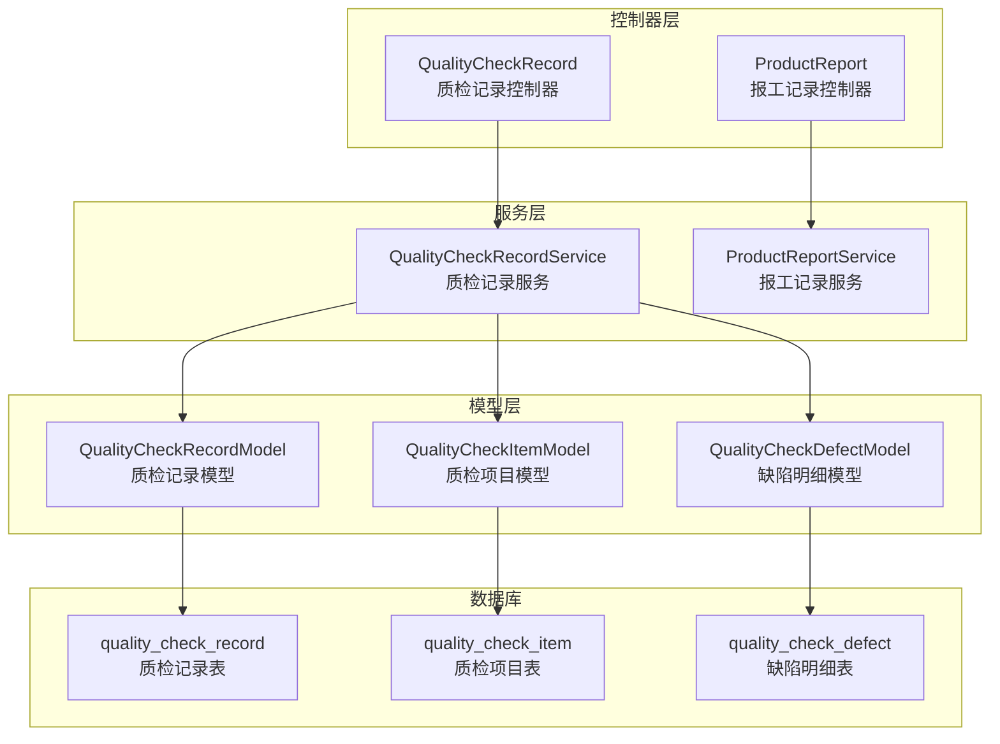
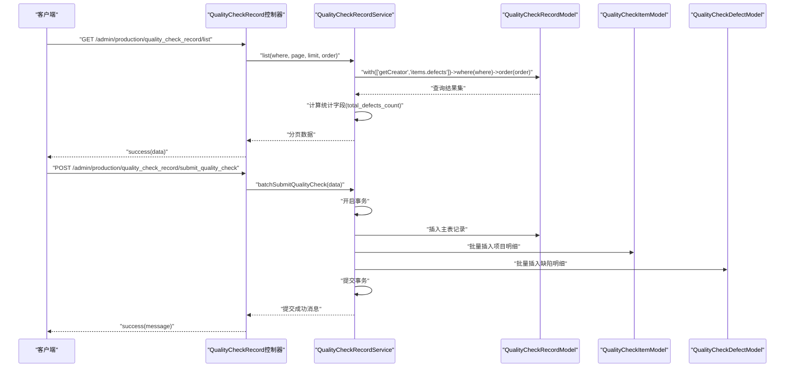
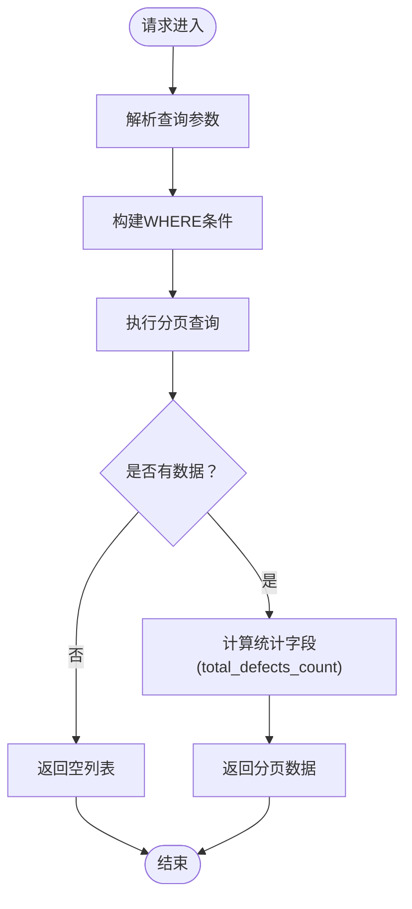
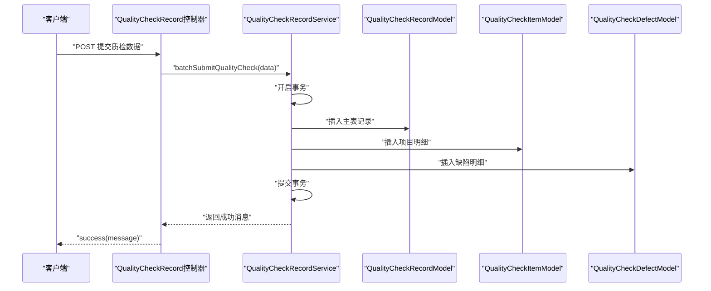
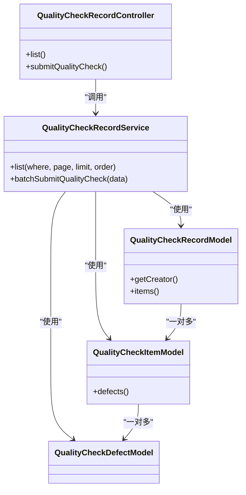

# 质量统计分析API

<cite>
**本文档引用的文件**
- [QualityCheckRecord.php](file://gccd_server/app/admin/controller/production/QualityCheckRecord.php)
- [QualityCheckRecordService.php](file://gccd_server/app/common/service/admin/QualityCheckRecordService.php)
- [QualityCheckRecordModel.php](file://gccd_server/app/common/model/admin/QualityCheckRecordModel.php)
- [QualityCheckItemModel.php](file://gccd_server/app/common/model/admin/QualityCheckItemModel.php)
- [QualityCheckDefectModel.php](file://gccd_server/app/common/model/admin/QualityCheckDefectModel.php)
- [ProductReport.php](file://gccd_server/app/admin/controller/production/ProductReport.php)
</cite>

## 目录
1. [简介](#简介)
2. [项目结构](#项目结构)
3. [核心组件](#核心组件)
4. [架构概览](#架构概览)
5. [详细组件分析](#详细组件分析)
6. [依赖关系分析](#依赖关系分析)
7. [性能考虑](#性能考虑)
8. [故障排除指南](#故障排除指南)
9. [结论](#结论)
10. [附录](#附录)

## 简介
本文件为高齿传动项目质量统计分析API的详细技术文档，聚焦于质量数据的采集、存储、查询与统计分析能力。当前代码库中已实现的质量相关接口主要围绕以下方面：
- 质检记录的查询与批量提交
- 报工记录的多维检索与统计
- 能耗统计与吨数计算辅助功能

文档将从系统架构、组件关系、数据流、处理逻辑、集成点、错误处理与性能特征等方面进行深入解析，并提供面向使用者的接口规范与使用示例路径。

## 项目结构
质量统计分析API位于服务端应用的后台模块中，采用分层架构设计：
- 控制器层：负责HTTP请求接收、参数校验、调用服务层并返回响应
- 服务层：封装业务逻辑，协调模型层与数据库操作
- 模型层：定义数据表结构及关联关系，提供ORM查询能力
- 数据库：存储质检记录、缺陷明细、报工记录等核心数据

**图表来源**
- [QualityCheckRecord.php:12-45](file://gccd_server/app/admin/controller/production/QualityCheckRecord.php#L12-L45)
- [QualityCheckRecordService.php:9-123](file://gccd_server/app/common/service/admin/QualityCheckRecordService.php#L9-L123)
- [QualityCheckRecordModel.php:6-20](file://gccd_server/app/common/model/admin/QualityCheckRecordModel.php#L6-L20)
- [QualityCheckItemModel.php:6-15](file://gccd_server/app/common/model/admin/QualityCheckItemModel.php#L6-L15)
- [QualityCheckDefectModel.php:6-10](file://gccd_server/app/common/model/admin/QualityCheckDefectModel.php#L6-L10)

**章节来源**
- [QualityCheckRecord.php:1-46](file://gccd_server/app/admin/controller/production/QualityCheckRecord.php#L1-L46)
- [ProductReport.php:1-416](file://gccd_server/app/admin/controller/production/ProductReport.php#L1-L416)

## 核心组件
本节对质量统计分析API的核心组件进行深入剖析，涵盖职责划分、数据结构、复杂度分析、依赖链路与优化建议。

- 质检记录控制器
  - 职责：接收查询请求，构造筛选条件，调用服务层获取列表；支持小程序批量提交质检数据
  - 关键方法：列表查询、批量提交
  - 参数与返回：支持按时间段、工序名称等条件筛选；返回分页数据与统计字段

- 质检记录服务
  - 职责：构建查询语句、执行分页查询、计算统计字段、事务性批量写入
  - 复杂度：列表查询时间复杂度近似O(n)，其中n为记录条数；批量提交涉及多次插入，整体复杂度受明细数量影响
  - 优化：对高频查询建立索引；对大列表分页时避免一次性加载过多数据

- 质检记录模型
  - 职责：定义与用户表的关联、与项目明细的关联、与缺陷明细的关联
  - 性能：通过预加载关联减少N+1查询问题

- 质检项目模型
  - 职责：定义与缺陷明细的关联
  - 性能：通过关联查询一次性获取缺陷明细集合

- 缺陷明细模型
  - 职责：承载缺陷类型、日班/夜班数量等字段
  - 性能：作为明细表，查询时按需加载

**章节来源**
- [QualityCheckRecord.php:14-44](file://gccd_server/app/admin/controller/production/QualityCheckRecord.php#L14-L44)
- [QualityCheckRecordService.php:17-122](file://gccd_server/app/common/service/admin/QualityCheckRecordService.php#L17-L122)
- [QualityCheckRecordModel.php:11-19](file://gccd_server/app/common/model/admin/QualityCheckRecordModel.php#L11-L19)
- [QualityCheckItemModel.php:11-14](file://gccd_server/app/common/model/admin/QualityCheckItemModel.php#L11-L14)
- [QualityCheckDefectModel.php:6-10](file://gccd_server/app/common/model/admin/QualityCheckDefectModel.php#L6-L10)

## 架构概览
质量统计分析API遵循典型的三层架构：控制器负责请求处理与响应封装，服务层封装业务规则，模型层负责数据映射与查询。下图展示了关键组件间的交互流程：

**图表来源**
- [QualityCheckRecord.php:17-44](file://gccd_server/app/admin/controller/production/QualityCheckRecord.php#L17-L44)
- [QualityCheckRecordService.php:20-122](file://gccd_server/app/common/service/admin/QualityCheckRecordService.php#L20-L122)
- [QualityCheckRecordModel.php:11-19](file://gccd_server/app/common/model/admin/QualityCheckRecordModel.php#L11-L19)
- [QualityCheckItemModel.php:11-14](file://gccd_server/app/common/model/admin/QualityCheckItemModel.php#L11-L14)
- [QualityCheckDefectModel.php:6-10](file://gccd_server/app/common/model/admin/QualityCheckDefectModel.php#L6-L10)

## 详细组件分析

### 质检记录查询接口
该接口支持按时间段、工序名称等维度进行筛选，并返回包含统计字段的分页数据。服务层在查询完成后对每条记录计算缺陷总数，确保前端展示一致性。

- 接口定义
  - 方法：GET
  - 路径：/admin/production/quality_check_record/list
  - 查询参数：
    - check_start_date：开始日期
    - check_end_date：结束日期
    - process_name：工序名称（模糊匹配）
  - 返回字段：
    - count：总记录数
    - pages：总页数
    - page：当前页
    - limit：每页条数
    - list：记录列表，包含统计字段total_defects_count

- 处理流程
  - 构造查询条件：根据传入参数动态拼接WHERE子句
  - 执行查询：支持分页与排序，默认按质检日期与创建时间降序
  - 计算统计：遍历记录，累加日班/夜班缺陷数量得到总数
  - 返回响应：封装分页数据并返回

**图表来源**
- [QualityCheckRecord.php:17-34](file://gccd_server/app/admin/controller/production/QualityCheckRecord.php#L17-L34)
- [QualityCheckRecordService.php:20-56](file://gccd_server/app/common/service/admin/QualityCheckRecordService.php#L20-L56)

**章节来源**
- [QualityCheckRecord.php:17-34](file://gccd_server/app/admin/controller/production/QualityCheckRecord.php#L17-L34)
- [QualityCheckRecordService.php:20-56](file://gccd_server/app/common/service/admin/QualityCheckRecordService.php#L20-L56)

### 小程序批量提交质检数据接口
该接口支持小程序或外部系统批量提交质检数据，包含主表记录与明细（项目与缺陷）的事务性写入。

- 接口定义
  - 方法：POST
  - 路径：/admin/production/quality_check_record/submit_quality_check
  - 请求体字段：
    - check_date：质检日期（默认当前日期）
    - process_name：工序名称
    - user_id：提交用户ID（可选）
    - records：明细数组，包含物料信息与缺陷列表
  - 返回：提交成功提示与入库明细数量

- 处理流程
  - 开启事务
  - 插入主表记录，获取主键ID
  - 遍历明细数组，插入项目明细表
  - 遍历缺陷列表，批量插入缺陷明细表
  - 提交事务，返回成功消息

**图表来源**
- [QualityCheckRecord.php:39-44](file://gccd_server/app/admin/controller/production/QualityCheckRecord.php#L39-L44)
- [QualityCheckRecordService.php:61-122](file://gccd_server/app/common/service/admin/QualityCheckRecordService.php#L61-L122)

**章节来源**
- [QualityCheckRecord.php:39-44](file://gccd_server/app/admin/controller/production/QualityCheckRecord.php#L39-L44)
- [QualityCheckRecordService.php:61-122](file://gccd_server/app/common/service/admin/QualityCheckRecordService.php#L61-L122)

### 报工记录查询与统计接口
报工记录控制器提供了丰富的查询维度，包括路由编码、关联编码、工序编码、设备编码、起止日期等，并支持按JSON字段与多表关联的复杂查询。同时提供能耗统计与吨数计算等辅助功能。

- 接口定义
  - 方法：GET
  - 路径：/admin/production/product_report/list
  - 查询参数（示例）：
    - routing_code：路由编码（模糊匹配）
    - relation_code：关联编码（模糊匹配）
    - processes_code：工序编码（模糊匹配）
    - device_code：设备编码（模糊匹配）
    - create_start_date/create_end_date：创建时间范围
    - device_name：设备名称（JSON字段匹配）
    - create_name：创建人姓名（关联用户表）
    - production_plan_name：生产计划名称（多表关联）
    - plan_code：计划单号（多表关联）
    - c_material_spec：成品物料规格（关联成品物料表）
    - y_material_spec：原料物料规格（通过工单关联）

  - 返回：分页列表与统计信息

- 能耗统计接口
  - 方法：POST
  - 路径：/admin/production/product_report/power_stat
  - 功能：统计能源消耗相关指标

- 吨数计算接口
  - 方法：GET
  - 路径：/admin/production/product_report/count
  - 参数：task_code、count
  - 功能：基于型号、长度、支数等参数计算吨数

**章节来源**
- [ProductReport.php:43-182](file://gccd_server/app/admin/controller/production/ProductReport.php#L43-L182)
- [ProductReport.php:319-323](file://gccd_server/app/admin/controller/production/ProductReport.php#L319-L323)
- [ProductReport.php:362-387](file://gccd_server/app/admin/controller/production/ProductReport.php#L362-L387)

## 依赖关系分析
质量统计分析API的组件间依赖清晰，遵循单一职责原则与依赖倒置原则。控制器仅负责参数解析与响应封装，服务层承担业务逻辑，模型层提供数据访问能力。

**图表来源**
- [QualityCheckRecord.php:12-45](file://gccd_server/app/admin/controller/production/QualityCheckRecord.php#L12-L45)
- [QualityCheckRecordService.php:9-123](file://gccd_server/app/common/service/admin/QualityCheckRecordService.php#L9-L123)
- [QualityCheckRecordModel.php:6-20](file://gccd_server/app/common/model/admin/QualityCheckRecordModel.php#L6-L20)
- [QualityCheckItemModel.php:6-15](file://gccd_server/app/common/model/admin/QualityCheckItemModel.php#L6-L15)
- [QualityCheckDefectModel.php:6-10](file://gccd_server/app/common/model/admin/QualityCheckDefectModel.php#L6-L10)

**章节来源**
- [QualityCheckRecord.php:12-45](file://gccd_server/app/admin/controller/production/QualityCheckRecord.php#L12-L45)
- [QualityCheckRecordService.php:9-123](file://gccd_server/app/common/service/admin/QualityCheckRecordService.php#L9-L123)
- [QualityCheckRecordModel.php:6-20](file://gccd_server/app/common/model/admin/QualityCheckRecordModel.php#L6-L20)
- [QualityCheckItemModel.php:6-15](file://gccd_server/app/common/model/admin/QualityCheckItemModel.php#L6-L15)
- [QualityCheckDefectModel.php:6-10](file://gccd_server/app/common/model/admin/QualityCheckDefectModel.php#L6-L10)

## 性能考虑
- 查询性能
  - 对高频查询字段（如check_date、process_name、create_time等）建议建立数据库索引
  - 使用分页查询避免一次性加载大量数据，控制每页大小
  - 通过with预加载关联模型，减少N+1查询问题

- 写入性能
  - 批量提交采用事务包裹，确保数据一致性；对大批量明细建议分批提交以降低锁竞争
  - 批量插入时尽量使用框架提供的批量插入方法，减少SQL往返次数

- 缓存策略
  - 对于不频繁变动的配置类数据（如缺陷类型），可在服务层引入缓存机制
  - 对热点查询结果进行短期缓存，降低数据库压力

- 监控与告警
  - 对慢查询进行监控与日志记录，及时发现性能瓶颈
  - 对事务提交失败场景进行异常捕获与重试策略设计

## 故障排除指南
- 提交失败
  - 现象：批量提交质检数据时报错
  - 可能原因：明细为空、数据库连接异常、事务回滚
  - 处理建议：检查请求体格式与必填字段；查看服务层异常捕获日志；确认数据库事务状态

- 查询无结果
  - 现象：按条件查询返回空列表
  - 可能原因：查询条件过于严格、JSON字段匹配不到、多表关联无匹配
  - 处理建议：逐步缩小查询条件；验证JSON字段是否存在；检查关联表字段值

- 统计字段异常
  - 现象：total_defects_count统计值不正确
  - 可能原因：缺陷明细数量转换异常、空值处理不当
  - 处理建议：检查缺陷明细表中的数量字段类型；确认空值转换逻辑

**章节来源**
- [QualityCheckRecordService.php:118-121](file://gccd_server/app/common/service/admin/QualityCheckRecordService.php#L118-L121)
- [QualityCheckRecordService.php:40-53](file://gccd_server/app/common/service/admin/QualityCheckRecordService.php#L40-L53)

## 结论
本文件对高齿传动项目质量统计分析API进行了全面的技术梳理，明确了质检记录查询与批量提交、报工记录多维检索与统计、能耗与吨数计算等核心能力。通过清晰的分层架构与明确的组件职责，系统具备良好的可维护性与扩展性。后续可在查询性能、缓存策略与监控告警方面进一步优化，以支撑更大规模的质量数据分析需求。

## 附录
- 使用示例路径
  - 质检记录列表查询：[接口定义:17-34](file://gccd_server/app/admin/controller/production/QualityCheckRecord.php#L17-L34)
  - 批量提交质检数据：[接口定义:39-44](file://gccd_server/app/admin/controller/production/QualityCheckRecord.php#L39-L44)
  - 报工记录列表查询：[接口定义:43-182](file://gccd_server/app/admin/controller/production/ProductReport.php#L43-L182)
  - 能耗统计接口：[接口定义:319-323](file://gccd_server/app/admin/controller/production/ProductReport.php#L319-L323)
  - 吨数计算接口：[接口定义:362-387](file://gccd_server/app/admin/controller/production/ProductReport.php#L362-L387)