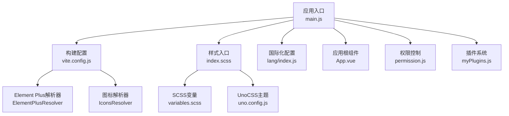
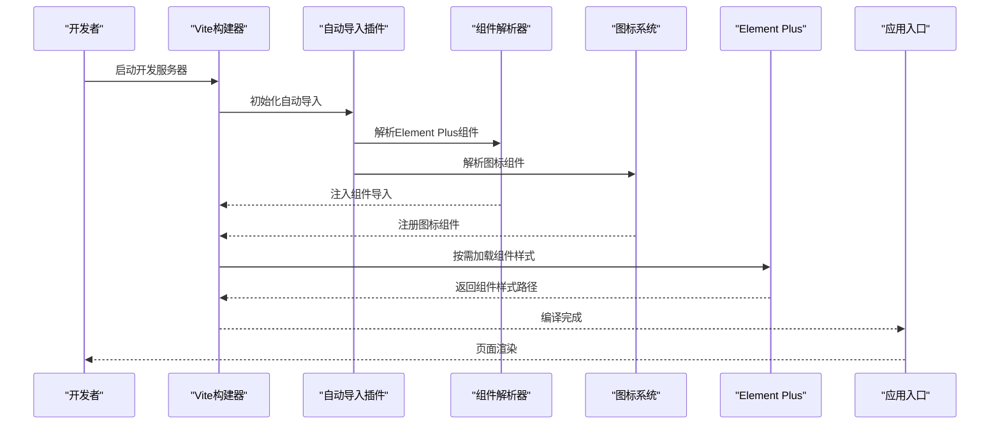
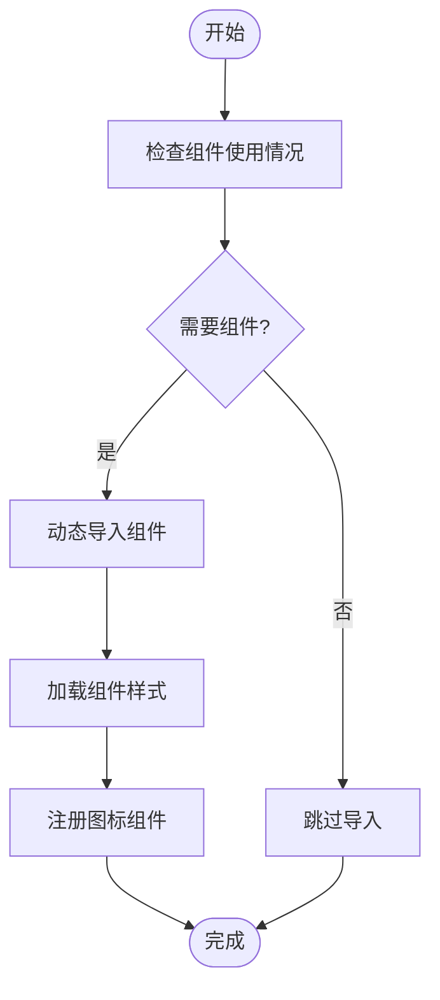
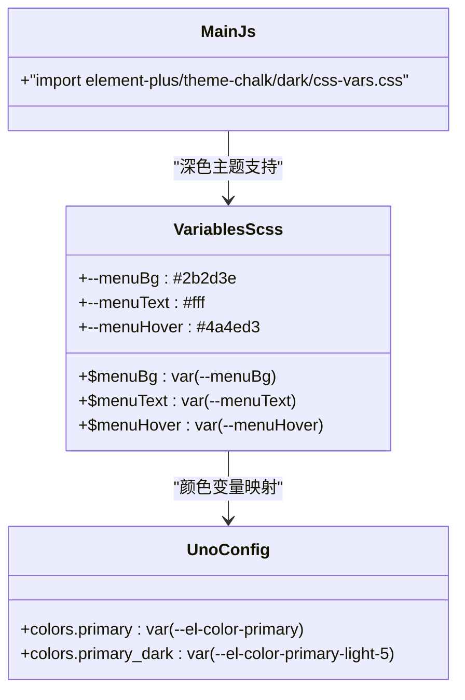
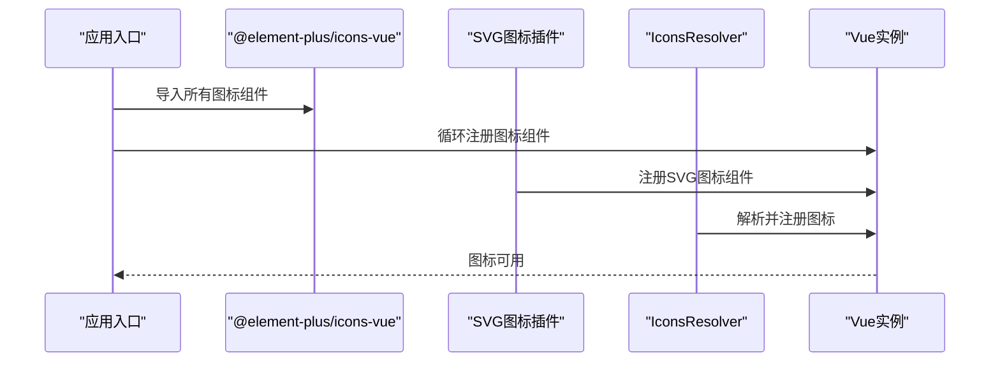
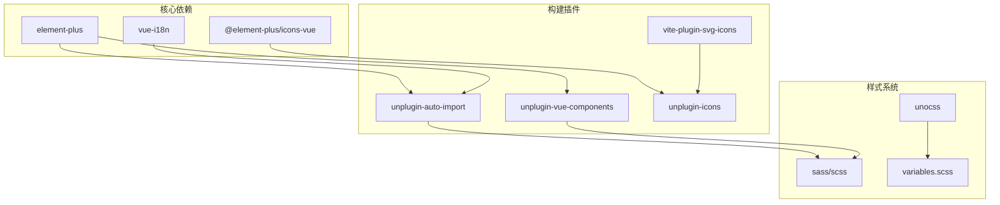

# Element Plus组件库集成

<cite>
**本文档引用的文件**
- [package.json](file://yarn/package.json)
- [vite.config.js](file://yarn/vite.config.js)
- [main.js](file://yarn/src/main.js)
- [uno.config.js](file://yarn/uno.config.js)
- [variables.scss](file://yarn/src/styles/variables.scss)
- [index.scss](file://yarn/src/styles/index.scss)
- [index.js](file://yarn/src/lang/index.js)
- [App.vue](file://yarn/src/App.vue)
- [permission.js](file://yarn/src/permission.js)
- [myPlugins.js](file://yarn/src/plugins/myPlugins.js)
- [index.html](file://yarn/index.html)
</cite>

## 目录
1. [简介](#简介)
2. [项目结构](#项目结构)
3. [核心组件](#核心组件)
4. [架构概览](#架构概览)
5. [详细组件分析](#详细组件分析)
6. [依赖关系分析](#依赖关系分析)
7. [性能考虑](#性能考虑)
8. [故障排除指南](#故障排除指南)
9. [结论](#结论)
10. [附录](#附录)

## 简介
本文件为Element Plus组件库在Vue 3项目中的集成与使用综合文档。项目基于Vite构建，采用按需引入策略，结合自动导入、图标系统、国际化配置以及主题定制方案，提供完整的组件库使用指南。文档涵盖安装配置、按需引入、主题定制、样式覆盖、图标集成、国际化支持、常用组件用法、组件封装最佳实践以及主题切换实现方案。

## 项目结构
项目采用前后端分离架构，Element Plus相关配置集中在前端工程（yarn目录）中，主要涉及以下关键文件：
- 依赖管理：package.json
- 构建配置：vite.config.js
- 应用入口：main.js
- 主题与样式：variables.scss、index.scss、uno.config.js
- 国际化：src/lang/index.js
- 权限与插件：permission.js、myPlugins.js

**图表来源**
- [main.js:1-44](file://yarn/src/main.js#L1-L44)
- [vite.config.js:1-185](file://yarn/vite.config.js#L1-L185)
- [index.scss:1-11](file://yarn/src/styles/index.scss#L1-L11)
- [variables.scss:1-34](file://yarn/src/styles/variables.scss#L1-L34)
- [uno.config.js:1-21](file://yarn/uno.config.js#L1-L21)

**章节来源**
- [package.json:1-88](file://yarn/package.json#L1-L88)
- [vite.config.js:1-185](file://yarn/vite.config.js#L1-L185)
- [main.js:1-44](file://yarn/src/main.js#L1-L44)

## 核心组件
- Element Plus组件库：提供丰富的UI组件，支持按需引入与自动导入
- 图标系统：通过@element-plus/icons-vue与unplugin-icons集成，支持EP图标与SVG图标
- 国际化：基于vue-i18n实现多语言支持
- 主题定制：结合SCSS变量与CSS自定义属性，实现主题切换与样式覆盖
- 构建工具链：Vite + unplugin-auto-import + unplugin-vue-components

**章节来源**
- [package.json:25-57](file://yarn/package.json#L25-L57)
- [vite.config.js:38-70](file://yarn/vite.config.js#L38-L70)
- [main.js:13-15](file://yarn/src/main.js#L13-L15)

## 架构概览
Element Plus在项目中的集成采用"按需引入 + 自动导入 + 图标解析 + 样式预处理"的组合策略，确保包体积最小化与开发效率最大化。

**图表来源**
- [vite.config.js:41-63](file://yarn/vite.config.js#L41-L63)
- [main.js:21-43](file://yarn/src/main.js#L21-L43)

## 详细组件分析

### 安装与配置
- 依赖安装：通过package.json引入element-plus与@element-plus/icons-vue
- 构建配置：在vite.config.js中启用ElementPlusResolver与IconsResolver
- 自动导入：unplugin-auto-import自动导入Element Plus相关函数
- 预加载：optimizeDeps中预加载大量Element Plus组件样式以提升首屏性能

**章节来源**
- [package.json:25-57](file://yarn/package.json#L25-L57)
- [vite.config.js:38-70](file://yarn/vite.config.js#L38-L70)
- [vite.config.js:72-144](file://yarn/vite.config.js#L72-L144)

### 按需引入策略
- 组件按需引入：ElementPlusResolver根据使用情况动态导入组件
- 图标按需引入：IconsResolver仅注册使用的图标组件
- 样式按需引入：通过预加载机制减少运行时样式请求
- 自动导入：unplugin-auto-import自动导入ElMessage、ElMessageBox等API

**图表来源**
- [vite.config.js:49-60](file://yarn/vite.config.js#L49-L60)
- [vite.config.js:41-48](file://yarn/vite.config.js#L41-L48)

**章节来源**
- [vite.config.js:41-63](file://yarn/vite.config.js#L41-L63)

### 主题定制与样式覆盖
- SCSS变量配置：variables.scss定义CSS自定义属性与SCSS变量映射
- UnoCSS主题：uno.config.js将Element Plus颜色变量映射到UnoCSS主题
- 样式入口：index.scss统一引入各模块样式文件
- 深色模式：引入element-plus/theme-chalk/dark/css-vars.css实现深色主题

**图表来源**
- [variables.scss:1-34](file://yarn/src/styles/variables.scss#L1-L34)
- [uno.config.js:12-21](file://yarn/uno.config.js#L12-L21)
- [main.js:13-13](file://yarn/src/main.js#L13-L13)

**章节来源**
- [variables.scss:1-34](file://yarn/src/styles/variables.scss#L1-L34)
- [uno.config.js:12-21](file://yarn/uno.config.js#L12-L21)
- [main.js:13-13](file://yarn/src/main.js#L13-L13)

### 图标系统使用
- 图标库集成：@element-plus/icons-vue提供Element Plus内置图标
- SVG图标缓存：vite-plugin-svg-icons缓存本地SVG图标
- 自动注册：main.js循环注册所有Element Plus图标组件
- 图标解析：IconsResolver自动解析并注册图标组件

**图表来源**
- [main.js:21-43](file://yarn/src/main.js#L21-L43)
- [vite.config.js:61-69](file://yarn/vite.config.js#L61-L69)
- [vite.config.js:49-55](file://yarn/vite.config.js#L49-L55)

**章节来源**
- [main.js:21-43](file://yarn/src/main.js#L21-L43)
- [vite.config.js:61-69](file://yarn/vite.config.js#L61-L69)

### 国际化配置
- 多语言支持：基于vue-i18n实现中英文双语
- 动态语言切换：从应用状态获取当前语言设置
- 语言包组织：独立的语言包文件便于维护
- 全局注入：启用globalInjection实现全局文本替换

**章节来源**
- [index.js:1-25](file://yarn/src/lang/index.js#L1-L25)

### 常用组件使用方法
- 表格组件：支持数据展示、排序、筛选、分页等功能
- 表单组件：包含输入框、选择器、日期选择器等基础表单元素
- 对话框组件：提供模态对话框、确认对话框等交互场景
- 导航组件：侧边栏菜单、面包屑导航等页面导航结构

### 组件封装与二次开发最佳实践
- 组件封装：基于Element Plus组件进行二次封装，保持API一致性
- 样式隔离：使用作用域样式或CSS Modules避免样式冲突
- 事件透传：合理透传原生事件，保证组件可扩展性
- 类型定义：为封装组件提供TypeScript类型定义

### 主题切换实现方案
- CSS变量驱动：通过修改CSS自定义属性实现主题切换
- 动态样式：运行时动态加载/卸载主题样式文件
- 存储机制：将用户选择的主题偏好存储在本地存储中
- 渐进增强：确保主题切换不影响现有功能

## 依赖关系分析
Element Plus相关依赖与插件之间的关系如下：

**图表来源**
- [package.json:25-57](file://yarn/package.json#L25-L57)
- [vite.config.js:38-70](file://yarn/vite.config.js#L38-L70)

**章节来源**
- [package.json:25-57](file://yarn/package.json#L25-L57)
- [vite.config.js:38-70](file://yarn/vite.config.js#L38-L70)

## 性能考虑
- 按需引入：通过ElementPlusResolver减少不必要的组件引入
- 预加载优化：optimizeDeps预加载常用组件样式提升首屏性能
- 代码分割：Vite自动进行代码分割，按需加载组件模块
- 样式优化：SCSS变量复用减少重复样式计算
- 图标优化：SVG图标缓存避免重复请求

## 故障排除指南
- 组件未生效：检查vite.config.js中的ElementPlusResolver配置
- 图标不显示：确认@element-plus/icons-vue已正确注册
- 样式冲突：检查variables.scss变量定义是否正确
- 国际化失效：验证vue-i18n配置与语言包路径
- 构建错误：检查package.json依赖版本兼容性

**章节来源**
- [vite.config.js:41-63](file://yarn/vite.config.js#L41-L63)
- [main.js:21-43](file://yarn/src/main.js#L21-L43)

## 结论
本项目成功集成了Element Plus组件库，通过按需引入、自动导入、图标系统与主题定制的组合策略，实现了高性能、可维护的前端界面开发。配置涵盖了从安装到部署的完整流程，为后续的功能扩展与主题定制提供了良好的基础。

## 附录
- 开发命令：npm run dev（开发环境）、npm run build:prod（生产构建）
- 代码规范：ESLint + Prettier统一代码风格
- 构建优化：Terser压缩、Rollup输出配置优化