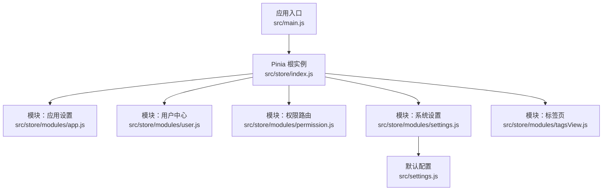
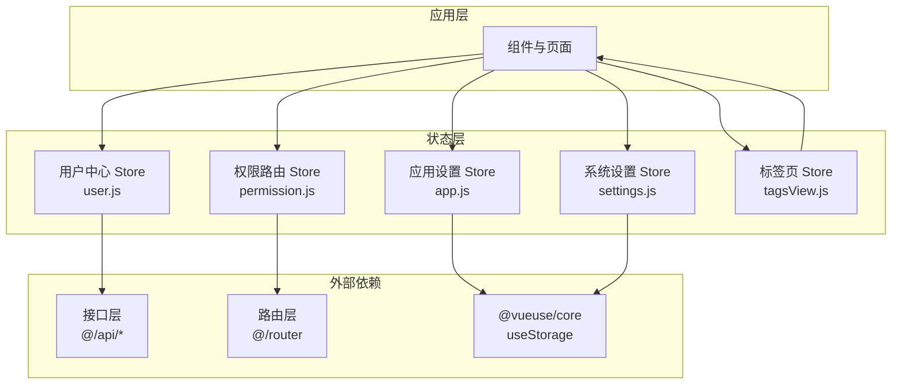
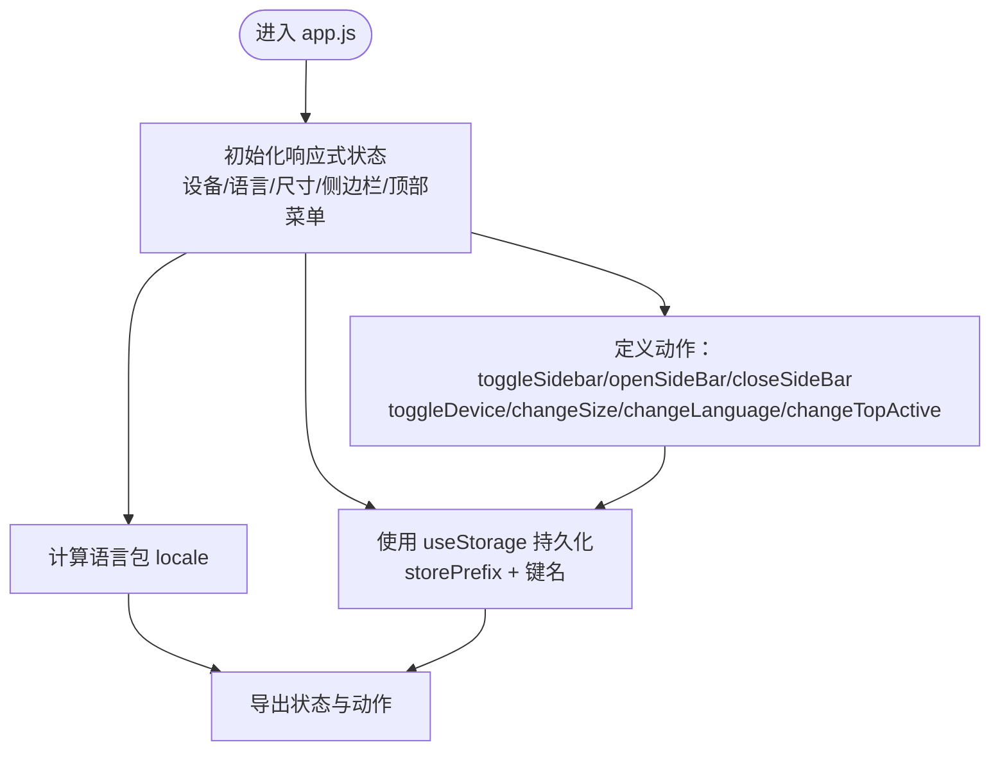
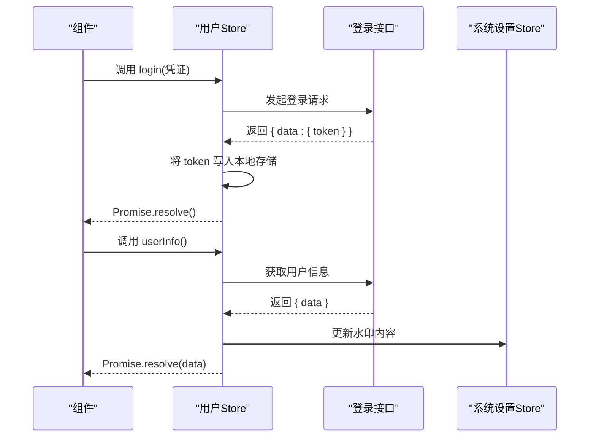
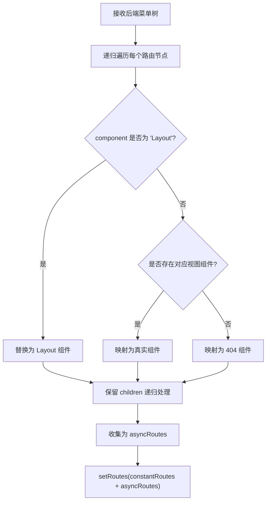
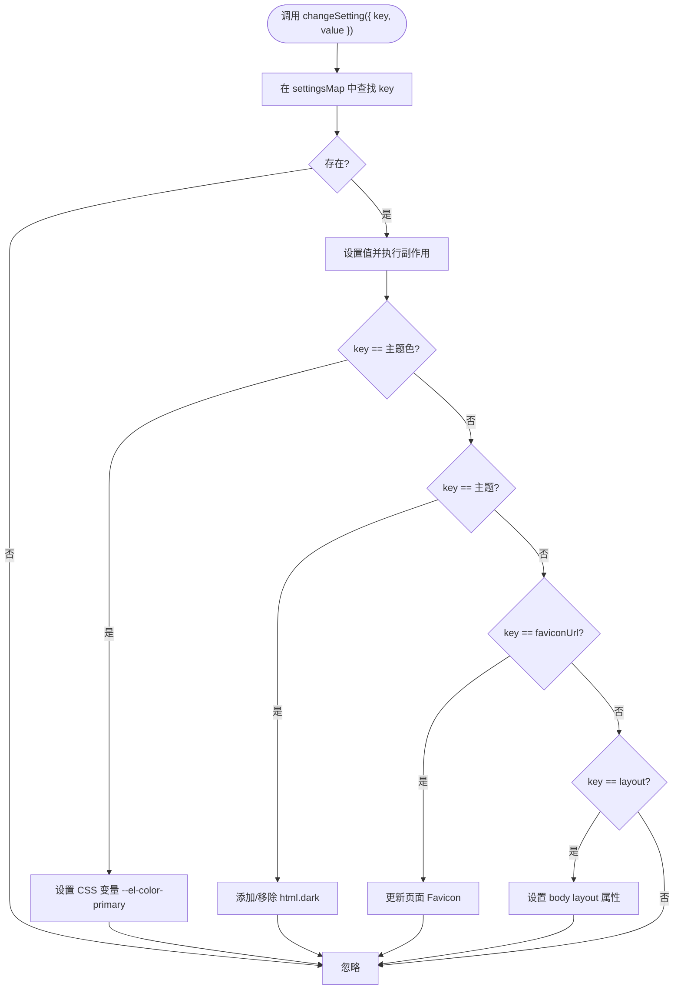
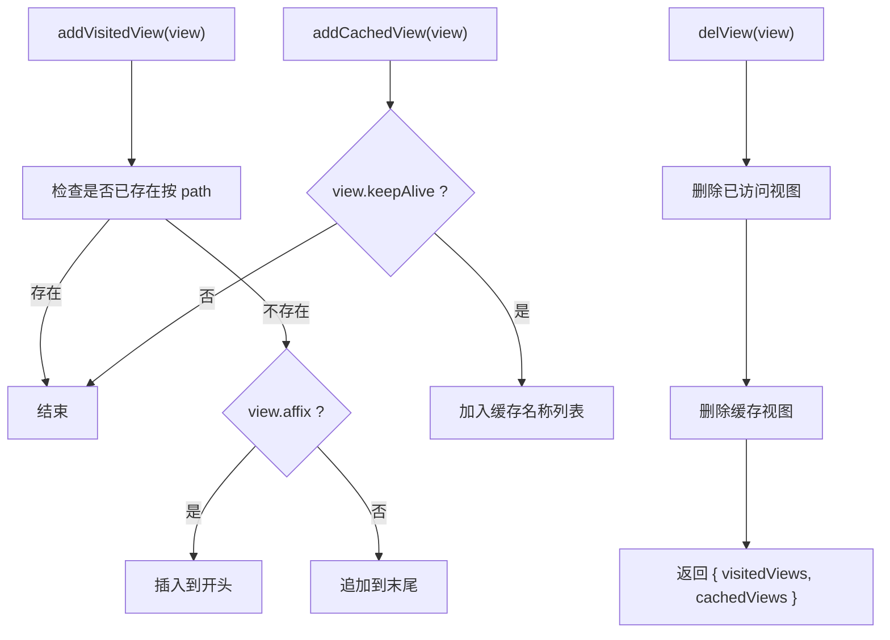
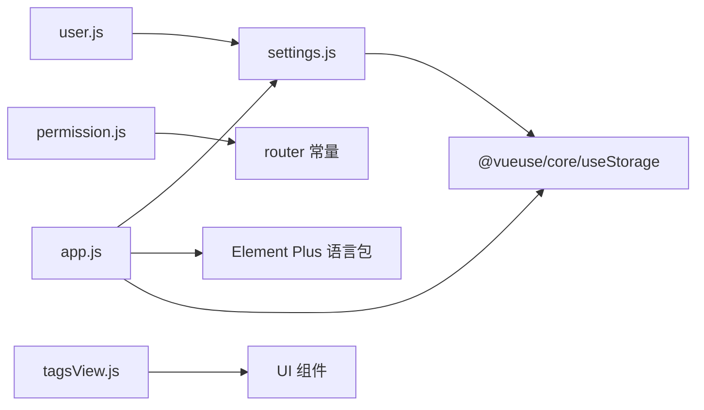

# Pinia状态管理

<cite>
**本文引用的文件**
- [src/store/index.js](file://yarn/src/store/index.js)
- [src/main.js](file://yarn/src/main.js)
- [src/store/modules/app.js](file://yarn/src/store/modules/app.js)
- [src/store/modules/user.js](file://yarn/src/store/modules/user.js)
- [src/store/modules/permission.js](file://yarn/src/store/modules/permission.js)
- [src/store/modules/settings.js](file://yarn/src/store/modules/settings.js)
- [src/store/modules/tagsView.js](file://yarn/src/store/modules/tagsView.js)
- [src/settings.js](file://yarn/src/settings.js)
</cite>

## 目录
1. [简介](#简介)
2. [项目结构](#项目结构)
3. [核心组件](#核心组件)
4. [架构总览](#架构总览)
5. [详细组件分析](#详细组件分析)
6. [依赖分析](#依赖分析)
7. [性能考虑](#性能考虑)
8. [故障排查指南](#故障排查指南)
9. [结论](#结论)
10. [附录](#附录)

## 简介
本文件面向使用 Vue 3 + Vite 的前端工程，系统性梳理基于 Pinia 的状态管理方案。内容涵盖：
- Store 设计理念与与 Vuex 的差异
- Store 定义、模块化组织与状态结构设计
- Actions、Getters 的使用与异步处理
- 状态持久化与本地存储策略
- 状态共享与组件间通信最佳实践
- 权限状态管理、用户信息管理等实战场景
- 调试与开发工具使用建议

## 项目结构
本项目采用“根级 Pinia 实例 + 多模块 Store”的组织方式：
- 根实例：在应用入口注册 Pinia，并通过统一导出的 setupStore 方法注入到应用实例
- 模块化：按业务域拆分模块，如用户、权限、系统设置、标签页等
- 默认配置：集中于 settings.js，统一管理 token 名称、主题、布局、分页等全局参数

图表来源
- [src/main.js:1-44](file://yarn/src/main.js#L1-L44)
- [src/store/index.js:1-10](file://yarn/src/store/index.js#L1-L10)
- [src/store/modules/app.js:1-89](file://yarn/src/store/modules/app.js#L1-L89)
- [src/store/modules/user.js:1-109](file://yarn/src/store/modules/user.js#L1-L109)
- [src/store/modules/permission.js:1-79](file://yarn/src/store/modules/permission.js#L1-L79)
- [src/store/modules/settings.js:1-104](file://yarn/src/store/modules/settings.js#L1-L104)
- [src/store/modules/tagsView.js:1-212](file://yarn/src/store/modules/tagsView.js#L1-L212)
- [src/settings.js:1-24](file://yarn/src/settings.js#L1-L24)

章节来源
- [src/main.js:1-44](file://yarn/src/main.js#L1-L44)
- [src/store/index.js:1-10](file://yarn/src/store/index.js#L1-L10)
- [src/settings.js:1-24](file://yarn/src/settings.js#L1-L24)

## 核心组件
- Pinia 根实例与安装
  - 在根实例中创建并导出 store，并提供 setupStore(app) 注入方法
  - 应用入口通过 setupStore(app) 完成全局安装
- 模块化 Store
  - 使用 defineStore 定义各业务域 Store，返回响应式状态与方法
  - 通过 useXxxStoreHook 包装非组合式调用方式（部分模块提供）
- 默认配置
  - settings.js 提供全局默认值，包括 token 名称、布局、主题、分页、语言、本地存储前缀等

章节来源
- [src/store/index.js:1-10](file://yarn/src/store/index.js#L1-L10)
- [src/main.js:1-44](file://yarn/src/main.js#L1-L44)
- [src/store/modules/app.js:1-89](file://yarn/src/store/modules/app.js#L1-L89)
- [src/store/modules/user.js:1-109](file://yarn/src/store/modules/user.js#L1-L109)
- [src/store/modules/permission.js:1-79](file://yarn/src/store/modules/permission.js#L1-L79)
- [src/store/modules/settings.js:1-104](file://yarn/src/store/modules/settings.js#L1-L104)
- [src/store/modules/tagsView.js:1-212](file://yarn/src/store/modules/tagsView.js#L1-L212)
- [src/settings.js:1-24](file://yarn/src/settings.js#L1-L24)

## 架构总览
Pinia 在本项目中的职责划分：
- 应用设置：设备类型、侧边栏状态、语言、尺寸、顶部菜单激活项等
- 用户中心：登录、登出、获取用户信息、令牌管理
- 权限路由：根据后端菜单生成动态路由，支持混合模式菜单
- 系统设置：主题、布局、图标、分页、水印、Favicon 等
- 标签页：多页签浏览记录与缓存控制

图表来源
- [src/store/modules/app.js:1-89](file://yarn/src/store/modules/app.js#L1-L89)
- [src/store/modules/user.js:1-109](file://yarn/src/store/modules/user.js#L1-L109)
- [src/store/modules/permission.js:1-79](file://yarn/src/store/modules/permission.js#L1-L79)
- [src/store/modules/settings.js:1-104](file://yarn/src/store/modules/settings.js#L1-L104)
- [src/store/modules/tagsView.js:1-212](file://yarn/src/store/modules/tagsView.js#L1-L212)

## 详细组件分析

### 应用设置 Store（app.js）
- 状态结构
  - 设备类型、语言、尺寸、侧边栏状态、顶部菜单激活项、侧边栏对象（opened、withoutAnimation）
  - locale 计算属性，根据语言切换 Element Plus 语言包
- 关键行为
  - 切换侧边栏、打开/关闭侧边栏、切换设备、变更尺寸、切换语言、切换顶部菜单
- 持久化策略
  - 基于 @vueuse/core 的 useStorage，以 storePrefix 为前缀写入本地存储
- 最佳实践
  - 将 UI 展现相关状态与持久化绑定，避免重复同步
  - 通过 locale 计算属性集中切换语言，减少分支散落

图表来源
- [src/store/modules/app.js:1-89](file://yarn/src/store/modules/app.js#L1-L89)

章节来源
- [src/store/modules/app.js:1-89](file://yarn/src/store/modules/app.js#L1-L89)
- [src/settings.js:1-24](file://yarn/src/settings.js#L1-L24)

### 用户中心 Store（user.js）
- 状态结构
  - token：通过 useStorage 持久化，键名为 storePrefix + tokenName
  - user：用户名、昵称、头像、角色数组、菜单数组、是否超管标识
- 关键行为
  - 登录：调用登录接口，成功后将 token 写入本地存储
  - 获取用户信息：拉取用户资料，填充 user 并联动设置水印内容
  - 登出：调用登出接口，清空 token 并刷新页面重置路由
  - 重置 token：清空 token 并重置路由
- 异步处理
  - 所有接口均返回 Promise，便于在组件中 .then/.catch 或 await
- 最佳实践
  - 登录成功后立即写入 token，确保后续请求可携带认证
  - 用户信息变更时同步更新系统设置（如水印）

图表来源
- [src/store/modules/user.js:1-109](file://yarn/src/store/modules/user.js#L1-L109)
- [src/store/modules/settings.js:1-104](file://yarn/src/store/modules/settings.js#L1-L104)

章节来源
- [src/store/modules/user.js:1-109](file://yarn/src/store/modules/user.js#L1-L109)
- [src/store/modules/settings.js:1-104](file://yarn/src/store/modules/settings.js#L1-L104)

### 权限路由 Store（permission.js）
- 动态路由生成
  - 依据后端返回的菜单树，递归过滤生成可加载的路由
  - 支持将字符串组件映射为真实组件或回退到 404
- 路由集合
  - routes：最终可用的路由集合（常量路由 + 动态路由）
  - mixLeftMenu：混合模式左侧菜单（根据顶部激活项筛选）
- 最佳实践
  - 仅在用户登录后生成动态路由，避免无意义的构建
  - 对未匹配组件进行兜底处理，提升健壮性

图表来源
- [src/store/modules/permission.js:1-79](file://yarn/src/store/modules/permission.js#L1-L79)

章节来源
- [src/store/modules/permission.js:1-79](file://yarn/src/store/modules/permission.js#L1-L79)

### 系统设置 Store（settings.js）
- 状态结构
  - 登录背景图/色、系统名、页面标题、Favicon、Logo、侧边栏 Logo/名称、固定头部、标签页开关、布局、主题、主题色、token 类型/名称、分页条数、通知、水印开关/内容等
- 行为
  - changeSetting：根据键名更新对应设置，并触发 DOM/样式变更（如主题色、布局、暗色类、Favicon）
- 最佳实践
  - 将设置映射表集中管理，避免分散赋值
  - 对主题色、布局等关键设置做副作用处理，保证即时生效

图表来源
- [src/store/modules/settings.js:1-104](file://yarn/src/store/modules/settings.js#L1-L104)

章节来源
- [src/store/modules/settings.js:1-104](file://yarn/src/store/modules/settings.js#L1-L104)

### 标签页 Store（tagsView.js）
- 职责
  - 维护已访问视图列表与缓存视图列表
  - 提供新增、删除、批量清理、左右/其他/全部等操作
- 关键点
  - affix 固定标签优先展示
  - keepAlive 控制缓存视图名称集合
- 最佳实践
  - 对带参数路由进行路径匹配，避免重复添加
  - 清理时保留固定标签，避免误删

图表来源
- [src/store/modules/tagsView.js:1-212](file://yarn/src/store/modules/tagsView.js#L1-L212)

章节来源
- [src/store/modules/tagsView.js:1-212](file://yarn/src/store/modules/tagsView.js#L1-L212)

## 依赖分析
- 模块耦合关系
  - user.js 依赖 settings.js（token 名称、水印内容等）
  - permission.js 依赖 router 常量与视图组件映射
  - app.js 与 settings.js 共同影响 UI 展现与主题
  - tagsView.js 与 UI 交互最直接
- 外部依赖
  - @vueuse/core：提供 useStorage 实现本地持久化
  - Element Plus：语言包与主题切换
- 潜在风险
  - 组件映射使用 import.meta.glob，需确保路径与命名规范一致
  - 登录后动态路由生成需与鉴权流程配合，避免未授权访问

图表来源
- [src/store/modules/user.js:1-109](file://yarn/src/store/modules/user.js#L1-L109)
- [src/store/modules/permission.js:1-79](file://yarn/src/store/modules/permission.js#L1-L79)
- [src/store/modules/app.js:1-89](file://yarn/src/store/modules/app.js#L1-L89)
- [src/store/modules/settings.js:1-104](file://yarn/src/store/modules/settings.js#L1-L104)
- [src/store/modules/tagsView.js:1-212](file://yarn/src/store/modules/tagsView.js#L1-L212)

章节来源
- [src/store/modules/user.js:1-109](file://yarn/src/store/modules/user.js#L1-L109)
- [src/store/modules/permission.js:1-79](file://yarn/src/store/modules/permission.js#L1-L79)
- [src/store/modules/app.js:1-89](file://yarn/src/store/modules/app.js#L1-L89)
- [src/store/modules/settings.js:1-104](file://yarn/src/store/modules/settings.js#L1-L104)
- [src/store/modules/tagsView.js:1-212](file://yarn/src/store/modules/tagsView.js#L1-L212)

## 性能考虑
- 响应式粒度
  - 将 UI 展现状态与业务状态分离，避免无关渲染
- 持久化策略
  - 仅对必要字段使用 useStorage，减少本地存储体积
  - 合理设置 storePrefix，避免键冲突
- 动态路由
  - 仅在登录后生成一次动态路由，避免重复构建
- 标签页
  - 对 keepAlive 的视图进行缓存，减少重复渲染
- 主题与语言
  - 通过计算属性与副作用最小化 DOM 操作次数

## 故障排查指南
- 登录后无法跳转或白屏
  - 检查登录接口返回的 token 字段是否与 settings.js 中 tokenName 一致
  - 确认动态路由生成逻辑与后端菜单结构一致
- 语言切换无效
  - 检查 app.js 中 locale 计算属性与语言值是否正确
- 主题色不生效
  - 检查 settings.js 中 changeSetting 对 CSS 变量的设置是否执行
- 标签页异常
  - 检查视图的 keepAlive 与 affix 标记是否正确
- 调试建议
  - 使用浏览器开发者工具的 Vue DevTools 查看 Store 状态变化
  - 在关键动作处添加日志，定位异步流程问题

章节来源
- [src/store/modules/user.js:1-109](file://yarn/src/store/modules/user.js#L1-L109)
- [src/store/modules/permission.js:1-79](file://yarn/src/store/modules/permission.js#L1-L79)
- [src/store/modules/app.js:1-89](file://yarn/src/store/modules/app.js#L1-L89)
- [src/store/modules/settings.js:1-104](file://yarn/src/store/modules/settings.js#L1-L104)
- [src/store/modules/tagsView.js:1-212](file://yarn/src/store/modules/tagsView.js#L1-L212)

## 结论
本项目以 Pinia 为核心的状态管理方案，通过模块化组织实现了清晰的职责边界与良好的可维护性。结合 @vueuse/core 的本地持久化能力与 Element Plus 的主题体系，能够快速落地权限路由、用户信息、系统设置与标签页等常见业务场景。建议在后续迭代中持续优化异步流程与调试体验，并保持模块间的低耦合与高内聚。

## 附录
- Store 定义与注册
  - 根实例：[src/store/index.js:1-10](file://yarn/src/store/index.js#L1-L10)
  - 应用入口：[src/main.js:1-44](file://yarn/src/main.js#L1-L44)
- 默认配置
  - [src/settings.js:1-24](file://yarn/src/settings.js#L1-L24)
- 模块清单
  - 应用设置：[src/store/modules/app.js:1-89](file://yarn/src/store/modules/app.js#L1-L89)
  - 用户中心：[src/store/modules/user.js:1-109](file://yarn/src/store/modules/user.js#L1-L109)
  - 权限路由：[src/store/modules/permission.js:1-79](file://yarn/src/store/modules/permission.js#L1-L79)
  - 系统设置：[src/store/modules/settings.js:1-104](file://yarn/src/store/modules/settings.js#L1-L104)
  - 标签页：[src/store/modules/tagsView.js:1-212](file://yarn/src/store/modules/tagsView.js#L1-L212)