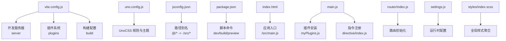
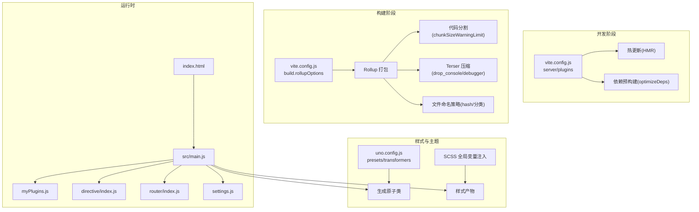
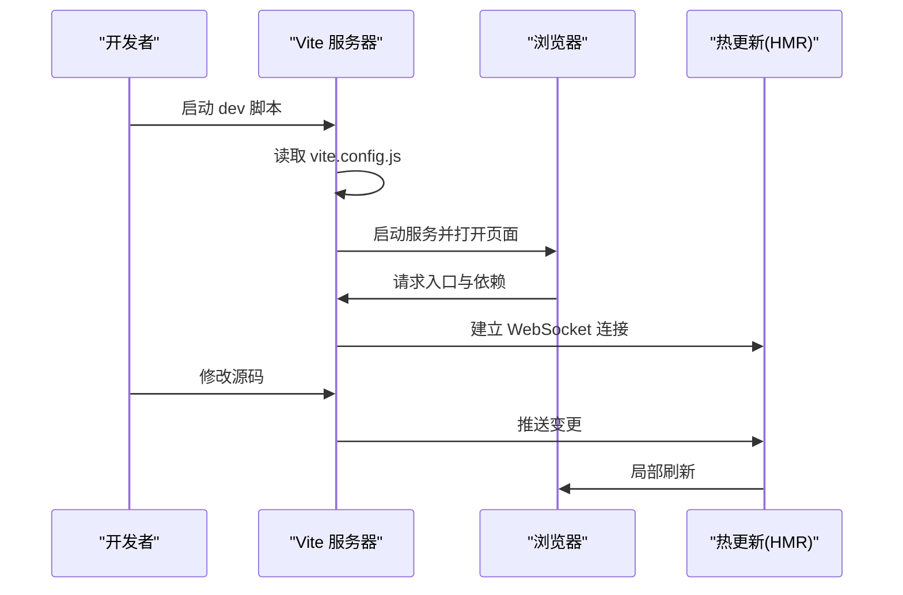
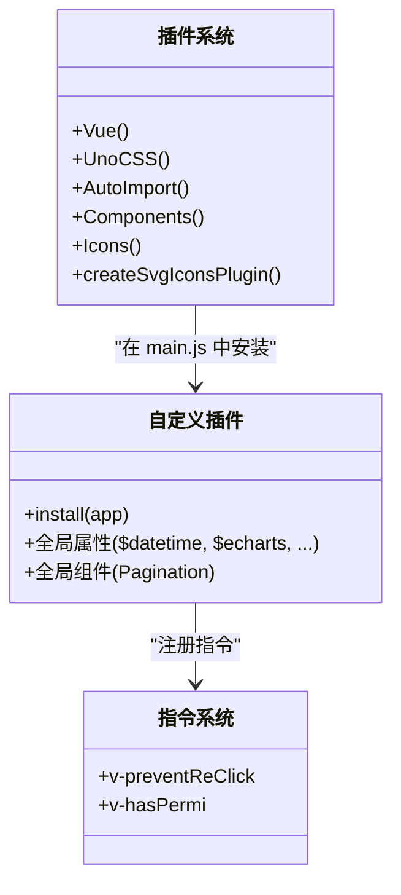
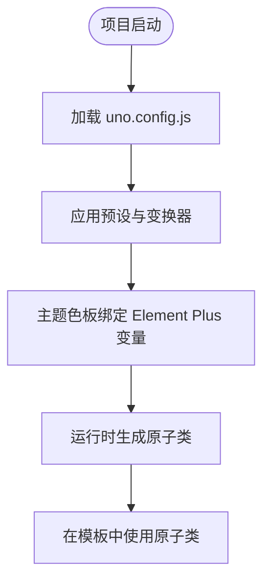
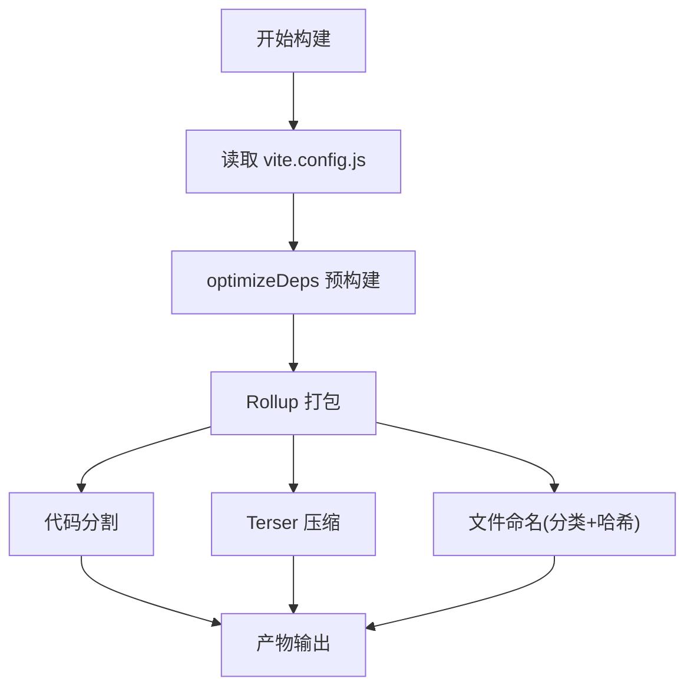
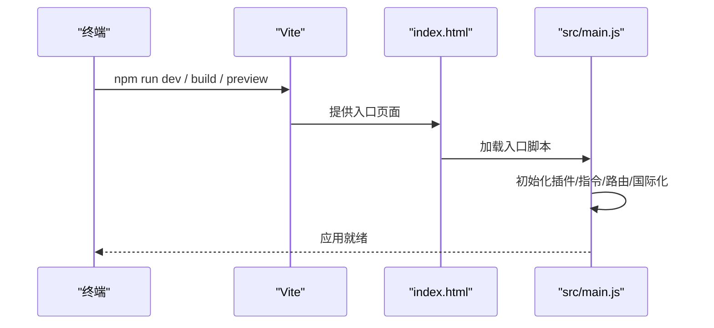
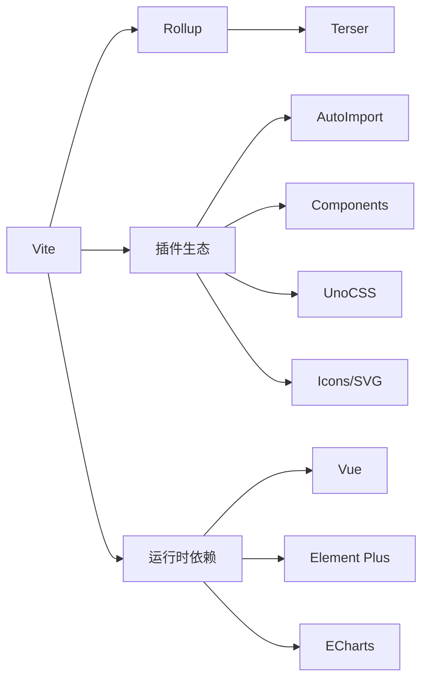

# Vite构建配置

<cite>
**本文引用的文件**
- [vite.config.js](file://yarn/vite.config.js)
- [uno.config.js](file://yarn/uno.config.js)
- [package.json](file://yarn/package.json)
- [jsconfig.json](file://yarn/jsconfig.json)
- [index.html](file://yarn/index.html)
- [main.js](file://yarn/src/main.js)
- [myPlugins.js](file://yarn/src/plugins/myPlugins.js)
- [directive/index.js](file://yarn/src/directive/index.js)
- [router/index.js](file://yarn/src/router/index.js)
- [settings.js](file://yarn/src/settings.js)
- [styles/index.scss](file://yarn/src/styles/index.scss)
</cite>

## 目录
1. [简介](#简介)
2. [项目结构](#项目结构)
3. [核心组件](#核心组件)
4. [架构总览](#架构总览)
5. [详细组件分析](#详细组件分析)
6. [依赖关系分析](#依赖关系分析)
7. [性能考量](#性能考量)
8. [故障排查指南](#故障排查指南)
9. [结论](#结论)
10. [附录](#附录)

## 简介
本文件面向前端工程团队与运维人员，系统性梳理基于 Vite 的前端构建配置，覆盖开发服务器、代理与热更新、打包优化（代码分割、Tree Shaking、压缩）、UnoCSS 原子化 CSS 集成、TypeScript 支持与路径别名、插件体系与自定义插件开发、生产构建与部署优化以及性能监控与构建分析方法。文档以仓库中的实际配置为依据，避免臆测，确保可操作性与可追溯性。

## 项目结构
本项目采用“多包/多目录”组织方式，其中与 Vite 构建直接相关的核心目录与文件如下：
- 构建配置层：vite.config.js、uno.config.js、jsconfig.json、package.json
- 应用入口层：index.html、src/main.js、src/App.vue（未在本节列出）
- 插件与指令层：src/plugins/myPlugins.js、src/directive/index.js
- 路由与设置：src/router/index.js、src/settings.js
- 样式层：src/styles/index.scss 及其依赖的多个样式文件

**图表来源**
- [vite.config.js:1-185](file://yarn/vite.config.js#L1-L185)
- [uno.config.js:1-22](file://yarn/uno.config.js#L1-L22)
- [jsconfig.json:1-9](file://yarn/jsconfig.json#L1-L9)
- [package.json:1-88](file://yarn/package.json#L1-L88)
- [index.html:1-138](file://yarn/index.html#L1-L138)
- [main.js:1-44](file://yarn/src/main.js#L1-L44)
- [myPlugins.js:1-74](file://yarn/src/plugins/myPlugins.js#L1-L74)
- [directive/index.js:1-8](file://yarn/src/directive/index.js#L1-L8)
- [router/index.js:1-106](file://yarn/src/router/index.js#L1-L106)
- [settings.js:1-24](file://yarn/src/settings.js#L1-L24)
- [styles/index.scss:1-11](file://yarn/src/styles/index.scss#L1-L11)

**章节来源**
- [vite.config.js:1-185](file://yarn/vite.config.js#L1-L185)
- [uno.config.js:1-22](file://yarn/uno.config.js#L1-L22)
- [jsconfig.json:1-9](file://yarn/jsconfig.json#L1-L9)
- [package.json:1-88](file://yarn/package.json#L1-L88)
- [index.html:1-138](file://yarn/index.html#L1-L138)
- [main.js:1-44](file://yarn/src/main.js#L1-L44)
- [myPlugins.js:1-74](file://yarn/src/plugins/myPlugins.js#L1-L74)
- [directive/index.js:1-8](file://yarn/src/directive/index.js#L1-L8)
- [router/index.js:1-106](file://yarn/src/router/index.js#L1-L106)
- [settings.js:1-24](file://yarn/src/settings.js#L1-L24)
- [styles/index.scss:1-11](file://yarn/src/styles/index.scss#L1-L11)

## 核心组件
- 开发服务器与热更新
  - 主机与端口：允许外部访问，便于多设备联调
  - 自动打开浏览器
  - 内置 HMR（热模块替换）与依赖预构建
- 插件生态
  - Vue 官方插件、UnoCSS、自动导入、组件自动注册、图标自动安装、SVG 图标缓存
- CSS 预处理与全局变量
  - SCSS 全局变量注入，提升样式复用性
- 构建优化
  - Terser 压缩、移除 console/debugger、注释删除
  - 文件命名策略（哈希、分类目录）
  - 依赖预构建（optimizeDeps.include）

**章节来源**
- [vite.config.js:33-37](file://yarn/vite.config.js#L33-L37)
- [vite.config.js:38-70](file://yarn/vite.config.js#L38-L70)
- [vite.config.js:23-32](file://yarn/vite.config.js#L23-L32)
- [vite.config.js:146-182](file://yarn/vite.config.js#L146-L182)
- [vite.config.js:72-145](file://yarn/vite.config.js#L72-L145)

## 架构总览
下图展示从开发到生产的整体流程，以及关键配置对各阶段的影响。

**图表来源**
- [vite.config.js:13-185](file://yarn/vite.config.js#L13-L185)
- [uno.config.js:12-22](file://yarn/uno.config.js#L12-L22)
- [main.js:1-44](file://yarn/src/main.js#L1-L44)
- [myPlugins.js:43-74](file://yarn/src/plugins/myPlugins.js#L43-L74)
- [directive/index.js:4-7](file://yarn/src/directive/index.js#L4-L7)
- [router/index.js:1-106](file://yarn/src/router/index.js#L1-L106)
- [settings.js:1-24](file://yarn/src/settings.js#L1-L24)
- [styles/index.scss:1-11](file://yarn/src/styles/index.scss#L1-L11)

## 详细组件分析

### 开发服务器与热更新
- 主机与端口
  - 绑定 0.0.0.0，允许局域网访问；端口固定，便于统一管理
- 自动打开浏览器
  - 启动后自动打开默认浏览器，提升开发效率
- 依赖预构建
  - 将常用依赖（如 Vue、Element Plus 组件样式、echarts 等）纳入预构建，减少冷启动时间与二次请求

**图表来源**
- [vite.config.js:33-37](file://yarn/vite.config.js#L33-L37)
- [vite.config.js:72-145](file://yarn/vite.config.js#L72-L145)

**章节来源**
- [vite.config.js:33-37](file://yarn/vite.config.js#L33-L37)
- [vite.config.js:72-145](file://yarn/vite.config.js#L72-L145)

### 插件系统与自定义插件
- 插件清单
  - Vue、UnoCSS、AutoImport、Components、Icons、SVG 图标缓存
- 自动导入
  - 自动导入 Vue/Router/VueI18n/Pinia 与 @vueuse/core
  - 自动解析 Element Plus 与图标解析器
- 组件自动注册
  - 指定组件目录，自动注册并关闭 d.ts 自动生成
- 图标与 SVG
  - 自动安装图标库，指定图标目录与 symbolId
- 自定义插件
  - 在 main.js 中通过 installPlugins 安装全局属性、组件与指令
  - 指令集中注册 v-preventReClick 与 v-hasPermi

**图表来源**
- [vite.config.js:38-70](file://yarn/vite.config.js#L38-L70)
- [main.js:19-43](file://yarn/src/main.js#L19-L43)
- [myPlugins.js:43-74](file://yarn/src/plugins/myPlugins.js#L43-L74)
- [directive/index.js:4-7](file://yarn/src/directive/index.js#L4-L7)

**章节来源**
- [vite.config.js:38-70](file://yarn/vite.config.js#L38-L70)
- [main.js:19-43](file://yarn/src/main.js#L19-L43)
- [myPlugins.js:43-74](file://yarn/src/plugins/myPlugins.js#L43-L74)
- [directive/index.js:4-7](file://yarn/src/directive/index.js#L4-L7)

### UnoCSS 原子化 CSS 集成
- 预设与变换器
  - 预设：Uno、Icons、Web Fonts、Typography、Attributify
  - 变换器：Directives、Variant Group
- 主题色板
  - 使用 Element Plus 主题变量作为 Uno 主色映射
- 使用方式
  - 在入口文件中引入 uno.css，即可在模板与样式中直接使用原子类

**图表来源**
- [uno.config.js:12-22](file://yarn/uno.config.js#L12-L22)
- [main.js:15](file://yarn/src/main.js#L15)

**章节来源**
- [uno.config.js:12-22](file://yarn/uno.config.js#L12-L22)
- [main.js:15](file://yarn/src/main.js#L15)

### TypeScript 支持与路径别名
- 路径别名
  - jsconfig.json 将 @ 映射到 src 目录，便于 import 时使用相对路径
- TypeScript 支持
  - 项目使用 .js/.cjs/.vue 文件，未启用 tsconfig.json；如需 TS 支持，可在根目录新增 tsconfig 并配置路径别名与编译选项

**章节来源**
- [jsconfig.json:1-9](file://yarn/jsconfig.json#L1-L9)

### 构建优化策略
- 代码分割
  - 通过 Rollup 输出策略，将入口、共享块与静态资源分别命名，配合哈希实现缓存友好
- Tree Shaking
  - 依赖预构建与按需引入第三方库（如 ECharts），减少打包体积
- 压缩与清理
  - Terser 压缩开启，移除 console 与 debugger，删除注释，降低体积
- 文件命名
  - 不同类型资源分类输出（img/media/fonts），便于 CDN 缓存与版本管理

**图表来源**
- [vite.config.js:72-145](file://yarn/vite.config.js#L72-L145)
- [vite.config.js:146-182](file://yarn/vite.config.js#L146-L182)

**章节来源**
- [vite.config.js:72-145](file://yarn/vite.config.js#L72-L145)
- [vite.config.js:146-182](file://yarn/vite.config.js#L146-L182)

### 开发脚本与运行时入口
- 脚本命令
  - dev、build:prod、build:stage、preview:prod、preview:stage、lint、format
- 应用入口
  - index.html 引入 /src/main.js
  - main.js 完成应用初始化、插件安装、指令注册、国际化、主题与样式引入

**图表来源**
- [package.json:16-24](file://yarn/package.json#L16-L24)
- [index.html:26](file://yarn/index.html#L26)
- [main.js:1-44](file://yarn/src/main.js#L1-L44)

**章节来源**
- [package.json:16-24](file://yarn/package.json#L16-L24)
- [index.html:26](file://yarn/index.html#L26)
- [main.js:1-44](file://yarn/src/main.js#L1-L44)

## 依赖关系分析
- 构建工具链
  - Vite 作为核心，配合 Rollup 进行打包；Terser 负责压缩
- 插件耦合
  - AutoImport 与 Components 依赖解析器（Element Plus、Icons）
  - UnoCSS 与样式系统解耦，通过入口引入
- 运行时依赖
  - Vue、Router、Pinia、Element Plus、Axios、ECharts 等在 optimizeDeps 中预构建，提升首屏与热更性能

**图表来源**
- [vite.config.js:72-145](file://yarn/vite.config.js#L72-L145)
- [vite.config.js:38-70](file://yarn/vite.config.js#L38-L70)
- [package.json:25-58](file://yarn/package.json#L25-L58)

**章节来源**
- [vite.config.js:72-145](file://yarn/vite.config.js#L72-L145)
- [vite.config.js:38-70](file://yarn/vite.config.js#L38-L70)
- [package.json:25-58](file://yarn/package.json#L25-L58)

## 性能考量
- 依赖预构建
  - 将大型第三方库与样式纳入 optimizeDeps.include，显著缩短冷启动与二次启动时间
- 代码分割与缓存
  - 通过哈希命名与分类输出，提升浏览器缓存命中率
- 压缩与体积控制
  - 移除调试与注释，结合 Tree Shaking 与按需引入，有效降低产物体积
- 开发体验
  - 外网可访问与自动打开，提升联调效率；合理设置 chunkSizeWarningLimit，避免大包告警干扰

**章节来源**
- [vite.config.js:72-145](file://yarn/vite.config.js#L72-L145)
- [vite.config.js:146-182](file://yarn/vite.config.js#L146-L182)

## 故障排查指南
- 依赖预构建失败或启动缓慢
  - 检查 optimizeDeps.include 是否包含必要依赖；确认网络与缓存状态
- UnoCSS 类名不生效
  - 确认入口已引入 uno.css；检查 uno.config.js 预设与主题配置
- 路径别名无效
  - 确认 jsconfig.json 的 @/* 映射正确；编辑器需支持该配置
- 构建产物异常或体积过大
  - 检查 Terser 配置与压缩规则；审查依赖是否按需引入；关注代码分割策略
- 热更新不生效
  - 检查开发服务器 host/port 设置；确认浏览器与 Vite 的 HMR 连接正常

**章节来源**
- [vite.config.js:72-145](file://yarn/vite.config.js#L72-L145)
- [vite.config.js:146-182](file://yarn/vite.config.js#L146-L182)
- [uno.config.js:12-22](file://yarn/uno.config.js#L12-L22)
- [jsconfig.json:1-9](file://yarn/jsconfig.json#L1-L9)

## 结论
本项目以 Vite 为核心，结合 UnoCSS 原子化方案与完善的插件生态，在开发体验与构建性能之间取得良好平衡。通过依赖预构建、合理的代码分割与压缩策略，以及路径别名与自动导入机制，显著提升了开发效率与产物质量。建议在后续迭代中持续关注依赖体积、缓存策略与运行时性能指标，并结合构建分析工具进行优化。

## 附录
- 生产构建与部署最佳实践
  - 使用 build.outDir 指定输出目录；结合 CDN 与缓存头策略；启用 gzip/br 压缩
  - 对静态资源进行分类命名，便于长期缓存与灰度发布
- 性能监控与构建分析
  - 使用 Vite 内置分析工具或第三方可视化工具，定位大包与重复依赖
  - 关注首屏渲染时间、TTFB、FID 等关键指标，持续优化