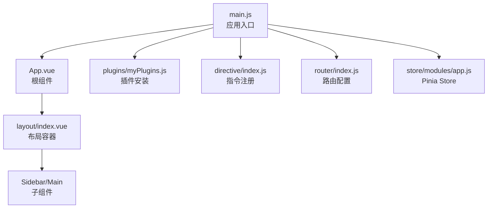
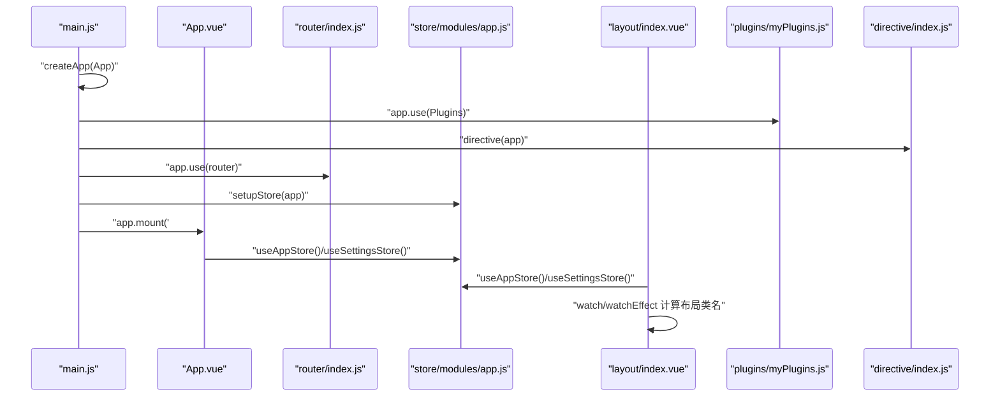
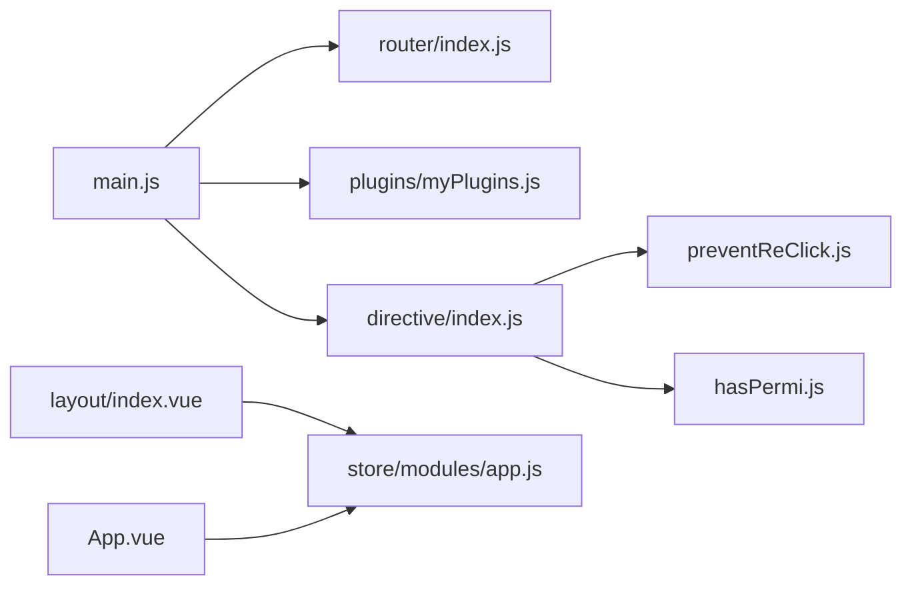

# Vue 3 Composition API开发

<cite>
**本文引用的文件**
- [main.js](file://yarn/src/main.js)
- [App.vue](file://yarn/src/App.vue)
- [index.js](file://yarn/src/directive/index.js)
- [preventReClick.js](file://yarn/src/directive/common/preventReClick.js)
- [hasPermi.js](file://yarn/src/directive/common/hasPermi.js)
- [myPlugins.js](file://yarn/src/plugins/myPlugins.js)
- [index.vue](file://yarn/src/layout/index.vue)
- [app.js](file://yarn/src/store/modules/app.js)
- [index.js](file://yarn/src/router/index.js)
</cite>

## 目录
1. [引言](#引言)
2. [项目结构](#项目结构)
3. [核心组件](#核心组件)
4. [架构总览](#架构总览)
5. [详细组件分析](#详细组件分析)
6. [依赖分析](#依赖分析)
7. [性能考虑](#性能考虑)
8. [故障排查指南](#故障排查指南)
9. [结论](#结论)
10. [附录](#附录)

## 引言
本文件面向使用 Vue 3 Composition API 的开发者，系统梳理项目中的响应式数据体系（ref、reactive、computed）、生命周期钩子（setup、onMounted、onUnmounted 等）、组合函数（Composition Functions）设计与复用策略、模板引用与事件处理、自定义指令开发与注册，以及与 Options API 的差异与迁移建议。文档以仓库中实际代码为依据，结合架构图与流程图帮助读者快速掌握工程化落地实践。

## 项目结构
项目采用 Vite + Vue 3 + Pinia + Vue Router 的现代前端架构，入口在应用根组件与主配置文件中完成全局插件、指令、图标、国际化与粒子动画等初始化；业务层通过组合式 Store 与路由进行状态与导航管理；布局层通过计算属性与副作用实现响应式布局与菜单联动。

**图表来源**
- [main.js:1-44](file://yarn/src/main.js#L1-L44)
- [App.vue:1-57](file://yarn/src/App.vue#L1-L57)
- [myPlugins.js:1-74](file://yarn/src/plugins/myPlugins.js#L1-L74)
- [index.js:1-8](file://yarn/src/directive/index.js#L1-L8)
- [index.js:1-106](file://yarn/src/router/index.js#L1-L106)
- [app.js:1-89](file://yarn/src/store/modules/app.js#L1-L89)
- [index.vue:1-270](file://yarn/src/layout/index.vue#L1-L270)

**章节来源**
- [main.js:1-44](file://yarn/src/main.js#L1-L44)
- [index.js:1-106](file://yarn/src/router/index.js#L1-L106)

## 核心组件
- 应用入口与全局装配
  - 在入口文件中完成应用实例创建、插件安装、指令注册、国际化、粒子动画、Element Plus 图标批量注册等。
  - 参考路径：[main.js:1-44](file://yarn/src/main.js#L1-L44)
- 根组件与生命周期
  - 根组件使用 script setup 语法，集中声明响应式数据与生命周期钩子，负责全局配置项的初始化与水印逻辑。
  - 参考路径：[App.vue:17-56](file://yarn/src/App.vue#L17-L56)
- 布局容器与响应式行为
  - 布局组件通过计算属性与副作用监听窗口尺寸变化，动态切换设备类型与侧边栏状态，实现响应式布局。
  - 参考路径：[index.vue:27-104](file://yarn/src/layout/index.vue#L27-L104)
- 状态管理（Pinia）
  - 使用 defineStore 定义应用状态模块，暴露响应式状态与动作，支持持久化存储与多维度配置。
  - 参考路径：[app.js:9-82](file://yarn/src/store/modules/app.js#L9-L82)
- 路由配置
  - 定义静态路由与布局组件，提供重置路由能力，支撑权限与页面导航。
  - 参考路径：[index.js:7-87](file://yarn/src/router/index.js#L7-L87)

**章节来源**
- [main.js:1-44](file://yarn/src/main.js#L1-L44)
- [App.vue:17-56](file://yarn/src/App.vue#L17-L56)
- [index.vue:27-104](file://yarn/src/layout/index.vue#L27-L104)
- [app.js:9-82](file://yarn/src/store/modules/app.js#L9-L82)
- [index.js:7-87](file://yarn/src/router/index.js#L7-L87)

## 架构总览
下图展示了从应用启动到组件渲染的关键交互路径，包括插件与指令的注册、Store 的初始化、路由与布局的协作。

**图表来源**
- [main.js:1-44](file://yarn/src/main.js#L1-L44)
- [App.vue:17-56](file://yarn/src/App.vue#L17-L56)
- [index.js:1-106](file://yarn/src/router/index.js#L1-L106)
- [app.js:9-82](file://yarn/src/store/modules/app.js#L9-L82)
- [index.vue:27-104](file://yarn/src/layout/index.vue#L27-L104)
- [myPlugins.js:43-71](file://yarn/src/plugins/myPlugins.js#L43-L71)
- [index.js:4-7](file://yarn/src/directive/index.js#L4-L7)

## 详细组件分析

### 响应式数据系统：ref、reactive、computed
- ref：用于包裹基本类型或对象，使其具备响应式能力。在布局组件中用于监听窗口尺寸并驱动设备类型与侧边栏状态切换。
  - 示例路径：[index.vue:32-95](file://yarn/src/layout/index.vue#L32-L95)
- reactive：用于创建对象的响应式副本。在应用 Store 中，侧边栏状态以 reactive 包裹，便于与持久化存储协同工作。
  - 示例路径：[app.js:17-20](file://yarn/src/store/modules/app.js#L17-L20)
- computed：用于派生响应式数据。在根组件中对水印相关配置进行计算，实现主题色适配与条件渲染。
  - 示例路径：[App.vue:50-55](file://yarn/src/App.vue#L50-L55)

最佳实践
- 对于简单标量使用 ref，复杂对象结构优先使用 reactive。
- 将计算结果封装为 computed，避免在模板中直接进行复杂表达式计算。
- 在组合函数中返回 ref 或 computed，以便在多个组件间共享状态。

**章节来源**
- [index.vue:32-95](file://yarn/src/layout/index.vue#L32-L95)
- [app.js:17-20](file://yarn/src/store/modules/app.js#L17-L20)
- [App.vue:50-55](file://yarn/src/App.vue#L50-L55)

### 生命周期钩子：setup、onMounted、onUnmounted 等
- script setup：在根组件中作为编译时宏使用，声明响应式数据与生命周期钩子，简化样板代码。
  - 示例路径：[App.vue:17-48](file://yarn/src/App.vue#L17-L48)
- onMounted：在挂载阶段初始化设置项，确保 DOM 已就绪后再写入配置。
  - 示例路径：[App.vue:43-48](file://yarn/src/App.vue#L43-L48)
- onUnmounted：在根组件中监听页面卸载事件，进行必要的清理与状态记录。
  - 示例路径：[App.vue:28-41](file://yarn/src/App.vue#L28-L41)

最佳实践
- 将副作用逻辑集中在 setup 或 onMounted 内部，避免在模板中直接执行副作用。
- 对于需要清理的资源（如定时器、事件监听），在 onUnmounted 中统一释放。

**章节来源**
- [App.vue:17-48](file://yarn/src/App.vue#L17-L48)
- [App.vue:28-41](file://yarn/src/App.vue#L28-L41)

### 组合函数（Composition Functions）设计与复用策略
- 组合函数定位：将可复用的逻辑抽取为函数，返回响应式状态与方法，供多个组件共享。
- 设计要点
  - 输入输出明确：接收参数与返回值清晰，便于测试与维护。
  - 作用域隔离：内部状态不污染外部命名空间，仅暴露必要接口。
  - 与生命周期配合：在 setup 中调用组合函数，保证响应式上下文正确。
- 复用策略
  - 将通用逻辑（如设备检测、窗口尺寸监听）抽象为组合函数，减少重复代码。
  - 在 Store 中导出组合函数，实现跨视图的状态共享与更新。

参考实现位置
- 布局组件中使用窗口尺寸监听与设备类型切换的组合逻辑。
  - 示例路径：[index.vue:32-95](file://yarn/src/layout/index.vue#L32-L95)

**章节来源**
- [index.vue:32-95](file://yarn/src/layout/index.vue#L32-L95)

### 模板引用与事件处理机制
- 模板引用：通过 ref 获取 DOM 元素或子组件实例，用于聚焦、滚动、尺寸测量等场景。
  - 在布局组件中可通过模板引用访问侧边栏与遮罩层元素，实现点击外部关闭侧边栏等交互。
  - 示例路径：[index.vue:4-8](file://yarn/src/layout/index.vue#L4-L8)
- 事件处理：在模板中绑定事件处理器，或在指令中封装交互逻辑（如防重复点击）。
  - 示例路径：[preventReClick.js:5-14](file://yarn/src/directive/common/preventReClick.js#L5-L14)

最佳实践
- 优先使用组合式 API 的响应式数据与计算属性，减少对 DOM 的直接操作。
- 将复杂交互封装为指令，提升复用性与可维护性。

**章节来源**
- [index.vue:4-8](file://yarn/src/layout/index.vue#L4-L8)
- [preventReClick.js:5-14](file://yarn/src/directive/common/preventReClick.js#L5-L14)

### 自定义指令的开发与注册
- 指令注册
  - 在入口文件中统一注册指令，确保全局可用。
  - 示例路径：[main.js:19-39](file://yarn/src/main.js#L19-L39)，[index.js:4-7](file://yarn/src/directive/index.js#L4-L7)
- 防重复点击指令
  - 在 mounted 钩子中为元素绑定点击事件，在触发后禁用按钮一段时间再恢复，防止用户误触。
  - 示例路径：[preventReClick.js:4-15](file://yarn/src/directive/common/preventReClick.js#L4-L15)
- 权限指令
  - 在 mounted 钩子中读取用户角色与指令值进行比对，若无权限则移除节点。
  - 示例路径：[hasPermi.js:6-22](file://yarn/src/directive/common/hasPermi.js#L6-L22)

最佳实践
- 指令尽量保持单一职责，避免在指令中做过多副作用。
- 在指令中使用组合式 API 时，确保在合适的生命周期钩子中执行。

**章节来源**
- [main.js:19-39](file://yarn/src/main.js#L19-L39)
- [index.js:4-7](file://yarn/src/directive/index.js#L4-L7)
- [preventReClick.js:4-15](file://yarn/src/directive/common/preventReClick.js#L4-L15)
- [hasPermi.js:6-22](file://yarn/src/directive/common/hasPermi.js#L6-L22)

### 插件系统与全局能力
- 插件安装
  - 在插件中向全局配置注入工具方法与组件，统一对外暴露能力。
  - 示例路径：[myPlugins.js:43-71](file://yarn/src/plugins/myPlugins.js#L43-L71)
- 全局工具与组件
  - 注入日期格式化、图表库、剪贴板、分页组件等全局能力。
  - 示例路径：[myPlugins.js:46-70](file://yarn/src/plugins/myPlugins.js#L46-L70)

最佳实践
- 插件应遵循“按需加载”原则，避免一次性引入过多资源。
- 对外暴露的全局方法应提供类型提示与文档说明。

**章节来源**
- [myPlugins.js:43-71](file://yarn/src/plugins/myPlugins.js#L43-L71)

### 状态管理与布局联动
- Store 设计
  - 使用 defineStore 定义应用状态模块，包含设备类型、侧边栏状态、语言与区域等。
  - 示例路径：[app.js:9-82](file://yarn/src/store/modules/app.js#L9-L82)
- 布局联动
  - 布局组件通过计算属性与副作用监听 Store 状态，动态生成布局类名与菜单数据。
  - 示例路径：[index.vue:51-104](file://yarn/src/layout/index.vue#L51-L104)

最佳实践
- 将 UI 相关状态与业务状态分离，避免 Store 过度膨胀。
- 使用 computed 与 watch/watchEffect 实现状态到 UI 的解耦映射。

**章节来源**
- [app.js:9-82](file://yarn/src/store/modules/app.js#L9-L82)
- [index.vue:51-104](file://yarn/src/layout/index.vue#L51-L104)

## 依赖分析
- 入口依赖关系
  - 入口文件依赖路由、插件、指令、国际化与 Store 初始化，最终挂载根组件。
  - 示例路径：[main.js:1-44](file://yarn/src/main.js#L1-L44)
- 指令依赖关系
  - 指令通过入口统一注册，部分指令依赖 Store 中的用户信息。
  - 示例路径：[index.js:4-7](file://yarn/src/directive/index.js#L4-L7)，[hasPermi.js:4-10](file://yarn/src/directive/common/hasPermi.js#L4-L10)
- 布局与 Store 的耦合
  - 布局组件依赖多个 Store 模块，通过计算属性与副作用实现响应式联动。
  - 示例路径：[index.vue:31-104](file://yarn/src/layout/index.vue#L31-L104)

**图表来源**
- [main.js:1-44](file://yarn/src/main.js#L1-L44)
- [index.js:1-106](file://yarn/src/router/index.js#L1-L106)
- [myPlugins.js:1-74](file://yarn/src/plugins/myPlugins.js#L1-L74)
- [index.js:1-8](file://yarn/src/directive/index.js#L1-L8)
- [preventReClick.js:1-16](file://yarn/src/directive/common/preventReClick.js#L1-L16)
- [hasPermi.js:1-23](file://yarn/src/directive/common/hasPermi.js#L1-L23)
- [index.vue:1-270](file://yarn/src/layout/index.vue#L1-L270)
- [app.js:1-89](file://yarn/src/store/modules/app.js#L1-L89)
- [App.vue:1-57](file://yarn/src/App.vue#L1-L57)

**章节来源**
- [main.js:1-44](file://yarn/src/main.js#L1-L44)
- [index.js:1-8](file://yarn/src/directive/index.js#L1-L8)
- [preventReClick.js:1-16](file://yarn/src/directive/common/preventReClick.js#L1-L16)
- [hasPermi.js:1-23](file://yarn/src/directive/common/hasPermi.js#L1-L23)
- [index.vue:1-270](file://yarn/src/layout/index.vue#L1-L270)
- [app.js:1-89](file://yarn/src/store/modules/app.js#L1-L89)
- [App.vue:1-57](file://yarn/src/App.vue#L1-L57)

## 性能考虑
- 响应式粒度控制
  - 将大对象拆分为多个小的 ref/computed，避免不必要的重渲染。
- 计算属性缓存
  - 合理使用 computed 缓存昂贵的派生计算，减少重复计算。
- 指令与事件节流
  - 在高频交互场景中对事件处理进行节流/去抖，降低主线程压力。
- 按需加载
  - 路由与组件采用异步加载，减小首屏体积。
- 插件按需注册
  - 插件中仅注册必要能力，避免全局注入过多对象。

## 故障排查指南
- 指令未生效
  - 检查是否在入口中完成指令注册，确认指令钩子（mounted）执行顺序。
  - 参考路径：[main.js:19-39](file://yarn/src/main.js#L19-L39)，[index.js:4-7](file://yarn/src/directive/index.js#L4-L7)
- 权限指令报错
  - 确认指令传参格式与用户角色集合匹配，检查 Store 中用户信息是否已加载。
  - 参考路径：[hasPermi.js:6-22](file://yarn/src/directive/common/hasPermi.js#L6-L22)
- 布局异常
  - 检查窗口尺寸监听与设备类型切换逻辑，确认计算属性与副作用执行顺序。
  - 参考路径：[index.vue:32-95](file://yarn/src/layout/index.vue#L32-L95)
- 水印不显示
  - 检查设置 Store 中水印开关与内容配置，确认根组件中 computed 的依赖是否正确。
  - 参考路径：[App.vue:50-55](file://yarn/src/App.vue#L50-L55)

**章节来源**
- [main.js:19-39](file://yarn/src/main.js#L19-L39)
- [index.js:4-7](file://yarn/src/directive/index.js#L4-L7)
- [hasPermi.js:6-22](file://yarn/src/directive/common/hasPermi.js#L6-L22)
- [index.vue:32-95](file://yarn/src/layout/index.vue#L32-L95)
- [App.vue:50-55](file://yarn/src/App.vue#L50-L55)

## 结论
本项目以 Composition API 为核心，结合 Pinia、Vue Router 与自定义指令/插件，构建了清晰的响应式数据流与可复用的交互能力。通过计算属性与副作用实现布局与状态的解耦联动，通过组合函数与指令提升代码复用性与可维护性。建议在后续迭代中进一步细化组合函数边界、完善错误处理与性能监控，持续优化用户体验。

## 附录

### 与 Options API 的区别与迁移策略
- 数据声明
  - Options：data/props/computed/methods
  - Composition：ref/reactive/computed/函数
- 生命周期
  - Options：生命周期选项
  - Composition：onMounted/onUnmounted 等钩子
- 组合与复用
  - Options：mixins/extends
  - Composition：组合函数与指令
- 迁移建议
  - 逐步将 Options 中的逻辑抽取为组合函数，保留最小的 Options 层以兼容现有组件。
  - 对指令与插件进行模块化改造，确保在新旧 API 下均可使用。

[本节为概念性总结，无需列出具体文件来源]