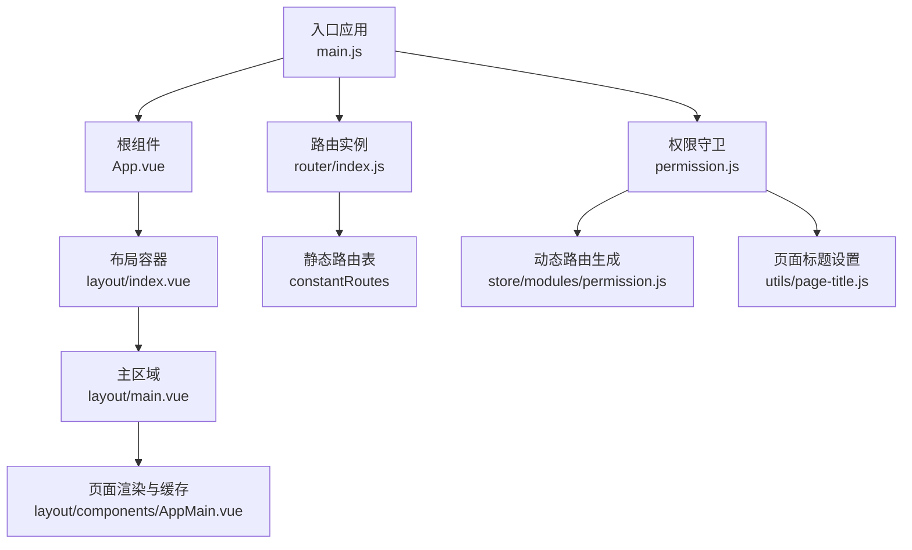
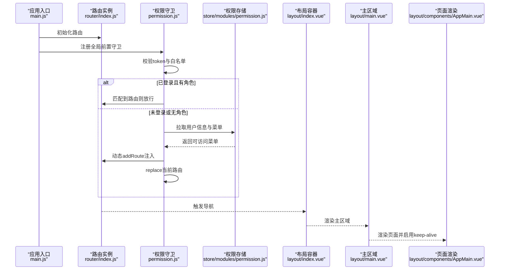
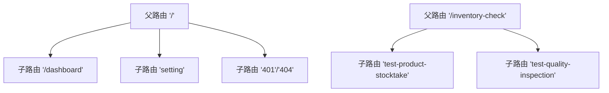
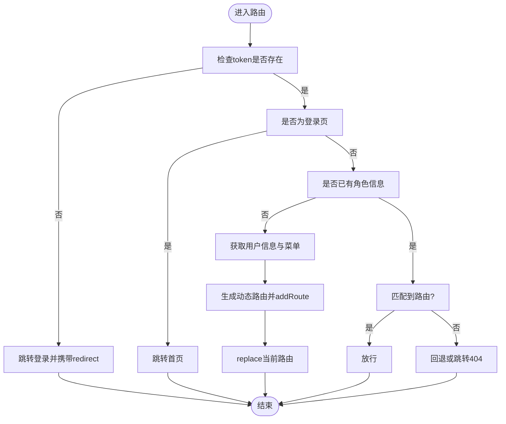
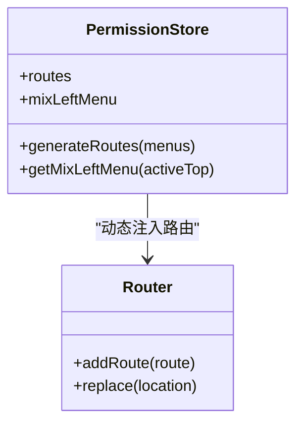
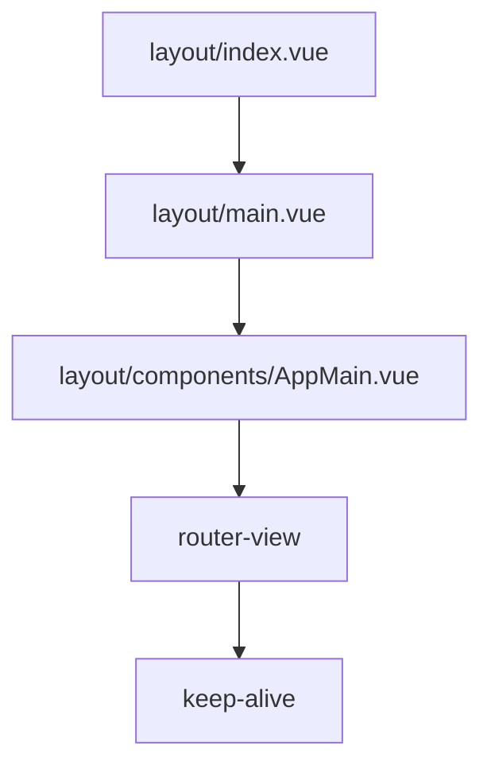
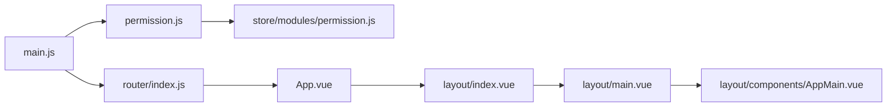

# Vue Router路由导航

<cite>
**本文引用的文件**
- [main.js](file://yarn/src/main.js)
- [App.vue](file://yarn/src/App.vue)
- [router/index.js](file://yarn/src/router/index.js)
- [permission.js](file://yarn/src/permission.js)
- [layout/index.vue](file://yarn/src/layout/index.vue)
- [layout/main.vue](file://yarn/src/layout/main.vue)
- [layout/components/AppMain.vue](file://yarn/src/layout/components/AppMain.vue)
- [layout/components/Sidebar/index.vue](file://yarn/src/layout/components/Sidebar/index.vue)
- [store/modules/permission.js](file://yarn/src/store/modules/permission.js)
- [utils/page-title.js](file://yarn/src/utils/page-title.js)
- [views/system/index.vue](file://yarn/src/views/system/index.vue)
</cite>

## 目录
1. [简介](#简介)
2. [项目结构](#项目结构)
3. [核心组件](#核心组件)
4. [架构总览](#架构总览)
5. [详细组件分析](#详细组件分析)
6. [依赖关系分析](#依赖关系分析)
7. [性能考量](#性能考量)
8. [故障排查指南](#故障排查指南)
9. [结论](#结论)
10. [附录](#附录)

## 简介
本文件系统性梳理并讲解本项目的Vue Router路由导航体系，涵盖静态与动态路由、嵌套路由设计、导航守卫与权限校验、懒加载与代码分割、动态路由与菜单联动、路由参数与查询串处理、面包屑与页面标题管理、布局与页面组织、以及路由缓存与状态保持等主题。目标是帮助开发者快速理解并高效扩展路由能力。

## 项目结构
本项目前端基于Vue 3 + Vite，采用Pinia状态管理，路由采用Vue Router 4。路由与权限控制集中在src/router与src/permission中，布局与页面组件位于src/layout与src/views，页面标题与国际化工具位于src/utils。

**图表来源**
- [main.js:1-44](file://yarn/src/main.js#L1-L44)
- [router/index.js:1-106](file://yarn/src/router/index.js#L1-L106)
- [permission.js:1-73](file://yarn/src/permission.js#L1-L73)
- [App.vue:1-57](file://yarn/src/App.vue#L1-L57)
- [layout/index.vue:1-270](file://yarn/src/layout/index.vue#L1-L270)
- [layout/main.vue:1-82](file://yarn/src/layout/main.vue#L1-L82)
- [layout/components/AppMain.vue:1-86](file://yarn/src/layout/components/AppMain.vue#L1-L86)
- [store/modules/permission.js:1-79](file://yarn/src/store/modules/permission.js#L1-L79)
- [utils/page-title.js:1-18](file://yarn/src/utils/page-title.js#L1-L18)

**章节来源**
- [main.js:1-44](file://yarn/src/main.js#L1-L44)
- [router/index.js:1-106](file://yarn/src/router/index.js#L1-L106)
- [permission.js:1-73](file://yarn/src/permission.js#L1-L73)
- [App.vue:1-57](file://yarn/src/App.vue#L1-L57)
- [layout/index.vue:1-270](file://yarn/src/layout/index.vue#L1-L270)
- [layout/main.vue:1-82](file://yarn/src/layout/main.vue#L1-L82)
- [layout/components/AppMain.vue:1-86](file://yarn/src/layout/components/AppMain.vue#L1-L86)
- [store/modules/permission.js:1-79](file://yarn/src/store/modules/permission.js#L1-L79)
- [utils/page-title.js:1-18](file://yarn/src/utils/page-title.js#L1-L18)

## 核心组件
- 路由实例与静态路由：在router/index.js中定义常量路由表constantRoutes，并通过createRouter创建路由实例；支持滚动行为与重置路由。
- 权限守卫：在permission.js中实现beforeEach与afterEach，负责登录态判断、白名单放行、动态路由注入、页面标题国际化与进度条控制。
- 布局与页面：layout/index.vue作为布局容器，layout/main.vue承载头部与主区域，AppMain.vue负责router-view渲染与keep-alive缓存。
- 动态路由与菜单：store/modules/permission.js通过import.meta.glob扫描视图目录，按后端菜单结构动态生成路由并注入至路由实例。
- 页面标题：utils/page-title.js结合设置中心统一拼接页面标题。

**章节来源**
- [router/index.js:1-106](file://yarn/src/router/index.js#L1-L106)
- [permission.js:1-73](file://yarn/src/permission.js#L1-L73)
- [layout/index.vue:1-270](file://yarn/src/layout/index.vue#L1-L270)
- [layout/main.vue:1-82](file://yarn/src/layout/main.vue#L1-L82)
- [layout/components/AppMain.vue:1-86](file://yarn/src/layout/components/AppMain.vue#L1-L86)
- [store/modules/permission.js:1-79](file://yarn/src/store/modules/permission.js#L1-L79)
- [utils/page-title.js:1-18](file://yarn/src/utils/page-title.js#L1-L18)

## 架构总览
下图展示从应用启动到页面渲染的关键流程，包括路由初始化、权限守卫、动态路由注入与页面缓存。

**图表来源**
- [main.js:1-44](file://yarn/src/main.js#L1-L44)
- [router/index.js:1-106](file://yarn/src/router/index.js#L1-L106)
- [permission.js:1-73](file://yarn/src/permission.js#L1-L73)
- [store/modules/permission.js:1-79](file://yarn/src/store/modules/permission.js#L1-L79)
- [layout/index.vue:1-270](file://yarn/src/layout/index.vue#L1-L270)
- [layout/main.vue:1-82](file://yarn/src/layout/main.vue#L1-L82)
- [layout/components/AppMain.vue:1-86](file://yarn/src/layout/components/AppMain.vue#L1-L86)

## 详细组件分析

### 路由配置与嵌套路由
- 静态路由：包含登录页、重定向、仪表盘、系统设置、错误页等；仪表盘与“盘点检验”模块采用嵌套路由，子路由在children中声明，父级使用Layout作为容器。
- 嵌套设计：父路由设置redirect与meta属性，子路由通过相对路径挂载到父级容器，形成多级菜单与页面栈。
- 路由历史：createWebHashHistory用于兼容部署环境；scrollBehavior固定滚动位置。

**图表来源**
- [router/index.js:7-87](file://yarn/src/router/index.js#L7-L87)

**章节来源**
- [router/index.js:1-106](file://yarn/src/router/index.js#L1-L106)

### 导航守卫与权限验证
- 白名单：仅允许未登录访问/login。
- 登录态：从localStorage读取token，存在则继续，否则跳转登录并携带redirect参数。
- 角色与动态路由：若用户无角色信息，则拉取用户信息与菜单，调用permissionStore.generateRoutes生成动态路由并通过router.addRoute注入，再replace当前路由以生效。
- 路由匹配：若to未匹配到任何路由，优先回退from.name，否则跳转404。
- 页面标题：使用getPageTitle与translateRouteTitle对标题进行国际化拼接。
- 进度条：NProgress在前置守卫开启，在后置钩子关闭。

**图表来源**
- [permission.js:18-68](file://yarn/src/permission.js#L18-L68)
- [store/modules/permission.js:53-60](file://yarn/src/store/modules/permission.js#L53-L60)

**章节来源**
- [permission.js:1-73](file://yarn/src/permission.js#L1-L73)
- [utils/page-title.js:1-18](file://yarn/src/utils/page-title.js#L1-L18)
- [store/modules/permission.js:1-79](file://yarn/src/store/modules/permission.js#L1-L79)

### 路由懒加载与代码分割
- 动态导入：静态路由中的组件均使用动态import实现按需加载。
- 动态路由：permission.js通过import.meta.glob扫描views目录下的所有.vue文件，将后端返回的component路径映射到对应组件，实现运行时代码分割与按需加载。
- keep-alive：AppMain.vue对router-view进行包裹，结合tagsView缓存列表实现页面级缓存，减少重复渲染成本。

**图表来源**
- [store/modules/permission.js:5-39](file://yarn/src/store/modules/permission.js#L5-L39)
- [router/index.js:20-25](file://yarn/src/router/index.js#L20-L25)
- [layout/components/AppMain.vue:4-9](file://yarn/src/layout/components/AppMain.vue#L4-L9)

**章节来源**
- [store/modules/permission.js:1-79](file://yarn/src/store/modules/permission.js#L1-L79)
- [router/index.js:1-106](file://yarn/src/router/index.js#L1-L106)
- [layout/components/AppMain.vue:1-86](file://yarn/src/layout/components/AppMain.vue#L1-L86)

### 动态路由与菜单生成
- 数据源：后端返回的菜单结构（含path、name、component、children等）。
- 组件映射：通过import.meta.glob按“views/xxx.vue”路径映射组件；若找不到则回退到404页面。
- 布局适配：当component为“Layout”时，自动替换为统一布局组件，保证嵌套结构一致。
- 混合模式菜单：permission.js提供mixLeftMenu与getMixLeftMenu，支持顶部菜单切换时左侧子菜单联动。

**图表来源**
- [store/modules/permission.js:42-72](file://yarn/src/store/modules/permission.js#L42-L72)
- [router/index.js:101-103](file://yarn/src/router/index.js#L101-L103)

**章节来源**
- [store/modules/permission.js:1-79](file://yarn/src/store/modules/permission.js#L1-L79)
- [router/index.js:1-106](file://yarn/src/router/index.js#L1-L106)

### 路由参数传递与查询字符串处理
- 参数传递：路由元信息meta中可携带title、icon、affix、keepAlive、alwaysShow等字段，供布局与标签页使用。
- 查询串：页面内可通过$router.replace或$router.push携带query参数；在页面组件中使用$route.query读取。
- 注意：本项目未在router/index.js中显式定义具名参数(:id)的路由，如需参数化路由，请在constantRoutes或动态路由中补充相应路径与组件映射。

**章节来源**
- [router/index.js:38-44](file://yarn/src/router/index.js#L38-L44)
- [views/system/index.vue:110-119](file://yarn/src/views/system/index.vue#L110-L119)

### 面包屑导航与页面标题管理
- 页面标题：permission.js在前置守卫中调用getPageTitle与translateRouteTitle，将路由meta.title翻译并拼接站点标题。
- 面包屑：项目未提供通用面包屑组件，可在Sidebar或TagsView基础上扩展，依据当前路由层级与父级路由构建路径数组，渲染面包屑导航。

**章节来源**
- [permission.js:21-24](file://yarn/src/permission.js#L21-L24)
- [utils/page-title.js:1-18](file://yarn/src/utils/page-title.js#L1-L18)

### 布局组件与页面组件组织
- 布局容器：layout/index.vue根据布局类型（left/top/mix）渲染不同菜单与主区域，支持响应式与混合模式。
- 主区域：layout/main.vue承载头部与主内容区，结合fixedHeader与tagsView开关。
- 页面渲染：layout/components/AppMain.vue通过router-view默认插槽与keep-alive结合，实现页面缓存与过渡动画。

**图表来源**
- [layout/index.vue:1-270](file://yarn/src/layout/index.vue#L1-L270)
- [layout/main.vue:1-82](file://yarn/src/layout/main.vue#L1-L82)
- [layout/components/AppMain.vue:1-86](file://yarn/src/layout/components/AppMain.vue#L1-L86)

**章节来源**
- [layout/index.vue:1-270](file://yarn/src/layout/index.vue#L1-L270)
- [layout/main.vue:1-82](file://yarn/src/layout/main.vue#L1-L82)
- [layout/components/AppMain.vue:1-86](file://yarn/src/layout/components/AppMain.vue#L1-L86)

### 路由缓存与页面状态保持
- 缓存策略：AppMain.vue通过keep-alive与tagsView缓存列表实现页面级缓存，避免重复渲染与请求。
- 元信息控制：静态路由中dashboard设置了keepAlive与affix，确保首页常驻缓存。
- 状态保持：页面组件可利用onActivated/onDeactivated生命周期配合缓存策略保存/恢复状态；对于复杂场景可结合pinia store持久化。

**章节来源**
- [layout/components/AppMain.vue:4-9](file://yarn/src/layout/components/AppMain.vue#L4-L9)
- [router/index.js:42-44](file://yarn/src/router/index.js#L42-L44)

## 依赖关系分析
- 应用入口依赖路由与权限守卫；路由依赖静态常量表；权限守卫依赖用户与权限store；动态路由依赖import.meta.glob扫描；页面渲染依赖keep-alive与tagsView缓存。

**图表来源**
- [main.js:1-44](file://yarn/src/main.js#L1-L44)
- [router/index.js:1-106](file://yarn/src/router/index.js#L1-L106)
- [permission.js:1-73](file://yarn/src/permission.js#L1-L73)
- [store/modules/permission.js:1-79](file://yarn/src/store/modules/permission.js#L1-L79)
- [App.vue:1-57](file://yarn/src/App.vue#L1-L57)
- [layout/index.vue:1-270](file://yarn/src/layout/index.vue#L1-L270)
- [layout/main.vue:1-82](file://yarn/src/layout/main.vue#L1-L82)
- [layout/components/AppMain.vue:1-86](file://yarn/src/layout/components/AppMain.vue#L1-L86)

**章节来源**
- [main.js:1-44](file://yarn/src/main.js#L1-L44)
- [router/index.js:1-106](file://yarn/src/router/index.js#L1-L106)
- [permission.js:1-73](file://yarn/src/permission.js#L1-L73)
- [store/modules/permission.js:1-79](file://yarn/src/store/modules/permission.js#L1-L79)
- [App.vue:1-57](file://yarn/src/App.vue#L1-L57)
- [layout/index.vue:1-270](file://yarn/src/layout/index.vue#L1-L270)
- [layout/main.vue:1-82](file://yarn/src/layout/main.vue#L1-L82)
- [layout/components/AppMain.vue:1-86](file://yarn/src/layout/components/AppMain.vue#L1-L86)

## 性能考量
- 懒加载与代码分割：通过动态import与import.meta.glob实现按需加载，降低首屏体积。
- keep-alive缓存：对高频访问页面启用缓存，减少重复渲染与网络请求。
- 进度条与滚动：NProgress提升交互反馈；scrollBehavior统一滚动位置，改善用户体验。
- 响应式布局：根据窗口宽度自动切换侧边栏与头部显示，兼顾移动端体验。

[本节为通用建议，无需特定文件引用]

## 故障排查指南
- 登录后仍跳转登录页
  - 检查localStorage中token键值是否正确；确认whiteList是否包含/login。
  - 参考：[permission.js:18-68](file://yarn/src/permission.js#L18-L68)
- 动态路由不生效
  - 确认后端返回的component路径与views目录结构一致；检查import.meta.glob是否能正确解析。
  - 参考：[store/modules/permission.js:5-39](file://yarn/src/store/modules/permission.js#L5-L39)
- 页面标题未更新
  - 检查getPageTitle与translateRouteTitle是否正确；确认meta.title是否传入。
  - 参考：[permission.js:21-24](file://yarn/src/permission.js#L21-L24)，[utils/page-title.js:1-18](file://yarn/src/utils/page-title.js#L1-L18)
- 页面缓存无效
  - 确认页面是否在tagsView缓存列表中；检查keep-alive include配置。
  - 参考：[layout/components/AppMain.vue:4-9](file://yarn/src/layout/components/AppMain.vue#L4-L9)

**章节来源**
- [permission.js:18-68](file://yarn/src/permission.js#L18-L68)
- [store/modules/permission.js:5-39](file://yarn/src/store/modules/permission.js#L5-L39)
- [utils/page-title.js:1-18](file://yarn/src/utils/page-title.js#L1-L18)
- [layout/components/AppMain.vue:4-9](file://yarn/src/layout/components/AppMain.vue#L4-L9)

## 结论
本项目通过“静态路由+动态路由”的组合，结合权限守卫与keep-alive缓存，实现了灵活、安全且高性能的路由导航体系。建议在后续扩展中：
- 补充具名参数路由与路由元信息规范；
- 增强面包屑与页面标题的通用组件；
- 完善路由缓存策略与状态持久化方案；
- 优化菜单与路由的联动与一致性。

[本节为总结，无需特定文件引用]

## 附录
- 示例页面：views/system/index.vue展示了dashboard页面的数据与组件组织方式，可作为新增页面的参考模板。
  
**章节来源**
- [views/system/index.vue:1-699](file://yarn/src/views/system/index.vue#L1-L699)