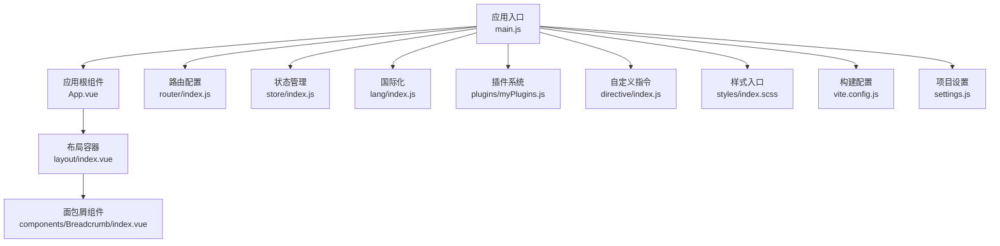
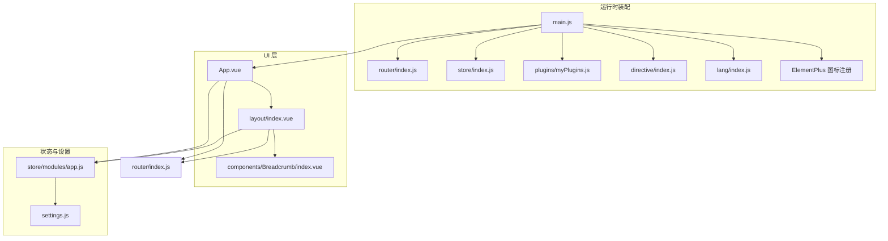
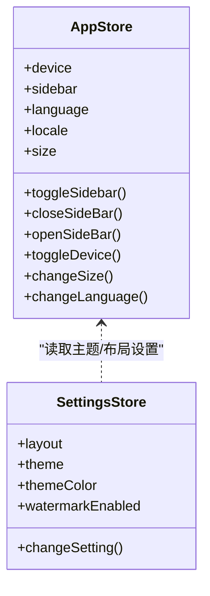
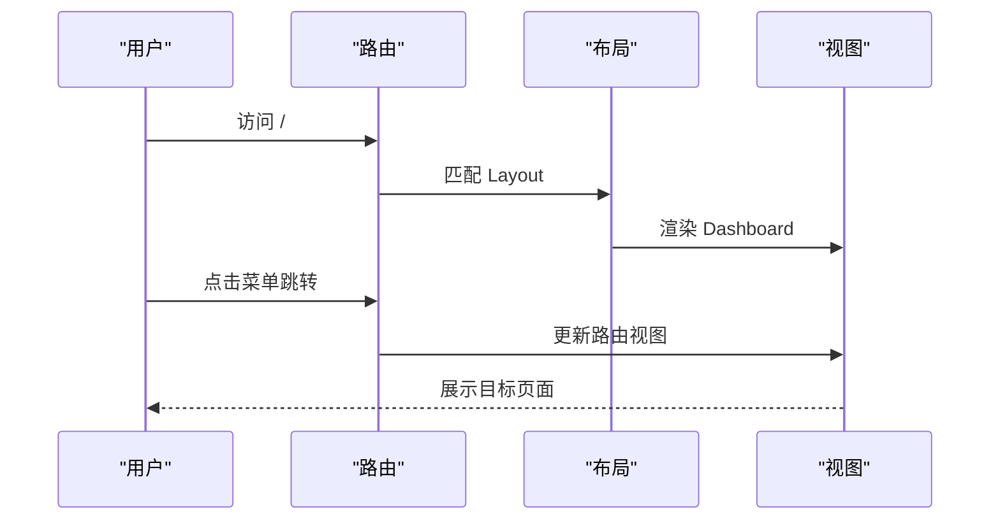
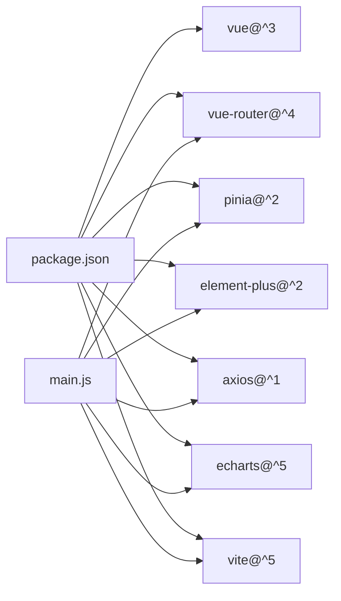

# 前端架构设计

<cite>
**本文引用的文件**
- [package.json](file://yarn/package.json)
- [vite.config.js](file://yarn/vite.config.js)
- [main.js](file://yarn/src/main.js)
- [App.vue](file://yarn/src/App.vue)
- [settings.js](file://yarn/src/settings.js)
- [router/index.js](file://yarn/src/router/index.js)
- [store/index.js](file://yarn/src/store/index.js)
- [store/modules/app.js](file://yarn/src/store/modules/app.js)
- [layout/index.vue](file://yarn/src/layout/index.vue)
- [styles/index.scss](file://yarn/src/styles/index.scss)
- [components/Breadcrumb/index.vue](file://yarn/src/components/Breadcrumb/index.vue)
- [plugins/myPlugins.js](file://yarn/src/plugins/myPlugins.js)
- [directive/index.js](file://yarn/src/directive/index.js)
</cite>

## 目录
1. [引言](#引言)
2. [项目结构](#项目结构)
3. [核心组件](#核心组件)
4. [架构总览](#架构总览)
5. [详细组件分析](#详细组件分析)
6. [依赖关系分析](#依赖关系分析)
7. [性能考虑](#性能考虑)
8. [故障排查指南](#故障排查指南)
9. [结论](#结论)
10. [附录](#附录)

## 引言
本文件面向“高齿传动”前端工程，系统梳理基于 Vue 3 + Composition API 的架构设计与最佳实践，涵盖响应式数据、计算属性、生命周期钩子、Element Plus 组件库集成与定制、Pinia 状态管理、Vue Router 路由与导航守卫、Vite 构建与优化策略，并总结组件化开发的设计原则、代码组织与开发规范，以及前端性能优化与用户体验提升的实践方案。

## 项目结构
前端工程位于 yarn 目录，采用典型的单页应用（SPA）结构，核心目录与职责如下：
- src：源代码根目录
  - api：接口封装与调用
  - assets：静态资源
  - components：通用组件
  - directive：自定义指令
  - lang：国际化配置
  - layout：布局与导航
  - plugins：插件安装与全局能力注入
  - router：路由配置
  - store：Pinia 状态管理
  - styles：样式入口与主题
  - utils：工具函数
  - views：页面级视图
  - App.vue、main.js：应用入口与挂载
- vite.config.js：构建与开发服务器配置
- package.json：依赖与脚本

**图表来源**
- [main.js:1-44](file://yarn/src/main.js#L1-L44)
- [App.vue:1-57](file://yarn/src/App.vue#L1-L57)
- [router/index.js:1-106](file://yarn/src/router/index.js#L1-L106)
- [store/index.js:1-10](file://yarn/src/store/index.js#L1-L10)
- [layout/index.vue:1-270](file://yarn/src/layout/index.vue#L1-L270)
- [components/Breadcrumb/index.vue:1-95](file://yarn/src/components/Breadcrumb/index.vue#L1-L95)
- [styles/index.scss:1-11](file://yarn/src/styles/index.scss#L1-L11)
- [vite.config.js:1-185](file://yarn/vite.config.js#L1-L185)
- [settings.js:1-24](file://yarn/src/settings.js#L1-L24)

**章节来源**
- [main.js:1-44](file://yarn/src/main.js#L1-L44)
- [vite.config.js:1-185](file://yarn/vite.config.js#L1-L185)
- [package.json:1-88](file://yarn/package.json#L1-L88)

## 核心组件
- 应用入口与初始化
  - 创建应用实例、安装路由、状态、国际化、粒子动画、自定义插件与指令、全局注册 Element Plus 图标组件。
- 应用根组件
  - 通过 Element Plus ConfigProvider 提供语言与尺寸上下文；根据设置决定是否启用水印；渲染路由视图。
- 布局容器
  - 支持 left/top/mix 三种导航布局模式；响应式设备检测与侧边栏状态；混合模式下联动左侧菜单。
- 面包屑组件
  - 基于路由元信息生成面包屑；支持动态路径编译与点击跳转。
- 插件系统
  - 注入全局工具函数（时间、剪贴板、分页、权限等）、按需注册 ECharts 图表、注册分页组件。
- 自定义指令
  - 防重复点击、权限校验等指令注册。

**章节来源**
- [main.js:1-44](file://yarn/src/main.js#L1-L44)
- [App.vue:1-57](file://yarn/src/App.vue#L1-L57)
- [layout/index.vue:1-270](file://yarn/src/layout/index.vue#L1-L270)
- [components/Breadcrumb/index.vue:1-95](file://yarn/src/components/Breadcrumb/index.vue#L1-L95)
- [plugins/myPlugins.js:1-74](file://yarn/src/plugins/myPlugins.js#L1-L74)
- [directive/index.js:1-8](file://yarn/src/directive/index.js#L1-L8)

## 架构总览
整体采用“入口装配 + 布局容器 + 视图页面”的分层架构，配合 Pinia 实现跨组件状态共享，Element Plus 提供 UI 基础能力，Vite 提供高效开发与构建体验。

**图表来源**
- [main.js:1-44](file://yarn/src/main.js#L1-L44)
- [router/index.js:1-106](file://yarn/src/router/index.js#L1-L106)
- [store/index.js:1-10](file://yarn/src/store/index.js#L1-L10)
- [store/modules/app.js:1-89](file://yarn/src/store/modules/app.js#L1-L89)
- [layout/index.vue:1-270](file://yarn/src/layout/index.vue#L1-L270)
- [components/Breadcrumb/index.vue:1-95](file://yarn/src/components/Breadcrumb/index.vue#L1-L95)
- [settings.js:1-24](file://yarn/src/settings.js#L1-L24)

## 详细组件分析

### Vue 3 Composition API 使用模式与最佳实践
- 响应式数据
  - 使用 ref/ reactive 管理局部状态；结合 useStorage 实现持久化响应式状态（如设备类型、侧边栏状态、语言、尺寸）。
  - 示例参考：[store/modules/app.js:17-20](file://yarn/src/store/modules/app.js#L17-L20)、[layout/index.vue:31-35](file://yarn/src/layout/index.vue#L31-L35)。
- 计算属性
  - 通过 computed 对派生状态进行统一计算，如语言包 locale、布局类名 classObj、混合模式菜单等。
  - 示例参考：[store/modules/app.js:22-28](file://yarn/src/store/modules/app.js#L22-L28)、[layout/index.vue:72-80](file://yarn/src/layout/index.vue#L72-L80)。
- 生命周期钩子
  - 在 App.vue 中使用 onMounted 初始化设置项；在组件中使用 watch/watchEffect 响应式监听与副作用。
  - 示例参考：[App.vue:43-48](file://yarn/src/App.vue#L43-L48)、[layout/index.vue:60-95](file://yarn/src/layout/index.vue#L60-L95)。

**章节来源**
- [store/modules/app.js:1-89](file://yarn/src/store/modules/app.js#L1-L89)
- [layout/index.vue:1-270](file://yarn/src/layout/index.vue#L1-L270)
- [App.vue:1-57](file://yarn/src/App.vue#L1-L57)

### Element Plus 组件库的集成与定制
- 全局注册与按需导入
  - 在入口中注册 Element Plus 图标组件，确保模板中可直接使用图标。
  - 示例参考：[main.js:41-43](file://yarn/src/main.js#L41-L43)。
- 主题与样式
  - 引入暗黑主题变量文件与全局样式入口；通过 ConfigProvider 动态切换语言与组件尺寸。
  - 示例参考：[main.js:13-15](file://yarn/src/main.js#L13-L15)、[App.vue:2](file://yarn/src/App.vue#L2)。
- 组件封装与自动导入
  - Vite 插件自动导入 Element Plus 组件与图标，减少手动引入成本。
  - 示例参考：[vite.config.js:38-70](file://yarn/vite.config.js#L38-L70)。

**章节来源**
- [main.js:1-44](file://yarn/src/main.js#L1-L44)
- [App.vue:1-57](file://yarn/src/App.vue#L1-L57)
- [vite.config.js:1-185](file://yarn/vite.config.js#L1-L185)

### Pinia 状态管理的设计理念与使用方法
- Store 定义与安装
  - 在入口中安装 Pinia；在 store/index.js 中导出 setupStore 以供入口调用。
  - 示例参考：[store/index.js:1-10](file://yarn/src/store/index.js#L1-L10)、[main.js:23](file://yarn/src/main.js#L23)。
- 状态共享与持久化
  - 使用 useStorage 将状态持久化到本地存储，实现刷新后状态恢复。
  - 示例参考：[store/modules/app.js:12-16](file://yarn/src/store/modules/app.js#L12-L16)。
- 行为与动作
  - 定义 toggleSidebar、changeLanguage、changeSize 等动作，集中处理状态变更逻辑。
  - 示例参考：[store/modules/app.js:31-67](file://yarn/src/store/modules/app.js#L31-L67)。

**图表来源**
- [store/modules/app.js:1-89](file://yarn/src/store/modules/app.js#L1-L89)
- [settings.js:1-24](file://yarn/src/settings.js#L1-L24)

**章节来源**
- [store/index.js:1-10](file://yarn/src/store/index.js#L1-L10)
- [store/modules/app.js:1-89](file://yarn/src/store/modules/app.js#L1-L89)
- [settings.js:1-24](file://yarn/src/settings.js#L1-L24)

### Vue Router 路由配置与导航守卫机制
- 静态路由与布局
  - constantRoutes 定义登录、重定向、仪表盘、系统设置、错误页等基础路由；使用 Layout 作为主框架。
  - 示例参考：[router/index.js:7-87](file://yarn/src/router/index.js#L7-L87)。
- 路由行为与滚动
  - createWebHashHistory 与 scrollBehavior 控制滚动位置。
  - 示例参考：[router/index.js:92-96](file://yarn/src/router/index.js#L92-L96)。
- 路由重置
  - resetRouter 提供路由重置能力，便于登出后回到登录页。
  - 示例参考：[router/index.js:101-103](file://yarn/src/router/index.js#L101-L103)。

**图表来源**
- [router/index.js:1-106](file://yarn/src/router/index.js#L1-L106)
- [layout/index.vue:1-270](file://yarn/src/layout/index.vue#L1-L270)

**章节来源**
- [router/index.js:1-106](file://yarn/src/router/index.js#L1-L106)

### Vite 构建工具的配置与优化策略
- 插件生态
  - Vue、UnoCSS、AutoImport、Components、Icons、SVG Icons 等插件协同工作，实现自动导入与组件注册。
  - 示例参考：[vite.config.js:38-70](file://yarn/vite.config.js#L38-L70)。
- 预构建与依赖优化
  - optimizeDeps 预加载常用依赖，缩短冷启动时间。
  - 示例参考：[vite.config.js:72-144](file://yarn/vite.config.js#L72-L144)。
- 构建产物与压缩
  - Terser 去除 console/debugger，Rollup 输出命名规则清晰，chunkSizeWarningLimit 降低大包告警阈值。
  - 示例参考：[vite.config.js:147-181](file://yarn/vite.config.js#L147-L181)。
- CSS 预处理与别名
  - SCSS 全局变量注入与路径别名配置，提升样式复用性。
  - 示例参考：[vite.config.js:23-32](file://yarn/vite.config.js#L23-L32)、[vite.config.js:17-22](file://yarn/vite.config.js#L17-L22)。

**章节来源**
- [vite.config.js:1-185](file://yarn/vite.config.js#L1-L185)

### 组件化开发的设计原则、代码组织与开发规范
- 设计原则
  - 单一职责：每个组件聚焦一个功能域；布局、导航、业务视图分离。
  - 可复用性：通用组件（如分页、面包屑）抽取至 components 目录。
  - 数据驱动：通过 props、events、slots 传递数据与行为。
- 代码组织
  - 组件按功能分层：layout、components、views；插件与指令集中管理。
  - 样式入口统一：styles/index.scss 汇总主题、过渡、全局样式。
- 开发规范
  - 使用 Composition API；合理划分响应式状态与计算属性；避免在模板中写复杂逻辑。
  - 使用 ESLint/Prettier 统一风格；Vite 插件 AutoImport/Components 减少样板代码。

**章节来源**
- [layout/index.vue:1-270](file://yarn/src/layout/index.vue#L1-L270)
- [components/Breadcrumb/index.vue:1-95](file://yarn/src/components/Breadcrumb/index.vue#L1-L95)
- [styles/index.scss:1-11](file://yarn/src/styles/index.scss#L1-L11)
- [plugins/myPlugins.js:1-74](file://yarn/src/plugins/myPlugins.js#L1-L74)
- [directive/index.js:1-8](file://yarn/src/directive/index.js#L1-L8)

## 依赖关系分析
- 运行时依赖
  - Vue 3、Vue Router、Pinia、Element Plus、Axios、ECharts、QRCode、XLSX 等。
- 开发依赖
  - Vite、ESLint、Prettier、UnoCSS、unplugin-auto-import、unplugin-vue-components、unplugin-icons 等。
- 依赖注入链路
  - main.js -> router、store、i18n、plugins、directive -> App.vue -> layout/index.vue -> components/Breadcrumb/index.vue。

**图表来源**
- [package.json:25-57](file://yarn/package.json#L25-L57)
- [main.js:1-44](file://yarn/src/main.js#L1-L44)

**章节来源**
- [package.json:1-88](file://yarn/package.json#L1-L88)
- [main.js:1-44](file://yarn/src/main.js#L1-L44)

## 性能考虑
- 体积与加载
  - 通过 optimizeDeps 预构建常用依赖；Terser 去除无用代码与注释；合理拆分 chunk。
  - 参考：[vite.config.js:72-144](file://yarn/vite.config.js#L72-L144)、[vite.config.js:150-160](file://yarn/vite.config.js#L150-L160)。
- 渲染与交互
  - 使用 Composition API 的响应式粒度控制更新范围；避免在模板中执行复杂计算。
  - 参考：[store/modules/app.js:22-28](file://yarn/src/store/modules/app.js#L22-L28)、[layout/index.vue:72-80](file://yarn/src/layout/index.vue#L72-L80)。
- 资源与网络
  - 合理使用懒加载路由组件；对图片、字体、媒体资源进行分类命名与缓存策略。
  - 参考：[vite.config.js:168-179](file://yarn/vite.config.js#L168-L179)。
- 用户体验
  - 使用 NProgress 进度条、水印、主题切换等增强感知；保持路由切换流畅与首屏加载速度。

[本节为通用性能建议，不直接分析具体文件]

## 故障排查指南
- 路由跳转无效
  - 检查路由配置与命名；确认 Layout 与子路由匹配关系。
  - 参考：[router/index.js:7-87](file://yarn/src/router/index.js#L7-L87)。
- 状态未持久化
  - 确认 useStorage 的键名与 storePrefix 设置一致。
  - 参考：[store/modules/app.js:10-16](file://yarn/src/store/modules/app.js#L10-L16)、[settings.js:10](file://yarn/src/settings.js#L10)。
- 样式异常或主题不生效
  - 确认 Element Plus 暗黑主题变量文件引入顺序与 ConfigProvider 语言/尺寸设置。
  - 参考：[main.js:13-15](file://yarn/src/main.js#L13-L15)、[App.vue:2](file://yarn/src/App.vue#L2)。
- 构建失败或包体过大
  - 检查 optimizeDeps.include 与 Terser 配置；关注 Rollup 输出命名与 chunkSizeWarningLimit。
  - 参考：[vite.config.js:72-144](file://yarn/vite.config.js#L72-L144)、[vite.config.js:147-181](file://yarn/vite.config.js#L147-L181)。

**章节来源**
- [router/index.js:1-106](file://yarn/src/router/index.js#L1-L106)
- [store/modules/app.js:1-89](file://yarn/src/store/modules/app.js#L1-L89)
- [settings.js:1-24](file://yarn/src/settings.js#L1-L24)
- [main.js:1-44](file://yarn/src/main.js#L1-L44)
- [App.vue:1-57](file://yarn/src/App.vue#L1-L57)
- [vite.config.js:1-185](file://yarn/vite.config.js#L1-L185)

## 结论
本项目以 Vue 3 + Composition API 为核心，结合 Pinia 实现轻量而强大的状态管理，借助 Element Plus 与 Vite 插件体系实现高效率的开发与构建。通过清晰的路由与布局设计、完善的插件与指令体系、以及统一的样式与主题策略，形成了可维护、可扩展、可优化的前端架构。建议在后续迭代中持续完善路由权限模型、组件测试与文档化，进一步提升工程稳定性与团队协作效率。

## 附录
- 术语
  - SPA：单页应用
  - SSR/SSG：服务端渲染/静态站点生成（本项目为 SPA）
  - ECharts：可视化图表库
  - UnoCSS：原子化 CSS 框架
- 参考路径
  - [入口装配与插件注册:1-44](file://yarn/src/main.js#L1-L44)
  - [应用根组件与主题配置:1-57](file://yarn/src/App.vue#L1-L57)
  - [路由与布局:1-106](file://yarn/src/router/index.js#L1-L106)
  - [状态管理与持久化:1-89](file://yarn/src/store/modules/app.js#L1-L89)
  - [构建与优化:1-185](file://yarn/vite.config.js#L1-L185)
  - [样式入口与主题:1-11](file://yarn/src/styles/index.scss#L1-L11)