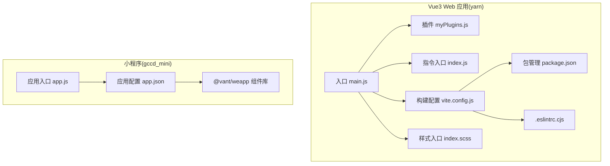
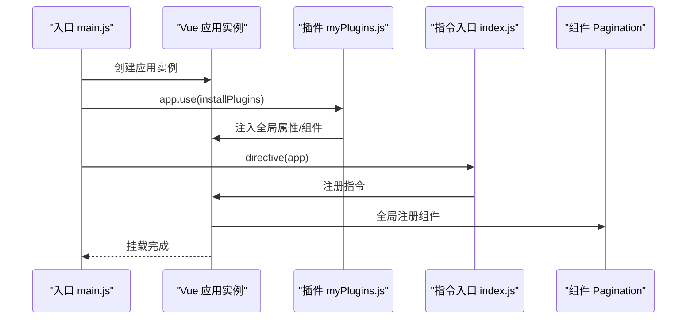
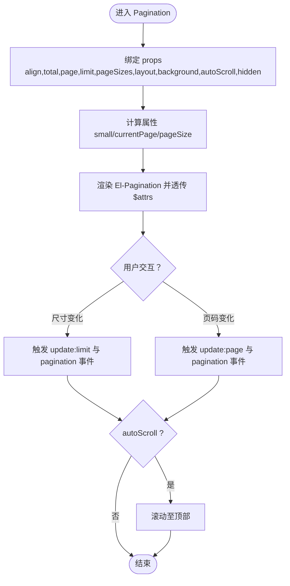
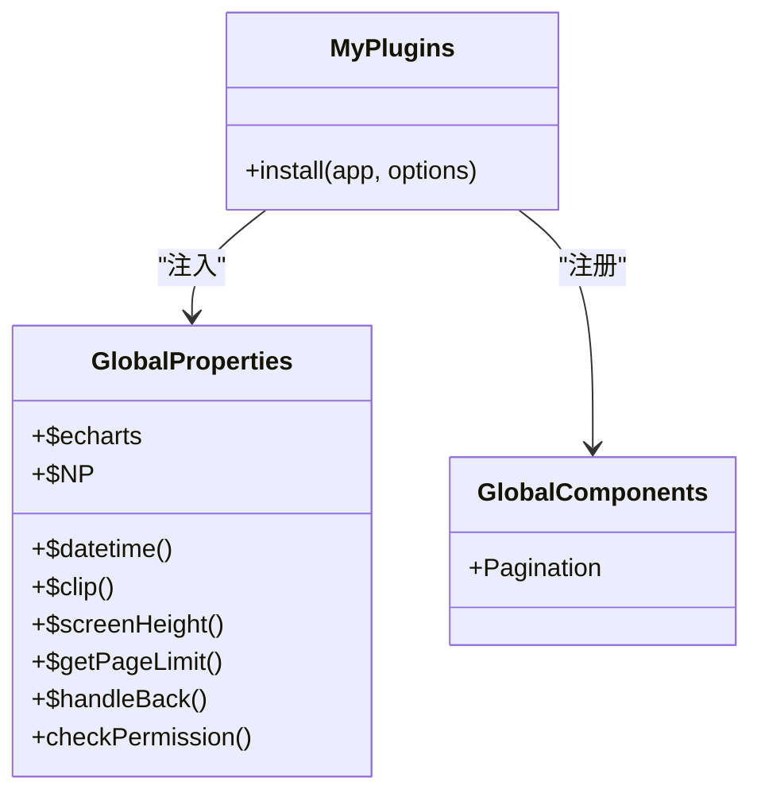
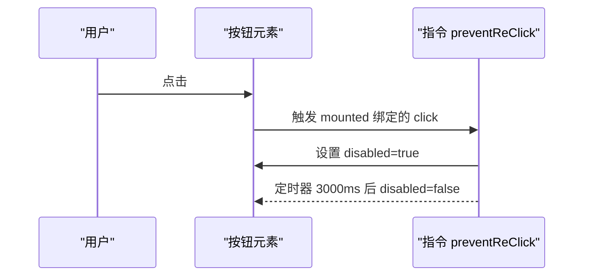
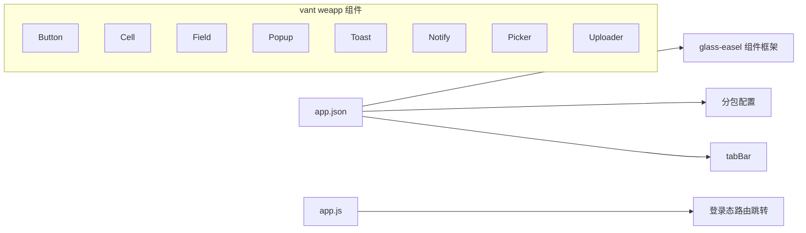
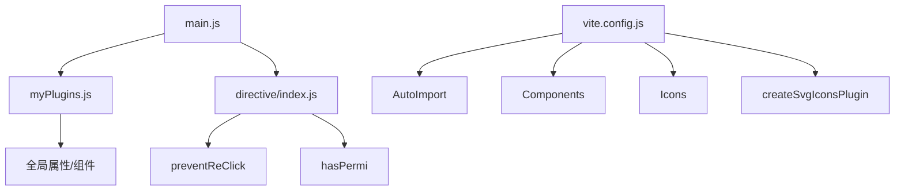

# 组件开发规范

<cite>
**本文引用的文件**
- [main.js](file://yarn/src/main.js)
- [myPlugins.js](file://yarn/src/plugins/myPlugins.js)
- [index.js](file://yarn/src/directive/index.js)
- [preventReClick.js](file://yarn/src/directive/common/preventReClick.js)
- [hasPermi.js](file://yarn/src/directive/common/hasPermi.js)
- [index.vue](file://yarn/src/components/Pagination/index.vue)
- [index.js](file://gccd_mini/app.json)
- [app.js](file://gccd_mini/app.js)
- [package.json](file://yarn/package.json)
- [vite.config.js](file://yarn/vite.config.js)
- [.eslintrc.cjs](file://yarn/.eslintrc.cjs)
- [index.scss](file://yarn/src/styles/index.scss)
- [index.vue](file://yarn/src/components/AjCaptcha/index.vue)
- [VerifySlide.vue](file://yarn/src/components/AjCaptcha/Verify/VerifySlide.vue)
- [VerifyPoints.vue](file://yarn/src/components/AjCaptcha/Verify/VerifyPoints.vue)
- [index.vue](file://yarn/src/components/FileManage/index.vue)
- [FileUpload.vue](file://yarn/src/components/FileManage/FileUpload.vue)
- [FileUploads.vue](file://yarn/src/components/FileManage/FileUploads.vue)
- [FilePreview.vue](file://yarn/src/components/FileManage/FilePreview.vue)
- [FileImage.vue](file://yarn/src/components/FileManage/FileImage.vue)
- [index.vue](file://yarn/src/components/RichEditor/index.vue)
- [index.vue](file://yarn/src/components/ExcelImport/index.vue)
- [index.vue](file://yarn/src/components/SvgIcon/index.vue)
- [index.vue](file://yarn/src/components/ThemeSelect/index.vue)
- [index.vue](file://yarn/src/components/LangSelect/index.vue)
- [index.vue](file://yarn/src/components/Hamburger/index.vue)
- [index.vue](file://yarn/src/components/Breadcrumb/index.vue)
- [index.vue](file://yarn/src/components/IconSelect/index.vue)
- [goodsquery/Columnchart.vue](file://yarn/src/components/goodsquery/Columnchart.vue)
- [goodsquery/Histogram.vue](file://yarn/src/components/goodsquery/Histogram.vue)
- [goodsquery/Mapping.vue](file://yarn/src/components/goodsquery/Mapping.vue)
- [index.vue](file://gccd_mini/miniprogram_npm/@vant/weapp/button/index.vue)
- [index.vue](file://gccd_mini/miniprogram_npm/@vant/weapp/cell/index.vue)
- [index.vue](file://gccd_mini/miniprogram_npm/@vant/weapp/field/index.vue)
- [index.vue](file://gccd_mini/miniprogram_npm/@vant/weapp/popup/index.vue)
- [index.vue](file://gccd_mini/miniprogram_npm/@vant/weapp/toast/index.vue)
- [index.vue](file://gccd_mini/miniprogram_npm/@vant/weapp/overlay/index.vue)
- [index.vue](file://gccd_mini/miniprogram_npm/@vant/weapp/notify/index.vue)
- [index.vue](file://gccd_mini/miniprogram_npm/@vant/weapp/area/index.vue)
- [index.vue](file://gccd_mini/miniprogram_npm/@vant/weapp/calendar/index.vue)
- [index.vue](file://gccd_mini/miniprogram_npm/@vant/weapp/cascader/index.vue)
- [index.vue](file://gccd_mini/miniprogram_npm/@vant/weapp/checkbox/index.vue)
- [index.vue](file://gccd_mini/miniprogram_npm/@vant/weapp/col/index.vue)
- [index.vue](file://gccd_mini/miniprogram_npm/@vant/weapp/count-down/index.vue)
- [index.vue](file://gccd_mini/miniprogram_npm/@vant/weapp/datetime-picker/index.vue)
- [index.vue](file://gccd_mini/miniprogram_npm/@vant/weapp/dialog/index.vue)
- [index.vue](file://gccd_mini/miniprogram_npm/@vant/weapp/dropdown-menu/index.vue)
- [index.vue](file://gccd_mini/miniprogram_npm/@vant/weapp/empty/index.vue)
- [index.vue](file://gccd_mini/miniprogram_npm/@vant/weapp/grid/index.vue)
- [index.vue](file://gccd_mini/miniprogram_npm/@vant/weapp/icon/index.vue)
- [index.vue](file://gccd_mini/miniprogram_npm/@vant/weamp/image/index.vue)
- [index.vue](file://gccd_mini/miniprogram_npm/@vant/weapp/notice-bar/index.vue)
- [index.vue](file://gccd_mini/miniprogram_npm/@vant/weapp/panel/index.vue)
- [index.vue](file://gccd_mini/miniprogram_npm/@vant/weapp/picker/index.vue)
- [index.vue](file://gccd_mini/miniprogram_npm/@vant/weapp/progress/index.vue)
- [index.vue](file://gccd_mini/miniprogram_npm/@vant/weapp/rate/index.vue)
- [index.vue](file://gccd_mini/miniprogram_npm/@vant/weapp/search/index.vue)
- [index.vue](file://gccd_mini/miniprogram_npm/@vant/weapp/share-sheet/index.vue)
- [index.vue](file://gccd_mini/miniprogram_npm/@vant/weapp/slider/index.vue)
- [index.vue](file://gccd_mini/miniprogram_npm/@vant/weapp/stepper/index.vue)
- [index.vue](file://gccd_mini/miniprogram_npm/@vant/weapp/steps/index.vue)
- [index.vue](file://gccd_mini/miniprogram_npm/@vant/weapp/submit-bar/index.vue)
- [index.vue](file://gccd_mini/miniprogram_npm/@vant/weapp/swipe-cell/index.vue)
- [index.vue](file://gccd_mini/miniprogram_npm/@vant/weapp/switch/index.vue)
- [index.vue](file://gccd_mini/miniprogram_npm/@vant/weapp/tab/index.vue)
- [index.vue](file://gccd_mini/miniprogram_npm/@vant/weapp/tabbar/index.vue)
- [index.vue](file://gccd_mini/miniprogram_npm/@vant/weapp/tabs/index.vue)
- [index.vue](file://gccd_mini/miniprogram_npm/@vant/weapp/tag/index.vue)
- [index.vue](file://gccd_mini/miniprogram_npm/@vant/weapp/transition/index.vue)
- [index.vue](file://gccd_mini/miniprogram_npm/@vant/weapp/tree-select/index.vue)
- [index.vue](file://gccd_mini/miniprogram_npm/@vant/weapp/uploader/index.vue)
</cite>

## 目录
1. [引言](#引言)
2. [项目结构](#项目结构)
3. [核心组件](#核心组件)
4. [架构总览](#架构总览)
5. [详细组件分析](#详细组件分析)
6. [依赖关系分析](#依赖关系分析)
7. [性能考虑](#性能考虑)
8. [故障排查指南](#故障排查指南)
9. [结论](#结论)
10. [附录](#附录)

## 引言
本指南面向前端组件开发团队，系统梳理并规范组件设计原则、命名与结构、props/events/slots 设计模式、封装与复用策略、插件系统与自定义指令、视图与业务组件职责划分、测试与文档规范、性能优化与错误处理、以及组件库构建与发布流程。内容基于仓库现有实现进行提炼与推广，既适用于 Vue 3 Web 应用，也适用于微信小程序生态（如 vant weapp 组件）。

## 项目结构
本仓库包含两套前端体系：
- Vue 3 Web 应用：位于 yarn/，采用 Vite 构建，集成 Vue Router、Pinia、Element Plus、UnoCSS 等生态。
- 微信小程序：位于 gccd_mini/，使用原生小程序框架与 vant weapp 组件库。

**图表来源**
- [main.js:1-44](file://yarn/src/main.js#L1-L44)
- [myPlugins.js:1-74](file://yarn/src/plugins/myPlugins.js#L1-L74)
- [index.js:1-8](file://yarn/src/directive/index.js#L1-L8)
- [vite.config.js:1-185](file://yarn/vite.config.js#L1-L185)
- [package.json:1-88](file://yarn/package.json#L1-L88)
- [.eslintrc.cjs:1-63](file://yarn/.eslintrc.cjs#L1-L63)
- [index.scss:1-11](file://yarn/src/styles/index.scss#L1-L11)
- [index.js:1-99](file://gccd_mini/app.json#L1-L99)
- [app.js:1-33](file://gccd_mini/app.js#L1-L33)
- [index.vue](file://gccd_mini/miniprogram_npm/@vant/weapp/button/index.vue)

**章节来源**
- [main.js:1-44](file://yarn/src/main.js#L1-L44)
- [vite.config.js:1-185](file://yarn/vite.config.js#L1-L185)
- [package.json:1-88](file://yarn/package.json#L1-L88)
- [index.js:1-99](file://gccd_mini/app.json#L1-L99)
- [app.js:1-33](file://gccd_mini/app.js#L1-L33)

## 核心组件
本节聚焦 Vue 3 Web 应用中的核心组件与基础设施，包括分页组件、插件系统、自定义指令、样式体系与构建配置。

- 分页组件 Pagination
  - 设计要点：支持对齐、布局、尺寸列表、背景色、小尺寸适配、自动滚动、隐藏控制；通过计算属性与 v-model:page/v-model:page-size 实现双向绑定；对外抛出 pagination 事件并可透传原生属性。
  - 复用性：作为通用分页容器，统一业务侧分页交互体验。
  - 性能：结合滚动定位与小尺寸状态，减少不必要的重排。

- 插件系统 myPlugins
  - 全局属性：挂载时间格式化、图表库、剪贴板、屏幕高度、分页限制、返回逻辑、权限校验、数值精度工具等。
  - 全局组件：注册 Pagination 组件，便于在任意模板中直接使用。
  - 可扩展：新增全局能力或组件均在此集中注册，避免分散注入。

- 自定义指令 directive
  - 指令入口：统一注册 preventReClick（防重复点击）、hasPermi（权限控制）。
  - 指令实现：preventReClick 在挂载阶段绑定 click 事件，触发后禁用按钮并在定时器后恢复；hasPermi 读取用户角色集合，若不满足权限则移除节点，并在参数非法时抛错。

- 样式体系与构建
  - 样式入口：整合过渡、侧边栏、重置、暗色主题、全局样式等模块。
  - 构建：Vite 预设自动导入、组件自动注册、图标自动安装、SVG 图标缓存、依赖预构建与产物命名策略、生产环境压缩与注释清理。
  - 规范：ESLint 关闭多词组件名强制、显式 emits 建议等，以提升开发效率与一致性。

**章节来源**
- [index.vue:1-116](file://yarn/src/components/Pagination/index.vue#L1-L116)
- [myPlugins.js:1-74](file://yarn/src/plugins/myPlugins.js#L1-L74)
- [index.js:1-8](file://yarn/src/directive/index.js#L1-L8)
- [preventReClick.js:1-16](file://yarn/src/directive/common/preventReClick.js#L1-L16)
- [hasPermi.js:1-23](file://yarn/src/directive/common/hasPermi.js#L1-L23)
- [index.scss:1-11](file://yarn/src/styles/index.scss#L1-L11)
- [vite.config.js:1-185](file://yarn/vite.config.js#L1-L185)
- [.eslintrc.cjs:1-63](file://yarn/.eslintrc.cjs#L1-L63)

## 架构总览
下图展示 Vue 应用启动、插件与指令注册、全局能力注入及组件使用的整体流程。

**图表来源**
- [main.js:1-44](file://yarn/src/main.js#L1-L44)
- [myPlugins.js:1-74](file://yarn/src/plugins/myPlugins.js#L1-L74)
- [index.js:1-8](file://yarn/src/directive/index.js#L1-L8)
- [index.vue:1-116](file://yarn/src/components/Pagination/index.vue#L1-L116)

## 详细组件分析

### 分页组件 Pagination 设计与实现
- Props 设计
  - 对齐 align：文本对齐方式，默认左对齐。
  - 数据总量 total：必填项，Number 类型。
  - 当前页 page：Number，默认 1。
  - 每页数量 limit：Number，默认 20。
  - 页面尺寸列表 pageSizes：Array，默认提供常见选项。
  - 布局 layout：String，默认包含总数、尺寸切换、上一页、页码、下一页、跳转。
  - 背景色 background：Boolean，默认开启。
  - 小尺寸 small：根据全局状态动态决定。
  - 自动滚动 autoScroll：Boolean，默认开启。
  - 隐藏 hidden：Boolean，默认显示。
  - 透传属性 v-bind="$attrs"：兼容原生 El-Pageination 的所有属性。

- Events 设计
  - update:page/update:limit：内部双向绑定触发。
  - pagination：对外暴露 {page, limit} 结构化分页信息。

- Slots 设计
  - 未定义具名插槽，保持最小 API，通过布局与属性组合满足大多数场景。

- 设计模式
  - 计算属性桥接 v-model：currentPage/pageSize 提供 getter/setter，实现与父组件的双向同步。
  - 事件冒泡：统一在变更回调中抛出 pagination 事件，便于父组件订阅。
  - 自动滚动：可选滚动至顶部，改善用户体验。

**图表来源**
- [index.vue:1-116](file://yarn/src/components/Pagination/index.vue#L1-L116)

**章节来源**
- [index.vue:1-116](file://yarn/src/components/Pagination/index.vue#L1-L116)

### 插件系统 myPlugins 设计与注册
- 全局属性
  - 时间格式化、图表库、剪贴板、屏幕高度、分页限制、返回逻辑、权限校验、数值精度工具等。
- 全局组件
  - 注册 Pagination，使任意模板可直接使用。
- 扩展建议
  - 新增全局能力时，优先在 install 内部集中注入，避免污染全局作用域。
  - 对于第三方库，按需引入并注册，降低首屏体积。

**图表来源**
- [myPlugins.js:1-74](file://yarn/src/plugins/myPlugins.js#L1-L74)

**章节来源**
- [myPlugins.js:1-74](file://yarn/src/plugins/myPlugins.js#L1-L74)

### 自定义指令 directive 设计与实现
- 指令入口
  - 统一导出并注册 preventReClick 与 hasPermi。
- 防重复点击 preventReClick
  - 行为：首次点击后立即禁用，定时器后恢复；默认 3 秒。
  - 场景：防止网络抖动或服务端延迟导致的重复提交。
- 权限指令 hasPermi
  - 行为：读取用户角色集合，若不包含任一权限标识则移除节点；参数非法时抛错。
  - 场景：页面级/按钮级权限控制。

**图表来源**
- [index.js:1-8](file://yarn/src/directive/index.js#L1-L8)
- [preventReClick.js:1-16](file://yarn/src/directive/common/preventReClick.js#L1-L16)

**章节来源**
- [index.js:1-8](file://yarn/src/directive/index.js#L1-L8)
- [preventReClick.js:1-16](file://yarn/src/directive/common/preventReClick.js#L1-L16)
- [hasPermi.js:1-23](file://yarn/src/directive/common/hasPermi.js#L1-L23)

### 小程序组件与 WeUI 风格组件
- 小程序应用配置与入口
  - app.json 中启用 glass-easel 组件框架、懒加载策略、分包配置与 tabBar。
  - app.js 中根据登录态决定路由跳转。
- vant weapp 组件
  - 提供 Button、Cell、Field、Popup、Toast、Overlay、Notify、Area、Calendar、Cascader、Checkbox、Col、CountDown、DatetimePicker、Dialog、DropdownMenu、Empty、Grid、Icon、Image、NoticeBar、Panel、Picker、Progress、Rate、Search、ShareSheet、Slider、Stepper、Steps、SubmitBar、SwipeCell、Switch、Tab/Tabs、Tag、Transition、TreeSelect、Uploader 等丰富组件。
  - 设计风格：统一的视觉语言与交互行为，适合快速搭建业务页面。

**图表来源**
- [index.js:1-99](file://gccd_mini/app.json#L1-L99)
- [app.js:1-33](file://gccd_mini/app.js#L1-L33)
- [index.vue](file://gccd_mini/miniprogram_npm/@vant/weapp/button/index.vue)
- [index.vue](file://gccd_mini/miniprogram_npm/@vant/weapp/cell/index.vue)
- [index.vue](file://gccd_mini/miniprogram_npm/@vant/weapp/field/index.vue)
- [index.vue](file://gccd_mini/miniprogram_npm/@vant/weapp/popup/index.vue)
- [index.vue](file://gccd_mini/miniprogram_npm/@vant/weapp/toast/index.vue)
- [index.vue](file://gccd_mini/miniprogram_npm/@vant/weapp/notify/index.vue)
- [index.vue](file://gccd_mini/miniprogram_npm/@vant/weapp/picker/index.vue)
- [index.vue](file://gccd_mini/miniprogram_npm/@vant/weapp/uploader/index.vue)

**章节来源**
- [index.js:1-99](file://gccd_mini/app.json#L1-L99)
- [app.js:1-33](file://gccd_mini/app.js#L1-L33)
- [index.vue](file://gccd_mini/miniprogram_npm/@vant/weapp/button/index.vue)
- [index.vue](file://gccd_mini/miniprogram_npm/@vant/weapp/cell/index.vue)
- [index.vue](file://gccd_mini/miniprogram_npm/@vant/weapp/field/index.vue)
- [index.vue](file://gccd_mini/miniprogram_npm/@vant/weapp/popup/index.vue)
- [index.vue](file://gccd_mini/miniprogram_npm/@vant/weapp/toast/index.vue)
- [index.vue](file://gccd_mini/miniprogram_npm/@vant/weapp/notify/index.vue)
- [index.vue](file://gccd_mini/miniprogram_npm/@vant/weapp/picker/index.vue)
- [index.vue](file://gccd_mini/miniprogram_npm/@vant/weapp/uploader/index.vue)

## 依赖关系分析
- Vue 应用层
  - 入口 main.js 依赖插件与指令模块，统一注册全局能力与组件。
  - 构建配置 vite.config.js 通过插件链路实现自动导入、组件扫描、图标与 SVG 缓存。
  - ESLint 规则放宽部分约束，提升开发效率，同时保证格式化一致性。
- 小程序层
  - app.json 控制页面、分包与组件框架；vant weapp 组件提供基础 UI 能力。

**图表来源**
- [main.js:1-44](file://yarn/src/main.js#L1-L44)
- [myPlugins.js:1-74](file://yarn/src/plugins/myPlugins.js#L1-L74)
- [index.js:1-8](file://yarn/src/directive/index.js#L1-L8)
- [vite.config.js:1-185](file://yarn/vite.config.js#L1-L185)

**章节来源**
- [main.js:1-44](file://yarn/src/main.js#L1-L44)
- [myPlugins.js:1-74](file://yarn/src/plugins/myPlugins.js#L1-L74)
- [index.js:1-8](file://yarn/src/directive/index.js#L1-L8)
- [vite.config.js:1-185](file://yarn/vite.config.js#L1-L185)

## 性能考虑
- 依赖预构建与按需加载
  - vite.config.js 中对常用依赖进行预构建，减少冷启动时间。
  - optimizeDeps.include 显式声明必要依赖，确保稳定预构建。
- 产物体积与压缩
  - 构建时启用 Terser 压缩，移除 console 与 debugger，清理注释。
  - chunkSizeWarningLimit 提升阈值，避免误报。
  - 自定义命名策略，便于缓存与回滚。
- 组件懒加载与分包
  - 小程序 app.json 启用 lazyCodeLoading 与 subPackages，按需加载页面与组件，降低首屏压力。
- 指令与全局能力
  - 指令仅在需要时挂载，避免无谓的事件监听。
  - 全局属性按需使用，避免过度注入造成内存压力。

**章节来源**
- [vite.config.js:70-182](file://yarn/vite.config.js#L70-L182)
- [index.js:21-24](file://gccd_mini/app.json#L21-L24)

## 故障排查指南
- 指令参数非法
  - hasPermi 在参数非数组或为空时抛错，检查调用处是否传入正确权限标识数组。
- 防重复点击无效
  - preventReClick 默认 3 秒恢复，确认元素未被外部逻辑再次启用；检查事件绑定是否正确。
- 分页事件未触发
  - 确认父组件监听 pagination 事件并处理 {page, limit}；检查 v-model:page 与 v-model:limit 是否正确绑定。
- 样式冲突
  - 检查 index.scss 导入顺序与覆盖规则；UnoCSS 与 Element Plus 样式优先级。
- 构建异常
  - 确认 Node 版本满足 engines 要求；检查 Vite 插件链与别名配置。

**章节来源**
- [hasPermi.js:18-21](file://yarn/src/directive/common/hasPermi.js#L18-L21)
- [preventReClick.js:7-13](file://yarn/src/directive/common/preventReClick.js#L7-L13)
- [index.vue:90-101](file://yarn/src/components/Pagination/index.vue#L90-L101)
- [index.scss:1-11](file://yarn/src/styles/index.scss#L1-L11)
- [package.json:83-86](file://yarn/package.json#L83-L86)

## 结论
本规范以现有实现为基础，总结了组件设计原则、命名与结构、props/events/slots 模式、插件与指令体系、样式与构建策略，并给出性能与故障排查建议。建议在后续迭代中持续完善组件文档与测试规范，确保跨平台（Vue/Web 与小程序）的一致性与可维护性。

## 附录

### 组件设计原则与命名规范
- 原则
  - 单一职责：每个组件聚焦一个功能域。
  - 最小 API：优先通过 props 与事件表达行为，避免复杂插槽。
  - 可复用性：提供明确的输入输出契约，支持透传与样式定制。
  - 可测试性：清晰的事件与状态，便于单元测试与快照测试。
- 命名
  - 组件文件夹与 index.vue 文件名一致，保持目录即组件的约定。
  - 小程序组件遵循 vant weapp 的命名风格，统一视觉与交互。

### props、events、slots 设计模式
- props
  - 必填项使用 required；提供合理默认值；类型明确。
  - 通过 v-bind 透传原生属性，增强兼容性。
- events
  - 语义化事件名，如 pagination；对外暴露结构化数据，便于父组件解耦。
- slots
  - 仅在确有需要时提供具名插槽，避免过度设计。

### 封装与复用最佳实践
- 抽象通用能力：如分页、权限、全局组件注册。
- 指令与插件：集中注册，避免散落注入。
- 样式模块化：通过样式入口统一管理主题与变量。

### 插件系统与注册机制
- 插件集中注册：在 install 中注入全局属性与组件。
- 指令统一入口：集中导出与注册，便于扩展。

### 自定义指令开发方法与场景
- 开发步骤
  - 在 directive/common 下新增指令文件，导出对象包含 mounted 钩子。
  - 在 directive/index.js 中注册指令。
  - 在入口 main.js 中调用 directive(app)。
- 场景
  - 防重复点击、权限控制、埋点统计、表单校验辅助等。

### 视图组件与业务组件职责划分
- 视图组件：负责界面呈现与交互，保持无状态或轻状态，通过 props 与事件与父组件通信。
- 业务组件：封装具体业务逻辑，如分页、上传、富文本编辑等，向上提供稳定的 API。

### 测试与文档编写规范
- 测试
  - 单元测试：验证 props 校验、事件触发、指令行为。
  - 端到端测试：覆盖关键业务流程。
- 文档
  - 组件 API 文档：props、events、slots、插槽、样式类名。
  - 使用示例：最小可用示例与常见变体。
  - 注意事项：性能、权限、兼容性提示。

### 性能优化与错误处理
- 性能
  - 依赖预构建、按需加载、产物压缩与命名策略。
  - 指令与全局能力按需使用，避免冗余。
- 错误处理
  - 指令参数校验与异常抛出；组件边界校验与降级提示。

### 组件库构建与发布流程
- 构建
  - 使用 Vite 进行构建，配置 terser 压缩与产物命名。
- 发布
  - 通过 npm/yarn 发布，确保 package.json 字段完整与 engines 版本要求满足。

**章节来源**
- [vite.config.js:146-182](file://yarn/vite.config.js#L146-L182)
- [package.json:16-24](file://yarn/package.json#L16-L24)
- [package.json:83-86](file://yarn/package.json#L83-L86)