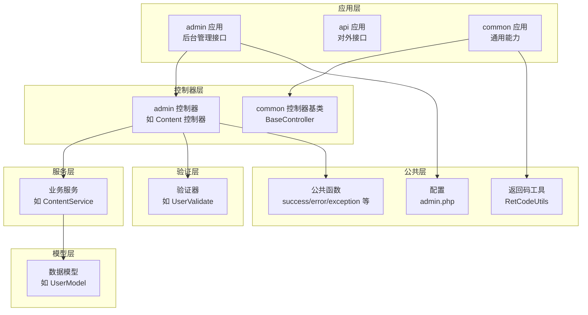
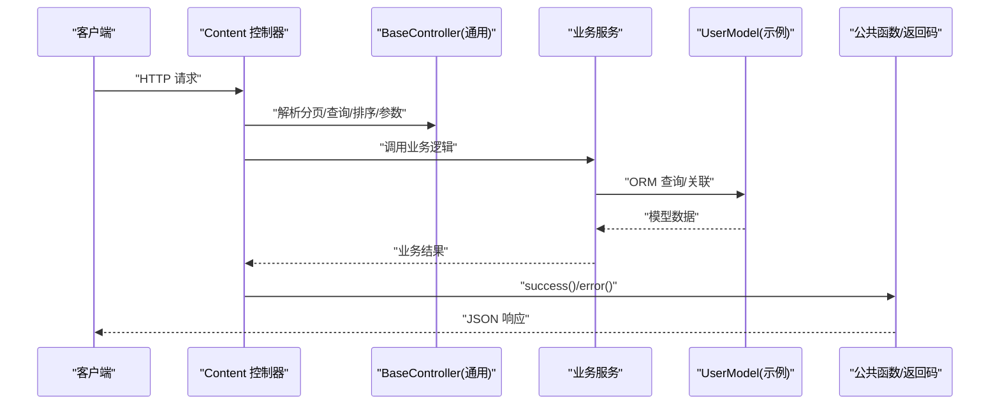
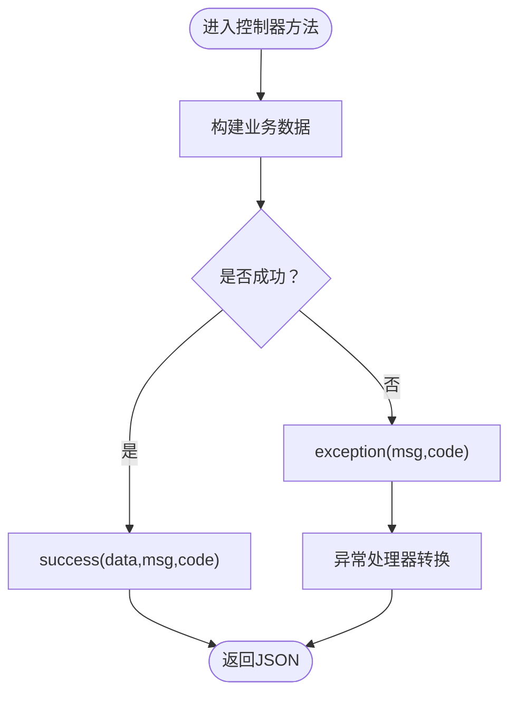
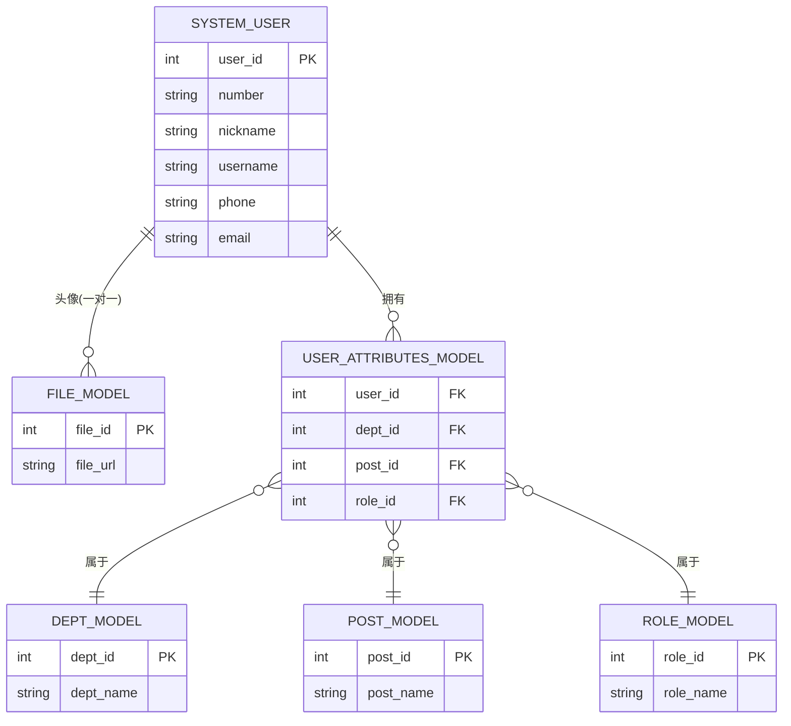
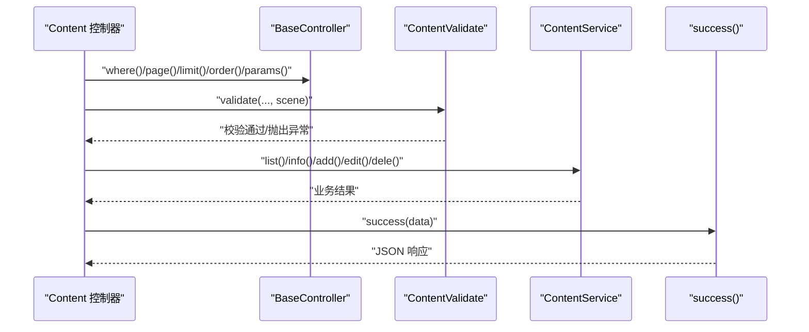
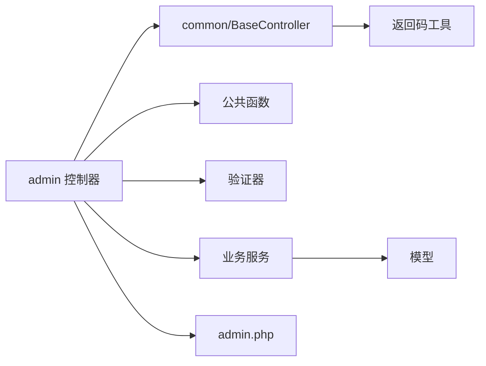

# MVC架构设计

<cite>
**本文引用的文件**
- [gccd_server/app/BaseController.php](file://gccd_server/app/BaseController.php)
- [gccd_server/app/common/controller/BaseController.php](file://gccd_server/app/common/controller/BaseController.php)
- [gccd_server/app/common.php](file://gccd_server/app/common.php)
- [gccd_server/app/common/service/utils/RetCodeUtils.php](file://gccd_server/app/common/service/utils/RetCodeUtils.php)
- [gccd_server/app/admin/controller/content/Content.php](file://gccd_server/app/admin/controller/content/Content.php)
- [gccd_server/app/common/model/system/UserModel.php](file://gccd_server/app/common/model/system/UserModel.php)
- [gccd_server/app/common/validate/system/UserValidate.php](file://gccd_server/app/common/validate/system/UserValidate.php)
- [gccd_server/config/admin.php](file://gccd_server/config/admin.php)
</cite>

## 目录
1. [引言](#引言)
2. [项目结构](#项目结构)
3. [核心组件](#核心组件)
4. [架构总览](#架构总览)
5. [详细组件分析](#详细组件分析)
6. [依赖分析](#依赖分析)
7. [性能考量](#性能考量)
8. [故障排查指南](#故障排查指南)
9. [结论](#结论)
10. [附录](#附录)

## 引言
本文件面向ThinkPHP 8高齿传动项目的MVC架构设计，聚焦于admin、api、common三个应用的职责划分与协作关系，系统性阐述控制器基类的设计理念与核心能力（请求处理、参数提取、分页与排序、查询条件构造、统一响应封装），模型层的数据访问模式（ORM使用、关联查询、访问器扩展）、验证器的场景化校验策略，以及视图层在前后端分离背景下的数据传递方式。文档通过架构图、时序图与流程图，帮助读者快速理解各层之间的交互与数据流转。

## 项目结构
高齿传动项目采用典型的多应用架构（admin、api、common），分别承担后台管理、对外接口与通用能力（公共函数、基础控制器、服务工具等）。MVC分层清晰：控制器负责请求入口与参数处理，服务层承载业务逻辑，模型层封装数据访问与关联关系，验证器保障输入合法性，公共函数与工具类提供统一响应与通用能力。



图表来源
- [gccd_server/app/admin/controller/content/Content.php:1-287](file://gccd_server/app/admin/controller/content/Content.php#L1-L287)
- [gccd_server/app/common/controller/BaseController.php:1-244](file://gccd_server/app/common/controller/BaseController.php#L1-L244)
- [gccd_server/app/common.php:1-921](file://gccd_server/app/common.php#L1-L921)
- [gccd_server/app/common/service/utils/RetCodeUtils.php:1-85](file://gccd_server/app/common/service/utils/RetCodeUtils.php#L1-L85)
- [gccd_server/config/admin.php:1-65](file://gccd_server/config/admin.php#L1-L65)

章节来源
- [gccd_server/app/admin/controller/content/Content.php:1-287](file://gccd_server/app/admin/controller/content/Content.php#L1-L287)
- [gccd_server/app/common/controller/BaseController.php:1-244](file://gccd_server/app/common/controller/BaseController.php#L1-L244)
- [gccd_server/app/common.php:1-921](file://gccd_server/app/common.php#L1-L921)
- [gccd_server/app/common/service/utils/RetCodeUtils.php:1-85](file://gccd_server/app/common/service/utils/RetCodeUtils.php#L1-L85)
- [gccd_server/config/admin.php:1-65](file://gccd_server/config/admin.php#L1-L65)

## 核心组件
- 控制器基类（common/BaseController）：提供分页、查询条件、排序、参数提取等通用能力，统一异常处理入口，屏蔽框架细节，提升控制器复用性与一致性。
- 统一响应与异常：公共函数提供success/error/exception等便捷方法，配合RetCodeUtils统一返回码语义，确保前后端一致的响应格式。
- 配置中心：admin.php集中管理token类型与名称、超管ID、菜单免登/免权/免限等策略，支撑安全与权限控制。
- 验证器：基于场景化的规则集，结合自定义规则，覆盖新增、编辑、删除、登录等典型业务场景。
- 模型关联：通过hasOne/belongsToMany与访问器扩展，将关联字段以统一格式返回，简化控制器与前端对接。

章节来源
- [gccd_server/app/common/controller/BaseController.php:1-244](file://gccd_server/app/common/controller/BaseController.php#L1-L244)
- [gccd_server/app/common.php:1-921](file://gccd_server/app/common.php#L1-L921)
- [gccd_server/app/common/service/utils/RetCodeUtils.php:1-85](file://gccd_server/app/common/service/utils/RetCodeUtils.php#L1-L85)
- [gccd_server/config/admin.php:1-65](file://gccd_server/config/admin.php#L1-L65)

## 架构总览
下图展示了从HTTP请求到响应返回的关键调用链路，体现MVC各层职责与协作关系。



图表来源
- [gccd_server/app/admin/controller/content/Content.php:43-53](file://gccd_server/app/admin/controller/content/Content.php#L43-L53)
- [gccd_server/app/common/controller/BaseController.php:67-196](file://gccd_server/app/common/controller/BaseController.php#L67-L196)
- [gccd_server/app/common.php:29-54](file://gccd_server/app/common.php#L29-L54)
- [gccd_server/app/common/model/system/UserModel.php:19-133](file://gccd_server/app/common/model/system/UserModel.php#L19-L133)

## 详细组件分析

### 控制器基类（common/BaseController）设计与能力
- 设计理念
  - 将“请求参数解析”“分页/排序/查询条件构造”“参数提取”等横切关注点下沉到基类，减少重复代码，提升可维护性。
  - 通过统一异常抛出机制，将错误转化为标准HTTP状态与业务返回码，便于前端统一处理。
- 核心能力
  - 分页与限制：page/limit支持默认值与内存上限控制，避免大页导致内存溢出。
  - 查询条件构造：where方法支持多种查询表达式、模糊匹配、区间与集合查询、日期范围自动补全。
  - 排序：order方法支持动态字段与值映射，兼容特殊字段命名（如带_is_前缀的显示名字段）。
  - 参数提取：params方法按字段白名单与类型注解提取参数，支持默认值与过滤器。
  - 方法不存在兜底：__call统一抛出URL错误，避免非法路由泄露内部细节。
- 与admin/api应用的关系
  - admin应用控制器继承common/BaseController，获得上述能力；api应用同样可复用该基类，形成一致的参数处理体验。

```mermaid
classDiagram
class BaseController_Common {
"+app"
"+request"
"+__construct(app)"
"+__call(name,args)"
"+page(default)"
"+limit(default)"
"+where(other)"
"+order(default)"
"+params(fields,filter)"
"+param(name,default,filter)"
}
```

图表来源
- [gccd_server/app/common/controller/BaseController.php:1-244](file://gccd_server/app/common/controller/BaseController.php#L1-L244)

章节来源
- [gccd_server/app/common/controller/BaseController.php:1-244](file://gccd_server/app/common/controller/BaseController.php#L1-L244)

### 统一响应与异常处理
- success/error：封装统一的JSON响应结构（code/msg/data），便于前端统一解析。
- exception：抛出HTTP异常，携带业务返回码，交由异常处理器统一转换为标准响应。
- RetCodeUtils：集中管理返回码与消息映射，保证前后端一致的语义约定。



图表来源
- [gccd_server/app/common.php:29-88](file://gccd_server/app/common.php#L29-L88)
- [gccd_server/app/common/service/utils/RetCodeUtils.php:15-85](file://gccd_server/app/common/service/utils/RetCodeUtils.php#L15-L85)

章节来源
- [gccd_server/app/common.php:1-921](file://gccd_server/app/common.php#L1-L921)
- [gccd_server/app/common/service/utils/RetCodeUtils.php:1-85](file://gccd_server/app/common/service/utils/RetCodeUtils.php#L1-L85)

### 验证器与场景化校验
- 规则与场景：UserValidate定义了编号、昵称、账号、密码、手机、邮箱等字段规则，并按info/add/edit/dele/登录等场景裁剪与追加规则。
- 自定义规则：如checkNumber/checkNickname/checkUsername/checkPhone/checkEmail等，均基于模型查询去重，确保唯一性。
- 权限校验：checkIsSuper/checkIsDisable/checkIsDelete等规则结合系统超管与当前用户身份，防止越权操作。

```mermaid
classDiagram
class UserValidate {
"+rule"
"+scene"
"+checkNumber(value,rule,data)"
"+checkNickname(value,rule,data)"
"+checkUsername(value,rule,data)"
"+checkPhone(value,rule,data)"
"+checkEmail(value,rule,data)"
"+checkIsSuper(value,rule,data)"
"+checkIsDisable(value,rule,data)"
"+checkIsDelete(value,rule,data)"
}
class UserModel {
"+name='system_user'"
"+pk='user_id'"
}
UserValidate --> UserModel : "查询去重"
```

图表来源
- [gccd_server/app/common/validate/system/UserValidate.php:1-273](file://gccd_server/app/common/validate/system/UserValidate.php#L1-L273)
- [gccd_server/app/common/model/system/UserModel.php:19-133](file://gccd_server/app/common/model/system/UserModel.php#L19-L133)

章节来源
- [gccd_server/app/common/validate/system/UserValidate.php:1-273](file://gccd_server/app/common/validate/system/UserValidate.php#L1-L273)
- [gccd_server/app/common/model/system/UserModel.php:1-133](file://gccd_server/app/common/model/system/UserModel.php#L1-L133)

### 模型层的数据访问与关联
- ORM使用：UserModel以system_user为表名，user_id为主键，遵循ThinkPHP约定。
- 关联查询：通过hasOne/belongsToMany关联头像文件、部门、职位、角色等，配合访问器扩展输出统一字段（如dept_ids/dept_names/post_ids/post_names/role_ids/role_names）。
- 访问器：getAvatarUrlAttr/getDeptIdsAttr/getDeptNamesAttr/getPostIdsAttr/getPostNamesAttr/getRoleIdsAttr/getRoleNamesAttr等，将关联数据扁平化输出，降低控制器与前端耦合度。



图表来源
- [gccd_server/app/common/model/system/UserModel.php:19-133](file://gccd_server/app/common/model/system/UserModel.php#L19-L133)

章节来源
- [gccd_server/app/common/model/system/UserModel.php:1-133](file://gccd_server/app/common/model/system/UserModel.php#L1-L133)

### admin、api、common三应用的MVC分工与职责边界
- admin应用
  - 职责：后台管理接口，如内容管理、文件管理、用户管理等。
  - 特点：继承common/BaseController，统一参数处理与响应格式；通过配置admin.php控制token策略、菜单免登/免权/免限等。
- api应用
  - 职责：对外接口，供移动端或第三方调用。
  - 特点：可复用common层能力（控制器基类、公共函数、验证器、模型），通过api相关配置与中间件实现鉴权与限流。
- common应用
  - 职责：提供跨应用共享的能力，包括基础控制器、公共函数、返回码工具、验证器、模型与服务工具等。
  - 特点：无HTTP入口，仅作为能力库被admin/api复用。

章节来源
- [gccd_server/config/admin.php:1-65](file://gccd_server/config/admin.php#L1-L65)

### 控制器与服务层交互示例（以内容管理为例）
- Content控制器在list/info/add/edit/dele等方法中，统一通过基类的where/page/limit/order/params等方法获取请求参数，调用对应服务执行业务逻辑，最终以success封装响应返回。
- 验证器按场景裁剪规则，确保输入合法与权限校验。



图表来源
- [gccd_server/app/admin/controller/content/Content.php:43-141](file://gccd_server/app/admin/controller/content/Content.php#L43-L141)
- [gccd_server/app/common/controller/BaseController.php:95-196](file://gccd_server/app/common/controller/BaseController.php#L95-L196)
- [gccd_server/app/common.php:29-54](file://gccd_server/app/common.php#L29-L54)

章节来源
- [gccd_server/app/admin/controller/content/Content.php:1-287](file://gccd_server/app/admin/controller/content/Content.php#L1-L287)
- [gccd_server/app/common/controller/BaseController.php:1-244](file://gccd_server/app/common/controller/BaseController.php#L1-L244)
- [gccd_server/app/common.php:1-921](file://gccd_server/app/common.php#L1-L921)

## 依赖分析
- 控制器依赖
  - 继承common/BaseController，获得参数解析与通用能力。
  - 使用公共函数success/error/exception与RetCodeUtils统一响应。
  - 依赖验证器进行场景化校验。
  - 依赖服务层完成业务处理，服务层再依赖模型层进行数据访问。
- 配置依赖
  - admin.php提供token策略、超管ID、菜单免登/免权/免限等配置，影响控制器与中间件行为。
- 循环依赖规避
  - common层提供基础能力，admin/api仅消费，避免相互依赖；模型与验证器通过服务层解耦。



图表来源
- [gccd_server/app/admin/controller/content/Content.php:1-287](file://gccd_server/app/admin/controller/content/Content.php#L1-L287)
- [gccd_server/app/common/controller/BaseController.php:1-244](file://gccd_server/app/common/controller/BaseController.php#L1-L244)
- [gccd_server/app/common.php:1-921](file://gccd_server/app/common.php#L1-L921)
- [gccd_server/app/common/service/utils/RetCodeUtils.php:1-85](file://gccd_server/app/common/service/utils/RetCodeUtils.php#L1-L85)
- [gccd_server/config/admin.php:1-65](file://gccd_server/config/admin.php#L1-L65)

章节来源
- [gccd_server/app/admin/controller/content/Content.php:1-287](file://gccd_server/app/admin/controller/content/Content.php#L1-L287)
- [gccd_server/app/common/controller/BaseController.php:1-244](file://gccd_server/app/common/controller/BaseController.php#L1-L244)
- [gccd_server/app/common.php:1-921](file://gccd_server/app/common.php#L1-L921)
- [gccd_server/app/common/service/utils/RetCodeUtils.php:1-85](file://gccd_server/app/common/service/utils/RetCodeUtils.php#L1-L85)
- [gccd_server/config/admin.php:1-65](file://gccd_server/config/admin.php#L1-L65)

## 性能考量
- 分页与内存控制：limit方法对大页设置特殊内存策略，避免一次性加载过多数据导致内存压力。
- 查询条件优化：where方法对like/not like、between/in等表达式做预处理，减少无效查询与字符串处理开销。
- 关联查询：模型侧通过访问器统一输出关联字段，避免控制器重复拼装，降低网络传输与前端处理成本。
- 建议
  - 对高频接口启用缓存（如菜单、字典、配置）。
  - 合理设置分页limit上限，避免超大页请求。
  - 对复杂查询使用索引与必要字段投影，减少数据库负载。

## 故障排查指南
- 常见问题
  - 参数缺失或类型不符：检查控制器中params/validate调用与验证器场景是否匹配。
  - 查询条件错误：确认where_exps支持的表达式与传入值类型（如between需数组、like需字符串）。
  - 超管/权限相关错误：核对admin.php中的super_ids与菜单免权配置，确认当前用户身份与操作范围。
  - 响应格式异常：确认使用success/error封装，避免直接echo或异常未捕获。
- 定位步骤
  - 在控制器入口打印请求参数与场景，定位参数解析问题。
  - 在服务层增加日志，记录关键业务分支与模型查询SQL。
  - 使用RetCodeUtils返回码辅助前端识别错误类型。

章节来源
- [gccd_server/app/common/controller/BaseController.php:1-244](file://gccd_server/app/common/controller/BaseController.php#L1-L244)
- [gccd_server/app/common.php:1-921](file://gccd_server/app/common.php#L1-L921)
- [gccd_server/config/admin.php:1-65](file://gccd_server/config/admin.php#L1-L65)

## 结论
本项目在ThinkPHP 8上实现了清晰的MVC分层与多应用协作：admin/api复用common提供的基础能力，通过统一的控制器基类、验证器与公共函数，形成一致的参数处理、校验与响应规范；模型层以关联查询与访问器扩展，降低前后端耦合；配置中心集中管理安全与权限策略。该架构既保证了开发效率，也为后续扩展与维护提供了良好基础。

## 附录
- 关键文件速览
  - 控制器基类：[gccd_server/app/common/controller/BaseController.php:1-244](file://gccd_server/app/common/controller/BaseController.php#L1-L244)
  - 统一响应与异常：[gccd_server/app/common.php:1-921](file://gccd_server/app/common.php#L1-L921)
  - 返回码工具：[gccd_server/app/common/service/utils/RetCodeUtils.php:1-85](file://gccd_server/app/common/service/utils/RetCodeUtils.php#L1-L85)
  - 内容管理控制器：[gccd_server/app/admin/controller/content/Content.php:1-287](file://gccd_server/app/admin/controller/content/Content.php#L1-L287)
  - 用户模型与验证器：[gccd_server/app/common/model/system/UserModel.php:1-133](file://gccd_server/app/common/model/system/UserModel.php#L1-L133)、[gccd_server/app/common/validate/system/UserValidate.php:1-273](file://gccd_server/app/common/validate/system/UserValidate.php#L1-L273)
  - 配置中心：[gccd_server/config/admin.php:1-65](file://gccd_server/config/admin.php#L1-L65)