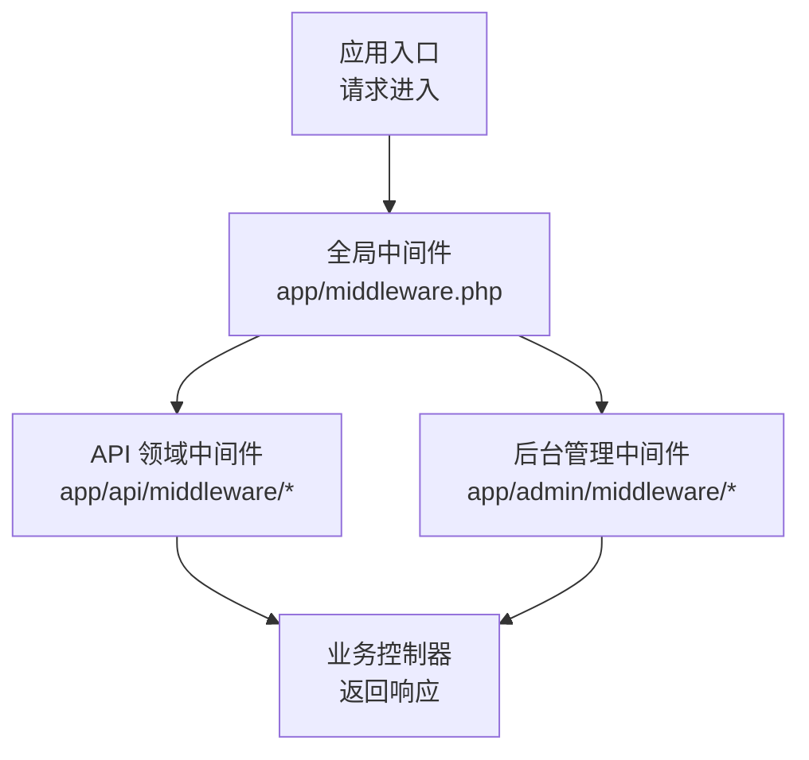
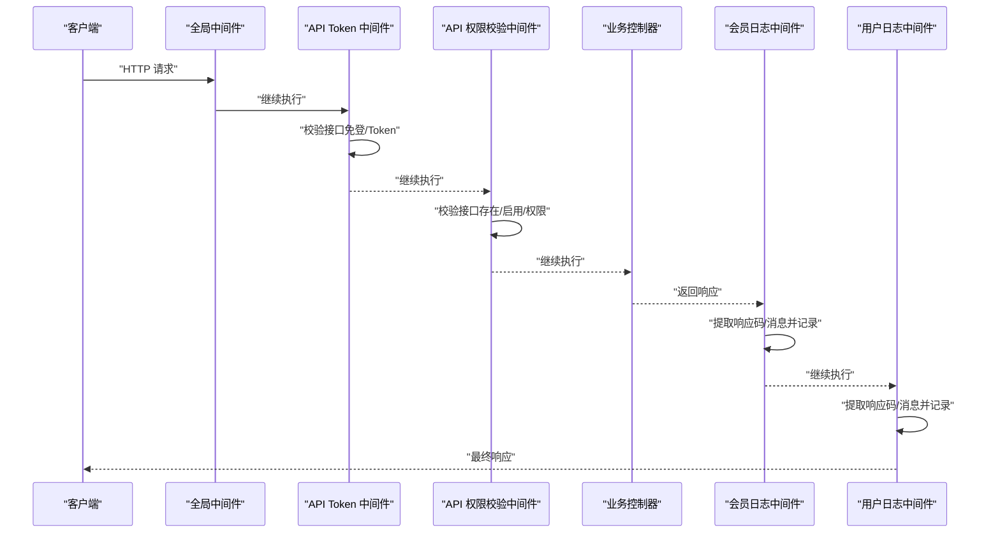
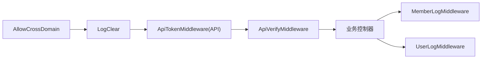

# 中间件开发规范

<cite>
**本文引用的文件**
- [app/middleware.php](file://gccd_server/app/middleware.php)
- [config/middleware.php](file://gccd_server/config/middleware.php)
- [app/common/middleware/AllowCrossDomain.php](file://gccd_server/app/common/middleware/AllowCrossDomain.php)
- [app/common/middleware/LogClear.php](file://gccd_server/app/common/middleware/LogClear.php)
- [app/api/middleware/ApiTokenMiddleware.php](file://gccd_server/app/api/middleware/ApiTokenMiddleware.php)
- [app/api/middleware/ApiVerifyMiddleware.php](file://gccd_server/app/api/middleware/ApiVerifyMiddleware.php)
- [app/admin/middleware/ApiTokenMiddleware.php](file://gccd_server/app/admin/middleware/ApiTokenMiddleware.php)
- [app/api/middleware/ContentSettingMiddleware.php](file://gccd_server/app/api/middleware/ContentSettingMiddleware.php)
- [app/api/middleware/FileSettingMiddleware.php](file://gccd_server/app/api/middleware/FileSettingMiddleware.php)
- [app/api/middleware/MemberLogMiddleware.php](file://gccd_server/app/api/middleware/MemberLogMiddleware.php)
- [app/admin/middleware/UserLogMiddleware.php](file://gccd_server/app/admin/middleware/UserLogMiddleware.php)
- [app/common/middleware/ApidocCrudMiddleware.php](file://gccd_server/app/common/middleware/ApidocCrudMiddleware.php)
</cite>

## 目录
1. [引言](#引言)
2. [项目结构](#项目结构)
3. [核心组件](#核心组件)
4. [架构总览](#架构总览)
5. [详细组件分析](#详细组件分析)
6. [依赖分析](#依赖分析)
7. [性能考量](#性能考量)
8. [故障排查指南](#故障排查指南)
9. [结论](#结论)
10. [附录](#附录)

## 引言
本指南面向后端中间件开发者，系统性梳理中间件的开发流程、标准接口与实现规范，并结合仓库中现有中间件示例（跨域、日志清理、Token 校验、接口权限校验、日志记录、内容/文件开关控制等）给出可复用的开发模板与最佳实践。文档同时覆盖错误处理、异常捕获、响应控制、性能优化与安全建议，帮助团队在统一规范下高效扩展中间件能力。

## 项目结构
中间件在本项目中按领域划分存放于不同命名空间目录：
- 公共中间件：app/common/middleware
- API 领域中间件：app/api/middleware
- 后台管理中间件：app/admin/middleware

全局中间件注册位于应用根配置文件，用于声明对所有请求生效的中间件链路；领域中间件通过路由或模块配置进行按需挂载。

图表来源
- [app/middleware.php:11-22](file://gccd_server/app/middleware.php#L11-L22)

章节来源
- [app/middleware.php:11-22](file://gccd_server/app/middleware.php#L11-L22)
- [config/middleware.php:11-16](file://gccd_server/config/middleware.php#L11-L16)

## 核心组件
本节从“接口规范、职责边界、执行顺序”三个维度总结中间件的核心要素，便于在新场景下快速设计与落地。

- 标准接口与必需方法
  - 必须实现 handle(Request, Closure): Response 方法，作为中间件处理入口
  - 可选支持 before/after 生命周期钩子（部分工具型中间件使用）
- 执行顺序
  - 全局中间件先于领域中间件执行
  - 同层中间件按注册顺序依次执行
- 响应控制
  - 在 handle 内部可直接返回响应对象以短路后续链路
  - 或调用 $next($request) 将控制权交给下一个中间件
- 错误处理
  - 使用统一异常抛出机制中断流程并返回标准化错误响应
  - 对调试环境可附加详细信息以便定位问题

章节来源
- [app/common/middleware/AllowCrossDomain.php:28-40](file://gccd_server/app/common/middleware/AllowCrossDomain.php#L28-L40)
- [app/common/middleware/LogClear.php:29-38](file://gccd_server/app/common/middleware/LogClear.php#L29-L38)
- [app/api/middleware/ApiTokenMiddleware.php:29-45](file://gccd_server/app/api/middleware/ApiTokenMiddleware.php#L29-L45)
- [app/api/middleware/ApiVerifyMiddleware.php:33-84](file://gccd_server/app/api/middleware/ApiVerifyMiddleware.php#L33-L84)
- [app/admin/middleware/ApiTokenMiddleware.php:29-43](file://gccd_server/app/admin/middleware/ApiTokenMiddleware.php#L29-L43)
- [app/api/middleware/ContentSettingMiddleware.php:29-37](file://gccd_server/app/api/middleware/ContentSettingMiddleware.php#L29-L37)
- [app/api/middleware/FileSettingMiddleware.php:29-37](file://gccd_server/app/api/middleware/FileSettingMiddleware.php#L29-L37)
- [app/api/middleware/MemberLogMiddleware.php:29-53](file://gccd_server/app/api/middleware/MemberLogMiddleware.php#L29-L53)
- [app/admin/middleware/UserLogMiddleware.php:29-50](file://gccd_server/app/admin/middleware/UserLogMiddleware.php#L29-L50)

## 架构总览
下图展示了请求在中间件链中的流转过程，以及典型中间件的职责位置与触发时机。

图表来源
- [app/middleware.php:11-22](file://gccd_server/app/middleware.php#L11-L22)
- [app/api/middleware/ApiTokenMiddleware.php:29-45](file://gccd_server/app/api/middleware/ApiTokenMiddleware.php#L29-L45)
- [app/api/middleware/ApiVerifyMiddleware.php:33-84](file://gccd_server/app/api/middleware/ApiVerifyMiddleware.php#L33-L84)
- [app/api/middleware/MemberLogMiddleware.php:29-53](file://gccd_server/app/api/middleware/MemberLogMiddleware.php#L29-L53)
- [app/admin/middleware/UserLogMiddleware.php:29-50](file://gccd_server/app/admin/middleware/UserLogMiddleware.php#L29-L50)

## 详细组件分析

### 跨域中间件（AllowCrossDomain）
- 职责：统一设置跨域相关响应头，处理预检请求（OPTIONS），确保前端跨域访问顺畅
- 关键点：
  - 在 handle 中设置允许来源、头部、方法等
  - 对 OPTIONS 预检请求直接返回空响应，避免后续链路执行
  - 保持最小化跨域策略，生产环境建议限定具体来源
- 典型用法：全局中间件启用，保障前后端分离场景下的跨域通信

章节来源
- [app/common/middleware/AllowCrossDomain.php:16-41](file://gccd_server/app/common/middleware/AllowCrossDomain.php#L16-L41)

### 日志清理中间件（LogClear）
- 职责：在请求进入时触发指定事件，清理过期日志
- 关键点：
  - 使用事件触发器触发多个日志清理事件
  - 适合在全局中间件中启用，保证每次请求都进行清理
- 典型用法：全局中间件启用，避免日志无限增长

章节来源
- [app/common/middleware/LogClear.php:17-39](file://gccd_server/app/common/middleware/LogClear.php#L17-L39)

### API Token 中间件（app/api/middleware/ApiTokenMiddleware.php）
- 职责：校验接口访问所需的 Token，支持“免登录”场景
- 关键点：
  - 判断接口是否免登
  - 获取并校验 Token，失败时抛出统一异常
  - 成功则放行到下一个中间件
- 典型用法：挂载于 API 领域路由组，保护需要登录态的接口

章节来源
- [app/api/middleware/ApiTokenMiddleware.php:17-46](file://gccd_server/app/api/middleware/ApiTokenMiddleware.php#L17-L46)

### 后台管理 Token 中间件（app/admin/middleware/ApiTokenMiddleware.php）
- 职责：校验后台管理接口访问所需的用户 Token，支持“免登录”场景
- 关键点：
  - 判断菜单是否免登
  - 获取并校验用户 Token，失败时抛出统一异常
  - 成功则放行到下一个中间件
- 典型用法：挂载于后台管理路由组，保护后台接口

章节来源
- [app/admin/middleware/ApiTokenMiddleware.php:17-44](file://gccd_server/app/admin/middleware/ApiTokenMiddleware.php#L17-L44)

### API 权限校验中间件（app/api/middleware/ApiVerifyMiddleware.php）
- 职责：校验会员接口的可用性、启用状态、权限列表，支持调试模式输出详细信息
- 关键点：
  - 读取系统设置判断是否启用会员接口
  - 校验接口是否存在、是否被禁用
  - 若非免权接口，校验会员是否拥有该接口权限
  - 调试模式下追加接口 URL 便于定位问题
- 典型用法：在需要细粒度权限控制的接口组中启用

章节来源
- [app/api/middleware/ApiVerifyMiddleware.php:21-85](file://gccd_server/app/api/middleware/ApiVerifyMiddleware.php#L21-L85)

### 内容功能开关中间件（app/api/middleware/ContentSettingMiddleware.php）
- 职责：根据系统设置开关控制内容相关接口是否可访问
- 关键点：
  - 读取配置项判断内容功能是否开启
  - 未开启时直接返回错误响应，阻止后续执行
- 典型用法：挂载于内容相关接口组，统一开关控制

章节来源
- [app/api/middleware/ContentSettingMiddleware.php:17-38](file://gccd_server/app/api/middleware/ContentSettingMiddleware.php#L17-L38)

### 文件功能开关中间件（app/api/middleware/FileSettingMiddleware.php）
- 职责：根据系统设置开关控制文件相关接口是否可访问
- 关键点：
  - 读取配置项判断文件功能是否开启
  - 未开启时直接返回错误响应，阻止后续执行
- 典型用法：挂载于文件相关接口组，统一开关控制

章节来源
- [app/api/middleware/FileSettingMiddleware.php:17-38](file://gccd_server/app/api/middleware/FileSettingMiddleware.php#L17-L38)

### 会员日志中间件（app/api/middleware/MemberLogMiddleware.php）
- 职责：在请求完成后收集响应结果并记录会员操作日志
- 关键点：
  - 先执行 $next($request) 获取响应
  - 解析响应数据中的 code/msg/message 字段，组装日志参数
  - 记录会员 ID、平台、应用等上下文信息
- 典型用法：挂载于 API 领域路由组，用于审计与追踪

章节来源
- [app/api/middleware/MemberLogMiddleware.php:17-54](file://gccd_server/app/api/middleware/MemberLogMiddleware.php#L17-L54)

### 用户日志中间件（app/admin/middleware/UserLogMiddleware.php）
- 职责：在请求完成后收集响应结果并记录后台用户操作日志
- 关键点：
  - 先执行 $next($request) 获取响应
  - 解析响应数据中的 code/msg/message 字段，组装日志参数
  - 记录用户 ID 等上下文信息
- 典型用法：挂载于后台管理路由组，用于审计与追踪

章节来源
- [app/admin/middleware/UserLogMiddleware.php:17-51](file://gccd_server/app/admin/middleware/UserLogMiddleware.php#L17-L51)

### 接口文档 CRUD 中间件（app/common/middleware/ApidocCrudMiddleware.php）
- 职责：为接口文档与 CRUD 代码生成提供模板参数处理的生命周期钩子
- 关键点：
  - before 阶段修正类名、字段集合等模板参数
  - after 阶段可进行生成后的收尾工作
- 典型用法：配合文档生成工具使用，提升代码生成一致性

章节来源
- [app/common/middleware/ApidocCrudMiddleware.php:12-76](file://gccd_server/app/common/middleware/ApidocCrudMiddleware.php#L12-L76)

## 依赖分析
中间件之间的依赖关系主要体现在“执行顺序”和“职责耦合”两个方面：
- 执行顺序：全局中间件先于领域中间件执行，同层按注册顺序执行
- 职责耦合：权限校验中间件通常依赖 Token 中间件已完成的身份判定；日志中间件通常放在链路末尾以收集最终响应

图表来源
- [app/middleware.php:11-22](file://gccd_server/app/middleware.php#L11-L22)
- [app/api/middleware/ApiTokenMiddleware.php:29-45](file://gccd_server/app/api/middleware/ApiTokenMiddleware.php#L29-L45)
- [app/api/middleware/ApiVerifyMiddleware.php:33-84](file://gccd_server/app/api/middleware/ApiVerifyMiddleware.php#L33-L84)
- [app/api/middleware/MemberLogMiddleware.php:29-53](file://gccd_server/app/api/middleware/MemberLogMiddleware.php#L29-L53)
- [app/admin/middleware/UserLogMiddleware.php:29-50](file://gccd_server/app/admin/middleware/UserLogMiddleware.php#L29-L50)

## 性能考量
- 中间件数量与顺序
  - 控制中间件数量，避免链路过长导致延迟累积
  - 将耗时逻辑（如远程校验、复杂计算）置于必要位置，尽量前置短路
- 缓存与事件
  - 对频繁读取的配置或权限数据使用缓存，减少重复查询
  - 事件触发应异步化或延迟执行，避免阻塞主请求链路
- 响应早返回
  - 对于 OPTIONS 预检、开关关闭、权限不足等场景，尽早返回响应，减少后续处理
- 日志与监控
  - 日志中间件仅在必要时记录，避免高频写入造成 IO 压力
  - 对关键路径增加埋点，便于性能分析与告警

## 故障排查指南
- 统一异常与错误码
  - 使用统一异常抛出机制，确保错误响应格式一致
  - 结合返回码工具类，明确区分登录失效、无权限、接口错误等场景
- 调试模式
  - 在调试模式下输出详细信息（如接口 URL），便于快速定位问题
- 响应解析
  - 日志中间件依赖响应数据中的 code/msg/message 字段，确保控制器返回的数据结构符合预期
- 跨域问题
  - 检查跨域中间件是否正确设置来源、头部与方法，生产环境建议限制来源
- 事件触发
  - 确保日志清理事件已正确注册并可被触发

章节来源
- [app/api/middleware/ApiVerifyMiddleware.php:44-84](file://gccd_server/app/api/middleware/ApiVerifyMiddleware.php#L44-L84)
- [app/api/middleware/MemberLogMiddleware.php:35-50](file://gccd_server/app/api/middleware/MemberLogMiddleware.php#L35-L50)
- [app/admin/middleware/UserLogMiddleware.php:35-49](file://gccd_server/app/admin/middleware/UserLogMiddleware.php#L35-L49)
- [app/common/middleware/AllowCrossDomain.php:30-39](file://gccd_server/app/common/middleware/AllowCrossDomain.php#L30-L39)

## 结论
本规范基于仓库现有中间件实现，总结了中间件的标准接口、执行顺序、错误处理与响应控制机制，并提供了跨域、日志清理、Token 校验、权限校验、日志记录、功能开关等典型场景的实现模板。建议在新增中间件时遵循“职责单一、顺序合理、异常统一、性能优先”的原则，确保系统稳定性与可维护性。

## 附录

### 开发步骤与代码结构模板
- 创建中间件类
  - 命名空间：按领域放置于 app/{domain}/middleware
  - 类名：以 Middleware 结尾，例如 ApiTokenMiddleware
- 实现 handle 方法
  - 参数：Request $request, Closure $next
  - 返回：Response
  - 逻辑：前置校验/处理 -> $next($request) -> 后置处理/记录
- 注册中间件
  - 全局中间件：在 app/middleware.php 中添加
  - 领域中间件：在对应模块配置中按需挂载
- 配置与别名
  - 如需别名或优先级，可在 config/middleware.php 中配置

章节来源
- [app/middleware.php:11-22](file://gccd_server/app/middleware.php#L11-L22)
- [config/middleware.php:11-16](file://gccd_server/config/middleware.php#L11-L16)

### 典型中间件开发示例（步骤说明）
- 权限验证中间件
  - 步骤：读取配置 -> 校验接口存在与启用 -> 校验会员权限 -> 抛出异常或放行
  - 参考实现：[app/api/middleware/ApiVerifyMiddleware.php:21-85](file://gccd_server/app/api/middleware/ApiVerifyMiddleware.php#L21-L85)
- 日志记录中间件
  - 步骤：先执行 $next($request) -> 解析响应 -> 组装日志 -> 写入服务
  - 参考实现：[app/api/middleware/MemberLogMiddleware.php:17-54](file://gccd_server/app/api/middleware/MemberLogMiddleware.php#L17-L54)
- 请求过滤中间件
  - 步骤：检查开关配置 -> 未开启直接返回错误 -> 放行
  - 参考实现：[app/api/middleware/ContentSettingMiddleware.php:17-38](file://gccd_server/app/api/middleware/ContentSettingMiddleware.php#L17-L38)
- 跨域中间件
  - 步骤：设置响应头 -> 处理 OPTIONS 预检 -> 放行
  - 参考实现：[app/common/middleware/AllowCrossDomain.php:16-41](file://gccd_server/app/common/middleware/AllowCrossDomain.php#L16-L41)

### 错误处理、异常捕获与响应控制机制
- 异常抛出
  - 使用统一异常抛出机制，确保错误码与消息一致
- 响应控制
  - 在 handle 内部可直接返回响应对象以短路后续链路
  - 日志中间件通过 $response->getData() 提取响应数据
- 调试模式
  - 在调试模式下输出详细信息，便于定位问题

章节来源
- [app/api/middleware/ApiVerifyMiddleware.php:44-84](file://gccd_server/app/api/middleware/ApiVerifyMiddleware.php#L44-L84)
- [app/api/middleware/MemberLogMiddleware.php:35-50](file://gccd_server/app/api/middleware/MemberLogMiddleware.php#L35-L50)
- [app/admin/middleware/UserLogMiddleware.php:35-49](file://gccd_server/app/admin/middleware/UserLogMiddleware.php#L35-L49)

### 测试方法与安全最佳实践
- 测试方法
  - 单元测试：针对 handle 的输入输出与异常分支进行断言
  - 集成测试：模拟请求链路，验证中间件顺序与响应行为
  - 场景测试：覆盖免登录、权限不足、开关关闭、跨域预检等边界条件
- 安全最佳实践
  - Token 校验：严格校验签名与有效期，避免硬编码与明文传输
  - 跨域策略：生产环境限定来源与方法，避免通配符
  - 日志脱敏：记录日志时避免敏感信息泄露
  - 权限最小化：接口权限与菜单权限双重校验，防止越权访问