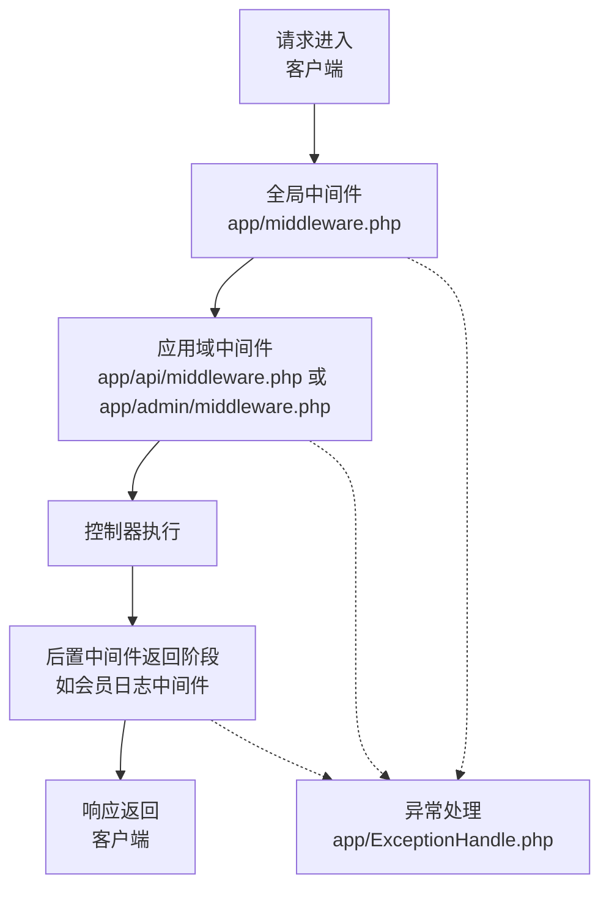
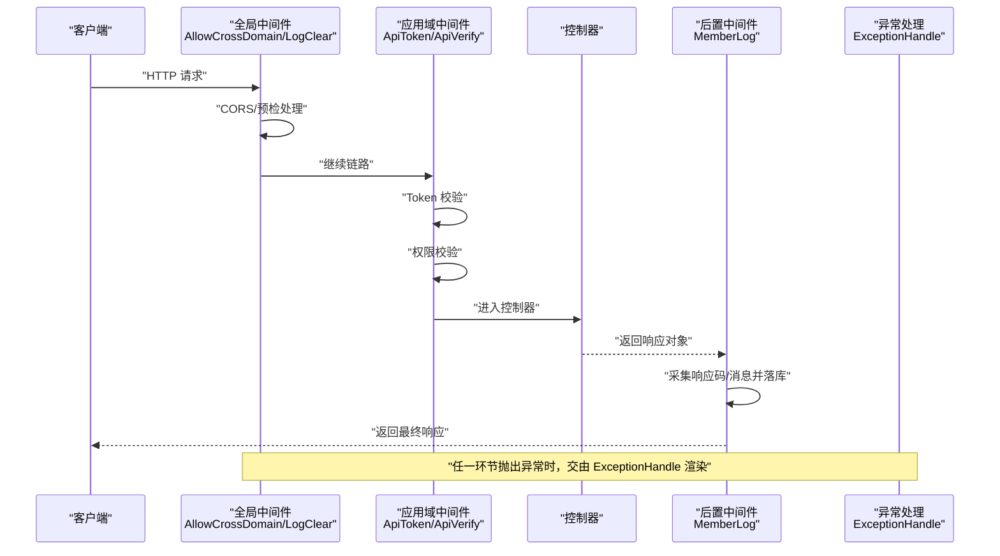
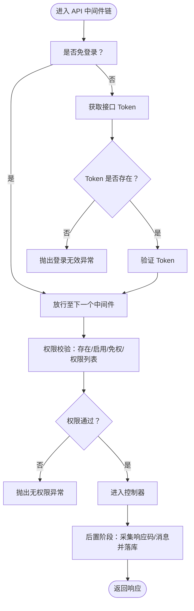
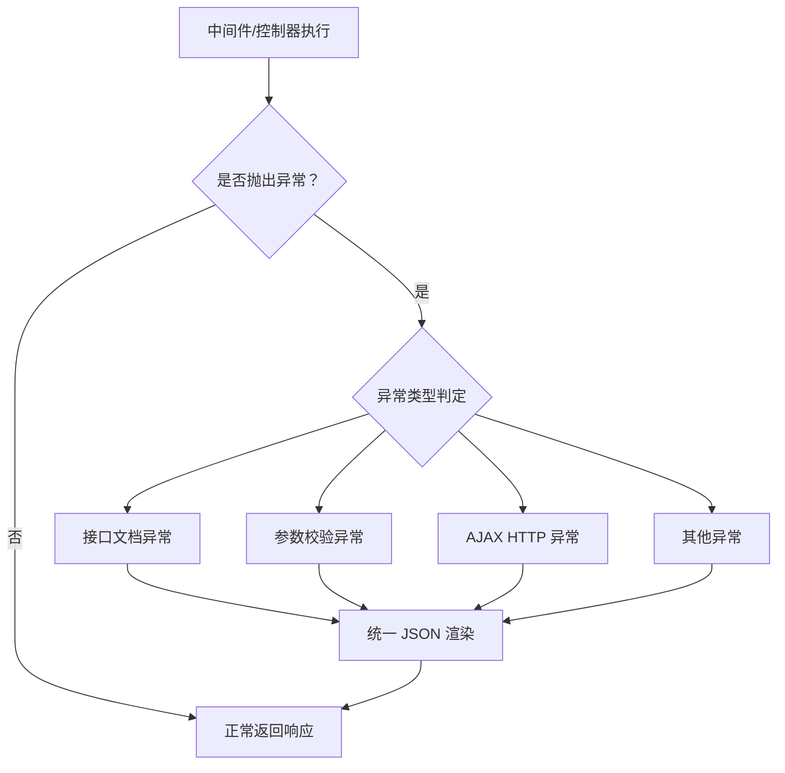
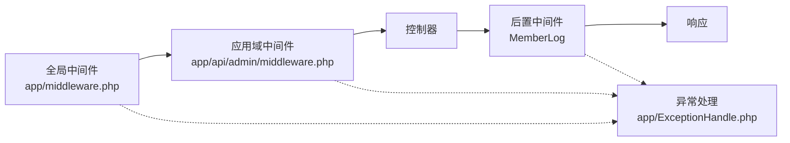

# 中间件执行流程

<cite>
**本文引用的文件**
- [app/middleware.php](file://gccd_server/app/middleware.php)
- [app/admin/middleware.php](file://gccd_server/app/admin/middleware.php)
- [app/api/middleware.php](file://gccd_server/app/api/middleware.php)
- [config/middleware.php](file://gccd_server/config/middleware.php)
- [app/common/middleware/AllowCrossDomain.php](file://gccd_server/app/common/middleware/AllowCrossDomain.php)
- [app/common/middleware/LogClear.php](file://gccd_server/app/common/middleware/LogClear.php)
- [app/api/middleware/ApiTokenMiddleware.php](file://gccd_server/app/api/middleware/ApiTokenMiddleware.php)
- [app/api/middleware/ApiVerifyMiddleware.php](file://gccd_server/app/api/middleware/ApiVerifyMiddleware.php)
- [app/api/middleware/MemberLogMiddleware.php](file://gccd_server/app/api/middleware/MemberLogMiddleware.php)
- [app/admin/middleware/ApiTokenMiddleware.php](file://gccd_server/app/admin/middleware/ApiTokenMiddleware.php)
- [app/admin/middleware/ApiVerifyMiddleware.php](file://gccd_server/app/admin/middleware/ApiVerifyMiddleware.php)
- [app/ExceptionHandle.php](file://gccd_server/app/ExceptionHandle.php)
</cite>

## 目录
1. [引言](#引言)
2. [项目结构](#项目结构)
3. [核心组件](#核心组件)
4. [架构总览](#架构总览)
5. [详细组件分析](#详细组件分析)
6. [依赖关系分析](#依赖关系分析)
7. [性能考量](#性能考量)
8. [故障排查指南](#故障排查指南)
9. [结论](#结论)
10. [附录](#附录)

## 引言
本文件围绕后端中间件的生命周期与执行顺序进行深入技术说明，覆盖请求进入时的预处理、控制器执行阶段、响应返回时的后处理三个阶段；绘制中间件链式调用的执行流程图，展示请求在各中间件之间的传递过程；分析异常处理机制与错误拦截流程；并提供性能优化建议与调试技巧，辅以具体代码示例路径帮助定位执行时机与处理逻辑。

## 项目结构
本项目采用 ThinkPHP 框架风格组织中间件，按应用域划分全局与子域中间件配置，并通过统一的异常处理类对异常进行集中渲染与上报。

- 全局中间件：位于应用根目录，对所有请求生效
- 子域中间件：按业务域划分（如 admin、api），仅对该域生效
- 中间件别名与优先级：集中配置于配置文件中
- 异常处理：统一由应用异常处理类接管

图表来源
- [app/middleware.php:11-22](file://gccd_server/app/middleware.php#L11-L22)
- [app/api/middleware.php:11-20](file://gccd_server/app/api/middleware.php#L11-L20)
- [app/admin/middleware.php:11-20](file://gccd_server/app/admin/middleware.php#L11-L20)
- [app/ExceptionHandle.php:59-96](file://gccd_server/app/ExceptionHandle.php#L59-L96)

章节来源
- [app/middleware.php:11-22](file://gccd_server/app/middleware.php#L11-L22)
- [app/api/middleware.php:11-20](file://gccd_server/app/api/middleware.php#L11-L20)
- [app/admin/middleware.php:11-20](file://gccd_server/app/admin/middleware.php#L11-L20)
- [config/middleware.php:11-16](file://gccd_server/config/middleware.php#L11-L16)

## 核心组件
- 全局中间件
  - 跨域中间件：设置 CORS 头部，处理 OPTIONS 预检请求
  - 日志清理中间件：触发用户与会员日志清理事件
- 应用域中间件（以 api/admin 为例）
  - Token 校验中间件：校验接口是否免登录、获取并验证 Token
  - 权限校验中间件：校验接口存在性、启用状态、权限列表等
  - 会员日志中间件（仅 api）：在控制器返回响应后，采集响应码与消息写入日志
- 异常处理
  - 统一渲染 JSON 响应，区分不同异常类型（参数校验、HTTP、接口文档、通用异常）
  - 可根据调试开关输出堆栈信息

章节来源
- [app/common/middleware/AllowCrossDomain.php:28-40](file://gccd_server/app/common/middleware/AllowCrossDomain.php#L28-L40)
- [app/common/middleware/LogClear.php:29-38](file://gccd_server/app/common/middleware/LogClear.php#L29-L38)
- [app/api/middleware/ApiTokenMiddleware.php:29-45](file://gccd_server/app/api/middleware/ApiTokenMiddleware.php#L29-L45)
- [app/api/middleware/ApiVerifyMiddleware.php:33-84](file://gccd_server/app/api/middleware/ApiVerifyMiddleware.php#L33-L84)
- [app/api/middleware/MemberLogMiddleware.php:29-53](file://gccd_server/app/api/middleware/MemberLogMiddleware.php#L29-L53)
- [app/admin/middleware/ApiTokenMiddleware.php:29-43](file://gccd_server/app/admin/middleware/ApiTokenMiddleware.php#L29-L43)
- [app/admin/middleware/ApiVerifyMiddleware.php:32-78](file://gccd_server/app/admin/middleware/ApiVerifyMiddleware.php#L32-L78)
- [app/ExceptionHandle.php:59-96](file://gccd_server/app/ExceptionHandle.php#L59-L96)

## 架构总览
下图展示了请求从进入系统到返回响应的完整链路，以及异常发生时的拦截与渲染路径。

图表来源
- [app/common/middleware/AllowCrossDomain.php:28-40](file://gccd_server/app/common/middleware/AllowCrossDomain.php#L28-L40)
- [app/common/middleware/LogClear.php:29-38](file://gccd_server/app/common/middleware/LogClear.php#L29-L38)
- [app/api/middleware/ApiTokenMiddleware.php:29-45](file://gccd_server/app/api/middleware/ApiTokenMiddleware.php#L29-L45)
- [app/api/middleware/ApiVerifyMiddleware.php:33-84](file://gccd_server/app/api/middleware/ApiVerifyMiddleware.php#L33-L84)
- [app/api/middleware/MemberLogMiddleware.php:29-53](file://gccd_server/app/api/middleware/MemberLogMiddleware.php#L29-L53)
- [app/ExceptionHandle.php:59-96](file://gccd_server/app/ExceptionHandle.php#L59-L96)

## 详细组件分析

### 全局中间件
- 跨域中间件
  - 执行时机：请求进入时最先处理
  - 关键行为：设置允许跨域头、处理 OPTIONS 预检请求直接返回空响应
  - 适用范围：所有请求
- 日志清理中间件
  - 执行时机：请求进入时处理
  - 关键行为：触发用户日志与会员日志清理事件，随后放行

章节来源
- [app/common/middleware/AllowCrossDomain.php:28-40](file://gccd_server/app/common/middleware/AllowCrossDomain.php#L28-L40)
- [app/common/middleware/LogClear.php:29-38](file://gccd_server/app/common/middleware/LogClear.php#L29-L38)

### 应用域中间件（API 场景）
- Token 校验中间件
  - 执行时机：全局之后，控制器之前
  - 关键行为：判断接口是否免登录；若非免登录则获取并验证 Token，失败时抛出异常
- 权限校验中间件
  - 执行时机：Token 校验之后
  - 关键行为：读取系统设置，校验接口存在性、启用状态、是否免权；若非免权则校验用户权限列表，失败时抛出异常
- 会员日志中间件（后置阶段）
  - 执行时机：控制器返回响应后
  - 关键行为：从响应对象提取 code/msg，结合上下文信息写入会员日志

图表来源
- [app/api/middleware/ApiTokenMiddleware.php:29-45](file://gccd_server/app/api/middleware/ApiTokenMiddleware.php#L29-L45)
- [app/api/middleware/ApiVerifyMiddleware.php:33-84](file://gccd_server/app/api/middleware/ApiVerifyMiddleware.php#L33-L84)
- [app/api/middleware/MemberLogMiddleware.php:29-53](file://gccd_server/app/api/middleware/MemberLogMiddleware.php#L29-L53)

章节来源
- [app/api/middleware/ApiTokenMiddleware.php:29-45](file://gccd_server/app/api/middleware/ApiTokenMiddleware.php#L29-L45)
- [app/api/middleware/ApiVerifyMiddleware.php:33-84](file://gccd_server/app/api/middleware/ApiVerifyMiddleware.php#L33-L84)
- [app/api/middleware/MemberLogMiddleware.php:29-53](file://gccd_server/app/api/middleware/MemberLogMiddleware.php#L29-L53)

### 应用域中间件（ADMIN 场景）
- Token 校验中间件（管理端）
  - 执行时机：全局之后，控制器之前
  - 关键行为：判断菜单是否免登录；若非免登录则获取并验证用户 Token，失败时抛出异常
- 权限校验中间件（管理端）
  - 执行时机：Token 校验之后
  - 关键行为：当前版本注释掉菜单存在性、启用状态与角色权限校验逻辑，保留放行

章节来源
- [app/admin/middleware/ApiTokenMiddleware.php:29-43](file://gccd_server/app/admin/middleware/ApiTokenMiddleware.php#L29-L43)
- [app/admin/middleware/ApiVerifyMiddleware.php:32-78](file://gccd_server/app/admin/middleware/ApiVerifyMiddleware.php#L32-L78)

### 异常处理与错误拦截
- 异常处理类负责：
  - 忽略型异常白名单（HTTP、响应、模型未找到、参数校验等）
  - 自定义渲染策略：接口文档异常、参数校验异常、AJAX HTTP 异常、通用异常
  - 调试模式下附加堆栈信息
- 执行位置：任一中间件或控制器抛出异常后，统一由该类接管并返回标准化 JSON 响应

图表来源
- [app/ExceptionHandle.php:59-96](file://gccd_server/app/ExceptionHandle.php#L59-L96)

章节来源
- [app/ExceptionHandle.php:27-49](file://gccd_server/app/ExceptionHandle.php#L27-L49)
- [app/ExceptionHandle.php:59-96](file://gccd_server/app/ExceptionHandle.php#L59-L96)

## 依赖关系分析
- 中间件配置
  - 全局中间件：app/middleware.php
  - 应用域中间件：app/api/middleware.php、app/admin/middleware.php
  - 别名与优先级：config/middleware.php
- 执行顺序
  - 全局中间件 → 应用域中间件 → 控制器 → 后置中间件 → 返回响应
  - 异常发生时，统一由 ExceptionHandle 渲染
- 关键依赖
  - Token/权限校验依赖服务层工具函数与配置项
  - 会员日志中间件依赖响应对象的数据结构

图表来源
- [app/middleware.php:11-22](file://gccd_server/app/middleware.php#L11-L22)
- [app/api/middleware.php:11-20](file://gccd_server/app/api/middleware.php#L11-L20)
- [app/admin/middleware.php:11-20](file://gccd_server/app/admin/middleware.php#L11-L20)
- [app/ExceptionHandle.php:59-96](file://gccd_server/app/ExceptionHandle.php#L59-L96)

章节来源
- [app/middleware.php:11-22](file://gccd_server/app/middleware.php#L11-L22)
- [app/api/middleware.php:11-20](file://gccd_server/app/api/middleware.php#L11-L20)
- [app/admin/middleware.php:11-20](file://gccd_server/app/admin/middleware.php#L11-L20)
- [config/middleware.php:11-16](file://gccd_server/config/middleware.php#L11-L16)

## 性能考量
- 中间件顺序优化
  - 将耗时较低的预检与快速短路逻辑前置（如跨域、免登录快速放行）
  - 将昂贵的鉴权与权限检查置于靠前但不阻断的阶段
- 缓存与事件
  - 日志清理事件可异步化，避免阻塞主请求链
  - Token 与权限结果可利用缓存减少重复查询
- 响应后置处理
  - 会员日志中间件仅在有会员上下文时写入，避免无谓 IO
- 异常早发现早返回
  - 在中间件尽早校验参数与权限，减少后续控制器负担

## 故障排查指南
- 症状：OPTIONS 预检失败
  - 检查跨域中间件是否正确设置允许方法与头部
  - 参考路径：[AllowCrossDomain::handle:28-40](file://gccd_server/app/common/middleware/AllowCrossDomain.php#L28-L40)
- 症状：登录态无效或被拦截
  - 检查接口是否免登录；若非免登录，确认 Token 获取与验证逻辑
  - 参考路径：[ApiTokenMiddleware::handle:29-45](file://gccd_server/app/api/middleware/ApiTokenMiddleware.php#L29-L45)、[ApiTokenMiddleware::handle(admin):29-43](file://gccd_server/app/admin/middleware/ApiTokenMiddleware.php#L29-L43)
- 症状：权限不足或接口不存在
  - 检查权限校验中间件的接口存在性、启用状态与权限列表
  - 参考路径：[ApiVerifyMiddleware::handle:33-84](file://gccd_server/app/api/middleware/ApiVerifyMiddleware.php#L33-L84)
- 症状：响应未记录会员日志
  - 确认会员上下文存在且后置中间件已执行
  - 参考路径：[MemberLogMiddleware::handle:29-53](file://gccd_server/app/api/middleware/MemberLogMiddleware.php#L29-L53)
- 症状：异常未按预期返回
  - 检查异常处理类的渲染分支与调试开关
  - 参考路径：[ExceptionHandle::render:59-96](file://gccd_server/app/ExceptionHandle.php#L59-L96)

章节来源
- [app/common/middleware/AllowCrossDomain.php:28-40](file://gccd_server/app/common/middleware/AllowCrossDomain.php#L28-L40)
- [app/api/middleware/ApiTokenMiddleware.php:29-45](file://gccd_server/app/api/middleware/ApiTokenMiddleware.php#L29-L45)
- [app/admin/middleware/ApiTokenMiddleware.php:29-43](file://gccd_server/app/admin/middleware/ApiTokenMiddleware.php#L29-L43)
- [app/api/middleware/ApiVerifyMiddleware.php:33-84](file://gccd_server/app/api/middleware/ApiVerifyMiddleware.php#L33-L84)
- [app/api/middleware/MemberLogMiddleware.php:29-53](file://gccd_server/app/api/middleware/MemberLogMiddleware.php#L29-L53)
- [app/ExceptionHandle.php:59-96](file://gccd_server/app/ExceptionHandle.php#L59-L96)

## 结论
本项目的中间件体系遵循“全局前置、域内控制、后置收尾”的清晰分层，配合统一异常处理，实现了从请求进入、权限校验、控制器执行到响应返回的全链路可观测与可控。通过合理排序与缓存策略，可在保证安全性的前提下提升整体吞吐与稳定性。

## 附录
- 中间件配置入口
  - 全局：[app/middleware.php:11-22](file://gccd_server/app/middleware.php#L11-L22)
  - API：[app/api/middleware.php:11-20](file://gccd_server/app/api/middleware.php#L11-L20)
  - ADMIN：[app/admin/middleware.php:11-20](file://gccd_server/app/admin/middleware.php#L11-L20)
  - 别名与优先级：[config/middleware.php:11-16](file://gccd_server/config/middleware.php#L11-L16)
- 关键中间件实现
  - 跨域：[AllowCrossDomain::handle:28-40](file://gccd_server/app/common/middleware/AllowCrossDomain.php#L28-L40)
  - 日志清理：[LogClear::handle:29-38](file://gccd_server/app/common/middleware/LogClear.php#L29-L38)
  - API Token 校验：[ApiTokenMiddleware::handle:29-45](file://gccd_server/app/api/middleware/ApiTokenMiddleware.php#L29-L45)
  - API 权限校验：[ApiVerifyMiddleware::handle:33-84](file://gccd_server/app/api/middleware/ApiVerifyMiddleware.php#L33-L84)
  - 会员日志后置：[MemberLogMiddleware::handle:29-53](file://gccd_server/app/api/middleware/MemberLogMiddleware.php#L29-L53)
  - ADMIN Token 校验：[ApiTokenMiddleware(admin)::handle:29-43](file://gccd_server/app/admin/middleware/ApiTokenMiddleware.php#L29-L43)
  - ADMIN 权限校验：[ApiVerifyMiddleware(admin)::handle:32-78](file://gccd_server/app/admin/middleware/ApiVerifyMiddleware.php#L32-L78)
  - 异常处理：[ExceptionHandle::render:59-96](file://gccd_server/app/ExceptionHandle.php#L59-L96)