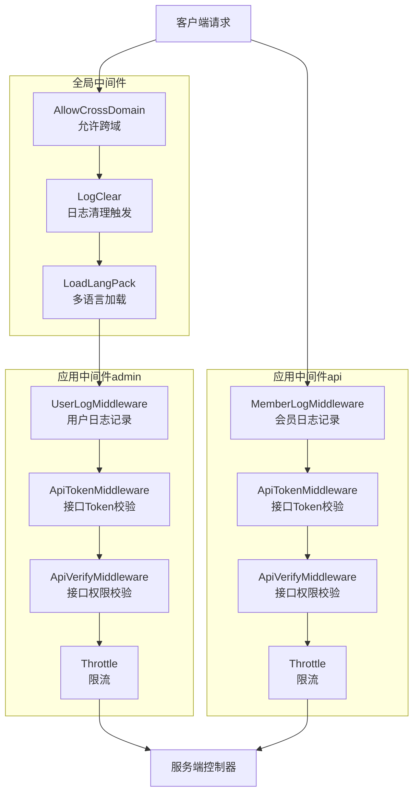
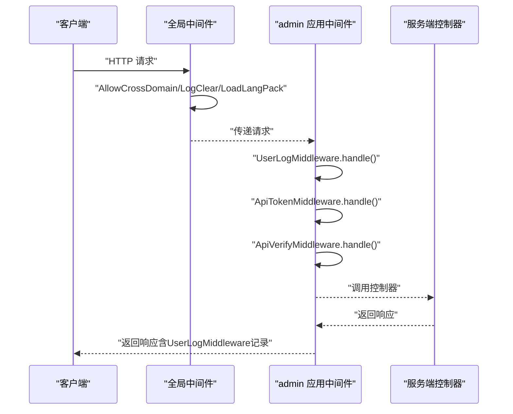
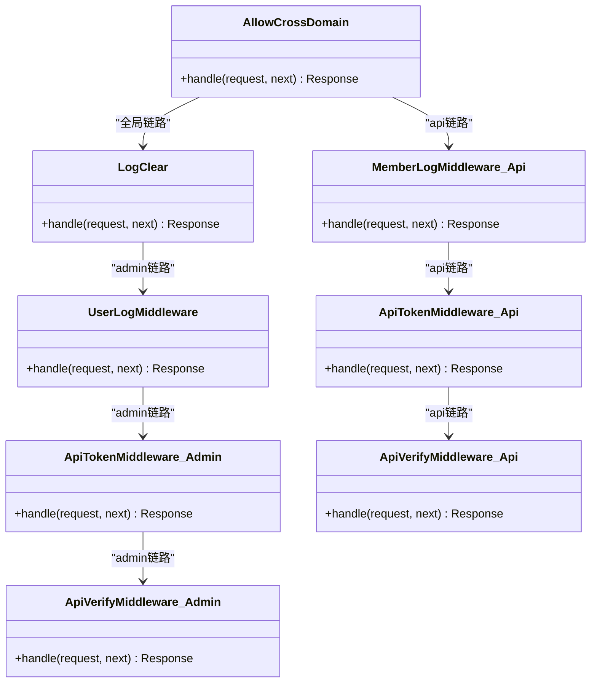
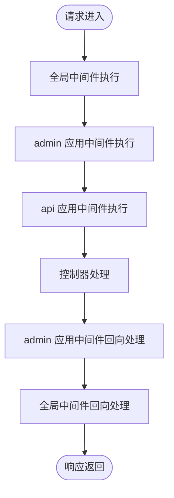

# 中间件类型与分类

<cite>
**本文引用的文件**
- [app/middleware.php](file://gccd_server/app/middleware.php)
- [app/admin/middleware.php](file://gccd_server/app/admin/middleware.php)
- [app/api/middleware.php](file://gccd_server/app/api/middleware.php)
- [config/middleware.php](file://gccd_server/config/middleware.php)
- [app/admin/middleware/ApiTokenMiddleware.php](file://gccd_server/app/admin/middleware/ApiTokenMiddleware.php)
- [app/admin/middleware/UserLogMiddleware.php](file://gccd_server/app/admin/middleware/UserLogMiddleware.php)
- [app/admin/middleware/ApiVerifyMiddleware.php](file://gccd_server/app/admin/middleware/ApiVerifyMiddleware.php)
- [app/api/middleware/ApiTokenMiddleware.php](file://gccd_server/app/api/middleware/ApiTokenMiddleware.php)
- [app/api/middleware/MemberLogMiddleware.php](file://gccd_server/app/api/middleware/MemberLogMiddleware.php)
- [app/api/middleware/ApiVerifyMiddleware.php](file://gccd_server/app/api/middleware/ApiVerifyMiddleware.php)
- [app/common/middleware/AllowCrossDomain.php](file://gccd_server/app/common/middleware/AllowCrossDomain.php)
- [app/common/middleware/LogClear.php](file://gccd_server/app/common/middleware/LogClear.php)
</cite>

## 目录
1. [简介](#简介)
2. [项目结构](#项目结构)
3. [核心组件](#核心组件)
4. [架构总览](#架构总览)
5. [详细组件分析](#详细组件分析)
6. [依赖关系分析](#依赖关系分析)
7. [性能考量](#性能考量)
8. [故障排查指南](#故障排查指南)
9. [结论](#结论)
10. [附录](#附录)

## 简介
本文件面向 ThinkPHP 8 的中间件体系，系统性梳理并说明中间件的分类、执行优先级与注册机制，并对关键中间件（如 ApiTokenMiddleware、UserLogMiddleware、ApiVerifyMiddleware）进行深入解析。同时给出配置参数、使用场景、最佳实践以及中间件选择与组合建议，帮助开发者在不同业务模块（全局、应用、路由）中正确选择与组合中间件。

## 项目结构
中间件在本项目中按作用范围分为三类：
- 全局中间件：对所有请求生效，统一处理跨域、日志清理、多语言、会话等横切关注点。
- 应用中间件：按模块划分（admin、api），针对特定业务域进行鉴权、校验、日志等处理。
- 路由中间件：通常通过路由绑定方式在具体路由上启用，本项目未直接展示独立路由中间件文件，但可通过路由绑定方式复用上述应用中间件。

下图展示了中间件在应用中的组织结构与职责边界：

图表来源
- [app/middleware.php:11-22](file://gccd_server/app/middleware.php#L11-L22)
- [app/admin/middleware.php:11-20](file://gccd_server/app/admin/middleware.php#L11-L20)
- [app/api/middleware.php:11-20](file://gccd_server/app/api/middleware.php#L11-L20)

章节来源
- [app/middleware.php:11-22](file://gccd_server/app/middleware.php#L11-L22)
- [app/admin/middleware.php:11-20](file://gccd_server/app/admin/middleware.php#L11-L20)
- [app/api/middleware.php:11-20](file://gccd_server/app/api/middleware.php#L11-L20)

## 核心组件
- 全局中间件
  - AllowCrossDomain：统一设置跨域响应头，处理预检请求。
  - LogClear：触发用户日志与会员日志清理事件。
  - LoadLangPack：加载多语言包。
- 应用中间件（admin）
  - UserLogMiddleware：在响应后记录用户操作日志。
  - ApiTokenMiddleware：校验管理员 Token，支持免登录白名单。
  - ApiVerifyMiddleware：校验管理员接口访问权限，支持调试模式增强提示。
  - Throttle：限流控制。
- 应用中间件（api）
  - MemberLogMiddleware：在响应后记录会员操作日志。
  - ApiTokenMiddleware：校验会员 Token，支持免登录白名单。
  - ApiVerifyMiddleware：校验会员接口访问权限，支持调试模式增强提示。
  - Throttle：限流控制。

章节来源
- [app/middleware.php:11-22](file://gccd_server/app/middleware.php#L11-L22)
- [app/common/middleware/AllowCrossDomain.php:28-40](file://gccd_server/app/common/middleware/AllowCrossDomain.php#L28-L40)
- [app/common/middleware/LogClear.php:29-37](file://gccd_server/app/common/middleware/LogClear.php#L29-L37)
- [app/admin/middleware.php:11-20](file://gccd_server/app/admin/middleware.php#L11-L20)
- [app/admin/middleware/UserLogMiddleware.php:29-49](file://gccd_server/app/admin/middleware/UserLogMiddleware.php#L29-L49)
- [app/admin/middleware/ApiTokenMiddleware.php:29-42](file://gccd_server/app/admin/middleware/ApiTokenMiddleware.php#L29-L42)
- [app/admin/middleware/ApiVerifyMiddleware.php:32-77](file://gccd_server/app/admin/middleware/ApiVerifyMiddleware.php#L32-L77)
- [app/api/middleware.php:11-20](file://gccd_server/app/api/middleware.php#L11-L20)
- [app/api/middleware/MemberLogMiddleware.php:29-52](file://gccd_server/app/api/middleware/MemberLogMiddleware.php#L29-L52)
- [app/api/middleware/ApiTokenMiddleware.php:29-44](file://gccd_server/app/api/middleware/ApiTokenMiddleware.php#L29-L44)
- [app/api/middleware/ApiVerifyMiddleware.php:33-83](file://gccd_server/app/api/middleware/ApiVerifyMiddleware.php#L33-L83)

## 架构总览
中间件的执行顺序遵循“先注册先执行”的原则；全局中间件在应用中间件之前执行。下图以序列图形式展示一次典型请求的中间件链路（以 admin 模块为例）：

图表来源
- [app/middleware.php:11-22](file://gccd_server/app/middleware.php#L11-L22)
- [app/admin/middleware.php:11-20](file://gccd_server/app/admin/middleware.php#L11-L20)
- [app/admin/middleware/UserLogMiddleware.php:29-49](file://gccd_server/app/admin/middleware/UserLogMiddleware.php#L29-L49)
- [app/admin/middleware/ApiTokenMiddleware.php:29-42](file://gccd_server/app/admin/middleware/ApiTokenMiddleware.php#L29-L42)
- [app/admin/middleware/ApiVerifyMiddleware.php:32-77](file://gccd_server/app/admin/middleware/ApiVerifyMiddleware.php#L32-L77)

## 详细组件分析

### 全局中间件
- AllowCrossDomain
  - 功能：设置跨域响应头，处理 OPTIONS 预检请求，避免前端跨域阻断。
  - 关键点：对预检请求直接返回空响应，减少后续处理成本。
- LogClear
  - 功能：在请求进入时触发用户日志与会员日志清理事件，保持日志库整洁。
- LoadLangPack
  - 功能：加载当前语言包，为国际化提供基础。

章节来源
- [app/common/middleware/AllowCrossDomain.php:28-40](file://gccd_server/app/common/middleware/AllowCrossDomain.php#L28-L40)
- [app/common/middleware/LogClear.php:29-37](file://gccd_server/app/common/middleware/LogClear.php#L29-L37)
- [app/middleware.php:11-22](file://gccd_server/app/middleware.php#L11-L22)

### 应用中间件（admin）
- UserLogMiddleware
  - 功能：在控制器返回响应后，从响应体提取状态码与消息，结合当前用户 ID 记录用户操作日志。
  - 注意：仅当存在有效用户 ID 时记录，避免匿名请求产生无意义日志。
- ApiTokenMiddleware
  - 功能：校验管理员 Token，支持“免登录”白名单；若未通过则抛出异常。
  - 关键点：先判断菜单是否免登，再进行 Token 获取与验证。
- ApiVerifyMiddleware
  - 功能：校验管理员接口访问权限，支持调试模式输出更详细的错误信息。
  - 关键点：默认注释掉严格校验逻辑，便于开发阶段快速调试；生产环境可按需启用。

章节来源
- [app/admin/middleware/UserLogMiddleware.php:29-49](file://gccd_server/app/admin/middleware/UserLogMiddleware.php#L29-L49)
- [app/admin/middleware/ApiTokenMiddleware.php:29-42](file://gccd_server/app/admin/middleware/ApiTokenMiddleware.php#L29-L42)
- [app/admin/middleware/ApiVerifyMiddleware.php:32-77](file://gccd_server/app/admin/middleware/ApiVerifyMiddleware.php#L32-L77)

### 应用中间件（api）
- MemberLogMiddleware
  - 功能：在控制器返回响应后，记录会员操作日志，包含平台、应用等上下文信息。
- ApiTokenMiddleware
  - 功能：校验会员 Token，支持“免登录”白名单；若未通过则抛出异常。
- ApiVerifyMiddleware
  - 功能：校验会员接口访问权限，支持调试模式输出更详细的错误信息。
  - 关键点：根据系统设置判断是否启用会员接口保护；非超级会员才进行权限校验。

章节来源
- [app/api/middleware/MemberLogMiddleware.php:29-52](file://gccd_server/app/api/middleware/MemberLogMiddleware.php#L29-L52)
- [app/api/middleware/ApiTokenMiddleware.php:29-44](file://gccd_server/app/api/middleware/ApiTokenMiddleware.php#L29-L44)
- [app/api/middleware/ApiVerifyMiddleware.php:33-83](file://gccd_server/app/api/middleware/ApiVerifyMiddleware.php#L33-L83)

### 类关系与职责

图表来源
- [app/common/middleware/AllowCrossDomain.php:28-40](file://gccd_server/app/common/middleware/AllowCrossDomain.php#L28-L40)
- [app/common/middleware/LogClear.php:29-37](file://gccd_server/app/common/middleware/LogClear.php#L29-L37)
- [app/admin/middleware/UserLogMiddleware.php:29-49](file://gccd_server/app/admin/middleware/UserLogMiddleware.php#L29-L49)
- [app/admin/middleware/ApiTokenMiddleware.php:29-42](file://gccd_server/app/admin/middleware/ApiTokenMiddleware.php#L29-L42)
- [app/admin/middleware/ApiVerifyMiddleware.php:32-77](file://gccd_server/app/admin/middleware/ApiVerifyMiddleware.php#L32-L77)
- [app/api/middleware/MemberLogMiddleware.php:29-52](file://gccd_server/app/api/middleware/MemberLogMiddleware.php#L29-L52)
- [app/api/middleware/ApiTokenMiddleware.php:29-44](file://gccd_server/app/api/middleware/ApiTokenMiddleware.php#L29-L44)
- [app/api/middleware/ApiVerifyMiddleware.php:33-83](file://gccd_server/app/api/middleware/ApiVerifyMiddleware.php#L33-L83)

## 依赖关系分析
- 注册机制
  - 全局中间件：在全局配置文件中声明，对所有请求生效。
  - 应用中间件：在各应用目录下的 middleware.php 中声明，仅对该应用生效。
  - 路由中间件：本项目未直接展示独立路由中间件文件，但可通过路由绑定方式复用应用中间件。
- 执行优先级
  - 全局中间件先于应用中间件执行。
  - 应用中间件内部按其在 middleware.php 中的声明顺序依次执行。
  - 配置文件 config/middleware.php 提供别名与优先级数组占位，当前为空，表示默认按声明顺序执行。

图表来源
- [app/middleware.php:11-22](file://gccd_server/app/middleware.php#L11-L22)
- [app/admin/middleware.php:11-20](file://gccd_server/app/admin/middleware.php#L11-L20)
- [app/api/middleware.php:11-20](file://gccd_server/app/api/middleware.php#L11-L20)

章节来源
- [app/middleware.php:11-22](file://gccd_server/app/middleware.php#L11-L22)
- [app/admin/middleware.php:11-20](file://gccd_server/app/admin/middleware.php#L11-L20)
- [app/api/middleware.php:11-20](file://gccd_server/app/api/middleware.php#L11-L20)
- [config/middleware.php:11-16](file://gccd_server/config/middleware.php#L11-L16)

## 性能考量
- 跨域中间件仅在预检阶段返回空响应，避免额外计算。
- 日志中间件在响应后执行，尽量减少对主流程的影响。
- 限流中间件（Throttle）应结合实际流量峰值合理配置，避免误伤正常请求。
- 权限校验中间件在生产环境建议启用严格校验，以降低越权风险。

## 故障排查指南
- 登录态异常
  - 现象：提示“请登录”或“登录已失效，请重新登录”。
  - 排查：确认 Token 是否存在、是否过期、是否匹配当前用户或会员身份。
- 权限不足
  - 现象：提示“你没有权限操作”或“No permission”。
  - 排查：检查接口是否在菜单/接口白名单中、用户角色是否包含该接口权限。
- 跨域失败
  - 现象：浏览器报跨域错误。
  - 排查：确认 AllowCrossDomain 是否生效、预检请求是否被正确处理。
- 日志未记录
  - 现象：UserLogMiddleware 或 MemberLogMiddleware 未产生日志。
  - 排查：确认当前请求是否携带有效用户/会员 ID；响应体是否包含标准字段。

章节来源
- [app/admin/middleware/ApiTokenMiddleware.php:36-42](file://gccd_server/app/admin/middleware/ApiTokenMiddleware.php#L36-L42)
- [app/admin/middleware/ApiVerifyMiddleware.php:62-77](file://gccd_server/app/admin/middleware/ApiVerifyMiddleware.php#L62-L77)
- [app/api/middleware/ApiTokenMiddleware.php:36-44](file://gccd_server/app/api/middleware/ApiTokenMiddleware.php#L36-L44)
- [app/api/middleware/ApiVerifyMiddleware.php:67-79](file://gccd_server/app/api/middleware/ApiVerifyMiddleware.php#L67-L79)
- [app/common/middleware/AllowCrossDomain.php:35-39](file://gccd_server/app/common/middleware/AllowCrossDomain.php#L35-L39)
- [app/admin/middleware/UserLogMiddleware.php:33-49](file://gccd_server/app/admin/middleware/UserLogMiddleware.php#L33-L49)
- [app/api/middleware/MemberLogMiddleware.php:33-52](file://gccd_server/app/api/middleware/MemberLogMiddleware.php#L33-L52)

## 结论
本项目采用“全局 + 应用”的中间件分层设计，既保证了横切能力的一致性，又实现了业务域的精细化治理。通过在 admin 与 api 应用中分别配置 Token 校验、权限校验与日志记录中间件，能够有效提升安全性与可观测性。建议在生产环境启用严格的权限校验与限流策略，并结合业务场景合理调整中间件顺序与参数。

## 附录

### 中间件配置参数与使用场景
- 全局中间件
  - AllowCrossDomain：适用于前后端分离场景，确保跨域请求正常。
  - LogClear：适用于需要定期清理日志的场景，避免日志膨胀。
  - LoadLangPack：适用于多语言切换场景。
- 应用中间件（admin）
  - UserLogMiddleware：适用于后台管理操作审计。
  - ApiTokenMiddleware：适用于后台接口登录态校验。
  - ApiVerifyMiddleware：适用于后台接口权限校验。
  - Throttle：适用于后台接口限流。
- 应用中间件（api）
  - MemberLogMiddleware：适用于会员操作审计。
  - ApiTokenMiddleware：适用于会员接口登录态校验。
  - ApiVerifyMiddleware：适用于会员接口权限校验。
  - Throttle：适用于会员接口限流。

### 中间件选择与组合建议
- 全局链路必须包含 AllowCrossDomain 与 LogClear，以保障跨域与日志清理。
- admin 与 api 分别维护独立的中间件链，避免相互干扰。
- Token 校验与权限校验建议相邻放置，以便在权限校验前完成身份确认。
- 在开发阶段可暂时启用宽松的权限校验策略，生产阶段务必启用严格校验。
- 对高频接口启用限流，防止恶意刷量或突发流量冲击。