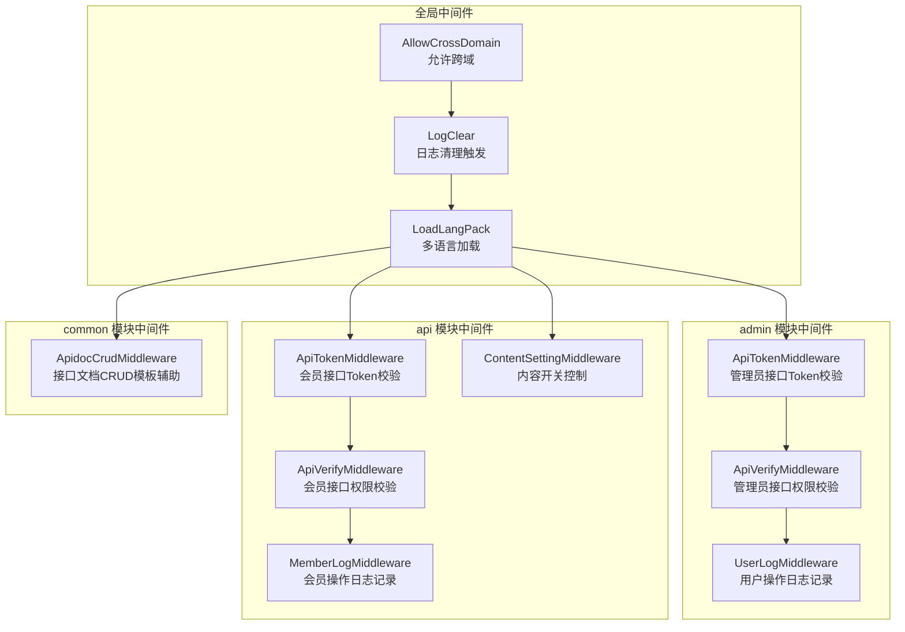
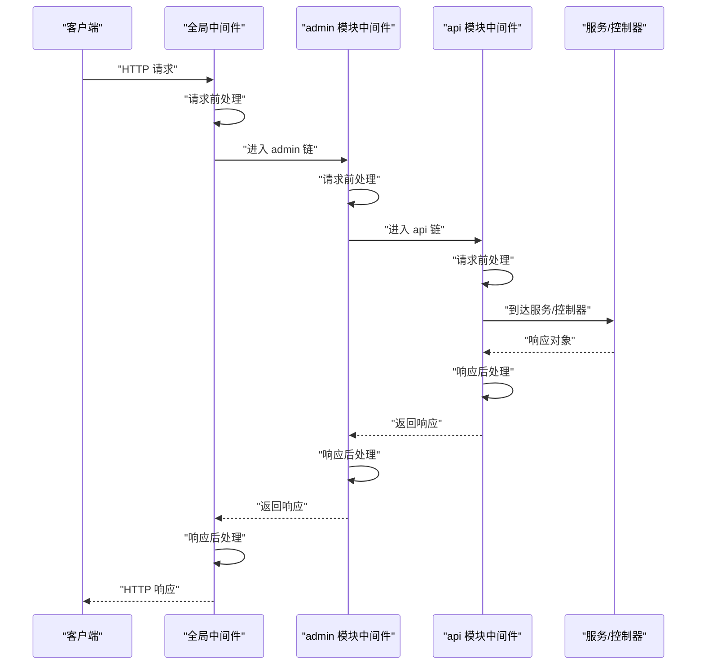
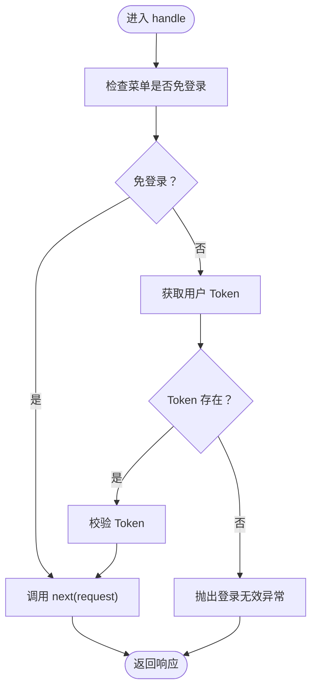
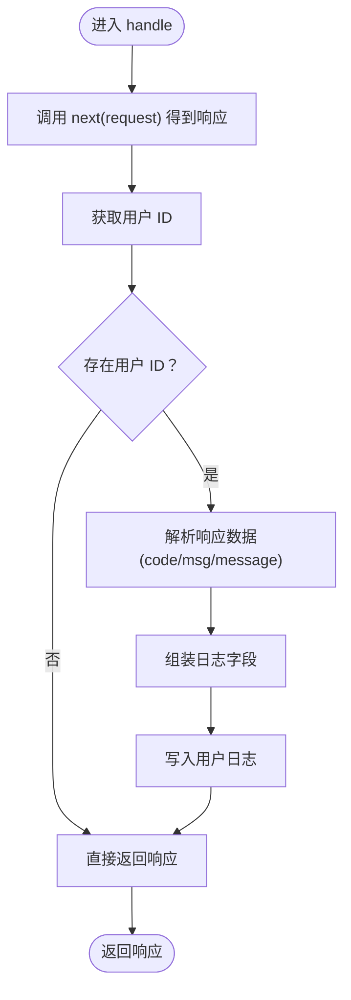
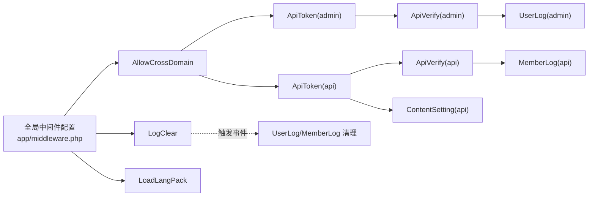

# 中间件系统

<cite>
**本文引用的文件**
- [app/middleware.php](file://gccd_server/app/middleware.php)
- [config/middleware.php](file://gccd_server/config/middleware.php)
- [app/admin/middleware/ApiTokenMiddleware.php](file://gccd_server/app/admin/middleware/ApiTokenMiddleware.php)
- [app/admin/middleware/UserLogMiddleware.php](file://gccd_server/app/admin/middleware/UserLogMiddleware.php)
- [app/admin/middleware/ApiVerifyMiddleware.php](file://gccd_server/app/admin/middleware/ApiVerifyMiddleware.php)
- [app/api/middleware/ApiTokenMiddleware.php](file://gccd_server/app/api/middleware/ApiTokenMiddleware.php)
- [app/api/middleware/MemberLogMiddleware.php](file://gccd_server/app/api/middleware/MemberLogMiddleware.php)
- [app/api/middleware/ApiVerifyMiddleware.php](file://gccd_server/app/api/middleware/ApiVerifyMiddleware.php)
- [app/api/middleware/ContentSettingMiddleware.php](file://gccd_server/app/api/middleware/ContentSettingMiddleware.php)
- [app/common/middleware/AllowCrossDomain.php](file://gccd_server/app/common/middleware/AllowCrossDomain.php)
- [app/common/middleware/LogClear.php](file://gccd_server/app/common/middleware/LogClear.php)
- [app/common/middleware/ApidocCrudMiddleware.php](file://gccd_server/app/common/middleware/ApidocCrudMiddleware.php)
</cite>

## 目录
1. [简介](#简介)
2. [项目结构](#项目结构)
3. [核心组件](#核心组件)
4. [架构总览](#架构总览)
5. [详细组件分析](#详细组件分析)
6. [依赖关系分析](#依赖关系分析)
7. [性能考量](#性能考量)
8. [故障排查指南](#故障排查指南)
9. [结论](#结论)
10. [附录](#附录)

## 简介
本文件系统性梳理 ThinkPHP 8 在本项目中的中间件体系，覆盖全局中间件与按模块划分的中间件（admin/api/common），重点解析以下方面：
- 中间件工作原理与执行顺序（请求前处理、响应后处理、异常拦截）
- 核心中间件实现机制：ApiTokenMiddleware、UserLogMiddleware、MemberLogMiddleware、ApiVerifyMiddleware、AllowCrossDomain、LogClear
- 中间件注册方式、配置项与生命周期管理
- 自定义中间件的开发规范与最佳实践
- 提供中间件链式调用的执行流程图与代码示例路径
- 权限验证、日志记录、请求过滤等常见场景的实现案例

## 项目结构
中间件在本项目中分为三层：
- 全局中间件：集中于应用入口配置，对所有请求生效
- 模块中间件：admin/api/common 分别提供各自领域的中间件
- 配置项：中间件别名与优先级由配置文件统一管理

图表来源
- [app/middleware.php:11-22](file://gccd_server/app/middleware.php#L11-L22)
- [config/middleware.php:11-16](file://gccd_server/config/middleware.php#L11-L16)
- [app/admin/middleware/ApiTokenMiddleware.php:29](file://gccd_server/app/admin/middleware/ApiTokenMiddleware.php#L29)
- [app/admin/middleware/UserLogMiddleware.php:29](file://gccd_server/app/admin/middleware/UserLogMiddleware.php#L29)
- [app/admin/middleware/ApiVerifyMiddleware.php:32](file://gccd_server/app/admin/middleware/ApiVerifyMiddleware.php#L32)
- [app/api/middleware/ApiTokenMiddleware.php:29](file://gccd_server/app/api/middleware/ApiTokenMiddleware.php#L29)
- [app/api/middleware/MemberLogMiddleware.php:29](file://gccd_server/app/api/middleware/MemberLogMiddleware.php#L29)
- [app/api/middleware/ApiVerifyMiddleware.php:33](file://gccd_server/app/api/middleware/ApiVerifyMiddleware.php#L33)
- [app/api/middleware/ContentSettingMiddleware.php:29](file://gccd_server/app/api/middleware/ContentSettingMiddleware.php#L29)
- [app/common/middleware/AllowCrossDomain.php:28](file://gccd_server/app/common/middleware/AllowCrossDomain.php#L28)
- [app/common/middleware/LogClear.php:29](file://gccd_server/app/common/middleware/LogClear.php#L29)
- [app/common/middleware/ApidocCrudMiddleware.php:18](file://gccd_server/app/common/middleware/ApidocCrudMiddleware.php#L18)

章节来源
- [app/middleware.php:11-22](file://gccd_server/app/middleware.php#L11-L22)
- [config/middleware.php:11-16](file://gccd_server/config/middleware.php#L11-L16)

## 核心组件
- 允许跨域中间件（AllowCrossDomain）：统一设置跨域头，并对预检请求快速返回
- 日志清理中间件（LogClear）：在请求进入时触发事件，清理相关日志
- 管理员 Token 校验中间件（ApiTokenMiddleware@admin）：校验管理员接口访问令牌，支持免登录白名单
- 管理员权限校验中间件（ApiVerifyMiddleware@admin）：校验菜单/接口存在性、启用状态与权限
- 用户日志中间件（UserLogMiddleware@admin）：在响应返回后采集结果码与消息，写入用户日志
- 会员 Token 校验中间件（ApiTokenMiddleware@api）：校验会员接口访问令牌，支持免登录白名单
- 会员权限校验中间件（ApiVerifyMiddleware@api）：校验接口存在性、启用状态与会员授权
- 会员日志中间件（MemberLogMiddleware@api）：在响应返回后采集结果码与消息，写入会员日志
- 内容开关中间件（ContentSettingMiddleware@api）：根据配置开关控制内容相关接口可用性
- Apidoc CRUD 辅助中间件（ApidocCrudMiddleware@common）：用于接口文档生成时的模板参数调整

章节来源
- [app/common/middleware/AllowCrossDomain.php:28](file://gccd_server/app/common/middleware/AllowCrossDomain.php#L28)
- [app/common/middleware/LogClear.php:29](file://gccd_server/app/common/middleware/LogClear.php#L29)
- [app/admin/middleware/ApiTokenMiddleware.php:29](file://gccd_server/app/admin/middleware/ApiTokenMiddleware.php#L29)
- [app/admin/middleware/UserLogMiddleware.php:29](file://gccd_server/app/admin/middleware/UserLogMiddleware.php#L29)
- [app/admin/middleware/ApiVerifyMiddleware.php:32](file://gccd_server/app/admin/middleware/ApiVerifyMiddleware.php#L32)
- [app/api/middleware/ApiTokenMiddleware.php:29](file://gccd_server/app/api/middleware/ApiTokenMiddleware.php#L29)
- [app/api/middleware/MemberLogMiddleware.php:29](file://gccd_server/app/api/middleware/MemberLogMiddleware.php#L29)
- [app/api/middleware/ApiVerifyMiddleware.php:33](file://gccd_server/app/api/middleware/ApiVerifyMiddleware.php#L33)
- [app/api/middleware/ContentSettingMiddleware.php:29](file://gccd_server/app/api/middleware/ContentSettingMiddleware.php#L29)
- [app/common/middleware/ApidocCrudMiddleware.php:18](file://gccd_server/app/common/middleware/ApidocCrudMiddleware.php#L18)

## 架构总览
中间件链遵循“先入后出”的洋葱模型：请求从外层中间件进入，逐层向内传递，最终到达控制器；响应沿相反方向回传，外层中间件可对响应进行二次加工。

图表来源
- [app/middleware.php:11-22](file://gccd_server/app/middleware.php#L11-L22)
- [app/admin/middleware/ApiTokenMiddleware.php:29](file://gccd_server/app/admin/middleware/ApiTokenMiddleware.php#L29)
- [app/admin/middleware/UserLogMiddleware.php:29](file://gccd_server/app/admin/middleware/UserLogMiddleware.php#L29)
- [app/admin/middleware/ApiVerifyMiddleware.php:32](file://gccd_server/app/admin/middleware/ApiVerifyMiddleware.php#L32)
- [app/api/middleware/ApiTokenMiddleware.php:29](file://gccd_server/app/api/middleware/ApiTokenMiddleware.php#L29)
- [app/api/middleware/MemberLogMiddleware.php:29](file://gccd_server/app/api/middleware/MemberLogMiddleware.php#L29)
- [app/api/middleware/ApiVerifyMiddleware.php:33](file://gccd_server/app/api/middleware/ApiVerifyMiddleware.php#L33)

## 详细组件分析

### 允许跨域中间件（AllowCrossDomain）
- 功能要点
  - 设置标准跨域响应头
  - 对预检请求（OPTIONS）直接返回空响应，减少不必要的后续处理
  - 将后续处理交由链路中的下一个中间件
- 执行顺序
  - 作为全局中间件链首部，确保所有请求均能正确处理跨域
- 异常与错误处理
  - 无显式异常抛出，仅通过响应头与快速返回处理预检请求

章节来源
- [app/common/middleware/AllowCrossDomain.php:28](file://gccd_server/app/common/middleware/AllowCrossDomain.php#L28)

### 日志清理中间件（LogClear）
- 功能要点
  - 在请求进入时触发事件，清理用户日志与会员日志
  - 保持对后续中间件的透明传递
- 执行顺序
  - 通常位于跨域之后，保证清理逻辑在业务处理之前执行
- 异常与错误处理
  - 无显式异常抛出，清理失败不影响请求主链

章节来源
- [app/common/middleware/LogClear.php:29](file://gccd_server/app/common/middleware/LogClear.php#L29)

### 管理员 Token 校验中间件（ApiTokenMiddleware@admin）
- 功能要点
  - 支持菜单级别的免登录白名单判断
  - 获取并校验管理员 Token，缺失或无效时抛出异常
  - 通过闭包将控制权交给下一个中间件
- 执行顺序
  - 通常位于全局链之后，admin 链之前，确保管理员接口访问受控
- 异常与错误处理
  - 缺失 Token 或校验失败时抛出异常，中断后续处理

图表来源
- [app/admin/middleware/ApiTokenMiddleware.php:29](file://gccd_server/app/admin/middleware/ApiTokenMiddleware.php#L29)

章节来源
- [app/admin/middleware/ApiTokenMiddleware.php:29](file://gccd_server/app/admin/middleware/ApiTokenMiddleware.php#L29)

### 管理员权限校验中间件（ApiVerifyMiddleware@admin）
- 功能要点
  - 可选的权限校验逻辑（注释掉的分支），包含菜单存在性、启用状态、免权判断与角色授权校验
  - 未启用校验时直接放行
- 执行顺序
  - 在 Token 校验之后，日志记录之前
- 异常与错误处理
  - 当接口不存在、被禁用或无权限时抛出异常

章节来源
- [app/admin/middleware/ApiVerifyMiddleware.php:32](file://gccd_server/app/admin/middleware/ApiVerifyMiddleware.php#L32)

### 用户日志中间件（UserLogMiddleware@admin）
- 功能要点
  - 在调用 next(request) 后获取响应对象
  - 解析响应数据中的状态码与消息字段，写入用户日志
  - 仅当存在用户 ID 时记录
- 执行顺序
  - 位于权限校验之后，负责在响应阶段记录用户行为
- 异常与错误处理
  - 无显式异常抛出，记录失败不影响响应返回

图表来源
- [app/admin/middleware/UserLogMiddleware.php:29](file://gccd_server/app/admin/middleware/UserLogMiddleware.php#L29)

章节来源
- [app/admin/middleware/UserLogMiddleware.php:29](file://gccd_server/app/admin/middleware/UserLogMiddleware.php#L29)

### 会员 Token 校验中间件（ApiTokenMiddleware@api）
- 功能要点
  - 支持接口级别的免登录白名单判断
  - 获取并校验会员 Token，缺失或无效时抛出异常
- 执行顺序
  - 位于全局链之后，api 链之前
- 异常与错误处理
  - 缺失 Token 或校验失败时抛出异常

章节来源
- [app/api/middleware/ApiTokenMiddleware.php:29](file://gccd_server/app/api/middleware/ApiTokenMiddleware.php#L29)

### 会员权限校验中间件（ApiVerifyMiddleware@api）
- 功能要点
  - 读取全局设置，判断是否启用会员接口
  - 校验接口存在性、启用状态与免权判断
  - 非超级会员时校验会员授权列表
- 执行顺序
  - 在 Token 校验之后，日志记录之前
- 异常与错误处理
  - 接口不存在、被禁用或无权限时抛出异常

章节来源
- [app/api/middleware/ApiVerifyMiddleware.php:33](file://gccd_server/app/api/middleware/ApiVerifyMiddleware.php#L33)

### 会员日志中间件（MemberLogMiddleware@api）
- 功能要点
  - 在调用 next(request) 后获取响应对象
  - 解析响应数据中的状态码与消息字段，写入会员日志
  - 记录平台、应用标识等上下文信息
- 执行顺序
  - 位于权限校验之后，负责在响应阶段记录会员行为
- 异常与错误处理
  - 无显式异常抛出，记录失败不影响响应返回

章节来源
- [app/api/middleware/MemberLogMiddleware.php:29](file://gccd_server/app/api/middleware/MemberLogMiddleware.php#L29)

### 内容开关中间件（ContentSettingMiddleware@api）
- 功能要点
  - 读取配置项判断内容功能是否开启
  - 未开启时直接返回错误响应
- 执行顺序
  - 位于全局链之后，具体业务接口之前
- 异常与错误处理
  - 通过错误响应中断后续处理

章节来源
- [app/api/middleware/ContentSettingMiddleware.php:29](file://gccd_server/app/api/middleware/ContentSettingMiddleware.php#L29)

### Apidoc CRUD 辅助中间件（ApidocCrudMiddleware@common）
- 功能要点
  - 提供模板生成前后钩子，用于自动补全类名、字段集合等
- 执行顺序
  - 作为文档生成工具的辅助，不参与常规请求链
- 异常与错误处理
  - 无显式异常抛出，主要用于模板参数调整

章节来源
- [app/common/middleware/ApidocCrudMiddleware.php:18](file://gccd_server/app/common/middleware/ApidocCrudMiddleware.php#L18)

## 依赖关系分析
- 注册与配置
  - 全局中间件通过应用入口配置文件集中声明
  - 中间件别名与优先级由配置文件管理
- 模块化组织
  - admin/api/common 下分别提供领域相关的中间件
  - admin 与 api 的 Token/权限中间件分别面向不同主体（管理员/会员）
- 事件驱动
  - 日志清理中间件通过事件触发清理动作，降低耦合度

图表来源
- [app/middleware.php:11-22](file://gccd_server/app/middleware.php#L11-L22)
- [config/middleware.php:11-16](file://gccd_server/config/middleware.php#L11-L16)
- [app/common/middleware/LogClear.php:32](file://gccd_server/app/common/middleware/LogClear.php#L32)

章节来源
- [app/middleware.php:11-22](file://gccd_server/app/middleware.php#L11-L22)
- [config/middleware.php:11-16](file://gccd_server/config/middleware.php#L11-L16)

## 性能考量
- 预检请求快速返回：跨域中间件对 OPTIONS 请求直接返回空响应，避免后续处理开销
- 早失败策略：Token 校验与权限校验在请求早期执行，尽早发现无效请求，减少后续资源消耗
- 响应后处理：日志中间件在 next 返回后再处理，避免阻塞业务主链
- 事件解耦：日志清理通过事件触发，降低中间件间的直接耦合，提升扩展性

## 故障排查指南
- Token 相关问题
  - 现象：提示“请登录”或“登录无效”
  - 排查：确认请求头中携带正确的 Token；检查免登录白名单配置；核对 Token 校验逻辑
  - 参考路径
    - [app/admin/middleware/ApiTokenMiddleware.php:29](file://gccd_server/app/admin/middleware/ApiTokenMiddleware.php#L29)
    - [app/api/middleware/ApiTokenMiddleware.php:29](file://gccd_server/app/api/middleware/ApiTokenMiddleware.php#L29)
- 权限相关问题
  - 现象：提示“接口地址不存在/接口已被禁用/你没有权限操作”
  - 排查：确认接口是否存在且启用；非超级会员需核对授权列表；调试模式下可查看详细信息
  - 参考路径
    - [app/admin/middleware/ApiVerifyMiddleware.php:32](file://gccd_server/app/admin/middleware/ApiVerifyMiddleware.php#L32)
    - [app/api/middleware/ApiVerifyMiddleware.php:33](file://gccd_server/app/api/middleware/ApiVerifyMiddleware.php#L33)
- 日志记录问题
  - 现象：用户/会员日志未记录
  - 排查：确认响应数据包含 code/msg/message 字段；确认当前请求存在用户/会员 ID；检查日志服务实现
  - 参考路径
    - [app/admin/middleware/UserLogMiddleware.php:29](file://gccd_server/app/admin/middleware/UserLogMiddleware.php#L29)
    - [app/api/middleware/MemberLogMiddleware.php:29](file://gccd_server/app/api/middleware/MemberLogMiddleware.php#L29)
- 跨域问题
  - 现象：浏览器报跨域错误
  - 排查：确认跨域头是否正确设置；预检请求是否被正确快速返回
  - 参考路径
    - [app/common/middleware/AllowCrossDomain.php:28](file://gccd_server/app/common/middleware/AllowCrossDomain.php#L28)
- 内容功能不可用
  - 现象：提示“内容功能未开启”
  - 排查：确认配置项 is_api_content 已开启
  - 参考路径
    - [app/api/middleware/ContentSettingMiddleware.php:29](file://gccd_server/app/api/middleware/ContentSettingMiddleware.php#L29)

章节来源
- [app/admin/middleware/ApiTokenMiddleware.php:29](file://gccd_server/app/admin/middleware/ApiTokenMiddleware.php#L29)
- [app/api/middleware/ApiTokenMiddleware.php:29](file://gccd_server/app/api/middleware/ApiTokenMiddleware.php#L29)
- [app/admin/middleware/ApiVerifyMiddleware.php:32](file://gccd_server/app/admin/middleware/ApiVerifyMiddleware.php#L32)
- [app/api/middleware/ApiVerifyMiddleware.php:33](file://gccd_server/app/api/middleware/ApiVerifyMiddleware.php#L33)
- [app/admin/middleware/UserLogMiddleware.php:29](file://gccd_server/app/admin/middleware/UserLogMiddleware.php#L29)
- [app/api/middleware/MemberLogMiddleware.php:29](file://gccd_server/app/api/middleware/MemberLogMiddleware.php#L29)
- [app/common/middleware/AllowCrossDomain.php:28](file://gccd_server/app/common/middleware/AllowCrossDomain.php#L28)
- [app/api/middleware/ContentSettingMiddleware.php:29](file://gccd_server/app/api/middleware/ContentSettingMiddleware.php#L29)

## 结论
本项目的中间件体系以“全局中间件 + 模块中间件”的方式实现，既保证了通用能力（跨域、日志清理、多语言）的统一接入，又为 admin/api 提供了细粒度的权限与日志控制。通过清晰的执行顺序与响应后处理机制，中间件在保障安全与可观测性的同时，尽量减少对业务主链的影响。建议在新增中间件时遵循“请求前处理 + 响应后处理”的职责边界，并通过配置文件合理管理中间件的别名与优先级。

## 附录
- 中间件注册与配置
  - 全局中间件注册：[app/middleware.php:11-22](file://gccd_server/app/middleware.php#L11-L22)
  - 中间件别名与优先级：[config/middleware.php:11-16](file://gccd_server/config/middleware.php#L11-L16)
- 关键中间件实现路径
  - 管理员 Token 校验：[app/admin/middleware/ApiTokenMiddleware.php:29](file://gccd_server/app/admin/middleware/ApiTokenMiddleware.php#L29)
  - 管理员权限校验：[app/admin/middleware/ApiVerifyMiddleware.php:32](file://gccd_server/app/admin/middleware/ApiVerifyMiddleware.php#L32)
  - 用户日志记录：[app/admin/middleware/UserLogMiddleware.php:29](file://gccd_server/app/admin/middleware/UserLogMiddleware.php#L29)
  - 会员 Token 校验：[app/api/middleware/ApiTokenMiddleware.php:29](file://gccd_server/app/api/middleware/ApiTokenMiddleware.php#L29)
  - 会员权限校验：[app/api/middleware/ApiVerifyMiddleware.php:33](file://gccd_server/app/api/middleware/ApiVerifyMiddleware.php#L33)
  - 会员日志记录：[app/api/middleware/MemberLogMiddleware.php:29](file://gccd_server/app/api/middleware/MemberLogMiddleware.php#L29)
  - 内容开关控制：[app/api/middleware/ContentSettingMiddleware.php:29](file://gccd_server/app/api/middleware/ContentSettingMiddleware.php#L29)
  - 跨域处理：[app/common/middleware/AllowCrossDomain.php:28](file://gccd_server/app/common/middleware/AllowCrossDomain.php#L28)
  - 日志清理：[app/common/middleware/LogClear.php:29](file://gccd_server/app/common/middleware/LogClear.php#L29)
  - Apidoc CRUD 辅助：[app/common/middleware/ApidocCrudMiddleware.php:18](file://gccd_server/app/common/middleware/ApidocCrudMiddleware.php#L18)