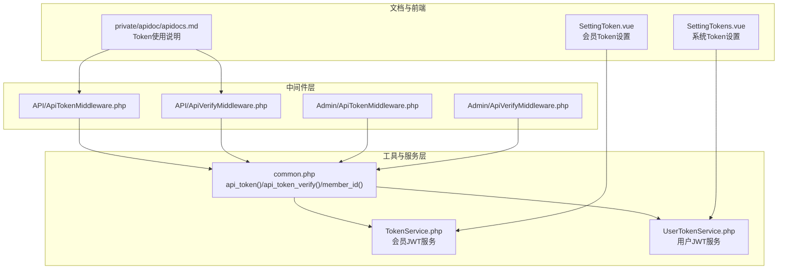
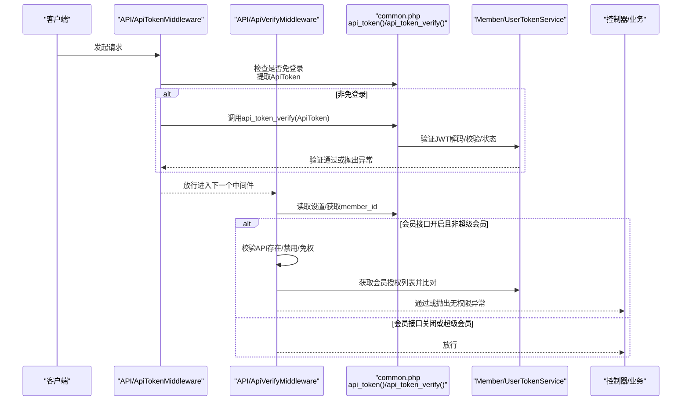
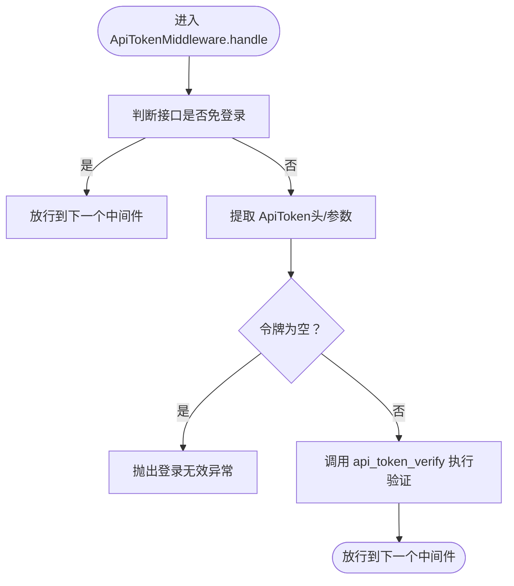
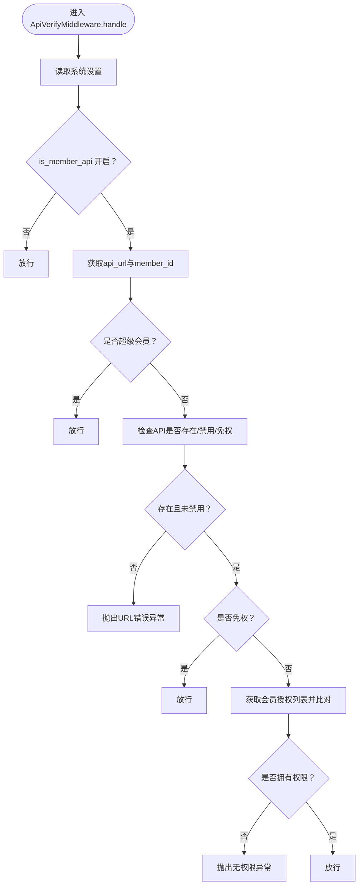
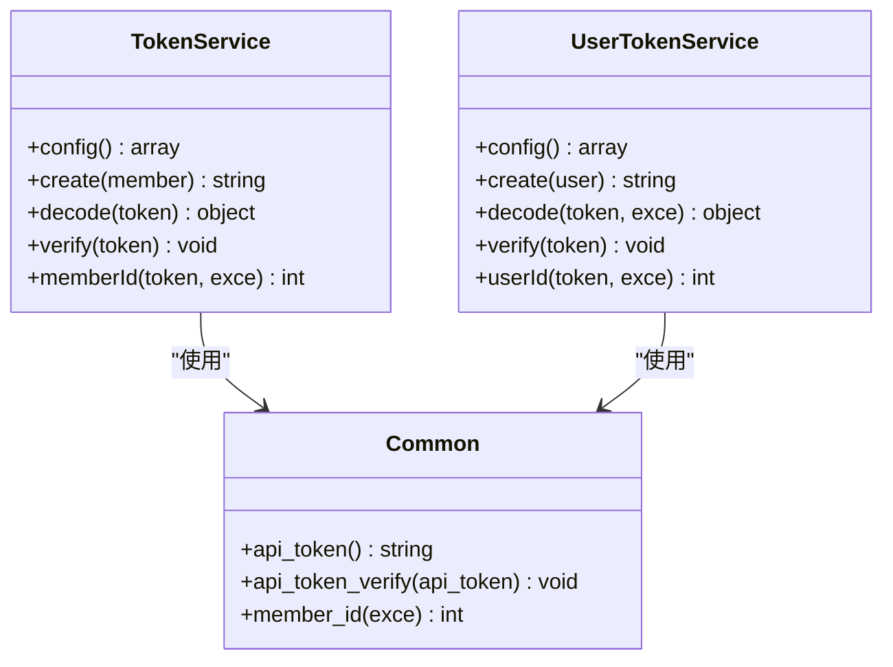
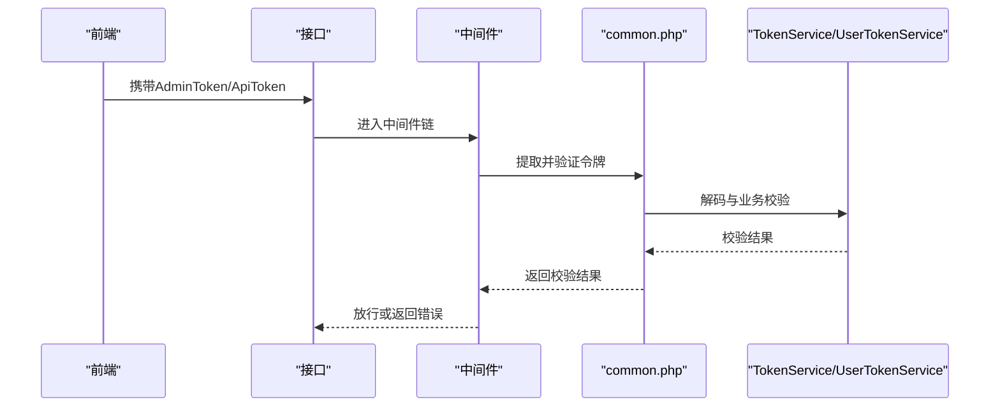
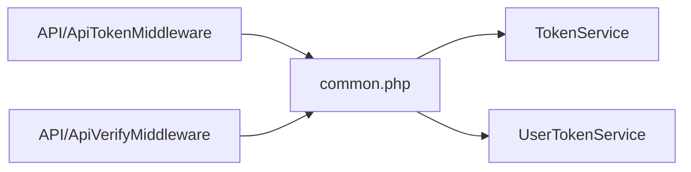

# 安全与认证中间件

<cite>
**本文引用的文件**
- [ApiTokenMiddleware.php](file://gccd_server/app/api/middleware/ApiTokenMiddleware.php)
- [ApiTokenMiddleware.php](file://gccd_server/app/admin/middleware/ApiTokenMiddleware.php)
- [ApiVerifyMiddleware.php](file://gccd_server/app/api/middleware/ApiVerifyMiddleware.php)
- [ApiVerifyMiddleware.php](file://gccd_server/app/admin/middleware/ApiVerifyMiddleware.php)
- [common.php](file://gccd_server/app/common.php)
- [TokenService.php](file://gccd_server/app/common/service/member/TokenService.php)
- [UserTokenService.php](file://gccd_server/app/common/service/system/UserTokenService.php)
- [apidocs.md](file://gccd_server/private/apidoc/apidocs.md)
- [SettingTokens.vue](file://yarn/src/views/system/components/SettingTokens.vue)
- [SettingToken.vue](file://yarn/src/views/member/components/SettingToken.vue)
</cite>

## 目录
1. [简介](#简介)
2. [项目结构](#项目结构)
3. [核心组件](#核心组件)
4. [架构总览](#架构总览)
5. [详细组件分析](#详细组件分析)
6. [依赖关系分析](#依赖关系分析)
7. [性能考量](#性能考量)
8. [故障排查指南](#故障排查指南)
9. [结论](#结论)
10. [附录](#附录)

## 简介
本文件聚焦于安全与认证中间件的专业技术文档，深入解析 ApiTokenMiddleware 与 ApiVerifyMiddleware 的安全机制实现，涵盖 JWT 令牌验证、API 签名验证与访问权限控制。文档将详细说明认证流程、令牌生成与验证算法、配置参数与调优建议，并提供多层认证与动态权限控制的实现思路、常见安全威胁的防护与检测机制，以及测试与漏洞扫描指南。

## 项目结构
围绕安全与认证的关键文件分布如下：
- 中间件层：API 与后台分别提供 Token 与 Verify 中间件，负责请求拦截与权限校验。
- 工具与服务层：通用工具函数与 Token 服务，封装 JWT 生成、解码与验证逻辑。
- 文档与前端配置：接口文档与前端 Token 设置界面，用于理解请求头与参数规范及配置项。

**图表来源**
- [ApiTokenMiddleware.php:29-45](file://gccd_server/app/api/middleware/ApiTokenMiddleware.php#L29-L45)
- [ApiVerifyMiddleware.php:33-84](file://gccd_server/app/api/middleware/ApiVerifyMiddleware.php#L33-L84)
- [ApiTokenMiddleware.php:29-43](file://gccd_server/app/admin/middleware/ApiTokenMiddleware.php#L29-L43)
- [ApiVerifyMiddleware.php:32-78](file://gccd_server/app/admin/middleware/ApiVerifyMiddleware.php#L32-L78)
- [common.php:501-534](file://gccd_server/app/common.php#L501-L534)
- [TokenService.php:41-113](file://gccd_server/app/common/service/member/TokenService.php#L41-L113)
- [UserTokenService.php:41-117](file://gccd_server/app/common/service/system/UserTokenService.php#L41-L117)
- [apidocs.md:9-18](file://gccd_server/private/apidoc/apidocs.md#L9-L18)
- [SettingTokens.vue:45-48](file://yarn/src/views/system/components/SettingTokens.vue#L45-L48)
- [SettingToken.vue:43-47](file://yarn/src/views/member/components/SettingToken.vue#L43-L47)

**章节来源**
- [ApiTokenMiddleware.php:1-47](file://gccd_server/app/api/middleware/ApiTokenMiddleware.php#L1-L47)
- [ApiVerifyMiddleware.php:1-86](file://gccd_server/app/api/middleware/ApiVerifyMiddleware.php#L1-L86)
- [ApiTokenMiddleware.php:1-45](file://gccd_server/app/admin/middleware/ApiTokenMiddleware.php#L1-L45)
- [ApiVerifyMiddleware.php:1-80](file://gccd_server/app/admin/middleware/ApiVerifyMiddleware.php#L1-L80)
- [common.php:501-534](file://gccd_server/app/common.php#L501-L534)
- [TokenService.php:1-143](file://gccd_server/app/common/service/member/TokenService.php#L1-L143)
- [UserTokenService.php:1-147](file://gccd_server/app/common/service/system/UserTokenService.php#L1-L147)
- [apidocs.md:9-18](file://gccd_server/private/apidoc/apidocs.md#L9-L18)
- [SettingTokens.vue:45-48](file://yarn/src/views/system/components/SettingTokens.vue#L45-L48)
- [SettingToken.vue:43-47](file://yarn/src/views/member/components/SettingToken.vue#L43-L47)

## 核心组件
- ApiTokenMiddleware（API/后台）：负责在非免登录场景下提取并验证接口令牌，确保请求具备有效会话。
- ApiVerifyMiddleware（API/后台）：在启用会员接口时，对 API 地址存在性、可用性、权限白名单与成员授权进行校验；后台版本保留了菜单权限校验的注释逻辑，便于扩展。
- 令牌工具与服务：
  - 通用函数：从请求头或参数中提取令牌、执行令牌验证、获取会员/用户 ID。
  - 会员 Token 服务：基于 HS256 的 JWT 生成、解码与验证，含多端登录控制、账号状态与密码变更校验。
  - 用户 Token 服务：同上，面向后台用户。

**章节来源**
- [ApiTokenMiddleware.php:29-45](file://gccd_server/app/api/middleware/ApiTokenMiddleware.php#L29-L45)
- [ApiVerifyMiddleware.php:33-84](file://gccd_server/app/api/middleware/ApiVerifyMiddleware.php#L33-L84)
- [ApiTokenMiddleware.php:29-43](file://gccd_server/app/admin/middleware/ApiTokenMiddleware.php#L29-L43)
- [ApiVerifyMiddleware.php:32-78](file://gccd_server/app/admin/middleware/ApiVerifyMiddleware.php#L32-L78)
- [common.php:501-534](file://gccd_server/app/common.php#L501-L534)
- [TokenService.php:41-113](file://gccd_server/app/common/service/member/TokenService.php#L41-L113)
- [UserTokenService.php:41-117](file://gccd_server/app/common/service/system/UserTokenService.php#L41-L117)

## 架构总览
安全中间件在请求生命周期中的位置与职责如下：

**图表来源**
- [ApiTokenMiddleware.php:29-45](file://gccd_server/app/api/middleware/ApiTokenMiddleware.php#L29-L45)
- [ApiVerifyMiddleware.php:33-84](file://gccd_server/app/api/middleware/ApiVerifyMiddleware.php#L33-L84)
- [common.php:501-534](file://gccd_server/app/common.php#L501-L534)
- [TokenService.php:83-113](file://gccd_server/app/common/service/member/TokenService.php#L83-L113)
- [UserTokenService.php:87-117](file://gccd_server/app/common/service/system/UserTokenService.php#L87-L117)

## 详细组件分析

### ApiTokenMiddleware 分析
- 功能定位：统一处理接口层的令牌提取与验证，支持“免登录”策略。
- 处理流程：
  - 判断当前接口是否免登录；
  - 若非免登录，从请求头或参数中提取 ApiToken；
  - 调用通用验证函数执行验证；
  - 通过后放行至后续中间件或控制器。
- 关键交互：
  - 依赖通用函数从配置中确定令牌来源（头或参数）与名称；
  - 依赖会员/用户 Token 服务完成 JWT 解码与有效性校验。

**图表来源**
- [ApiTokenMiddleware.php:29-45](file://gccd_server/app/api/middleware/ApiTokenMiddleware.php#L29-L45)
- [common.php:501-534](file://gccd_server/app/common.php#L501-L534)

**章节来源**
- [ApiTokenMiddleware.php:29-45](file://gccd_server/app/api/middleware/ApiTokenMiddleware.php#L29-L45)
- [ApiTokenMiddleware.php:29-43](file://gccd_server/app/admin/middleware/ApiTokenMiddleware.php#L29-L43)
- [common.php:501-534](file://gccd_server/app/common.php#L501-L534)

### ApiVerifyMiddleware 分析（API）
- 功能定位：在启用会员接口时，对 API 地址的存在性、禁用状态、免权策略与成员授权进行严格校验。
- 核心逻辑：
  - 读取系统设置，若开启会员接口：
    - 校验 API 地址是否存在与是否被禁用；
    - 若非免权，获取会员信息并比对授权列表；
    - 在调试模式下附加详细信息以便定位问题；
  - 通过后放行。
- 与后台版本差异：后台版本保留了菜单权限校验的注释逻辑，可按需启用。

**图表来源**
- [ApiVerifyMiddleware.php:33-84](file://gccd_server/app/api/middleware/ApiVerifyMiddleware.php#L33-L84)

**章节来源**
- [ApiVerifyMiddleware.php:33-84](file://gccd_server/app/api/middleware/ApiVerifyMiddleware.php#L33-L84)
- [ApiVerifyMiddleware.php:32-78](file://gccd_server/app/admin/middleware/ApiVerifyMiddleware.php#L32-L78)

### JWT 令牌生成与验证算法
- 令牌类型：HS256 对称加密 JWT。
- 生成流程：
  - 从设置服务读取密钥、算法与过期时间；
  - 构造载荷（签发时间、生效时间、过期时间、数据主体）；
  - 使用密钥与算法生成 JWT。
- 验证流程：
  - 解码阶段：使用相同密钥与算法尝试解码；
  - 异常处理：解码失败或过期等抛出“登录无效”；
  - 业务校验：检查账号状态（删除/禁用）、密码变更时间、多端登录控制（登录时间戳一致）。
- 会员与用户服务共享同一算法，但作用域不同（会员 vs 后台用户）。

**图表来源**
- [TokenService.php:27-113](file://gccd_server/app/common/service/member/TokenService.php#L27-L113)
- [UserTokenService.php:27-117](file://gccd_server/app/common/service/system/UserTokenService.php#L27-L117)
- [common.php:501-548](file://gccd_server/app/common.php#L501-L548)

**章节来源**
- [TokenService.php:27-113](file://gccd_server/app/common/service/member/TokenService.php#L27-L113)
- [UserTokenService.php:27-117](file://gccd_server/app/common/service/system/UserTokenService.php#L27-L117)
- [common.php:501-548](file://gccd_server/app/common.php#L501-L548)

### 认证流程与令牌来源
- 令牌来源：支持从请求头或请求参数读取，具体键名与方式由配置决定。
- 请求示例：接口文档明确要求在请求头或参数中携带相应 Token（AdminToken 或 ApiToken）。
- 前端配置：系统与会员 Token 设置界面提供密钥、过期时间与多端登录开关，便于统一管理。

**图表来源**
- [apidocs.md:9-18](file://gccd_server/private/apidoc/apidocs.md#L9-L18)
- [common.php:501-534](file://gccd_server/app/common.php#L501-L534)
- [TokenService.php:83-113](file://gccd_server/app/common/service/member/TokenService.php#L83-L113)
- [UserTokenService.php:87-117](file://gccd_server/app/common/service/system/UserTokenService.php#L87-L117)
- [SettingTokens.vue:45-48](file://yarn/src/views/system/components/SettingTokens.vue#L45-L48)
- [SettingToken.vue:43-47](file://yarn/src/views/member/components/SettingToken.vue#L43-L47)

**章节来源**
- [apidocs.md:9-18](file://gccd_server/private/apidoc/apidocs.md#L9-L18)
- [common.php:501-534](file://gccd_server/app/common.php#L501-L534)
- [SettingTokens.vue:45-48](file://yarn/src/views/system/components/SettingTokens.vue#L45-L48)
- [SettingToken.vue:43-47](file://yarn/src/views/member/components/SettingToken.vue#L43-L47)

## 依赖关系分析
- 中间件依赖通用工具函数与 Token 服务，形成清晰的分层：
  - 中间件负责“门卫”职责；
  - 通用函数负责“令牌提取与验证入口”；
  - Token 服务负责“JWT 算法与业务规则”。
- 配置耦合点：
  - 令牌键名、来源（头/参数）、算法、过期时间、多端登录策略均来自设置服务。
- 可能的循环依赖风险：
  - 当前结构为单向依赖（中间件 -> 工具/服务），未见循环依赖迹象。

**图表来源**
- [ApiTokenMiddleware.php:29-45](file://gccd_server/app/api/middleware/ApiTokenMiddleware.php#L29-L45)
- [ApiVerifyMiddleware.php:33-84](file://gccd_server/app/api/middleware/ApiVerifyMiddleware.php#L33-L84)
- [common.php:501-534](file://gccd_server/app/common.php#L501-L534)
- [TokenService.php:83-113](file://gccd_server/app/common/service/member/TokenService.php#L83-L113)
- [UserTokenService.php:87-117](file://gccd_server/app/common/service/system/UserTokenService.php#L87-L117)

**章节来源**
- [ApiTokenMiddleware.php:29-45](file://gccd_server/app/api/middleware/ApiTokenMiddleware.php#L29-L45)
- [ApiVerifyMiddleware.php:33-84](file://gccd_server/app/api/middleware/ApiVerifyMiddleware.php#L33-L84)
- [common.php:501-534](file://gccd_server/app/common.php#L501-L534)
- [TokenService.php:83-113](file://gccd_server/app/common/service/member/TokenService.php#L83-L113)
- [UserTokenService.php:87-117](file://gccd_server/app/common/service/system/UserTokenService.php#L87-L117)

## 性能考量
- JWT 解码成本低，HS256 为对称算法，验证开销较小。
- 建议：
  - 合理设置过期时间，避免频繁刷新导致的额外请求；
  - 多端登录控制在高并发场景下可能增加数据库/缓存查询，建议结合缓存策略优化；
  - 将中间件置于链路靠前位置，尽早失败以减少后续处理。

## 故障排查指南
- 常见错误与定位：
  - 登录无效：令牌缺失、格式错误、过期、账号被删除/禁用、密码变更、异地登录；
  - 无权限：非超级会员未获得 API 授权；
  - API 地址错误/禁用：URL 不存在或被禁用。
- 调试建议：
  - 开启调试模式可返回更详细的错误信息；
  - 检查前端是否正确传递 Token 键名与值；
  - 核对设置服务中的密钥、算法、过期时间与多端登录策略。

**章节来源**
- [TokenService.php:83-113](file://gccd_server/app/common/service/member/TokenService.php#L83-L113)
- [UserTokenService.php:87-117](file://gccd_server/app/common/service/system/UserTokenService.php#L87-L117)
- [ApiVerifyMiddleware.php:44-81](file://gccd_server/app/api/middleware/ApiVerifyMiddleware.php#L44-L81)
- [apidocs.md:44-48](file://gccd_server/private/apidoc/apidocs.md#L44-L48)

## 结论
该安全与认证中间件体系以中间件为核心，配合通用工具函数与 JWT 服务，实现了从令牌提取、解码验证到权限控制的完整闭环。通过配置化管理密钥、算法、过期时间与多端登录策略，既保证了安全性，也兼顾了灵活性。建议在生产环境中强化日志审计、限流与入侵检测，并定期轮换密钥与审查授权策略。

## 附录

### 配置参数与调优建议
- 令牌键名与来源：在设置中定义，支持从请求头或参数读取；
- 密钥与算法：建议使用强随机密钥，算法固定为 HS256；
- 过期时间：根据业务特性设置，建议较短周期以降低泄露风险；
- 多端登录：默认禁止异地登录，如需支持可调整为允许；
- 超级会员/管理员：针对特权账户可绕过部分校验，谨慎使用。

**章节来源**
- [common.php:501-534](file://gccd_server/app/common.php#L501-L534)
- [TokenService.php:27-32](file://gccd_server/app/common/service/member/TokenService.php#L27-L32)
- [UserTokenService.php:27-32](file://gccd_server/app/common/service/system/UserTokenService.php#L27-L32)
- [SettingTokens.vue:45-48](file://yarn/src/views/system/components/SettingTokens.vue#L45-L48)
- [SettingToken.vue:43-47](file://yarn/src/views/member/components/SettingToken.vue#L43-L47)

### 多层认证与动态权限控制
- 多层认证：可叠加后台用户 Token 与会员 Token 中间件，分别校验不同域的会话；
- 动态权限：通过会员授权列表与 API/菜单白名单实现细粒度控制，后台版本保留了菜单权限的扩展点。

**章节来源**
- [ApiVerifyMiddleware.php:65-79](file://gccd_server/app/api/middleware/ApiVerifyMiddleware.php#L65-L79)
- [ApiVerifyMiddleware.php:32-78](file://gccd_server/app/admin/middleware/ApiVerifyMiddleware.php#L32-L78)

### 测试方法与漏洞扫描指南
- 单元测试：对中间件的免登录分支、令牌提取与验证分支进行覆盖；
- 集成测试：构造有效/无效/过期/异地登录等场景，验证异常路径；
- 漏洞扫描：重点检查以下方面：
  - 令牌泄露：确保仅在 HTTPS 下传输，避免明文存储；
  - 算法强度：确认使用 HS256 并妥善保管密钥；
  - 权限提升：验证非超级会员无法越权访问；
  - 速率限制：结合限流中间件防止暴力破解；
  - 日志审计：记录关键事件（登录、权限拒绝、异地登录）以便追踪。

[本节为通用指导，不直接分析具体文件，故无“章节来源”]