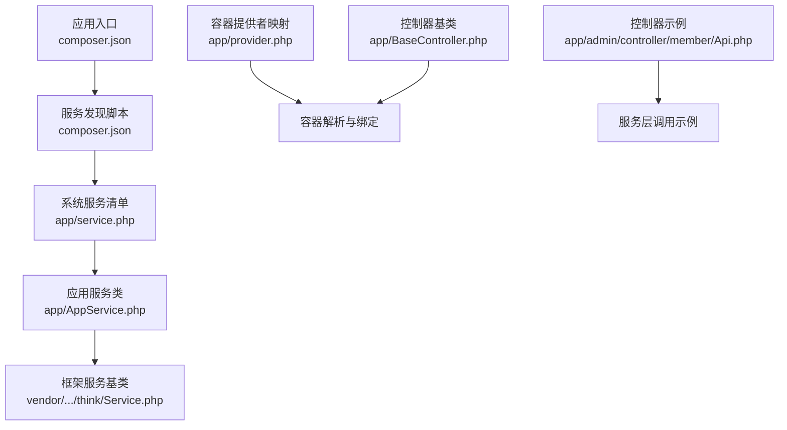
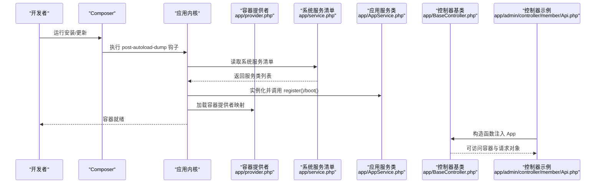
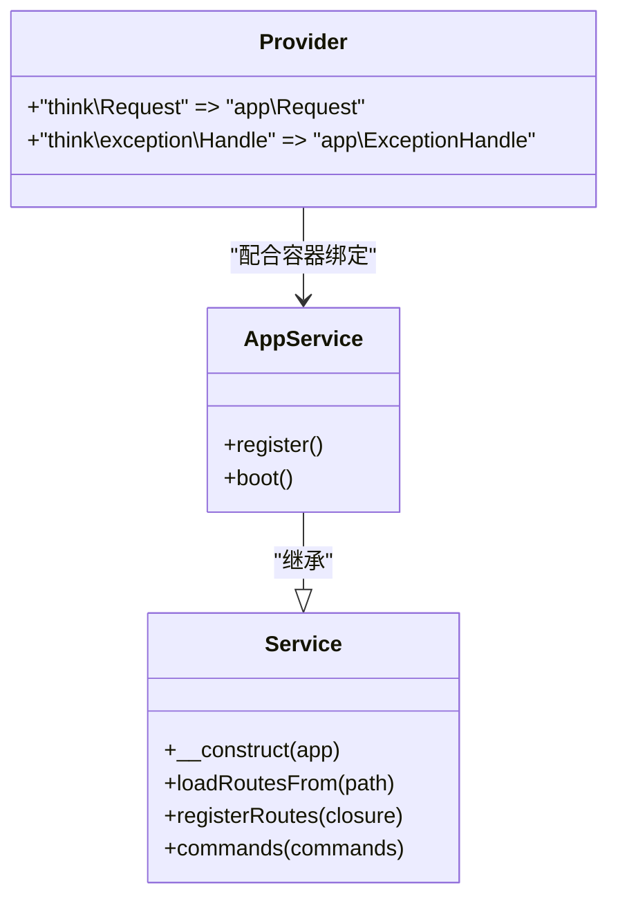
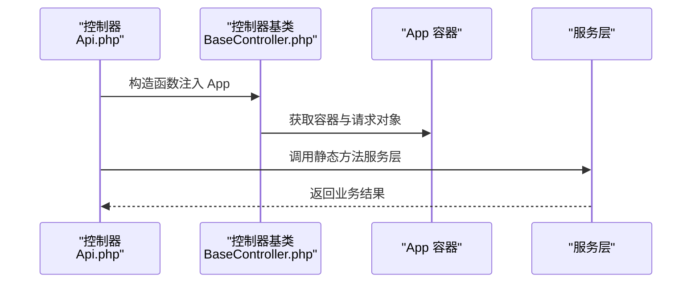
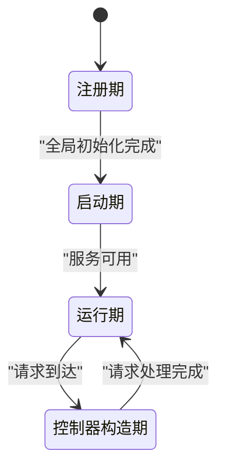
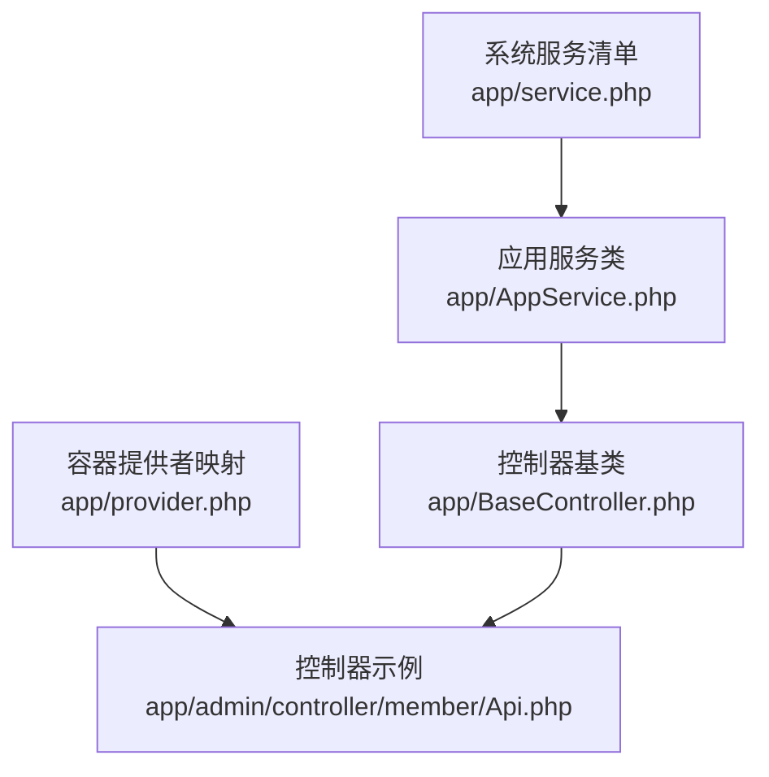

# 依赖注入

<cite>
**本文引用的文件**
- [composer.json](file://gccd_server/composer.json)
- [provider.php](file://gccd_server/app/provider.php)
- [service.php](file://gccd_server/app/service.php)
- [AppService.php](file://gccd_server/app/AppService.php)
- [Service.php](file://gccd_server/vendor/topthink/framework/src/think/Service.php)
- [BaseController.php](file://gccd_server/app/BaseController.php)
- [Api.php](file://gccd_server/app/admin/controller/member/Api.php)
</cite>

## 目录
1. [引言](#引言)
2. [项目结构](#项目结构)
3. [核心组件](#核心组件)
4. [架构总览](#架构总览)
5. [详细组件分析](#详细组件分析)
6. [依赖关系分析](#依赖关系分析)
7. [性能考量](#性能考量)
8. [故障排查指南](#故障排查指南)
9. [结论](#结论)
10. [附录](#附录)

## 引言
本文件围绕 ThinkPHP 8 的依赖注入体系进行系统化技术说明，重点覆盖以下主题：
- 服务提供者（Provider）的注册机制与服务绑定原理
- 依赖注入容器的工作流程与生命周期管理
- 自动注入、手动注入、延迟注入的使用场景与差异
- 服务别名、接口绑定、闭包服务等高级特性
- 在控制器与服务层中的最佳实践与常见陷阱
- 结合仓库现有代码的示例路径，帮助读者快速落地

## 项目结构
本项目基于 ThinkPHP 8 框架，采用多应用与服务化架构。与依赖注入密切相关的目录与文件包括：
- app/provider.php：容器服务提供者映射表
- app/service.php：系统服务注册清单
- app/AppService.php：应用级服务类，继承框架 Service 基类
- vendor/topthink/framework/src/think/Service.php：框架提供的服务抽象基类
- app/BaseController.php：控制器基类，构造函数中通过依赖注入获取 App 实例
- app/admin/controller/member/Api.php：控制器示例，展示服务层调用

图表来源
- [composer.json:17-22](file://gccd_server/composer.json#L17-L22)
- [service.php:13-15](file://gccd_server/app/service.php#L13-L15)
- [AppService.php:17-28](file://gccd_server/app/AppService.php#L17-L28)
- [Service.php:23-63](file://gccd_server/vendor/topthink/framework/src/think/Service.php#L23-L63)
- [provider.php:14-17](file://gccd_server/app/provider.php#L14-L17)
- [BaseController.php:48-57](file://gccd_server/app/BaseController.php#L48-L57)
- [Api.php:32-118](file://gccd_server/app/admin/controller/member/Api.php#L32-L118)

章节来源
- [composer.json:17-22](file://gccd_server/composer.json#L17-L22)
- [service.php:13-15](file://gccd_server/app/service.php#L13-L15)
- [AppService.php:17-28](file://gccd_server/app/AppService.php#L17-L28)
- [Service.php:23-63](file://gccd_server/vendor/topthink/framework/src/think/Service.php#L23-L63)
- [provider.php:14-17](file://gccd_server/app/provider.php#L14-L17)
- [BaseController.php:48-57](file://gccd_server/app/BaseController.php#L48-L57)
- [Api.php:32-118](file://gccd_server/app/admin/controller/member/Api.php#L32-L118)

## 核心组件
- 服务提供者映射表（app/provider.php）
  - 将框架内置接口别名映射到自定义实现类，实现“接口绑定”与“服务别名”的基础能力。
  - 示例映射：将 think\Request 映射为 app\Request；将 think\exception\Handle 映射为 app\ExceptionHandle。

- 系统服务清单（app/service.php）
  - 列举应用启动后需要执行的系统服务类，框架在完成全局初始化后加载这些服务。

- 应用服务类（app/AppService.php）
  - 继承框架 Service 抽象类，提供 register 与 boot 生命周期钩子，用于注册与启动阶段的扩展逻辑。

- 框架服务基类（vendor/topthink/framework/src/think/Service.php）
  - 提供 register、boot 生命周期方法，以及 loadRoutesFrom、registerRoutes、commands 等工具方法，支撑服务化开发。

- 控制器基类（app/BaseController.php）
  - 构造函数通过类型提示注入 App 实例，从而获得 request、response、container 等能力，并统一初始化流程。

- 控制器示例（app/admin/controller/member/Api.php）
  - 展示对服务层的静态调用，体现“服务层解耦、控制器薄化”的依赖注入实践。

章节来源
- [provider.php:14-17](file://gccd_server/app/provider.php#L14-L17)
- [service.php:13-15](file://gccd_server/app/service.php#L13-L15)
- [AppService.php:17-28](file://gccd_server/app/AppService.php#L17-L28)
- [Service.php:23-63](file://gccd_server/vendor/topthink/framework/src/think/Service.php#L23-L63)
- [BaseController.php:48-57](file://gccd_server/app/BaseController.php#L48-L57)
- [Api.php:32-118](file://gccd_server/app/admin/controller/member/Api.php#L32-L118)

## 架构总览
下图展示了从 Composer 自动发现到服务注册、容器绑定、控制器依赖注入的关键流程。

图表来源
- [composer.json:17-22](file://gccd_server/composer.json#L17-L22)
- [service.php:13-15](file://gccd_server/app/service.php#L13-L15)
- [AppService.php:17-28](file://gccd_server/app/AppService.php#L17-L28)
- [provider.php:14-17](file://gccd_server/app/provider.php#L14-L17)
- [BaseController.php:48-57](file://gccd_server/app/BaseController.php#L48-L57)
- [Api.php:32-118](file://gccd_server/app/admin/controller/member/Api.php#L32-L118)

## 详细组件分析

### 服务提供者与容器绑定
- 接口绑定与服务别名
  - 通过 app/provider.php 将 think\Request 映射为 app\Request，实现“别名替换”。同理可将异常处理类映射为自定义实现。
  - 这种映射在容器解析时生效，确保上层代码仅依赖接口别名，不直接耦合具体实现。

- 生命周期与加载顺序
  - 系统服务清单 app/service.php 在全局初始化完成后被框架加载。
  - 应用服务类 AppService::register 与 AppService::boot 分别承担“注册期”和“启动期”的扩展点。

- 与框架服务基类的关系
  - AppService 继承 think\Service，可复用其路由加载、命令注册等能力，便于模块化扩展。

图表来源
- [Service.php:23-63](file://gccd_server/vendor/topthink/framework/src/think/Service.php#L23-L63)
- [AppService.php:17-28](file://gccd_server/app/AppService.php#L17-L28)
- [provider.php:14-17](file://gccd_server/app/provider.php#L14-L17)

章节来源
- [provider.php:14-17](file://gccd_server/app/provider.php#L14-L17)
- [service.php:13-15](file://gccd_server/app/service.php#L13-L15)
- [AppService.php:17-28](file://gccd_server/app/AppService.php#L17-L28)
- [Service.php:23-63](file://gccd_server/vendor/topthink/framework/src/think/Service.php#L23-L63)

### 控制器中的依赖注入
- 构造函数注入 App
  - BaseController 在构造函数中通过类型提示注入 think\App，从而获得容器、请求、响应等能力。
  - 这是典型的“手动注入”，确保控制器具备统一的基础设施。

- 服务层调用
  - 控制器示例通过静态方法调用服务层（如 ApiService::list），体现了“服务层解耦”的思想。
  - 若服务层内部需要进一步依赖其他服务，可通过容器或构造函数注入实现。

图表来源
- [BaseController.php:48-57](file://gccd_server/app/BaseController.php#L48-L57)
- [Api.php:32-118](file://gccd_server/app/admin/controller/member/Api.php#L32-L118)

章节来源
- [BaseController.php:48-57](file://gccd_server/app/BaseController.php#L48-L57)
- [Api.php:32-118](file://gccd_server/app/admin/controller/member/Api.php#L32-L118)

### 自动注入、手动注入与延迟注入
- 自动注入（推荐）
  - 在类的构造函数或方法参数中使用类型提示，让容器自动解析并注入依赖。
  - 适用场景：服务类、中间件、命令、事件监听器等。

- 手动注入
  - 通过容器或构造函数显式获取依赖，如 BaseController 中对 App 的注入。
  - 适用场景：控制器、视图渲染器等需要直接访问容器的场景。

- 延迟注入（按需解析）
  - 使用容器的延迟解析能力，在真正需要时再解析具体实现，降低启动成本。
  - 适用场景：大型应用中非核心功能、可选模块。

说明：以上三类注入方式在本仓库中均有体现，建议结合业务复杂度选择合适的方式，优先保证可测试性与可维护性。

### 服务别名、接口绑定与闭包服务
- 服务别名
  - 通过 app/provider.php 为 think\Request 指定别名为 app\Request，实现“别名替换”。
  - 优点：屏蔽底层实现细节，便于替换与测试。

- 接口绑定
  - 将接口别名绑定到具体实现类，容器在解析时自动返回实现类实例。
  - 适用于多实现场景（如多种缓存驱动、多种存储后端）。

- 闭包服务
  - 在容器中以闭包形式注册单例或工厂，适合需要复杂初始化逻辑的服务。
  - 适用场景：数据库连接池、第三方 SDK 客户端、带配置的工具类等。

说明：本仓库已通过 provider.php 展示了“接口绑定 + 别名替换”的基础能力，若需引入闭包服务，可在容器初始化阶段补充相应注册逻辑。

章节来源
- [provider.php:14-17](file://gccd_server/app/provider.php#L14-L17)

### 生命周期管理
- 注册期（register）
  - 在此阶段进行服务注册、路由加载、命令注册等，不涉及外部资源的强依赖初始化。
- 启动期（boot）
  - 在全局初始化完成后执行，适合进行日志、监控、缓存预热等操作。
- 控制器构造期
  - 通过构造函数注入 App，获取容器能力，避免在运行期重复解析。

图表来源
- [AppService.php:19-27](file://gccd_server/app/AppService.php#L19-L27)
- [Service.php:23-63](file://gccd_server/vendor/topthink/framework/src/think/Service.php#L23-L63)
- [BaseController.php:48-57](file://gccd_server/app/BaseController.php#L48-L57)

章节来源
- [AppService.php:19-27](file://gccd_server/app/AppService.php#L19-L27)
- [Service.php:23-63](file://gccd_server/vendor/topthink/framework/src/think/Service.php#L23-L63)
- [BaseController.php:48-57](file://gccd_server/app/BaseController.php#L48-L57)

## 依赖关系分析
- 组件耦合与协作
  - app/service.php 与 app/AppService.php 形成“系统服务注册—应用服务实现”的协作关系。
  - app/provider.php 与框架容器形成“接口别名—实现类”的绑定关系。
  - BaseController 作为基础设施，向上游控制器提供容器能力。

图表来源
- [service.php:13-15](file://gccd_server/app/service.php#L13-L15)
- [AppService.php:17-28](file://gccd_server/app/AppService.php#L17-L28)
- [provider.php:14-17](file://gccd_server/app/provider.php#L14-L17)
- [BaseController.php:48-57](file://gccd_server/app/BaseController.php#L48-L57)
- [Api.php:32-118](file://gccd_server/app/admin/controller/member/Api.php#L32-L118)

章节来源
- [service.php:13-15](file://gccd_server/app/service.php#L13-L15)
- [AppService.php:17-28](file://gccd_server/app/AppService.php#L17-L28)
- [provider.php:14-17](file://gccd_server/app/provider.php#L14-L17)
- [BaseController.php:48-57](file://gccd_server/app/BaseController.php#L48-L57)
- [Api.php:32-118](file://gccd_server/app/admin/controller/member/Api.php#L32-L118)

## 性能考量
- 延迟解析与按需加载
  - 对于非核心服务，采用延迟注入或延迟注册，减少启动时间与内存占用。
- 单例与工厂的选择
  - 多次使用的昂贵对象应注册为单例；每次需要独立状态的对象使用工厂模式。
- 服务别名与映射优化
  - 保持 provider.php 的映射简洁明确，避免过度嵌套与循环依赖。

## 故障排查指南
- 服务未注册
  - 检查 app/service.php 是否包含目标服务类，确认框架已执行服务发现脚本。
- 容器解析失败
  - 检查 app/provider.php 的映射键是否与类型提示一致，确保命名空间正确。
- 控制器无法注入 App
  - 确认 BaseController 构造函数签名与框架约定一致，避免覆盖导致注入失效。
- 服务层调用异常
  - 检查服务层内部依赖是否已正确注入或通过容器解析，避免硬编码实现。

章节来源
- [service.php:13-15](file://gccd_server/app/service.php#L13-L15)
- [provider.php:14-17](file://gccd_server/app/provider.php#L14-L17)
- [BaseController.php:48-57](file://gccd_server/app/BaseController.php#L48-L57)

## 结论
本仓库已具备 ThinkPHP 8 依赖注入的基础能力：通过服务提供者映射实现接口绑定与别名替换，借助系统服务清单完成服务注册与生命周期管理，控制器通过构造函数注入 App 实现手动注入。建议在此基础上逐步引入自动注入与延迟注入策略，完善服务别名与闭包服务的注册，持续提升系统的可测试性与可维护性。

## 附录
- 最佳实践清单
  - 优先使用自动注入；必要时采用手动注入；对非核心功能采用延迟注入。
  - 服务类尽量无状态或使用单例；避免在控制器中直接实例化外部依赖。
  - 通过 provider.php 统一管理接口别名与实现映射，保持清晰与可追溯。
  - 在 AppService::register 与 AppService::boot 中分别承担“注册期”和“启动期”职责，避免在注册期做重 IO 操作。

- 常见陷阱
  - 忘记服务发现脚本导致系统服务未加载。
  - 映射键与类型提示不一致，导致容器无法解析。
  - 在控制器中直接 new 具体实现类，破坏依赖注入原则。
  - 在注册期执行启动期才需要的外部资源初始化，影响启动性能。