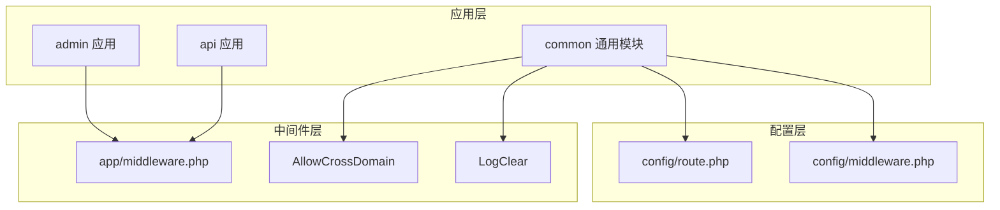
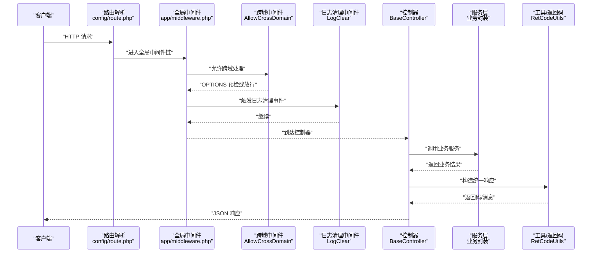
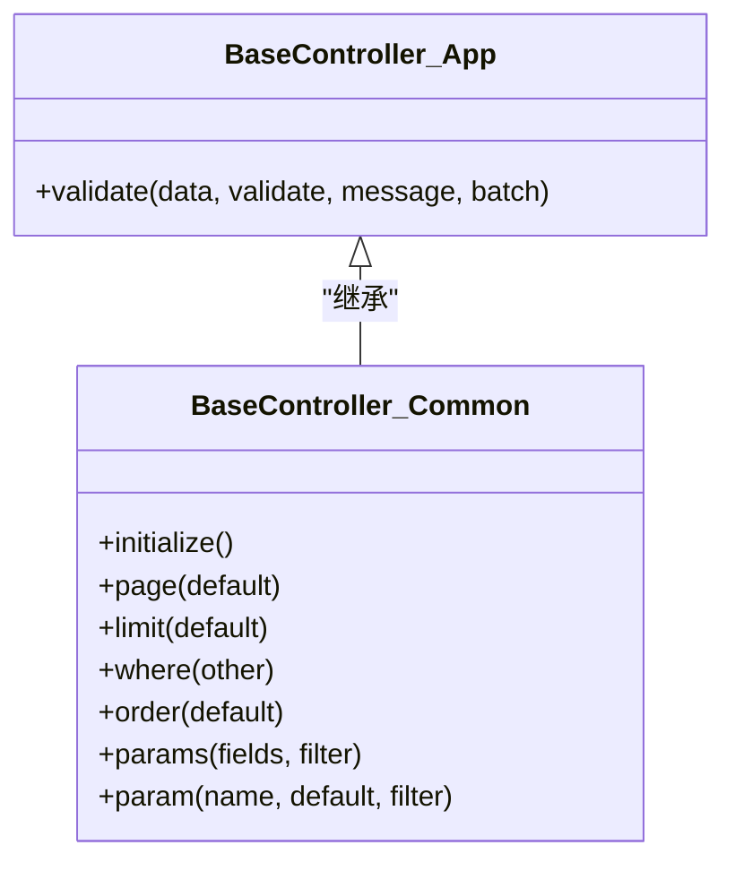
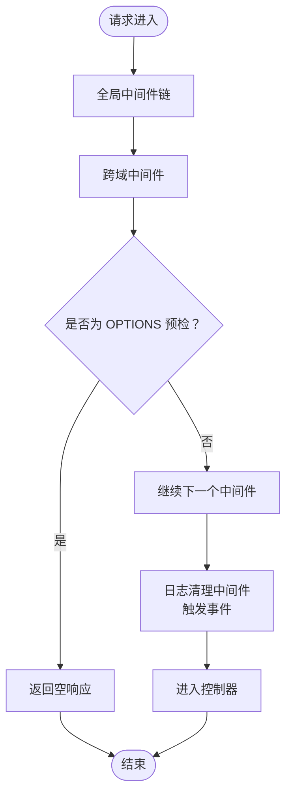
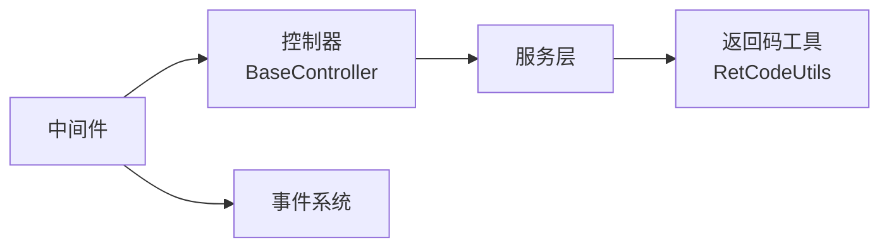

# 后端架构设计

<cite>
**本文引用的文件**
- [app/common/controller/BaseController.php](file://gccd_server/app/common/controller/BaseController.php)
- [app/BaseController.php](file://gccd_server/app/BaseController.php)
- [app/common/middleware/AllowCrossDomain.php](file://gccd_server/app/common/middleware/AllowCrossDomain.php)
- [app/common/middleware/LogClear.php](file://gccd_server/app/common/middleware/LogClear.php)
- [app/common/service/utils/RetCodeUtils.php](file://gccd_server/app/common/service/utils/RetCodeUtils.php)
- [app/provider.php](file://gccd_server/app/provider.php)
- [app/service.php](file://gccd_server/app/service.php)
- [config/route.php](file://gccd_server/config/route.php)
- [app/middleware.php](file://gccd_server/app/middleware.php)
- [config/middleware.php](file://gccd_server/config/middleware.php)
</cite>

## 目录
1. [引言](#引言)
2. [项目结构](#项目结构)
3. [核心组件](#核心组件)
4. [架构总览](#架构总览)
5. [详细组件分析](#详细组件分析)
6. [依赖分析](#依赖分析)
7. [性能考虑](#性能考虑)
8. [故障排查指南](#故障排查指南)
9. [结论](#结论)
10. [附录](#附录)

## 引言
本文件面向“高齿传动”后端架构，基于 ThinkPHP 8 的 MVC 架构与多应用模式（admin、api、common），系统化梳理控制器、服务层、模型层的职责划分与协作关系；深入解析中间件机制（请求拦截、权限校验、日志清理）、API 设计规范、错误处理与数据验证策略，并给出路由配置、依赖注入、事件系统等核心组件的实现要点与可视化图示。

## 项目结构
后端采用多应用目录组织，按功能域拆分为 admin、api、common 三个应用，配合全局公共模块与配置中心，形成清晰的分层与职责边界：
- app/admin：管理后台相关控制器、中间件、事件与公共入口
- app/api：对外 API 控制器、服务层、中间件、事件与公共入口
- app/common：通用控制器基类、通用中间件、通用工具与服务工具
- config：全局与各应用的配置项（路由、中间件别名与优先级等）
- route：应用路由聚合入口
- runtime：运行时日志、缓存等

图表来源
- [config/route.php:1-51](file://gccd_server/config/route.php#L1-L51)
- [config/middleware.php:1-17](file://gccd_server/config/middleware.php#L1-L17)
- [app/middleware.php:1-23](file://gccd_server/app/middleware.php#L1-L23)
- [app/common/middleware/AllowCrossDomain.php:1-42](file://gccd_server/app/common/middleware/AllowCrossDomain.php#L1-L42)
- [app/common/middleware/LogClear.php:1-40](file://gccd_server/app/common/middleware/LogClear.php#L1-L40)

章节来源
- [config/route.php:1-51](file://gccd_server/config/route.php#L1-L51)
- [config/middleware.php:1-17](file://gccd_server/config/middleware.php#L1-L17)
- [app/middleware.php:1-23](file://gccd_server/app/middleware.php#L1-L23)

## 核心组件
- 控制器基类
  - app/common/controller/BaseController.php：提供分页、查询条件、排序、参数提取等通用能力，统一异常处理入口
  - app/BaseController.php：提供统一验证入口与批量验证开关
- 中间件
  - AllowCrossDomain：处理跨域与预检请求
  - LogClear：触发用户与会员日志清理事件
- 错误码工具
  - RetCodeUtils：集中维护返回码与消息映射
- 容器与服务
  - provider.php：绑定 Request 与异常处理器
  - service.php：注册系统服务（如 AppService）

章节来源
- [app/common/controller/BaseController.php:1-244](file://gccd_server/app/common/controller/BaseController.php#L1-L244)
- [app/BaseController.php:1-101](file://gccd_server/app/BaseController.php#L1-L101)
- [app/common/middleware/AllowCrossDomain.php:1-42](file://gccd_server/app/common/middleware/AllowCrossDomain.php#L1-L42)
- [app/common/middleware/LogClear.php:1-40](file://gccd_server/app/common/middleware/LogClear.php#L1-L40)
- [app/common/service/utils/RetCodeUtils.php:1-85](file://gccd_server/app/common/service/utils/RetCodeUtils.php#L1-L85)
- [app/provider.php:1-18](file://gccd_server/app/provider.php#L1-L18)
- [app/service.php:1-16](file://gccd_server/app/service.php#L1-L16)

## 架构总览
下图展示从请求进入至响应返回的关键路径，涵盖路由、中间件、控制器与服务层的交互关系。

图表来源
- [config/route.php:1-51](file://gccd_server/config/route.php#L1-L51)
- [app/middleware.php:1-23](file://gccd_server/app/middleware.php#L1-L23)
- [app/common/middleware/AllowCrossDomain.php:1-42](file://gccd_server/app/common/middleware/AllowCrossDomain.php#L1-L42)
- [app/common/middleware/LogClear.php:1-40](file://gccd_server/app/common/middleware/LogClear.php#L1-L40)
- [app/common/controller/BaseController.php:1-244](file://gccd_server/app/common/controller/BaseController.php#L1-L244)
- [app/common/service/utils/RetCodeUtils.php:1-85](file://gccd_server/app/common/service/utils/RetCodeUtils.php#L1-L85)

## 详细组件分析

### 控制器基类与职责划分
- app/common/controller/BaseController.php
  - 统一分页参数 page/limit、列表查询条件 where（支持多种表达式与日期区间）、排序 order、参数提取 params
  - 提供统一的异常抛出入口，避免未定义方法访问
  - 通过 Request 实例读取参数，保证控制器层只做参数整理与调用服务层
- app/BaseController.php
  - 提供 validate 方法，支持类名与场景两种校验方式，批量验证开关可按控制器设置
  - 将验证异常转换为统一异常处理流程

图表来源
- [app/common/controller/BaseController.php:1-244](file://gccd_server/app/common/controller/BaseController.php#L1-L244)
- [app/BaseController.php:1-101](file://gccd_server/app/BaseController.php#L1-L101)

章节来源
- [app/common/controller/BaseController.php:1-244](file://gccd_server/app/common/controller/BaseController.php#L1-L244)
- [app/BaseController.php:1-101](file://gccd_server/app/BaseController.php#L1-L101)

### 中间件机制与工作原理
- 全局中间件链
  - app/middleware.php 定义全局中间件顺序：跨域、日志清理、多语言加载等
  - config/middleware.php 提供别名与优先级配置占位
- AllowCrossDomain
  - 设置 CORS 头，处理 OPTIONS 预检请求，直接返回空响应
- LogClear
  - 触发 UserLog、MemberLog 事件，交由监听器执行清理逻辑

图表来源
- [app/middleware.php:1-23](file://gccd_server/app/middleware.php#L1-L23)
- [app/common/middleware/AllowCrossDomain.php:1-42](file://gccd_server/app/common/middleware/AllowCrossDomain.php#L1-L42)
- [app/common/middleware/LogClear.php:1-40](file://gccd_server/app/common/middleware/LogClear.php#L1-L40)

章节来源
- [app/middleware.php:1-23](file://gccd_server/app/middleware.php#L1-L23)
- [app/common/middleware/AllowCrossDomain.php:1-42](file://gccd_server/app/common/middleware/AllowCrossDomain.php#L1-L42)
- [app/common/middleware/LogClear.php:1-40](file://gccd_server/app/common/middleware/LogClear.php#L1-L40)

### 服务层设计理念与封装
- 服务层定位
  - 位于 app/api/service 或 app/admin/service 下，承载具体业务逻辑，屏蔽控制器与模型层细节
  - 通过控制器调用服务，实现业务复用与测试隔离
- 与控制器协作
  - 控制器负责参数校验、分页与查询条件组装，服务层专注业务规则与数据处理
  - 统一通过 RetCodeUtils 生成返回码与消息，确保响应一致性

章节来源
- [app/common/service/utils/RetCodeUtils.php:1-85](file://gccd_server/app/common/service/utils/RetCodeUtils.php#L1-L85)

### API 接口设计规范与数据验证
- 参数规范
  - 分页：page/limit；查询：search_field/search_exp/search_value/date_field/date_value；排序：sort_field/sort_value
  - 参数提取：params 支持类型标注与默认值，减少重复判断
- 数据验证
  - validate 支持类名与场景两种方式，批量验证可按控制器设置
  - 验证失败抛出异常，交由异常处理器统一输出

章节来源
- [app/common/controller/BaseController.php:1-244](file://gccd_server/app/common/controller/BaseController.php#L1-L244)
- [app/BaseController.php:1-101](file://gccd_server/app/BaseController.php#L1-L101)

### 错误处理机制
- 返回码与消息
  - RetCodeUtils 集中维护 SUCCESS、ERROR、LOGIN_INVALID、NO_PERMISSION、API_URL_ERROR、FREQUENT_OPERATION、SERVER_ERROR 等
- 异常绑定
  - provider.php 绑定异常处理器，统一拦截未捕获异常并输出标准响应

章节来源
- [app/common/service/utils/RetCodeUtils.php:1-85](file://gccd_server/app/common/service/utils/RetCodeUtils.php#L1-L85)
- [app/provider.php:1-18](file://gccd_server/app/provider.php#L1-L18)

### 路由配置与多应用模式
- 路由设置
  - config/route.php 控制 pathinfo 分隔符、URL 后缀、默认控制器/动作、完全匹配等
- 多应用模式
  - admin、api、common 应用各自拥有独立 controller、middleware、event、service 等目录
  - 通过 app/middleware.php 注入全局中间件，实现跨应用的一致性行为

章节来源
- [config/route.php:1-51](file://gccd_server/config/route.php#L1-L51)
- [app/middleware.php:1-23](file://gccd_server/app/middleware.php#L1-L23)

### 依赖注入与容器绑定
- 容器绑定
  - provider.php 将 think\Request 与自定义异常处理器绑定，便于全局替换与扩展
- 系统服务
  - service.php 注册系统服务（如 AppService），在应用初始化完成后执行

章节来源
- [app/provider.php:1-18](file://gccd_server/app/provider.php#L1-L18)
- [app/service.php:1-16](file://gccd_server/app/service.php#L1-L16)

### 事件系统与日志清理
- 事件触发
  - LogClear 中间件通过 Event::trigger 触发 UserLog、MemberLog 事件
- 监听器
  - 在 app/listener 下注册对应监听器以执行清理任务

章节来源
- [app/common/middleware/LogClear.php:1-40](file://gccd_server/app/common/middleware/LogClear.php#L1-L40)

## 依赖分析
- 控制器对服务层的依赖：控制器仅依赖服务层接口，不直接依赖数据库或外部资源
- 中间件对事件系统的依赖：LogClear 依赖事件系统触发清理任务
- 工具对返回码的依赖：服务层与控制器通过 RetCodeUtils 统一返回码

图表来源
- [app/common/controller/BaseController.php:1-244](file://gccd_server/app/common/controller/BaseController.php#L1-L244)
- [app/common/service/utils/RetCodeUtils.php:1-85](file://gccd_server/app/common/service/utils/RetCodeUtils.php#L1-L85)
- [app/common/middleware/LogClear.php:1-40](file://gccd_server/app/common/middleware/LogClear.php#L1-L40)

## 性能考虑
- 分页与内存
  - 当 limit 较大时，BaseController.php 中对内存限制进行调整，避免超大分页导致内存溢出
- 路由与缓存
  - config/route.php 关闭了请求缓存，避免复杂场景下的缓存一致性问题
- 中间件链
  - 全局中间件顺序影响请求耗时，建议将无状态且快速的中间件前置（如跨域、多语言）

章节来源
- [app/common/controller/BaseController.php:85-92](file://gccd_server/app/common/controller/BaseController.php#L85-L92)
- [config/route.php:34-40](file://gccd_server/config/route.php#L34-L40)
- [app/middleware.php:11-22](file://gccd_server/app/middleware.php#L11-L22)

## 故障排查指南
- 控制器方法不存在
  - 通过 __call 抛出异常，检查路由与控制器方法命名是否一致
- 查询条件错误
  - where 方法对表达式与值类型进行严格校验，确认 search_exp 与 search_value 类型匹配
- 验证失败
  - validate 抛出验证异常，检查验证器类名、场景与 message 配置
- 跨域问题
  - 确认 AllowCrossDomain 中间件已启用，OPTIONS 预检是否正确返回
- 日志清理未生效
  - 检查 LogClear 是否触发事件，以及对应监听器是否注册

章节来源
- [app/common/controller/BaseController.php:56-59](file://gccd_server/app/common/controller/BaseController.php#L56-L59)
- [app/common/controller/BaseController.php:112-138](file://gccd_server/app/common/controller/BaseController.php#L112-L138)
- [app/BaseController.php:74-99](file://gccd_server/app/BaseController.php#L74-L99)
- [app/common/middleware/AllowCrossDomain.php:28-40](file://gccd_server/app/common/middleware/AllowCrossDomain.php#L28-L40)
- [app/common/middleware/LogClear.php:29-38](file://gccd_server/app/common/middleware/LogClear.php#L29-L38)

## 结论
该架构以 ThinkPHP 8 为基础，结合多应用模式与中间件链，实现了清晰的职责分层与可扩展的业务封装。控制器基类提供统一的参数处理与验证入口，服务层承载业务逻辑，中间件负责横切关注点（跨域、日志、多语言）。通过容器绑定与事件系统进一步解耦，整体具备良好的可维护性与扩展性。

## 附录
- 多应用模式建议
  - admin：后台管理、权限控制、审计日志
  - api：对外接口、版本化、限流与鉴权
  - common：通用能力（中间件、工具、模型、验证器）
- 最佳实践
  - 控制器只做参数整理与调用服务，不直接操作数据库
  - 服务层保持纯业务逻辑，必要时引入领域对象
  - 使用 RetCodeUtils 统一返回码，便于前端统一处理
  - 通过事件系统解耦日志、通知等横切功能