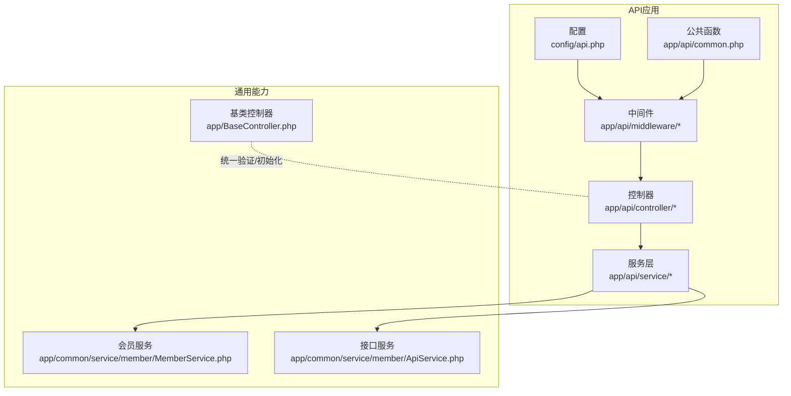
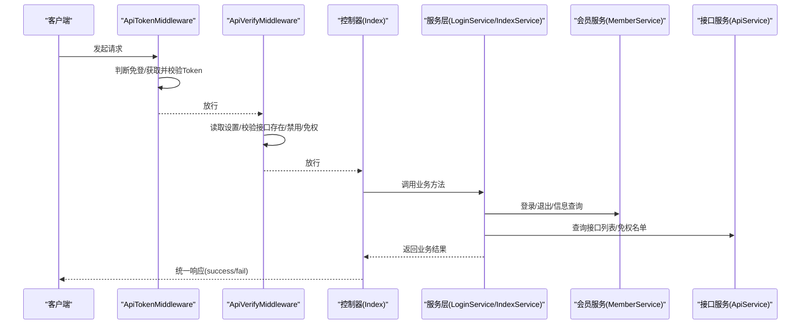
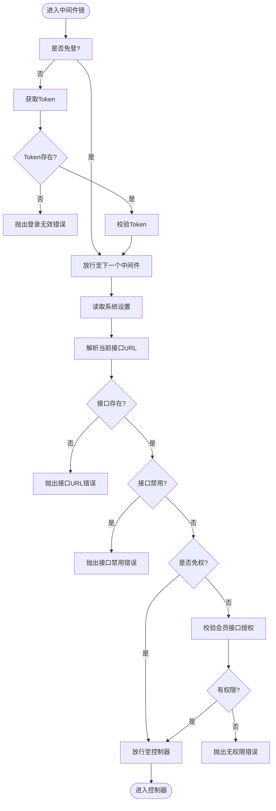
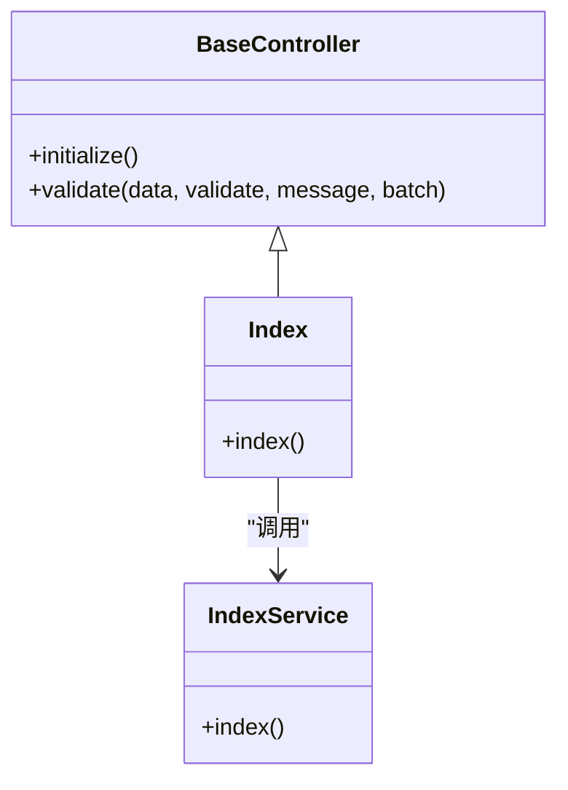
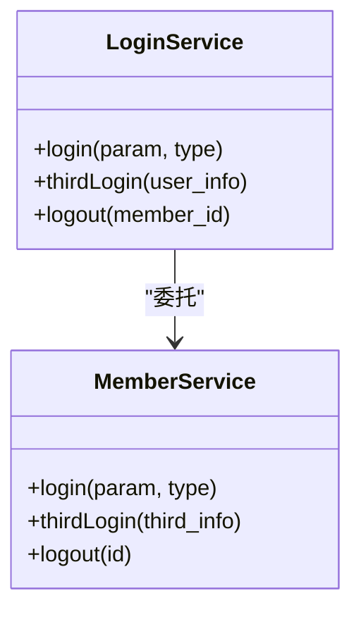
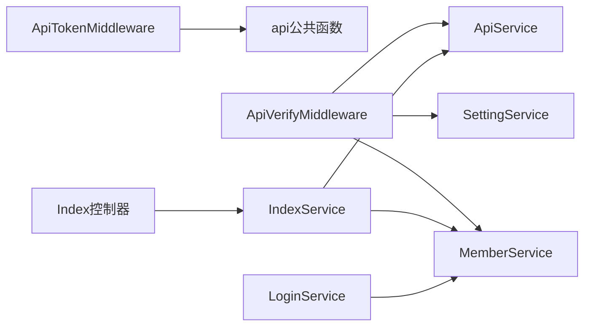

# API接口应用 (api)

<cite>
**本文引用的文件**
- [Index.php](file://gccd_server/app/api/controller/Index.php)
- [ApiTokenMiddleware.php](file://gccd_server/app/api/middleware/ApiTokenMiddleware.php)
- [ApiVerifyMiddleware.php](file://gccd_server/app/api/middleware/ApiVerifyMiddleware.php)
- [middleware.php](file://gccd_server/app/api/middleware.php)
- [LoginService.php](file://gccd_server/app/api/service/LoginService.php)
- [IndexService.php](file://gccd_server/app/api/service/IndexService.php)
- [BaseController.php](file://gccd_server/app/BaseController.php)
- [api公共函数](file://gccd_server/app/api/common.php)
- [api配置](file://gccd_server/config/api.php)
- [README.md](file://gccd_server/README.md)
- [MemberService.php](file://gccd_server/app/common/service/member/MemberService.php)
- [ApiService.php](file://gccd_server/app/common/service/member/ApiService.php)
</cite>

## 目录
1. [简介](#简介)
2. [项目结构](#项目结构)
3. [核心组件](#核心组件)
4. [架构总览](#架构总览)
5. [组件详解](#组件详解)
6. [依赖关系分析](#依赖关系分析)
7. [性能考量](#性能考量)
8. [故障排查指南](#故障排查指南)
9. [结论](#结论)
10. [附录](#附录)

## 简介
本文件面向ThinkPHP 8的API接口应用（api），系统性阐述其设计理念与实现架构，重点覆盖以下方面：
- 中间件体系：ApiTokenMiddleware与ApiVerifyMiddleware的认证与权限校验机制
- 控制器设计模式：通过Index.php等控制器提供统一API入口
- 服务层架构：以LoginService为例，展示服务层的设计原则与实现方法
- 应用间数据交互：参数传递、数据验证、错误处理等关键点
- 完整API开发实践：接口设计、参数校验、响应格式的最佳实践

## 项目结构
API应用位于gccd_server/app/api目录，采用“控制器-服务-中间件”分层组织，配合全局公共函数与配置文件实现统一的接口入口与安全控制。

图表来源
- [middleware.php:11-20](file://gccd_server/app/api/middleware.php#L11-L20)
- [ApiTokenMiddleware.php:29-45](file://gccd_server/app/api/middleware/ApiTokenMiddleware.php#L29-L45)
- [ApiVerifyMiddleware.php:33-84](file://gccd_server/app/api/middleware/ApiVerifyMiddleware.php#L33-L84)
- [Index.php:21-35](file://gccd_server/app/api/controller/Index.php#L21-L35)
- [LoginService.php:27-61](file://gccd_server/app/api/service/LoginService.php#L27-L61)
- [api公共函数:22-130](file://gccd_server/app/api/common.php#L22-L130)
- [api配置:11-58](file://gccd_server/config/api.php#L11-L58)

章节来源
- [README.md:1-189](file://gccd_server/README.md#L1-L189)
- [middleware.php:11-20](file://gccd_server/app/api/middleware.php#L11-L20)

## 核心组件
- 控制器层：以Index.php为代表的统一入口，调用服务层返回标准响应
- 服务层：封装业务逻辑，如LoginService代理会员登录/退出，IndexService提供首页信息
- 中间件层：ApiTokenMiddleware负责Token认证，ApiVerifyMiddleware负责接口权限校验与开关控制
- 公共函数与配置：提供接口URL解析、免登/免权/免限判定、平台与应用参数解析等
- 基类控制器：提供统一的参数验证能力与中间件声明

章节来源
- [Index.php:21-35](file://gccd_server/app/api/controller/Index.php#L21-L35)
- [LoginService.php:27-61](file://gccd_server/app/api/service/LoginService.php#L27-L61)
- [IndexService.php:22-30](file://gccd_server/app/api/service/IndexService.php#L22-L30)
- [ApiTokenMiddleware.php:29-45](file://gccd_server/app/api/middleware/ApiTokenMiddleware.php#L29-L45)
- [ApiVerifyMiddleware.php:33-84](file://gccd_server/app/api/middleware/ApiVerifyMiddleware.php#L33-L84)
- [BaseController.php:74-99](file://gccd_server/app/BaseController.php#L74-L99)
- [api公共函数:22-130](file://gccd_server/app/api/common.php#L22-L130)
- [api配置:11-58](file://gccd_server/config/api.php#L11-L58)

## 架构总览
API应用通过中间件链路完成认证与权限校验，再由控制器调用服务层执行业务，最终返回统一的成功/失败响应。

图表来源
- [ApiTokenMiddleware.php:29-45](file://gccd_server/app/api/middleware/ApiTokenMiddleware.php#L29-L45)
- [ApiVerifyMiddleware.php:33-84](file://gccd_server/app/api/middleware/ApiVerifyMiddleware.php#L33-L84)
- [Index.php:29-35](file://gccd_server/app/api/controller/Index.php#L29-L35)
- [LoginService.php:27-61](file://gccd_server/app/api/service/LoginService.php#L27-L61)
- [MemberService.php:434-570](file://gccd_server/app/common/service/member/MemberService.php#L434-L570)
- [ApiService.php:263-354](file://gccd_server/app/common/service/member/ApiService.php#L263-L354)

## 组件详解

### 中间件体系
- ApiTokenMiddleware
  - 作用：在非免登接口下，从请求中提取并校验Token，确保会话有效性
  - 关键流程：判断免登 → 获取Token → 校验Token → 放行
- ApiVerifyMiddleware
  - 作用：基于系统设置与接口配置，校验接口是否存在、是否禁用、是否免权；若非超级会员，进一步校验会员的接口授权
  - 关键流程：读取设置 → 解析接口URL → 存在性与禁用检查 → 免权判定 → 会员信息与授权校验 → 放行

图表来源
- [ApiTokenMiddleware.php:29-45](file://gccd_server/app/api/middleware/ApiTokenMiddleware.php#L29-L45)
- [ApiVerifyMiddleware.php:33-84](file://gccd_server/app/api/middleware/ApiVerifyMiddleware.php#L33-L84)
- [api公共函数:22-109](file://gccd_server/app/api/common.php#L22-L109)
- [api配置:20-43](file://gccd_server/config/api.php#L20-L43)

章节来源
- [ApiTokenMiddleware.php:29-45](file://gccd_server/app/api/middleware/ApiTokenMiddleware.php#L29-L45)
- [ApiVerifyMiddleware.php:33-84](file://gccd_server/app/api/middleware/ApiVerifyMiddleware.php#L33-L84)
- [api公共函数:22-130](file://gccd_server/app/api/common.php#L22-L130)
- [api配置:11-58](file://gccd_server/config/api.php#L11-L58)

### 控制器设计模式
- 统一入口：Index.php继承基类控制器，通过调用服务层方法返回统一响应
- 响应规范：控制器仅负责组装数据与消息，具体业务由服务层承担
- 参数校验：可复用基类控制器提供的validate方法进行参数校验

图表来源
- [BaseController.php:19-99](file://gccd_server/app/BaseController.php#L19-L99)
- [Index.php:21-35](file://gccd_server/app/api/controller/Index.php#L21-L35)
- [IndexService.php:15-31](file://gccd_server/app/api/service/IndexService.php#L15-L31)

章节来源
- [Index.php:21-35](file://gccd_server/app/api/controller/Index.php#L21-L35)
- [BaseController.php:74-99](file://gccd_server/app/BaseController.php#L74-L99)

### 服务层架构（以LoginService为例）
- 设计原则
  - 业务聚合：LoginService聚合会员相关业务，屏蔽底层细节
  - 明确职责：登录、第三方登录、退出分别对应独立方法
  - 参数补全：自动补全平台与应用参数，提升调用一致性
- 实现要点
  - 登录：委托MemberService.login完成账号/密码校验与Token生成
  - 第三方登录：委托MemberService.thirdLogin完成第三方账号绑定与登录
  - 退出：委托MemberService.logout完成登出记录清理

图表来源
- [LoginService.php:17-62](file://gccd_server/app/api/service/LoginService.php#L17-L62)
- [MemberService.php:434-570](file://gccd_server/app/common/service/member/MemberService.php#L434-L570)

章节来源
- [LoginService.php:27-61](file://gccd_server/app/api/service/LoginService.php#L27-L61)
- [MemberService.php:434-570](file://gccd_server/app/common/service/member/MemberService.php#L434-L570)

### 应用间数据交互
- 参数传递
  - 平台与应用参数：通过api公共函数解析请求头或参数，支持默认值与回退策略
  - 接口URL：通过api公共函数拼接应用/控制器/动作，用于权限与配置匹配
- 数据验证
  - 控制器基类提供validate方法，支持类名+场景、数组规则、批量验证等
- 错误处理
  - 中间件与服务层通过统一异常抛出机制，结合RetCodeUtils返回码，便于前端统一处理

章节来源
- [api公共函数:137-181](file://gccd_server/app/api/common.php#L137-L181)
- [BaseController.php:74-99](file://gccd_server/app/BaseController.php#L74-L99)
- [ApiVerifyMiddleware.php:66-78](file://gccd_server/app/api/middleware/ApiVerifyMiddleware.php#L66-L78)

### API接口开发最佳实践
- 接口设计
  - 使用统一的控制器入口，按模块划分子目录，避免控制器臃肿
  - 通过服务层封装复杂业务，保持控制器薄响应
- 参数校验
  - 在控制器中使用validate方法进行前置校验，减少重复校验代码
  - 对于复杂场景，可在服务层补充自定义校验逻辑
- 响应格式
  - 统一使用success/fail等封装方法返回，便于前端解析与错误提示
- 安全与权限
  - 通过中间件链路保障Token与权限校验
  - 利用配置文件集中管理免登/免权/免限接口清单

章节来源
- [Index.php:29-35](file://gccd_server/app/api/controller/Index.php#L29-L35)
- [BaseController.php:74-99](file://gccd_server/app/BaseController.php#L74-L99)
- [ApiTokenMiddleware.php:29-45](file://gccd_server/app/api/middleware/ApiTokenMiddleware.php#L29-L45)
- [ApiVerifyMiddleware.php:33-84](file://gccd_server/app/api/middleware/ApiVerifyMiddleware.php#L33-L84)
- [api配置:20-43](file://gccd_server/config/api.php#L20-L43)

## 依赖关系分析
- 中间件依赖
  - ApiTokenMiddleware依赖公共函数中的Token获取与校验工具
  - ApiVerifyMiddleware依赖SettingService、MemberService、ApiService进行系统设置、会员信息与接口配置查询
- 控制器依赖
  - Index.php依赖IndexService与apidoctools注解进行文档标注
- 服务层依赖
  - LoginService依赖MemberService
  - ApiService提供接口列表、免权/免登/免限名单与接口信息查询

图表来源
- [ApiTokenMiddleware.php:29-45](file://gccd_server/app/api/middleware/ApiTokenMiddleware.php#L29-L45)
- [ApiVerifyMiddleware.php:33-84](file://gccd_server/app/api/middleware/ApiVerifyMiddleware.php#L33-L84)
- [Index.php:21-35](file://gccd_server/app/api/controller/Index.php#L21-L35)
- [LoginService.php:27-61](file://gccd_server/app/api/service/LoginService.php#L27-L61)
- [ApiService.php:263-354](file://gccd_server/app/common/service/member/ApiService.php#L263-L354)

章节来源
- [middleware.php:11-20](file://gccd_server/app/api/middleware.php#L11-L20)
- [ApiTokenMiddleware.php:29-45](file://gccd_server/app/api/middleware/ApiTokenMiddleware.php#L29-L45)
- [ApiVerifyMiddleware.php:33-84](file://gccd_server/app/api/middleware/ApiVerifyMiddleware.php#L33-L84)
- [Index.php:21-35](file://gccd_server/app/api/controller/Index.php#L21-L35)
- [LoginService.php:27-61](file://gccd_server/app/api/service/LoginService.php#L27-L61)
- [ApiService.php:263-354](file://gccd_server/app/common/service/member/ApiService.php#L263-L354)

## 性能考量
- 缓存利用：ApiService与MemberService广泛使用缓存（ApiCache、MemberCache）降低数据库压力，建议在接口频繁访问场景下合理设置缓存键与过期时间
- 中间件顺序：将快速判定的中间件（如免登/免权）置于前部，减少不必要的鉴权与查询
- 配置集中：通过config/api.php集中管理免登/免权/免限列表，避免硬编码带来的维护成本与性能隐患

## 故障排查指南
- 登录无效/未登录
  - 检查请求中Token是否正确传递（名称与位置需与配置一致）
  - 确认接口是否在免登列表中
- 接口URL错误/接口被禁用
  - 核对接口URL拼写与配置是否一致
  - 检查接口在系统中是否被禁用
- 无权限
  - 确认会员是否为超级会员
  - 核对会员的接口授权列表与分组权限
- 参数问题
  - 使用validate方法定位参数校验失败的具体字段
  - 检查平台与应用参数的来源（请求头/参数）是否正确

章节来源
- [ApiTokenMiddleware.php:32-42](file://gccd_server/app/api/middleware/ApiTokenMiddleware.php#L32-L42)
- [ApiVerifyMiddleware.php:46-80](file://gccd_server/app/api/middleware/ApiVerifyMiddleware.php#L46-L80)
- [api配置:11-58](file://gccd_server/config/api.php#L11-L58)
- [BaseController.php:74-99](file://gccd_server/app/BaseController.php#L74-L99)

## 结论
本API应用通过清晰的中间件链路、薄控制器与厚服务层设计，实现了统一的认证、权限与业务处理能力。依托公共函数与配置文件，系统具备良好的可扩展性与可维护性。遵循本文的最佳实践，可高效构建稳定、安全、易维护的对外接口服务。

## 附录
- 快速参考
  - 中间件注册：见app/api/middleware.php
  - 接口URL解析：见app/api/common.php中的api_url函数
  - 免登/免权/免限配置：见config/api.php
  - 统一响应：控制器通过success等方法返回

章节来源
- [middleware.php:11-20](file://gccd_server/app/api/middleware.php#L11-L20)
- [api公共函数:22-130](file://gccd_server/app/api/common.php#L22-L130)
- [api配置:11-58](file://gccd_server/config/api.php#L11-L58)
- [Index.php:29-35](file://gccd_server/app/api/controller/Index.php#L29-L35)