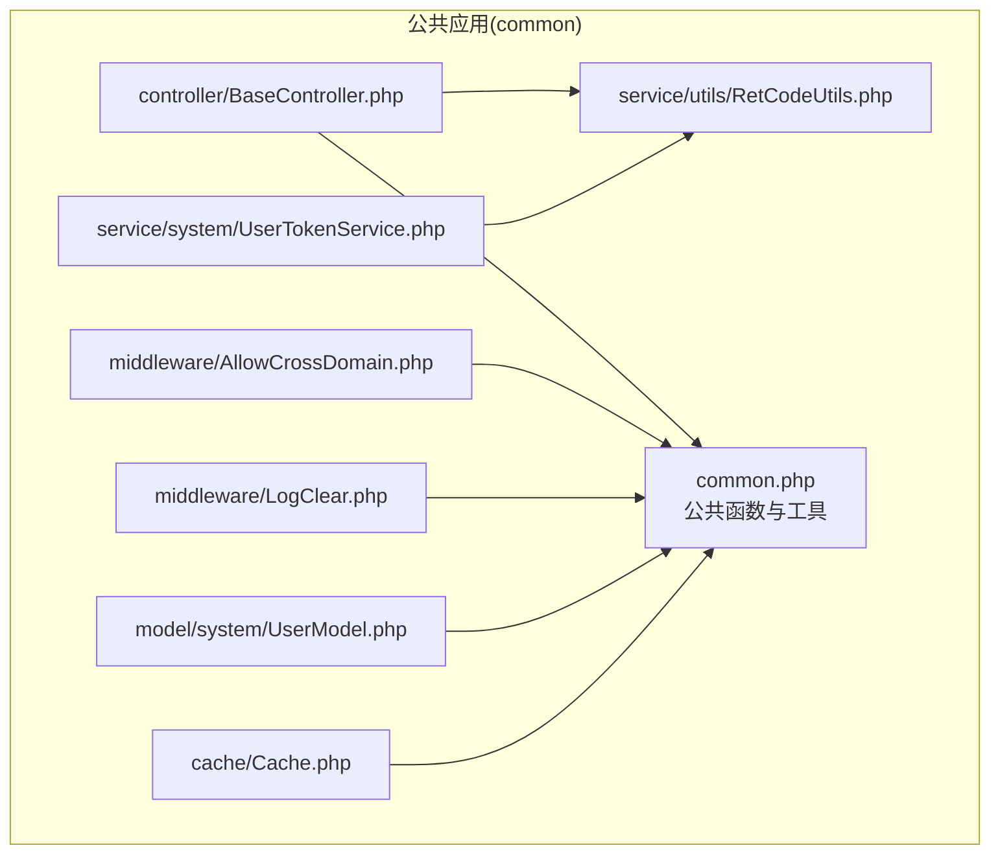
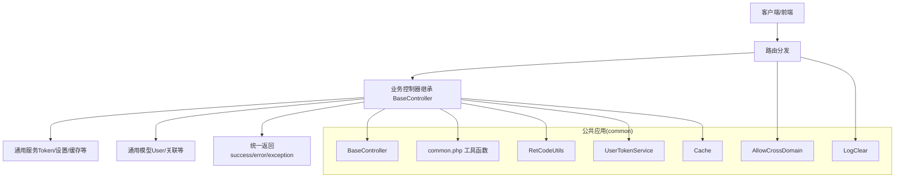
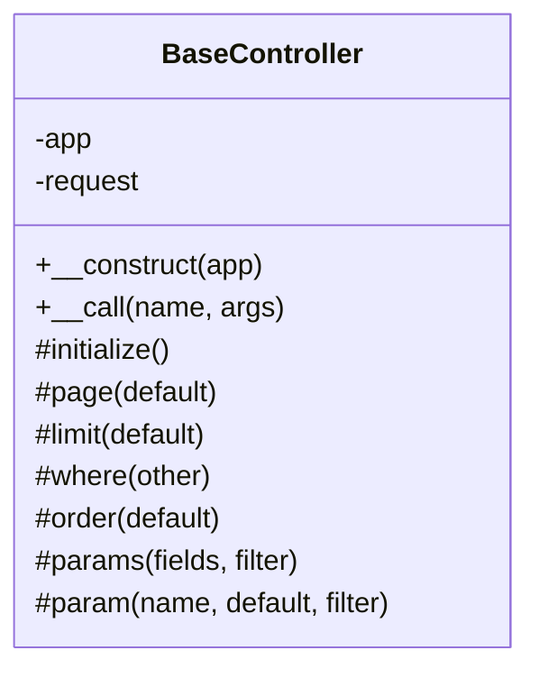
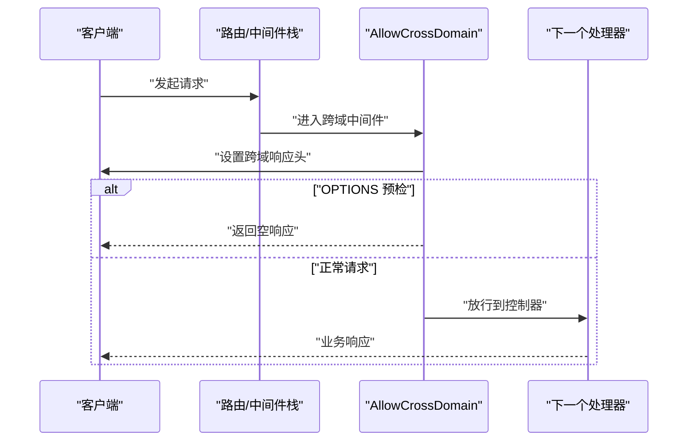
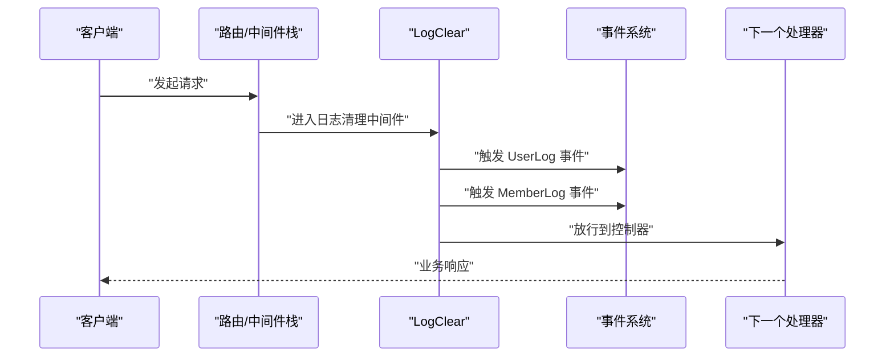
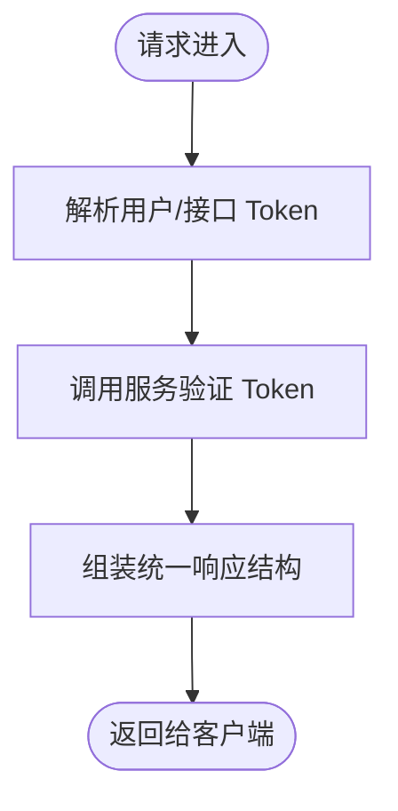
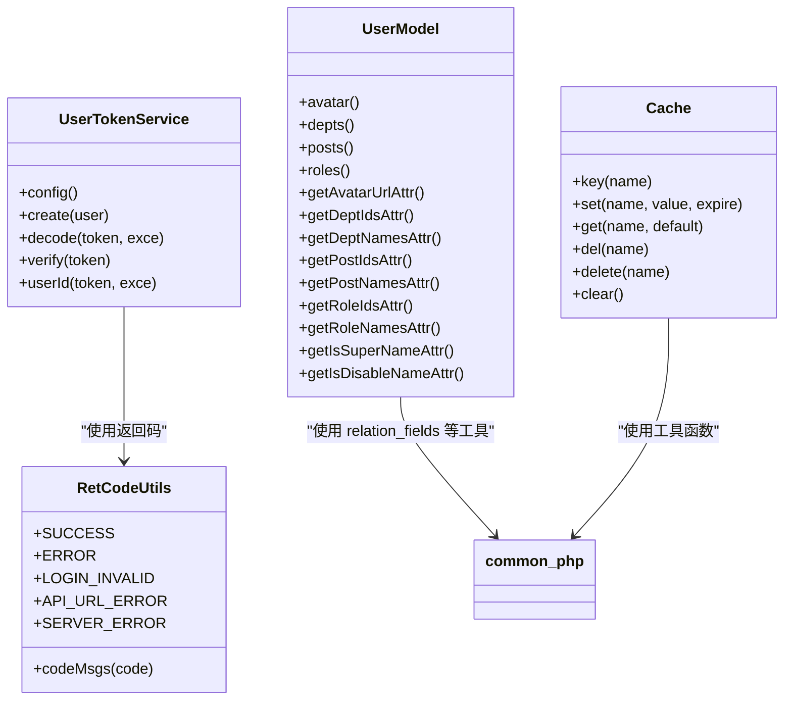
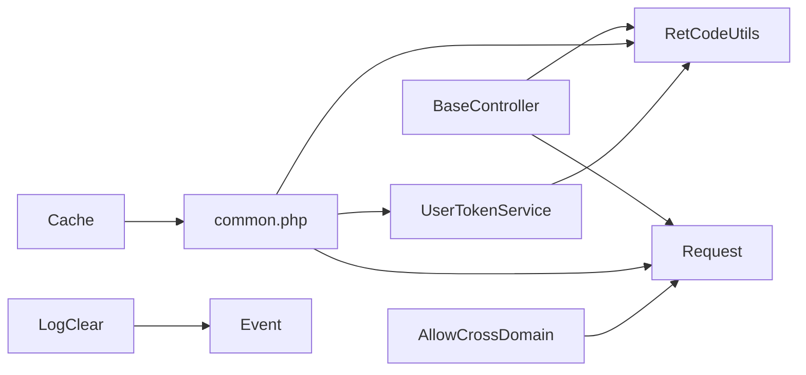

# 公共应用 (common)

<cite>
**本文引用的文件**
- [app/common/controller/BaseController.php](file://gccd_server/app/common/controller/BaseController.php)
- [app/common/middleware/AllowCrossDomain.php](file://gccd_server/app/common/middleware/AllowCrossDomain.php)
- [app/common/middleware/LogClear.php](file://gccd_server/app/common/middleware/LogClear.php)
- [app/common.php](file://gccd_server/app/common.php)
- [app/common/service/utils/RetCodeUtils.php](file://gccd_server/app/common/service/utils/RetCodeUtils.php)
- [app/common/service/system/UserTokenService.php](file://gccd_server/app/common/service/system/UserTokenService.php)
- [app/common/model/system/UserModel.php](file://gccd_server/app/common/model/system/UserModel.php)
- [app/common/cache/Cache.php](file://gccd_server/app/common/cache/Cache.php)
- [config/middleware.php](file://gccd_server/config/middleware.php)
</cite>

## 目录
1. [引言](#引言)
2. [项目结构](#项目结构)
3. [核心组件](#核心组件)
4. [架构总览](#架构总览)
5. [详细组件分析](#详细组件分析)
6. [依赖关系分析](#依赖关系分析)
7. [性能考量](#性能考量)
8. [故障排查指南](#故障排查指南)
9. [结论](#结论)
10. [附录](#附录)

## 引言
本文件面向 ThinkPHP 8 多应用架构下的公共应用（common），系统性梳理其设计思想与实现价值，重点覆盖以下方面：
- BaseController 基类如何为各应用提供统一的控制器继承体系与通用能力封装；
- common 应用中的通用中间件（如 AllowCrossDomain 跨域处理、LogClear 日志清理）的作用机制与接入方式；
- common 在整体系统中的定位与职责，如何实现代码复用、资源共享与统一管理；
- common 的配置与初始化流程，以及与业务应用（admin、api 等）的协作方式；
- 实战开发示例：如何在新应用中继承 BaseController、注册中间件、调用公共服务。

## 项目结构
common 应用位于 gccd_server/app/common 目录，主要由以下模块构成：
- controller：基础控制器 Base 控制器，为各业务控制器提供统一入口与通用参数处理；
- middleware：通用中间件，如跨域处理、日志清理等；
- service：通用服务层工具与业务服务（如 Token 验证、系统设置、缓存等）；
- model：通用模型（如用户模型、关联关系等）；
- validate：通用校验规则；
- cache：缓存抽象与统一前缀管理。

图表来源
- [app/common/controller/BaseController.php:1-244](file://gccd_server/app/common/controller/BaseController.php#L1-L244)
- [app/common/middleware/AllowCrossDomain.php:1-42](file://gccd_server/app/common/middleware/AllowCrossDomain.php#L1-L42)
- [app/common/middleware/LogClear.php:1-40](file://gccd_server/app/common/middleware/LogClear.php#L1-L40)
- [app/common.php:1-921](file://gccd_server/app/common.php#L1-L921)
- [app/common/service/utils/RetCodeUtils.php:1-85](file://gccd_server/app/common/service/utils/RetCodeUtils.php#L1-L85)
- [app/common/service/system/UserTokenService.php:1-147](file://gccd_server/app/common/service/system/UserTokenService.php#L1-L147)
- [app/common/model/system/UserModel.php:1-133](file://gccd_server/app/common/model/system/UserModel.php#L1-L133)
- [app/common/cache/Cache.php:1-94](file://gccd_server/app/common/cache/Cache.php#L1-L94)

章节来源
- [app/common/controller/BaseController.php:1-244](file://gccd_server/app/common/controller/BaseController.php#L1-L244)
- [app/common/middleware/AllowCrossDomain.php:1-42](file://gccd_server/app/common/middleware/AllowCrossDomain.php#L1-L42)
- [app/common/middleware/LogClear.php:1-40](file://gccd_server/app/common/middleware/LogClear.php#L1-L40)
- [app/common.php:1-921](file://gccd_server/app/common.php#L1-L921)
- [app/common/service/utils/RetCodeUtils.php:1-85](file://gccd_server/app/common/service/utils/RetCodeUtils.php#L1-L85)
- [app/common/service/system/UserTokenService.php:1-147](file://gccd_server/app/common/service/system/UserTokenService.php#L1-L147)
- [app/common/model/system/UserModel.php:1-133](file://gccd_server/app/common/model/system/UserModel.php#L1-L133)
- [app/common/cache/Cache.php:1-94](file://gccd_server/app/common/cache/Cache.php#L1-L94)

## 核心组件
- 基础控制器 BaseController：提供统一构造、参数提取、分页、查询条件组装、排序、通用参数过滤等能力；通过 initialize 钩子供子类扩展；对不存在的方法统一抛出异常，避免误调用。
- 通用中间件 AllowCrossDomain：统一设置跨域响应头，支持预检请求快速返回。
- 通用中间件 LogClear：在请求进入时触发用户日志与会员日志清理事件，便于异步清理或定时任务处理。
- 公共函数与工具 common.php：提供统一的成功/失败返回、异常抛出、HTTP 请求、URL 组装、树形结构转换、Token 获取与验证、软删除、缓存键生成、语言检测、唯一标识生成等工具函数。
- 通用服务与工具：RetCodeUtils 统一返回码；UserTokenService 统一用户 Token 生成、解码、验证与用户 ID 解析；Cache 抽象统一缓存键命名与标签。
- 通用模型：UserModel 展示了关联关系与动态字段拼装的典型用法。

章节来源
- [app/common/controller/BaseController.php:1-244](file://gccd_server/app/common/controller/BaseController.php#L1-L244)
- [app/common/middleware/AllowCrossDomain.php:1-42](file://gccd_server/app/common/middleware/AllowCrossDomain.php#L1-L42)
- [app/common/middleware/LogClear.php:1-40](file://gccd_server/app/common/middleware/LogClear.php#L1-L40)
- [app/common.php:1-921](file://gccd_server/app/common.php#L1-L921)
- [app/common/service/utils/RetCodeUtils.php:1-85](file://gccd_server/app/common/service/utils/RetCodeUtils.php#L1-L85)
- [app/common/service/system/UserTokenService.php:1-147](file://gccd_server/app/common/service/system/UserTokenService.php#L1-L147)
- [app/common/cache/Cache.php:1-94](file://gccd_server/app/common/cache/Cache.php#L1-L94)
- [app/common/model/system/UserModel.php:1-133](file://gccd_server/app/common/model/system/UserModel.php#L1-L133)

## 架构总览
common 作为多应用架构的“基础设施层”，向上为各业务应用（admin、api 等）提供：
- 统一的控制器基类，屏蔽重复逻辑；
- 通用中间件，保障跨域与日志清理等横切关注点；
- 公共函数与服务，降低重复实现成本；
- 统一的返回码与异常处理策略，提升一致性。

图表来源
- [app/common/controller/BaseController.php:1-244](file://gccd_server/app/common/controller/BaseController.php#L1-L244)
- [app/common/middleware/AllowCrossDomain.php:1-42](file://gccd_server/app/common/middleware/AllowCrossDomain.php#L1-L42)
- [app/common/middleware/LogClear.php:1-40](file://gccd_server/app/common/middleware/LogClear.php#L1-L40)
- [app/common.php:1-921](file://gccd_server/app/common.php#L1-L921)
- [app/common/service/utils/RetCodeUtils.php:1-85](file://gccd_server/app/common/service/utils/RetCodeUtils.php#L1-L85)
- [app/common/service/system/UserTokenService.php:1-147](file://gccd_server/app/common/service/system/UserTokenService.php#L1-L147)
- [app/common/cache/Cache.php:1-94](file://gccd_server/app/common/cache/Cache.php#L1-L94)

## 详细组件分析

### BaseController 基类设计与用法
- 设计理念
  - 通过构造函数注入 App 与 Request，集中初始化；
  - 提供 initialize 钩子，子类可按需扩展；
  - 对不存在的方法统一抛异常，避免误调用；
  - 封装分页、查询条件、排序、参数过滤等高频逻辑，减少重复代码。
- 关键能力
  - 分页与条数控制：自动处理 page/limit 参数并进行内存优化；
  - 查询条件组装：支持多种比较运算符、范围查询、模糊匹配、集合查询；
  - 排序字段兼容：自动处理 is_xxx_name 到 is_xxx 的映射；
  - 参数提取：支持多字段批量提取与默认值、类型约束；
  - 统一异常：__call 触发 API_URL_ERROR，确保错误一致化。
- 开发建议
  - 新增控制器直接继承 BaseController；
  - 在 initialize 中完成鉴权、权限校验等前置逻辑；
  - 使用 where/order/params 统一处理查询参数，避免散落的 Request 操作。

图表来源
- [app/common/controller/BaseController.php:1-244](file://gccd_server/app/common/controller/BaseController.php#L1-L244)

章节来源
- [app/common/controller/BaseController.php:1-244](file://gccd_server/app/common/controller/BaseController.php#L1-L244)

### AllowCrossDomain 跨域中间件
- 作用机制
  - 设置 Access-Control-Allow-Origin、Headers、Methods 等响应头；
  - 对 OPTIONS 预检请求直接返回空响应，加速跨域握手；
  - 仅在请求进入阶段生效，不影响后续控制器处理。
- 接入方式
  - 在应用或路由层注册该中间件，确保在业务处理前执行；
  - 可结合配置中心调整允许的源、头与方法，满足安全策略。

图表来源
- [app/common/middleware/AllowCrossDomain.php:1-42](file://gccd_server/app/common/middleware/AllowCrossDomain.php#L1-L42)

章节来源
- [app/common/middleware/AllowCrossDomain.php:1-42](file://gccd_server/app/common/middleware/AllowCrossDomain.php#L1-L42)

### LogClear 日志清理中间件
- 作用机制
  - 在请求进入时触发 UserLog 与 MemberLog 事件；
  - 交由事件监听器或队列任务执行清理逻辑，避免阻塞请求主线程；
  - 适合周期性或阈值触发的日志清理场景。
- 注意事项
  - 事件需在应用层正确注册与监听；
  - 清理策略应结合业务量与存储成本评估。

图表来源
- [app/common/middleware/LogClear.php:1-40](file://gccd_server/app/common/middleware/LogClear.php#L1-L40)

章节来源
- [app/common/middleware/LogClear.php:1-40](file://gccd_server/app/common/middleware/LogClear.php#L1-L40)

### 公共函数与工具（common.php）
- 统一返回与异常
  - success/error/error_e/exception：标准化响应结构与异常抛出；
  - 结合 RetCodeUtils 统一返回码与消息。
- URL 与文件
  - server_url/file_url：基于请求域构建完整 URL；
  - file_ids：从文件列表提取 ID 数组。
- HTTP 请求
  - http_get/http_post：封装 cURL 请求，自动设置 JSON 头部。
- 数据结构与工具
  - list_to_tree/array_to_tree/tree_to_list：树形结构转换；
  - var_to_array/var_isset：变量类型与存在性判断；
  - uniqids/create_state：生成唯一标识与状态值。
- Token 与鉴权
  - user_token/api_token：从请求头或参数中提取；
  - user_token_verify/api_token_verify：调用对应服务进行验证；
  - user_id/member_id：解析当前用户/会员 ID；
  - user_log_switch/member_log_switch/user_super_ids/user_is_super：系统与会员开关与权限辅助。
- 查询与缓存
  - where_exps/where_disable/where_delete/where_disdel：常用查询条件组合；
  - where_cache_key：生成稳定缓存键；
  - delete_update：软删除数据填充；
  - lang_get：语言检测；
  - relation_fields/relation_update：关联字段与多对多更新；
  - parent_children_ids/children_parent_ids：父子关系 ID 计算。

图表来源
- [app/common.php:1-921](file://gccd_server/app/common.php#L1-L921)
- [app/common/service/utils/RetCodeUtils.php:1-85](file://gccd_server/app/common/service/utils/RetCodeUtils.php#L1-L85)
- [app/common/service/system/UserTokenService.php:1-147](file://gccd_server/app/common/service/system/UserTokenService.php#L1-L147)

章节来源
- [app/common.php:1-921](file://gccd_server/app/common.php#L1-L921)
- [app/common/service/utils/RetCodeUtils.php:1-85](file://gccd_server/app/common/service/utils/RetCodeUtils.php#L1-L85)
- [app/common/service/system/UserTokenService.php:1-147](file://gccd_server/app/common/service/system/UserTokenService.php#L1-L147)

### 通用服务与模型
- RetCodeUtils：统一返回码常量与消息映射，保证前后端一致。
- UserTokenService：封装 JWT 生成、解码、验证与用户 ID 解析，含多端登录控制与状态校验。
- UserModel：展示关联头像、部门、职位、角色等多对多关系，以及动态字段（如头像 URL、部门/角色名称）的拼装。
- Cache：统一缓存键前缀与标签，提供 set/get/del/clear 等便捷方法。

图表来源
- [app/common/service/utils/RetCodeUtils.php:1-85](file://gccd_server/app/common/service/utils/RetCodeUtils.php#L1-L85)
- [app/common/service/system/UserTokenService.php:1-147](file://gccd_server/app/common/service/system/UserTokenService.php#L1-L147)
- [app/common/model/system/UserModel.php:1-133](file://gccd_server/app/common/model/system/UserModel.php#L1-L133)
- [app/common/cache/Cache.php:1-94](file://gccd_server/app/common/cache/Cache.php#L1-L94)
- [app/common.php:1-921](file://gccd_server/app/common.php#L1-L921)

章节来源
- [app/common/service/utils/RetCodeUtils.php:1-85](file://gccd_server/app/common/service/utils/RetCodeUtils.php#L1-L85)
- [app/common/service/system/UserTokenService.php:1-147](file://gccd_server/app/common/service/system/UserTokenService.php#L1-L147)
- [app/common/model/system/UserModel.php:1-133](file://gccd_server/app/common/model/system/UserModel.php#L1-L133)
- [app/common/cache/Cache.php:1-94](file://gccd_server/app/common/cache/Cache.php#L1-L94)
- [app/common.php:1-921](file://gccd_server/app/common.php#L1-L921)

## 依赖关系分析
- common 应用内部依赖
  - BaseController 依赖 Request 与 RetCodeUtils；
  - common.php 依赖 Config、Request、Event、RetCodeUtils、Token 服务等；
  - UserTokenService 依赖 SettingService、RetCodeUtils；
  - Cache 依赖 think\facade\Cache。
- 中间件依赖
  - AllowCrossDomain 依赖 Request 与 Response；
  - LogClear 依赖 Event。
- 与业务应用协作
  - 各业务应用（admin、api 等）通过继承 BaseController、使用 common.php 工具与服务，实现统一行为；
  - 中间件通过路由或应用配置接入，形成横切链路。

图表来源
- [app/common/controller/BaseController.php:1-244](file://gccd_server/app/common/controller/BaseController.php#L1-L244)
- [app/common.php:1-921](file://gccd_server/app/common.php#L1-L921)
- [app/common/service/utils/RetCodeUtils.php:1-85](file://gccd_server/app/common/service/utils/RetCodeUtils.php#L1-L85)
- [app/common/service/system/UserTokenService.php:1-147](file://gccd_server/app/common/service/system/UserTokenService.php#L1-L147)
- [app/common/cache/Cache.php:1-94](file://gccd_server/app/common/cache/Cache.php#L1-L94)
- [app/common/middleware/AllowCrossDomain.php:1-42](file://gccd_server/app/common/middleware/AllowCrossDomain.php#L1-L42)
- [app/common/middleware/LogClear.php:1-40](file://gccd_server/app/common/middleware/LogClear.php#L1-L40)

章节来源
- [config/middleware.php:1-17](file://gccd_server/config/middleware.php#L1-L17)

## 性能考量
- 分页与内存
  - 当 limit 较大时，BaseController 会调整内存限制，避免大数据量导出导致 OOM；建议合理设置最大分页条数与导出策略。
- 缓存键稳定性
  - where_cache_key 对 where/order/field 进行排序与序列化，确保缓存命中率；变更查询条件时注意键变化。
- 中间件链路
  - 跨域中间件无复杂计算，但需避免在 OPTIONS 频繁触发的场景下产生过多无效请求；
  - 日志清理中间件通过事件异步化，避免阻塞主请求。
- Token 验证
  - UserTokenService 使用 JWT 解码与数据库状态校验，建议结合缓存与白名单策略降低验证压力。

## 故障排查指南
- 控制器方法不存在
  - 现象：调用未定义方法返回 API_URL_ERROR；
  - 处理：确认路由与方法名，或在控制器中实现该方法。
- 跨域问题
  - 现象：浏览器报跨域错误；
  - 处理：确认 AllowCrossDomain 已注册且响应头正确；必要时调整允许源与头。
- Token 验证失败
  - 现象：返回登录失效或权限不足；
  - 处理：检查 Token 是否过期、是否被禁用/删除、是否异地登录、密码修改导致失效。
- 日志清理未生效
  - 现象：日志未按预期清理；
  - 处理：确认事件已注册、监听器可用、执行环境支持事件触发。

章节来源
- [app/common/controller/BaseController.php:1-244](file://gccd_server/app/common/controller/BaseController.php#L1-L244)
- [app/common/middleware/AllowCrossDomain.php:1-42](file://gccd_server/app/common/middleware/AllowCrossDomain.php#L1-L42)
- [app/common/middleware/LogClear.php:1-40](file://gccd_server/app/common/middleware/LogClear.php#L1-L40)
- [app/common/service/system/UserTokenService.php:1-147](file://gccd_server/app/common/service/system/UserTokenService.php#L1-L147)

## 结论
common 应用通过 BaseController、通用中间件、公共函数与服务、统一返回码与异常策略，为多应用架构提供了坚实的基础支撑。它实现了：
- 代码复用：统一控制器与工具函数；
- 资源共享：Token、缓存、配置等；
- 统一管理：返回码、异常、跨域、日志清理等横切关注点；
- 易于扩展：通过 initialize、事件与中间件链路，平滑接入新功能。

## 附录

### 开发实践示例（新应用集成）
- 继承 BaseController
  - 在新应用控制器中继承 BaseController，利用 where/order/params 等方法统一处理查询参数；
  - 在 initialize 中完成鉴权与权限校验。
- 注册中间件
  - 在应用或路由层注册 AllowCrossDomain 与 LogClear 中间件，确保跨域与日志清理生效。
- 调用公共服务
  - 使用 common.php 中的 user_token/api_token 与 user_token_verify/api_token_verify 完成鉴权；
  - 使用 RetCodeUtils 与 success/error/exception 统一响应结构；
  - 使用 Cache 统一缓存键与标签，提升缓存一致性。

章节来源
- [app/common/controller/BaseController.php:1-244](file://gccd_server/app/common/controller/BaseController.php#L1-L244)
- [app/common/middleware/AllowCrossDomain.php:1-42](file://gccd_server/app/common/middleware/AllowCrossDomain.php#L1-L42)
- [app/common/middleware/LogClear.php:1-40](file://gccd_server/app/common/middleware/LogClear.php#L1-L40)
- [app/common.php:1-921](file://gccd_server/app/common.php#L1-L921)
- [app/common/service/utils/RetCodeUtils.php:1-85](file://gccd_server/app/common/service/utils/RetCodeUtils.php#L1-L85)
- [app/common/service/system/UserTokenService.php:1-147](file://gccd_server/app/common/service/system/UserTokenService.php#L1-L147)
- [app/common/cache/Cache.php:1-94](file://gccd_server/app/common/cache/Cache.php#L1-L94)