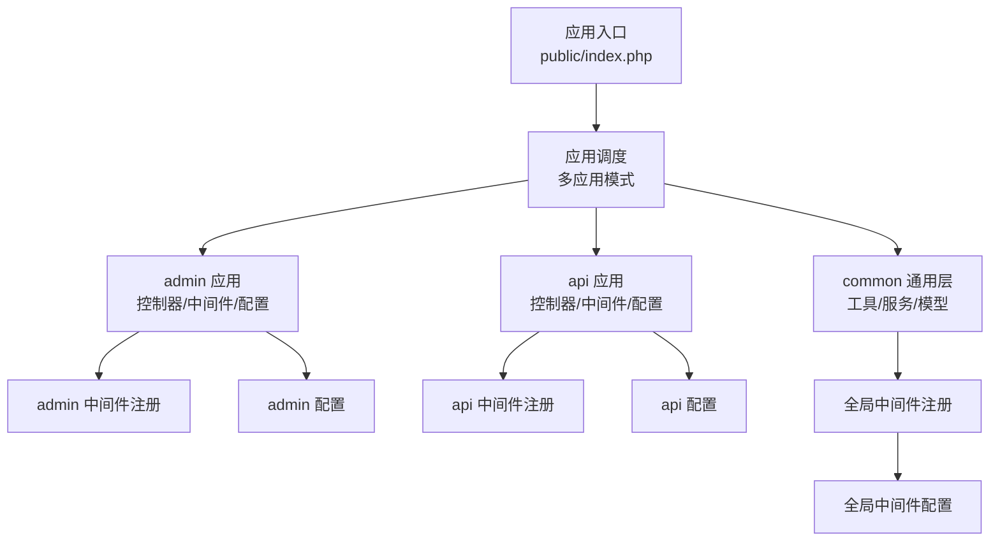
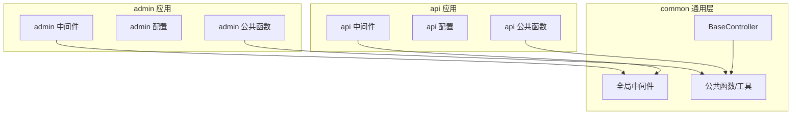
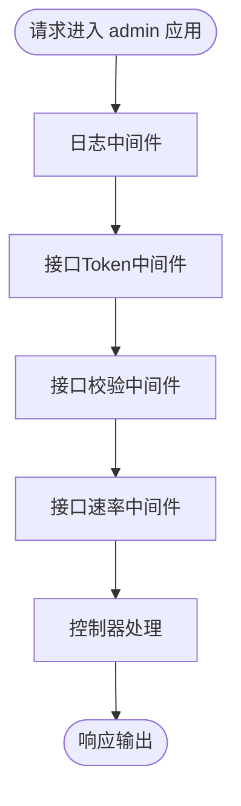
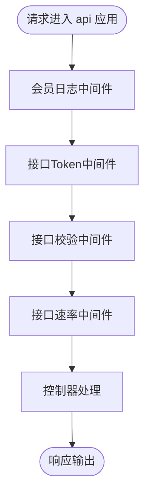
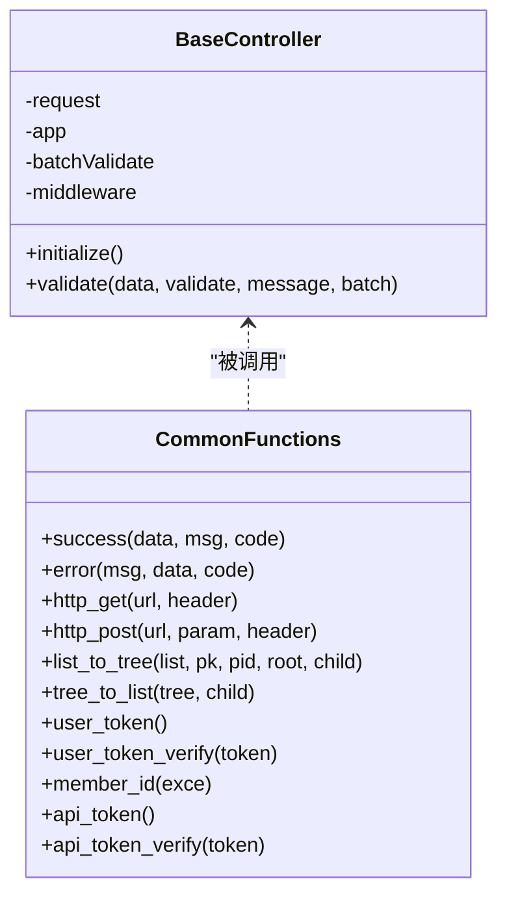
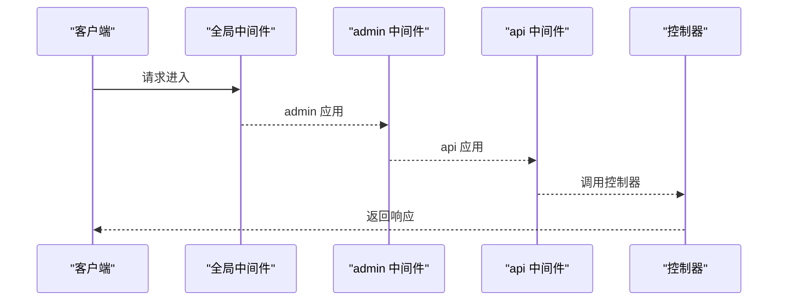
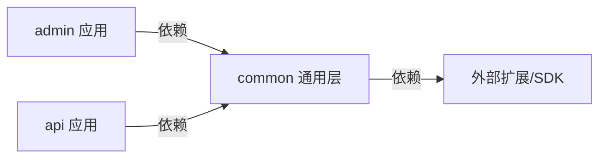

# 多应用模式

<cite>
**本文引用的文件**   
- [gccd_server/app/admin/middleware.php](file://gccd_server/app/admin/middleware.php)
- [gccd_server/app/api/middleware.php](file://gccd_server/app/api/middleware.php)
- [gccd_server/app/middleware.php](file://gccd_server/app/middleware.php)
- [gccd_server/config/admin.php](file://gccd_server/config/admin.php)
- [gccd_server/config/api.php](file://gccd_server/config/api.php)
- [gccd_server/config/app.php](file://gccd_server/config/app.php)
- [gccd_server/config/middleware.php](file://gccd_server/config/middleware.php)
- [gccd_server/route/app.php](file://gccd_server/route/app.php)
- [gccd_server/app/admin/common.php](file://gccd_server/app/admin/common.php)
- [gccd_server/app/api/common.php](file://gccd_server/app/api/common.php)
- [gccd_server/app/common.php](file://gccd_server/app/common.php)
- [gccd_server/app/BaseController.php](file://gccd_server/app/BaseController.php)
- [gccd_server/composer.json](file://gccd_server/composer.json)
- [gccd_server/README.md](file://gccd_server/README.md)
</cite>

## 目录
1. [简介](#简介)
2. [项目结构](#项目结构)
3. [核心组件](#核心组件)
4. [架构总览](#架构总览)
5. [详细组件分析](#详细组件分析)
6. [依赖分析](#依赖分析)
7. [性能考虑](#性能考虑)
8. [故障排查指南](#故障排查指南)
9. [结论](#结论)
10. [附录](#附录)

## 简介
本文件面向ThinkPHP 8多应用模式的深入技术文档，围绕admin、api、common三个应用展开，系统阐述其架构理念、独立配置、中间件、路由与业务逻辑设计，并总结多应用模式在代码隔离、权限控制、资源复用等方面的综合优势。同时给出应用间依赖关系与数据共享机制说明，以及路由配置、中间件注册、服务注入等关键配置的实现细节与实践示例。

## 项目结构
- 后端采用ThinkPHP 8多应用模式，应用目录划分清晰：admin（管理后台）、api（对外接口）、common（通用层）。
- 顶层配置通过config目录下的各应用配置文件实现差异化设置；全局中间件在app/middleware.php中统一注册；应用级中间件分别在各自应用目录下维护。
- composer.json声明了多应用、队列、限流、Worker等核心依赖，体现系统的可扩展性与并发能力。

图表来源
- [gccd_server/app/admin/middleware.php:11-20](file://gccd_server/app/admin/middleware.php#L11-L20)
- [gccd_server/app/api/middleware.php:11-20](file://gccd_server/app/api/middleware.php#L11-L20)
- [gccd_server/app/middleware.php:11-22](file://gccd_server/app/middleware.php#L11-L22)
- [gccd_server/config/admin.php:11-64](file://gccd_server/config/admin.php#L11-L64)
- [gccd_server/config/api.php:11-58](file://gccd_server/config/api.php#L11-L58)
- [gccd_server/config/middleware.php:11-16](file://gccd_server/config/middleware.php#L11-L16)

章节来源
- [gccd_server/composer.json:23-47](file://gccd_server/composer.json#L23-L47)
- [gccd_server/config/app.php:29-34](file://gccd_server/config/app.php#L29-L34)

## 核心组件
- 应用配置与默认行为
  - 默认应用与多应用映射：默认应用为api，禁止访问common应用，体现“接口优先”的设计。
  - admin与api应用各自独立的token策略、免登/免权/免限白名单、日志参数排除等配置，确保权限与安全边界清晰。
- 中间件体系
  - 全局中间件：跨域、日志清理、多语言加载等，保证所有应用共享的基础能力。
  - 应用中间件：admin与api分别注册日志、Token校验、接口校验、限流等中间件，形成“应用级”安全与治理。
- 通用函数与工具
  - admin与api应用均提供菜单/接口相关公共函数，用于判断是否存在、是否免登/免权/免限等，统一权限判定逻辑。
  - 公共层提供统一的成功/失败响应、HTTP请求封装、树形结构转换、关联字段处理等工具，便于跨应用复用。

章节来源
- [gccd_server/config/app.php:24-34](file://gccd_server/config/app.php#L24-L34)
- [gccd_server/app/middleware.php:11-22](file://gccd_server/app/middleware.php#L11-L22)
- [gccd_server/app/admin/middleware.php:11-20](file://gccd_server/app/admin/middleware.php#L11-L20)
- [gccd_server/app/api/middleware.php:11-20](file://gccd_server/app/api/middleware.php#L11-L20)
- [gccd_server/app/admin/common.php:14-128](file://gccd_server/app/admin/common.php#L14-L128)
- [gccd_server/app/api/common.php:16-181](file://gccd_server/app/api/common.php#L16-L181)
- [gccd_server/app/common.php:20-921](file://gccd_server/app/common.php#L20-L921)

## 架构总览
多应用模式在本项目中的落地要点：
- 应用边界清晰：admin负责后台管理，api负责对外接口，common提供通用能力。
- 权限与安全：通过admin与api各自的配置与中间件，实现“免登/免权/免限”白名单与Token校验、限流等安全策略。
- 资源复用：公共函数与工具在common层集中，避免重复实现；控制器基类BaseController统一验证与初始化流程。
- 可扩展性：composer依赖包含队列、限流、Worker等模块，支撑高并发与异步任务。

图表来源
- [gccd_server/app/admin/middleware.php:11-20](file://gccd_server/app/admin/middleware.php#L11-L20)
- [gccd_server/app/api/middleware.php:11-20](file://gccd_server/app/api/middleware.php#L11-L20)
- [gccd_server/app/middleware.php:11-22](file://gccd_server/app/middleware.php#L11-L22)
- [gccd_server/app/admin/common.php:14-128](file://gccd_server/app/admin/common.php#L14-L128)
- [gccd_server/app/api/common.php:16-181](file://gccd_server/app/api/common.php#L16-L181)
- [gccd_server/app/common.php:20-921](file://gccd_server/app/common.php#L20-L921)
- [gccd_server/app/BaseController.php:19-100](file://gccd_server/app/BaseController.php#L19-L100)

## 详细组件分析

### admin 应用
- 设计理念与使用场景
  - 面向后台管理，强调权限控制与审计日志，通过配置项定义超管、免登/免权/免限白名单与日志参数排除，确保后台操作的安全与合规。
- 独立配置
  - Token类型与名称、超管ID集合、免登/免权/免限URL列表、日志参数排除字段、地区级别等。
- 中间件
  - 注册用户日志、接口Token、接口校验、限流等中间件，形成“后台专用”的安全链路。
- 业务逻辑
  - 提供菜单URL生成、菜单存在性/禁用/免登/免权/免限判断等公共函数，统一后台权限判定。

图表来源
- [gccd_server/app/admin/middleware.php:11-20](file://gccd_server/app/admin/middleware.php#L11-L20)
- [gccd_server/config/admin.php:11-64](file://gccd_server/config/admin.php#L11-L64)

章节来源
- [gccd_server/config/admin.php:11-64](file://gccd_server/config/admin.php#L11-L64)
- [gccd_server/app/admin/middleware.php:11-20](file://gccd_server/app/admin/middleware.php#L11-L20)
- [gccd_server/app/admin/common.php:14-128](file://gccd_server/app/admin/common.php#L14-L128)

### api 应用
- 设计理念与使用场景
  - 面向对外接口，强调会员体系与平台/应用识别，通过配置项定义Token策略、免登/免权/免限白名单与日志参数排除，满足多端接入与安全控制。
- 独立配置
  - Token类型与名称、超级会员ID集合、接口免登/免权/免限白名单、日志参数排除字段等。
- 中间件
  - 注册会员日志、接口Token、接口校验、限流等中间件，形成“接口专用”的安全链路。
- 业务逻辑
  - 提供接口URL生成、接口存在性/禁用/免登/免权/免限判断，以及会员平台/应用识别等公共函数，统一接口权限与上下文识别。

图表来源
- [gccd_server/app/api/middleware.php:11-20](file://gccd_server/app/api/middleware.php#L11-L20)
- [gccd_server/config/api.php:11-58](file://gccd_server/config/api.php#L11-L58)

章节来源
- [gccd_server/config/api.php:11-58](file://gccd_server/config/api.php#L11-L58)
- [gccd_server/app/api/middleware.php:11-20](file://gccd_server/app/api/middleware.php#L11-L20)
- [gccd_server/app/api/common.php:16-181](file://gccd_server/app/api/common.php#L16-L181)

### common 通用层
- 设计理念与使用场景
  - 提供跨应用复用的公共函数与工具，包括统一响应格式、HTTP请求封装、树形结构转换、关联字段处理、用户/会员Token解析与校验、权限开关与隐藏条件等。
- 通用函数与工具
  - 统一成功/失败响应、服务器/文件URL拼接、HTTP GET/POST封装、日期时间、数组与树形转换、变量类型转换、权限判定、日志开关、隐藏条件、关联更新等。
- 控制器基类
  - BaseController提供请求与应用实例注入、批量验证支持、中间件声明等，降低控制器样板代码。

图表来源
- [gccd_server/app/BaseController.php:19-100](file://gccd_server/app/BaseController.php#L19-L100)
- [gccd_server/app/common.php:20-921](file://gccd_server/app/common.php#L20-L921)

章节来源
- [gccd_server/app/common.php:20-921](file://gccd_server/app/common.php#L20-L921)
- [gccd_server/app/BaseController.php:19-100](file://gccd_server/app/BaseController.php#L19-L100)

### 路由与中间件注册
- 路由定义
  - route/app.php当前为空，表明路由主要通过控制器注解或全局路由配置实现，多应用模式下按应用自动解析。
- 中间件注册
  - 全局中间件在app/middleware.php中注册，admin与api应用中间件在各自应用目录下注册，遵循“先全局后应用”的执行顺序。
- 中间件优先级
  - config/middleware.php提供别名与优先级配置占位，便于后续精细化控制执行顺序。

图表来源
- [gccd_server/app/middleware.php:11-22](file://gccd_server/app/middleware.php#L11-L22)
- [gccd_server/app/admin/middleware.php:11-20](file://gccd_server/app/admin/middleware.php#L11-L20)
- [gccd_server/app/api/middleware.php:11-20](file://gccd_server/app/api/middleware.php#L11-L20)
- [gccd_server/route/app.php:10-10](file://gccd_server/route/app.php#L10-L10)

章节来源
- [gccd_server/route/app.php:10-10](file://gccd_server/route/app.php#L10-L10)
- [gccd_server/config/middleware.php:11-16](file://gccd_server/config/middleware.php#L11-L16)

### 服务注入与依赖关系
- 依赖声明
  - composer.json声明了多应用、队列、限流、Worker等依赖，体现系统对并发与异步的支持。
- 服务与工具
  - admin与api应用通过公共函数与服务层协作，实现Token解析、权限判定、日志开关等功能；BaseController作为统一入口，减少重复实现。

章节来源
- [gccd_server/composer.json:23-47](file://gccd_server/composer.json#L23-L47)
- [gccd_server/app/common.php:11-18](file://gccd_server/app/common.php#L11-L18)

## 依赖分析
- 应用间耦合度
  - admin与api应用通过common层共享工具与函数，耦合集中在公共逻辑；应用间无直接依赖，符合“低耦合、高内聚”的原则。
- 外部依赖
  - 多应用、队列、限流、Worker、短信、邮件、存储SDK等，为系统提供横向扩展能力。
- 禁止访问的应用
  - config/app.php明确禁止访问common应用，避免直接暴露通用层逻辑。

图表来源
- [gccd_server/config/app.php:34-34](file://gccd_server/config/app.php#L34-L34)
- [gccd_server/composer.json:23-47](file://gccd_server/composer.json#L23-L47)

章节来源
- [gccd_server/config/app.php:34-34](file://gccd_server/config/app.php#L34-L34)
- [gccd_server/composer.json:23-47](file://gccd_server/composer.json#L23-L47)

## 性能考虑
- 限流与速率控制
  - admin与api应用均注册限流中间件，结合各自免限白名单，平衡安全与性能。
- 缓存与清理
  - 全局中间件包含日志清理，有助于降低长期运行的内存与IO压力。
- 并发与异步
  - 队列与Worker依赖为高并发与异步任务提供基础，建议配合限流策略使用。

## 故障排查指南
- 常见问题定位
  - Token无效：检查admin与api配置中的token类型与名称，确认请求头或参数传递是否正确。
  - 权限不足：核对免登/免权/免限白名单配置，确认菜单/接口URL是否命中相应规则。
  - 日志异常：检查日志开关与参数排除配置，避免敏感信息被过滤导致排查困难。
- 建议排查步骤
  - 确认默认应用与应用映射配置，避免请求进入错误应用。
  - 检查全局与应用中间件注册顺序，确保中间件链完整。
  - 使用公共函数进行快速验证，如user_token()/api_token()与对应verify方法。

章节来源
- [gccd_server/config/admin.php:12-60](file://gccd_server/config/admin.php#L12-L60)
- [gccd_server/config/api.php:12-57](file://gccd_server/config/api.php#L12-L57)
- [gccd_server/app/middleware.php:11-22](file://gccd_server/app/middleware.php#L11-L22)

## 结论
本项目以ThinkPHP 8多应用模式为基础，admin与api应用在权限、安全与业务边界上实现清晰分离，common通用层提供稳定复用能力。通过独立配置、中间件注册与公共函数体系，系统在代码隔离、权限控制与资源复用方面具备良好实践价值。结合限流、队列与Worker等依赖，可进一步提升系统的稳定性与扩展性。

## 附录
- 实际业务场景示例（概念性说明）
  - 后台登录与菜单权限：admin应用通过菜单URL白名单与免权规则，结合Token与日志中间件，实现登录态与操作审计。
  - 对外接口鉴权与平台识别：api应用通过接口URL白名单与Token校验，结合平台/应用识别函数，满足多端接入与权限控制。
  - 通用工具复用：跨应用调用公共函数进行树形结构转换、HTTP请求封装、权限判定等，减少重复实现。