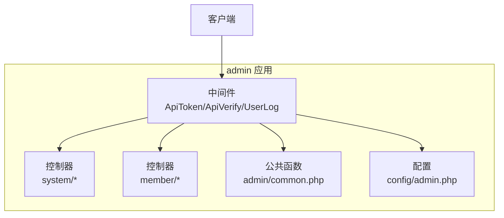
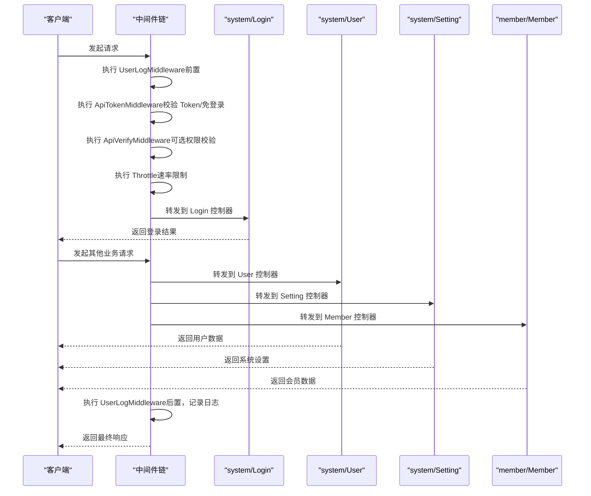
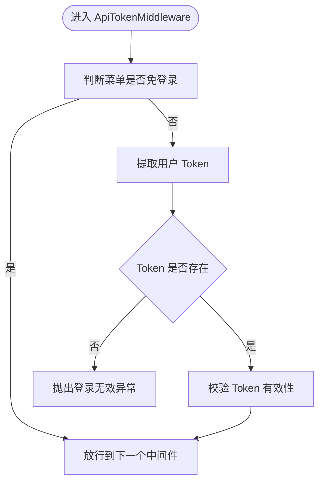
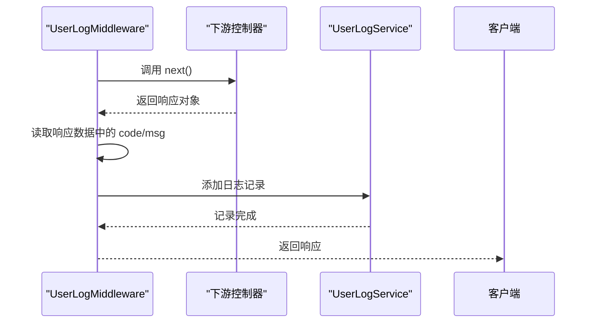
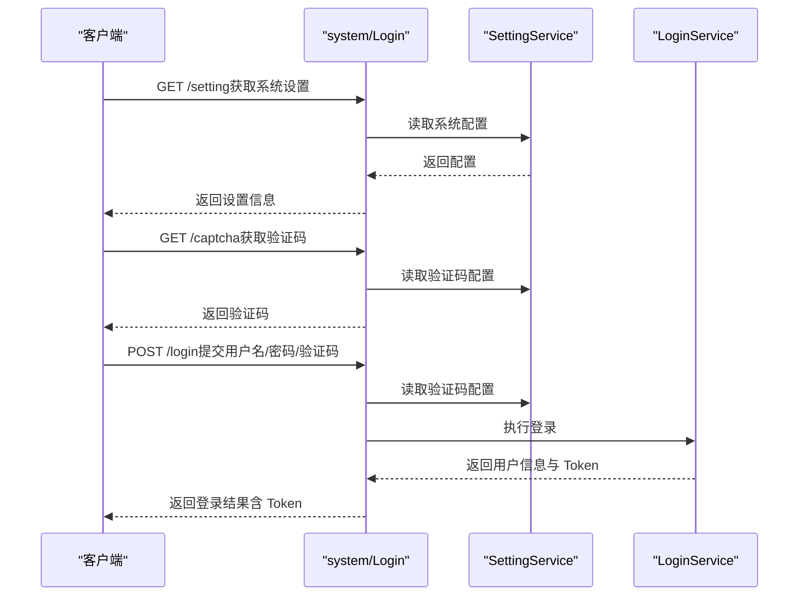
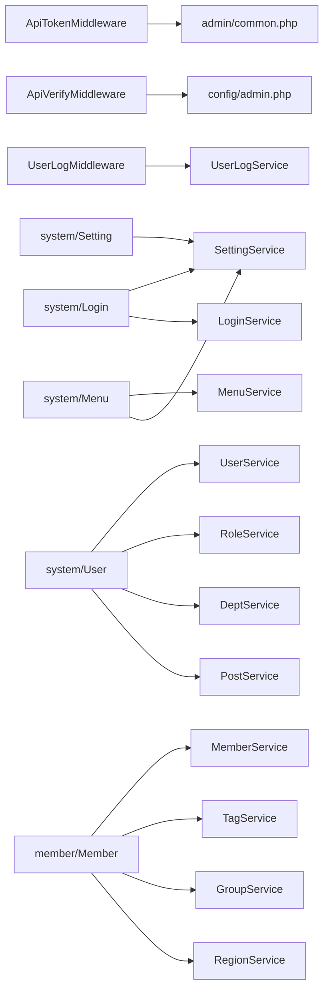

# 管理后台应用 (admin)

<cite>
**本文引用的文件**
- [gccd_server/app/admin/common.php](file://gccd_server/app/admin/common.php)
- [gccd_server/app/admin/middleware.php](file://gccd_server/app/admin/middleware.php)
- [gccd_server/app/admin/middleware/ApiTokenMiddleware.php](file://gccd_server/app/admin/middleware/ApiTokenMiddleware.php)
- [gccd_server/app/admin/middleware/ApiVerifyMiddleware.php](file://gccd_server/app/admin/middleware/ApiVerifyMiddleware.php)
- [gccd_server/app/admin/middleware/UserLogMiddleware.php](file://gccd_server/app/admin/middleware/UserLogMiddleware.php)
- [gccd_server/config/admin.php](file://gccd_server/config/admin.php)
- [gccd_server/app/admin/controller/system/Login.php](file://gccd_server/app/admin/controller/system/Login.php)
- [gccd_server/app/admin/controller/system/User.php](file://gccd_server/app/admin/controller/system/User.php)
- [gccd_server/app/admin/controller/system/Setting.php](file://gccd_server/app/admin/controller/system/Setting.php)
- [gccd_server/app/admin/controller/system/Menu.php](file://gccd_server/app/admin/controller/system/Menu.php)
- [gccd_server/app/admin/controller/member/Member.php](file://gccd_server/app/admin/controller/member/Member.php)
</cite>

## 目录
1. [简介](#简介)
2. [项目结构](#项目结构)
3. [核心组件](#核心组件)
4. [架构总览](#架构总览)
5. [详细组件分析](#详细组件分析)
6. [依赖关系分析](#依赖关系分析)
7. [性能考量](#性能考量)
8. [故障排查指南](#故障排查指南)
9. [结论](#结论)
10. [附录](#附录)

## 简介
本文件面向 ThinkPHP 8 管理后台应用（admin），系统性梳理其架构与实现要点，重点覆盖以下方面：
- 中间件体系：ApiTokenMiddleware、UserLogMiddleware、ApiVerifyMiddleware 的职责与执行顺序
- 控制器组织：system 模块（登录、用户、菜单、系统设置）、member 模块（会员管理）等业务逻辑
- 权限与安全：菜单免登/免权/免限策略、Token 校验、日志记录
- 配置管理：admin.php 中的 Token 类型、菜单豁免清单、日志排除字段、地区级别等
- 与其他应用的区别：admin 应用在权限、日志、配置方面的定制化设计

## 项目结构
admin 应用采用 ThinkPHP 分层架构，按“应用/模块/控制器/服务/中间件”组织，核心目录如下：
- app/admin/controller：控制器层，按业务域划分（system、member 等）
- app/admin/middleware：中间件层，负责鉴权、日志、限流等横切关注点
- app/admin/common.php：admin 应用公共函数，提供菜单相关判断与便捷方法
- config/admin.php：admin 应用专属配置项，包含 Token、菜单豁免、日志排除等

图示来源
- [gccd_server/app/admin/middleware.php:11-20](file://gccd_server/app/admin/middleware.php#L11-L20)
- [gccd_server/app/admin/common.php:14-129](file://gccd_server/app/admin/common.php#L14-L129)
- [gccd_server/config/admin.php:11-64](file://gccd_server/config/admin.php#L11-L64)

章节来源
- [gccd_server/app/admin/middleware.php:11-20](file://gccd_server/app/admin/middleware.php#L11-L20)
- [gccd_server/app/admin/common.php:14-129](file://gccd_server/app/admin/common.php#L14-L129)
- [gccd_server/config/admin.php:11-64](file://gccd_server/config/admin.php#L11-L64)

## 核心组件
- 中间件链
  - UserLogMiddleware：在请求完成后记录用户响应状态与消息
  - ApiTokenMiddleware：校验 Token，支持菜单级“免登录”
  - ApiVerifyMiddleware：可选的菜单存在性、禁用、权限校验（当前处于注释态）
  - Throttle：基于框架的接口速率限制中间件
- 公共函数
  - 菜单 URL 获取与判断：是否存在、是否禁用、是否免登录/免权/免限
- 配置项
  - Token 类型与名称、超管 ID 列表、菜单豁免清单、日志排除字段、地区级别

章节来源
- [gccd_server/app/admin/middleware/UserLogMiddleware.php:29-50](file://gccd_server/app/admin/middleware/UserLogMiddleware.php#L29-L50)
- [gccd_server/app/admin/middleware/ApiTokenMiddleware.php:29-43](file://gccd_server/app/admin/middleware/ApiTokenMiddleware.php#L29-L43)
- [gccd_server/app/admin/middleware/ApiVerifyMiddleware.php:32-78](file://gccd_server/app/admin/middleware/ApiVerifyMiddleware.php#L32-L78)
- [gccd_server/app/admin/common.php:20-129](file://gccd_server/app/admin/common.php#L20-L129)
- [gccd_server/config/admin.php:12-64](file://gccd_server/config/admin.php#L12-L64)

## 架构总览
admin 应用通过中间件链统一处理鉴权、日志与限流，控制器聚焦业务逻辑，公共函数与配置为横切能力提供支撑。

图示来源
- [gccd_server/app/admin/middleware.php:11-20](file://gccd_server/app/admin/middleware.php#L11-L20)
- [gccd_server/app/admin/middleware/ApiTokenMiddleware.php:29-43](file://gccd_server/app/admin/middleware/ApiTokenMiddleware.php#L29-L43)
- [gccd_server/app/admin/middleware/ApiVerifyMiddleware.php:32-78](file://gccd_server/app/admin/middleware/ApiVerifyMiddleware.php#L32-L78)
- [gccd_server/app/admin/middleware/UserLogMiddleware.php:29-50](file://gccd_server/app/admin/middleware/UserLogMiddleware.php#L29-L50)
- [gccd_server/app/admin/controller/system/Login.php:105-139](file://gccd_server/app/admin/controller/system/Login.php#L105-L139)
- [gccd_server/app/admin/controller/system/User.php:46-56](file://gccd_server/app/admin/controller/system/User.php#L46-L56)
- [gccd_server/app/admin/controller/system/Setting.php:29-59](file://gccd_server/app/admin/controller/system/Setting.php#L29-L59)
- [gccd_server/app/admin/controller/member/Member.php:53-67](file://gccd_server/app/admin/controller/member/Member.php#L53-L67)

## 详细组件分析

### 中间件：ApiTokenMiddleware
- 职责
  - 在非“免登录”菜单下，从请求中提取用户 Token 并进行有效性校验
  - 若未提供或无效，抛出登录无效异常
- 关键点
  - 使用公共函数判断菜单是否免登录
  - 通过工具方法校验 Token
- 执行顺序
  - 在 UserLogMiddleware 之后、ApiVerifyMiddleware 之前

图示来源
- [gccd_server/app/admin/middleware/ApiTokenMiddleware.php:29-43](file://gccd_server/app/admin/middleware/ApiTokenMiddleware.php#L29-L43)
- [gccd_server/app/admin/common.php:74-86](file://gccd_server/app/admin/common.php#L74-L86)

章节来源
- [gccd_server/app/admin/middleware/ApiTokenMiddleware.php:29-43](file://gccd_server/app/admin/middleware/ApiTokenMiddleware.php#L29-L43)
- [gccd_server/app/admin/common.php:74-86](file://gccd_server/app/admin/common.php#L74-L86)

### 中间件：UserLogMiddleware
- 职责
  - 在请求完成后，读取响应数据中的 code/msg，并结合当前用户 ID 记录用户操作日志
- 关键点
  - 仅当存在用户 ID 时记录
  - 对响应体字段进行兼容处理（优先 code/msg，其次 message）

图示来源
- [gccd_server/app/admin/middleware/UserLogMiddleware.php:29-50](file://gccd_server/app/admin/middleware/UserLogMiddleware.php#L29-L50)

章节来源
- [gccd_server/app/admin/middleware/UserLogMiddleware.php:29-50](file://gccd_server/app/admin/middleware/UserLogMiddleware.php#L29-L50)

### 中间件：ApiVerifyMiddleware
- 职责
  - 可选的菜单存在性、禁用、权限校验（当前处于注释态）
- 关键点
  - 当前默认放行，若启用，将基于菜单 URL 与用户角色进行权限判定

章节来源
- [gccd_server/app/admin/middleware/ApiVerifyMiddleware.php:32-78](file://gccd_server/app/admin/middleware/ApiVerifyMiddleware.php#L32-L78)

### 控制器：system.Login（登录与验证码）
- 功能
  - 获取系统设置信息（含验证码开关、模式、类型等）
  - 提供验证码生成与校验（支持多种模式）
  - 用户登录与退出
- 关键流程
  - 登录前根据设置决定是否需要验证码
  - 登录成功返回 Token，并在前端全局注入该 Token

图示来源
- [gccd_server/app/admin/controller/system/Login.php:37-50](file://gccd_server/app/admin/controller/system/Login.php#L37-L50)
- [gccd_server/app/admin/controller/system/Login.php:65-89](file://gccd_server/app/admin/controller/system/Login.php#L65-L89)
- [gccd_server/app/admin/controller/system/Login.php:105-139](file://gccd_server/app/admin/controller/system/Login.php#L105-L139)

章节来源
- [gccd_server/app/admin/controller/system/Login.php:37-50](file://gccd_server/app/admin/controller/system/Login.php#L37-L50)
- [gccd_server/app/admin/controller/system/Login.php:65-89](file://gccd_server/app/admin/controller/system/Login.php#L65-L89)
- [gccd_server/app/admin/controller/system/Login.php:105-139](file://gccd_server/app/admin/controller/system/Login.php#L105-L139)

### 控制器：system.User（用户管理）
- 功能
  - 用户列表、详情、新增、编辑、删除
  - 批量修改所属部门/职位/角色
  - 修改密码、设置是否超管/禁用
  - 查询生产相关用户列表
- 关键点
  - 统一使用 BaseService 的 list/info/add/edit/dele 等方法
  - 参数校验由对应 Validate 场景驱动

章节来源
- [gccd_server/app/admin/controller/system/User.php:46-56](file://gccd_server/app/admin/controller/system/User.php#L46-L56)
- [gccd_server/app/admin/controller/system/User.php:67-76](file://gccd_server/app/admin/controller/system/User.php#L67-L76)
- [gccd_server/app/admin/controller/system/User.php:83-93](file://gccd_server/app/admin/controller/system/User.php#L83-L93)
- [gccd_server/app/admin/controller/system/User.php:100-109](file://gccd_server/app/admin/controller/system/User.php#L100-L109)
- [gccd_server/app/admin/controller/system/User.php:116-125](file://gccd_server/app/admin/controller/system/User.php#L116-L125)
- [gccd_server/app/admin/controller/system/User.php:133-142](file://gccd_server/app/admin/controller/system/User.php#L133-L142)
- [gccd_server/app/admin/controller/system/User.php:150-159](file://gccd_server/app/admin/controller/system/User.php#L150-L159)
- [gccd_server/app/admin/controller/system/User.php:167-176](file://gccd_server/app/admin/controller/system/User.php#L167-L176)
- [gccd_server/app/admin/controller/system/User.php:184-193](file://gccd_server/app/admin/controller/system/User.php#L184-L193)
- [gccd_server/app/admin/controller/system/User.php:201-210](file://gccd_server/app/admin/controller/system/User.php#L201-L210)
- [gccd_server/app/admin/controller/system/User.php:218-227](file://gccd_server/app/admin/controller/system/User.php#L218-L227)
- [gccd_server/app/admin/controller/system/User.php:228-237](file://gccd_server/app/admin/controller/system/User.php#L228-L237)

### 控制器：system.Setting（系统设置）
- 功能
  - 系统信息、缓存清理、Token 设置、验证码设置、日志设置、接口限流设置、服务器信息
- 关键点
  - 所有设置项均通过 SettingService::info/edit 进行读取与更新
  - 支持强制刷新服务器信息

章节来源
- [gccd_server/app/admin/controller/system/Setting.php:29-59](file://gccd_server/app/admin/controller/system/Setting.php#L29-L59)
- [gccd_server/app/admin/controller/system/Setting.php:76-81](file://gccd_server/app/admin/controller/system/Setting.php#L76-L81)
- [gccd_server/app/admin/controller/system/Setting.php:99-108](file://gccd_server/app/admin/controller/system/Setting.php#L99-L108)
- [gccd_server/app/admin/controller/system/Setting.php:126-135](file://gccd_server/app/admin/controller/system/Setting.php#L126-L135)
- [gccd_server/app/admin/controller/system/Setting.php:153-162](file://gccd_server/app/admin/controller/system/Setting.php#L153-L162)
- [gccd_server/app/admin/controller/system/Setting.php:180-189](file://gccd_server/app/admin/controller/system/Setting.php#L180-L189)
- [gccd_server/app/admin/controller/system/Setting.php:195-202](file://gccd_server/app/admin/controller/system/Setting.php#L195-L202)

### 控制器：system.Menu（菜单管理）
- 功能
  - 菜单列表、详情、新增、编辑、删除
  - 批量修改排序、上级、是否免登录/免权/免限、是否隐藏、是否禁用
  - 查看拥有某菜单的角色列表，解除菜单与角色关联
- 关键点
  - 支持树形结构查询与筛选
  - 提供菜单类型枚举与计数

章节来源
- [gccd_server/app/admin/controller/system/Menu.php:31-55](file://gccd_server/app/admin/controller/system/Menu.php#L31-L55)
- [gccd_server/app/admin/controller/system/Menu.php:62-71](file://gccd_server/app/admin/controller/system/Menu.php#L62-L71)
- [gccd_server/app/admin/controller/system/Menu.php:78-87](file://gccd_server/app/admin/controller/system/Menu.php#L78-L87)
- [gccd_server/app/admin/controller/system/Menu.php:94-103](file://gccd_server/app/admin/controller/system/Menu.php#L94-L103)
- [gccd_server/app/admin/controller/system/Menu.php:110-119](file://gccd_server/app/admin/controller/system/Menu.php#L110-L119)
- [gccd_server/app/admin/controller/system/Menu.php:127-142](file://gccd_server/app/admin/controller/system/Menu.php#L127-L142)
- [gccd_server/app/admin/controller/system/Menu.php:150-159](file://gccd_server/app/admin/controller/system/Menu.php#L150-L159)
- [gccd_server/app/admin/controller/system/Menu.php:167-176](file://gccd_server/app/admin/controller/system/Menu.php#L167-L176)
- [gccd_server/app/admin/controller/system/Menu.php:184-193](file://gccd_server/app/admin/controller/system/Menu.php#L184-L193)
- [gccd_server/app/admin/controller/system/Menu.php:201-210](file://gccd_server/app/admin/controller/system/Menu.php#L201-L210)
- [gccd_server/app/admin/controller/system/Menu.php:218-227](file://gccd_server/app/admin/controller/system/Menu.php#L218-L227)
- [gccd_server/app/admin/controller/system/Menu.php:235-244](file://gccd_server/app/admin/controller/system/Menu.php#L235-L244)
- [gccd_server/app/admin/controller/system/Menu.php:254-265](file://gccd_server/app/admin/controller/system/Menu.php#L254-L265)
- [gccd_server/app/admin/controller/system/Menu.php:273-282](file://gccd_server/app/admin/controller/system/Menu.php#L273-L282)

### 控制器：member.Member（会员管理）
- 功能
  - 会员列表、详情、新增、编辑、删除（支持解绑第三方）
  - 批量修改所在地、标签、分组
  - 修改密码、设置是否超会/禁用（支持针对第三方账号）
  - 导出/导入、统计分析
- 关键点
  - 统一使用 MemberService、TagService、GroupService、RegionService 等进行数据组装与业务处理
  - 导入/导出支持模板下载与异步处理

章节来源
- [gccd_server/app/admin/controller/member/Member.php:53-67](file://gccd_server/app/admin/controller/member/Member.php#L53-L67)
- [gccd_server/app/admin/controller/member/Member.php:82-93](file://gccd_server/app/admin/controller/member/Member.php#L82-L93)
- [gccd_server/app/admin/controller/member/Member.php:102-114](file://gccd_server/app/admin/controller/member/Member.php#L102-L114)
- [gccd_server/app/admin/controller/member/Member.php:123-132](file://gccd_server/app/admin/controller/member/Member.php#L123-L132)
- [gccd_server/app/admin/controller/member/Member.php:140-153](file://gccd_server/app/admin/controller/member/Member.php#L140-L153)
- [gccd_server/app/admin/controller/member/Member.php:161-170](file://gccd_server/app/admin/controller/member/Member.php#L161-L170)
- [gccd_server/app/admin/controller/member/Member.php:178-187](file://gccd_server/app/admin/controller/member/Member.php#L178-L187)
- [gccd_server/app/admin/controller/member/Member.php:195-204](file://gccd_server/app/admin/controller/member/Member.php#L195-L204)
- [gccd_server/app/admin/controller/member/Member.php:212-221](file://gccd_server/app/admin/controller/member/Member.php#L212-L221)
- [gccd_server/app/admin/controller/member/Member.php:229-238](file://gccd_server/app/admin/controller/member/Member.php#L229-L238)
- [gccd_server/app/admin/controller/member/Member.php:247-262](file://gccd_server/app/admin/controller/member/Member.php#L247-L262)
- [gccd_server/app/admin/controller/member/Member.php:273-286](file://gccd_server/app/admin/controller/member/Member.php#L273-L286)
- [gccd_server/app/admin/controller/member/Member.php:300-313](file://gccd_server/app/admin/controller/member/Member.php#L300-L313)
- [gccd_server/app/admin/controller/member/Member.php:330-344](file://gccd_server/app/admin/controller/member/Member.php#L330-L344)

## 依赖关系分析
- 中间件依赖
  - ApiTokenMiddleware 依赖公共函数 menu_is_unlogin 与 Token 校验工具
  - ApiVerifyMiddleware 依赖菜单服务、用户缓存与配置项
  - UserLogMiddleware 依赖用户日志服务
- 控制器依赖
  - system/* 控制器依赖对应的 Service/Validate
  - member/* 控制器依赖 member 与 setting 相关服务
- 配置依赖
  - admin.php 决定 Token 类型/名称、菜单豁免、日志排除字段等

图示来源
- [gccd_server/app/admin/middleware/ApiTokenMiddleware.php:29-43](file://gccd_server/app/admin/middleware/ApiTokenMiddleware.php#L29-L43)
- [gccd_server/app/admin/common.php:74-86](file://gccd_server/app/admin/common.php#L74-L86)
- [gccd_server/app/admin/middleware/ApiVerifyMiddleware.php:32-78](file://gccd_server/app/admin/middleware/ApiVerifyMiddleware.php#L32-L78)
- [gccd_server/app/admin/middleware/UserLogMiddleware.php:29-50](file://gccd_server/app/admin/middleware/UserLogMiddleware.php#L29-L50)
- [gccd_server/app/admin/controller/system/Login.php:13-18](file://gccd_server/app/admin/controller/system/Login.php#L13-L18)
- [gccd_server/app/admin/controller/system/User.php:12-18](file://gccd_server/app/admin/controller/system/User.php#L12-L18)
- [gccd_server/app/admin/controller/system/Setting.php:12-15](file://gccd_server/app/admin/controller/system/Setting.php#L12-L15)
- [gccd_server/app/admin/controller/system/Menu.php:12-16](file://gccd_server/app/admin/controller/system/Menu.php#L12-L16)
- [gccd_server/app/admin/controller/member/Member.php:12-21](file://gccd_server/app/admin/controller/member/Member.php#L12-L21)

章节来源
- [gccd_server/app/admin/middleware/ApiTokenMiddleware.php:29-43](file://gccd_server/app/admin/middleware/ApiTokenMiddleware.php#L29-L43)
- [gccd_server/app/admin/middleware/ApiVerifyMiddleware.php:32-78](file://gccd_server/app/admin/middleware/ApiVerifyMiddleware.php#L32-L78)
- [gccd_server/app/admin/middleware/UserLogMiddleware.php:29-50](file://gccd_server/app/admin/middleware/UserLogMiddleware.php#L29-L50)
- [gccd_server/app/admin/controller/system/Login.php:13-18](file://gccd_server/app/admin/controller/system/Login.php#L13-L18)
- [gccd_server/app/admin/controller/system/User.php:12-18](file://gccd_server/app/admin/controller/system/User.php#L12-L18)
- [gccd_server/app/admin/controller/system/Setting.php:12-15](file://gccd_server/app/admin/controller/system/Setting.php#L12-L15)
- [gccd_server/app/admin/controller/system/Menu.php:12-16](file://gccd_server/app/admin/controller/system/Menu.php#L12-L16)
- [gccd_server/app/admin/controller/member/Member.php:12-21](file://gccd_server/app/admin/controller/member/Member.php#L12-L21)

## 性能考量
- 中间件链顺序
  - 将耗时较低的校验（如 Token 校验）前置，有助于尽早拒绝非法请求
  - 日志记录放在最后，避免对正常业务路径造成额外延迟
- 速率限制
  - Throttle 中间件可按配置对接口访问频率进行限制，建议结合 ApiVerify 的权限校验启用更严格的策略
- 缓存与查询
  - 控制器侧尽量复用 Service 层封装的查询与缓存逻辑，减少重复计算
- 配置优化
  - 合理设置日志排除字段，避免记录大字段或敏感信息，降低日志体积与写入开销

## 故障排查指南
- 登录无效
  - 检查 Token 类型与名称是否与前端一致（config/admin.php）
  - 确认菜单是否被标记为“免登录”，否则需正确传递 Token
- 权限不足
  - 若 ApiVerifyMiddleware 处于启用状态，检查菜单 URL 是否存在于菜单表且未被禁用
  - 确认用户角色是否包含该菜单 URL
- 日志未记录
  - 确认当前请求是否携带有效用户 ID
  - 检查响应体字段是否包含 code/msg 或 message 字段
- 验证码问题
  - 检查系统设置中的验证码开关、模式与类型
  - 校验验证码校验接口参数是否完整

章节来源
- [gccd_server/config/admin.php:12-64](file://gccd_server/config/admin.php#L12-L64)
- [gccd_server/app/admin/middleware/ApiTokenMiddleware.php:32-41](file://gccd_server/app/admin/middleware/ApiTokenMiddleware.php#L32-L41)
- [gccd_server/app/admin/middleware/ApiVerifyMiddleware.php:34-75](file://gccd_server/app/admin/middleware/ApiVerifyMiddleware.php#L34-L75)
- [gccd_server/app/admin/middleware/UserLogMiddleware.php:33-49](file://gccd_server/app/admin/middleware/UserLogMiddleware.php#L33-L49)
- [gccd_server/app/admin/controller/system/Login.php:117-135](file://gccd_server/app/admin/controller/system/Login.php#L117-L135)

## 结论
admin 应用以中间件为核心，围绕 Token 校验、日志记录与可选权限校验构建统一的安全与可观测性基线；控制器层按业务域清晰拆分，配合 Service/Validate 形成稳定的业务闭环。通过 config/admin.php 与 admin/common.php 的配置与公共函数，实现了菜单级“免登录/免权/免限”的灵活控制，满足后台管理场景下的差异化需求。

## 附录
- 示例：在 admin 应用中实现用户登录
  - 步骤
    - 调用 GET /system.Login/setting 获取系统设置（含验证码开关/模式/类型）
    - 如开启验证码，调用 GET /system.Login/captcha 获取验证码
    - 调用 POST /system.Login/login 提交用户名、密码与验证码
    - 登录成功后，前端应保存响应中的 Token 并在后续请求头中携带
  - 参考路径
    - [gccd_server/app/admin/controller/system/Login.php:37-50](file://gccd_server/app/admin/controller/system/Login.php#L37-L50)
    - [gccd_server/app/admin/controller/system/Login.php:65-89](file://gccd_server/app/admin/controller/system/Login.php#L65-L89)
    - [gccd_server/app/admin/controller/system/Login.php:105-139](file://gccd_server/app/admin/controller/system/Login.php#L105-L139)

- 示例：在 admin 应用中实现系统配置
  - 步骤
    - 调用 GET /system.Setting/systemInfo 获取系统信息
    - 调用 POST /system.Setting/systemEdit 更新系统信息
    - 调用 GET /system.Setting/tokenInfo 获取 Token 设置
    - 调用 POST /system.Setting/tokenEdit 更新 Token 设置
  - 参考路径
    - [gccd_server/app/admin/controller/system/Setting.php:29-59](file://gccd_server/app/admin/controller/system/Setting.php#L29-L59)
    - [gccd_server/app/admin/controller/system/Setting.php:99-108](file://gccd_server/app/admin/controller/system/Setting.php#L99-L108)

- 示例：在 admin 应用中实现数据管理（用户/会员）
  - 步骤
    - 用户管理：GET /system.User/list 获取用户列表，POST /system.User/add 新增用户
    - 会员管理：GET /member.Member/list 获取会员列表，POST /member.Member/add 新增会员
  - 参考路径
    - [gccd_server/app/admin/controller/system/User.php:46-56](file://gccd_server/app/admin/controller/system/User.php#L46-L56)
    - [gccd_server/app/admin/controller/system/User.php:83-93](file://gccd_server/app/admin/controller/system/User.php#L83-L93)
    - [gccd_server/app/admin/controller/member/Member.php:53-67](file://gccd_server/app/admin/controller/member/Member.php#L53-L67)
    - [gccd_server/app/admin/controller/member/Member.php:102-114](file://gccd_server/app/admin/controller/member/Member.php#L102-L114)