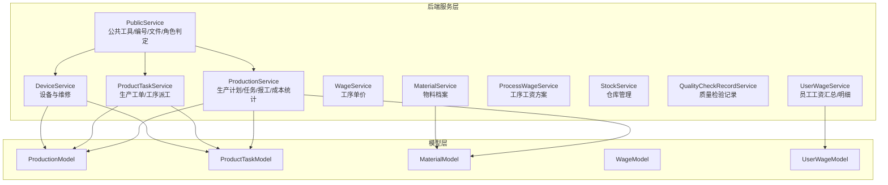
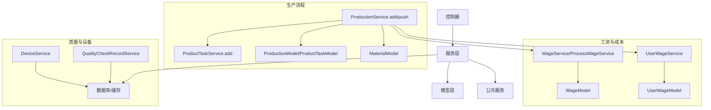
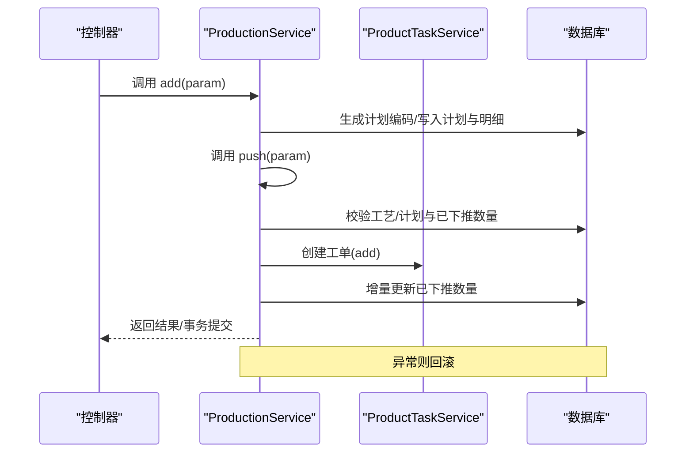
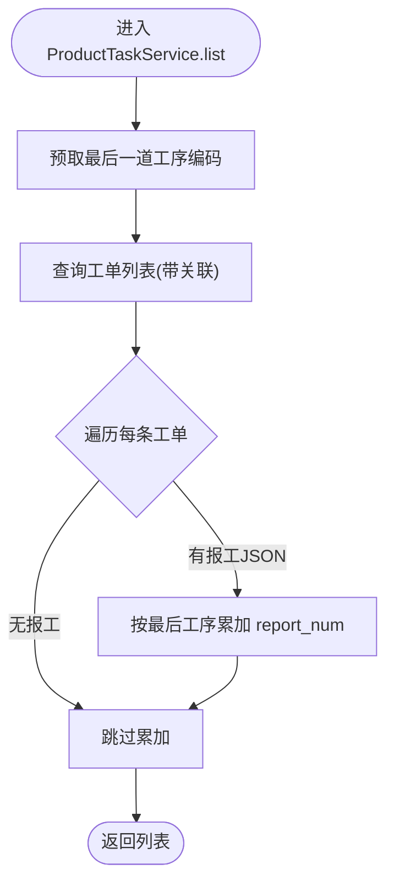
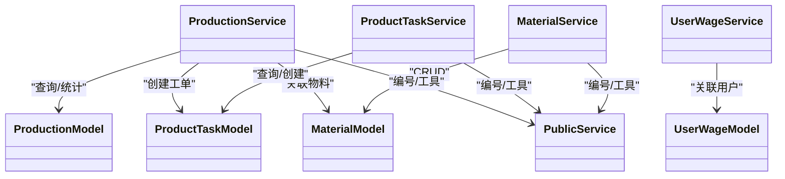

# 业务服务实现

<cite>
**本文引用的文件**
- [gccd_server/app/common/service/admin/ProductionService.php](file://gccd_server/app/common/service/admin/ProductionService.php)
- [gccd_server/app/common/service/admin/ProductTaskService.php](file://gccd_server/app/common/service/admin/ProductTaskService.php)
- [gccd_server/app/common/service/admin/MaterialService.php](file://gccd_server/app/common/service/admin/MaterialService.php)
- [gccd_server/app/common/service/admin/WageService.php](file://gccd_server/app/common/service/admin/WageService.php)
- [gccd_server/app/common/service/admin/UserWageService.php](file://gccd_server/app/common/service/admin/UserWageService.php)
- [gccd_server/app/common/service/admin/ProcessWageService.php](file://gccd_server/app/common/service/admin/ProcessWageService.php)
- [gccd_server/app/common/service/admin/StockService.php](file://gccd_server/app/common/service/admin/StockService.php)
- [gccd_server/app/common/service/admin/QualityCheckRecordService.php](file://gccd_server/app/common/service/admin/QualityCheckRecordService.php)
- [gccd_server/app/common/service/admin/DeviceService.php](file://gccd_server/app/common/service/admin/DeviceService.php)
- [gccd_server/app/common/service/admin/PublicService.php](file://gccd_server/app/common/service/admin/PublicService.php)
- [gccd_server/app/common/model/admin/ProductionModel.php](file://gccd_server/app/common/model/admin/ProductionModel.php)
- [gccd_server/app/common/model/admin/ProductTaskModel.php](file://gccd_server/app/common/model/admin/ProductTaskModel.php)
- [gccd_server/app/common/model/admin/MaterialModel.php](file://gccd_server/app/common/model/admin/MaterialModel.php)
- [gccd_server/app/common/model/admin/WageModel.php](file://gccd_server/app/common/model/admin/WageModel.php)
- [gccd_server/app/common/model/admin/UserWageModel.php](file://gccd_server/app/common/model/admin/UserWageModel.php)
- [gccd_server/README.md](file://gccd_server/README.md)
</cite>

## 目录
1. [简介](#简介)
2. [项目结构](#项目结构)
3. [核心组件](#核心组件)
4. [架构总览](#架构总览)
5. [详细组件分析](#详细组件分析)
6. [依赖关系分析](#依赖关系分析)
7. [性能考量](#性能考量)
8. [故障排查指南](#故障排查指南)
9. [结论](#结论)
10. [附录](#附录)

## 简介
本文件面向高齿传动项目的业务服务实现，聚焦于生产管理、物料管理、工资管理、设备与质量等关键模块的服务层设计与实现细节。文档从系统架构、组件职责、数据流与处理逻辑、事务与异常处理、复杂场景策略（批量、并发、一致性）等方面进行深入剖析，并提供可操作的示例与优化建议，帮助开发者快速理解与扩展业务能力。

## 项目结构
项目采用 ThinkPHP8 + Vue3 的前后端分离架构，后端位于 gccd_server，业务服务集中在 app/common/service/admin 目录下，按领域划分模块，如生产、物料、工资、设备、质量等。公共能力通过 PublicService 提供，如单据编号生成、文件上传、角色判定等。

图表来源
- [gccd_server/app/common/service/admin/ProductionService.php:1-799](file://gccd_server/app/common/service/admin/ProductionService.php#L1-L799)
- [gccd_server/app/common/service/admin/ProductTaskService.php:1-299](file://gccd_server/app/common/service/admin/ProductTaskService.php#L1-L299)
- [gccd_server/app/common/service/admin/MaterialService.php:1-195](file://gccd_server/app/common/service/admin/MaterialService.php#L1-L195)
- [gccd_server/app/common/service/admin/WageService.php:1-211](file://gccd_server/app/common/service/admin/WageService.php#L1-L211)
- [gccd_server/app/common/service/admin/UserWageService.php:1-214](file://gccd_server/app/common/service/admin/UserWageService.php#L1-L214)
- [gccd_server/app/common/service/admin/ProcessWageService.php:1-207](file://gccd_server/app/common/service/admin/ProcessWageService.php#L1-L207)
- [gccd_server/app/common/service/admin/StockService.php:1-177](file://gccd_server/app/common/service/admin/StockService.php#L1-L177)
- [gccd_server/app/common/service/admin/QualityCheckRecordService.php:1-124](file://gccd_server/app/common/service/admin/QualityCheckRecordService.php#L1-L124)
- [gccd_server/app/common/service/admin/DeviceService.php:1-540](file://gccd_server/app/common/service/admin/DeviceService.php#L1-L540)
- [gccd_server/app/common/service/admin/PublicService.php:1-351](file://gccd_server/app/common/service/admin/PublicService.php#L1-L351)
- [gccd_server/app/common/model/admin/ProductionModel.php:1-32](file://gccd_server/app/common/model/admin/ProductionModel.php#L1-L32)
- [gccd_server/app/common/model/admin/ProductTaskModel.php:1-67](file://gccd_server/app/common/model/admin/ProductTaskModel.php#L1-L67)
- [gccd_server/app/common/model/admin/MaterialModel.php:1-25](file://gccd_server/app/common/model/admin/MaterialModel.php#L1-L25)
- [gccd_server/app/common/model/admin/WageModel.php:1-22](file://gccd_server/app/common/model/admin/WageModel.php#L1-L22)
- [gccd_server/app/common/model/admin/UserWageModel.php:1-23](file://gccd_server/app/common/model/admin/UserWageModel.php#L1-L23)

章节来源
- [gccd_server/README.md:1-189](file://gccd_server/README.md#L1-L189)

## 核心组件
- 生产管理服务（ProductionService）：负责生产计划的创建、下推、进度统计与成本报表（能耗、工资、配件成本）。
- 生产物料服务（ProductTaskService）：负责生产工单创建、工序派工、报工数据解析与汇总。
- 物料管理服务（MaterialService）：负责物料档案的增删改查与库存关联。
- 工资管理服务（WageService、ProcessWageService、UserWageService）：负责工序单价、工序工资方案、员工工资汇总与明细。
- 仓储管理服务（StockService）：负责仓库编码生成与仓库信息维护。
- 质量管理服务（QualityCheckRecordService）：负责质量检验记录的批量提交与统计。
- 设备管理服务（DeviceService）：负责设备档案、二维码生成、维修流程与消息推送。
- 公共服务（PublicService）：提供单据编号生成、文件上传/删除、角色判定等通用能力。

章节来源
- [gccd_server/app/common/service/admin/ProductionService.php:1-799](file://gccd_server/app/common/service/admin/ProductionService.php#L1-L799)
- [gccd_server/app/common/service/admin/ProductTaskService.php:1-299](file://gccd_server/app/common/service/admin/ProductTaskService.php#L1-L299)
- [gccd_server/app/common/service/admin/MaterialService.php:1-195](file://gccd_server/app/common/service/admin/MaterialService.php#L1-L195)
- [gccd_server/app/common/service/admin/WageService.php:1-211](file://gccd_server/app/common/service/admin/WageService.php#L1-L211)
- [gccd_server/app/common/service/admin/UserWageService.php:1-214](file://gccd_server/app/common/service/admin/UserWageService.php#L1-L214)
- [gccd_server/app/common/service/admin/ProcessWageService.php:1-207](file://gccd_server/app/common/service/admin/ProcessWageService.php#L1-L207)
- [gccd_server/app/common/service/admin/StockService.php:1-177](file://gccd_server/app/common/service/admin/StockService.php#L1-L177)
- [gccd_server/app/common/service/admin/QualityCheckRecordService.php:1-124](file://gccd_server/app/common/service/admin/QualityCheckRecordService.php#L1-L124)
- [gccd_server/app/common/service/admin/DeviceService.php:1-540](file://gccd_server/app/common/service/admin/DeviceService.php#L1-L540)
- [gccd_server/app/common/service/admin/PublicService.php:1-351](file://gccd_server/app/common/service/admin/PublicService.php#L1-L351)

## 架构总览
后端采用“控制器-服务-模型”三层架构，服务层承担业务编排与事务控制，模型层封装 ORM 映射与关联查询，公共层提供跨域通用能力。生产相关流程贯穿“计划-工单-报工-成本统计”，物料与仓库信息支撑出入库与成本核算，工资体系与质量记录保障绩效与质量闭环。

图表来源
- [gccd_server/app/common/service/admin/ProductionService.php:152-217](file://gccd_server/app/common/service/admin/ProductionService.php#L152-L217)
- [gccd_server/app/common/service/admin/ProductTaskService.php:182-208](file://gccd_server/app/common/service/admin/ProductTaskService.php#L182-L208)
- [gccd_server/app/common/service/admin/MaterialService.php:119-137](file://gccd_server/app/common/service/admin/MaterialService.php#L119-L137)
- [gccd_server/app/common/service/admin/WageService.php:104-127](file://gccd_server/app/common/service/admin/WageService.php#L104-L127)
- [gccd_server/app/common/service/admin/UserWageService.php:117-140](file://gccd_server/app/common/service/admin/UserWageService.php#L117-L140)
- [gccd_server/app/common/service/admin/ProcessWageService.php:107-126](file://gccd_server/app/common/service/admin/ProcessWageService.php#L107-L126)
- [gccd_server/app/common/service/admin/QualityCheckRecordService.php:61-122](file://gccd_server/app/common/service/admin/QualityCheckRecordService.php#L61-L122)
- [gccd_server/app/common/service/admin/DeviceService.php:195-221](file://gccd_server/app/common/service/admin/DeviceService.php#L195-L221)

## 详细组件分析

### 生产管理服务（ProductionService）
- 核心职责
  - 生产计划的增删改查与列表统计
  - 生产物料明细与计划总量统计
  - 生产计划下推至工单与自动创建领料单
  - 生产进度统计与成本报表（能耗、工资、配件成本）
  - 日报成本报表导出（Excel）

- 关键方法与逻辑
  - 列表与详情：通过模型关联查询与子查询拼装计划总量与明细规格串。
  - 新增：生成计划编码，写入计划与明细，自动下推并创建工单与领料单。
  - 下推：校验工艺编码、计划与已下推数量，逐物料增量更新并创建工单。
  - 进度统计：按最后一道工序汇总报工数量，回填到结果集中。
  - 成本报表：按工序维度聚合报工吨位、不良品、工单数、工资、配件成本，计算单位成本与汇总。

- 数据验证与事务
  - 参数校验：计划/明细存在性、下推数量不超过计划数量、工艺编码必填。
  - 事务：新增与下推均包裹事务，异常回滚并抛出统一异常。

- 复杂场景
  - 批量下推：逐物料校验与增量更新，避免并发冲突。
  - 成本报表：多表联结与分组聚合，按日期范围筛选，最终合并展示。

- 示例（路径）
  - 新增生产计划与下推：[ProductionService.add:152-217](file://gccd_server/app/common/service/admin/ProductionService.php#L152-L217)，[ProductionService.push:314-414](file://gccd_server/app/common/service/admin/ProductionService.php#L314-L414)
  - 进度统计：[ProductionService.getProcess:418-459](file://gccd_server/app/common/service/admin/ProductionService.php#L418-L459)
  - 成本报表与导出：[ProductionService.getPowerConsumptionStats:493-637](file://gccd_server/app/common/service/admin/ProductionService.php#L493-L637)，[ProductionService.exportProcessCostDailyReport:664-795](file://gccd_server/app/common/service/admin/ProductionService.php#L664-L795)

图表来源
- [gccd_server/app/common/service/admin/ProductionService.php:152-217](file://gccd_server/app/common/service/admin/ProductionService.php#L152-L217)
- [gccd_server/app/common/service/admin/ProductionService.php:314-414](file://gccd_server/app/common/service/admin/ProductionService.php#L314-L414)
- [gccd_server/app/common/service/admin/ProductTaskService.php:182-208](file://gccd_server/app/common/service/admin/ProductTaskService.php#L182-L208)

章节来源
- [gccd_server/app/common/service/admin/ProductionService.php:72-109](file://gccd_server/app/common/service/admin/ProductionService.php#L72-L109)
- [gccd_server/app/common/service/admin/ProductionService.php:152-217](file://gccd_server/app/common/service/admin/ProductionService.php#L152-L217)
- [gccd_server/app/common/service/admin/ProductionService.php:314-414](file://gccd_server/app/common/service/admin/ProductionService.php#L314-L414)
- [gccd_server/app/common/service/admin/ProductionService.php:418-459](file://gccd_server/app/common/service/admin/ProductionService.php#L418-L459)
- [gccd_server/app/common/service/admin/ProductionService.php:493-637](file://gccd_server/app/common/service/admin/ProductionService.php#L493-L637)
- [gccd_server/app/common/service/admin/ProductionService.php:664-795](file://gccd_server/app/common/service/admin/ProductionService.php#L664-L795)

### 生产物料服务（ProductTaskService）
- 核心职责
  - 生产物料工单的创建与派工
  - 工单列表与详情的工序报工汇总
  - 工序顺序配置（路由明细）

- 关键方法与逻辑
  - 列表：预取最后一道工序编码，对 JSON 报工结构进行汇总，兜底修复历史数据缺失的工艺信息。
  - 详情：解析 JSON 报工，按工序编码累加 report_num。
  - 新增：生成工单编码，批量写入工单明细。
  - 工序顺序：校验排序唯一性并写入路由明细。

- 数据验证与事务
  - 相同顺序工序校验，异常回滚。
  - 事务包裹新增与更新。

- 示例（路径）
  - 列表与汇总：[ProductTaskService.list:60-114](file://gccd_server/app/common/service/admin/ProductTaskService.php#L60-L114)
  - 详情与报工解析：[ProductTaskService.info:123-174](file://gccd_server/app/common/service/admin/ProductTaskService.php#L123-L174)
  - 新增工单：[ProductTaskService.add:182-208](file://gccd_server/app/common/service/admin/ProductTaskService.php#L182-L208)
  - 工序顺序配置：[ProductTaskService.addProcess:215-242](file://gccd_server/app/common/service/admin/ProductTaskService.php#L215-L242)

图表来源
- [gccd_server/app/common/service/admin/ProductTaskService.php:60-114](file://gccd_server/app/common/service/admin/ProductTaskService.php#L60-L114)

章节来源
- [gccd_server/app/common/service/admin/ProductTaskService.php:60-114](file://gccd_server/app/common/service/admin/ProductTaskService.php#L60-L114)
- [gccd_server/app/common/service/admin/ProductTaskService.php:123-174](file://gccd_server/app/common/service/admin/ProductTaskService.php#L123-L174)
- [gccd_server/app/common/service/admin/ProductTaskService.php:182-208](file://gccd_server/app/common/service/admin/ProductTaskService.php#L182-L208)
- [gccd_server/app/common/service/admin/ProductTaskService.php:215-242](file://gccd_server/app/common/service/admin/ProductTaskService.php#L215-L242)

### 物料管理服务（MaterialService）
- 核心职责
  - 物料档案的增删改查
  - 与仓库库存的关联查询

- 关键方法与逻辑
  - 列表：支持分页与排序，后续可扩展库存字段绑定。
  - 详情：按 ID 查询并返回。
  - 新增/编辑/删除：统一事务控制与软删除更新字段。

- 示例（路径）
  - 新增：[MaterialService.add:119-137](file://gccd_server/app/common/service/admin/MaterialService.php#L119-L137)
  - 编辑：[MaterialService.edit:147-165](file://gccd_server/app/common/service/admin/MaterialService.php#L147-L165)
  - 删除：[MaterialService.dele:175-192](file://gccd_server/app/common/service/admin/MaterialService.php#L175-L192)

章节来源
- [gccd_server/app/common/service/admin/MaterialService.php:68-84](file://gccd_server/app/common/service/admin/MaterialService.php#L68-L84)
- [gccd_server/app/common/service/admin/MaterialService.php:119-137](file://gccd_server/app/common/service/admin/MaterialService.php#L119-L137)
- [gccd_server/app/common/service/admin/MaterialService.php:147-165](file://gccd_server/app/common/service/admin/MaterialService.php#L147-L165)
- [gccd_server/app/common/service/admin/MaterialService.php:175-192](file://gccd_server/app/common/service/admin/MaterialService.php#L175-L192)

### 工资管理服务（WageService、ProcessWageService、UserWageService）
- WageService：工序单价管理，禁止重复物料规格，统一事务控制。
- ProcessWageService：工序工资方案管理，支持启用状态切换。
- UserWageService：员工工资汇总与明细查询，按年月与用户过滤。

- 示例（路径）
  - 工序单价新增：[WageService.add:104-127](file://gccd_server/app/common/service/admin/WageService.php#L104-L127)
  - 工序工资方案启用：[ProcessWageService.is_start:183-204](file://gccd_server/app/common/service/admin/ProcessWageService.php#L183-L204)
  - 员工工资详情：[UserWageService.info:88-109](file://gccd_server/app/common/service/admin/UserWageService.php#L88-L109)

章节来源
- [gccd_server/app/common/service/admin/WageService.php:104-127](file://gccd_server/app/common/service/admin/WageService.php#L104-L127)
- [gccd_server/app/common/service/admin/ProcessWageService.php:183-204](file://gccd_server/app/common/service/admin/ProcessWageService.php#L183-L204)
- [gccd_server/app/common/service/admin/UserWageService.php:88-109](file://gccd_server/app/common/service/admin/UserWageService.php#L88-L109)

### 仓储管理服务（StockService）
- 核心职责
  - 仓库编码生成与仓库信息维护
  - 名称唯一性校验与事务控制

- 示例（路径）
  - 新增仓库：[StockService.add:105-131](file://gccd_server/app/common/service/admin/StockService.php#L105-L131)

章节来源
- [gccd_server/app/common/service/admin/StockService.php:105-131](file://gccd_server/app/common/service/admin/StockService.php#L105-L131)

### 质量管理服务（QualityCheckRecordService）
- 核心职责
  - 质检记录的批量提交（主表-明细-缺陷三表）
  - 列表统计：按记录聚合缺陷数量

- 示例（路径）
  - 批量提交：[QualityCheckRecordService.batchSubmitQualityCheck:61-122](file://gccd_server/app/common/service/admin/QualityCheckRecordService.php#L61-L122)
  - 列表与统计：[QualityCheckRecordService.list:20-56](file://gccd_server/app/common/service/admin/QualityCheckRecordService.php#L20-L56)

章节来源
- [gccd_server/app/common/service/admin/QualityCheckRecordService.php:61-122](file://gccd_server/app/common/service/admin/QualityCheckRecordService.php#L61-L122)
- [gccd_server/app/common/service/admin/QualityCheckRecordService.php:20-56](file://gccd_server/app/common/service/admin/QualityCheckRecordService.php#L20-L56)

### 设备管理服务（DeviceService）
- 核心职责
  - 设备档案与二维码生成
  - 报修流程与消息推送
  - 维修记录的时长计算与状态变更

- 示例（路径）
  - 新增设备并生成二维码：[DeviceService.add:195-221](file://gccd_server/app/common/service/admin/DeviceService.php#L195-L221)
  - 报修与消息推送：[DeviceService.report:303-364](file://gccd_server/app/common/service/admin/DeviceService.php#L303-L364)
  - 维修记录新增与设备/工单状态更新：[DeviceService.addrecords:464-522](file://gccd_server/app/common/service/admin/DeviceService.php#L464-L522)

章节来源
- [gccd_server/app/common/service/admin/DeviceService.php:195-221](file://gccd_server/app/common/service/admin/DeviceService.php#L195-L221)
- [gccd_server/app/common/service/admin/DeviceService.php:303-364](file://gccd_server/app/common/service/admin/DeviceService.php#L303-L364)
- [gccd_server/app/common/service/admin/DeviceService.php:464-522](file://gccd_server/app/common/service/admin/DeviceService.php#L464-L522)

### 公共服务（PublicService）
- 核心职责
  - 单据编号生成（入库、出库、生产计划、工单、工艺、报工、设备、质检、领料、批次、仓库、报修、发货等）
  - 文件上传/删除
  - 角色判定（生产班长）

- 示例（路径）
  - 编号生成：[PublicService.getCode:141-220](file://gccd_server/app/common/service/admin/PublicService.php#L141-L220)
  - 文件上传：[PublicService.upLoad:31-42](file://gccd_server/app/common/service/admin/PublicService.php#L31-L42)
  - 角色判定：[PublicService.is_class:298-318](file://gccd_server/app/common/service/admin/PublicService.php#L298-L318)

章节来源
- [gccd_server/app/common/service/admin/PublicService.php:141-220](file://gccd_server/app/common/service/admin/PublicService.php#L141-L220)
- [gccd_server/app/common/service/admin/PublicService.php:31-42](file://gccd_server/app/common/service/admin/PublicService.php#L31-L42)
- [gccd_server/app/common/service/admin/PublicService.php:298-318](file://gccd_server/app/common/service/admin/PublicService.php#L298-L318)

## 依赖关系分析
- 服务与模型
  - ProductionService 依赖 ProductionModel、ProductTaskModel、MaterialModel 等进行关联查询与统计。
  - ProductTaskService 依赖 ProductTaskModel、ProcessesModel、RoutingDetailModel 等。
  - MaterialService 依赖 MaterialModel 与其关联的库存模型。
  - UserWageService 依赖 UserWageModel 与 UserModel 进行用户绑定。
  - PublicService 为多个服务提供编号与通用能力。

图表来源
- [gccd_server/app/common/service/admin/ProductionService.php:1-799](file://gccd_server/app/common/service/admin/ProductionService.php#L1-L799)
- [gccd_server/app/common/service/admin/ProductTaskService.php:1-299](file://gccd_server/app/common/service/admin/ProductTaskService.php#L1-L299)
- [gccd_server/app/common/service/admin/MaterialService.php:1-195](file://gccd_server/app/common/service/admin/MaterialService.php#L1-L195)
- [gccd_server/app/common/model/admin/ProductionModel.php:1-32](file://gccd_server/app/common/model/admin/ProductionModel.php#L1-L32)
- [gccd_server/app/common/model/admin/ProductTaskModel.php:1-67](file://gccd_server/app/common/model/admin/ProductTaskModel.php#L1-L67)
- [gccd_server/app/common/model/admin/MaterialModel.php:1-25](file://gccd_server/app/common/model/admin/MaterialModel.php#L1-L25)
- [gccd_server/app/common/model/admin/UserWageModel.php:1-23](file://gccd_server/app/common/model/admin/UserWageModel.php#L1-L23)
- [gccd_server/app/common/service/admin/PublicService.php:1-351](file://gccd_server/app/common/service/admin/PublicService.php#L1-L351)

## 性能考量
- 查询优化
  - 列表分页与排序：优先在数据库侧完成，避免一次性拉取全量数据。
  - 关联查询：使用 with 预加载减少 N+1 查询；对最后工序编码进行一次性预取，降低循环内查询次数。
  - 聚合统计：使用 group 与 sum 聚合，避免应用层二次计算。
- 事务与并发
  - 新增/下推/更新均使用事务包裹，异常回滚，保证一致性。
  - 下推时使用数据库增量更新（inc）减少并发写冲突。
- IO 与导出
  - Excel 导出使用 PhpSpreadsheet，建议异步导出并提供下载链接，避免阻塞请求。
- 缓存与索引
  - 对高频查询字段建立索引（如编码、时间范围），结合分页与条件过滤提升查询效率。

## 故障排查指南
- 常见异常与定位
  - “计划不存在/明细不存在/工艺不存在”：检查生产计划与路由编码是否正确传入。
  - “下推数量超过计划数量”：核对计划数量与已下推数量的累加逻辑。
  - “相同名称/规格重复”：如仓库名称、物料规格、检验项等，需先清理重复再提交。
  - “文件上传失败/非法路径”：检查文件路径与权限，确保未被路径穿越攻击。
- 日志与回滚
  - 服务层捕获异常并回滚事务，同时记录错误日志，便于定位问题。
- 建议排查步骤
  - 核对请求参数与业务规则（数量、编码、状态）。
  - 查看数据库事务执行情况与增量更新结果。
  - 检查导出文件生成路径与权限。

章节来源
- [gccd_server/app/common/service/admin/ProductionService.php:314-414](file://gccd_server/app/common/service/admin/ProductionService.php#L314-L414)
- [gccd_server/app/common/service/admin/DeviceService.php:214-218](file://gccd_server/app/common/service/admin/DeviceService.php#L214-L218)
- [gccd_server/app/common/service/admin/PublicService.php:72-100](file://gccd_server/app/common/service/admin/PublicService.php#L72-L100)

## 结论
本项目的服务层围绕生产、物料、工资、质量与设备等核心业务域构建，通过清晰的职责划分、完善的事务与异常处理、以及面向复杂场景的优化策略，实现了从计划到执行再到统计的成本闭环。建议在后续迭代中进一步完善缓存策略、异步导出与监控告警，持续提升系统的稳定性与可维护性。

## 附录
- 快速参考（示例路径）
  - 生产计划新增与下推：[ProductionService.add:152-217](file://gccd_server/app/common/service/admin/ProductionService.php#L152-L217)，[ProductionService.push:314-414](file://gccd_server/app/common/service/admin/ProductionService.php#L314-L414)
  - 工单列表与报工汇总：[ProductTaskService.list:60-114](file://gccd_server/app/common/service/admin/ProductTaskService.php#L60-L114)
  - 物料新增：[MaterialService.add:119-137](file://gccd_server/app/common/service/admin/MaterialService.php#L119-L137)
  - 工序单价新增：[WageService.add:104-127](file://gccd_server/app/common/service/admin/WageService.php#L104-L127)
  - 工序工资启用：[ProcessWageService.is_start:183-204](file://gccd_server/app/common/service/admin/ProcessWageService.php#L183-L204)
  - 员工工资详情：[UserWageService.info:88-109](file://gccd_server/app/common/service/admin/UserWageService.php#L88-L109)
  - 仓库新增：[StockService.add:105-131](file://gccd_server/app/common/service/admin/StockService.php#L105-L131)
  - 质检批量提交：[QualityCheckRecordService.batchSubmitQualityCheck:61-122](file://gccd_server/app/common/service/admin/QualityCheckRecordService.php#L61-L122)
  - 设备新增与二维码：[DeviceService.add:195-221](file://gccd_server/app/common/service/admin/DeviceService.php#L195-L221)
  - 编号生成：[PublicService.getCode:141-220](file://gccd_server/app/common/service/admin/PublicService.php#L141-L220)